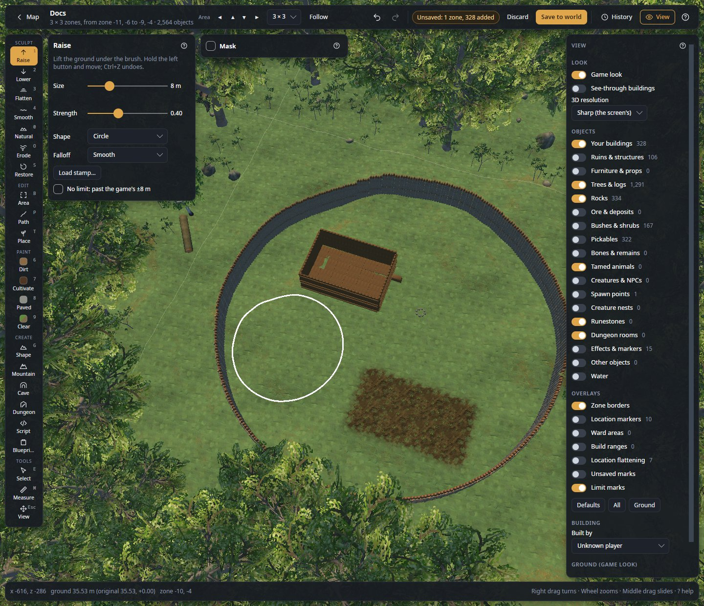
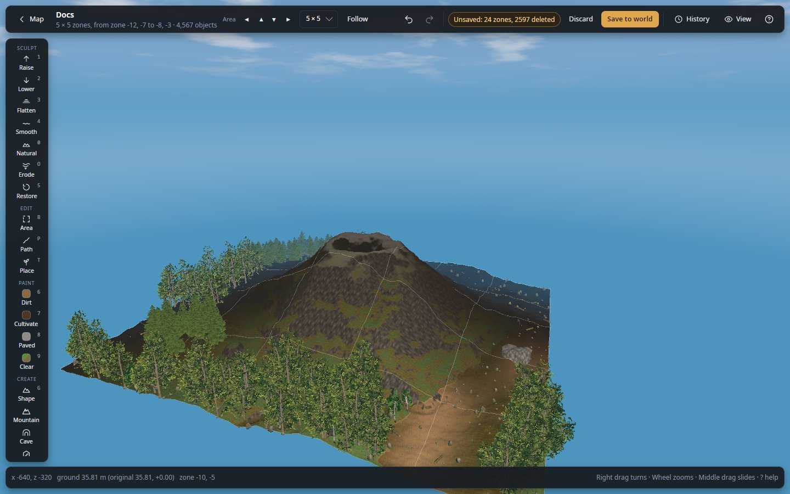
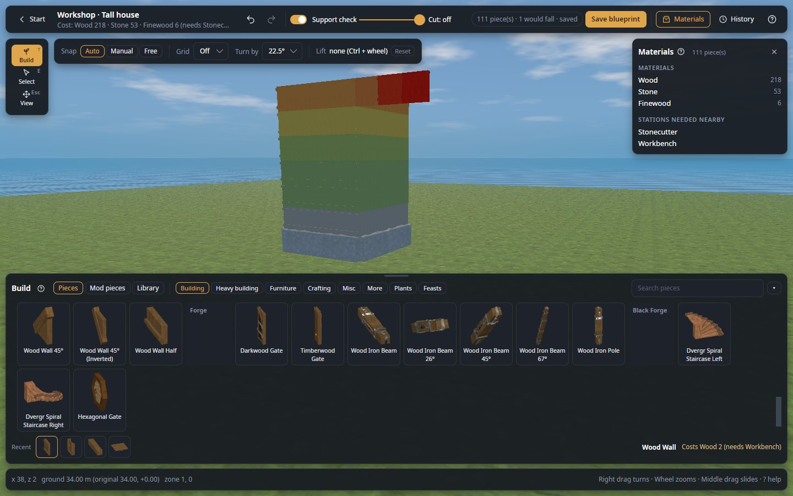
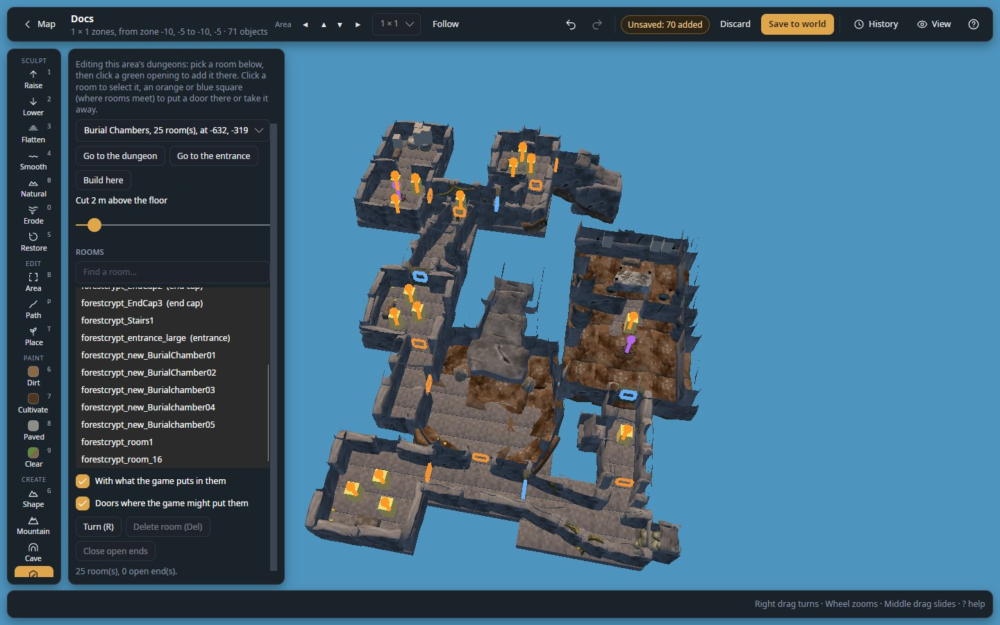
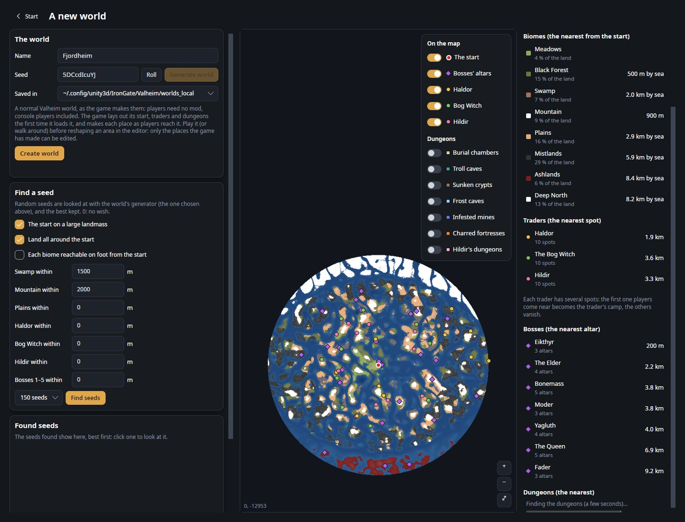
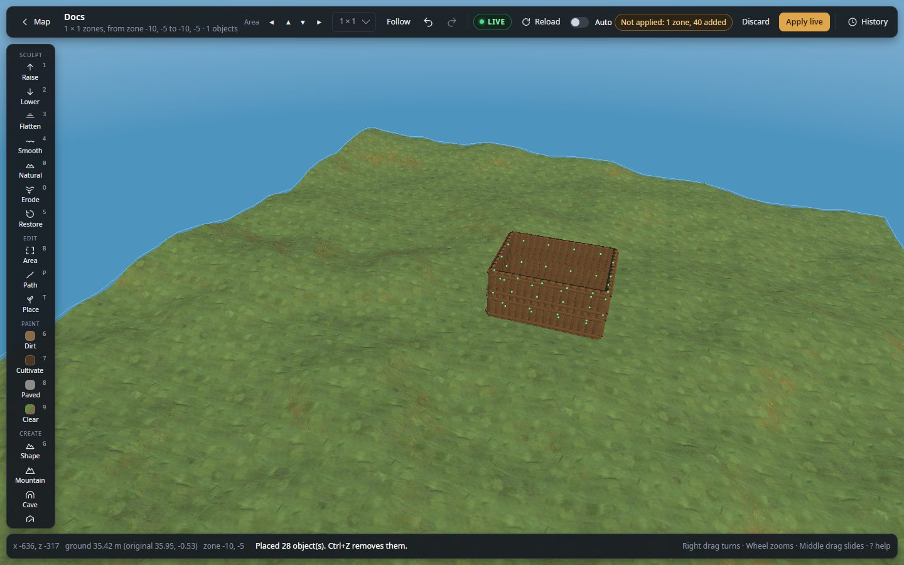
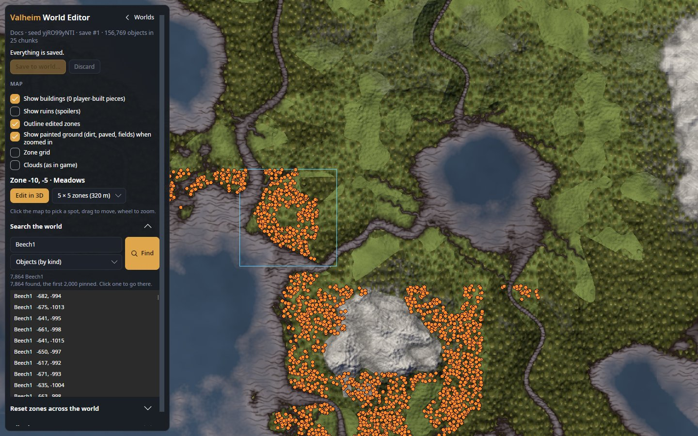
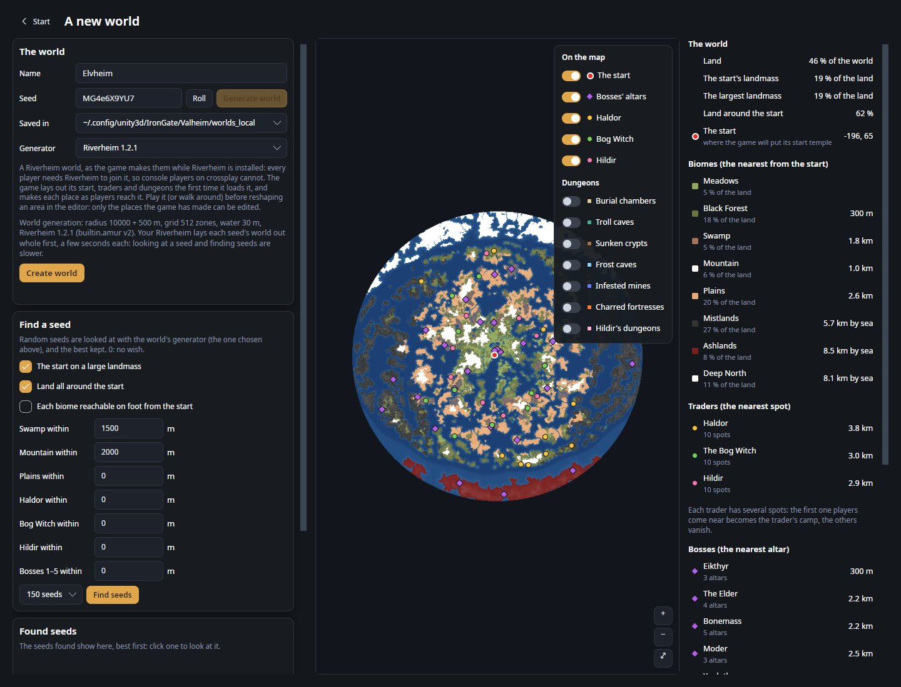

# Valheim World Editor

[](https://dl.circleci.com/status-badge/redirect/gh/Shuiei/valheim-world-editor/tree/main)
[](https://codecov.io/gh/Shuiei/valheim-world-editor)
[](https://github.com/Shuiei/valheim-world-editor/releases/latest)
[](https://scorecard.dev/viewer/?uri=github.com/Shuiei/valheim-world-editor)
[](https://www.bestpractices.dev/projects/15376)

**A world editor for Valheim, in the spirit of Minecraft's MCEdit, WorldEdit and WorldPainter:** open a world, saved
or running, in a 3D window drawn with the game's own terrain, textures and models; shape it, build, and save it back
or watch it change in game as you work. Free and open source.



## Download

| What | For | Where |
|---|---|---|
| **The editor** | Everyone: a program, not a mod. Windows, Linux, or macOS on Apple silicon (experimental). Unpack it and start it: nothing else to install, and it finds your Steam copy of Valheim by itself. | [GitHub releases](https://github.com/Shuiei/valheim-world-editor/releases/latest) · [Nexus Mods](https://www.nexusmods.com/valheim/mods/4348) |
| **WorldEditorBridge** | Live editing only: a BepInEx plugin for the game or server that hosts the world. Players who join need nothing. | [Thunderstore](https://thunderstore.io/c/valheim/p/Tie/WorldEditorBridge/) · [Hexium](https://valheim.hexium.gg/mods/Tie/WorldEditorBridge) · [Nexus Mods](https://www.nexusmods.com/valheim/mods/4348) · [GitHub releases](https://github.com/Shuiei/valheim-world-editor/releases/latest) |
| **Add-ons** | Worlds made or changed by some mods (see [Mods](#mods)). | [GitHub releases](https://github.com/Shuiei/valheim-world-editor/releases/latest) · [Nexus Mods](https://www.nexusmods.com/valheim/mods/4348) |

Use the plugin and add-ons of the same release as the editor. Step by step: [Install the editor](docs/start/install.md).

## What you can do

**Shape the land**

- **Sculpt and paint the ground** with brushes that raise, lower, flatten, smooth, erode, naturalize or restore it,
  and paint dirt, cultivated soil or paved stone ([Sculpt and paint](docs/terrain.md)).
- **Go past the game's ±8 m limit**: raise peaks, ridges, ranges, mesas and volcanoes in one click, or dig canyons.
  Players need no mod to see it, console players included ([Mountain](docs/mountain.md),
  [Ground limits](docs/concepts/ground-limits.md)).
- **Draw roads, ramps, rivers and caves** along a line ([Path](docs/path.md)); hills, craters, terraces or your own
  height formula in one click ([Shape](docs/shape.md)).
- **Keep any tool to some ground**: a biome, a height, a slope or a paint ([Mask](docs/masks.md)); measure distances
  and slopes ([Measure](docs/measure.md)).

**Fill and change the world**

- **Place anything the game has**, trees, rocks, crops, building pieces and spawn points, with a brush, along lines,
  in grids or over whole zones ([Place](docs/place.md)).
- **Select, move, turn, copy and delete** objects, whole buildings included ([Select](docs/select.md)).
- **Look inside objects and change them**: chest contents, sign texts, portal tags. **Search the whole world** for an
  object, an item in any chest, or a sign's text ([World map](docs/map.md)).
- **Work on a box or polygon at once**: level, clear, replace or regrow it, copy and paste it, or **restore it from a
  backup** to undo griefing without rolling the whole world back ([Area](docs/area.md)).

**Build, generate, create**

- **Build in the Workshop** with every piece of the hammer, cultivator and serving tray, with the game's snapping
  (Auto, Manual or Free), its support check, and a running bill of materials. Keep it as a
  [Homestead](https://thunderstore.io/c/valheim/p/sighsorry/Homestead/) blueprint to build in game, or paste it into
  any world ([Workshop](docs/workshop.md)).
- **Generate a whole dungeon** for any biome and style, with its monsters, loot and an optional boss behind a locked
  gate, or edit the game's own dungeons room by room ([Dungeons](docs/dungeons.md)).
- **See a seed's world before it exists**: biomes, the start, bosses' altars and traders; search many seeds for one
  with what you want near the start, then make the world ([A new world](docs/new-world.md)).

**Edit live, and undo anything**

- **Edit your own game or a dedicated server while people play**: apply your changes when you like, or turn on Auto
  and every stroke shows in game at once ([Live mode](docs/live-mode.md)).
- **Undo anything**, take out one change from the middle of the history, even after saving and closing the editor
  ([Saving and history](docs/concepts/saving-and-history.md)).

**For power users**

- **C# scripts** shape, paint and fill an area by rule, compiled by the editor itself ([Script](docs/scripting.md)).
- **Claude** (off by default) can shape, plant and build in the area you have open while you watch; what it does
  stays pending until you save ([Claude](docs/claude.md)).

| | | |
|---|---|---|
|  |  |  |
| A volcano, far past the 8 m limit | The Workshop and its support check | A dungeon of the game's own rooms |
|  |  |  |
| A seed's world before it exists | Live on a server while people play | Searching the whole world |

## Mods

**Building mods work without anything to set up.** Connected to a modded game, the editor learns the mods' pieces and
draws them with their own models; the Workshop's **Mod pieces** tab also reads the mods installed in your Valheim and
mod manager profiles, without a running game ([Modded games](docs/live-mode.md#modded-games)).

**Add-ons** teach the editor about mods that change how worlds are made or what they keep:

| Add-on | What it does |
|---|---|
| [Expand World](addons/ExpandWorld/README.md) | Wider or stretched worlds, other altitudes, custom biomes, rivers and locations: the ground, the map and the predictions follow the Expand World mods' settings and data. |
| [Riverheim](addons/Riverheim/README.md) | Opens and makes Riverheim worlds, drawn by your own copy of the mod. |
| [Tunnelheim](addons/Tunnelheim/README.md) | Draws its tunnels as the game rebuilds them, and adds a Tunnel tool: dig, bore, rooms, shafts, stairs. |
| [Railroads](addons/Railroads/README.md) | Draws track, stations and trains, and places, pastes and moves them as the game builds them. |
| [ValheimRAFT](addons/ValheimRAFT/README.md) | Draws ships and land vehicles whole, and moves, copies and deletes each as one. |


*A new Riverheim world, seen before it exists, with the Riverheim add-on.*

Each add-on reads the mod's own files and the data it keeps in a world: none holds a mod's code. Mod authors can tell
the editor more with a `worldeditor.json` file, or write an extension or add-on against the SDK:
[For mod authors](docs/modding.md).

## Quick start

1. [Install the editor](docs/start/install.md): download, unpack, start it.
2. [Back up a world](docs/guides/back-up-a-world.md), then follow [your first edit](docs/start/first-edit.md):
   raise a hill, plant trees, save, and see it in game.
3. Pick a way to edit on the start page: **My game** or **A dedicated server** (live), or **A saved world** with the
   game closed. In the editor, `F1` opens the help at the tool you are using.

## Documentation

The same documentation is in the editor (**Documentation** on the start page): start at
[docs/README.md](docs/README.md).

- **Getting started**: [Install](docs/start/install.md), [your first edit](docs/start/first-edit.md),
  [your first build](docs/start/first-build.md).
- **How-to guides**: one task each, from [editing your game live](docs/guides/edit-your-game-live.md) to
  [restoring an area from a backup](docs/guides/restore-from-backup.md). The list is in [docs/README.md](docs/README.md).
- **Tools**: [the editor window](docs/editor-basics.md), [the world map](docs/map.md),
  [sculpt and paint](docs/terrain.md), [Place](docs/place.md), [Select](docs/select.md),
  [the Workshop](docs/workshop.md), [live mode](docs/live-mode.md) and the rest.
- **How it works**: [saving and history](docs/concepts/saving-and-history.md),
  [ground limits](docs/concepts/ground-limits.md), [safety](docs/concepts/safety.md).
- **Help**: [troubleshooting](docs/help/troubleshooting.md), [questions](docs/help/faq.md),
  [shortcuts](docs/help/shortcuts.md), [glossary](docs/help/glossary.md).

What changed and when: [CHANGELOG.md](CHANGELOG.md).

## Safety

Nothing is written until you press **Save to world** or **Apply live** (or, live with **Auto** on, as you make each
change), and every offline save is read back and checked before the old one goes.

The plugin only listens on the computer it runs on and needs a secret token. Everything happens on your computer and
nothing is sent anywhere else, except what you let Claude see when you connect it (the area's data and pictures of the
view go to your Claude app).

Keep your own copy of a world you care about anyway: see
[Back up a world before editing](docs/guides/back-up-a-world.md). The details: [Safety](docs/concepts/safety.md).
Found a security problem? Report it privately, see [SECURITY.md](SECURITY.md).

## Stable and kept up to date

- **Tested on every change**: thousands of automated tests run on CircleCI at every push, the app's own drawing
  included, and the readers of world, blueprint and other files are fuzzed with millions of damaged inputs.
- **Released often**: new tools and fixes land in small releases, each written up in the [changelog](CHANGELOG.md).
- **Following the game and the mods**: a new version of a supported mod is checked on a server running it before the
  editor says it supports it; the changelog lists each one under **Mods**.

## Support

- **Bugs and ideas**: [open an issue](https://github.com/Shuiei/valheim-world-editor/issues), with the editor's log
  (**Open log** on the start page). See [The log and bug reports](docs/help/troubleshooting.md#the-log-and-bug-reports).
- **Questions**: [Questions](docs/help/faq.md) first, then an issue or the
  [Nexus Mods page](https://www.nexusmods.com/valheim/mods/4348).
- **Translations**: the editor is in English for now; a language is one JSON file
  ([Translating](docs/translating.md)).
- **Support the project**: [Buy Me a Coffee](https://buymeacoffee.com/tieboo).

## How it works

For the curious and for contributors; the full picture is in [docs/architecture.md](docs/architecture.md).

- **One program, nothing of the game inside.** .NET 10, an Avalonia window, the 3D view and the map drawn with OpenGL
  through Silk.NET. The game's models, textures, terrain shader and data tables are read at run time from the
  player's own Valheim install (AssetsTools.NET), never shipped.
- **The save format, read and written directly.** The world's chunked save (`_main.<n>.chunks`, the `.chunk` files of
  objects, `.db2`, `.fwl2`), kept in the save format each file had. Every save is written as a new save number, its
  `.ok` marker last as the game does, then read back and compared with what was meant before anything old goes.
- **The world generator, matching the game to the bit.** Written for the editor from the game's formulas (no Valheim
  code), down to Unity's random numbers and Perlin noise, so that edits sit exactly on the ground the game makes and a
  seed's world can be shown before it exists. Mods that change generation hook into it through add-ons.
- **Ground past ±8 m without a mod.** The game keeps edits within 8 m, but levels the ground under its locations
  without a limit. On save, the editor turns ground past the limit into **ground discs**, invisible locations of the
  game's own, and fits their heights to your shape: every player's game builds the same ground.
- **Live mode.** The WorldEditorBridge plugin (BepInEx, .NET Framework 4.7.2) answers HTTP on the host's own computer,
  with a token; the editor reaches a dedicated server through its own SSH tunnel. Each apply sends only what changed,
  so undo after applying works.
- **Extensible.** An SDK (netstandard2.0) for mods' editor extensions and add-ons, a `worldeditor.json` file for what
  a mod can simply declare, and an API for a mod's own plugin to take part in live mode
  ([For mod authors](docs/modding.md)). Scripts are compiled with Roslyn and run in a process of their own. Claude
  connects through an MCP server inside the editor, with a token, from this computer only unless you choose otherwise.
- **Checked and signed.** xUnit tests of the core and of the app (in Avalonia's headless mode, and drawing with
  OpenGL), fuzzing with SharpFuzz and libFuzzer, CodeQL, coverage on Codecov. The Windows program, the plugin and the
  add-ons are code-signed, and every release file carries a Sigstore signature.

## For developers

The program also opens a world or a live game from the command line:

```sh
ValheimWorldEditor "<world folder>"                                   # open that world's map
ValheimWorldEditor --live http://127.0.0.1:5182 --token <token>       # connect to a game (or WORLD_BRIDGE_TOKEN)
ValheimWorldEditor --world "<world folder or name>" --zone 3,-2       # straight into the 3D editor there
```

Build it from source with the .NET 10 SDK:

```sh
dotnet publish editor/Desktop/ValheimWorldEditor.Desktop.csproj -c Release -r linux-x64 --self-contained -p:PublishSingleFile=true -o ../ValheimWorldEditor
```

Use `-r win-x64` for Windows. `tools/release.sh <folder>` builds the complete release packages (the program and its
README; the Mac app signed ad hoc with [rcodesign](https://github.com/indygreg/apple-platform-rs), which `NO_MACOS=1`
leaves out); `tools/thunderstore.sh <folder>` the plugin's (`WorldEditorBridge-<version>.zip`). CircleCI runs the
tests on every push (the app's visual tests need a display; without one they skip, or leave them out with
`--filter-not-trait Category=Visual`):

```sh
dotnet test --project editor/tests/Core.Tests/Core.Tests.csproj -c Release
dotnet test --project editor/tests/Desktop.Tests/Desktop.Tests.csproj -c Release
```

Project layout, the documentation's pictures and the tests: [docs/development.md](docs/development.md). How the code
fits together: [docs/architecture.md](docs/architecture.md). Translating: [docs/translating.md](docs/translating.md).

## License

[MIT](LICENSE), © 2026 Thibault Bene. The repository holds none of Valheim's code: the world generator is written for
the editor, following the game's formulas. The data files read from the game remain Iron Gate's and are not covered:
see [NOTICE.md](NOTICE.md). Not affiliated with or endorsed by Iron Gate or Coffee Stain.
