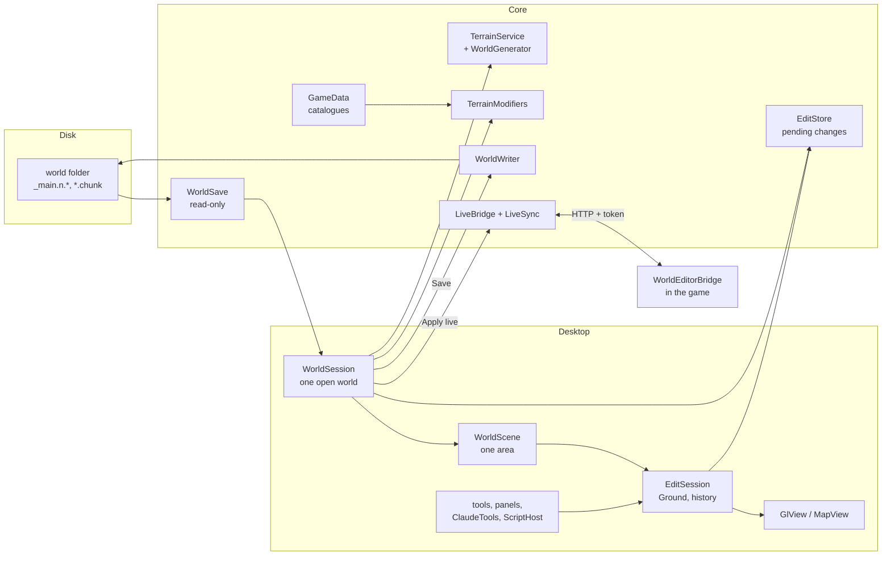

# Architecture

This page is for whoever changes the code, a person or an AI. It says how the parts fit, which rules
hold across files, and where a new feature goes. Building, CI, the game's files and releases are in
[development.md](development.md); this page links there instead of repeating it.

Files are named from the repository's root (`Core/Save/WorldWriter.cs`). Many comments in the code
still say "like the web editor's": the editor began as a page in the browser, which the native app
replaced. Tests from that time check that what it did still works (`KeysAndMouseTests`,
`ViewFeaturesTests`, `WebEditorFeaturesTests`, `WorldControlsTests`, `PrefsTests`, `SavedSelectionsTests`).

## The projects

| Project | Namespace(s) | What it owns |
|---|---|---|
| `Core/ValheimWorldEditor.Core.csproj` | `TerrainEditor.App`, `.Save`, `.Editing`, `.Terrain`, `ValheimGen` | Everything that is not the window: reading and writing saves, pending changes, the world generator, live mode's client, the game data read from Valheim, settings, blueprints, SSH. No Avalonia. |
| `Desktop/ValheimWorldEditor.Desktop.csproj` | `TerrainEditor.Desktop` | The program, `ValheimWorldEditor`: the Avalonia window, the pages, the 3D view and the map (OpenGL through Silk.NET), the tools and panels, the Script tool (Roslyn), the Claude MCP server (ASP.NET Core). |
| `plugin/WorldEditorBridge/` | `WorldEditorBridge` | The BepInEx plugin for live mode: `WorldEditorBridgePlugin.cs` (and `WorldEditorBridgePlugin.Catalogue.cs`, `.Models.cs` for `GET /catalogue`, `POST /models`), .NET Framework 4.7.2, inside the game. It shares no code with the editor, only a byte format and `VERSION`. |
| `tests/Core.Tests/` | `WorldEditor.Tests` | Core's tests (xUnit v3), laid out like `Core/`. |
| `tests/Desktop.Tests/` | `TerrainEditor.Desktop.Tests` | The app's tests, xUnit v3 with Avalonia's headless mode, laid out like `Desktop/`. |
| `tests/Support/` | `WorldEditor.Tests` | Helpers compiled into both test projects: the test world, the fixtures, a stand-in game. |
| `tools/WorldCheck/` | `TerrainEditor.WorldCheck` | Developer checks of the generator and the writer against the game (see [development.md](development.md#worldcheck)). |
| `tools/DocsScreenshots/` | `TerrainEditor.DocsScreenshots` | The pictures in `docs/images`, taken through the app's `--driver`. |

`Core/WorldGen/` has two namespaces: `ValheimGen` for the generator itself (`WorldGenerator*.cs`,
`GenMath.cs`, `UnityShim.cs`, `UnityNative.cs`, `FastNoise.cs`, `TerrainService.cs`, `MapData.cs`,
`SeedLocations.cs`, `DumpVerifier.cs`), and `TerrainEditor.Terrain` for what it is given from the
game's data (`TerrainModifiers`, `PrefabCatalog`, `PieceCatalog`, `PieceCost`, `CaveRocks`,
`ZdoKeys`). Core gives its internals to the app and the tests (`InternalsVisibleTo` in the csproj).

## A world from disk to the screen and back

A world is a folder in Valheim's chunked save format (world version 40 and up, the Deep North save):
`_main.<n>.chunks` (the index of chunk files), `XX_YY__<size>_<version>.chunk` (the objects, ZDOs),
`_main.<n>.db2` (generated zones, locations), `_main.<n>.fwl2` (name, seed) and `_main.<n>.ok`, the
marker the game writes last. The current save is the highest `<n>` that has its `.ok`; in a folder
where no save has one, the highest `<n>` with an index (`WorldSave.CommittedSave`). There is no reader for the older `.db`/`.fwl` worlds: `WorldSave.Load`
refuses a folder without a `_main.<n>.chunks`.

1. **Open.** `WorldSession.Open(dir)` (`Desktop/WorldSession.cs`) first makes sure the game data is
   there (`GameData.Ensure`, below), then `WorldSave.Load` (`Core/Save/WorldSave.cs`) reads the save.
   `WorldSave` is read-only: it keeps each object's prefab, position and where its bytes are
   (`ObjectRef`), the terrain data (`TCData`) of each zone, the locations and the zone list. The
   session then makes the `EditStore` (empty pending changes), the `TerrainModifiers` (how the
   world's locations flatten the ground) and the `TerrainService` (the generated ground). Live,
   `WorldSession.OpenLive` does the same from the plugin's snapshot (`WorldSave.LoadLive`).
2. **The map.** `Desktop/MapPage.cs` and `Desktop/MapView.cs` draw the world with the game's map
   shader from `Core/WorldGen/MapData.cs` (biomes, heights, the edits).
3. **An area.** `WorldScene.Load(owner, zx, zz, size)` (`Desktop/WorldScene.cs`) works out the
   generated ground of a square of zones in parallel (`TerrainService.BaseZone`), lays the saved and
   pending edits over it (`Core/Editing/HeightGrid.cs`), reads the objects in it (`ReadThings`) and
   makes the `EditSession` with a `Ground` (`Desktop/Ground.cs`: the arrays the game's `TerrainComp`
   keeps, over the whole block). `GlView` (`Desktop/GlView.cs`) draws it; `ModelStore` and
   `BundleModels` read the models from the game on worker threads. Besides the objects it draws
   what the save keeps no object for: dungeon rooms (`DungeonRooms`, from their dungeon's data)
   and the parts of locations the game makes again from a location proxy (`LocationParts`).
4. **Edit.** Tools call `EditSession` (`Desktop/EditSession.cs`): `BeginStroke` / `StrokeStep` /
   `EndStroke` for brushes, `EditGround`, `Commit`, `Delete`, `Move`. Each makes one `Change` on the
   undo list (at most `HistoryLength`, 200) and sends the touched zones to the `EditStore` as
   `ZoneEdit`s (`Core/Editing/EditStore.cs`). Objects are pending too: deleted ids, `NewObject`s
   (negative ids from `WorldSession.NextId`) and `ZoneReset`s. Nothing is written yet.
5. **Save.** `WorldSession.Save` refuses at once when the game saved the world since it was read
   (`WorldWriter.Newer`), turns No limit ground into ground discs (`Core/Editing/Uplift.cs`), then
   calls `WorldWriter.Save` (`Core/Save/WorldWriter.cs`), which writes the next save and reads it
   back (below). After zone resets or new discs the world is read again and the history starts over;
   otherwise the world stays open, the changes are marked applied and the history goes to disk
   (`Desktop/HistoryFile.cs`, in `history/` of the data folder).
6. **Leave.** `WorldSession.Dispose` prunes the folder down to the latest save (`WorldWriter.Prune`)
   and closes the live connection.

The Workshop (`Desktop/Workshop.cs`, `Desktop/MainWindow.Workshop.cs`) is an `EditSession` over a
plot that is no world: it has nothing to save; its building becomes a Homestead blueprint
(`Core/App/Homestead.cs`, `Core/App/BlueprintStore.cs`).

## Main types by area

| Area | Types | Notes |
|---|---|---|
| Start and pages | `Program`, `Options`, `App` (`Desktop/Program.cs`), `MainWindow` (+ `.Editor`, `.Workshop`, `.Dungeon` partials), `StartPage`, `MapPage`, `NewWorldPage`, `SettingsDialog` | `MainWindow` holds the pages and the 3D editor: top bar, tool rail (`ToolPanel`, `ToolMode`), the right-hand panels, keys. |
| 3D view | `GlView`, `GlObjects`, `Shaders`, `GameLookGl`, `ModelStore`, `BundleModels`, `LocationParts`, `Picking`, `Overlays`, `Gizmo` | OpenGL 3.3 or ES 3.0; objects drawn instanced. The view mirrors z (Unity is left-handed): see the comment at the top of `WorldScene`. |
| Open world | `WorldSession`, `WorldScene`, `EditSession`, `Ground`, `HistoryFile` | One `WorldSession` per open world, one `WorldScene` + `EditSession` per open area. |
| Tools | `Sculpt`, `Erosion`, `Mountain`, `PathTool`, `AreaTool`, `PlaceTool`, `SelectTool`, `MeasureTool`, `DungeonTool`, `Mask`, `Formula`, each with its `*Panel` | A tool works on the `EditSession`; its panel is a card next to the rail. |
| Save | `WorldSave`, `ValheimReader`, `WorldWriter`, `WorldCreator`, `ZdoTools`, `ZdoData`, `InventoryData`, `ChunkMath` (`Core/Save/`) | Byte formats follow the game's `ZPackage`. |
| Pending changes | `EditStore`, `ZoneEdit`, `NewObject`, `ObjectField`, `ZoneReset`, `HeightGrid`, `Uplift` (`Core/Editing/`) | `EditStore` takes its own lock: strokes and buttons use it from different threads. |
| Building, dungeons | `Hammer`, `Stability`, `Dungeons`, `DungeonGen`, `DungeonPlan`, `DungeonDresser` (`Core/Editing/`) | The hammer's snapping, the support check and the room joining, from the game's data. |
| Mods' objects | `ObjectLinks`, `LinkRule`, `LinkSet`, `ObjectLink`, `LinkIndex` (`Core/App/ObjectLinks.cs`), `ModKeys`, `ModManifests`, `ModCatalogue` (`Core/App/`) | Objects mods link into one (below); mods' data names, manifests and prefabs. |
| Game data | `GameLook`, `GameBundles`, `GameData`, `GameCatalogues*`, `GameLocations`, `GameTextures`, `Crunch`, `GameShader`, `TerrainShader` (`Core/App/`) | Below. |
| Live | `LiveBridge`, `LiveSync` (`Core/Save/`), `Tunnel`, `ServerConfig`, `LocalGame` (`Core/App/`) | Below. |
| Claude, scripts | `ClaudeServer`, `ClaudeTools`, `ClaudeBuilder`, `ClaudeGuide`, `ClaudeRelay`, `ScriptHost`, `ScriptApi.csx` (`Desktop/`) | Below. |
| Remembered | `AppSettings` (`settings.json`), `ServerConfig` (`servers.cfg`), `Prefs` (`prefs.json`), `PlaceMemory`, `Stamps`, `SavedSelections`, `Places` | All in the data folder (`AppSettings.UserDataDir`), pointed elsewhere by `--data` and by the tests. |

### Threads

- **The window's thread** owns the controls and the scene's objects: "Objects are changed on the
  window's thread only" (`EditSession`). `ClaudeTools` runs every call there (`OnUi`), as a click.
- **The drawing thread** (`GlView`) runs brush strokes: `EditSession` takes its lock for everything,
  and `EditStore` has its own.
- **Workers** read models (`ModelStore`), generate ground (`Parallel.ForEach` in `WorldScene.Load`),
  run scripts (`ScriptHost.Run`) and talk to the network. Their results come back to the window's
  thread before they touch the scene.

## Game data comes from the player's Valheim

The repository and the release packages hold nothing of the game: no models, textures, shaders, and
no data tables. Everything is read at run time from the player's install:

- `Core/App/GameLook.cs` finds Valheim and keeps the one bundle reader, `Core/App/GameBundles.cs`
  (AssetsTools.NET, with an index cached in `game-index.json`).
- `Core/App/GameData.cs` lists each kind of data the editor needs (`terrain-modifiers`, `prefabs`,
  `pieces`, `piece-support`, `piece-place`, `zdo-keys`, `cave-rocks`, `piece-cost`, `vegetation`,
  `dungeon-rooms`): how it is read, who takes it (`TerrainModifiers.Use`, `PrefabCatalog.Use`…) and
  how its test copy is trimmed. Each is cached as `game-<kind>.json` until the game's files change.
  Most are read in one pass over the bundles (`GameCatalogues.ReadAtStart`, the `AtStart` list); the
  others have their own reader.
- Without them no world or Workshop opens (`WorldSession.NeedGame`, `GameData.Missing`).
- Mods' prefabs are not in the game's files: `Core/App/ModCatalogue.cs` keeps those a live game
  reported (`GET /catalogue`, `mod-catalogue.json` in the data folder), and `GameData` lays them
  over `prefabs`, `pieces` and `piece-cost` each time it uses those kinds (the game's own entries
  win; entries not in the editor's format are left out, and should the merged data still fail, the
  game's own is used alone). `GameData.AddMods` takes a new report and uses the kinds again.
- Mods' manifests: `Core/App/ModManifests.cs` reads every `worldeditor.json` in the plugins folders
  (docs/modding.md, docs/worldeditor.schema.json) as a world or the Workshop opens
  (`WorldSession.ReadModFiles`): data labels, read-only flags and help for `InspectorPanel`, hidden
  prefabs left out of `PlacePanel` and `BuildPanel`, groups for the Mods tab.
- Mods' data names: `Core/App/ModKeys.cs` reads the string literals of every DLL in the plugins
  folders (`GameCatalogues.KeyNamesIn`, as `zdo-keys` reads `assembly_valheim.dll`), keeps them in
  `mod-zdo-keys.json` (user data folder) until a DLL changes, and gives them to `ZdoKeys.UseMods`;
  the game's own names come first. `WorldSession.NeedGame` refreshes them as a world opens.
- Mods' models: `Desktop/BundleModels.cs` draws a mod prefab from `ModCatalogue.ModelOf` (what the
  game reported, `POST /models`), finding each part's mesh and material by name (`GameBundles.Named`,
  a names index over a bundles folder kept as `<index>-names.json`) in the mods' bundles first, then
  the game's; same-named meshes are told apart by their bounds (`GameBundles.BoundsOf`) and vertex
  count, Unity's built-in Cube, Quad and Plane (in no bundle) are made (`BundleModels.PrimitiveMesh`,
  ids starting "~"), and a mod's placeholder material (`JVLmock_`/`_REPLACE_` names, Jötunn mock
  shaders) gives way to the game's. Compressed meshes are unpacked (`GameBundles.ReadCompressedMesh`);
  crunched textures (formats 28, 29: one crn file holding every level) are unpacked to DXT1 or DXT5
  blocks by `Core/App/Crunch.cs` (a port of crunch's decoder, Unity's format; `GameBundles.LoadTexture`
  picks the level, `GameTextures.Rgba` decodes it as any DXT one). `Core/App/ModBundles.cs` copies the
  mods' bundles (files of their own, or manifest resources of their DLLs starting "UnityFS"; LZMA
  ones packed again as LZ4) from the plugins folders `LocalGame.BepInExFolders` lists into
  `mod-bundles` (user data folder), read by a second `GameBundles`. Ids in the mods' bundles start
  with "+".
- The tests run without Valheim on trimmed copies in `tests/fixtures/<kind>.json`
  (`GameData.UseCopies`; the driver's `gamedata <folder>`), made again after a game update with
  `ValheimWorldEditor --export-test-data tests/fixtures`. Those copies are the game's data:
  `NOTICE.md` lists them.

The kinds and the readers are described in [development.md](development.md#the-games-files).

**No decompiled game code.** The game's logic the editor needs (the generator, the location layout,
the hammer, support, vegetation) is written for the editor, in its own structure and names, keeping
the formulas and the order of random draws. Reading decompiled code to understand it is fine;
committing it, or a near copy, is not (see the README's License and `NOTICE.md`). Comments name the
game's method a piece of code follows (`Heightmap.ApplyModifiers`, `WearNTear.UpdateSupport`), so
the next person knows what to compare with after a game update.

## The world generator matches the game to the bit

`Core/WorldGen/WorldGenerator*.cs` makes a world from its seed as the game does: to the bit, but for 8 of
the 3000 heights the reference test samples, all in the Deep North and less than a millimetre off
(floating point done in another order than the game's runtime; `WorldGeneratorReferenceTests`). The ground under
every saved edit is "generated height + location flattening + edit", so a generator that is off by
a float's last bit puts the edits at the wrong height, and seams show where the editor's ground meets
the game's. So:

- **Keep the arithmetic as it is.** Where the game works in float or double, where it rounds back
  to float, the `+ 0.0` that turns `-0` into `0`, the order of operations: each is there on purpose
  (`GenMath.cs`, `UnityShim.cs`, `UnityNative.cs`: Unity's `Random` (Xorshift128) and
  `Mathf.PerlinNoise` written to match the engine's machine code). A "simplification" that the
  compiler takes as the same maths may not give the same bits.
- **Keep the order of random draws.** One draw added, removed or moved changes every river.
- **The analyzers' fixes count.** A code-style fix in `Core/WorldGen/` is a change to the maths:
  `.editorconfig` already turns off the rules (CA1051, CA1708, CA2231) that would change the Unity
  stand-ins' public fields, names and operators in `UnityShim.cs` and `UnityNative.cs`.
- **Check.** `WorldGeneratorReferenceTests` compares Unity's random numbers, Perlin noise, 3000 heights and
  biomes, eight whole zones and the water's count with values recorded in the game
  (`tests/fixtures/worldgen-reference.txt`, seed `5DCcdIcuYJ`); any change that moves away from the
  game fails there. `MapDataTests`, `TerrainModifiersTests` and `UnityShimTests` cover the map,
  the flattening and the helpers. For a refactor, also compare `WorldCheck look <seed> <metres>` (and
  `verify` against a dump, where you have one) before and after: the output must be identical.
- **Thread-safety.** The game has one static generator; the editor has one per world
  (`WorldGenerator.Create`), and several worlds, maps and Regrow can generate at once. Unity's
  `Random` state is `[ThreadStatic]`, and the generator's per-call caches are `[ThreadStatic]` fields
  keyed by the generator's own `_number` (`WorldGenerator.Ground.cs`, `WorldGenerator.Biomes.cs`);
  longer-lived caches are instance `ConcurrentDictionary`s (`TerrainService`, `MapData`). A new
  static field in the generator must follow one of those patterns. `WorldGeneratorConcurrencyTests` checks
  that a second world leaves the first one's rivers alone and that generators made at once agree.

CodeRabbit is told the same for `Core/WorldGen/**` (`.coderabbit.yaml`).

## Live mode

The editor and the game talk over HTTP on the game's computer, `127.0.0.1:5182` by default, with a
token in the `X-Bridge-Token` header. For a dedicated server the editor opens its own SSH tunnel
(`Core/App/Tunnel.cs`, SSH.NET); for the player's own game it reads the plugin's port and token from
`BepInEx/config/Tie.WorldEditorBridge.cfg` (`Core/App/LocalGame.cs`). Users' side of it is in
[live-mode.md](live-mode.md).

| Side | Owns |
|---|---|
| Plugin, `plugin/WorldEditorBridge/WorldEditorBridgePlugin.cs` (and `.Catalogue.cs`, `.Models.cs`) | Listening, the token, refusing when the game does not host the world (409) or has no world (503). Every request is queued and run on Unity's main thread (`OnMainThread`, a few per frame in `Update`); a job the caller gave up on never runs later. Creating and destroying ZDOs, terrain, zone resets, in the game. |
| Editor, `Core/Save/LiveBridge.cs` | The HTTP client: one method per endpoint. |
| Editor, `Core/Save/LiveSync.cs` | What the game already has: which world objects are destroyed there, and the live ZDOID of each object the editor created. Each apply sends only the difference, so undo after apply works (a deleted object comes back from its snapshot bytes; a placed one is destroyed). |
| Editor, `Desktop/WorldSession.cs` | `ApplyLive` (one at a time: ground, then objects, then resets, after which the world is read again), and following the game (`FetchGame` off the window's thread, `MergeGame` on it). |

The endpoints (the plugin's header comment lists them with their byte layouts):

| Endpoint | What |
|---|---|
| `GET /status`, `GET /players` | JSON: plugin version and world; players and their positions. |
| `GET /snapshot` | The whole persistent world, gzip: `VWEB`, a snapshot version, world info, zone data, every object in the chunk files' format. `WorldSave.LoadLive` refuses another version. |
| `POST /terrain` | Zones' new `TCData` (`WorldWriter.EncodeTerrain`, the game's `TerrainComp.Save` format). |
| `POST /objects` | Objects to destroy (ZDOID) and to create (save bytes); answers the new ZDOIDs, and how many were refound at their place after another mod made them again. |
| `POST /zones/reset` | Zones to generate again. |
| `POST /watch`, `POST /zone` | One digest per zone; the objects of the zones whose digest changed (the editor asks every 2 s). |
| `POST /models` | Prefab names, one per line: JSON, what the game draws of each (each renderer's mesh name and vertex count, submesh, material name, matrix in the root's frame, the root's scale; LOD 0, active, not the worn and broken looks). `WorldSession.OpenLive` asks it for the mod prefabs; `ModCatalogue.TakeModels` keeps them. On a dedicated server (no graphics) the game has no textures or colours to report, so only names. |
| `GET /catalogue` | JSON: every prefab with a ZNetView the game knows, mods' too, in GameData's formats (prefabs, pieces, piece-cost) and the mod of each (Jötunn's `ModQuery`, when installed). `WorldSession.OpenLive` hands it to `GameData.AddMods`; `ModCatalogue` keeps the ones that are not the game's own in `mod-catalogue.json` (data folder) and lays them over the game's data (the game's entries win). |

Changing the protocol means changing both sides in one pull request, under one `VERSION`. An
editor meets older plugins in the wild: a missing endpoint answers 404, and the editor says the
plugin is too old instead of failing (`LiveBridge`). Keep old endpoints and fields working, and add
a `### WorldEditorBridge` part to the version's `CHANGELOG.md` section. Tests use a stand-in game
(`tests/Support/FakeGame.cs`, `LiveBridgeTests`, `LiveTests`, `LiveFollowTests`); CI never runs
the real plugin, so test it in a local game or a local server.

**The plugin is Unity code.** Unity calls `Awake`, `Update` and `OnDestroy` by name: they look unused
to the analyzers (IDE0051), and `dotnet format` deleted them once; they carry a `SuppressMessage`
saying so. Unity's `== null` also catches destroyed objects, so it must not become `?.` or `is null`
(the `#pragma warning disable IDE0031` around those lines). If you add Harmony patches, their
parameters are found by name (`__instance`, `__result`). The plugin's csproj points its `HintPath`s
at a local BepInEx and the game's `Managed` folder; CI does not build it.

## Claude and scripts

**Scripts** (`Desktop/ScriptHost.cs`, user docs in [scripting.md](scripting.md)): the user's C#
(top-level statements) is compiled in the app with Roslyn against the API in `Desktop/ScriptApi.csx`
(`Area`, `Ground`, `Objects`, `Noise`, `Rnd`, `Print`), run on a worker over a snapshot of the area,
and its changes go in afterwards as one undo step, on the window's thread. A script that fails
changes nothing. It is not a sandbox: a script runs with the editor's rights, like any program the
user runs.

**Claude** (`Desktop/ClaudeServer.cs`, `Desktop/ClaudeTools.cs`, user docs in [claude.md](claude.md)):
an MCP server inside the editor, on when Settings → Claude says so. It listens on `127.0.0.1` only
(port 5731 by default), answers only a request with `Authorization: Bearer <token>` and a local
`Host`, which keeps web pages out. `--mcp-stdio` (`Desktop/ClaudeRelay.cs`) relays stdin/stdout to it
for clients that start a program. The tools (each a `[McpServerTool]` method in `ClaudeTools`) look
at what is open and change it as the user would, through the same code: `run_script` goes through
`ScriptHost`, `place_pieces` through the `Hammer`, `support_check` through `Stability`.

Its safety rule is **pending only**:

- No tool saves a world, applies live or saves a blueprint; every change is one history step whose
  label starts with `Claude:`, which `HistoryPanel.ByClaude` uses for **Take back Claude's
  changes**. (A dungeon generated on the plot is kept in the library, as the Workshop's own button
  does.)
- `ClaudeTools.CannotEdit` refuses changes when nothing is open, or when the world is live with Auto
  on (each change would reach the game at once). `open_world` is refused over unsaved changes.
- A new tool keeps to this: call `CannotEdit` first, make its change one labelled step, never call
  `Save`, `ApplyLive` or the blueprint store's writes. `ClaudeToolsTests` checks the rules.

`ClaudeGuide.cs` holds what Claude is told when it connects and the building guide. The skill in
`.claude/skills/valheim-build` uses the tools' names and the script API (`scripts/lib.cs`): renaming
either breaks it, the user's own scripts and the docs.

## Rules that no single file shows

**Save safety** (`Core/Save/WorldWriter.cs`, header comment):

- A save is always a new save number. Changed chunk files are written under a new version, then the
  index, `.db2` and `.fwl2`, and the `.ok` marker last, as the game does.
- The new save is read back and compared with what was meant (`WorldWriter.Verify`): one object lost
  or gained, a zone not asked for changed, and the new files are removed. Nothing of the old save is
  touched before the read-back passes.
- The save the world was opened from stays while it is open (`Options.KeepBase`): each save is made
  from it with every change since, and the session's previous save is dropped (`Options.Drop`). Only
  on leaving is the folder pruned to the latest save.
- A newer committed save than the one the editor knows (the game saved meanwhile) blocks the save
  before anything changes (`WorldWriter.Newer`, `SaveSafetyTests`).
- A zone reset never clears players' tombstones (`WorldWriter.TombstonePrefab`).
- The writer makes no backup folder. `Core/App/Backups.cs` only finds the game's (`_backup_auto-…`)
  and older editors' backups, to restore an area from one.
- Ground edits are clamped as the game clamps them (`EditStore.MaxLevel`, ±8 m); beyond that only
  through `Uplift`'s ground discs (`EditStore.MaxLift`).
- Settings and servers are written through `Core/App/SafeFile.cs` (temporary file, then moved over).

**Objects mods link into one** (`Core/App/ObjectLinks.cs`, user docs in
[select.md](select.md#linked-objects-ships-and-other-mods-groups), mod authors' in
[modding.md](modding.md#linked-objects)): nothing in the code knows a mod. A `LinkRule` comes from the `links` of a
mod's `worldeditor.json` (`ModManifests`; the editor ships none for any mod, its tests give their example mod's through
`ModManifests.Base`); it names the data keys of an object's id, of what a part hangs on, of its offset and turn in that
one's frame, of other ids a copy rewrites and of values a copy leaves out, and whether the game saves parts at their
root or where they are drawn. `WorldSave.Links` keeps each object's
`ObjectLink`, read by the rules in use as the world was read (the manifests are read before; its whole stored turn
too: `Pieces` keep only the turn about y); `LinkIndex` is the groups as they are now (saved objects not deleted, and
`NewObject`s through `ObjectLinks.LinkOf`), giving a part's `Pose` and a group's `Group`. Only the drawn place
changes: `WorldScene.Placed` gives a `Thing` its pose (in `ReadThings`, `FindThings`, and `EditSession.PlaceLinked`
after every change of things), while `ObjectRef.Position` and `NewObject.Position` stay the stored ones (live
refinding, zones, the writer). A part never moves alone (`EditSession.WholeGroupMoves` in `Transform`;
`EditSession.WithLinked` for the Select tool, copies, Claude's tools); a pasted copy gets new ids with every
reference rewritten (`ObjectLinks.Remap`): two groups under one id would share their parts in the game.

**Names that are file formats.** Some names are read back from files or by other programs; renaming
them in a refactor loses users' data or breaks a client:

- `AppSettings` properties (`settings.json`, `System.Text.Json` by property name), `PlaceMemory`'s,
  the records in `Stamps` and `SavedSelections`, and the keys `Prefs` binds (`prefs.json`).
- The keys in `servers.cfg` (`ServerConfig`) and the plugin's settings (`Http`/`BindAddress`, `Port`,
  `Token`; its GUID `Tie.WorldEditorBridge` names the file).
- The game-data JSON (`game-<kind>.json` and `tests/fixtures/<kind>.json`, written by
  `Core/App/CatalogueJson.cs` in a fixed form); `HistoryFile`'s binary layout (`VWEH` and its
  `Version`: raise it when the layout changes).
- Blueprint formats of other mods (Homestead and PlanBuild `.blueprint`, `.vbuild`:
  `Core/App/BlueprintFormats.cs`, `Core/App/Homestead.cs`), and the clipboard's copy format.
- The driver's commands and its `@@ ok` JSON (tests and `tools/DocsScreenshots`), MCP tool and
  parameter names, and `ScriptApi.csx` (above).
- The game's own names and hashes: ZDO keys are `StableHash.Of("<name>")` of the game's strings
  (`ObjectField.CreatorKey`), prefab names, `ZPackage` layouts. They are the game's, not ours.

**Code style.** `Directory.Build.props` turns on the .NET analyzers (`latest-recommended`), the
code style of `.editorconfig` in the build, and Roslynator, with every warning an error, for every
project. CI's `code-analysis` job builds the app with `-warnaserror` and runs `dotnet format
whitespace` and `style` with `--verify-no-changes` on Core and Desktop. .NET community style: four
spaces, Allman braces, file-scoped namespaces, `_camelCase` private fields, PascalCase constants and
static readonly fields. Review what `dotnet format` changes before you keep it (the plugin and the
generator above). A commit that only reformats goes in `.git-blame-ignore-revs`.

**One version.** `VERSION` is the only version number: `Directory.Build.props` makes it the
assemblies' version and `BuildInfo.Version` for the app and the plugin, and the packages are named
after it. `VersionTests` checks `CHANGELOG.md` has its section. Steps in
[development.md](development.md#versions).

## Where a change goes

| To add | Where | Then |
|---|---|---|
| A tool | A value in `ToolMode` (`Desktop/ToolPanel.cs`) and its rail button there; `<Name>Tool.cs` for the mouse (wired in `GlView`, like `Tape` for Measure) and `<Name>Panel.cs` with its `Card`, built and added to the tool column in `MainWindow.cs`, shown when its mode is on. Changes go through `EditSession` (`Commit`, `EditGround`…) so they are pending and undoable. | A tip for each control in `Desktop/Tips.cs` (`TipsTests` fails otherwise); `<Name>ToolTests` and `<Name>PanelTests` files; a `docs/<tool>.md` page and the README's table. |
| A Claude tool | A `[McpServerTool]` method in `Desktop/ClaudeTools.cs`, run through `OnUi`, `CannotEdit` first. | `ClaudeToolsTests`; the table in `docs/claude.md`. |
| A script API member | `Desktop/ScriptApi.csx` (and what it calls in `ScriptHost`). Add, do not rename. | `ScriptHostTests`; `docs/scripting.md`. |
| A kind of game data | A reader in `Core/App/GameCatalogues*.cs` (an `IStartScan` in the one pass when it is in the bundles, listed in `AtStart`), a `Kind` line in `GameData.Kinds` with its `Use` and trim, and the type that takes it (often in `Core/WorldGen/`, namespace `TerrainEditor.Terrain`). | `--export-test-data tests/fixtures` for its copy; `NOTICE.md`; the list in `docs/development.md`; a test in `tests/Core.Tests` reading the copy. |
| A value of an object (a chest, a sign) | `ObjectField` on `NewObject`, read and written through `ZdoData` (`Core/Save/ZdoData.cs`) and `ObjectData` (`Core/App/ObjectData.cs`); item formats in `InventoryData`, `StandData`. | `ObjectDataTests`, `ZdoDataTests`; check the bytes against the game's with `WorldCheck objects`. |
| Something saved with the world | `WorldWriter.Save` writes it, and `WorldWriter.Verify` must check it read back; `WorldSave` reads it. Live, the same change needs its endpoint in the plugin. | `WorldWriterTests`, `WorldWriterCheckTests`, `WorldSaveIntegrityTests`, `SaveSafetyTests`; `WorldCheck selftest-save` on a copy. |
| A remembered choice | A `Prefs` bind where the control is made; a setting in `AppSettings` (with the Settings dialog). | `PrefsTests`, `SettingsDialogTests`. |

### Which tests cover what

The tests are laid out like the code: a test class per file, named after the file it tests
(`Core/Save/WorldWriter.cs` → `tests/Core.Tests/Save/WorldWriterTests.cs`, `Desktop/PlaceTool.cs` →
`tests/Desktop.Tests/PlaceToolTests.cs`). Several classes for one file say what they look at
(`PlaceToolMouseTests`, `PlaceToolEdgeTests`, `WorldWriterCheckTests`).

| Files | Cover | CI job |
|---|---|---|
| `tests/Core.Tests/{App,Editing,Save,WorldGen}/` | Core without a window, file by file: saves (`WorldSave*`, `WorldWriter*`, `ValheimReader`, `ZdoData`), the generator (`WorldGenerator*`, `MapData`, `TerrainModifiers`), live mode against a stand-in (`LiveBridge`), the game's files read without the game (`GameBundles`, `TerrainShader`), dungeons, the hammer, support, blueprints, the SSH tunnel (`Tunnel`, a real local `sshd`) | `core-tests` |
| `tests/Core.Tests/Integration/` | Core across files: the home folder (`HomeFolderTests`), the shared data on the test world (`AppDataTests`), the save's small parts; the real game's terrain and map (`GameFilesTests`, `Category=Game`, not in CI: needs Valheim) | `core-tests` |
| `tests/Desktop.Tests/*Tests.cs` | One tool, panel, page or part of the app, with real mouse and key events (`PlaceToolTests`, `AreaPanelTests`, `StartPageTests`, `ClaudeToolsTests`, `ScriptHostTests`, `WorkshopTests`…) | `app-tests` |
| `tests/Desktop.Tests/Integration/` | The window's workflows end to end (`WindowFlowTests`, `PagesTests`, `SaveSafetyTests`, `StartupTests`, `LiveTests`, `LiveFollowTests`), what the old web editor did (`KeysAndMouseTests`, `ViewFeaturesTests`, `WebEditorFeaturesTests`, `WorldControlsTests`), `VERSION` | `app-tests` |
| `tests/Desktop.Tests/Integration/*VisualTests.cs` (`Category=Visual`) | The real app over `--driver`, drawing with OpenGL | `app-tests` (on a virtual screen) |

Helpers are in `Support/` folders: each project's own, and `tests/Support/` for both. Tests never
touch the user's files: `TestFiles` (`tests/Support`) and `TestApp` (the app's) point every path at
temporary ones; tests that change the environment go in the `DataDir` collection. Each test works on
its own copy of `tests/fixtures/CITest` (`TempWorld`, `Fixtures.CopyFixture`). How to run them, and
what CI leaves out: [development.md](development.md#tests).
