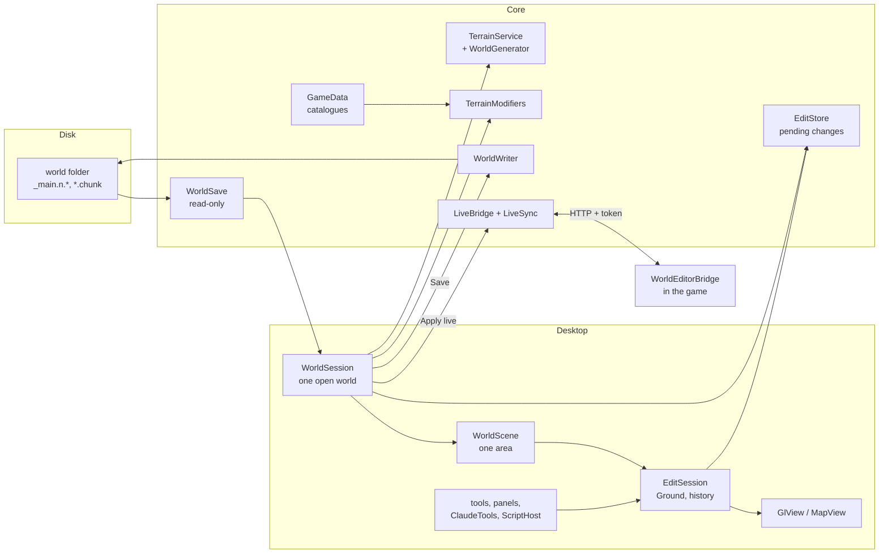

# Architecture

This page is for whoever changes the code, a person or an AI. It says how the parts fit, which rules
hold across files, and where a new feature goes. Building, CI, the game's files and releases are in
[development.md](development.md); this page links there instead of repeating it.

Files are named from the repository's root (`editor/Core/Save/WorldWriter.cs`). Many comments in the code
still say "like the web editor's": the editor began as a page in the browser, which the native app
replaced. Tests from that time check that what it did still works (`KeysAndMouseTests`,
`ViewFeaturesTests`, `WebEditorFeaturesTests`, `WorldControlsTests`, `PrefsTests`, `SavedSelectionsTests`).

## The projects

| Project | Namespace(s) | What it owns |
|---|---|---|
| `editor/Core/ValheimWorldEditor.Core.csproj` | `TerrainEditor.App`, `.Save`, `.Editing`, `.Terrain`, `ValheimGen` | Everything that is not the window: reading and writing saves, pending changes, the world generator, live mode's client, the game data read from Valheim, settings, blueprints, SSH. No Avalonia. |
| `editor/Desktop/ValheimWorldEditor.Desktop.csproj` | `TerrainEditor.Desktop` | The program, `ValheimWorldEditor`: the Avalonia window, the pages, the 3D view and the map (OpenGL through Silk.NET), the tools and panels, the Script tool (Roslyn), the Claude MCP server (ASP.NET Core). |
| `sdk/ValheimWorldEditor.Sdk/ValheimWorldEditor.Sdk.csproj` | `ValheimWorldEditor.Sdk` | What mods' editor extensions are built against (netstandard2.0): `IWorldEditorExtension`, `IExtensionRegistry`, the hooks' interfaces, `IObjectView`, `Shape`. Only what the editor hands over, nothing of the editor; Core references it, and extensions load against the editor's copy. Released as `ValheimWorldEditor.Sdk-<version>.zip` (`tools/sdk.sh`). Add, do not rename: built extensions bind to it. |
| `sdk/samples/ExampleVehicles.WorldEditor/` | `ExampleVehicles.WorldEditor` | The SDK's sample extension, a made-up mod's (packed ids, sails, cables, pits), built and tested with Core's tests, never loaded by the editor by itself. The editor holds nothing for any real mod. |
| `sdk/WorldEditorBridge.Api/` | `WorldEditorBridge.Api` | What mods' own plugins build against to take part in live mode (netstandard2.0, no game types): `BridgeApi` (a registry), `IBridgeListener`, `IBridgeRoutes`, `AppliedChanges`. Shipped beside the plugin and in the SDK's zip; the plugin references it. Add, do not rename. |
| `sdk/samples/ExampleVehicles.Bridge/` | `ExampleVehicles.Bridge` | The SDK's sample plugin (the game side of the made-up mod): registers a listener and routes. Built in the release job against the game's DLLs, never shipped. |
| `editor/plugin/WorldEditorBridge/` | `WorldEditorBridge` | The BepInEx plugin for live mode: `WorldEditorBridgePlugin.cs` (and `WorldEditorBridgePlugin.Catalogue.cs`, `.Models.cs` for `GET /catalogue`, `POST /models`), .NET Framework 4.7.2, inside the game. It shares no code with the editor, only a byte format and `VERSION`. |
| `editor/tests/Core.Tests/` | `WorldEditor.Tests` | Core's tests (xUnit v3), laid out like `editor/Core/`. |
| `editor/tests/Desktop.Tests/` | `TerrainEditor.Desktop.Tests` | The app's tests, xUnit v3 with Avalonia's headless mode, laid out like `editor/Desktop/`. |
| `editor/tests/AddOns.Tests/` | `WorldEditor.Tests` | The repository's add-ons in the editor: each one installed as a player installs it, loaded by Core's own code and its hooks called (`AddOnSandbox`, `RepositoryAddOns`); with checks of an add-on's own (`Tunnelheim/`). |
| `editor/tests/Support/` | `WorldEditor.Tests` | Helpers compiled into both test projects: the test world, the fixtures, a stand-in game. |
| `tools/WorldCheck/` | `TerrainEditor.WorldCheck` | Developer checks of the generator and the writer against the game (see [development.md](development.md#worldcheck)). |
| `tools/DocsScreenshots/` | `TerrainEditor.DocsScreenshots` | The pictures in `docs/images`, taken through the app's `--driver`. |

`editor/Core/WorldGen/` has two namespaces: `ValheimGen` for the generator itself (`WorldGenerator*.cs`,
`GenMath.cs`, `Vector2.cs`, `Vector3.cs`, `Mathf.cs`, `UnityNative.cs`, `FastNoise.cs`, `TerrainService.cs`, `MapData.cs`,
`SeedLocations.cs`, `DumpVerifier.cs`), and `TerrainEditor.Terrain` for what it is given from the
game's data (`TerrainModifiers`, `PrefabCatalog`, `PieceCatalog`, `PieceCost`, `CaveRocks`,
`ZdoKeys`). Core gives its internals to the app and the tests (`InternalsVisibleTo` in the csproj).

## A world from disk to the screen and back

A world is a folder in Valheim's chunked save format (world version 40 and up, the Deep North save):
`_main.<n>.chunks` (the index of chunk files), `XX_YY__<size>_<version>.chunk` (the objects, ZDOs),
`_main.<n>.db2` (generated zones, locations), `_main.<n>.fwl2` (name, seed) and `_main.<n>.ok`, the
marker the game writes last. Each file names its save format at its head: 41 up to Valheim 1.0.17, 42 since 1.0.20, laid
out the same (only the number differs). The game writes the index, `.db2`, `.fwl2` and `.ok` in its own format at
every save but only the chunk files whose objects changed, so a world it migrated holds a 42 index with 41 chunk
files; `WorldWriter` keeps each file's format (`WorldSave.SaveVersion` for the index and the marker,
`ChunkFile.WorldVersion` per chunk file, `.db2` and `.fwl2` as read) and saves formats 41 to 42 (`WorldVersion`);
`WorldCreator` makes new worlds in 42. The current save is the highest `<n>` that has its `.ok`; in a folder
where no save has one, the highest `<n>` with an index (`WorldSave.CommittedSave`). There is no reader for the older `.db`/`.fwl` worlds: `WorldSave.Load`
refuses a folder without a `_main.<n>.chunks`.

1. **Open.** `WorldSession.Open(dir)` (`editor/Desktop/WorldSession.cs`) first makes sure the game data is
   there (`GameData.Ensure`, below), then `WorldSave.Load` (`editor/Core/Save/WorldSave.cs`) reads the save.
   `WorldSave` is read-only: it keeps each object's prefab, position and where its bytes are
   (`ObjectRef`), the terrain data (`TCData`) of each zone, the locations and the zone list. The
   session then makes the `EditStore` (empty pending changes), the `TerrainModifiers` (how the
   world's locations flatten and paint the ground) and the `TerrainService` (the generated ground). Live,
   `WorldSession.OpenLive` does the same from the plugin's snapshot (`WorldSave.LoadLive`).
2. **The map.** `editor/Desktop/MapPage.cs` and `editor/Desktop/MapView.cs` draw the world from `editor/Core/WorldGen/MapData.cs`
   (biomes, heights, the edits) with the editor's own map shader (`editor/Desktop/MapShader.cs`), which gives it the game's
   look from the game's map textures and material values.
3. **An area.** `WorldScene.Load(owner, zx, zz, size)` (`editor/Desktop/WorldScene.cs`) works out the
   generated ground of a square of zones in parallel (`TerrainService.BaseZone`), lays the saved and
   pending edits over it (`editor/Core/Editing/HeightGrid.cs`), reads the objects in it (`ReadThings`) and
   makes the `EditSession` with a `Ground` (`editor/Desktop/Ground.cs`: the arrays the game's `TerrainComp`
   keeps, over the whole block). `GlView` (`editor/Desktop/GlView.cs` and its `GlView.*.cs` partials) draws it; `ModelStore` and
   `BundleModels` read the models from the game on worker threads. Besides the objects it draws
   what the save keeps no object for: dungeon rooms (`DungeonRooms`, from their dungeon's data),
   the parts of locations the game makes again from a location proxy (`LocationParts`) and the items
   stands hold (`StandItems`, from each stand's data, placed by `editor/Core/App/StandLook.cs` as the game
   places them: `GameBundles.LoadHeld` reads an item's "attach" child, `LoadStandPoints` a stand's
   attach point and joints). `DungeonRooms` and `StandItems` keep what they read per scene through
   `SceneReads`, read again in the background when the edits, the live game or the object count change.
4. **Edit.** Tools call `EditSession` (`editor/Desktop/EditSession.cs`): `BeginStroke` / `StrokeStep` /
   `EndStroke` for brushes, `EditGround`, `Commit`, `Delete`, `Move`. Each makes one `Change` on the
   undo list (at most `KeepSteps` steps, from Settings, 0 = no limit, and `KeepBytes`, 2 GB) and
   sends the touched zones to the `EditStore` as `ZoneEdit`s (`editor/Core/Editing/EditStore.cs`). Objects
   are pending too: deleted ids, `NewObject`s (negative ids from `WorldSession.NextId`) and
   `ZoneReset`s. Nothing is written yet.
5. **Save.** `WorldSession.Save` refuses at once when the game saved the world since it was read
   (`WorldWriter.Newer`; the window then offers `WorldSession.PrepareReplay` / `Replay`, below), turns No limit
   ground into ground discs (`editor/Core/Editing/Uplift.cs`), then
   calls `WorldWriter.Save` (`editor/Core/Save/WorldWriter.cs`), which writes the next save and reads it
   back (below). After zone resets or new discs the world is read again and the history starts over;
   otherwise the world stays open, the changes are marked applied and the history goes to disk
   (`editor/Desktop/HistoryFile.cs`, in `history/` of the data folder).
6. **Leave.** `WorldSession.Dispose` prunes the folder down to the latest save (`WorldWriter.Prune`)
   and closes the live connection.

The Workshop (`editor/Desktop/Workshop.cs`, `editor/Desktop/MainWindow.Workshop.cs`) is an `EditSession` over a
plot that is no world: it has nothing to save; its building becomes a Homestead blueprint
(`editor/Core/App/Homestead.cs`, `editor/Core/App/BlueprintStore.cs`).

## Main types by area

| Area | Types | Notes |
|---|---|---|
| Start and pages | `Program`, `Options`, `App` (`editor/Desktop/Program.cs`), `MainWindow` (+ `.Editor`, `.Workshop`, `.Dungeon` partials), `StartPage`, `MapPage` (+ `.Zones` partial), `NewWorldPage`, `SettingsDialog` | `MainWindow` holds the pages and the 3D editor: top bar, tool rail (`ToolPanel`, `ToolMode`), the right-hand panels, keys. |
| Help | `HelpWindow` (+ `.Side`), `HelpView` (+ `.Text`, `.Table`), `HelpDocs`, `HelpContents`, `HelpSearch`, `HelpText` | The documentation in the app: `docs/` (pages and pictures, not the release notes) is carried in the program as `Docs/...` resources and read with Markdig as GitHub reads it (tables, alerts, heading ids). `HelpContents` takes the contents from `docs/README.md`'s lists; `HelpView` draws a page with the app's controls; links to anything not carried open on GitHub. `HelpDocsTests` checks every link and picture of every page. |
| 3D view | `GlView` (one partial file per concern: `.Camera`, `.Input`, `.Tools`, `.Render`, `.Terrain`, `.Models`, `.Objects`, `.Cells`, `.Shapes`, `.Picking`, `.Overlays`, and `.Overlays.<tool>` for each tool's marks), `GlObjects`, `Shaders`, `GameLookGl` (with `WaterTint`, its water colours), `ModelStore`, `BundleModels`, `LocationParts`, `StandItems`, `SceneReads`, `Picking`, `Overlays`, `Gizmo` | OpenGL 3.3 or ES 3.0; objects drawn instanced. The view mirrors z (Unity is left-handed): see the comment at the top of `WorldScene`. |
| Open world | `WorldSession`, `WorldScene`, `EditSession`, `Ground`, `HistoryFile` | One `WorldSession` per open world, one `WorldScene` + `EditSession` per open area. |
| Tools | `Sculpt`, `Erosion`, `Mountain`, `PathTool`, `AreaTool`, `PlaceTool`, `SelectTool`, `MeasureTool`, `DungeonTool`, `Mask`, `Formula`, each with its `*Panel` | A tool works on the `EditSession`; its panel is a card next to the rail. |
| Save | `WorldSave`, `ValheimReader`, `WorldWriter`, `WorldCreator`, `ZdoReader`, `ZdoTools`, `ZdoData`, `InventoryData`, `ChunkMath` (`editor/Core/Save/`) | Byte formats follow the game's `ZPackage`. |
| Pending changes | `EditStore`, `ZoneEdit`, `NewObject`, `ObjectField`, `ZoneReset`, `HeightGrid`, `Uplift` (`editor/Core/Editing/`) | `EditStore` takes its own lock: strokes and buttons use it from different threads. |
| Building, dungeons | `Hammer`, `Stability`, `Dungeons`, `DungeonGen`, `DungeonPlan`, `DungeonDresser`, `LocationPrefabs` (`editor/Core/Editing/`) | The hammer's snapping, the support check and the room joining, from the game's data; what the game makes of a location it spawns (for new worlds). `Dungeons.UseMod` lays the open world's Expand World Data room and dungeon files (`DungeonRules`) over the game's catalogue when an area opens; `Dungeons.Scope` does it for one flow of work (the tests). |
| Mods' objects | `ObjectLinks`, `LinkRule`, `LinkSet`, `ObjectLink`, `LinkIndex` (`editor/Core/App/ObjectLinks.cs`), `ModKeys`, `ModManifests`, `ModCatalogue`, `ModExtensions`, `AddOns`, `ModComponents`, `ObjectView`, `CopyView`, `GroundCuts` (`editor/Core/App/`) | Objects mods link into one, mods' extensions (below); mods' data names, manifests and prefabs. |
| Game data | `GameLook`, `GameBundles`, `GameData`, `GameCatalogues*`, `GameLocations`, `GameTextures`, `Crunch`, `GameShader`, `TerrainShader` (`editor/Core/App/`) | Below. |
| Live | `LiveBridge`, `LiveSync` (`editor/Core/Save/`), `Tunnel`, `ServerConfig`, `LocalGame` (`editor/Core/App/`) | Below. |
| Claude, scripts | `ClaudeServer`, `ClaudeTools`, `ClaudeBuilder`, `ClaudeGuide`, `ClaudeRelay`, `ScriptHost`, `ScriptApi.csx` (`editor/Desktop/`) | Below. |
| Remembered | `AppSettings` (`settings.json`), `ServerConfig` (`servers.cfg`), `Prefs` (`prefs.json`), `PlaceMemory`, `Stamps`, `SavedSelections`, `Places` | All in the data folder (`AppSettings.UserDataDir`), pointed elsewhere by `--data` and by the tests. |

### Threads

- **The window's thread** owns the controls and the scene's objects: "Objects are changed on the
  window's thread only" (`EditSession`). `ClaudeTools` runs every call there (`OnUi`), as a click.
- **The drawing thread** (`GlView`) runs brush strokes: `EditSession` takes its lock for everything,
  and `EditStore` has its own.
- **Workers** read models (`ModelStore`), generate ground (`Parallel.ForEach` in `WorldScene.Load`)
  and talk to the network; scripts run in a process of their own (`ScriptHost.RunInChild`). Their
  results come back to the window's thread before they touch the scene.

## Game data comes from the player's Valheim

The repository and the release packages hold nothing of the game: no models, textures, shaders, and
no data tables. Everything is read at run time from the player's install:

- `editor/Core/App/GameLook.cs` finds Valheim and keeps the one bundle reader, `editor/Core/App/GameBundles.cs`
  (AssetsTools.NET, with an index cached in `game-index.json`).
- `editor/Core/App/GameData.cs` lists each kind of data the editor needs (`terrain-modifiers`, `prefabs`,
  `pieces`, `piece-support`, `piece-place`, `zdo-keys`, `cave-rocks`, `piece-cost`, `vegetation`,
  `dungeon-rooms`): how it is read, who takes it (`TerrainModifiers.Use`, `PrefabCatalog.Use`…) and
  how its test copy is trimmed. Each is cached as `game-<kind>.json` until the game's files change.
  Most are read in one pass over the bundles (`GameCatalogues.ReadAtStart`, the `AtStart` list); the
  others have their own reader.
- Without them no world or Workshop opens (`WorldSession.NeedGame`, `GameData.Missing`).
- Mods' prefabs are not in the game's files: `editor/Core/App/ModCatalogue.cs` keeps those a live game
  reported (`GET /catalogue`, `mod-catalogue.json` in the data folder), and `GameData` lays them
  over `prefabs`, `pieces` and `piece-cost` each time it uses those kinds (the game's own entries
  win; entries not in the editor's format are left out, and should the merged data still fail, the
  game's own is used alone). `GameData.AddMods` takes a new report and uses the kinds again.
- Mods' manifests: `editor/Core/App/ModManifests.cs` reads every `worldeditor.json` in the plugins folders
  (docs/modding.md, docs/worldeditor.schema.json) as a world or the Workshop opens
  (`WorldSession.ReadModFiles`): data labels, read-only flags and help for `InspectorPanel`, hidden
  prefabs left out of `PlacePanel` and `BuildPanel`, groups for the Mods tab, data holders (`ModManifests.IsData`:
  objects that only hold a mod's data, left out of an area's things by `WorldScene.ReadThings`, kept by a zone reset that
  keeps the buildings in `WorldWriter.PlanRemovals` and, live, by the plugin's `/zones/reset`). `PlacePanel` also leaves
  out a mod's helpers, prefabs whose reported model has no parts (sounds, effects; `PlacePanel.NotOffered`),
  and works its list out again when `ModManifests.Generation` or `ModCatalogue.Generation` changes.
- Mods' scene layers: `editor/Desktop/SceneLayers.cs` asks the running extensions' scene providers (`ModExtensions.ScenesOf`)
  what to draw of an open area as a whole, on a worker, giving them the area as `SceneLayers.AreaView` (its objects of a
  prefab from the save and the pending edits, its heights, biomes, terrain colours and paint), and keeps what came back
  per scene (`Built`: the layers, the ground cells their holes leave undrawn, their triangles in the view's frame for
  picking) until the edits, the live game, the objects or `ModExtensions.Generation` change. `GlView.SceneLayers.cs`
  uploads their meshes with the ground's layout and draws them right after the ground with the same programs (the
  look's `BindMask` puts each mesh's paint mask in `_ClearedMaskTex`); both terrain shaders discard the hole cells
  (`uHoles`, one byte a cell, on a texture unit of its own), and `Picking.HitGround` skips them and meets the meshes.
- Mods' tools: `ModExtensions.Tools` (`editor/Core/App/ModExtensions.Tools.cs`, each `IEditorTool` behind `Guard`) are put on
  the rail by `ToolPanel.SetModTools` (`ToolPanel.Mods.cs`, `ToolMode.Mod`); `ModToolPanel` makes the chosen tool's card
  from its controls (values kept in `Prefs` as `mod.<tool>.<control>`), `MainWindow.ModTools.cs` tells it when it is
  chosen and left and hands it keys, and `GlView.ModTool.cs` its pointer (aimed with `Picking`) and draws its preview.
  `ModToolContext` is its `IToolContext`; `ToolCommit` makes a `ToolEdit` one step (`EditSession.CommitObjects`): data
  holders are not things, so they go in the step's `Change.Hidden` by object id (`EditSession.Hidden.cs`, kept from
  format 2 of the history file), the rest as things; a changed object is a copy (`DataCopy`) whose source is the old one.
- Mods' copies: `ModExtensions.CopyArea` and `PasteArea` (`editor/Core/App/ModExtensions.Copies.cs`) call the running
  `IAreaCopier`s. `ModCopies.Keep` asks them when `MainWindow.CopyToClipboard` makes a copy (`CopyData.Middle` and
  `Poly` are its region) and keeps their bytes in `CopyData.Kept` (`"mods"` in the clipboard format, so in blueprint
  files); `ModCopies.Put` runs inside the paste's ground step, after `PasteTool.Apply` (which lists where each copy
  landed, `PasteTool.Placed`), with the scene's heights brought up to date first. Their edits become one
  `ToolCommit.Plan` added to that step's things and hidden objects (`EditSession.Commit` takes hidden objects too).
- Mods' game components: `editor/Core/App/ModComponents.cs` reads the fields of the game's scripts the running extensions'
  manifests ask for (`gameComponents`, `ModExtensions.RequestedComponents`) in one pass over the bundles
  (`GameCatalogues.ReadComponents`), after the extensions at `WorldSession.ReadModFiles`, and keeps them in
  `game-mod-components.json` (user data folder) until the game, the editor or the classes asked for change; extensions
  read them as `IEditorHost.Game`.
- Mods' settings: `editor/Core/App/ModSettings.cs` reads the BepInEx settings files the running extensions' manifests
  ask for (`settingsFiles`, `ModExtensions.RequestedSettingsFiles`) by section and name, from the first local BepInEx
  folder that has each at `WorldSession.ReadModFiles`, then from the game's BepInEx/config through the bridge
  (`LiveBridge.ConfigFile`) as a live world opens (`WorldSession.OpenLive`); extensions read them as
  `IEditorHost.Setting`. The Expand World add-on's `ExpandWorldMod.ReadCfg` reads its files with the same parser (the SDK's `SettingsFile.Entries`).
- Mods' data names: `editor/Core/App/ModKeys.cs` reads the string literals of every DLL in the plugins
  folders (`GameCatalogues.KeyNamesIn`, as `zdo-keys` reads `assembly_valheim.dll`), keeps them in
  `mod-zdo-keys.json` (user data folder) until a DLL changes, and gives them to `ZdoKeys.UseMods`;
  the game's own names come first. `WorldSession.NeedGame` refreshes them as a world opens.
- Mods' models: `editor/Desktop/BundleModels.cs` draws a mod prefab from `ModCatalogue.ModelOf` (what the
  game reported, `POST /models`), finding each part's mesh and material by name (`GameBundles.Named`,
  a names index over a bundles folder kept as `<index>-names.json`) in the mods' bundles first, then
  the game's; same-named meshes are told apart by their bounds (`GameBundles.BoundsOf`) and vertex
  count, Unity's built-in Cube, Quad, Plane, Cylinder, Sphere and Capsule (in no bundle) are made
  (`BundleModels.PrimitiveMesh`, ids starting "~", each triangle wound both ways: `MeshData.BothWays`, which
  `GlView` draws with back faces culled so each side shows once), and a mod's placeholder material (`JVLmock_`/`_REPLACE_` names, Jötunn mock
  shaders) gives way to the game's. Compressed meshes are unpacked (`GameBundles.ReadCompressedMesh`);
  crunched textures (formats 28, 29: one crn file holding every level) are unpacked to DXT1 or DXT5
  blocks by `editor/Core/App/Crunch.cs` (a port of crunch's decoder, Unity's format; `GameBundles.LoadTexture`
  picks the level, `GameTextures.Rgba` decodes it as any DXT one). `editor/Core/App/ModBundles.cs` copies the
  mods' bundles (files of their own, or manifest resources of their DLLs starting "UnityFS"; LZMA
  ones packed again as LZ4) from the plugins folders `LocalGame.BepInExFolders` lists into
  `mod-bundles` (user data folder), read by a second `GameBundles`. Ids in the mods' bundles start
  with "+".
- Materials (`BundleModels.ViewMaterial`, the game's and the mods'): the main texture is `_MainTex`, else
  the first of `_Albedo`, `_BaseMap`, `_BaseColorMap`, `_MainTexture`, `_Diffuse`, `_BaseTexture` the
  material has. Cut out: Standard's `_Mode` 1, cut-out shaders, vegetation and grass (at `_Cutoff`).
  Foliage (`MaterialData.Foliage`): vegetation and grass, which a click counts only where nothing solid is
  behind it along the ray (`GlView.PartHits`); a cut-out piece is picked like an opaque one.
  See-through (`MaterialData.Transparent`): Standard's `_Mode` 2 and 3 (fade, transparent) and
  transparent, glass and particle shaders, no cutoff, their alpha at least `BundleModels.LeastAlpha`
  (glass the game draws all but clear still shows as a tint; refracting glass is drawn at that). A `_Mode`
  2 or 3 left on a shader without modes (the game's pieces and rocks keep one) still cuts out at half.
  `GlView` draws see-through batches after every opaque one (`DrawGlass`; rooms' and locations' in
  `DrawInstances`), blended, depth tested without writing depth (`uBlend` in the object shader);
  `BuildingPicture` blends them over the opaque triangles the same way.
- The tests run without Valheim on trimmed copies in `editor/tests/fixtures/<kind>.json`
  (`GameData.UseCopies`; the driver's `gamedata <folder>`), made again after a game update with
  `ValheimWorldEditor --export-test-data editor/tests/fixtures`. Those copies are the game's data:
  `NOTICE.md` lists them.

The kinds and the readers are described in [development.md](development.md#the-games-files).

**No decompiled game code.** The game's logic the editor needs (the generator, the location layout,
the hammer, support, vegetation) is written for the editor, in its own structure and names, keeping
the formulas and the order of random draws. Reading decompiled code to understand it is fine;
committing it, or a near copy, is not (see the README's License and `NOTICE.md`). Comments name the
game's method a piece of code follows (`Heightmap.ApplyModifiers`, `WearNTear.UpdateSupport`), so
the next person knows what to compare with after a game update.

## The world generator matches the game to the bit

`editor/Core/WorldGen/WorldGenerator*.cs` makes a world from its seed as the game does: to the bit, every one of the 3000
heights the reference test samples (`WorldGeneratorReferenceTests`). The game's runtime (Mono) keeps a float
expression in double until it is stored: where the game's code uses a value it never stored, the port keeps it in
double too (the Deep North's raised continents, Expand World's formulas). The ground under
every saved edit is "generated height + location flattening + edit", so a generator that is off by
a float's last bit puts the edits at the wrong height, and seams show where the editor's ground meets
the game's. So:

- **Keep the arithmetic as it is.** Where the game works in float or double, where it rounds back
  to float, the `+ 0.0` that turns `-0` into `0`, the order of operations: each is there on purpose
  (`GenMath.cs`, `Mathf.cs`, `UnityNative.cs`: Unity's `Random` (Xorshift128) and
  `Mathf.PerlinNoise` written to match the engine's machine code). A "simplification" that the
  compiler takes as the same maths may not give the same bits.
- **Keep the order of random draws.** One draw added, removed or moved changes every river.
- **The analyzers' fixes count.** A code-style fix in `editor/Core/WorldGen/` is a change to the maths:
  `.editorconfig` already turns off the rules (CA1051, CA1708, CA2231) that would change the Unity
  stand-ins' public fields, names and operators in `Vector2.cs`, `Vector3.cs`, `Mathf.cs` and `UnityNative.cs`.
- **Check.** `WorldGeneratorReferenceTests` compares Unity's random numbers, Perlin noise, 3000 heights and
  biomes, eight whole zones and the water's count with values recorded in the game
  (`editor/tests/fixtures/worldgen-reference.txt`, seed `5DCcdIcuYJ`); any change that moves away from the
  game fails there. `MapDataTests`, `TerrainModifiersTests` and `UnityShimTests` cover the map,
  the flattening and the helpers. For a refactor, also compare `WorldCheck look <seed> <metres>` (and
  `verify` against a dump, where you have one) before and after: the output must be identical.
- **Thread-safety.** The game has one static generator; the editor has one per world
  (`WorldGenerator.Create`), and several worlds, maps and Regrow can generate at once. Unity's
  `Random` state is `[ThreadStatic]`, and the generator's per-call caches are `[ThreadStatic]` fields
  keyed by the generator's own `_number` (`WorldGenerator.Ground.cs`, `WorldGenerator.Biomes.cs`);
  longer-lived caches are instance `ConcurrentDictionary`s (`TerrainService`, `MapData`). A new
  static field in the generator must follow one of those patterns. `WorldGeneratorConcurrencyTests` checks
  that a second world leaves the first one's rivers alone and that generators made at once agree.

CodeRabbit is told the same for `editor/Core/WorldGen/**` (`.coderabbit.yaml`).

### What a world generation mod changes: `WorldRules`

Expand World (Size and Rivers) patches the game's generator through Harmony: it replaces literals (the
radius 10000, the edge 10500, the distance bands, the stream heights...) and adds a few transforms
(altitude, water depth, forest). The editor carries those as `WorldRules`, the world-rules model: `WorldRules` and
what it holds (biome table and rules, territories, location, vegetation and dungeon rules, location contents) are in
the SDK's net10.0 build (`sdk/ValheimWorldEditor.Sdk/WorldRules/`, namespace `ValheimGen`), so that an add-on can make
them; their behaviour that needs the editor's own maths stays in Core as extension methods (`HeightTransforms`,
`RgbaColors`). They ride on the generator's `World`; `WorldGenerator.Rules.cs` turns them into the values the formulas use, each
**in the floating-point type of the literal it stands in for, computed as the mod computes it**: at the
game's own values (`WorldRules.Vanilla`) every one is the literal to the bit, so the reference tests hold
unchanged. Where the mod only patches when a setting is set (the altitude and depth postfixes, the forest
divisor), the generator branches the same way, since the formula would round differently at the default.
Rules for a new setting go in the same way: the mod's expression and type, a comment naming the game's
method and literal, and a test that the vanilla value is the old one.

Expand World Data's files add a third layer: the biome table (`BiomeTable`: the game's nine biomes plus the
biome file's, each with its terrain biome, colours, lava and `HeightTransform`), the world rules (`BiomeRule`,
evaluated by `WorldGenerator.BiomeRules.cs` in place of the game's biome layout, boiling included) and the
territories (`Territory`). Every table keyed by the biome enum goes through `BiomeTable` (names, map colours,
the point map's indices), so a biome the game does not have is drawn and placed like the others. The files are
read by the Expand World add-on (`addons/ExpandWorld`, `ExpandWorldMod.Data.cs`) through `YamlReader`, which loads the YamlDotNet library found under the
BepInEx plugins folder (the mod depends on it; the editor ships none) into its own load context and drives it by
reflection into plain lists and maps. The mod's own conversions (fractions of the radius to metres, the defaults
it fills in, the files it refuses) live in `ExpandWorldMod.Biomes/World/Territories.cs`.

The places follow the same way: `WorldRules.Locations` carries the location kinds (a `LocationRuleSet`
made by `ExpandWorldMod.Locations.cs` from the mod's file against the game's own kinds, with the mod's clones, blueprints,
groups and distance rules as extra fields of `LocationRule`; or the game's kinds with Expand World Size's
multiplier), and `WorldRules.Vegetation` the vegetation rules (`VegetationRule`, which Regrow now reads for every
world, made by `ExpandWorldMod.Vegetation.cs`). A layout (`SeedLocations.Layout`) and Regrow take the world's own rules
when it has them, else the game's, so the same code lays out vanilla and modded worlds; the mod's own placement
patches (the zone's middle for wide kinds, the forced start temple, its distance checks, the extra draws for a prefab
choice or a scale by axis) are branches on the rules in `SeedLocations.Placer` and `Regrow`, each mirrored as the
mod does it, quirks included.

The alt biomes (Dark Meadows, Rock Black Forest...) are laid out as the game lays them out each time a world
loads, all from the seed: `SeedLocations.AltBiomeLayout` cuts the biome point map (`BiomeGrid`: the game's 2048
points of 12 m, or the grid Expand World Size sizes to the world) into areas, measures each along its edge, then
gives each alt biome to areas with the game's shuffle and draws, Expand World Data's forced areas and Expand World
Size's stretch included. It is made once per generator (`AltBiomeLayout.Of`) and asked only for a kind or rule that
depends on an alt biome (one it adds, or one in a block list), so the start, bosses and traders never wait for it.
`WorldCheck altbiomes`, `locations` and `regrow` compare the layout, every location and Regrow with what the game
made (development.md).

Regrow keeps the ground clear round locations as `PlaceVegetation` does, before an object's own draws: the caller
gives the world's location instances (`Regrow.ClearAreas`: the world's zone file, or New world's laid out
locations), and each zone starts with its own location's square (with Expand World Data: its neighbours' wide
ones too, as circles widened by the rule's clear radius, and the areas the mod's vegetation adds as it grows).

New world builds a location whose contents Expand World Data's file changes the way the mod spawns it
(`WorldCreator.Contents.cs`): `LocationRule.Contents` (`LocationContents`, made by `ExpandWorldMod.Contents.cs`
with the data entries of `ExpandWorldMod.DataEntries.cs`) holds the swaps, data and added objects, and says why the game
must make the location itself when the editor cannot (`LeftToGame`). Its own objects are rolled as the game rolls them
(`Dungeons.Replay`, which hands back the random state after the rolls), then swapped and given data drawing on from
there; the added objects are drawn from the zone's seed again. Each object then makes the draws its scripts make as it
wakes (`WakeDraws`, from the `wake-draws` game data; a building piece's through `WorldCreator.Wake`, a container's
default items rolled as the game rolls them), as Regrow's objects do; checked against a server's world with
`WorldCheck contents`.

The pages follow: the seed preview covers the rules' radius (`SeedPreview.Preview.Radius`), a new world is made with
the rules (`WorldCreator.Create`'s `rules`), the overview's texel grows with the world (`MapData.TexelMeters`), and
the Desktop names and colours a biome of the biome file through the table (`ZoneFilter.BiomeName`,
`WorldScene.GroundColor`). The rules a new world follows come from the first BepInEx folder with the mods
(`ExpandWorldMod.ForNewWorld`); users' side of it is in [the add-on's README](../addons/ExpandWorld/README.md).

A world's rules come from the world rules providers (`editor/Core/App/WorldRulesSource.cs`): the running extensions'
(`IExtensionRegistry.AddWorldRules`, asked by `ModExtensions.FirstRules`, a fault turning the extension off: the
Expand World add-on's `ExpandWorldRules`); the first rules other than the game's own win, and with none the world is
the game's own. A world's card names the mod a provider says made it (`IWorldRulesProvider.MadeBy`,
`ModExtensions.MadeBy`, `Worlds.Info.MadeBy`). A provider is handed the world as a
`WorldRulesRequest` (its keys, grid and, live, the game as an `ILiveGame` with its plugins and config files) and the
editor as an `IEditorHost` (its BepInEx folders, data folder, and the game's own rules as `IWorldGameData`,
`GameWorldData`). The add-on's readers (`ExpandWorldMod*.cs`) use only those and the SDK (their log lines and the game's
rules set at registration, `ExpandWorldMod.Editor.cs`); its tests use the editor's Core and test helpers, to check the
rules with the editor's generator, placer and dungeons. A live world's keys come from the game's world file first (`WorldSave.TakeLiveKeys`),
and the save's grid from its keys (`WorldSave.SavedGridWidth`, `ews_gridwidth`) whatever the providers say.

Three things to keep apart: the water level the rules move (`WorldRules.WaterLevel`, which the generator's
lakes and streams and the editor's own water follow), the **literal 30** the game's zone system keeps for its
vegetation, locations, biome points and map mask (`WorldGenerator.LiteralWaterLevel`: neither mod changes
it), and the generator's stretched coordinates (`WorldGenerator.Stretched`: the mod divides a point on the
way into `GetBiome`, `GetBiomeHeight` and the map's mask, and multiplies it back for the rivers). The
reader of the mods' files is the Expand World add-on (`addons/ExpandWorld`); without it (or with its switch off),
every world is generated as the game does.

World generation mods write a header before the game's file version in the world file (a marker, -1, then the
generator's id, then what the mod keeps): `WorldSave.ReadMetadata` reads it through `WorldGenerators.ReadVersion`
(`editor/Core/App/WorldGenerators.cs`), which finds the generator a running extension registered
(`IExtensionRegistry.AddWorldGenerator`, wrapped in a `ModGenerator` that turns its extension off on a fault; the
extensions are run first when the start page lists worlds before any opened) and has it read the rest into
`WorldSave.Generator` (`GeneratorHeader`); a generator none registers, or a header it cannot read, throws
`GeneratorHeaderException` (the world list says why). The world list asks the generator's quick `Problem` and marks
the world; opening it (`WorldSession.TakeGenerator`) gives `WorldRules.Generator` (`GeneratorRules`, from the
generator's `Open`), and the world generator asks the laid-out world (an SDK `IGroundLayout`) in place of the bodies
of the game's GetBiome, GetBiomeHeight, GetAshlandsHeight and GetForestFactor, and lays out no water. Expand World
Size's stretch stays before it, its depth and forest after, as the mods' patches meet in the game. New worlds take
the first generator that makes them (`WorldGenerators.ForNewWorld`); `WorldCreator` writes its header.

Riverheim's generator comes as an add-on (`addons/Riverheim`, net10.0): its header, and the player's own Riverheim.dll
found through the host (`IEditorHost.FindPlugin`, `GameManagedFolder`) and loaded in a context of its own to lay the
worlds out (see its README).

## Live mode

The editor and the game talk over HTTP on the game's computer, `127.0.0.1:5182` by default, with a
token in the `X-Bridge-Token` header. For a dedicated server the editor opens its own SSH tunnel
(`editor/Core/App/Tunnel.cs`, SSH.NET); for the player's own game it reads the plugin's port and token from
`BepInEx/config/Tie.WorldEditorBridge.cfg` (`editor/Core/App/LocalGame.cs`). Users' side of it is in
[live-mode.md](live-mode.md).

| Side | Owns |
|---|---|
| Plugin, `editor/plugin/WorldEditorBridge/WorldEditorBridgePlugin.cs` (and `.Catalogue.cs`, `.Models.cs`) | Listening, the token, refusing when the game does not host the world (409) or has no world (503). Every request is queued and run on Unity's main thread (`OnMainThread`, a few per frame in `Update`); a job the caller gave up on never runs later. Creating and destroying ZDOs, terrain, zone resets, in the game. |
| Editor, `editor/Core/Save/LiveBridge.cs` | The HTTP client: one method per endpoint. |
| Editor, `editor/Core/Save/BridgeAnswerException.cs` | An error status from the bridge (`ApplyTerrain`), with the status: Apply live puts No limit ground back only when the plugin turned the ground down before reading it (4xx, 503) or no connection was made. |
| Editor, `editor/Core/Save/LiveSync.cs` | What the game already has: which world objects are destroyed there, the live ZDOID of each object the editor created, and which world objects' own game objects were moved to stand for one of the editor's (`_movedTo`). Each apply sends only the difference, so undo after apply works (a deleted object comes back from its snapshot bytes; a placed one is destroyed; a moved one moves back). A world object deleted with one copy of it that differs only by place and turn (`SameButPlace`: a move, or a cut pasted) is sent as a move, to a plugin whose status lists `move`. To a plugin whose status lists `once`, each call goes with an id; a call left without an answer (`_unanswered`) is sent again first under it, so the plugin answers with what it did rather than making the objects twice; not to a game started since (another `run` in its status), which no longer knows: that apply fails until the world is reloaded. |
| Editor, `editor/Desktop/WorldSession.cs` | `ApplyLive` (one at a time: ground, then objects, then resets, after which the world is read again), and following the game (`FetchGame` off the window's thread, `MergeGame` on it). |

The endpoints (the plugin's header comment lists them with their byte layouts):

| Endpoint | What |
|---|---|
| `GET /status`, `GET /players` | JSON: plugin version, world and features (`move`: `/objects` takes moves; `once`: `/objects` does a call once per `X-Call-Id`) and `run`, a new id each time the game starts; players and their positions. |
| `GET /snapshot` | The whole persistent world, gzip: `VWEB`, a snapshot version, world info, zone data, every object in the chunk files' format. `WorldSave.LoadLive` refuses another version. |
| `POST /terrain` | Zones' new `TCData` (`WorldWriter.EncodeTerrain`, the game's `TerrainComp.Save` format). |
| `POST /objects` | Objects to destroy (ZDOID) and to create (save bytes), then the destroyed ones' prefab and place, then objects to move (ZDOID, prefab, place, new place and turn, and the object at its new place as save bytes); answers the new ZDOIDs, how many were refound at their place after another mod made them again, and each move's ZDOID and whether it moved in place (it is made again from its bytes where a player has both places loaded: a game does not move a standing object it shows). A call with an `X-Call-Id` header already done (its answer lost) is answered again from the last 16 kept, not done twice. |
| `POST /zones/reset` | Zones to generate again, each keeping its buildings or not; then (1.93.0 on) the prefabs kept with the buildings besides the players' pieces (mods' data holders), which older plugins do not read. |
| `POST /watch`, `POST /zone`, `POST /zone/movers` | Two digests per zone (the editor asks every 2 s): the first changes when an object is made or removed or one that stays put changes, and the zone's objects are read whole (`/zone`); the second (1.57.3 on; older plugins give one digest, read as 0) when a kind that moves or ticks on its own (`ZSyncTransform`, fires, smelters...) moves or changes, and only those objects are read (`/zone/movers`). `WorldSave.MergeLive` takes both: objects of a zone read whole that the game lacks vanish, nothing of a zone read in part does; the editor's own objects (`LiveSync.IsOurs`) are given back as `Merged.Made`, and `WorldSession.TakeMade` gives the editor's copies the game's place, turn and data (`EditStore.TakeFromGame`, same id, no history step; `LiveSync.Moved`). |
| `POST /models` | Prefab names, one per line: JSON, what the game draws of each (each renderer's mesh name and vertex count, submesh, material name, matrix in the root's frame, the root's scale; LOD 0, active, not the worn and broken looks). `WorldSession.OpenLive` asks it for the mod prefabs; `ModCatalogue.TakeModels` keeps them. On a dedicated server (no graphics) the game has no textures or colours to report, so only names. |
| `GET /catalogue` | JSON: every prefab with a ZNetView the game knows, mods' too, in GameData's formats (prefabs, pieces, piece-cost) and the mod of each (Jötunn's `ModQuery`, when installed). `WorldSession.OpenLive` hands it to `GameData.AddMods`; `ModCatalogue` keeps the ones that are not the game's own in `mod-catalogue.json` (data folder) and lays them over the game's data (the game's entries win). |
| `GET /plugins`, `GET /config?path=`, `GET /world/meta` | The game's files, read only (`WorldEditorBridgePlugin.Files.cs`, 1.54.0, feature `files`): the plugins BepInEx loaded (id, name, version); a file under `BepInEx/config` as its bytes or a folder there as a JSON list of entries (nothing outside the folder: no absolute path, `..` or link, 400; 4 MB at most, 413); the world's meta file as it lies on disk (its starting global keys as written, which a mod may take out of the loaded list): the file the game saves (`worlds/name/_main.n.fwl2`), else the older `worlds/name.fwl`, 404 with neither. Extensions read them as `ILiveGame.Plugins`, `ConfigFile` and `ConfigFolder` (`LiveGame`); the Expand World add-on's `ExpandWorldMod.ResolveLive` copies the mods' settings and data files through them into `live-bepinex` (data folder) and reads that as a local BepInEx folder (`LiveBridge.Files`, `LiveBridge.FilesVersion`; 404 means an older plugin: the local folders). |

Changing the protocol means changing both sides in one pull request, under one `VERSION`. An
editor meets older plugins in the wild: a missing endpoint answers 404, and the editor says the
plugin is too old instead of failing (`LiveBridge`). Keep old endpoints and fields working, and add
a `### WorldEditorBridge` part to the version's `CHANGELOG.md` section. Tests use a stand-in game
(`editor/tests/Support/FakeGame.cs`, `LiveBridgeTests`, `LiveTests`, `LiveFollowTests`); CI never runs
the real plugin, so test it in a local game or a local server.

**Mods' plugins in live mode** (`WorldEditorBridgePlugin.Mods.cs`, mod authors' docs in
[modding.md](modding.md#live-mode)): `BridgeApi` (the API assembly) is a static registry mods' plugins fill from their
`Awake`; the plugin lists it on `GET /mods` (`{"api", "mods"}`), calls a mod's `IBridgeRoutes.Handle` on
`POST /mods/<id>/<name>` (on the main thread; null 404, an exception 500, a body over 16 MB 413) and, after each
apply, hands every `IBridgeListener` the `AppliedChanges` (the handlers return their JSON and the changes together:
`Applied`), each guarded. On the editor's side, `LiveBridge.Mods` (404 means an old plugin: none) and `LiveBridge.Call`
(404 means no such mod or route); `WorldSession.OpenLive` asks `BridgeMods` and tells `ModExtensions.LiveConnected` once the
session is made (a world that fails to load connects nothing), `Dispose` tells `LiveDisconnected`; extensions see it as `IEditorHost.Live` (`LiveGame`) and `ILiveListener`.

**The plugin is Unity code.** Unity calls `Awake`, `Update` and `OnDestroy` by name: they look unused
to the analyzers (IDE0051), and `dotnet format` deleted them once; they carry a `SuppressMessage`
saying so. Unity's `== null` also catches destroyed objects, so it must not become `?.` or `is null`
(the `#pragma warning disable IDE0031` around those lines). If you add Harmony patches, their
parameters are found by name (`__instance`, `__result`). The plugin's csproj points its `HintPath`s
at a local BepInEx and the game's `Managed` folder; CI does not build it.

## Claude and scripts

**Scripts** (`editor/Desktop/ScriptHost.cs`, user docs in [scripting.md](scripting.md)): the user's C#
(top-level statements) is compiled in the app with Roslyn against the API in `editor/Desktop/ScriptApi.csx`
(`Area`, `Ground`, `Objects`, `Noise`, `Rnd`, `Print`), run over a snapshot of the area in a process
of its own (`editor/Desktop/ScriptHost.Child.cs`: the editor started again with `--script-host`, the script
and the snapshot on its stdin, the changes or the error on its stdout, in the editor's own unversioned
binary format since both ends are the same build), and its changes go in afterwards as one undo step,
on the window's thread. Stop and the 2-minute limit close the process's stdin (its loops' `Check`s end
the script) and kill the process tree a second later when that was not enough; a process that dies
is an error, never a hang. A script that fails changes nothing. The process limits what a crash can
take down, but it is not a sandbox: a script runs with the editor's rights, like any program the
user runs.

**Claude** (`editor/Desktop/ClaudeServer.cs`, `editor/Desktop/ClaudeTools.cs`, user docs in [claude.md](claude.md)):
an MCP server inside the editor, on when Settings → Claude says so. It listens on `127.0.0.1` only
(port 5731 by default), answers only a request with `Authorization: Bearer <token>` and a local
`Host`, which keeps web pages out. `--mcp-stdio` (`editor/Desktop/ClaudeRelay.cs`) relays stdin/stdout to it
for clients that start a program. The tools (each a `[McpServerTool]` method in `ClaudeTools`) look
at what is open and change it as the user would, through the same code: `run_script` goes through
`ScriptHost`, `place_pieces` through the `Hammer`, `support_check` through `Stability`.

Its safety rule is **pending only**:

- No tool saves a world, applies live or saves a blueprint; every change is one history step whose
  label starts with `Claude:`, which `HistoryPanel.ByClaude` uses for **Take back Claude's
  changes**. (A dungeon generated on the plot is kept in the library, as the Workshop's own button
  does.)
- `ClaudeTools.CannotEdit` refuses changes when nothing is open, or when the world is live with Auto
  on (each change would reach the game at once). `open_world` is refused over unsaved changes.
- A new tool keeps to this: call `CannotEdit` first, make its change one labelled step, never call
  `Save`, `ApplyLive` or the blueprint store's writes. `ClaudeToolsTests` checks the rules.

`ClaudeGuide.cs` holds what Claude is told when it connects and the building guide. The skill in
`.claude/skills/valheim-build` uses the tools' names and the script API (`scripts/lib.cs`): renaming
either breaks it, the user's own scripts and the docs.

## Rules that no single file shows

**Save safety** (`editor/Core/Save/WorldWriter.cs`, header comment):

- A save is always a new save number. Changed chunk files are written under a new version, then the
  index, `.db2` and `.fwl2`, and the `.ok` marker last, as the game does. Each file is flushed to disk,
  and so are the folder's names (`editor/Core/Save/DirectorySync.cs`, Linux and macOS) before the marker and
  after it, before anything old goes.
- The new save is read back and compared with what was meant (`WorldWriter.Verify`): one object lost
  or gained, a zone not asked for changed, and the new files are removed. Nothing of the old save is
  touched before the read-back passes.
- The save the world was opened from stays while it is open (`Options.KeepBase`): each save is made
  from it with every change since, and the session's previous save is dropped (`Options.Drop`). Only
  on leaving is the folder pruned to the latest save.
- A newer committed save than the one the editor knows (the game saved meanwhile) blocks the save
  before anything changes (`WorldWriter.Newer`, `SaveSafetyTests`). The pending edits can then be
  brought onto that save (`editor/Core/Editing/EditReplay.cs`): `Prepare` reads it and finds the edits'
  objects again by kind and place (`editor/Core/Save/ObjectPlaces.cs`, which `HistoryFile` uses too),
  comparing their data as the editor writes it to find what the game changed too (`Clashes`, by
  `ReplayClash` kind); `Apply` restarts the `EditStore` from the game's save and puts every change
  back, a clash as the user chose (a zone both changed: the editor's changed points over the game's).
  Moves whose source is found take the game's object as source; otherwise the data as read (from the
  save read, while its chunk files are still there). `WorldSession.Replay` then makes the game's save
  the world (no save of the session's own to prune) and fits the history to it (`Refit`: ids
  mapped, the rest kept as gone objects, steps touching a dropped change cut with every step before
  them, the rest asked about before undo through `HistoryFile.Restored.Replayed`). Nothing is
  written to disk until the next save.
- A zone reset never clears players' tombstones (`WorldWriter.TombstonePrefab`).
- The writer makes no backup folder. `editor/Core/App/Backups.cs` only finds the game's (`_backup_auto-…`)
  and older editors' backups, to restore an area from one.
- Ground edits are clamped as the game clamps them (`EditStore.MaxLevel`, ±8 m); beyond that only
  through `Uplift`'s ground discs (`EditStore.MaxLift`).
- Settings and servers are written through `editor/Core/App/SafeFile.cs` (temporary file, then moved over).

**Mods' editor extensions** (`editor/Core/App/ModExtensions.cs`, mod authors' docs in
[modding.md](modding.md#extensions)): a DLL a mod's `worldeditor.json` names (`"extension"`, inside its folder;
`ModManifests.Extensions`) runs only when `AppSettings.Extensions` holds its path with the SHA-256 of the file as it is
(Settings, Mod extensions: `ModExtensions.Allow`), or is an add-on's (`Offered.AddOn`: `editor/Core/App/AddOns.cs`, the
`addons` folder next to the program, or next to the macOS app; `ModManifests.ReadAddOns` lists each in
`ModManifests.InstalledAddOns` and reads its manifest, before the mods' own, only while the DLL its `serves` names is
in a plugins folder, `AddOns.IsInstalled`; it runs without being allowed, and Settings lists it apart with its switch,
`AppSettings.AddOnsOff`, `BuildAddOns`); each
file is loaded once per run, in an `AssemblyLoadContext`
of its own that hands it the editor's `ValheimWorldEditor.Sdk` (one set of SDK types), and registers its hooks. They are
used through `ModExtensions` only: `Decode` (the inspector's `Decoded`), `Rewrite` (`ObjectLinks.Remap`, after the
links, over a `CopyView`; `RewrittenKeys` are not dropped by `dropOnCopy`), `Place` (`EditSession.Placed`, at the
start of every `EditSession.Commit`: the step's new objects of a placer's prefabs, but those standing exactly where a
thing the step takes away of their kind stood, are read as `CopyView`s from `WorldSave.NewObjectBytes`, handed over with
a `SceneLayers.AreaView` leaving the step's taken-away things out, and what the placer changed is added to each
`NewObject.Data`, so it is saved and applied live as any data) and `ShapesOf` (`GlView.RebuildShapes`,
batches of their own in view space among `_batches`, made again when things or `ModExtensions.Generation` change; its
`ShapeWorld` finds objects by a links rule's id through `LinkIndex.Holder`, for shapes reaching another object) and
`CutsOf` (the same rebuild: each cut's outline is marked on the area's grid, `GroundCuts.Mark` into `WorldScene.Cut`,
one float per point sent as the terrain's attribute 7, which both terrain shaders `discard` on; `Picking.HitGround`
sees no ground where it is cut, so a click reaches what is in the hole).
Every call goes through `Guard`: a hook that throws turns its extension off (`Status.Failed`), never the editor. Hooks
run on any thread; what is in use is swapped in whole (`State`). The SDK's sample (`sdk/samples/`) is tested in
`editor/tests/Core.Tests/Samples/` and loaded as a mod's DLL in `ModExtensionsTests`.

**Objects mods link into one** (`editor/Core/App/ObjectLinks.cs`, user docs in
[select.md](select.md#ships-and-other-linked-objects), mod authors' in
[modding.md](modding.md#linked-objects)): nothing in the code knows a mod. A `LinkRule` comes from the `links` of a
mod's `worldeditor.json` (`ModManifests`; the editor ships none for any mod, its tests give their example mod's through
`ModManifests.Base`); it names the data keys of an object's id, of what a part hangs on, of its offset and turn in that
one's frame, of other ids a copy rewrites and of values a copy leaves out, and whether the game saves parts at their
root or where they are drawn. `WorldSave.Links` keeps each object's
`ObjectLink`, read by the rules in use as the world was read (the manifests are read before; its whole stored turn
too: `Pieces` keep only the turn about y); `LinkIndex` is the groups as they are now (saved objects not deleted, and
`NewObject`s through `ObjectLinks.LinkOf`), giving a part's `Pose` and a group's `Group`. Only the drawn place
changes: `WorldScene.Placed` gives a `Thing` its pose (in `ReadThings`, `FindThings`, and `EditSession.PlaceLinked`
after every change of things), while `ObjectRef.Position` and `NewObject.Position` stay the stored ones (live
refinding, zones, the writer). A part never moves alone (`EditSession.WholeGroupMoves` in `Transform`;
`EditSession.WithLinked` for the Select tool, copies, Claude's tools); a pasted copy gets new ids with every
reference rewritten (`ObjectLinks.Remap`): two groups under one id would share their parts in the game.

**Names that are file formats.** Some names are read back from files or by other programs; renaming
them in a refactor loses users' data or breaks a client:

- `AppSettings` properties (`settings.json`, `System.Text.Json` by property name), `PlaceMemory`'s,
  the records in `Stamps` and `SavedSelections`, and the keys `Prefs` binds (`prefs.json`).
- The keys in `servers.cfg` (`ServerConfig`) and the plugin's settings (`Http`/`BindAddress`, `Port`,
  `Token`; its GUID `Tie.WorldEditorBridge` names the file).
- The game-data JSON (`game-<kind>.json` and `editor/tests/fixtures/<kind>.json`, written by
  `editor/Core/App/CatalogueJson.cs` in a fixed form); `HistoryFile`'s binary layout (`VWEH` and its
  `Version`: raise it when the layout changes).
- Blueprint formats of other mods (Homestead and PlanBuild `.blueprint`, `.vbuild`:
  `editor/Core/App/BlueprintFormats.cs`, `editor/Core/App/Homestead.cs`), and the clipboard's copy format.
- The driver's commands and its `@@ ok` JSON (tests and `tools/DocsScreenshots`), MCP tool and
  parameter names, and `ScriptApi.csx` (above).
- The game's own names and hashes: ZDO keys are `StableHash.Of("<name>")` of the game's strings
  (`ObjectField.CreatorKey`), prefab names, `ZPackage` layouts. They are the game's, not ours.

**Code style.** `Directory.Build.props` turns on the .NET analyzers (`latest-recommended`), the
code style of `.editorconfig` in the build, and Roslynator, with every warning an error, for every
project. CI's `code-analysis` job builds the app with `-warnaserror` and runs `dotnet format
whitespace` and `style` with `--verify-no-changes` on Core and Desktop. .NET community style: four
spaces, Allman braces, file-scoped namespaces, `_camelCase` private fields, PascalCase constants and
static readonly fields. Review what `dotnet format` changes before you keep it (the plugin and the
generator above). A commit that only reformats goes in `.git-blame-ignore-revs`.

**One version.** `VERSION` is the only version number: `Directory.Build.props` makes it the
assemblies' version and `BuildInfo.Version` for the app and the plugin, and the packages are named
after it. `VersionTests` checks `CHANGELOG.md` has its section. Steps in
[development.md](development.md#versions).

## Where a change goes

| To add | Where | Then |
|---|---|---|
| A tool | A value in `ToolMode` (`editor/Desktop/ToolPanel.cs`) and its rail button there; `<Name>Tool.cs` for the mouse (wired in `GlView`, like `Tape` for Measure) and `<Name>Panel.cs` with its `Card`, built and added to the tool column in `MainWindow.cs`, shown when its mode is on. Changes go through `EditSession` (`Commit`, `EditGround`…) so they are pending and undoable. | A tip for each control in `editor/Core/Lang/en.json` (`tip.` keys, `TipsTests` fails otherwise) and its other texts there too; `<Name>ToolTests` and `<Name>PanelTests` files; a `docs/<tool>.md` page on the tool template of `docs/dev/writing-docs.md`, listed in `docs/README.md` (the Help window's contents), and its keys in `docs/help/shortcuts.md`. |
| A Claude tool | A `[McpServerTool]` method in `editor/Desktop/ClaudeTools.cs`, run through `OnUi`, `CannotEdit` first. | `ClaudeToolsTests`; the table in `docs/claude.md`. |
| A script API member | `editor/Desktop/ScriptApi.csx` (and what it calls in `ScriptHost`). Add, do not rename. | `ScriptHostTests`; `docs/scripting.md`. |
| A kind of game data | A reader in `editor/Core/App/GameCatalogues*.cs` (an `IStartScan` in the one pass when it is in the bundles, listed in `AtStart`), a `Kind` line in `GameData.Kinds` with its `Use` and trim, and the type that takes it (often in `editor/Core/WorldGen/`, namespace `TerrainEditor.Terrain`). | `--export-test-data editor/tests/fixtures` for its copy; `NOTICE.md`; the list in `docs/development.md`; a test in `editor/tests/Core.Tests` reading the copy. |
| A value of an object (a chest, a sign) | `ObjectField` on `NewObject`, read and written through `ZdoData` (`editor/Core/Save/ZdoData.cs`) and `ObjectData` (`editor/Core/App/ObjectData.cs`); item formats in `InventoryData`, `StandData`. | `ObjectDataTests`, `ZdoDataTests`; check the bytes against the game's with `WorldCheck objects`. |
| Something saved with the world | `WorldWriter.Save` writes it, and `WorldWriter.Verify` must check it read back; `WorldSave` reads it. Live, the same change needs its endpoint in the plugin. | `WorldWriterTests`, `WorldWriterCheckTests`, `WorldSaveIntegrityTests`, `SaveSafetyTests`; `WorldCheck selftest-save` on a copy. |
| A text the user sees | A key in `editor/Core/Lang/en.json`, asked for with `Lang.T("key")` (`editor/Core/App/Lang.cs`); a hover tip is a `tip.` key given with `.Tip("key")`. Texts for Claude, the log and the command line stay in English; a status-bar message goes through `MainWindow.Msg` with a `Said` (`editor/Core/App/Said.cs`), which keeps its English for Claude. | `LangTests` (every key asked for is there and the other way round); a `<Window>LangTests` under the tests' made-up language (`PseudoLang`); [translating.md](translating.md). |
| A remembered choice | A `Prefs` bind where the control is made; a setting in `AppSettings` (with the Settings dialog). | `PrefsTests`, `SettingsDialogTests`. |

### Which tests cover what

The tests are laid out like the code: a test class per file, named after the file it tests
(`editor/Core/Save/WorldWriter.cs` → `editor/tests/Core.Tests/Save/WorldWriterTests.cs`, `editor/Desktop/PlaceTool.cs` →
`editor/tests/Desktop.Tests/PlaceToolTests.cs`). Several classes for one file say what they look at
(`PlaceToolMouseTests`, `PlaceToolEdgeTests`, `WorldWriterCheckTests`).

| Files | Cover | CI job |
|---|---|---|
| `editor/tests/Core.Tests/{App,Editing,Save,WorldGen}/` | Core without a window, file by file: saves (`WorldSave*`, `WorldWriter*`, `ValheimReader`, `ZdoData`), the generator (`WorldGenerator*`, `MapData`, `TerrainModifiers`), live mode against a stand-in (`LiveBridge`), the game's files read without the game (`GameBundles`, `TerrainShader`), dungeons, the hammer, support, blueprints, the SSH tunnel (`Tunnel`, a real local `sshd`) | `core-tests` |
| `editor/tests/Core.Tests/Integration/` | Core across files: the home folder (`HomeFolderTests`), the shared data on the test world (`AppDataTests`), the save's small parts; the real game's terrain and map (`GameFilesTests`, `Category=Game`, not in CI: needs Valheim) | `core-tests` |
| `editor/tests/Desktop.Tests/*Tests.cs` | One tool, panel, page or part of the app, with real mouse and key events (`PlaceToolTests`, `AreaPanelTests`, `StartPageTests`, `ClaudeToolsTests`, `ScriptHostTests`, `WorkshopTests`…) | `app-tests` |
| `editor/tests/Desktop.Tests/Integration/` | The window's workflows end to end (`WindowFlowTests`, `PagesTests`, `SaveSafetyTests`, `StartupTests`, `LiveTests`, `LiveFollowTests`), what the old web editor did (`KeysAndMouseTests`, `ViewFeaturesTests`, `WebEditorFeaturesTests`, `WorldControlsTests`), `VERSION` | `app-tests` |
| `editor/tests/Desktop.Tests/Integration/*VisualTests.cs` (`Category=Visual`) | The real app over `--driver`, drawing with OpenGL | `app-tests` (on a virtual screen) |

Helpers are in `Support/` folders: each project's own, and `editor/tests/Support/` for both. Tests never
touch the user's files: `TestFiles` (`editor/tests/Support`) and `TestApp` (the app's) point every path at
temporary ones; tests that change the environment go in the `DataDir` collection. Each test works on
its own copy of `editor/tests/fixtures/CITest` (`TempWorld`, `Fixtures.CopyFixture`). How to run them, and
what CI leaves out: [development.md](development.md#tests).
