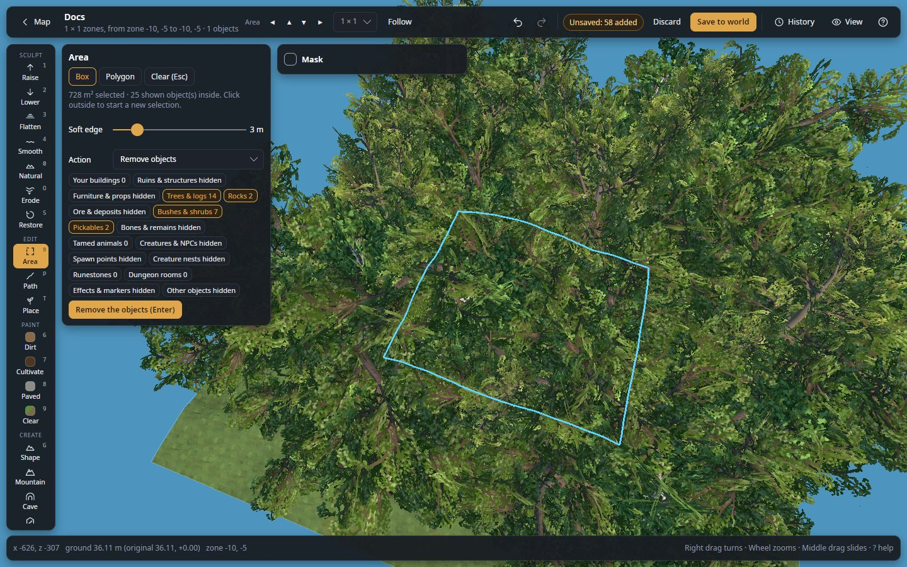
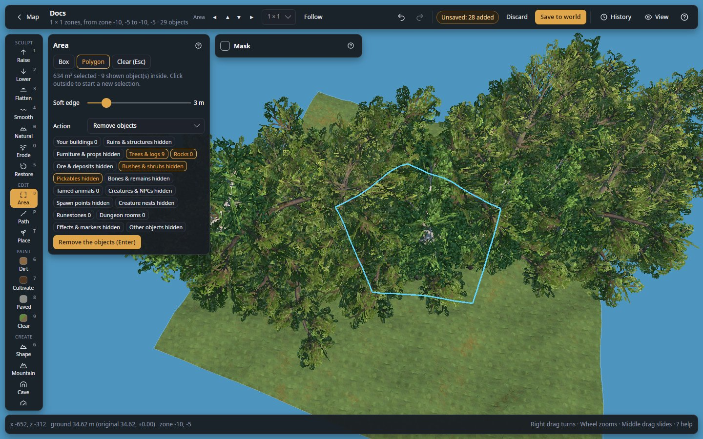
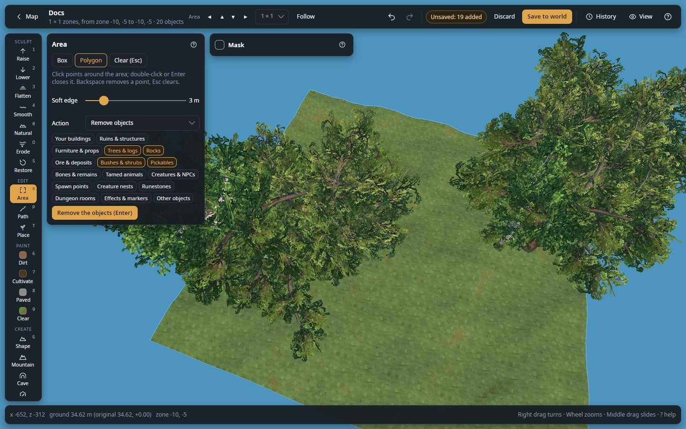
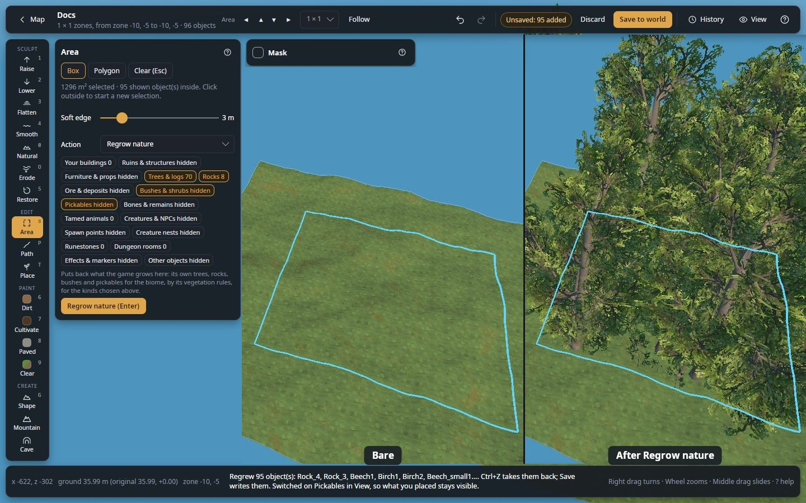
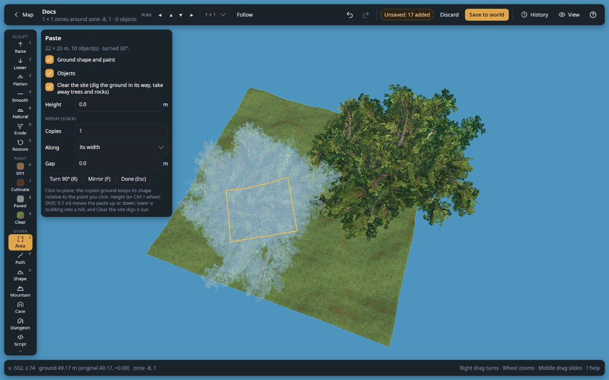
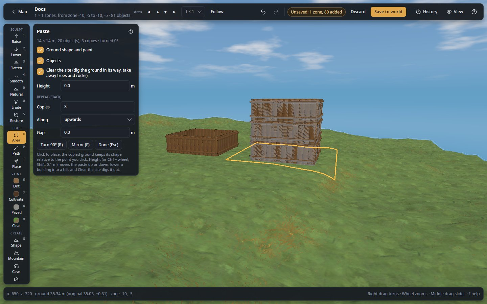

# Area, copy and paste (`B`)

*A box dragged over part of a wood. **Remove objects** is chosen: the kind chips show how many trees, rocks
and bushes are inside. Nothing has changed yet: the button at the bottom does it.*

The Area tool works on everything inside a box or a polygon at once: the ground, the objects, or the
zones themselves. You draw the selection once, then choose what to do with it from one list: shape or
paint the ground, remove, select, replace or regrow objects, copy, cut and paste, read or write a
heightmap, restore from a backup, or reset the zones so that the game generates them again.

## How to use it

1. Press `B` (or **Area** in the rail's EDIT section).
2. Choose **Box** or **Polygon** at the top of the panel and draw the selection on the ground.
3. Choose what to do in the **Action** list. The panel shows only that action's settings and a line
   saying what it does.
4. Press the button at the bottom or `Enter`. The button's label names the action: **Flatten (Enter)**,
   **Remove the objects (Enter)**, **Regrow nature (Enter)**...

Each action is one step in History: `Ctrl+Z` undoes it. Nothing is written to the world until you
**Save** (or **Apply live** in [live mode](live-mode.md)). The chosen action is remembered.

The [Mask](masks.md) is on its own card next to the panel. It limits the ground actions and the object
actions (Remove, Select, Regrow, Restore from a backup) to the ground it lets through.

## Selecting

*A polygon clicked corner by corner round part of a wood, with **Remove objects** chosen.*

*After **Remove the objects (Enter)**: the trees inside the polygon are gone, the ones outside stand.*

| Control | What it does |
|---|---|
| **Box** | Drag a rectangle on the ground. A box smaller than a metre is dropped. Dragging somewhere else starts a new box. |
| **Polygon** | Click corners. A double-click or `Enter` closes the shape (it needs three corners); `Backspace` removes the last corner. Clicking after the polygon is closed starts a new one. |
| **Clear (Esc)** | Clears the selection, to start a new one. |
| **Soft edge** | 0 to 20 m (3 m at first). The ground actions fade in over this many metres inside the outline, so the result blends into the ground around. At **0** the edge is as sharp as the ground allows: points that the outline crosses get a share, so a slanted edge is straight instead of stepped. |

The line under the buttons gives the selected surface and how many shown objects are inside
("1250 m² selected · 84 shown object(s) inside").

The selection is only drawn in the Area tool (and while pasting). It is kept when you use another tool,
and shown again when you come back.

The outermost line of points of the open area never changes (it joins the zones around the area):
no action touches it.

## Ground

These actions change the height or paint of the ground inside the selection. Each point is faded by the
**Soft edge** and by the Mask.

| Action | What it does |
|---|---|
| **Flatten** | Levels the ground inside to **Height** (m). **avg** sets Height to the average ground height inside. |
| **Raise** / **Lower** | Lifts / digs the ground inside by **Amount** (m). |
| **Smooth** | Evens out bumps: each point moves towards the average of the ground within 3 m of it. |
| **Naturalize** | Natural-looking bumps, with the **Bumps** and **Bump size** of the [Naturalize](terrain.md#naturalize-settings) brush: the ground is smoothed, then a noise pattern of that size and height is added. |
| **Restore the ground** | Puts the ground back to how the world generated it and removes paint. This also takes back ground raised or dug past ±8 m with No limit. |
| **Erode** | Weathers the ground in one go: the slopes settle (thermal, with the Erode brush's rest angle), rain cuts gullies and leaves fans (water), then the slopes settle again. See [Erode](terrain.md#erode-settings). |
| **Paint** | Paints the ground inside with **Dirt**, **Cultivated**, **Paved** or **Clear paint** (the list under it). |

Under **Flatten**, **Raise** and **Lower**:

| Control | What it does |
|---|---|
| **No limit: past the game's ±8 m** | The ground inside may go past the game's ±8 m. It is the same switch as **No limit** in the brush options, and it stays on for every tool until you switch it off. See [No limit](terrain.md#no-limit). |
| Cut and fill | How much ground the action would move: "Flatten to 35 m: dig 120 m³, fill 340 m³", with what stays out of reach ("(40 m³ out of reach: ±8 m limit)", or the ±400 m lift with No limit on). The second line, "Ground inside: … raised, … dug since generated", is how much the ground inside differs from the world as generated. Both follow every change of the ground. |

### How the ±8 m limit works here

The game keeps every ground change within 8 m of the ground it generated. Without **No limit**, a point
that would go further stops at 8 m, and the cut-and-fill line says how much is out of reach. With No
limit on, the ground may rise or sink up to 400 m: the editor stores the extra height as invisible
ground discs that the game levels when it loads the zone (see [No limit](terrain.md#no-limit)).
**Restore the ground** removes both kinds of change.

## Objects inside

For **Remove objects**, **Select objects**, **Replace objects**, **Regrow nature** and **Restore from a
backup**, a row of **kind chips** chooses which kinds of objects the action works on. Each chip shows how
many objects of its kind are inside ("Trees & logs 42"). "hidden" means the kind is switched off in the
[View panel](editor-basics.md#view-panel), so its objects are not counted and not removed. At first the
chips **Trees & logs**, **Rocks**, **Bushes & shrubs** and **Pickables** are on. Choose **Your buildings**
to act on player-built pieces, and **Ore & deposits** for copper, tin, silver and the like.

| Action | What it does |
|---|---|
| **Remove objects** | Removes the shown objects of the chosen kinds inside the selection, where the Mask allows. A linked group's root (a ship from a mod) takes its parts with it. `Ctrl+Z` brings them back. |
| **Select objects** | Selects them and switches to the [Select tool](select.md), to move, turn, copy or delete them. |
| **Replace objects**: **Replace** … **with** … | Replaces every object of the first kind inside by the second kind, at the same place and facing. The first list offers the kinds that are inside, the most common first ("Beech1 (42)"); it does not follow the chips. The second offers every kind the world can make; **pick** fills it from the world: click an object to use its kind (`Esc` cancels). The new objects are fresh: nothing that the old ones held is kept (a replaced chest is empty). New building pieces are built by the player chosen in View → Building → **Built by**. |
| **Regrow nature** | Puts back what the game grows here (below). |

### Regrow nature

*A zone stripped bare, then Regrow nature: the game's own trees, bushes and rocks for the biome are back,
and the status bar says what grew.*

Regrow nature puts back the trees, rocks, bushes, pickables and ore deposits that the game grows here,
for the kinds chosen with the chips, inside the selection and where the Mask allows. Use it to undo the
clearing of a wood, or to dress ground you reshaped.

How it decides what grows:

- It works out the zones under the selection exactly as the game does when it first generates a zone.
  It uses the game's own vegetation rules (read from your Valheim) and the same random numbers, seeded by
  the world's seed, the zone and the kind. On ground that is still as generated, you get back the same
  trees at the same places as the world first had.
- Each rule has the game's conditions: the biome (and whether the kind grows at the biome's edge or in
  its middle), the height above the water, the slope, the forest factor (groves and clearings), how rough
  the ground is around the spot, the distance from the world's centre, how many groups per zone and how
  many objects per group.
- It uses the ground **as it is now**. A hill you raised gets what grows at its new height and slope.
  A pad you levelled gets what grows on flat ground.
- A spot is skipped when something already stands within 1 m of it, when an object of the same kind
  stands within 3 m (a tree still there is not doubled), and within 4 m of a building piece.
- Kinds the world cannot make are left out.

What it cannot know, and leaves out: the game's physics checks against objects already standing, the
clear ground that the game keeps round its locations (villages, dungeon entrances...), and the Deep
North's other biomes.

It works on up to 16 zones at once (256 × 256 m): choose a smaller selection for more. The result is
one undo step; **Save** writes it.

## Copy and paste

*A copied wood following the cursor, see-through and turned, with the Paste panel. A click puts it down.*

The **Copy and paste** action shows these buttons. `Ctrl+C` and `Ctrl+X` work with any action in the
Area tool (and in the Select tool); `Ctrl+V` works in any tool.

| Control | What it does |
|---|---|
| **Copy (Ctrl+C)** | Copies every shown object inside the selection (whatever the kind chips say), and the ground their buildings stand on. Kinds the world cannot make are left out. The copy is remembered: you can paste it in another area, in another world, or after restarting the editor. |
| **Cut (Ctrl+X)** | The same copy, then the copied objects leave the world (one undo step: `Ctrl+Z` brings them back), so a paste moves them instead of doubling them. The ground stays as it is: a cut moves what was built, not the land under it. A selection with no objects copies its ground only and removes nothing. |
| **Paste (Ctrl+V)** | Switches to pasting: the copy follows the cursor; click to put it down. You can paste as many copies as you like; `Esc` stops. |

### What a copy holds

- **The objects**, with everything they hold in the save: a chest's contents, a sign's text, their health,
  who built them. A pasted chest is full like the original.
- **The ground under the buildings only**: under each building piece (by its real shape) and 1 m
  around it, as it is (height and paint), fading into the ground where it is pasted over 3 more metres.
  The rest of the selection's ground is not copied: a pasted town sits in the land where it lands,
  instead of carrying a square of foreign ground with it.
- **Heights**: everything keeps its height relative to the copy's average ground height. When you paste,
  that average goes to the height of the ground where you click.

The Select tool's copy differs: trees, rocks and the like each land on the ground where they go, while
building pieces keep the building's shape, with the ground under them (without paint).

### Pasting

*Repeat (stack): a hut copied, then pasted with Copies 3 and Along "upwards": the see-through preview beside the
original is a three-storey tower, before the click.*

While pasting, the outline and the objects follow the cursor as see-through previews. The paste must
fit in the open area (the ground and the site can only be shaped there): its outline turns red when it
does not, and a click there says so. Open a bigger area around the place first (with the area size list
in the top bar, or from the [map](map.md)).

| Control | What it does |
|---|---|
| **Ground shape and paint** | Paste the ground under the buildings. The shape is kept relative to the point you click, past the game's ±8 m when needed (as with **No limit**), so a building stands on the ground it was built on: its foundations, cellar and floors are supported as they were. |
| **Objects** | Paste the copied objects. |
| **Clear the site (dig the ground in its way, take away trees and rocks)** | See [How a paste clears its site](#how-a-paste-clears-its-site). On at first. |
| **Height** | Moves the pasted ground and objects up or down (m). `Ctrl` + wheel does it by 0.5 m (`Shift`: 0.1 m). Lower a building into a hill and Clear the site digs it out. |
| **Turn 90° (R)** | A quarter turn. `,` and `.` or `Alt` + wheel turn by 1° (`Shift`: 15°), to any angle. |
| **Mirror (F)** | Mirrors the paste east to west (before turning). |
| **Done (Esc)** | Stops pasting and goes back to the Area tool. |

Under **REPEAT (STACK)** (like WorldEdit's `//stack`):

| Control | What it does |
|---|---|
| **Copies** | How many copies one click places, 1 to 50. The extra copies are outlined too. All of them are one undo step. |
| **Along** | Which way the copies follow each other: along **its width** or **its depth** (these turn and mirror with the paste), or **upwards** (stacked floors). |
| **Gap** | Space between two copies (m). Each copy is moved by its own size plus the gap; a negative gap makes them overlap. Upwards, a copy's size is the height from its lowest object to its highest, plus a metre. |

Copies side by side each sit on the ground where they land. Stacked upwards, only the first copy
shapes the ground.

The line at the top of the panel says what is on the clipboard: its name (for a blueprint), its size,
how many objects, the copies, the turn and whether it is mirrored.

### How a paste clears its site

With **Clear the site** on, every paste does this in the same undo step:

- Where a pasted building piece stands (by its real shape, and 1 m around it), the ground in its way is
  dug down to the lowest piece's bottom, past ±8 m if needed. A building pasted into a hill or a mound
  is not buried in it. Lower ground is never raised.
- Where the copied ground went in fully, nothing is dug: the building stands on it as it stood on the
  original, its pieces set into it as they were.
- Pieces more than 100 m below the ground are ignored (some mods keep crafting stations there).
  Linked groups (a mod's ship) do not stand on the ground: nothing is dug under them.
- Trees, rocks, ore, bushes and pickables in that footprint are taken away. Buildings, creatures and
  tamed animals stay.

The status bar says what happened: "Pasted with the ground, 54 object(s), 7 tree(s), rock(s) and the like
cleared from the site."

### What a pasted object is

Pasted objects are new objects made from the copy, with all the data it carried, so a paste works in
another world too. Each paste gives linked groups (a mod's ship and its parts) new ids of their own, so
two pasted ships never share their parts; see
[Linked objects](select.md#linked-objects-ships-and-other-mods-groups). In [live mode](live-mode.md), a
**Cut** then pasted moves the objects in the running game under their own ids when it can
([Moving things](live-mode.md#moving-things)).

### Good to know

- An Area copy keeps every object's height relative to the copy, not to the ground under each object.
  On uneven ground, pasted trees and rocks can float or sink. To move only trees and rocks, select them
  and copy with the [Select tool](select.md) instead: each lands on the ground.
- The copied ground also fades within the selection's **Soft edge**: a building close to the outline
  takes less of its ground. Draw the selection a few metres wider than the buildings.
- Pasting changes only the open area. A big town needs a big area: choose 9 × 9 or more in the top bar's
  area size list before pasting.

## Blueprints

A blueprint is a building kept as a file, to paste into any world or build in game. Blueprints are
[Homestead](https://thunderstore.io/c/valheim/p/sighsorry/Homestead/)'s: the library, the Workshop (a
blank plot to build them on) and the support check are in [The Workshop](workshop.md).

| Control | What it does |
|---|---|
| **Save blueprint…** | Saves the clipboard's objects (what the Area or Select tool copied last) as a Homestead blueprint, with a name, description and tags, and whether it is a dungeon (see [Dungeons from blueprints](dungeons.md#dungeons-from-blueprints)). Copied ground is not kept: blueprints hold pieces only. Builders are not kept either. A blueprint with the same name is replaced, after asking. |
| **Blueprints…** | Opens the library (also the **Blueprints** button of the rail): each blueprint with its picture, cost, description and tags, the ones made in the Workshop too. **Paste** puts it on the clipboard and starts pasting. See [The library](workshop.md#the-library-blueprints-panel). |

Pasted objects keep what the blueprint holds (sign texts, items on item stands, chest contents). Their
pieces are built by the player chosen in View → Building → **Built by**, except pieces nobody built (a
ruin's), which stay so. Pasted into a world, the objects are made like the ones you place: copies of an
object of the same kind in that world, or new objects for kinds it has none of. Kinds the game does not
know (from mods that are not installed) are left out, and the editor says which. A blueprint tagged as
a dungeon goes 5000 m up, behind an entrance on the ground where you click, as the game keeps its
dungeons.

## Heightmap

The **Heightmap** action, like WorldPainter's heightmap import and export: the ground as a grayscale
picture, to change in an image editor (GIMP, Krita...) or a terrain tool (Gaea, World Machine...) and
bring back.

| Control | What it does |
|---|---|
| **Export the area** | Writes the ground of the whole open area as a 16-bit grayscale PNG: black is its lowest point, white its highest, north at the top, one pixel per metre (a 3 × 3 area is 193 × 193 pixels). The two heights are written into the picture. It goes to the `heightmaps` folder of the editor's data folder, named after the world and its zones; the status bar says where. |
| **Import…** | Reads a PNG (grayscale or colour, 8 or 16 bits) and fits it to the selection's box, or to the whole area when nothing is selected. |
| **Lowest** / **Highest** | The heights for black and white. A picture the editor exported brings its own, so an unchanged picture puts the ground back exactly. Otherwise they start at the lowest and highest ground it covers now. |
| **Put it into the ground** | Sets the ground to the picture's heights, one undo step. Inside a selection, the **Soft edge** blends it into the ground around. The Mask applies, and so does the game's ±8 m limit unless No limit is on: points that cannot reach their height turn red, and the status bar counts them. |
| **Cancel** | Forgets the picture without changing the ground. |

Use 16 bits when you can: 8-bit pictures only have 256 steps between Lowest and Highest (steps of
20 cm over 50 m).

## Restore from a backup

The **Restore from a backup** action, like WorldEdit's `//restore`: put the selection back as it was in a
backup of this world, to undo griefing, a bad raid or an edit you regret, without rolling back the
whole world.

| Control | What it does |
|---|---|
| **Backup** | The backups next to the world folder, newest first: the game's own (`<World>_backup_auto-<date>`, listed as "Game · date") and the editor's from older versions (`<World>_backup_terraineditor-<date>`, "Editor · date"). **Another folder…** picks any other copy of the same world, for example a server backup copied to this computer (in live mode the list is empty, so that is the way). A copy of another world (another seed) is refused. The line under it says which save it is and how many objects it holds. |
| **Ground (height and paint)** | The height and paint inside the selection come back exactly as in the backup, including ground raised with No limit; within the **Soft edge** they blend into the ground around. The Mask applies. |
| **Objects of the kinds chosen above** | The objects of the kinds chosen with the chips come back as they were, with all their data: a restored chest has its contents, a sign its text. Choose **Your buildings** to bring buildings back. |
| **Restore the selection (Enter)** | Does it: one step in History. Save or Apply live writes it. |

How objects are matched: an object that is in the selection now and in the backup, of the same kind, at
the same place (within 1 cm) and facing the same way, is left as it is. Every other object of the chosen
kinds in the selection now is removed (even when its kind is hidden in View), and every object of the
backup without a match is brought back. Runestones are never touched. When nothing differs, the status
bar says "Nothing to restore: the selection is as it was in the backup."

## Reset zones

| Control | What it does |
|---|---|
| **Keep my buildings** | Player-built objects in the zones are kept (on at first). |
| **Reset ground edits too** | Also undoes the ground edits in the zones: height (No limit lifts too) and paint (on at first). |
| **Reset zones… (Enter)** | Marks every zone under the selection for reset (red outline), after asking. |
| **Cancel reset** | Cancels the reset of the zones under the selection. |

How a reset works:

- When you save (offline) or apply live (with WorldEditorBridge 0.10.0 or newer), every object in the
  marked zones is removed: trees, rocks, ore, ruins, dungeon entrances and their rooms, creatures and
  dropped items. Players' tombstones are always kept; objects with a builder are kept with **Keep my
  buildings**; the ground edits are kept without **Reset ground edits too**.
- The world then forgets that it generated these zones and their locations. The next time a player
  comes near, the game generates them again: its trees, rocks and ore, and its locations (villages,
  dungeons, camps) at their places, with fresh loot and creatures.
- A zone counts when the selection reaches into it past the outer half of the soft edge: a zone that
  the selection only grazes is not reset.
- Tamed animals have no builder: they go with the zone. Move them out first.

To reset many zones across the whole world at once (by biome, away from buildings...), use the
[zone filter on the world map](map.md#reset-zones-across-the-world).
