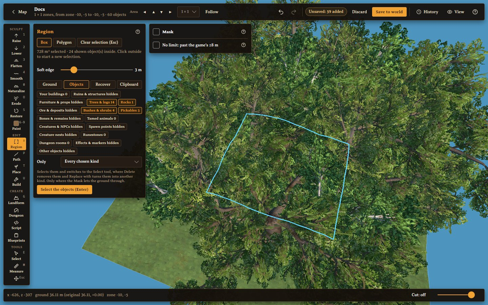
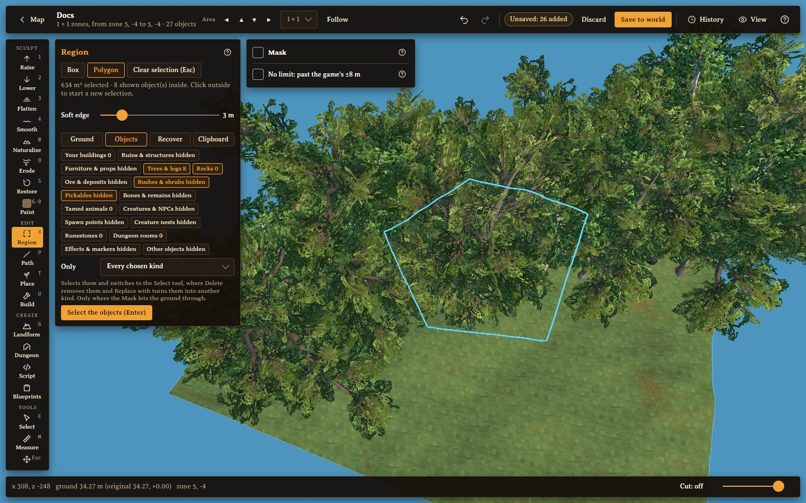
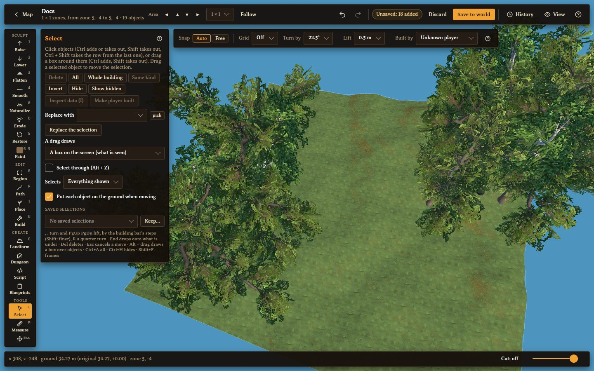
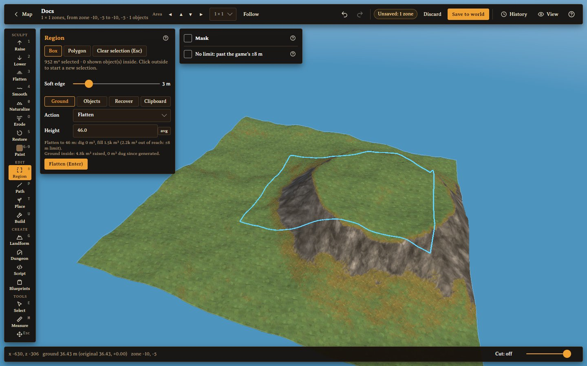
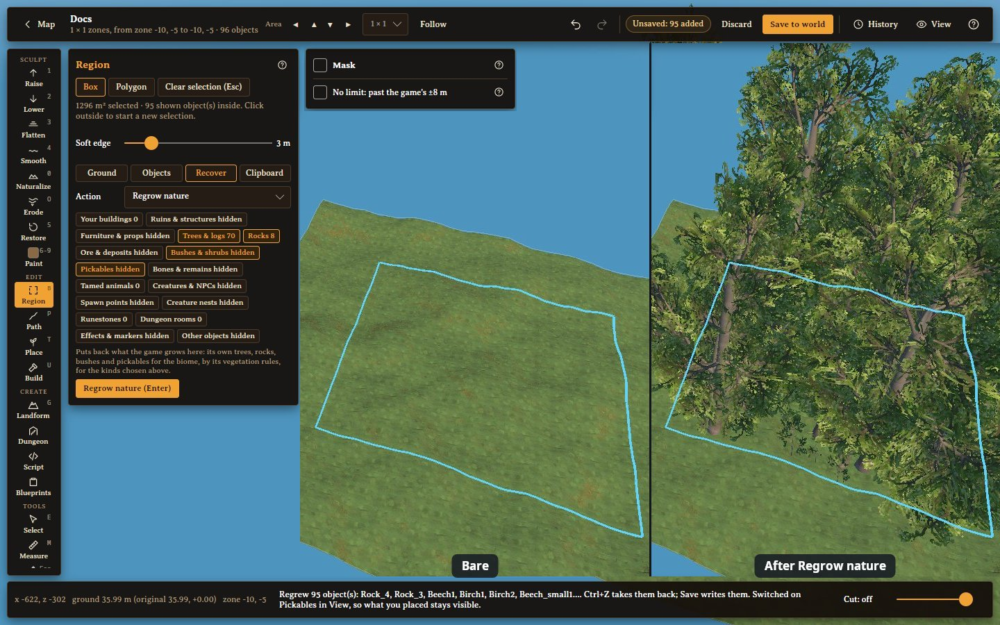
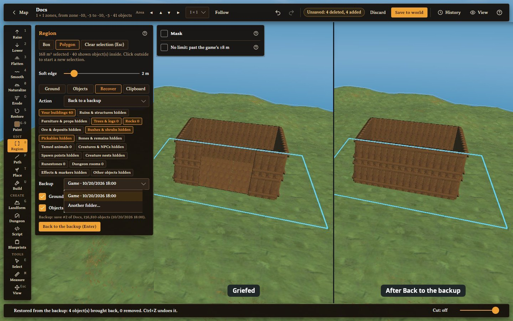
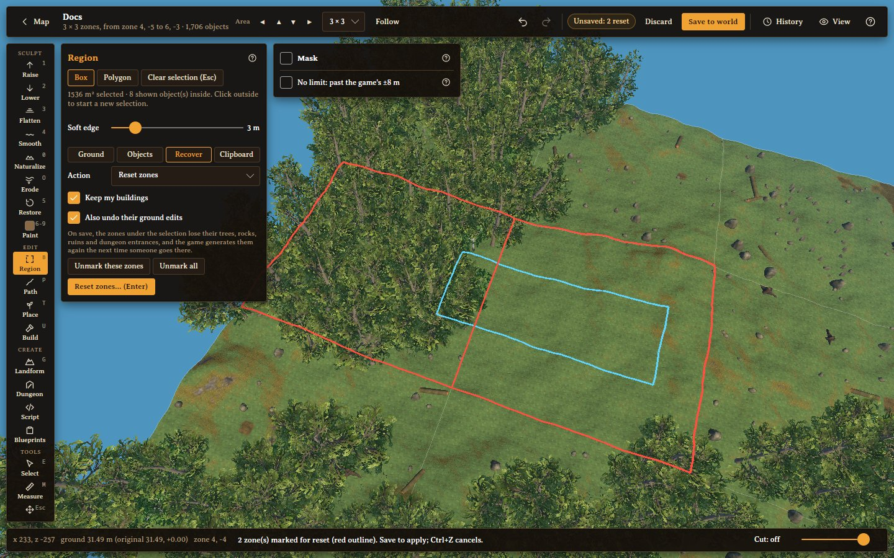
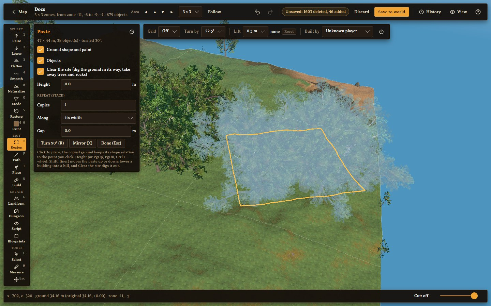
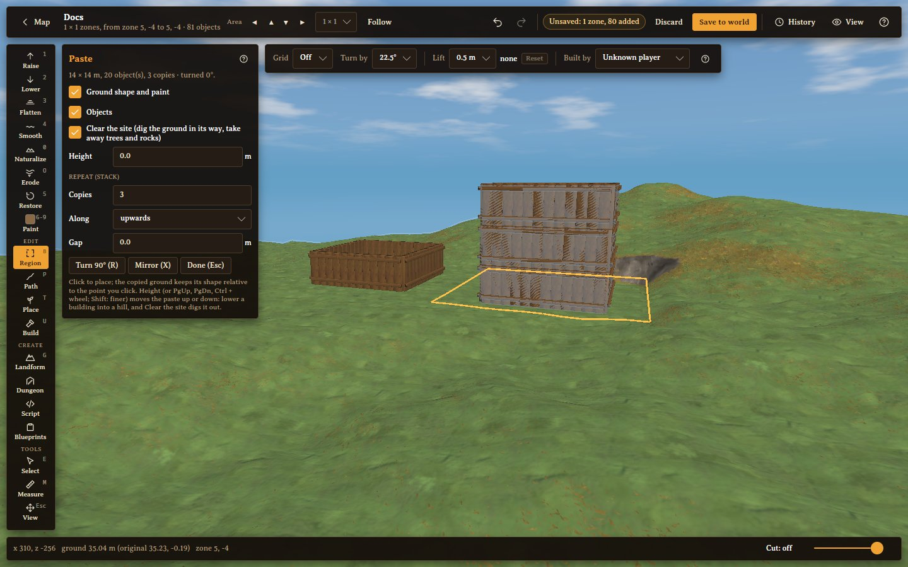
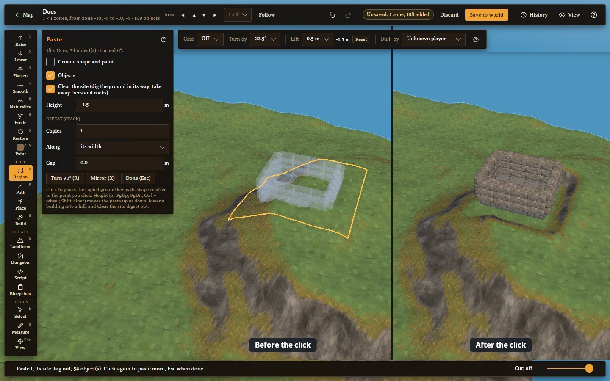

# Region, copy and paste

Change everything inside a box or a polygon at once: level or paint its ground, pick its objects to delete or
replace them, copy and paste it, or put it back as it was: the generated ground, a backup, the game's own nature.

**Where:** tool rail, **EDIT** section · **Key:** `B` · **Works in:** saved worlds, live

*A box dragged round a clump of trees with **Objects** chosen: the kind chips count the trees, rocks, bushes and
pickables inside. Nothing has changed yet: the button at the bottom selects them.*

## Use it

1. In the tool rail, click **Region** (`B`).
2. At the top of the panel, choose **Box** or **Polygon** and draw the selection on the ground.
3. Choose a group: **Ground**, **Objects**, **Recover** or **Clipboard**. Ground and Recover then offer their actions
   in the **Action** list. The panel shows only the chosen action's settings and a line saying what it does.
4. Press the button at the bottom, or `Enter`. Its label names the action: **Flatten (Enter)**, **Select the objects
   (Enter)**, **Regrow nature (Enter)**…
5. Not right? `Ctrl+Z` takes it back: each action is one step in History. **Save to world** (or **Apply live**)
   keeps it.

| Group | What is in it |
|---|---|
| **Ground** | [Ground actions](#ground-actions): Flatten, Raise, Lower, Smooth, Naturalize, Erode, Paint, and [Heightmap](#heightmap). |
| **Objects** | [Select objects](#object-actions): the objects inside, by kind, handed to the Select tool to delete, replace or move. |
| **Recover** | [What was there](#recover-what-was-there), brought back: [Back to generated ground](#back-to-generated-ground), [Regrow nature](#regrow-nature), [Back to a backup](#back-to-a-backup), [Reset zones](#reset-zones). |
| **Clipboard** | [Copy and paste](#copy-and-paste), and [blueprints](#blueprints). |

The chosen action is remembered, and each group comes back on the action it was last on. The [Mask](masks.md), on
its own card next to the panel, limits the ground actions, Select objects, Regrow nature and Back to a backup to the
ground it lets through.

## Settings

| Setting | What it does |
|---|---|
| **Box** | Drag a rectangle on the ground. A box smaller than a metre is dropped. Dragging somewhere else starts a new box. |
| **Polygon** | Click corners. A double-click or `Enter` closes the shape (three corners at least); `Backspace` removes the last corner. Clicking after it is closed starts a new one. |
| **Clear selection (Esc)** | Clears the selection, to start a new one. |
| **Soft edge** | 0 to 20 m (3 m at first). The ground actions fade in over this many metres inside the outline, so the result blends into the land around. At **0** the edge is sharp and follows a slanted outline straight. |
| **Ground**, **Objects**, **Recover**, **Clipboard** | The group of actions shown (see the table above). |
| **Action** | The group's actions, for Ground and Recover. Objects and Clipboard have one action each, so no list. |

The line under the buttons gives the surface and how many shown objects are inside ("1250 m² selected · 84 shown
object(s) inside"). The selection is drawn only in the Region tool and while pasting; it is kept when you use another
tool.

*A closed polygon round part of a wood, with **Objects** chosen.*

*After **Select the objects (Enter)**, then `Del` in the Select tool: the trees inside the polygon are gone, the ones
outside stand.*

## Ground actions

Each point is faded by the **Soft edge** and by the Mask. These are the [brushes](terrain.md)' actions and the
[Path](path.md) tool's, under the same names: here they apply to the whole selection in one go.

| Action | What it does |
|---|---|
| **Flatten** | Levels the ground inside to **Height** (m). **avg** sets Height to the average ground height inside. |
| **Raise** / **Lower** | Lifts / digs the ground inside by **Amount** (m). |
| **Smooth** | Evens out bumps: each point moves towards the average of the ground within 3 m. |
| **Naturalize** | The ground is smoothed, then natural bumps are added. **Bumps**, **Bump size** and **New pattern** show under it: they are the [Naturalize](terrain.md#naturalize) brush's, the same values wherever you set them. |
| **Erode** | Weathers the ground in one go: slopes settle, rain cuts gullies and leaves fans, slopes settle again. **Rest angle** shows under it: the [Erode](terrain.md#erode) brush's, the same value wherever you set it. |
| **Paint** | Paints the ground inside with **Dirt**, **Cultivated**, **Paved** or **Clear paint** (the list under it). |
| **Heightmap** | The ground as a grayscale picture, out and back in: see [Heightmap](#heightmap). |

To take the ground back to how the world made it, choose **Recover**, then
[Back to generated ground](#back-to-generated-ground).

The ground actions keep within the game's ±8 m unless **No limit: past the game's ±8 m** is ticked on the **Mask**
card next to the panel: the one switch for every ground tool, which stays on until you switch it off. See
[No limit](terrain.md#no-limit).

Under **Flatten**, **Raise** and **Lower**:

| Setting | What it does |
|---|---|
| Cut and fill line | How much ground the action would move ("Flatten to 35 m: dig 120 m³, fill 340 m³"), and for Flatten what is out of reach ("(40 m³ out of reach: ±8 m limit)"; with No limit on, only what is past its ±400 m). The second line, "Ground inside: … raised, … dug since generated", compares with the world as generated. Both follow every change, the soft edge and the Mask. |

*A box over a hill with **Flatten** at 46 m and **No limit** off: "Flatten to 46 m: dig 0 m³, fill 1.5k m³ (2.2k
m³ out of reach: ±8 m limit)", and under it the ground already raised inside since the world was generated.*

### Heightmap

Export the ground as a grayscale picture, change it in an image editor (GIMP, Krita…) or a terrain tool (Gaea, World
Machine…), and bring it back.

| Setting | What it does |
|---|---|
| **Export** | Writes the ground of the selection's box, or of the whole open area when nothing is selected, as a 16-bit grayscale PNG: black is its lowest point, white its highest, north at the top, one pixel per metre (a whole 3 × 3 area is 193 × 193 pixels). It goes to the `heightmaps` folder of the editor's data folder; the status bar says where. A polygon is exported as the box round it. |
| **Import…** | Reads a PNG (grayscale or colour, 8 or 16 bits) and fits it to the selection's box, or to the whole area when nothing is selected. |
| **Lowest** / **Highest** | The heights for black and white. A picture the editor exported brings its own, so an unchanged picture puts the ground back exactly. |
| **Put it into the ground** | Sets the ground to the picture's heights, one undo step. Inside a selection, **Soft edge** blends it in. The Mask and the ±8 m limit apply (unless No limit is on): points that cannot reach their height turn red, and the status bar counts them. |
| **Cancel** | Forgets the picture without changing the ground. |

Use 16 bits when you can: an 8-bit picture has only 256 steps between Lowest and Highest (20 cm steps over 50 m).

*With nothing selected, after **Export**, then **Import…** of the same picture: "Picture 65 × 65 fitted to 65 × 65 m
(the whole area), with the heights it was exported with", **Lowest** and **Highest** read from it. Nothing changes
until **Put it into the ground**.*

## Object actions

The Region tool chooses **which** objects: those inside the selection, of the kinds you switch on, where the Mask
lets the ground through. The [Select](select.md) tool then does things **with** them: delete, replace, move, turn,
copy, hide.

A row of **kind chips** chooses the kinds. Each chip shows how many objects of its kind are inside ("Trees & logs
42"). At first **Trees & logs**, **Rocks**, **Bushes & shrubs** and **Pickables** are on; choose **Your buildings**
for player-built pieces, **Ore & deposits** for copper, tin, silver and the like. The same chips choose the kinds for
[Regrow nature](#regrow-nature) and [Back to a backup](#back-to-a-backup).

A chip that says "hidden" is a kind switched off in the [View panel](editor-basics.md): its objects are not counted
and are left alone, except by **Back to a backup**.

| Setting | What it does |
|---|---|
| Kind chips | The kinds of objects taken. |
| **Only** | **Every chosen kind** takes all of them. Or choose one object among those inside, listed with how many there are, the most common first ("Beech1 (42)"): only those are taken. The list follows the chips. |
| **Select the objects (Enter)** | Selects them and switches to the Select tool. The status bar says how many. When nothing of the chosen kinds is inside, it says so and the Region tool stays. |

Then, in the Select tool:

| To | Do this |
|---|---|
| Remove them | Press `Del` (or **Delete**). One step in History; `Ctrl+Z` brings them back. A linked group (a mod's ship) goes whole. |
| Replace them with another kind | Choose the kind in **Replace with** (or **pick** it from the world), then **Replace the selection**. To replace only the beeches of a wood, choose them in **Only** first. See [Select](select.md#settings). |
| Move, turn, copy, hide them | As any selection: see [Select](select.md). |
| Come back | Press `B`: the box or polygon is still there. |

## Recover what was there

Four ways to bring back what was there, from the lightest to the heaviest.

| Action | What it brings back |
|---|---|
| **Back to generated ground** | The ground inside as the world generated it. Objects stay. |
| **Regrow nature** | The trees, rocks, bushes and pickables the game grows here, on the ground as it is now. |
| **Back to a backup** | The ground and the objects inside as they were in a backup of this world. |
| **Reset zones** | Whole zones, made again by the game the next time someone goes there. |

### Back to generated ground

The ground inside goes back to how the world generated it: its height (ground raised or dug with No limit included)
and its paint. Faded by the **Soft edge** and by the Mask, as the [ground actions](#ground-actions). It does for a
box or polygon what the [Restore](terrain.md#restore) brush does under the cursor.

### Regrow nature

*Left: a box on bare ground. Right: the same box after **Regrow nature**: the game's own trees and rocks for the
biome, and the status bar says what grew.*

Regrow nature puts back the trees, rocks, bushes, pickables and ore that the game grows here, for the kinds chosen
with the [kind chips](#object-actions), inside the selection and where the Mask allows. Use it to undo the clearing of a wood, or to dress ground you
reshaped.

- **It follows the game's own rules** and the world's seed: on ground still as generated, you get back the same trees
  at the same places. Alt biomes (Dark Meadows, Rock Black Forest…) get what they add.
- **It uses the ground as it is now**: a hill you raised gets what grows at its new height and slope.
- **It does not double what stands**: nothing grows within 1 m of an object, 3 m of one of the same kind or 4 m of a
  building piece, nor where a location (a village, a dungeon entrance) keeps its ground clear.
- **Up to 16 zones at once** (256 × 256 m): choose a smaller selection for more.
- If a kind it grew is hidden in View, it switches it on, so what grew stays visible.

The rules in full: [Growing rules](concepts/objects.md#growing-rules).

### Back to a backup

Put the selection back as it was in a backup of this world, to undo griefing, a bad raid or an edit you regret,
without rolling back the whole world. Step by step: [Restore one area from a backup](guides/restore-from-backup.md).

| Setting | What it does |
|---|---|
| **Backup** | The backups next to the world folder, newest first: the game's own ("Game · date") and the editor's from older versions ("Editor · date"). **Another folder…** picks any other copy of the same world, such as a server backup copied to this computer; live, the list is empty, so that is the way. A copy of another world (another seed) is refused. The line under it says which save it is and how many objects it holds. |
| **Ground (height and paint)** | The ground inside comes back exactly as in the backup, No limit ground included; within **Soft edge** it blends in. The Mask applies. |
| **Objects of the kinds chosen above** | Objects of the kinds chosen with the [kind chips](#object-actions) come back with all their data: a restored chest has its contents. Choose **Your buildings** to bring buildings back. |
| **Back to the backup (Enter)** | Does it: one step in History. |

An object that is the same in both (same kind, place and facing) is left alone. Every other object of the chosen kinds
inside is removed, even when hidden in View, and every unmatched object of the backup comes back. Runestones are
never touched. When nothing differs, the status bar says "Nothing to restore: the selection is as it was in the
backup."

*Left: a polygon round a hut with part of its near wall gone, **Back to a backup** chosen, the **Backup**
list open on the game's backup and **Your buildings** on. Right: after **Back to the backup (Enter)**, the wall is
whole again; the line above the button names the backup's save, the status bar counts what came back.*

### Reset zones

Mark the zones under the selection so that the game generates them again: new trees, rocks, ore and locations. To pick
zones across the whole world by biome or distance from buildings, use the
[world map](map.md#reset-zones-across-the-world), which has the same two switches and marks the same way; step by
step: [Generate zones again](guides/reset-zones.md).

| Setting | What it does |
|---|---|
| **Keep my buildings** | Player-built objects in the zones are kept. On at first. Off, the buildings in the zones go too. |
| **Also undo their ground edits** | Also undoes the zones' ground edits: height (No limit ground too) and paint. The view shows the ground back as generated as soon as the zones are marked. On at first. |
| **Reset zones… (Enter)** | Marks every zone under the selection for reset (red outline), after asking. |
| **Unmark these zones** | Unmarks the zones under the selection: they are not reset. |
| **Unmark all** | Unmarks every zone marked for reset, those marked on the map and outside the open area too. One step in History. |

A zone counts when the outline takes in at least one of its ground points, whatever the soft edge: a zone the
selection stays outside of is not reset. The reset happens when you save (offline) or apply live (WorldEditorBridge 0.10.0 or newer).

> [!CAUTION]
> **Once saved or applied, a reset cannot be undone.** Every tree, rock, ruin, dungeon entrance, creature and dropped
> item in the zones goes; players' tombstones stay. Tamed animals have no builder, so they go too: move them out
> first.

*A box over two zones, **Reset zones** with **Keep my buildings** and **Also undo their ground edits** on, after
**Reset zones… (Enter)**: both zones outlined red, the status bar counting them. Nothing is reset until you save.*

## Copy and paste

*A copied wood of a few dozen trees and rocks following the cursor, see-through and turned 30°; the line at the top
of the Paste panel says what is on the clipboard. A click puts it down.*

The **Clipboard** group shows these buttons. `Ctrl+C` and `Ctrl+X` work with any action of the Region tool (and in
the Select tool); `Ctrl+V` works in any tool.

| Setting | What it does |
|---|---|
| **Copy (Ctrl+C)** | Copies every shown object inside (whatever the kind chips say), and the ground their buildings stand on. Pasted, trees, rocks and the like keep their height above the ground where each lands; building pieces keep the building's shape. Kinds the world cannot make are left out. The copy is remembered: paste it in another area, another world, or after restarting the editor. |
| **Cut (Ctrl+X)** | The same copy, then the copied objects leave the world (`Ctrl+Z` brings them back), so a paste moves them. The ground stays. |
| **Paste (Ctrl+V)** | Starts pasting: the copy follows the cursor; click to put it down. Paste as many as you like; `Esc` stops. |
| **Save blueprint…** / **Blueprints…** | See [Blueprints](#blueprints). |

The line under the buttons says what is on the clipboard ("Clipboard: 24 × 18 m, 54 object(s).", with the blueprint's
name when it came from the library). A selection with no shown objects inside copies nothing (its ground goes only
with buildings): the status bar says so, and the clipboard keeps what it had.

A copy holds:

- **The objects, with all their data**: a chest's contents, a sign's text, their health, who built them.
- **The ground under the buildings only**: under each building piece plus 1 m, fading out over 3 more metres. The
  rest of the selection's ground is not copied, so a pasted town sits in the land it lands on.
- **Heights two ways.** Trees, rocks and other nature keep their height above the ground and follow the ground
  where each one lands. Building pieces and the parts of a linked group (a mod's ship) keep the building's shape,
  measured from the copy's average ground, which goes to the height of the ground where you click.

The [Select](select.md) tool's copy holds only the objects you selected, and the ground under their building pieces
without its paint. It pastes the same way.

### Pasting

*One click with **Copies** 3 and **Along** upwards, seen from the ground: beside the original hut, three copies
stacked into three floors (the outline is the next paste, following the cursor).*

The paste must fit in the open area: its outline turns red when it does not, and a click there says so. Open a bigger
area first (the area size list in the top bar, or the [map](map.md)).

| Setting | What it does |
|---|---|
| **Ground shape and paint** | Pastes the ground under the buildings, keeping its shape relative to the point you click, past the game's ±8 m when needed. A building stands on the ground it was built on. |
| **Objects** | Pastes the copied objects. |
| **Clear the site (dig the ground in its way, take away trees and rocks)** | On at first. Digs ground in the way of pasted building pieces down to the lowest piece (never raises ground), and takes away trees, rocks, ore, bushes and pickables in their footprint. Buildings and creatures stay. |
| **Height** | Moves the paste up or down (m); `PgUp`, `PgDn` and `Ctrl` + wheel do too. Lower a building into a hill and Clear the site digs it out. |

Under **REPEAT (STACK)**:

| Setting | What it does |
|---|---|
| **Copies** | How many copies one click places, 1 to 50, all one undo step. |
| **Along** | Which way they follow each other: **its width** or **its depth** (these turn and mirror with the paste), or **upwards** (stacked floors). |
| **Gap** | Space between two copies (m); negative overlaps them. Upwards, a copy's size is its height plus a metre. |

At the bottom of the panel:

| Setting | What it does |
|---|---|
| **Turn 90° (R)** | A quarter turn. `,` and `.` turn by the building bar's **Turn by** step (`Shift`: 1°). |
| **Mirror (X)** | Mirrors the paste east to west, before turning. |
| **Done (Esc)** | Stops pasting, back to the Region tool. |

While you paste, [the building bar](build.md#the-building-bar) shows beside the panel, the same one Build and Select
use: **Grid** (the paste goes by it), **Turn by** and **Lift** (the steps of `,` `.` and of `PgUp` `PgDn`; the bar
shows the height, **Reset** takes it back to none) and **Built by**.

Copies side by side each sit on the ground where they land; stacked upwards, only the first shapes the ground. The
line at the top of the panel says what is on the clipboard: name, size, objects, copies, turn, mirrored. The status
bar says what the paste did: "Pasted with the ground, 54 object(s), 7 tree(s), rock(s) and the like cleared from the
site."

*With **Clear the site** on (**Ground shape and paint** off, **Height** -1.5 m): left, the see-through copy sunk
into the side of a mound; right, after the click, the ground dug away round its walls.*

## Blueprints

A blueprint is a building saved as a file, to paste into any world or build in game with
[Homestead](https://thunderstore.io/c/valheim/p/sighsorry/Homestead/). The library, the Workshop and the support
check are in [The Workshop](workshop.md).

| Setting | What it does |
|---|---|
| **Save blueprint…** | Saves the clipboard's objects (what Region or Select copied last) as a Homestead blueprint, with a name, description and tags, and whether it is a dungeon (see [Dungeons](dungeons.md)). Ground and builders are not kept. A blueprint with the same name is replaced, after asking. |
| **Blueprints…** | Opens the library (also **Blueprints** on the rail). **Paste** puts a blueprint on the clipboard and starts pasting. |

Pasted pieces keep what the blueprint holds (sign texts, items on stands, chest contents) and are built by the player
chosen in **Built by** on [the building bar](build.md#the-building-bar) (pieces nobody built stay so). Kinds the game does not know (mods not
installed) are left out, and the editor says which. A dungeon blueprint goes 5000 m up, behind an entrance on the
ground where you click, as the game keeps its dungeons.

## Shortcuts

| Key or mouse | What it does |
|---|---|
| `B` | Choose Region. |
| Drag (Box) / click corners (Polygon) | Draw the selection. |
| Double-click or `Enter` | Close the polygon. |
| `Backspace` | Remove the polygon's last corner. |
| `Enter` | Do the chosen action. |
| `Enter`, then `Del` | With **Objects** chosen: select the objects inside, then delete them (in the Select tool). |
| `Esc` | Clear the selection; a second `Esc` leaves the tool. |
| `Ctrl+C` / `Ctrl+X` / `Ctrl+V` | Copy / cut the selection / paste. |
| While pasting: `R`, `X` | Turn 90°, mirror. |
| While pasting: `,` `.` or `Alt`+wheel | Turn by the building bar's **Turn by** step, 22.5° at first (`Shift`, finer: 1°). |
| While pasting: `PgUp` / `PgDn` or `Ctrl`+wheel | Height by the building bar's **Lift** step, 0.5 m at first (`Shift`, finer: a fifth of it). |
| While pasting: `Esc` | Done. |

## Tips and limits

- **Draw the selection a few metres wider than the buildings**: the copied ground fades within the **Soft edge**, so a
  building close to the outline takes less of its ground.
- **A big town needs a big area**: choose 9 × 9 or more in the area size list before pasting.
- **Pasted objects are new objects** with all the copied data, so a paste works in another world too. Linked groups
  (a mod's ship) get new ids of their own. Live, a **Cut** then pasted moves the objects in the running game when it
  can (see [Live mode](live-mode.md)).
- **No action touches the area's outermost line of points** (see
  [The locked edge](concepts/areas-and-zones.md#the-locked-edge)).
- **To take an action back**, `Ctrl+Z`, after saving too (then save again: the [History](concepts/saving-and-history.md#history)
  stays); for a change older than the history, [Restore one area from a backup](guides/restore-from-backup.md).

## Related

- [Clear trees and rocks, level a building site](guides/clear-an-area.md)
- [Restore one area from a backup](guides/restore-from-backup.md)
- [Move or copy a building](guides/move-a-building.md)
- [Generate zones again](guides/reset-zones.md)
- [Objects](concepts/objects.md), [Backups](concepts/saving-and-history.md#backups)
- [How a paste clears its site](concepts/objects.md#how-a-paste-clears-its-site), [how Regrow decides what grows](concepts/objects.md#how-regrow-decides-what-grows)
