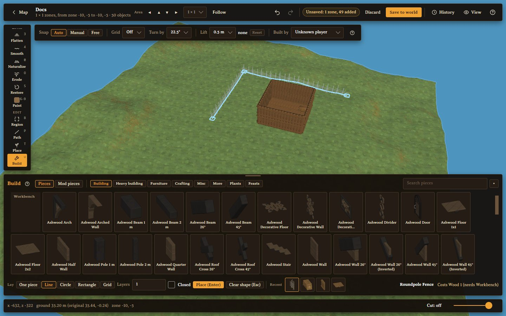
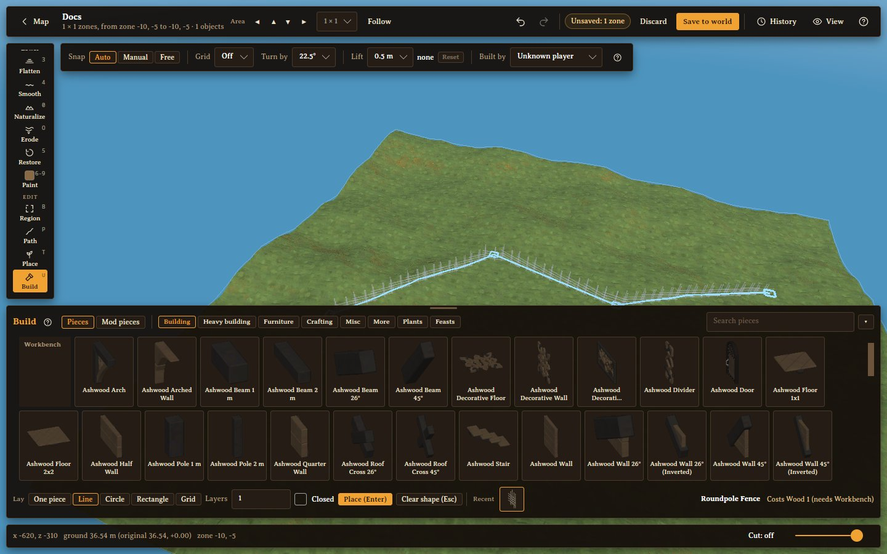
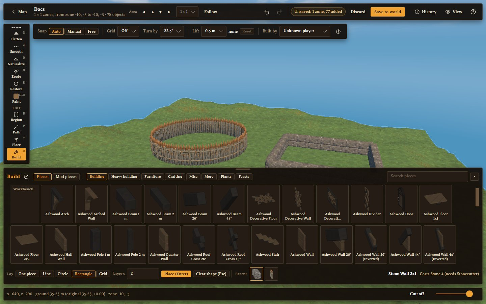
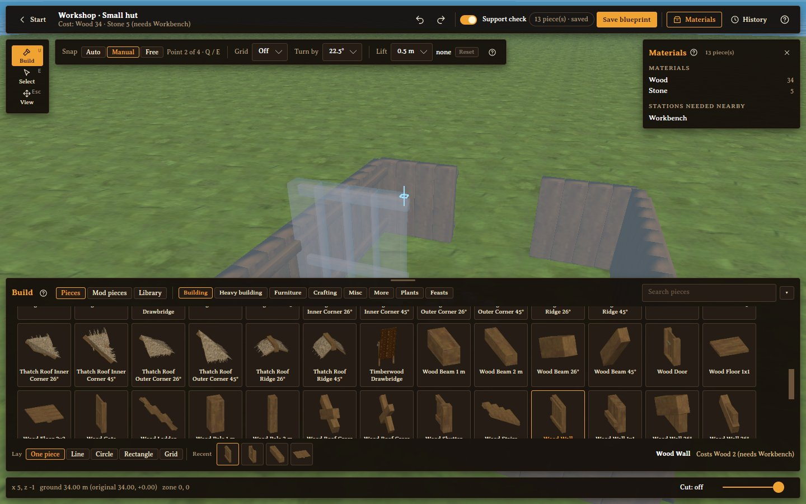

# Build

Put down the pieces players build (walls, floors, roofs, fences, furniture, crafting stations), one at a time like
the game's hammer, or along a line, round a circle or a rectangle, or in a grid.

**Where:** tool rail, **EDIT** section · **Key:** `U` (in the Workshop `T` too) · **Works in:** saved worlds, live,
the [Workshop](workshop.md), and a dungeon's rooms with [Build here](dungeons.md)

*Build in a world: a hut put up on levelled ground and a roundpole fence being laid along a line of three points
(**Lay** on **Line**, shown before **Place (Enter)**). Bottom: the Build dock with the pieces of the **Building** tab
and the **Lay** row. Top: the building bar, with **Snap**, **Grid**, **Turn by**, **Lift** and **Built by**.*

## Use it

To put up a wall and a fence in a world:

1. Press `U`. The **Build** dock opens along the bottom of the window, and
   [the building bar](#the-building-bar) beside the tool rail.
2. In the dock, click a piece (search `wall`). It follows the pointer, see-through, where the hammer would put it.
3. Point at the ground or at a piece: the piece snaps to the pieces already there. Click to put it down.
4. Press `,` or `.` to turn the next one, `PgUp` or `PgDn` to lift or lower it.
5. For a fence, pick it, then at the dock's foot choose **Lay** → **Line**, click points on the ground and press
   `Enter`.

Each click, row or `Enter` is one undo step (`Ctrl+Z`). Nothing is written to the world until you **Save to world**
(or **Apply live**). To move, turn or delete pieces, use [Select](select.md), which shares the building bar.

Trees, rocks, crops by the field and spawn points are placed with [Place](place.md), not Build.

## The Build dock

The dock spans the bottom of the window. Its tabs, its search, **Recent**, the piece's cost, and the quick ways
(drag a row, `Shift` + right click to take a piece away, middle click to build with a piece's kind) are the same
everywhere: see [The Build dock](workshop.md#the-build-dock) on the Workshop's page.

What changes with the place:

| Where | The dock |
|---|---|
| A world's open ground | **Pieces** and **Mod pieces**. No **Library**: paste a blueprint with the [Blueprints panel](workshop.md#blueprints-panel). The [Mask](masks.md) does not apply to Build. |
| The Workshop | **Pieces**, **Mod pieces** and **Library**; **Materials** counts what the building costs. No **Built by**: a blueprint keeps no builder. |
| A dungeon (**Build here**) | **Pieces** and **Mod pieces**, one piece at a time: **Lay**'s lines and grid are drawn on the ground, far under a dungeon's rooms. |

The rail and the right-hand panels end above the dock; the rail scrolls with the wheel. Fold the dock with **▾** for
more room.

## Lay pieces along a line or in a grid

**Lay**, at the dock's foot, chooses how the picked piece goes down. It is kept for the next time.

| Lay | What it does |
|---|---|
| **One piece** | One piece where you point, like the hammer. Drag to lay a row. |
| **Line** | Click points on the ground: the piece is laid end to end along straight stretches between them, each one meeting the last at its snap points (a fence, a wall, a road of floors). Drag a point to move it, drag the line to add one, `Ctrl` + click removes one, `Backspace` the last. **Closed** returns to the first point, to fence a yard in. |
| **Circle** | Press at the centre and drag out. The size is rounded so whole pieces close the ring. |
| **Rectangle** | Press at one corner and drag to the opposite one. The sides fill from the corners so the corners meet. |
| **Grid** | Press at one corner and drag to the other: one piece in the middle of each cell, **Spacing** apart (2 m for the game's 2 m floors), as many whole cells as fit. `,` and `.` turn the whole grid. |

| Setting | What it does |
|---|---|
| **Layers** | Line, Circle and Rectangle: the line stacked 1 to 20 pieces high (a wall 3 high, a double fence). |
| **Spacing** | Grid: the distance between pieces, centre to centre, 0.5 to 30 m. |
| **Place (Enter)** | Puts down what the see-through preview shows, as one undo step. A double-click on a line's last point does the same. |
| **Clear shape (Esc)** | Removes the line, the figure or the box drawn. It stays after placing, its preview empty, until you clear it. |

*A fence laid end to end along a line through four points, see-through until `Enter` puts it down.*

***Circle** (a ring of stake walls) and **Rectangle** (stone walls, **Layers** 2), each put down with `Enter`.*

- A line that starts within 1 m of a piece already there continues it, at its level (with **Snap** on **Auto** or
  **Manual**).
- On a slope, the pieces stay level and step up or down with the ground, like a fence going up a hill. For one even
  wall, flatten the ground along the line first ([Path](path.md), Flatten).
- The lift (`PgUp`, `PgDn`) raises the whole line or grid above the ground: a floor laid 2 m up is a roof.
- At most 2000 pieces per line or grid.

## The building bar

The bar beside the tool rail holds the building settings. It is one bar for **Build**, [Select](select.md) and
[Paste](area.md#copy-and-paste): what you set in one holds in the others, and is kept for the next time. Each tool
shows the parts it uses. On a narrow window the bar wraps onto two rows.

| Setting | Build | Select | Paste |
|---|---|---|---|
| **Snap** | **Auto** (the default): the piece snaps to the pieces already there, like the hammer. **Manual**: only one of its snap points meets the others, reaching 1.5 m; `Q` and `E` choose which, marked on the piece (`Point 2 of 8 · Q / E`). **Free**: it stays where it touches what you point at. | **Auto**: moved pieces snap to the pieces around, within 0.75 m. **Free**: they stay where you drag them. | Not used. |
| **Grid** | **Off** (as in game), **0.5 m**, **1 m** or **2 m**: a point on the ground is rounded to this grid, counted from the area's middle. A piece pointed at another piece snaps as usual. | Pieces dragged across the ground that do not snap go by the grid. | The paste goes by the grid. |
| **Turn by** | How far `,` and `.` (or `Alt` + wheel) turn the piece: **1°**, **15°**, **22.5°** (the game's step, the default), **45°** or **90°**. | The same keys turn the selection. | The same keys turn the paste. |
| **Lift** | How far `PgUp`, `PgDn` or `Ctrl` + wheel lift the piece: **0.1 m**, **0.25 m**, **0.5 m** (the default) or **1 m**. The bar shows the lift (`+1.5 m`); **Reset** takes it back to none. | The same keys lift the selection. | The same keys raise or lower the paste (its **Height**); **Reset** takes it back. |
| **Built by** | The player written as the builder of the pieces you put down. | The builder **Make player built** and **Replace** write. | The builder of the pieces pasted. |

**`Shift` always makes a step finer**, in the three tools: `,` and `.` turn by 1°, and the lift goes by a fifth of
its step (0.1 m at 0.5 m).

Hold `Alt` while building to place a piece by a quarter metre, without snapping, whatever the **Snap** setting (like
holding `Alt` in game, with a step). See [Snapping](concepts/objects.md#snapping).

***Snap** on **Manual**, `E` pressed once: the bar reads `Point 2 of 4 · Q / E`, and the see-through wall that follows
the pointer meets the hut's wall by its top corner, marked with a cross.*

### Built by

**Built by** lists the players who built in this world (with their piece counts), the players named on beds, wards
and tombstones, and the characters on this computer, marked "(this computer)". At first it chooses the player with
the most pieces, else your own character, else a player named in the world. **Other player id…** asks for any id (a
whole number). **Nobody (not player built)** puts pieces down without a builder, as parts of a ruin. With no player
known at all, pieces get **Unknown player** (id 1): wards and private chests then answer to nobody, so choose your own
id when you can. The choice is remembered per world.

It is not on the bar in the Workshop: a blueprint keeps no builder, and its pieces get theirs when it is pasted. Why
the builder matters: see [Player-built pieces](concepts/objects.md#player-built-pieces).

## Shortcuts

| Key or mouse | What it does |
|---|---|
| `U` | Opens Build (in the Workshop, `T` too). |
| Click | Put the piece down (**One piece**); add a point (**Line**). |
| Drag | **One piece**: a row of the piece. **Circle**, **Rectangle**, **Grid**: draw it. |
| `,` `.` or `Alt` + wheel | Turn the piece by the bar's **Turn by** (`Shift`: 1°). In **Grid**: the whole grid. |
| `PgUp` / `PgDn` or `Ctrl` + wheel | Lift or lower the piece by the bar's **Lift** (`Shift`: a fifth of it). |
| `Alt` (held) | Place by a quarter metre, no snapping. |
| `Q` / `E` | **Manual** snap: the piece's previous / next snap point. |
| `Shift` + right click | Take away the piece under the pointer. |
| Middle click | Build with the kind of the piece under the pointer. |
| `Enter` | Put down the line, figure or grid. |
| `Backspace` | Remove the line's last point. |
| `Esc` | Clear the line, figure or grid; with nothing drawn, back to **View**. |
| `Ctrl+Z` | Undo the last piece, row or line. |

All the editor's keys are in [Shortcuts](help/shortcuts.md).

## Tips and limits

- **Undo:** `Ctrl+Z` takes back a piece, a row or a whole line, after saving too (then save again). See
  [Undo changes](guides/undo-changes.md).
- Pieces go only inside the open area, not on its outermost line of points.
- The editor does not check that pieces hold up in a world: use the Workshop's
  [Support check](workshop.md#support-check) for a building you mean to keep, or build it there and paste it.
- New pieces are fresh: full health, empty chests. To fill a chest, see
  [Change what a chest holds](guides/fill-a-chest.md).
- The **Plants** tab holds the cultivator's saplings and crops, one at a time or in a **Grid**; [Place](place.md)
  has them too, with its brush, and keeps the room they need to grow.

## Related

- [Design a house and save it as a blueprint](start/first-build.md)
- [Workshop](workshop.md): the plot, the Library, Materials, the support check
- [Select](select.md) · [Place](place.md) · [Region, copy and paste](area.md)
- [Snapping](concepts/objects.md#snapping) · [Player-built pieces](concepts/objects.md#player-built-pieces)
