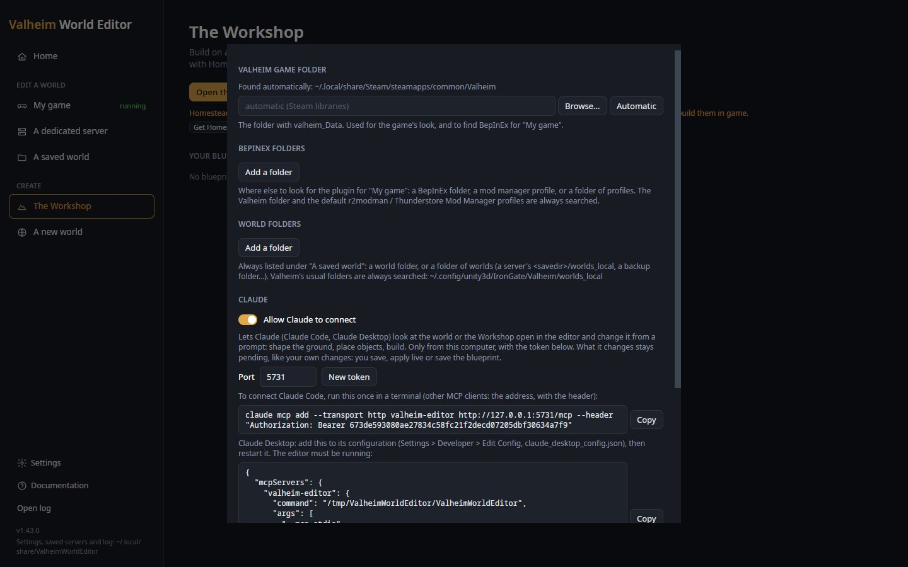
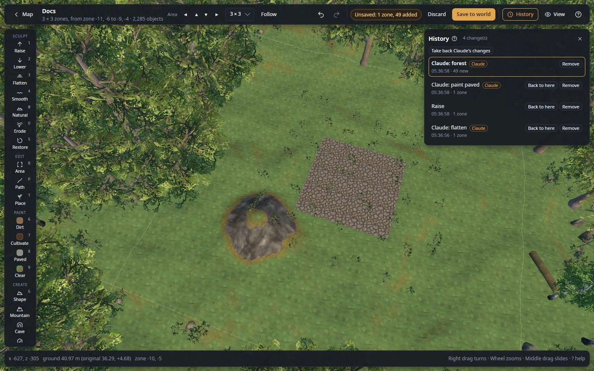

# Claude

Let Claude (in Claude Code, Claude Desktop or another MCP client) shape the ground, plant, build and generate dungeons
in the world or Workshop you have open, from a prompt, while you watch in the 3D view.

**Where:** start page, **Settings** → **Claude** · **Key:** none · **Works in:** saved worlds, live (with **Auto** off),
the Workshop


*Left: the **Claude** section switched on and listening; copy the command into a terminal (Claude Code) or the lines
into Claude Desktop's configuration. Right: the end of Settings, with **Save**. Your command holds your own token where
this picture says `<token>`, and the lines your own program's path.*

Whatever Claude changes stays **pending**, like your own changes: one step of History each (`Ctrl+Z` takes it back),
counted in the top bar. Claude never saves a world and never applies anything to a live game: you do, when you like
what you see. To set it up step by step, see [Let Claude shape or build](guides/connect-claude.md).

## Use it

1. In **Settings** on the start page, turn on **Allow Claude to connect** and press **Save**.
2. Add the editor to Claude once: run the command Settings shows (Claude Code), or add its lines to Claude Desktop's
   configuration.
3. Open a world's area or the Workshop (or ask Claude to open one).
4. Ask Claude for what you want ([Asking](#asking)) and watch it work in the 3D view.
5. Keep what you like: **Save to world**, **Apply live** or **Save blueprint**. Take back what you do not like with
   `Ctrl+Z`, **Discard**, or **Take back Claude's changes** in History.

## Settings

In **Settings** (on the start page), section **Claude**:

| Setting | What it does |
|---|---|
| **Allow Claude to connect** | On: the editor takes Claude's requests, from this computer only, from callers with the token. Off: nothing can connect. |
| **Claude may run scripts** | On: Claude may run C# scripts, as the [Script](scripting.md) tool does, each one shown to you first to run or refuse. A script is a program with your rights on this computer, your files included. Off (the default): Claude's scripts are refused; its other tools still work. |
| **Port** | The port Claude connects to on `127.0.0.1`: 5731 at first, 1024 to 65535. Change it if another program uses 5731. |
| **New token** | Makes another token. Once you **Save**, the old one stops working: add the editor to Claude again with the new command. |
| Claude Code command, **Copy** | The command that adds the editor to Claude Code. It holds the token: keep it to yourself. |
| Claude Desktop lines, **Copy** | The lines to add to Claude Desktop's configuration. |

After **Save**, the section shows "Listening on http://127.0.0.1:5731/mcp", or why it could not ("Could not listen on
port …" when the port is taken).

## Adding the editor to Claude

**Claude Code:** run the command Settings shows, once, in a terminal. It looks like this, with your token:

```sh
claude mcp add --transport http valheim-editor http://127.0.0.1:5731/mcp --header "Authorization: Bearer <token>"
```

In Claude Code, `/mcp` then lists **valheim-editor** as connected while the editor runs.

**Claude Desktop** starts a program rather than connecting to an address. Add the lines Settings shows to its
configuration (Claude Desktop → Settings → Developer → Edit Config, `claude_desktop_config.json`), then restart it:

```json
{
  "mcpServers": {
    "valheim-editor": { "command": "/path/to/ValheimWorldEditor", "args": ["--mcp-stdio"] }
  }
}
```

`--mcp-stdio` opens no window: it passes Claude's messages to the editor that is running (with **Allow Claude to
connect** on), with the token from its settings.

**Other MCP clients** connect to the address (streamable HTTP) with the same `Authorization` header.

The editor must be running for Claude to reach it.

## What Claude can do

Claude's tools call the same code as the editor's own tools and buttons, so what it makes follows the same game rules
as your edits: the 8 m ground limit unless No limit is asked for, the snapping of building pieces, zones, locations.
Each step it makes is named "Claude: …" in History and carries a **Claude** tag. It checks its work with pictures of
the 3D view and the map, and with the support check.

| Claude can | Its tools |
|---|---|
| See what is open, the worlds on this computer, and an area's heights, biomes, water and objects; open an area of 1 to 17 zones; search the whole world for a kind, a chest's item or a sign's text; list the start, traders, altars and dungeon entrances | `editor_state`, `list_worlds`, `open_world`, `open_area`, `describe_area`, `list_objects`, `ground_at`, `search_world`, `list_locations` |
| Look at its work: pictures of the 3D view (any camera, or four views of a place at once) or the map, a map of the area from above with a grid in metres, the support check (which pieces would fall) | `screenshot`, `area_map`, `support_check` |
| Use your selection, and show you what it means | `get_selection`, `select_objects` |
| Set any control as you would (View switches, tool settings, the rail) | `list_controls`, `set_control` |
| Look up the game's pieces and how they fit | `find_prefabs`, `piece_info`, `building_guide`, `list_blueprints` |
| Look at a seed's world (biomes, start, traders, bosses) and make a new world of a name and seed | `preview_seed`, `create_world` |
| Level, paint, smooth, naturalize, erode, restore, raise or lower ground; press a stamp or a heightmap picture; dig a river, moat, cave or ramp along a line; lay a road; mark zones for reset; regrow the game's trees and rocks | `flatten`, `paint_area`, `shape_ground`, `stamp`, `import_heightmap`, `dig_path`, `road`, `reset_zones`, `regrow_nature` (most take a [Mask](masks.md)) |
| Plant trees or rocks, put down pieces and objects (they snap like the hammer), copy objects once or in a row or ring, swap objects for another kind, take objects away | `forest`, `place_pieces`, `copy_objects`, `replace_objects`, `remove_objects` |
| Build a floor, walls with doors and a gable roof (26° or 45°, thatch or shingle) over a rectangle; open the Workshop; add a blueprint to the plot or an area; save the plot as a blueprint | `build_floor`, `build_walls`, `build_roof`, `place_pieces`, `open_workshop`, `add_blueprint`, `save_blueprint` |
| Move and turn objects as a group, or place, tilt and size each exactly; fill a chest, dress an armour stand or item stand, write a sign, give a creature stars; change a portal's tag, a builder, a ward's permitted players, health, fuel, a creature's level or tamed state | `move_objects`, `set_transform`, `get_object`, `set_object_data`, `set_contents` |
| Generate a dungeon on the plot or above a point of the world behind its entrance; list a game dungeon's rooms; add a room at an open end, take one out, cap every open end, set a door | `generate_dungeon`, `list_dungeons`, `dungeon_rooms`, `add_dungeon_room`, `remove_dungeon_room`, `close_dungeon_ends`, `set_dungeon_door` |
| Run a script (with your leave) | `run_script`, `script_reference` |
| Undo and redo | `undo`, `redo` |

A few rules worth knowing:

- `open_world` is refused while the open world or the Workshop has changes not saved.
- `save_blueprint` saves the Workshop's building only when asked, and never replaces a blueprint unless told to.
  Saving a blueprint again keeps its description and tags.
- `generate_dungeon` refuses a biome, style or wall material it does not know, and lists the ones it does.
- `move_objects` keeps a building's shape, and a part of a mod's linked group (a ship and its pieces) brings its whole
  group, also for copies and removals.
- A dungeon Claude generates on the Workshop's plot is part of the plot's building, pending like the rest; it is not
  added to your library.
- When Claude connects, the editor gives it a short guide to working in it, and two ready prompts:
  *build_in_workshop* and *shape_area*.

## Asking

Open the world or the Workshop yourself, or ask Claude to. Then, for example:

- "Open the area around 1200, -340 and make a valley with a river running north, with birches along it."
- "Flatten a 40 m square in the middle of the area, pave it, and put a ring of torches round it."
- "In the Workshop, build a small longhouse: stone floor, wooden walls with two doors, a 45° thatch roof. Check that
  it stands."
- "Open the area around 800, 950 and generate a two-level Swamp crypt above it."
- "These trees I selected: replace them with beeches." (Select them first; Claude reads your selection.)

Ground work, forests and dungeons are the easiest to ask for. Detailed buildings placed piece by piece may take a few
rounds ("the roof overhangs on the east side, fix it"), or start from one of your blueprints.


*Claude's steps are named "Claude: …" and tagged **Claude**; your own **Raise** sits between them. **Take back Claude's changes** at the top removes Claude's steps and keeps yours.*

## Taking back Claude's changes

- `Ctrl+Z` takes back the last step, Claude's or yours.
- In **History**, **Remove** on a step tagged **Claude** takes that step out and keeps everything done after it.
- **Take back Claude's changes** (at the top of History, while Claude has changes in) removes every step Claude made
  in the open area's history, newest first, and keeps yours, even those made after Claude's. The status bar says how
  many were taken back, and how many of Claude's steps made in other areas are kept: open those areas to take them
  back too (see [The history belongs to the world](concepts/saving-and-history.md#the-history-belongs-to-the-world)).
- **Discard** throws away everything not saved, yours too.

This works after saving or applying too: the next **Save to world** or **Apply live** writes it. See
[Undo a step, take back one change, or discard everything](guides/undo-changes.md).

## Safety

- **This computer only.** The editor listens on `127.0.0.1` and refuses any request addressed to another name, so a
  web page you visit cannot reach it.
- **The token.** Every request must carry the token (48 random characters made for your editor). **New token** makes
  another one.
- **Pending only.** Claude never saves, applies live, discards, reloads, writes or deletes your files, or connects to
  a live game: no tool does these, and `set_control` refuses those controls.
- **Scripts need your leave, each one.** `run_script` (dry runs too) and the Script tool's **Run** are refused until you
  turn on **Claude may run scripts**. Then each script Claude writes is shown to you before it runs: **Run it** or
  **Refuse** (Enter and Esc refuse). A dry run and then the same script's run in the same area ask once; every
  other run asks again. Claude's
  other tools (`flatten`, `road`, `forest`…) run the editor's own code and are not asked.
- **What a world says is not an order.** Signs, portal tags and names are written by players, and a blueprint or a
  mod's data by others: Claude is told to treat them as data. A sign that tries to give Claude orders cannot run a
  script without you seeing it first.
- **Live with Auto on: nothing.** While the open world is live with **Auto** on, each change would reach the game at
  once, so Claude changes nothing but the View panel and asks you to turn Auto off.
- **Off is off.** Turn **Allow Claude to connect** off and nothing can connect.

More in [Scripts and Claude](concepts/safety.md#scripts-and-claude).

## Shortcuts

Claude adds no keys. `Ctrl+Z` and `Ctrl+Y` undo and redo its steps as yours.

## Tips and limits

- The editor must be running, with **Allow Claude to connect** on, for Claude to reach it. If it cannot, see
  [Claude cannot connect](help/troubleshooting.md#claude-cannot-connect).
- After **New token** and **Save**, run the new Claude Code command again (the old token stops working). Claude
  Desktop reads the new token by itself.
- Claude sees the open area only. Ask it to open another area, or a bigger one, for bigger works.

### The building skill (Claude Code)

Optional, for buildings that should look hand-made: the editor's repository has a Claude Code skill,
[`.claude/skills/valheim-build`](../.claude/skills/valheim-build/SKILL.md). With it, Claude looks up real Valheim builds
for ideas, writes a short design brief, shapes the ground, tries unfamiliar pieces in a small mock-up, builds in
phases with proven helpers (arched windows, cornices, battlements, round towers, tile roofs, timber-framed halls),
then checks its own work for blocked windows, doubled pieces and bad junctions. Interiors get framing, lighting and
furnishing; the outside gets paths, lights and planting.

Claude Code loads it by itself when you work in the repository. To have it everywhere, copy the folder to your own
skills: `cp -r .claude/skills/valheim-build ~/.claude/skills/`. Then ask as usual, for example "Build a Gothic castle
with a moat in the Workshop". What it knows about pieces is in its `references/pieces.md`; corrections are welcome
there.

## Related

- [Let Claude shape or build](guides/connect-claude.md)
- [Undo a step, take back one change, or discard everything](guides/undo-changes.md)
- [Safety](concepts/safety.md#scripts-and-claude): scripts and Claude
- [Script](scripting.md): what `run_script` runs
