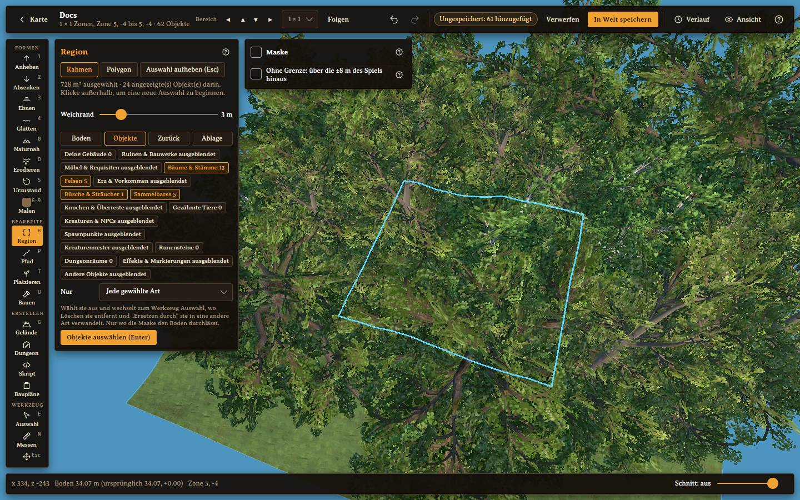
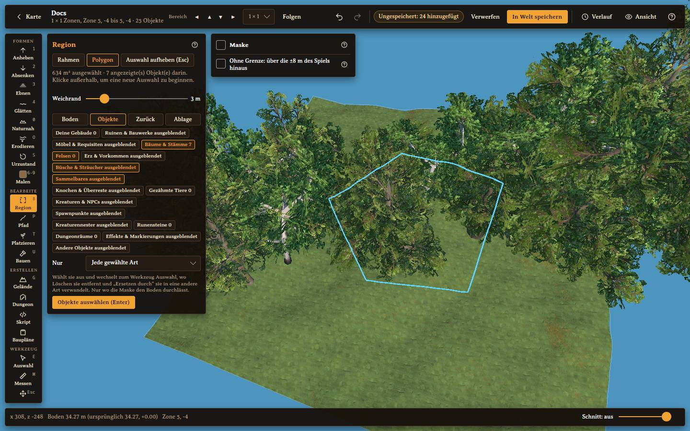
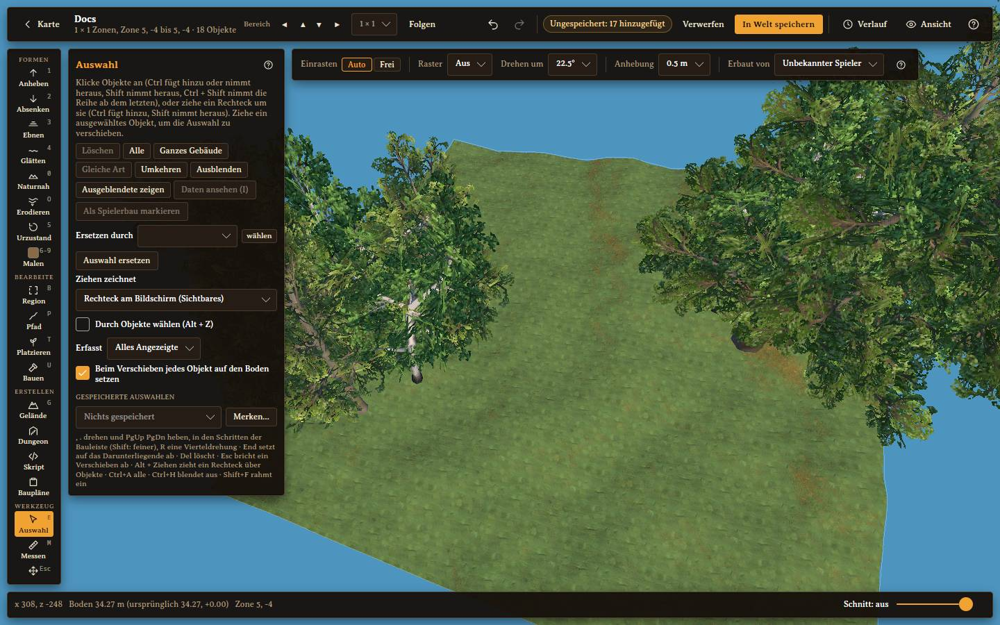
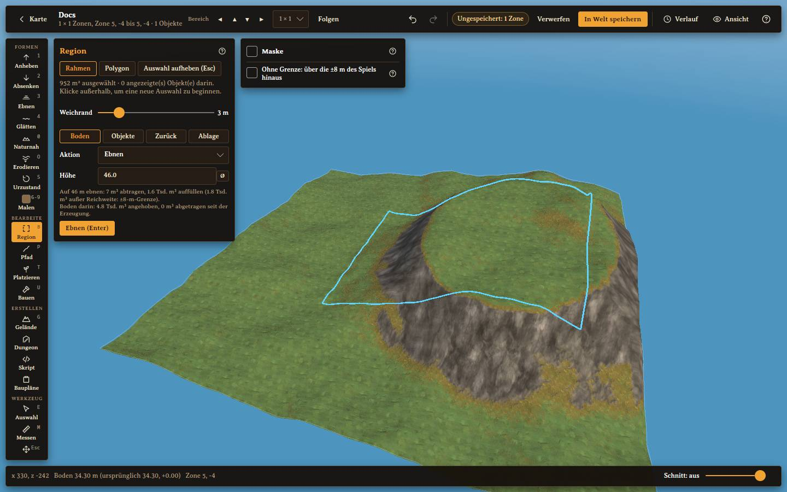
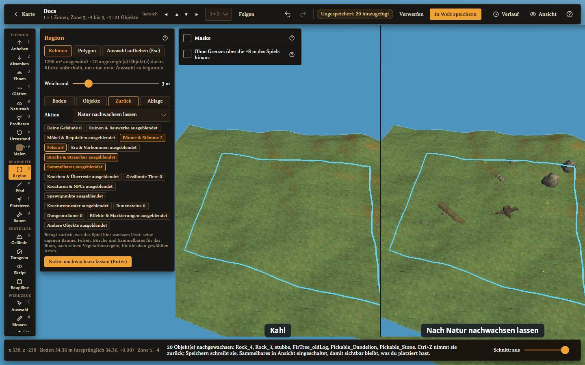
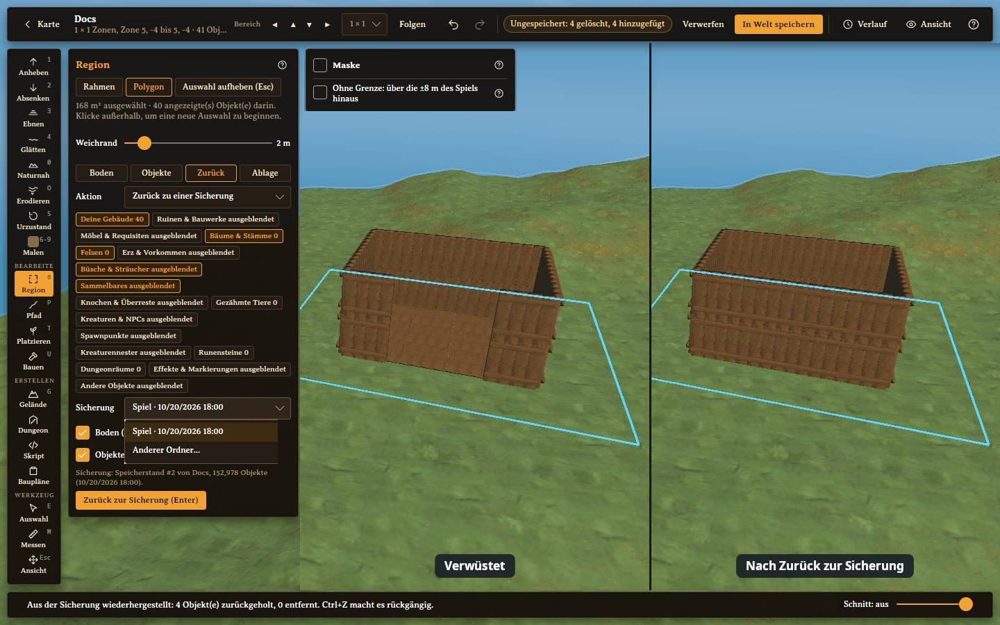
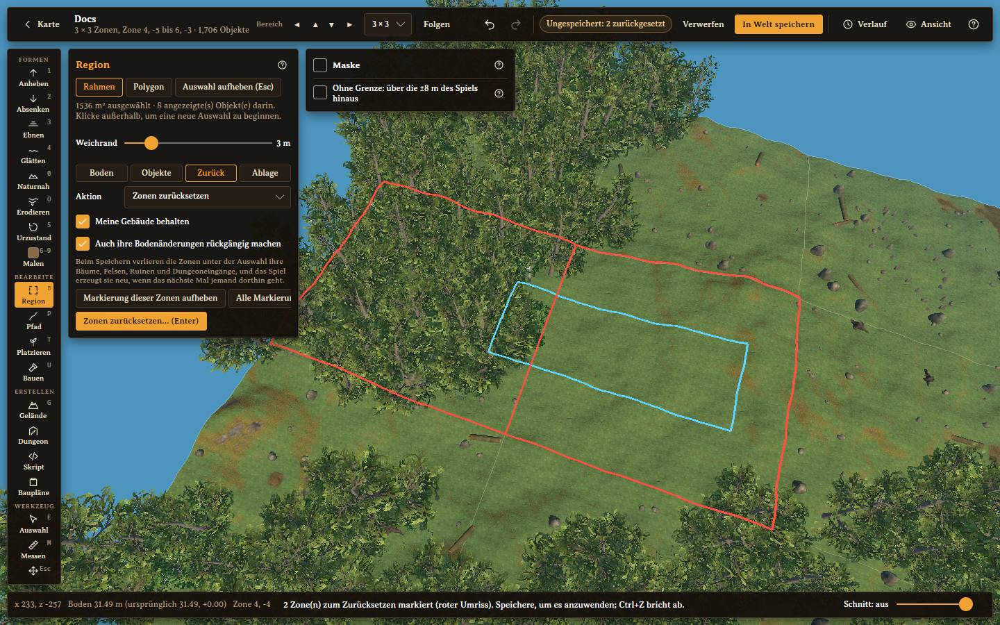
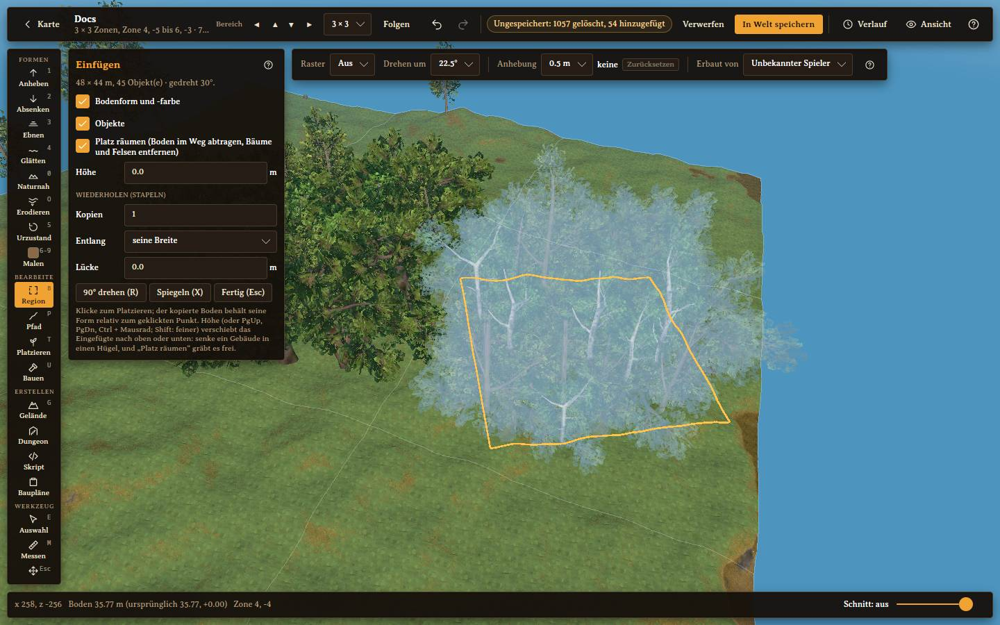
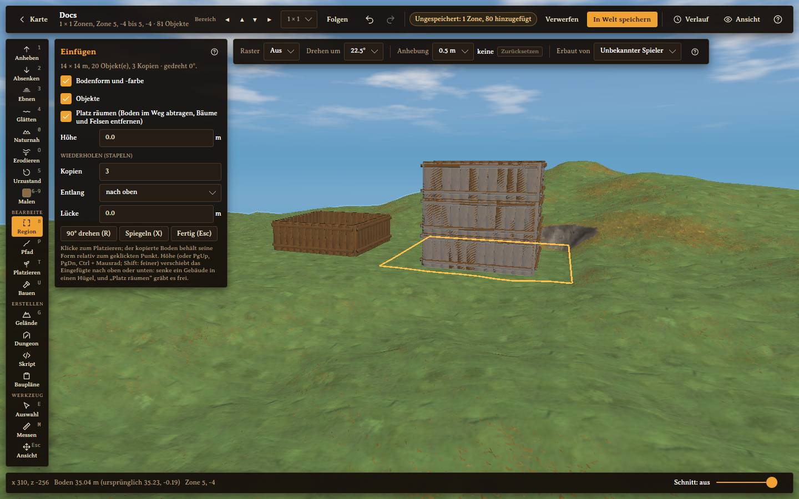
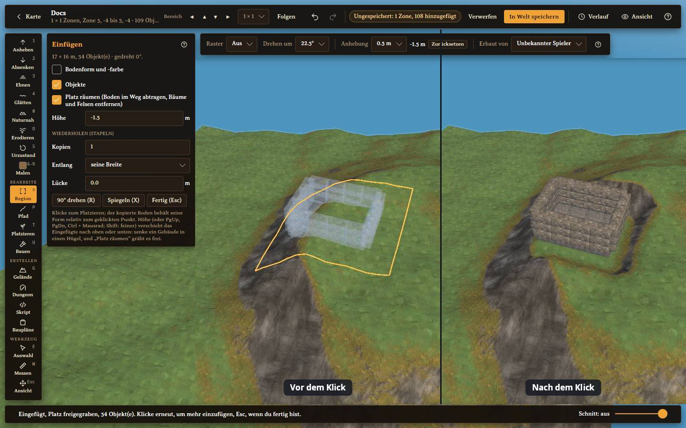

<!-- source: 89a0aafb -->
# Region, Kopieren und Einfügen

Ändere alles in einem Rahmen oder Polygon auf einmal: ebne oder bemale seinen Boden, wähle seine Objekte aus, um sie
zu löschen oder zu ersetzen, kopiere es und füge es ein, oder setze es so zurück, wie es war: der erzeugte Boden, eine
Sicherung, die eigene Natur des Spiels.

**Wo:** Werkzeugleiste, Abschnitt **BEARBEITEN** · **Taste:** `B` · **Funktioniert in:** gespeicherten Welten, live

*Ein Rahmen um eine Baumgruppe mit gewähltem **Objekte**: Die Art-Chips zählen die Bäume, Felsen, Büsche und das
Sammelbare darin. Noch hat sich nichts geändert: Die Schaltfläche unten wählt sie aus.*

## Benutzen

1. Klicke in der Werkzeugleiste auf **Region** (`B`).
2. Wähle oben im Panel **Rahmen** oder **Polygon** und zeichne die Auswahl auf den Boden.
3. Wähle eine Gruppe: **Boden**, **Objekte**, **Zurück** oder **Ablage**. Boden und Zurück bieten
   dann ihre Aktionen in der Liste **Aktion** an. Das Panel zeigt nur die Einstellungen der gewählten Aktion und eine
   Zeile, die sagt, was sie tut.
4. Drücke die Schaltfläche unten oder `Enter`. Ihre Beschriftung nennt die Aktion: **Ebnen (Enter)**, **Objekte
   auswählen (Enter)**, **Natur nachwachsen lassen (Enter)**…
5. Nicht richtig? `Ctrl+Z` nimmt es zurück: Jede Aktion ist ein Schritt im Verlauf. **In Welt speichern** (oder
   **Live anwenden**) behält es.

| Gruppe | Was darin ist |
|---|---|
| **Boden** | [Bodenaktionen](#bodenaktionen): Ebnen, Anheben, Absenken, Glätten, Naturnah, Erodieren, Malen und [Höhenkarte](#höhenkarte). |
| **Objekte** | [Objekte auswählen](#objektaktionen): die Objekte darin, nach Art, an das Werkzeug Auswahl übergeben, um sie zu löschen, zu ersetzen oder zu verschieben. |
| **Zurück** | [Was dort war](#zurückholen-was-dort-war), zurückgeholt: [Zurück zum Urzustand](#zurück-zum-urzustand), [Natur nachwachsen lassen](#natur-nachwachsen-lassen), [Zurück zu einer Sicherung](#zurück-zu-einer-sicherung), [Zonen zurücksetzen](#zonen-zurücksetzen). |
| **Ablage** | [Kopieren und Einfügen](#kopieren-und-einfügen) sowie [Baupläne](#baupläne). |

Die gewählte Aktion wird gespeichert, und jede Gruppe kommt mit der Aktion zurück, auf der sie zuletzt stand. Die
[Maske](masks.md), auf ihrer eigenen Karte neben dem Panel, beschränkt die Bodenaktionen, Objekte auswählen, Natur
nachwachsen lassen und Zurück zu einer Sicherung auf den Boden, den sie durchlässt.

## Einstellungen

| Einstellung | Was sie tut |
|---|---|
| **Rahmen** | Ziehe ein Rechteck auf den Boden. Ein Rahmen kleiner als ein Meter wird verworfen. Ziehen an einer anderen Stelle beginnt einen neuen Rahmen. |
| **Polygon** | Klicke Ecken an. Ein Doppelklick oder `Enter` schließt die Form (mindestens drei Ecken); `Backspace` entfernt die letzte Ecke. Ein Klick nach dem Schließen beginnt eine neue. |
| **Auswahl aufheben (Esc)** | Hebt die Auswahl auf, um eine neue zu beginnen. |
| **Weichrand** | 0 bis 20 m (anfangs 3 m). Die Bodenaktionen setzen über so viele Meter innerhalb des Umrisses allmählich ein, sodass das Ergebnis in das Land ringsum übergeht. Bei **0** ist der Rand scharf und folgt einem schrägen Umriss gerade. |
| **Boden**, **Objekte**, **Zurück**, **Ablage** | Die gezeigte Gruppe von Aktionen (siehe die Tabelle oben). |
| **Aktion** | Die Aktionen der Gruppe, bei Boden und Zurück. Objekte und Ablage haben je eine Aktion, daher keine Liste. |

Die Zeile unter den Schaltflächen nennt die Fläche und wie viele angezeigte Objekte darin sind („1250 m² ausgewählt ·
84 angezeigte(s) Objekt(e) darin“). Die Auswahl wird nur im Werkzeug Region und beim Einfügen gezeichnet; sie bleibt
erhalten, wenn du ein anderes Werkzeug benutzt.

*Ein geschlossenes Polygon um einen Teil eines Walds, mit gewähltem **Objekte**.*

*Nach **Objekte auswählen (Enter)**, dann `Del` im Werkzeug Auswahl: Die Bäume im Polygon sind weg, die außerhalb
stehen noch.*

## Bodenaktionen

Jeder Punkt wird durch **Weichrand** und durch die Maske abgeschwächt. Das sind die Aktionen der
[Pinsel](terrain.md) und des Werkzeugs [Pfad](path.md), unter denselben Namen: Hier wirken sie in einem Zug auf die
ganze Auswahl.

| Aktion | Was sie tut |
|---|---|
| **Ebnen** | Ebnet den Boden darin auf **Höhe** (m). **Ø** setzt die Höhe auf die mittlere Bodenhöhe darin. |
| **Anheben** / **Absenken** | Hebt / gräbt den Boden darin um **Betrag** (m). |
| **Glätten** | Gleicht Unebenheiten aus: Jeder Punkt wandert zum Mittel des Bodens im Umkreis von 3 m. |
| **Naturnah** | Der Boden wird geglättet, dann kommen natürliche Buckel hinzu. **Buckel**, **Buckelgröße** und **Neues Muster** erscheinen darunter: Es sind die des Pinsels [Naturnah](terrain.md#naturnah), dieselben Werte, wo immer du sie einstellst. |
| **Erodieren** | Lässt den Boden in einem Zug verwittern: Hänge setzen sich, Regen schneidet Rinnen und hinterlässt Schuttfächer, Hänge setzen sich erneut. **Schüttwinkel** erscheint darunter: der des Pinsels [Erodieren](terrain.md#erodieren), derselbe Wert, wo immer du ihn einstellst. |
| **Malen** | Bemalt den Boden darin mit **Erde**, **Kultiviert**, **Gepflastert** oder **Farbe entfernen** (die Liste darunter). |
| **Höhenkarte** | Der Boden als Graustufenbild, hinaus und wieder hinein: siehe [Höhenkarte](#höhenkarte). |

Um den Boden auf den Zustand zurückzusetzen, den die Welt erzeugt hat, wähle **Zurück**, dann
[Zurück zum Urzustand](#zurück-zum-urzustand).

Die Bodenaktionen bleiben innerhalb der ±8 m des Spiels, außer **Ohne Grenze: über die ±8 m des Spiels hinaus** ist
auf der Karte **Maske** neben dem Panel angehakt: der eine Schalter für jedes Bodenwerkzeug, der an bleibt, bis du ihn
ausschaltest. Siehe [Ohne Grenze](terrain.md#ohne-grenze).

Unter **Ebnen**, **Anheben** und **Absenken**:

| Einstellung | Was sie tut |
|---|---|
| Zeile für Abtrag und Auftrag | Wie viel Boden die Aktion bewegen würde („Auf 35 m ebnen: 120 m³ abtragen, 340 m³ auffüllen“) und bei Ebnen, was außer Reichweite ist („(40 m³ außer Reichweite: ±8-m-Grenze)“; mit Ohne Grenze nur, was jenseits seiner ±400 m liegt). Die zweite Zeile, „Boden darin: … angehoben, … abgetragen seit der Erzeugung“, vergleicht mit der Welt, wie sie erzeugt wurde. Beide folgen jeder Änderung, dem weichen Rand und der Maske. |

*Ein Rahmen über einem Hügel mit **Ebnen** auf 46 m und **Ohne Grenze** aus: „Auf 46 m ebnen: 0 m³ abtragen, 1.5 Tsd.
m³ auffüllen (2.2 Tsd. m³ außer Reichweite: ±8-m-Grenze)“, und darunter der Boden, der darin seit der Erzeugung der
Welt schon angehoben wurde.*

### Höhenkarte

Exportiere den Boden als Graustufenbild, ändere es in einem Bildbearbeitungsprogramm (GIMP, Krita…) oder einem
Geländewerkzeug (Gaea, World Machine…) und hole es zurück.

| Einstellung | Was sie tut |
|---|---|
| **Exportieren** | Schreibt den Boden im Rechteck der Auswahl, oder im ganzen offenen Bereich, wenn nichts ausgewählt ist, als 16-Bit-Graustufen-PNG: Schwarz ist sein tiefster Punkt, Weiß sein höchster, Norden oben, ein Pixel pro Meter (ein ganzer 3 × 3-Bereich ist 193 × 193 Pixel groß). Es landet im Ordner `heightmaps` des Datenordners des Editors; die Statusleiste sagt, wo. Ein Polygon wird als das Rechteck darum exportiert. |
| **Importieren…** | Liest ein PNG (Graustufen oder Farbe, 8 oder 16 Bit) und passt es an das Rechteck der Auswahl an, oder an den ganzen Bereich, wenn nichts ausgewählt ist. |
| **Tiefster** / **Höchster** | Die Höhen für Schwarz und Weiß. Ein vom Editor exportiertes Bild bringt seine eigenen mit, sodass ein unverändertes Bild den Boden genau wiederherstellt. |
| **In den Boden setzen** | Setzt den Boden auf die Höhen des Bilds, ein Rückgängig-Schritt. In einer Auswahl blendet **Weichrand** es ein. Die Maske und die ±8-m-Grenze gelten (außer Ohne Grenze ist an): Punkte, die ihre Höhe nicht erreichen können, werden rot, und die Statusleiste zählt sie. |
| **Abbrechen** | Vergisst das Bild, ohne den Boden zu ändern. |

Nimm 16 Bit, wenn du kannst: Ein 8-Bit-Bild hat nur 256 Stufen zwischen Tiefster und Höchster (20-cm-Stufen auf 50 m).

*Ohne Auswahl, nach **Exportieren**, dann **Importieren…** desselben Bilds: „Bild 65 × 65 an 65 × 65 m angepasst (der
ganze Bereich), mit den Höhen, mit denen es exportiert wurde“, **Tiefster** und **Höchster** daraus gelesen. Nichts
ändert sich bis **In den Boden setzen**.*

## Objektaktionen

Das Werkzeug Region wählt, **welche** Objekte: die in der Auswahl, der Arten, die du einschaltest, wo die Maske den
Boden durchlässt. Das Werkzeug [Auswahl](select.md) macht dann etwas **mit** ihnen: löschen, ersetzen, verschieben,
drehen, kopieren, ausblenden.

Eine Reihe von **Art-Chips** wählt die Arten. Jeder Chip zeigt, wie viele Objekte seiner Art darin sind („Bäume &
Stämme 42“). Anfangs sind **Bäume & Stämme**, **Felsen**, **Büsche & Sträucher** und **Sammelbares** an; wähle
**Deine Gebäude** für von Spielern gebaute Teile, **Erz & Vorkommen** für Kupfer, Zinn, Silber und Ähnliches.
Dieselben Chips wählen die Arten für [Natur nachwachsen lassen](#natur-nachwachsen-lassen) und
[Zurück zu einer Sicherung](#zurück-zu-einer-sicherung).

Ein Chip mit „ausgeblendet“ ist eine Art, die im [Panel Ansicht](editor-basics.md) ausgeschaltet ist: Ihre Objekte
werden nicht gezählt und bleiben unberührt, außer bei **Zurück zu einer Sicherung**.

| Einstellung | Was sie tut |
|---|---|
| Art-Chips | Die Arten der erfassten Objekte. |
| **Nur** | **Jede gewählte Art** erfasst alle. Oder wähle ein Objekt unter denen darin, aufgeführt mit ihrer Anzahl, das häufigste zuerst („Beech1 (42)“): Nur diese werden erfasst. Die Liste folgt den Chips. |
| **Objekte auswählen (Enter)** | Wählt sie aus und wechselt zum Werkzeug Auswahl. Die Statusleiste sagt, wie viele. Wenn nichts von den gewählten Arten darin ist, sagt sie das, und das Werkzeug Region bleibt. |

Dann im Werkzeug Auswahl:

| Um | Tu dies |
|---|---|
| Sie zu entfernen | Drücke `Del` (oder **Löschen**). Ein Schritt im Verlauf; `Ctrl+Z` holt sie zurück. Eine verbundene Gruppe (das Schiff einer Mod) verschwindet ganz. |
| Sie durch eine andere Art zu ersetzen | Wähle die Art unter **Ersetzen durch** (oder **wählen** aus der Welt), dann **Auswahl ersetzen**. Um nur die Buchen eines Walds zu ersetzen, wähle sie zuerst unter **Nur**. Siehe [Auswahl](select.md#einstellungen). |
| Sie zu verschieben, zu drehen, zu kopieren, auszublenden | Wie bei jeder Auswahl: siehe [Auswahl](select.md). |
| Zurückzukommen | Drücke `B`: Der Rahmen oder das Polygon ist noch da. |

## Zurückholen, was dort war

Vier Wege, zurückzuholen, was dort war, vom leichtesten zum schwersten.

| Aktion | Was sie zurückholt |
|---|---|
| **Zurück zum Urzustand** | Den Boden darin, wie die Welt ihn erzeugt hat. Objekte bleiben. |
| **Natur nachwachsen lassen** | Die Bäume, Felsen, Büsche und das Sammelbare, die das Spiel hier wachsen lässt, auf dem Boden, wie er jetzt ist. |
| **Zurück zu einer Sicherung** | Den Boden und die Objekte darin, wie sie in einer Sicherung dieser Welt waren. |
| **Zonen zurücksetzen** | Ganze Zonen, die das Spiel neu erzeugt, wenn das nächste Mal jemand dorthin kommt. |

### Zurück zum Urzustand

Der Boden darin kehrt in den Zustand zurück, in dem die Welt ihn erzeugt hat: seine Höhe (auch mit Ohne Grenze
angehobener oder gegrabener Boden) und seine Farbe. Abgeschwächt durch **Weichrand** und durch die Maske, wie
die [Bodenaktionen](#bodenaktionen). Es tut für einen Rahmen oder ein Polygon, was der Pinsel
[Urzustand](terrain.md#urzustand) unter dem Cursor tut.

### Natur nachwachsen lassen

*Links: ein Rahmen auf kahlem Boden. Rechts: derselbe Rahmen nach **Natur nachwachsen lassen**: die eigenen Bäume und
Felsen des Spiels für das Biom, und die Statusleiste sagt, was gewachsen ist.*

Natur nachwachsen lassen bringt die Bäume, Felsen, Büsche, das Sammelbare und das Erz zurück, die das Spiel hier
wachsen lässt, für die mit den [Art-Chips](#objektaktionen) gewählten Arten, in der Auswahl und wo die Maske es
erlaubt. Nutze es, um das Roden eines Walds rückgängig zu machen oder umgestalteten Boden zu begrünen.

- **Es folgt den eigenen Regeln des Spiels** und dem Seed der Welt: Auf Boden, der noch wie erzeugt ist, bekommst du
  dieselben Bäume an denselben Stellen zurück. Alternativbiome (Dark Meadows, Rock Black Forest…) bekommen, was sie
  hinzufügen.
- **Es verwendet den Boden, wie er jetzt ist**: Ein Hügel, den du angehoben hast, bekommt, was auf seiner neuen Höhe
  und Neigung wächst.
- **Es verdoppelt nicht, was schon steht**: Nichts wächst im Umkreis von 1 m um ein Objekt, 3 m um eines derselben Art
  oder 4 m um ein Bauteil, noch dort, wo ein Ort (ein Dorf, ein Dungeoneingang) seinen Boden frei hält.
- **Bis zu 16 Zonen auf einmal** (256 × 256 m): Wähle für mehr eine kleinere Auswahl.
- Wenn eine Art, die es hat wachsen lassen, in Ansicht ausgeblendet ist, schaltet es sie ein, damit das Gewachsene
  sichtbar bleibt.

Die Regeln vollständig: [Wachstumsregeln](concepts/objects.md#wachstumsregeln).

### Zurück zu einer Sicherung

Setze die Auswahl so zurück, wie sie in einer Sicherung dieser Welt war, um Griefing, einen schlimmen Überfall oder
eine bereute Bearbeitung rückgängig zu machen, ohne die ganze Welt zurückzusetzen. Schritt für Schritt:
[Einen Bereich aus einer Sicherung wiederherstellen](guides/restore-from-backup.md).

| Einstellung | Was sie tut |
|---|---|
| **Sicherung** | Die Sicherungen neben dem Weltordner, die neuesten zuerst: die eigenen des Spiels („Spiel · Datum“) und die des Editors aus älteren Versionen („Editor · Datum“). **Anderer Ordner…** wählt jede andere Kopie derselben Welt, etwa eine auf diesen Computer kopierte Serversicherung; live ist die Liste leer, also ist das der Weg. Eine Kopie einer anderen Welt (anderer Seed) wird abgelehnt. Die Zeile darunter sagt, welcher Speicherstand es ist und wie viele Objekte er enthält. |
| **Boden (Höhe und Farbe)** | Der Boden darin kommt genau so zurück wie in der Sicherung, Boden ohne Grenze eingeschlossen; innerhalb von **Weichrand** geht er allmählich über. Die Maske gilt. |
| **Objekte der oben gewählten Arten** | Objekte der mit den [Art-Chips](#objektaktionen) gewählten Arten kommen mit all ihren Daten zurück: Eine wiederhergestellte Truhe hat ihren Inhalt. Wähle **Deine Gebäude**, um Gebäude zurückzuholen. |
| **Zurück zur Sicherung (Enter)** | Führt es aus: ein Schritt im Verlauf. |

Ein Objekt, das in beiden gleich ist (gleiche Art, Stelle und Ausrichtung), bleibt unberührt. Jedes andere Objekt der
gewählten Arten darin wird entfernt, selbst wenn es in Ansicht ausgeblendet ist, und jedes Objekt der Sicherung ohne
Gegenstück kommt zurück. Runensteine werden nie angetastet. Wenn sich nichts unterscheidet, meldet die Statusleiste
„Nichts wiederherzustellen: die Auswahl ist so, wie sie in der Sicherung war.“

*Links: ein Polygon um eine Hütte, deren vordere Wand teilweise fehlt, **Zurück zu einer Sicherung** gewählt, die
Liste **Sicherung** auf der Sicherung des Spiels geöffnet und **Deine Gebäude** an. Rechts: nach **Zurück zur
Sicherung (Enter)** ist die Wand wieder ganz; die Zeile über der Schaltfläche nennt den Speicherstand der Sicherung,
die Statusleiste zählt, was zurückkam.*

### Zonen zurücksetzen

Markiere die Zonen unter der Auswahl, damit das Spiel sie neu erzeugt: neue Bäume, Felsen, Erz und Orte. Um Zonen in
der ganzen Welt nach Biom oder Abstand zu Gebäuden zu wählen, verwende die
[Weltkarte](map.md#zonen-in-der-ganzen-welt-zurücksetzen), die dieselben zwei Schalter hat und auf dieselbe Weise markiert;
Schritt für Schritt: [Zonen neu erzeugen](guides/reset-zones.md).

| Einstellung | Was sie tut |
|---|---|
| **Meine Gebäude behalten** | Von Spielern gebaute Objekte in den Zonen bleiben erhalten. Anfangs an. Ist es aus, verschwinden auch die Gebäude in den Zonen. |
| **Auch ihre Bodenänderungen rückgängig machen** | Macht auch die Bodenänderungen der Zonen rückgängig: Höhe (auch Boden ohne Grenze) und Farbe. Die Ansicht zeigt den Boden wie erzeugt, sobald die Zonen markiert sind. Anfangs an. |
| **Zonen zurücksetzen… (Enter)** | Markiert nach einer Rückfrage jede Zone unter der Auswahl zum Zurücksetzen (roter Umriss). |
| **Markierung dieser Zonen aufheben** | Hebt die Markierung der Zonen unter der Auswahl auf: Sie werden nicht zurückgesetzt. |
| **Alle Markierungen aufheben** | Hebt die Markierung jeder zum Zurücksetzen markierten Zone auf, auch der auf der Karte und außerhalb des offenen Bereichs markierten. Ein Schritt im Verlauf. |

Eine Zone zählt, wenn der Umriss mindestens einen ihrer Bodenpunkte einschließt, unabhängig vom weichen Rand: Eine
Zone, außerhalb derer die Auswahl bleibt, wird nicht zurückgesetzt. Das Zurücksetzen geschieht beim Speichern
(offline) oder beim Live-Anwenden (WorldEditorBridge 0.10.0 oder neuer).

> [!CAUTION]
> **Einmal gespeichert oder angewendet, lässt sich ein Zurücksetzen nicht rückgängig machen.** Jeder Baum, Felsen,
> jede Ruine, jeder Dungeoneingang, jede Kreatur und jeder fallengelassene Gegenstand in den Zonen verschwindet; die
> Grabsteine der Spieler bleiben. Gezähmte Tiere haben keinen Erbauer, also verschwinden auch sie: Bring sie zuerst
> weg.

*Ein Rahmen über zwei Zonen, **Zonen zurücksetzen** mit **Meine Gebäude behalten** und **Auch ihre Bodenänderungen
rückgängig machen** an, nach **Zonen zurücksetzen… (Enter)**: beide Zonen rot umrandet, die Statusleiste zählt sie.
Nichts wird zurückgesetzt, bis du speicherst.*

## Kopieren und Einfügen

*Ein kopierter Wald aus ein paar Dutzend Bäumen und Felsen folgt dem Cursor, durchsichtig und um 30° gedreht; die
Zeile oben im Panel Einfügen sagt, was in der Zwischenablage ist. Ein Klick setzt ihn ab.*

Die Gruppe **Ablage** zeigt diese Schaltflächen. `Ctrl+C` und `Ctrl+X` funktionieren mit jeder Aktion des
Werkzeugs Region (und im Werkzeug Auswahl); `Ctrl+V` funktioniert in jedem Werkzeug.

| Einstellung | Was sie tut |
|---|---|
| **Kopieren (Ctrl+C)** | Kopiert jedes angezeigte Objekt darin (egal, was die Art-Chips sagen) und den Boden, auf dem ihre Gebäude stehen. Beim Einfügen behalten Bäume, Felsen und Ähnliches ihre Höhe über dem Boden, wo jedes landet; Bauteile behalten die Form des Gebäudes. Arten, die die Welt nicht erzeugen kann, werden ausgelassen. Die Kopie wird gespeichert: Füge sie in einem anderen Bereich, einer anderen Welt oder nach einem Neustart des Editors ein. |
| **Ausschneiden (Ctrl+X)** | Dieselbe Kopie, dann verlassen die kopierten Objekte die Welt (`Ctrl+Z` holt sie zurück), sodass ein Einfügen sie verschiebt. Der Boden bleibt. |
| **Einfügen (Ctrl+V)** | Beginnt das Einfügen: Die Kopie folgt dem Cursor; klicke, um sie abzusetzen. Füge so viele ein, wie du willst; `Esc` beendet es. |
| **Bauplan speichern…** / **Baupläne…** | Siehe [Baupläne](#baupläne). |

Die Zeile unter den Schaltflächen sagt, was in der Zwischenablage ist („Zwischenablage: 24 × 18 m, 54 Objekt(e).“,
mit dem Namen des Bauplans, wenn er aus der Bibliothek kam). Eine Auswahl ohne angezeigte Objekte kopiert nichts (ihr
Boden kommt nur mit Gebäuden mit): Die Statusleiste sagt das, und die Zwischenablage behält ihren Inhalt.

Eine Kopie enthält:

- **Die Objekte, mit all ihren Daten**: den Inhalt einer Truhe, den Text eines Schilds, ihre Gesundheit, wer sie
  gebaut hat.
- **Nur den Boden unter den Gebäuden**: unter jedem Bauteil plus 1 m, über 3 weitere Meter auslaufend. Der restliche
  Boden der Auswahl wird nicht kopiert, sodass eine eingefügte Stadt im Land sitzt, auf dem sie landet.
- **Höhen auf zwei Arten.** Bäume, Felsen und andere Natur behalten ihre Höhe über dem Boden und folgen dem Boden,
  wo jedes landet. Bauteile und die Teile einer verbundenen Gruppe (das Schiff einer Mod) behalten die Form des
  Gebäudes, gemessen vom mittleren Boden der Kopie aus, der auf die Höhe des Bodens kommt, auf den du klickst.

Die Kopie des Werkzeugs [Auswahl](select.md) enthält nur die Objekte, die du ausgewählt hast, und den Boden unter
ihren Bauteilen ohne seine Farbe. Sie wird auf dieselbe Weise eingefügt.

### Einfügen

*Ein Klick mit **Kopien** 3 und **Entlang** nach oben, vom Boden aus gesehen: neben der ursprünglichen Hütte drei zu
drei Stockwerken gestapelte Kopien (der Umriss ist das nächste Einfügen, das dem Cursor folgt).*

Das Eingefügte muss in den offenen Bereich passen: Sein Umriss wird rot, wenn es nicht passt, und ein Klick dort sagt
das. Öffne zuerst einen größeren Bereich (die Liste der Bereichsgröße in der oberen Leiste oder die [Karte](map.md)).

| Einstellung | Was sie tut |
|---|---|
| **Bodenform und -farbe** | Fügt den Boden unter den Gebäuden ein und behält seine Form relativ zum angeklickten Punkt, bei Bedarf über die ±8 m des Spiels hinaus. Ein Gebäude steht auf dem Boden, auf dem es gebaut wurde. |
| **Objekte** | Fügt die kopierten Objekte ein. |
| **Platz räumen (Boden im Weg abtragen, Bäume und Felsen entfernen)** | Anfangs an. Trägt Boden im Weg eingefügter Bauteile bis zum tiefsten Bauteil ab (hebt nie Boden an) und entfernt Bäume, Felsen, Erz, Büsche und Sammelbares auf ihrer Grundfläche. Gebäude und Kreaturen bleiben. |
| **Höhe** | Verschiebt das Eingefügte nach oben oder unten (m); `PgUp`, `PgDn` und `Ctrl` + Mausrad tun das auch. Senke ein Gebäude in einen Hügel, und Platz räumen gräbt es frei. |

Unter **WIEDERHOLEN (STAPELN)**:

| Einstellung | Was sie tut |
|---|---|
| **Kopien** | Wie viele Kopien ein Klick setzt, 1 bis 50, alle ein Rückgängig-Schritt. |
| **Entlang** | In welche Richtung sie aufeinander folgen: **seine Breite** oder **seine Tiefe** (diese drehen und spiegeln sich mit dem Eingefügten) oder **nach oben** (gestapelte Stockwerke). |
| **Lücke** | Abstand zwischen zwei Kopien (m); negativ überlappt sie. Nach oben ist die Größe einer Kopie ihre Höhe plus ein Meter. |

Unten im Panel:

| Einstellung | Was sie tut |
|---|---|
| **90° drehen (R)** | Eine Vierteldrehung. `,` und `.` drehen um den Schritt **Drehen um** der Bauleiste (`Shift`: 1°). |
| **Spiegeln (X)** | Spiegelt das Eingefügte von Ost nach West, vor dem Drehen. |
| **Fertig (Esc)** | Beendet das Einfügen, zurück zum Werkzeug Region. |

Während du einfügst, erscheint [die Bauleiste](build.md#die-bauleiste) neben dem Panel, dieselbe, die Bauen und
Auswahl verwenden: **Raster** (das Eingefügte richtet sich danach), **Drehen um** und **Anhebung** (die Schritte von
`,` `.` und von `PgUp` `PgDn`; die Leiste zeigt die Höhe, **Zurücksetzen** setzt sie auf null zurück) und **Erbaut
von**.

Nebeneinander liegende Kopien sitzen jeweils auf dem Boden, auf dem sie landen; nach oben gestapelt formt nur die
erste den Boden. Die Zeile oben im Panel sagt, was in der Zwischenablage ist: Name, Größe, Objekte, Kopien, Drehung,
gespiegelt. Die Statusleiste sagt, was das Einfügen getan hat: „Eingefügt mit dem Boden, 54 Objekt(e), Bäume, Felsen
u. Ä. vom Platz geräumt: 7.“

*Mit **Platz räumen** an (**Bodenform und -farbe** aus, **Höhe** -1.5 m): links die durchsichtige Kopie, in die Flanke
eines Erdhügels versenkt; rechts, nach dem Klick, der Boden um ihre Wände weggegraben.*

## Baupläne

Ein Bauplan ist ein als Datei gespeichertes Gebäude, um es in jede Welt einzufügen oder im Spiel mit
[Homestead](https://thunderstore.io/c/valheim/p/sighsorry/Homestead/) zu bauen. Die Bibliothek, die Werkstatt und die
Stabilitätsprüfung findest du unter [Die Werkstatt](workshop.md).

| Einstellung | Was sie tut |
|---|---|
| **Bauplan speichern…** | Speichert die Objekte der Zwischenablage (was Region oder Auswahl zuletzt kopiert hat) als Homestead-Bauplan, mit Namen, Beschreibung und Tags und der Angabe, ob es ein Dungeon ist (siehe [Dungeons](dungeons.md)). Boden und Erbauer werden nicht übernommen. Ein Bauplan mit demselben Namen wird nach einer Rückfrage ersetzt. |
| **Baupläne…** | Öffnet die Bibliothek (auch **Baupläne** in der Werkzeugleiste). **Einfügen** legt einen Bauplan in die Zwischenablage und beginnt das Einfügen. |

Eingefügte Bauteile behalten, was der Bauplan enthält (Schildtexte, Gegenstände auf Ständern, Truheninhalte), und
gelten als gebaut von dem Spieler, der unter **Erbaut von** in [der Bauleiste](build.md#die-bauleiste) gewählt ist
(Bauteile, die niemand gebaut hat, bleiben so). Arten, die das Spiel nicht kennt (nicht installierte Mods), werden
ausgelassen, und der Editor sagt, welche. Ein Dungeon-Bauplan kommt 5000 m nach oben, hinter einen Eingang am Boden,
wo du klickst, so wie das Spiel seine Dungeons ablegt.

## Tastenkürzel

| Taste oder Maus | Was sie tut |
|---|---|
| `B` | Region wählen. |
| Ziehen (Rahmen) / Ecken anklicken (Polygon) | Die Auswahl zeichnen. |
| Doppelklick oder `Enter` | Das Polygon schließen. |
| `Backspace` | Die letzte Ecke des Polygons entfernen. |
| `Enter` | Die gewählte Aktion ausführen. |
| `Enter`, dann `Del` | Mit **Objekte** gewählt: die Objekte darin auswählen, dann löschen (im Werkzeug Auswahl). |
| `Esc` | Die Auswahl aufheben; ein zweites `Esc` verlässt das Werkzeug. |
| `Ctrl+C` / `Ctrl+X` / `Ctrl+V` | Die Auswahl kopieren / ausschneiden / einfügen. |
| Beim Einfügen: `R`, `X` | Um 90° drehen, spiegeln. |
| Beim Einfügen: `,` `.` oder `Alt`+Mausrad | Um den Schritt **Drehen um** der Bauleiste drehen, anfangs 22.5° (`Shift`, feiner: 1°). |
| Beim Einfügen: `PgUp` / `PgDn` oder `Ctrl`+Mausrad | Höhe um den Schritt **Anhebung** der Bauleiste, anfangs 0.5 m (`Shift`, feiner: ein Fünftel davon). |
| Beim Einfügen: `Esc` | Fertig. |

## Tipps und Grenzen

- **Zeichne die Auswahl ein paar Meter größer als die Gebäude**: Der kopierte Boden läuft innerhalb des **Weichen
  Rands** aus, sodass ein Gebäude nahe am Umriss weniger von seinem Boden mitnimmt.
- **Eine große Stadt braucht einen großen Bereich**: Wähle vor dem Einfügen 9 × 9 oder mehr in der Liste der
  Bereichsgröße.
- **Eingefügte Objekte sind neue Objekte** mit allen kopierten Daten, sodass ein Einfügen auch in einer anderen Welt
  funktioniert. Verbundene Gruppen (das Schiff einer Mod) bekommen eigene neue IDs. Live verschiebt ein **Ausschneiden**
  mit anschließendem Einfügen die Objekte im laufenden Spiel, wenn es geht (siehe [Live-Modus](live-mode.md)).
- **Keine Aktion berührt die äußerste Punktreihe des Bereichs** (siehe
  [Der gesperrte Rand](concepts/areas-and-zones.md#der-gesperrte-rand)).
- **Um eine Aktion zurückzunehmen**, `Ctrl+Z`, auch nach dem Speichern (speichere dann erneut: der
  [Verlauf](concepts/saving-and-history.md#verlauf) bleibt); für eine Änderung, die älter ist als der Verlauf,
  [Einen Bereich aus einer Sicherung wiederherstellen](guides/restore-from-backup.md).

## Verwandte Seiten

- [Bäume und Felsen räumen, einen Bauplatz ebnen](guides/clear-an-area.md)
- [Einen Bereich aus einer Sicherung wiederherstellen](guides/restore-from-backup.md)
- [Ein Gebäude verschieben oder kopieren](guides/move-a-building.md)
- [Zonen neu erzeugen](guides/reset-zones.md)
- [Objekte](concepts/objects.md), [Sicherungen](concepts/saving-and-history.md#sicherungen)
- [Wie ein Einfügen seinen Platz räumt](concepts/objects.md#wie-ein-einfügen-seinen-platz-räumt), [wie Natur nachwachsen lassen entscheidet, was wächst](concepts/objects.md#wie-nachwachsen-entscheidet-was-wächst)
