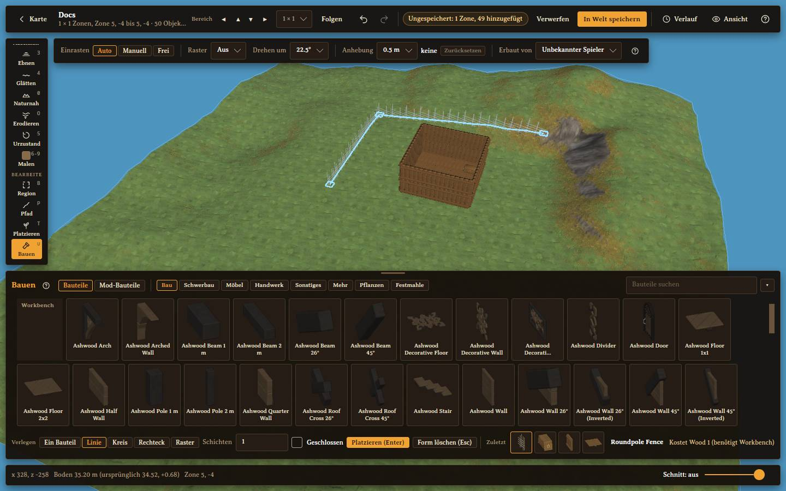
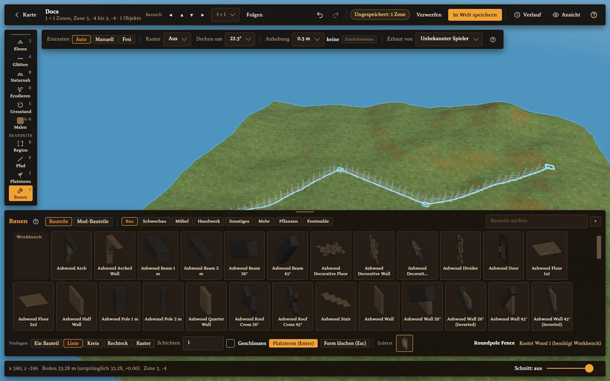
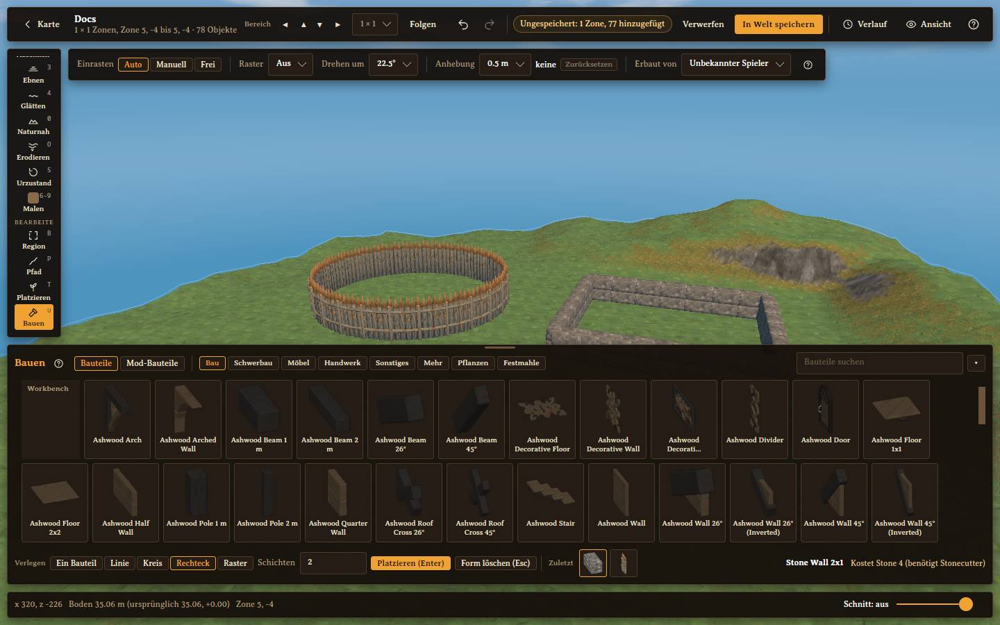
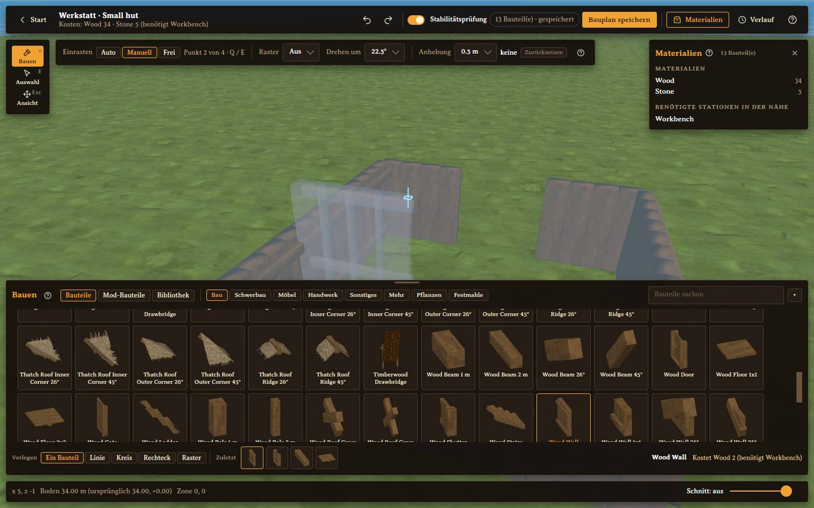

<!-- source: 1f261984 -->
# Bauen

Setze die Bauteile, die Spieler bauen (Wände, Böden, Dächer, Zäune, Möbel, Handwerksstationen), eines nach dem anderen
wie mit dem Hammer des Spiels, oder entlang einer Linie, rund um einen Kreis oder ein Rechteck oder in einem Raster.

**Wo:** Werkzeugleiste, Abschnitt **BEARBEITEN** · **Taste:** `U` (in der Werkstatt auch `T`) · **Funktioniert in:**
gespeicherten Welten, live, der [Werkstatt](workshop.md) und den Räumen eines Dungeons mit [Hier bauen](dungeons.md)

*Bauen in einer Welt: eine Hütte auf geebnetem Boden und ein Rundholzzaun, der entlang einer Linie aus drei Punkten
verlegt wird (**Verlegen** auf **Linie**, vor **Platzieren (Enter)** gezeigt). Unten: die Leiste Bauen mit den Bauteilen
des Reiters **Bau** und der Zeile **Verlegen**. Oben: die Bauleiste mit **Einrasten**, **Raster**, **Drehen um**,
**Anhebung** und **Erbaut von**.*

## Benutzen

Um in einer Welt eine Wand und einen Zaun aufzustellen:

1. Drücke `U`. Die Leiste **Bauen** öffnet sich am unteren Rand des Fensters, und
   [die Bauleiste](#die-bauleiste) neben der Werkzeugleiste.
2. Klicke in der Leiste auf ein Bauteil (suche `wall`). Es folgt dem Zeiger, durchsichtig, dort, wo der Hammer es
   hinsetzen würde.
3. Zeige auf den Boden oder auf ein Bauteil: das Bauteil rastet an den vorhandenen Bauteilen ein. Klicke, um es zu
   setzen.
4. Drücke `,` oder `.`, um das nächste zu drehen, `PgUp` oder `PgDn`, um es zu heben oder zu senken.
5. Für einen Zaun wähle ihn, wähle dann am Fuß der Leiste **Verlegen** → **Linie**, klicke Punkte auf den Boden und
   drücke `Enter`.

Jeder Klick, jede Reihe und jedes `Enter` ist ein Rückgängig-Schritt (`Ctrl+Z`). Nichts wird in die Welt geschrieben,
bis du **In Welt speichern** (oder **Live anwenden**) drückst. Um Bauteile zu verschieben, zu drehen oder zu löschen,
nutze [Auswahl](select.md), das die Bauleiste mitbenutzt.

Bäume, Felsen, Feldfrüchte für ganze Felder und Spawnpunkte werden mit [Platzieren](place.md) gesetzt, nicht mit Bauen.

## Die Leiste Bauen

Die Leiste erstreckt sich über den unteren Rand des Fensters. Ihre Reiter, ihre Suche, **Zuletzt**, die Kosten des
Bauteils und die schnellen Wege (eine Reihe ziehen, `Shift` + Rechtsklick, um ein Bauteil zu entfernen, Mittelklick, um
mit der Art eines Bauteils zu bauen) sind überall gleich: siehe [Die Leiste Bauen](workshop.md#die-leiste-bauen) auf der
Seite der Werkstatt.

Was sich je nach Ort ändert:

| Wo | Die Leiste |
|---|---|
| Der offene Boden einer Welt | **Bauteile** und **Mod-Bauteile**. Keine **Bibliothek**: füge einen Bauplan mit dem [Panel Baupläne](workshop.md#panel-baupläne) ein. Die [Maske](masks.md) gilt nicht für Bauen. |
| Die Werkstatt | **Bauteile**, **Mod-Bauteile** und **Bibliothek**; **Materialien** zählt, was das Gebäude kostet. Kein **Erbaut von**: ein Bauplan behält keinen Erbauer. |
| Ein Dungeon (**Hier bauen**) | **Bauteile** und **Mod-Bauteile**, ein Bauteil nach dem anderen: die Linien und das Raster von **Verlegen** werden auf den Boden gezeichnet, weit unter den Räumen eines Dungeons. |

Die Werkzeugleiste und die Panels rechts enden über der Leiste; die Werkzeugleiste scrollt mit dem Mausrad. Klappe die
Leiste mit **▾** ein, um mehr Platz zu haben.

## Bauteile entlang einer Linie oder in einem Raster verlegen

**Verlegen** am Fuß der Leiste wählt, wie das gewählte Bauteil gesetzt wird. Es bleibt für das nächste Mal erhalten.

| Verlegen | Was es bewirkt |
|---|---|
| **Ein Bauteil** | Ein Bauteil dort, wo du hinzeigst, wie mit dem Hammer. Ziehe, um eine Reihe zu verlegen. |
| **Linie** | Klicke Punkte auf den Boden: das Bauteil wird Ende an Ende entlang gerader Abschnitte zwischen ihnen verlegt, jedes trifft das letzte an seinen Einrastpunkten (ein Zaun, eine Wand, eine Straße aus Böden). Ziehe einen Punkt, um ihn zu verschieben, ziehe die Linie, um einen hinzuzufügen, `Ctrl` + Klick entfernt einen, `Backspace` den letzten. **Geschlossen** kehrt zum ersten Punkt zurück, um einen Hof einzuzäunen. |
| **Kreis** | Drücke in der Mitte und ziehe nach außen. Die Größe wird so gerundet, dass ganze Bauteile den Ring schließen. |
| **Rechteck** | Drücke an einer Ecke und ziehe zur gegenüberliegenden. Die Seiten füllen sich von den Ecken aus, sodass sich die Ecken treffen. |
| **Raster** | Drücke an einer Ecke und ziehe zur anderen: ein Bauteil in der Mitte jeder Zelle, **Abstand** voneinander entfernt (2 m für die 2-m-Böden des Spiels), so viele ganze Zellen, wie hineinpassen. `,` und `.` drehen das ganze Raster. |

| Einstellung | Was sie bewirkt |
|---|---|
| **Schichten** | Linie, Kreis und Rechteck: die Linie 1 bis 20 Bauteile hoch gestapelt (eine Wand 3 hoch, ein doppelter Zaun). |
| **Abstand** | Raster: der Abstand zwischen den Bauteilen, Mitte zu Mitte, 0.5 bis 30 m. |
| **Platzieren (Enter)** | Setzt, was die durchsichtige Vorschau zeigt, als ein Rückgängig-Schritt. Ein Doppelklick auf den letzten Punkt einer Linie tut dasselbe. |
| **Form löschen (Esc)** | Entfernt die gezeichnete Linie, Figur oder den gezeichneten Rahmen. Sie bleibt nach dem Platzieren, mit leerer Vorschau, bis du sie löschst. |

*Ein Zaun, Ende an Ende entlang einer Linie durch vier Punkte verlegt, durchsichtig, bis `Enter` ihn setzt.*

***Kreis** (ein Ring aus Pfahlwänden) und **Rechteck** (Steinwände, **Schichten** 2), jeweils mit `Enter` gesetzt.*

- Eine Linie, die innerhalb von 1 m von einem vorhandenen Bauteil beginnt, setzt es fort, auf seiner Höhe (mit
  **Einrasten** auf **Auto** oder **Manuell**).
- An einem Hang bleiben die Bauteile waagerecht und steigen oder fallen stufenweise mit dem Boden, wie ein Zaun, der
  einen Hügel hinaufgeht. Für eine gleichmäßige Wand ebne zuerst den Boden entlang der Linie ([Pfad](path.md), Ebnen).
- Die Anhebung (`PgUp`, `PgDn`) hebt die ganze Linie oder das ganze Raster über den Boden: ein Boden, der 2 m hoch
  verlegt wird, ist ein Dach.
- Höchstens 2000 Bauteile pro Linie oder Raster.

## Die Bauleiste

Die Leiste neben der Werkzeugleiste enthält die Baueinstellungen. Sie ist eine Leiste für **Bauen**,
[Auswahl](select.md) und [Einfügen](area.md#kopieren-und-einfügen): was du in einem einstellst, gilt in den anderen und bleibt
für das nächste Mal erhalten. Jedes Werkzeug zeigt die Teile, die es nutzt. In einem schmalen Fenster bricht die Leiste
auf zwei Zeilen um.

| Einstellung | Bauen | Auswahl | Einfügen |
|---|---|---|---|
| **Einrasten** | **Auto** (die Vorgabe): das Bauteil rastet an den vorhandenen Bauteilen ein, wie mit dem Hammer. **Manuell**: nur einer seiner Einrastpunkte trifft die anderen, mit bis zu 1,5 m Reichweite; `Q` und `E` wählen, welcher, auf dem Bauteil markiert (`Punkt 2 von 8 · Q / E`). **Frei**: es bleibt, wo es berührt, worauf du zeigst. | **Auto**: verschobene Bauteile rasten an den Bauteilen ringsum ein, innerhalb von 0,75 m. **Frei**: sie bleiben, wo du sie hinziehst. | Nicht genutzt. |
| **Raster** | **Aus** (wie im Spiel), **0.5 m**, **1 m** oder **2 m**: ein Punkt auf dem Boden wird auf dieses Raster gerundet, gezählt von der Mitte des Bereichs aus. Ein Bauteil, das auf ein anderes Bauteil zeigt, rastet wie gewohnt ein. | Bauteile, die über den Boden gezogen werden und nicht einrasten, richten sich nach dem Raster. | Das Einfügen richtet sich nach dem Raster. |
| **Drehen um** | Wie weit `,` und `.` (oder `Alt` + Mausrad) das Bauteil drehen: **1°**, **15°**, **22.5°** (der Schritt des Spiels, die Vorgabe), **45°** oder **90°**. | Dieselben Tasten drehen die Auswahl. | Dieselben Tasten drehen das Eingefügte. |
| **Anhebung** | Wie weit `PgUp`, `PgDn` oder `Ctrl` + Mausrad das Bauteil heben: **0.1 m**, **0.25 m**, **0.5 m** (die Vorgabe) oder **1 m**. Die Leiste zeigt die Anhebung (`+1.5 m`); **Zurücksetzen** setzt sie auf keine zurück. | Dieselben Tasten heben die Auswahl. | Dieselben Tasten heben oder senken das Eingefügte (seine **Höhe**); **Zurücksetzen** setzt sie zurück. |
| **Erbaut von** | Der Spieler, der als Erbauer der Bauteile geschrieben wird, die du setzt. | Der Erbauer, den **Als Spielerbau markieren** und **Ersetzen** schreiben. | Der Erbauer der eingefügten Bauteile. |

**`Shift` macht einen Schritt immer feiner**, in allen drei Werkzeugen: `,` und `.` drehen um 1°, und die Anhebung geht
um ein Fünftel ihres Schritts (0.1 m bei 0.5 m). `R` dreht in allen dreien um eine Vierteldrehung, unabhängig vom
Schritt.

Halte beim Bauen `Alt`, um ein Bauteil in Viertelmetern zu setzen, ohne Einrasten, unabhängig von der Einstellung
**Einrasten** (wie `Alt` gedrückt halten im Spiel, mit einem Schritt). Siehe [Einrasten](concepts/objects.md#einrasten).

***Einrasten** auf **Manuell**, `E` einmal gedrückt: die Leiste zeigt `Punkt 2 von 4 · Q / E`, und die durchsichtige
Wand, die dem Zeiger folgt, trifft die Wand der Hütte an ihrer oberen Ecke, mit einem Kreuz markiert.*

### Erbaut von

**Erbaut von** listet die Spieler auf, die in dieser Welt gebaut haben (mit der Zahl ihrer Bauteile), die Spieler, die
auf Betten, Wards und Grabsteinen genannt sind, und die Charaktere auf diesem Computer, markiert mit „(dieser
Computer)“. Anfangs wählt sie den Spieler mit den meisten Bauteilen, sonst deinen eigenen Charakter, sonst einen in der
Welt genannten Spieler. **Andere Spieler-ID…** fragt nach einer beliebigen ID (einer ganzen Zahl). **Niemand (nicht von
Spielern gebaut)** setzt Bauteile ohne Erbauer, als Teile einer Ruine. Ist gar kein Spieler bekannt, bekommen Bauteile
**Unbekannter Spieler** (ID 1): Wards und private Truhen gehorchen dann niemandem, also wähle deine eigene ID, wenn du
kannst. Die Wahl wird pro Welt gemerkt.

In der Werkstatt steht es nicht auf der Leiste: ein Bauplan behält keinen Erbauer, und seine Bauteile bekommen ihren
beim Einfügen. Warum der Erbauer wichtig ist: siehe [Von Spielern gebaute Bauteile](concepts/objects.md#von-spielern-gebaute-bauteile).

## Tastenkürzel

| Taste oder Maus | Was sie bewirkt |
|---|---|
| `U` | Öffnet Bauen (in der Werkstatt auch `T`). |
| Klick | Das Bauteil setzen (**Ein Bauteil**); einen Punkt hinzufügen (**Linie**). |
| Ziehen | **Ein Bauteil**: eine Reihe des Bauteils. **Kreis**, **Rechteck**, **Raster**: es zeichnen. |
| `,` `.` oder `Alt` + Mausrad | Das Bauteil um **Drehen um** der Leiste drehen (`Shift`: 1°). In **Raster**: das ganze Raster. |
| `R` | Dasselbe um eine Vierteldrehung drehen. |
| `PgUp` / `PgDn` oder `Ctrl` + Mausrad | Das Bauteil um **Anhebung** der Leiste heben oder senken (`Shift`: ein Fünftel davon). |
| `Alt` (gehalten) | In Viertelmetern setzen, ohne Einrasten. |
| `Q` / `E` | Einrasten **Manuell**: vorheriger / nächster Einrastpunkt des Bauteils. |
| `Shift` + Rechtsklick | Das Bauteil unter dem Zeiger entfernen. |
| Mittelklick | Mit der Art des Bauteils unter dem Zeiger bauen. |
| `Enter` | Die Linie, Figur oder das Raster setzen. |
| `Backspace` | Den letzten Punkt der Linie entfernen. |
| `Esc` | Die Linie, Figur oder das Raster löschen; ist nichts gezeichnet, zurück zu **Ansicht**. |
| `Ctrl+Z` | Das letzte Bauteil, die letzte Reihe oder Linie rückgängig machen. |

Alle Tasten des Editors stehen unter [Tastenkürzel](help/shortcuts.md).

## Tipps und Grenzen

- **Rückgängig:** `Ctrl+Z` nimmt ein Bauteil, eine Reihe oder eine ganze Linie zurück, auch nach dem Speichern (dann
  erneut speichern). Siehe [Änderungen rückgängig machen](guides/undo-changes.md).
- Bauteile kommen nur in den offenen Bereich, nicht auf seine äußerste Punktreihe.
- Der Editor prüft in einer Welt nicht, ob Bauteile halten: nutze die
  [Stabilitätsprüfung](workshop.md#stabilitätsprüfung) der Werkstatt für ein Gebäude, das du behalten willst, oder baue es dort
  und füge es ein.
- Neue Bauteile sind frisch: volle Gesundheit, leere Truhen. Um eine Truhe zu füllen, siehe
  [Ändern, was eine Truhe enthält](guides/fill-a-chest.md).
- Der Reiter **Pflanzen** enthält die Setzlinge und Feldfrüchte des Kultivators, einzeln oder in einem **Raster**;
  [Platzieren](place.md) hat sie auch, mit seinem Pinsel, und hält den Platz frei, den sie zum Wachsen brauchen.

## Verwandte Seiten

- [Ein Haus entwerfen und als Bauplan speichern](start/first-build.md)
- [Werkstatt](workshop.md): die Parzelle, die Bibliothek, Materialien, die Stabilitätsprüfung
- [Auswahl](select.md) · [Platzieren](place.md) · [Region, Kopieren und Einfügen](area.md)
- [Einrasten](concepts/objects.md#einrasten) · [Von Spielern gebaute Bauteile](concepts/objects.md#von-spielern-gebaute-bauteile)
