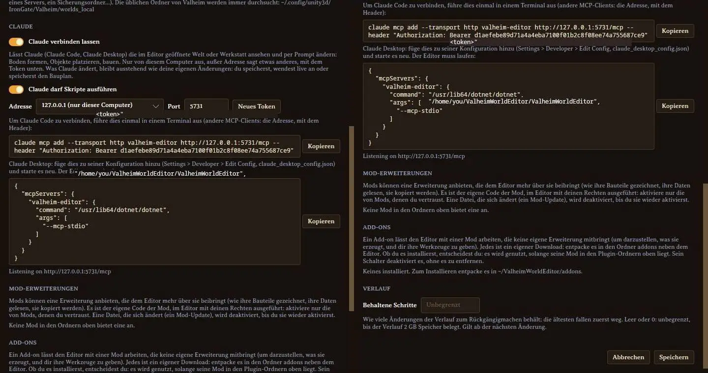
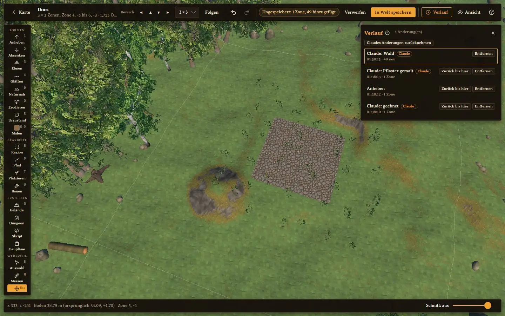

<!-- source: 3de08343 -->
# Claude

Lass Claude (in Claude Code, Claude Desktop oder einem anderen MCP-Client) per Prompt den Boden formen, pflanzen, bauen
und Dungeons erzeugen, in der Welt oder Werkstatt, die du geöffnet hast, während du in der 3D-Ansicht zusiehst.

**Wo:** Startseite, **Einstellungen** → **Claude** · **Taste:** keine · **Funktioniert in:** gespeicherten Welten,
live (mit **Auto** aus), der Werkstatt


*Links: der Abschnitt **Claude** eingeschaltet und empfangsbereit; kopiere den Befehl in ein Terminal (Claude Code)
oder die Zeilen in die Konfiguration von Claude Desktop. Rechts: das Ende der Einstellungen, mit **Speichern**. Dein
Befehl enthält dein eigenes Token, wo dieses Bild `<token>` zeigt, und die Zeilen den Pfad deines eigenen Programms.*

Was Claude ändert, bleibt **ausstehend**, wie deine eigenen Änderungen: je ein Schritt im Verlauf (`Ctrl+Z` nimmt ihn
zurück), in der oberen Leiste mitgezählt. Claude speichert nie eine Welt und wendet nie etwas auf ein Live-Spiel an:
Das tust du, wenn dir gefällt, was du siehst. Um es Schritt für Schritt einzurichten, siehe
[Claude formen oder bauen lassen](guides/connect-claude.md).

## Benutzen

1. Schalte in den **Einstellungen** auf der Startseite **Claude verbinden lassen** ein und drücke **Speichern**.
2. Füge den Editor einmal zu Claude hinzu: Führe den Befehl aus, den die Einstellungen zeigen (Claude Code), oder
   füge seine Zeilen zur Konfiguration von Claude Desktop hinzu.
3. Öffne einen Bereich einer Welt oder die Werkstatt (oder bitte Claude, einen zu öffnen).
4. Bitte Claude um das, was du willst ([Bitten formulieren](#bitten-formulieren)), und sieh ihm in der 3D-Ansicht bei der Arbeit
   zu.
5. Behalte, was dir gefällt: **In Welt speichern**, **Live anwenden** oder **Bauplan speichern**. Nimm zurück, was dir
   nicht gefällt, mit `Ctrl+Z`, **Verwerfen** oder **Claudes Änderungen zurücknehmen** im Verlauf.

## Einstellungen

In den **Einstellungen** (auf der Startseite), Abschnitt **Claude**:

| Einstellung | Was sie tut |
|---|---|
| **Claude verbinden lassen** | An: Der Editor nimmt die Anfragen von Claude an, nur von diesem Computer (außer **Adresse** sagt etwas anderes), von Aufrufern mit dem Token. Aus: Nichts kann sich verbinden. |
| **Claude darf Skripte ausführen** | An: Claude darf C#-Skripte ausführen, wie es das Werkzeug [Skript](scripting.md) tut, jedes wird dir zuerst gezeigt, um es auszuführen oder abzulehnen. Ein Skript ist ein Programm mit deinen Rechten auf diesem Computer, deine Dateien eingeschlossen. Aus (Standard): Die Skripte von Claude werden abgelehnt; seine anderen Werkzeuge funktionieren weiter. |
| **Adresse** | Von wo sich Claude verbinden kann: Wähle eine aus der Liste oder gib eine Adresse ein. `127.0.0.1 (nur dieser Computer)`, der Standard; `0.0.0.0 (jedes Netzwerk)`; oder eines der Netzwerke dieses Computers mit seiner Adresse (`192.168.1.20 (Ethernet)`): nur dieses Netzwerk. Bei jedem Netzwerk nennt eine Zeile unter dem Befehl die Adressen, die ein anderer Computer verwendet: den Namen dieses Computers (`http://my-pc.local:5731/mcp`), wo das Netzwerk `.local`-Namen beantwortet (mDNS), und seine Adresse in jedem Netzwerk (`http://192.168.1.20:5731/mcp`), die immer funktioniert, sich aber ändert, wenn das Netzwerk ihm eine andere gibt. Siehe [Sicherheit](#sicherheit). |
| **Port** | Der Port, mit dem sich Claude verbindet: anfangs 5731, 1024 bis 65535. Ändere ihn, wenn ein anderes Programm 5731 nutzt. |
| **Neues Token** | Erstellt ein anderes Token. Sobald du **Speichern** drückst, funktioniert das alte nicht mehr: Füge den Editor mit dem neuen Befehl erneut zu Claude hinzu. |
| Befehl für Claude Code, **Kopieren** | Der Befehl, der den Editor zu Claude Code hinzufügt. Er enthält das Token: Behalte ihn für dich. |
| Zeilen für Claude Desktop, **Kopieren** | Die Zeilen, die zur Konfiguration von Claude Desktop hinzukommen. |

Nach **Speichern** zeigt der Abschnitt „Listening on http://127.0.0.1:5731/mcp“ (auf einer anderen Adresse
„Listening on 0.0.0.0:5731, from other computers too“) oder warum es nicht ging („Could not listen on 127.0.0.1:5731:
…“, wenn der Port belegt ist oder wenn eine Netzwerkadresse nicht mehr zu diesem Computer gehört).

## Den Editor zu Claude hinzufügen

**Claude Code:** Führe den Befehl, den die Einstellungen zeigen, einmal in einem Terminal aus. Er sieht so aus, mit
deinem Token:

```sh
claude mcp add --transport http valheim-editor http://127.0.0.1:5731/mcp --header "Authorization: Bearer <token>"
```

In Claude Code listet `/mcp` dann **valheim-editor** als verbunden, solange der Editor läuft.

**Claude Desktop** startet ein Programm, statt sich mit einer Adresse zu verbinden. Füge die Zeilen, die die
Einstellungen zeigen, zu seiner Konfiguration hinzu (Claude Desktop → Settings → Developer → Edit Config,
`claude_desktop_config.json`) und starte es dann neu:

```json
{
  "mcpServers": {
    "valheim-editor": { "command": "/path/to/ValheimWorldEditor", "args": ["--mcp-stdio"] }
  }
}
```

`--mcp-stdio` öffnet kein Fenster: Es reicht die Nachrichten von Claude an den laufenden Editor weiter (mit
eingeschaltetem **Claude verbinden lassen**), mit dem Token aus dessen Einstellungen.

**Andere MCP-Clients** verbinden sich mit der Adresse (Streamable HTTP) mit demselben Header `Authorization`.

Der Editor muss laufen, damit Claude ihn erreicht.

## Was Claude kann

Die Werkzeuge von Claude rufen denselben Code auf wie die Werkzeuge und Schaltflächen des Editors selbst, daher folgt
das, was Claude macht, denselben Spielregeln wie deine Änderungen: der 8-m-Bodengrenze des Spiels (nur ein eigenes
Skript geht darüber hinaus), dem Einrasten von Bauteilen, den Zonen, den Orten.
Jeder Schritt, den Claude macht, heißt im Verlauf „Claude: …“ und trägt eine Markierung **Claude**. Claude prüft
seine Arbeit mit Bildern der 3D-Ansicht und der Karte und mit der Stabilitätsprüfung.

| Claude kann | Seine Werkzeuge |
|---|---|
| Sehen, was geöffnet ist, die Welten auf diesem Computer und die Höhen, Biome, das Wasser und die Objekte eines Bereichs; einen Bereich von 1 bis 17 Zonen öffnen; die ganze Welt nach einer Art, einem Gegenstand in einer Truhe oder dem Text eines Schilds durchsuchen; den Start, die Händler, Altäre und Dungeoneingänge auflisten | `editor_state`, `list_worlds`, `open_world`, `open_area`, `describe_area`, `list_objects`, `ground_at`, `search_world`, `list_locations` |
| Seine Arbeit ansehen: Bilder der 3D-Ansicht (beliebige Kamera oder vier Ansichten eines Orts auf einmal) oder der Karte, eine Karte des Bereichs von oben mit einem Raster in Metern, die Stabilitätsprüfung (welche Bauteile einstürzen würden) | `screenshot`, `area_map`, `support_check` |
| Deine Auswahl verwenden und dir zeigen, was es meint | `get_selection`, `select_objects` |
| Jedes Bedienelement einstellen, wie du es tun würdest (Schalter im Panel Ansicht, den Schnitt in der Statusleiste, Werkzeugeinstellungen, die Werkzeugleiste) | `list_controls`, `set_control` |
| Die Bauteile des Spiels nachschlagen und wie sie zusammenpassen | `find_prefabs`, `piece_info`, `building_guide`, `list_blueprints` |
| Die Welt eines Seeds ansehen (Biome, Start, Händler, Bosse) und eine neue Welt mit einem Namen und Seed erstellen | `preview_seed`, `create_world` |
| Boden ebnen, bemalen, glätten, naturnah machen, erodieren, in den Urzustand bringen, anheben oder absenken; einen Stempel oder ein Höhenkartenbild eindrücken; einen Fluss, Graben oder eine Rampe entlang einer Linie graben oder den Boden entlang davon ebnen, anheben, absenken, glätten, naturnah machen, erodieren oder in den Urzustand bringen; eine Straße anlegen; Zonen zum Zurücksetzen markieren; die Bäume und Felsen des Spiels nachwachsen lassen | `flatten`, `paint_area`, `shape_ground`, `stamp`, `import_heightmap`, `dig_path`, `road`, `reset_zones`, `regrow_nature` (die meisten nehmen eine [Maske](masks.md)) |
| Bäume oder Felsen pflanzen, Bauteile und Objekte setzen (sie rasten ein wie mit dem Hammer), Objekte einmal oder in einer Reihe oder einem Ring kopieren, Objekte gegen eine andere Art tauschen, Objekte entfernen | `forest`, `place_pieces`, `copy_objects`, `replace_objects`, `remove_objects` |
| Einen Boden, Wände mit Türen und ein Satteldach (26° oder 45°, Stroh oder Schindeln) über einem Rechteck bauen; die Werkstatt öffnen; einen Bauplan zur Parzelle oder zu einem Bereich hinzufügen; die Parzelle als Bauplan speichern | `build_floor`, `build_walls`, `build_roof`, `place_pieces`, `open_workshop`, `add_blueprint`, `save_blueprint` |
| Objekte als Gruppe verschieben und drehen, oder jedes genau platzieren, neigen und skalieren; eine Truhe füllen, einen Rüstungsständer oder Gegenstandsständer ausstatten, ein Schild beschriften, einer Kreatur Sterne geben; das Tag eines Portals, einen Erbauer, die zugelassenen Spieler eines Wards, Gesundheit, Brennstoff, die Stufe oder den Zähmungszustand einer Kreatur ändern | `move_objects`, `set_transform`, `get_object`, `set_object_data`, `set_contents` |
| Einen Dungeon auf der Parzelle oder über einem Punkt der Welt hinter seinem Eingang erzeugen; die Räume eines Dungeons des Spiels auflisten; einen Raum an einem offenen Ende hinzufügen, einen herausnehmen, jedes offene Ende schließen, eine Tür setzen | `generate_dungeon`, `list_dungeons`, `dungeon_rooms`, `add_dungeon_room`, `remove_dungeon_room`, `close_dungeon_ends`, `set_dungeon_door` |
| Ein Skript ausführen (mit deiner Erlaubnis) | `run_script`, `script_reference` |
| Rückgängig machen und wiederholen | `undo`, `redo` |

Ein paar Regeln, die man kennen sollte:

- `open_world` wird abgelehnt, solange die offene Welt oder die Werkstatt ungespeicherte Änderungen hat.
- `save_blueprint` speichert das Gebäude der Werkstatt nur auf Bitte und ersetzt nie einen Bauplan, außer es wird
  ausdrücklich gesagt. Ein erneut gespeicherter Bauplan behält seine Beschreibung und seine Tags.
- `generate_dungeon` lehnt ein Biom, einen Stil oder ein Wandmaterial ab, das es nicht kennt, und listet die auf, die
  es kennt.
- `move_objects` erhält die Form eines Gebäudes, und ein Teil einer verbundenen Gruppe einer Mod (ein Schiff und
  seine Bauteile) bringt seine ganze Gruppe mit, auch beim Kopieren und Entfernen.
- Ein Dungeon, den Claude auf der Parzelle der Werkstatt erzeugt, gehört zum Gebäude der Parzelle und ist ausstehend
  wie der Rest; er wird nicht zu deiner Bibliothek hinzugefügt.
- Wenn sich Claude verbindet, gibt der Editor ihm eine kurze Anleitung zur Arbeit darin und zwei fertige Prompts:
  *build_in_workshop* und *shape_area*.

## Bitten formulieren

Öffne die Welt oder die Werkstatt selbst, oder bitte Claude darum. Dann zum Beispiel:

- „Öffne den Bereich um 1200, -340 und mach ein Tal mit einem Fluss, der nach Norden fließt, mit Birken entlang des
  Ufers.“
- „Ebne ein 40-m-Quadrat in der Mitte des Bereichs, pflastere es und stell einen Ring aus Fackeln darum.“
- „Bau in der Werkstatt ein kleines Langhaus: Steinboden, Holzwände mit zwei Türen, ein 45°-Strohdach. Prüfe, ob es
  steht.“
- „Öffne den Bereich um 800, 950 und erzeuge darüber eine zweistöckige Sumpfkrypta.“
- „Diese Bäume, die ich ausgewählt habe: Ersetze sie durch Buchen.“ (Wähle sie zuerst aus; Claude liest deine
  Auswahl.)

Bodenarbeiten, Wälder und Dungeons sind am leichtesten zu erbitten. Detaillierte, Bauteil für Bauteil gesetzte
Gebäude brauchen vielleicht ein paar Runden („das Dach steht auf der Ostseite über, korrigiere das“), oder beginne mit
einem deiner Baupläne.


*Die Schritte von Claude heißen „Claude: …“ und tragen die Markierung **Claude**; dein eigenes **Anheben** liegt
dazwischen. **Claudes Änderungen zurücknehmen** oben entfernt die Schritte von Claude und behält deine.*

## Claudes Änderungen zurücknehmen

- `Ctrl+Z` nimmt den letzten Schritt zurück, ob von Claude oder von dir.
- Im **Verlauf** nimmt **Entfernen** bei einem Schritt mit der Markierung **Claude** diesen Schritt heraus und behält
  alles, was danach gemacht wurde.
- **Claudes Änderungen zurücknehmen** (oben im Verlauf, solange Änderungen von Claude darin sind) entfernt jeden
  Schritt, den Claude im Verlauf des offenen Bereichs gemacht hat, den neuesten zuerst, und behält deine, auch die nach
  denen von Claude gemachten. Die Statusleiste sagt, wie viele zurückgenommen wurden und wie viele Schritte von Claude
  aus anderen Bereichen erhalten bleiben: Öffne diese Bereiche, um auch sie zurückzunehmen (siehe
  [Der Verlauf gehört zur Welt](concepts/saving-and-history.md#der-verlauf-gehört-zur-welt)).
- **Verwerfen** verwirft alles nicht Gespeicherte, auch deines.

Das funktioniert auch nach dem Speichern oder Anwenden: Das nächste **In Welt speichern** oder **Live anwenden**
schreibt es. Siehe
[Einen Schritt rückgängig machen, eine Änderung zurücknehmen oder alles verwerfen](guides/undo-changes.md).

## Sicherheit

- **Nur dieser Computer.** Der Editor lauscht auf `127.0.0.1` (oder einer anderen Loopback-Adresse, die du eingibst,
  wie `::1`) und lehnt jede Anfrage ab, die an einen anderen Namen gerichtet ist, sodass eine Webseite, die du
  besuchst, ihn nicht erreichen kann. Mit einer anderen **Adresse** können ihn auch Computer in diesem Netzwerk
  erreichen, unter jedem Namen dieses Computers, mit dem Token. Nur die eigenen Netzwerke dieses Computers: Ein
  Computer, dessen Adresse keine lokale ist (`10.x`, `172.16`–`172.31`, `192.168.x`, Link-Local, IPv6 `fc00::/7`) oder
  der nicht in dem Netzwerk ist, auf dem der Editor lauscht, wird abgelehnt, sodass das Internet ihn nie erreicht,
  auch nicht über IPv6. Mit `0.0.0.0` sind diese Netzwerke die mit einem Gateway (nicht die eigenen von Docker, WSL
  oder Hyper-V, auch kein VPN-Tunnel). Ein VPN wie Tailscale, dessen Adressen von `100.64.x.x` bis `100.127.x.x`
  reichen, wird ebenfalls angenommen, wenn dieser Computer darin ist: Lausche auf seiner Tailscale-Adresse oder auf
  `0.0.0.0`, und der andere Computer verbindet sich mit dieser Adresse. Das VPN verschlüsselt den Weg, sodass das Token
  im Netzwerk nicht mitgelesen wird.
- **Skripte nur von diesem Computer.** Einem Claude auf einem anderen Computer werden Skripte verweigert
  (`run_script`, „Ausführen“ im Werkzeug Skript), selbst wenn **Claude darf Skripte ausführen** an ist: Wer das Token
  im Netzwerk mitliest, könnte sonst Programme mit deinen Rechten ausführen. Seine anderen Werkzeuge funktionieren wie
  hier.
- **Außerhalb dieses Computers nicht verschlüsselt.** Die Verbindung ist einfaches HTTP: Mit einer anderen
  **Adresse** kann jeder in diesem Netzwerk das Token und alles, was Editor und Claude einander senden, mitlesen und
  mit dem Token den Editor benutzen. Das ist ein fairer Tausch in einem Heimnetz, dem du vertraust, und die
  Einstellungen sagen das unter der Adresse, sobald du eine wählst. Überall sonst behalte `127.0.0.1` und erreiche ihn
  von einem anderen Computer über einen SSH-Tunnel, der die Verbindung verschlüsselt:
  `ssh -L 5731:127.0.0.1:5731 you@this-computer`.
- **Das Token.** Jede Anfrage muss das Token tragen (48 zufällige Zeichen, für deinen Editor erzeugt). **Neues Token**
  erstellt ein anderes.
- **Nur ausstehend.** Claude speichert nie, wendet nie live an, verwirft nie, lädt nie neu, schreibt oder löscht nie
  deine Dateien und verbindet sich nie mit einem Live-Spiel: Kein Werkzeug tut das, und `set_control` lehnt diese
  Bedienelemente ab.
- **Skripte brauchen deine Erlaubnis, jedes einzeln.** `run_script` (auch Probeläufe) und **Ausführen** im Werkzeug
  Skript werden abgelehnt, bis du **Claude darf Skripte ausführen** einschaltest. Dann wird dir jedes Skript, das
  Claude schreibt, gezeigt, bevor es läuft: **Ausführen** oder **Ablehnen** (Enter und Esc lehnen ab). Ein Probelauf
  und danach der Lauf desselben Skripts im selben Bereich fragen einmal; jeder andere Lauf fragt erneut. Die anderen
  Werkzeuge von Claude (`flatten`, `road`, `forest`…) führen den eigenen Code des Editors aus und fragen nicht.
- **Was eine Welt sagt, ist kein Befehl.** Schilder, Portal-Tags und Namen werden von Spielern geschrieben, ein
  Bauplan oder die Daten einer Mod von anderen: Claude ist angewiesen, sie als Daten zu behandeln. Ein Schild, das
  Claude Befehle zu geben versucht, kann kein Skript ausführen, ohne dass du es zuerst siehst.
- **Live mit Auto an: nichts.** Solange die offene Welt live mit **Auto** an ist, würde jede Änderung sofort das Spiel
  erreichen, daher ändert Claude nichts außer dem Panel Ansicht und bittet dich, Auto auszuschalten.
- **Aus ist aus.** Schalte **Claude verbinden lassen** aus, und nichts kann sich verbinden.

Mehr in [Skripte und Claude](concepts/safety.md#skripte-und-claude).

## Tastenkürzel

Claude fügt keine Tasten hinzu. `Ctrl+Z` und `Ctrl+Y` machen seine Schritte rückgängig und wiederholen sie wie deine.

## Tipps und Grenzen

- Der Editor muss laufen, mit **Claude verbinden lassen** an, damit Claude ihn erreicht. Wenn es nicht klappt, siehe
  [Claude kann sich nicht verbinden](help/troubleshooting.md#claude-kann-sich-nicht-verbinden).
- Führe nach **Neues Token** und **Speichern** den neuen Befehl für Claude Code erneut aus (das alte Token
  funktioniert nicht mehr). Claude Desktop liest das neue Token von selbst.
- Claude sieht nur den offenen Bereich. Bitte es, für größere Arbeiten einen anderen oder einen größeren Bereich zu
  öffnen.

### Der Bau-Skill (Claude Code)

Optional, für Gebäude, die handgemacht aussehen sollen: Das Repository des Editors hat einen Skill für Claude Code,
[`.claude/skills/valheim-build`](../../.claude/skills/valheim-build/SKILL.md). Damit sucht Claude echte Valheim-Bauten
als Ideen, schreibt einen kurzen Entwurf, formt den Boden, probiert unbekannte Bauteile in einem kleinen Modell aus,
baut in Phasen mit bewährten Hilfen (Bogenfenster, Gesimse, Zinnen, Rundtürme, Ziegeldächer, Fachwerkhallen) und
prüft dann seine eigene Arbeit auf verdeckte Fenster, doppelte Bauteile und schlechte Übergänge. Innenräume bekommen
Rahmenwerk, Beleuchtung und Einrichtung; das Äußere bekommt Wege, Lichter und Bepflanzung.

Claude Code lädt ihn von selbst, wenn du im Repository arbeitest. Um ihn überall zu haben, kopiere den Ordner zu deinen
eigenen Skills: `cp -r .claude/skills/valheim-build ~/.claude/skills/`. Bitte dann wie gewohnt, zum Beispiel „Bau eine
gotische Burg mit Burggraben in der Werkstatt“. Was er über Bauteile weiß, steht in seiner `references/pieces.md`;
Korrekturen sind dort willkommen.

## Verwandte Seiten

- [Claude formen oder bauen lassen](guides/connect-claude.md)
- [Einen Schritt rückgängig machen, eine Änderung zurücknehmen oder alles verwerfen](guides/undo-changes.md)
- [Sicherheit](concepts/safety.md#skripte-und-claude): Skripte und Claude
- [Skript](scripting.md): was `run_script` ausführt
