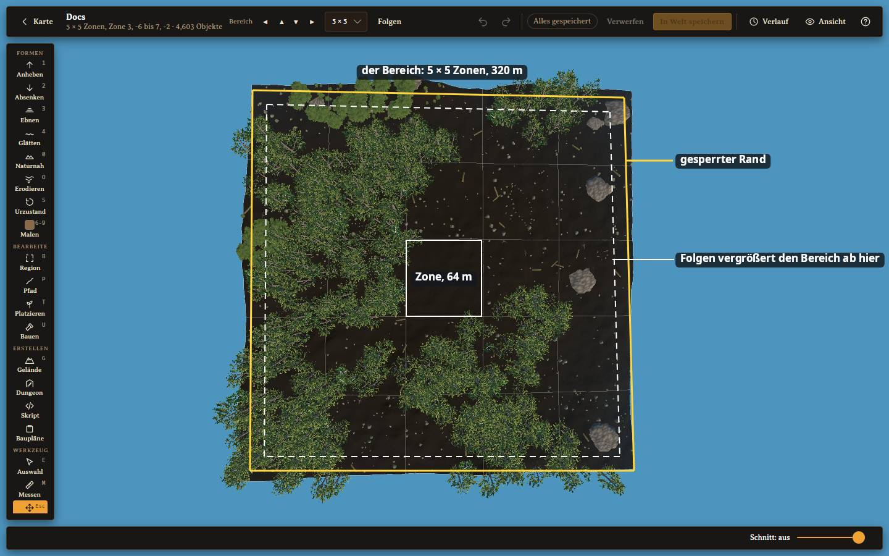

<!-- source: 24741409 -->
# Bereiche und Zonen

Valheim teilt seine Welt in quadratische **Zonen** von 64 m, und der Editor öffnet jeweils einen Block davon, den
**Bereich**. Das erklärt, warum sich manche Orte noch nicht speichern lassen, warum sich der Rand des Bereichs nie
bewegt und warum ein großer Bereich langsam ist.


*Der Bereich ist ein Block aus Zonen. Seine äußerste Reihe von Bodenpunkten (gelb) ändert sich nie; mit **Folgen** an
kommen Zonen hinzu, wenn der Punkt, auf den du schaust, die gestrichelte Linie 12 m innen überschreitet.*

## Zonen

Eine Zone ist ein Quadrat von 64 × 64 m. Die Statusleiste nennt die Zone unter der Maus (`Zone 20, -6`), **Ansicht →
Zonengrenzen** zeichnet ihre Linien in 3D, und **Zonenraster** auf der Karte zeichnet sie auf der Karte.

Das Spiel erzeugt eine Zone, wenn zum ersten Mal ein Spieler in ihre Nähe kommt: ihre Bäume, Felsen und ihr Erz, und
den Ort, den sie enthält (ein Dorf, einen Dungeoneingang). Das nennt man das **Erzeugen** der Zone. Bis dahin enthalten
die Dateien der Welt dort nichts, nicht einmal den Boden. Für dich heißt das:

- **Änderungen in einer Zone, die niemand besucht hat, lassen sich nicht speichern.** Die Meldung beim Speichern listet
  sie auf. Geh im Spiel zuerst an der Stelle vorbei und bearbeite sie dann.
- **Eine neue Welt ist leer.** Der Editor kann das Land eines Seeds zeigen, bevor jemand darauf spielt, aber es gibt
  nichts zu bearbeiten, bis das Spiel die Zonen erzeugt hat (siehe [Eine neue Welt](../new-world.md)).
- **Das Spiel entscheidet zonenweise.** Es legt einen Dungeon pro Zone an, setzt ganze Zonen zurück (siehe unten), und
  die Zeile der ausstehenden Änderungen zählt die Zonen, deren Boden du geändert hast.

Jede Zone enthält 65 × 65 Bodenpunkte, einen pro Meter; benachbarte Zonen teilen sich die Punkte entlang ihrer
gemeinsamen Kante. Siehe [Wie der Boden gespeichert wird](ground-limits.md#wie-der-boden-gespeichert-wird).

## Der Bereich

Der Bereich ist der Block von Zonen, der im 3D-Editor offen ist: von 3 × 3 bis 17 × 17 Zonen um die Stelle, die du auf
der [Karte](../map.md) gewählt hast.

| Größe | Breite | Gut für |
|---|---|---|
| 3 × 3 | 192 m | Ein Haus, ein Feld, schnelle Änderungen; öffnet am schnellsten. |
| 5 × 5 (Standard) | 320 m | Eine Basis und ihre Umgebung. |
| 7 × 7, 9 × 9 | 448 m, 576 m | Ein Dorf, eine lange Straße, das Einfügen einer Stadt. |
| 13 × 13, 17 × 17 | 832 m, 1088 m | Eine Bergkette, eine Küste. Langsam zu öffnen und zu zeichnen. |

Der Editor zeichnet jedes Objekt und jeden Bodenpunkt des Bereichs, darum öffnet er einen Block und nicht die ganze
Welt. Alles, was du tust, geschieht darin: Eingefügtes, ein Berg oder ein Skript muss in den offenen Bereich passen,
also öffne vor großen Arbeiten einen größeren.

**Deine Änderungen gehören zur Welt, nicht zum Bereich.** Der Editor führt eine Sammlung ausstehender Änderungen für die
ganze Welt. Verschiebe den Bereich, ändere seine Größe oder geh zurück zur Karte und öffne einen anderen Ort: was du
anderswo getan hast, wartet weiter und wird mit dem Rest gespeichert. Der Verlauf kommt ebenfalls mit (siehe
[Verlauf](saving-and-history.md#verlauf)).

Die Pfeile der oberen Leiste verschieben den Bereich jeweils um eine Zone (64 m), und die Kamera bleibt, wo sie in der
Welt ist. Die Größenliste öffnet den Bereich in einer anderen Größe um dieselbe mittlere Zone neu. Beide warten auf
das, worauf Folgen wartet, und verwerfen, was es verwirft (siehe [Folgen](#folgen)). Beim Öffnen eines anderen
Bereichs werden ausgeblendete Objekte wieder gezeigt.

## Der gesperrte Rand

Die äußerste Reihe von Bodenpunkten des Bereichs ändert sich nie. Kein Pinsel, kein Pfad, keine Aktion von Region, kein
Einfügen und kein Skript bewegt sie, und das Werkzeug Platzieren setzt nichts darauf.

Der Grund: diese Punkte teilt der Bereich mit den Zonen direkt außerhalb, die der Editor nicht geladen hat. Würde der
Editor sie bewegen, stieße der Boden draußen auf eine Stufe oder eine Klippe, die er nicht sehen kann. Mit gesperrtem
Rand schließt der Bereich immer nahtlos an das Land ringsum an. Ein Skript, das dorthin schreibt, wird nicht gestoppt:
die Änderung wird einfach weggelassen.

```text
 außerhalb │gesperrt│     was du bearbeiten kannst     │gesperrt│ außerhalb
 ──────────┼────────┼──────────────────────────────────┼────────┼──────────
           │  1 m   │  alles andere im Bereich         │  1 m   │
```

Um nahe an einem Rand zu arbeiten, verschiebe den Bereich mit den Pfeilen, wähle eine größere Größe oder schalte
**Folgen** ein.

## Folgen

Mit **Folgen** an (in der oberen Leiste) wächst der Bereich von selbst, während du dich zu seinem Rand vorarbeitest.
Kommt der Punkt, auf den du schaust, auf 12 m an den Rand heran, wird auf dieser Seite eine Reihe von Zonen
hinzugefügt, nahe einer Ecke auf beiden Seiten. Ein 3 × 3-Bereich wird zu 4 × 3, dann 4 × 4 und so weiter.

Folgen fügt nur Zonen hinzu und entfernt nie welche, sodass nichts, woran du arbeitest, den Bereich verlässt. Es hält
bei 17 Zonen in jeder Richtung an (etwa 1 km) und sagt das; verschiebe den Bereich dann mit den Pfeilen oder öffne
einen anderen Ort über die Karte.

Folgen wartet, und die Statusleiste sagt warum, solange das Wachsen etwas verlieren würde: die Welt wird gespeichert
oder gelesen, Objekte sind ausgewählt, ein Pinselstrich läuft, ein Pfad ist gezeichnet und nicht angewendet, oder
Änderungen werden noch an ein Live-Spiel gesendet. Es wartet nicht auf ein Rechteck von Region, eine Linie, ein Raster
oder ein Polygon von Platzieren oder eine Messung: das Wachsen verwirft sie.

## Zonen zurücksetzen

Ein Zurücksetzen lässt das Spiel eine Zone neu erzeugen, als wäre nie jemand dort gewesen. Nutze es, um die neuen
Inhalte eines Valheim-Updates an Orte zu bringen, an denen niemand gebaut hat, oder um einen Wald oder einen Dungeon
zurückzuholen. Du markierst Zonen mit dem Werkzeug [Region](../area.md) oder in der ganzen Welt über die
[Karte](../map.md); nichts geschieht, bis du speicherst oder live anwendest.

Wenn das Zurücksetzen geschrieben wird:

- **Alles in der Zone verschwindet**: Bäume, Felsen, Erz, Sammelbares, Ruinen, Dungeoneingänge und ihre Räume,
  Spawner, herumliegende Gegenstände und Kreaturen, gezähmte Tiere eingeschlossen (bring sie vorher weg).
- **Manches bleibt**: Grabsteine von Spielern immer; von Spielern gebaute Teile mit **Meine Gebäude behalten** an (auf
  der Karte werden Zonen, die welche enthalten, dann ganz ausgelassen; ausgeschaltet verschwinden Gebäude mit dem
  Rest); die Bodenänderungen, außer du hast gewählt, sie ebenfalls rückgängig zu machen.
- **Das Spiel erzeugt sie neu**, wenn das nächste Mal ein Spieler in die Nähe kommt: neuer Bewuchs, und ihr Ort an
  seiner Stelle neu gebaut, mit frischer Beute und neuen Kreaturen. Live wird eine Zone, in deren Nähe ein Spieler ist,
  sofort neu erzeugt.

Eine Zone gilt als ausgewählt, wenn der Umriss der Auswahl mindestens einen ihrer Bodenpunkte einschließt, unabhängig
vom weichen Rand; eine Auswahl, die überhaupt in eine Zone hineinreicht, setzt sie also zurück.

Ein Zurücksetzen lässt sich nicht rückgängig machen, sobald es gespeichert oder angewendet ist; bis dahin kannst du
die Markierung abbrechen oder rückgängig machen. Nachdem ein Zurücksetzen geschrieben ist, liest der Editor die Welt
neu, und der Verlauf kommt mit, ohne das, was er in den zurückgesetzten Zonen getan hat (siehe
[Was ein Schritt nicht zurücknehmen kann](saving-and-history.md#was-ein-schritt-nicht-zurücknehmen-kann)).
