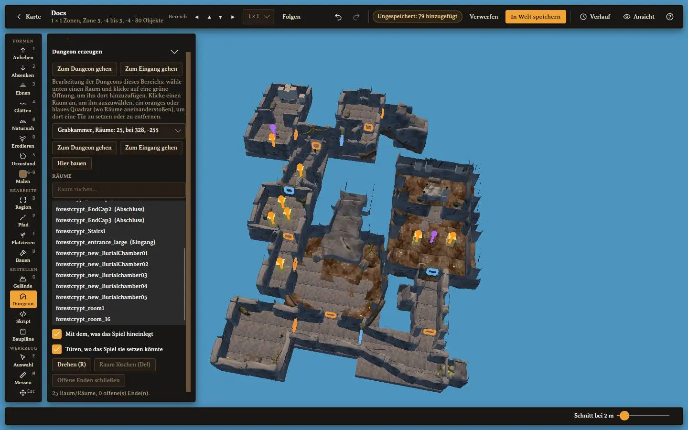

<!-- source: 5e6370cb -->
# Dungeons

Valheim bewahrt seine Dungeons auf ungewöhnliche Weise auf: hoch am Himmel, als Liste von Räumen, die das Spiel baut,
wenn jemand in die Nähe kommt. Das zu wissen erklärt, warum ein Dungeon, den niemand besucht hat, im Editor leer
aussieht, warum ein bearbeiteter Dungeon keine Mod braucht und wie ein Dungeon aus Bauteilen 5000 m hoch halten kann.
Das Werkzeug [Dungeon](../dungeons.md) baut darauf auf.

## Wie das Spiel Dungeons aufbewahrt

**Dungeons sind nicht in den Boden gegraben.** Jeder ist ein **Ort** an der Oberfläche (der Hügel einer Grabkammer, der
Eingang einer Frosthöhle), dessen Tür dich zum eigentlichen Dungeon teleportiert, **5000 m darüber**, wo das Spiel alles
als Innenraum behandelt. Im Editor hört die Kamera dort oben auf, dem Boden zu folgen, und **Ansicht → Dungeonräume**
zeigt oder verbirgt die Räume.

```text
   5000 m  ┌───────────────┐  die Räume des Dungeons
           │ ▢─▢─▢─▢       │  ◄── seine Tür führt zurück nach unten
           └───────────────┘
              ▲  Teleport
   Boden   ───┴─── der Eingang (ein Ort: Hügel, Höhleneingang, Mine)
```

**Ein Dungeon des Spiels ist eine Liste von Räumen.** Das Spiel baut seine Dungeons aus fertigen Räumen. Im Speicherstand
ist ein Dungeon ein Objekt, das seine **Liste von Räumen** enthält: welcher Raum, wo, in welche Richtung gedreht. Kommt
ein Spieler in die Nähe, baut das Spiel die Räume aus dieser Liste, was immer sie enthält, ohne sie gegen seine eigenen
Regeln zu prüfen. Darum funktioniert ein bearbeiteter Dungeon im Spiel jedes Spielers ohne Mod: der Editor ändert nur
die Liste.

**Bis ein Spieler in der Nähe war, ist die Liste leer.** Das Spiel legt einen Dungeon an, wenn zum ersten Mal jemand
kommt, also hat der Editor vorher keine Räume zu zeigen oder zu bearbeiten. Besuche ihn im Spiel und öffne den Bereich
dann neu. Fuling-Dörfer und Höfe in den Wiesen werden auf dieselbe Weise angelegt, am Boden.

### Räume, Öffnungen und Abschlüsse


*Ein Dungeon des Spiels 5000 m hoch, die Dächer weggeschnitten: jeder Raum ist ein Eintrag der Liste. Die Quadrate
markieren, wo sich zwei Räume treffen: blau mit einer Tür, orange ohne.*

Jeder Raum hat **Öffnungen**, die Durchgänge, an denen er auf den nächsten trifft, und jede Öffnung hat eine Art: eine
Frosthöhle hat einfache Höhlenöffnungen, Eisöffnungen, Schreinöffnungen und andere. Das Spiel verbindet nur Öffnungen
derselben Art, wobei manche Räume (ein Eiskorridor) eine Art mit einer anderen verbinden. Ein **Abschluss** ist ein
kleiner Raum, der eine Öffnung schließt, sodass nichts aus dem Dungeon hinausführt.

Das Spiel verhindert, dass sich seine Räume überlappen, und hält sie im Raum des Dungeons (bei den meisten Arten 64 ×
64 m um die Mitte seiner Zone). Eine Liste, die der Editor schreibt, wird trotzdem gebaut, also warnt der Editor nur,
wenn ein Raum diese Regeln bricht.

**Was in den Räumen ist.** Wenn das Spiel einen Dungeon zum ersten Mal anlegt, würfelt es aus, was in jeden Raum kommt:
Truhen, Spawner für Kreaturen, Fackeln, Feuerschalen, Eis, Dekoration. Jedes Teil hat seine Chance, abhängig vom Seed der
Welt, dem Ort des Raums, dem Thema des Dungeons und der Höhe des Raums. Der Editor würfelt sie genauso aus, sodass ein
Raum, den er hinzufügt, mit dem kommt, was das Spiel dort hineingesetzt hätte. Ein paar Dinge (Eiszapfen, Kristalle,
Fische) setzen sich im Spiel auf die nächste Oberfläche, daher sitzen sie vielleicht etwas anders, als der Editor sie
zeigt.

**Türen.** Wo sich zwei Räume treffen, setzt das Spiel manchmal eine Tür, nach seiner eigenen Chance: die Stoffvorhänge
und Eiswände einer Frosthöhle, die Gitter einer Krypta, die Türen der Minen. Jede Art von Dungeon hat ihre eigenen für
jede Art von Öffnung, und die Tür steht an der Öffnung des Raums, der zuerst da war.

### Eingänge, einer pro Zone

Das Spiel legt **einen Dungeon pro Zone** an und hält den Raum über einem Eingang frei, schon bevor der Dungeon angelegt
ist. Darum setzt der Editor einen Dungeon nur dort hinter den Eingang des Spiels, wo dort oben noch nichts ist; setze
den Eingang sonst in eine andere Zone. Ein Dungeon in den Ebenen, der stattdessen über ein Portal erreicht wird, wird in
Schritten von 50 m höher gestapelt, wenn der Raum belegt ist.

Der Eingang eines platzierten Dungeons ist der eigene Ort des Spiels für das Biom, so geschrieben, wie das Spiel einen
Ort schreibt, sodass das Spiel seine Tür, seine Steine und seinen Zugang jedes Mal erzeugt, wenn die Zone lädt. Der
Dungeon kommt dorthin, wo das Spiel den des Eingangs anlegt (den einer Frosthöhle in die Mitte ihrer Zone), so gedreht,
dass ein Spieler, der durch die Tür kommt, nach innen blickend ankommt. Die Ebenen haben keinen eigenen Dungeon: dort
steht ein Paar verknüpfter Portale für den Eingang, eines am Boden, sein Zwilling dort, wo die Spieler ankommen.

Das Spiel zeichnet Dungeons dunkel, nur von ihren Fackeln beleuchtet. Der Editor beleuchtet sie wie die Außenwelt,
damit du siehst, was du bearbeitest.

## Wie der Generator einen Dungeon anlegt

Der Generator kann einen Dungeon aus zweierlei machen: aus **den eigenen Räumen des Spiels** oder aus **Bauteilen**.

**Mit den eigenen Räumen des Spiels** verbindet er sie auf die Art des Spiels. Er wählt den Dungeon des Bioms (eine
Grabkammer in den Wiesen und im Schwarzwald, eine versunkene Krypta im Sumpf, eine Frosthöhle in den Bergen und im
Tiefen Norden, eine befallene Mine in den Nebellanden), beginnt mit einem seiner Eingangsräume und fügt an offenen
Öffnungen Räume hinzu, gewichtet, wie das Spiel sie gewichtet, wo sie passen, bis er je nach Größe etwa 8, 14, 20 oder
26 Räume hat. Er schließt jedes offene Ende ab, füllt jeden Raum, wie das Spiel es täte, und setzt Türen, wo Räume sich
treffen, nach der Chance des Spiels. Das Ergebnis ist ein Dungeon-Objekt mit seiner Liste von Räumen, genau wie die des
Spiels. In die Welt gesetzt, werden die Räume vom Dungeon-Objekt aus dort angelegt, wo der Eingang es hinsetzt, und im
Raum dieser Zone gehalten, wie das Spiel es tut: wo in seiner Zone der Eingang steht und wohin er blickt, ändert, welche
Räume passen.

**Mit Bauteilen** plant er den Dungeon auf einem Raster aus 2-m-Feldern, ein Stockwerk nach dem anderen, und baut und
möbliert ihn dann. Dieselben Einstellungen und derselbe Seed ergeben immer denselben Dungeon. Jedes Stockwerk wird in
dieser Reihenfolge angelegt:

| | Was angelegt wird |
|---|---|
| **Eingangshalle** | Eröffnet das erste Stockwerk. Spieler kommen vor ihrer Rückwand an, der Name des Dungeons auf einem Schild neben ihnen. |
| **Der Weg hindurch** | Etwa zwei von fünf Räumen sind der Reihe nach die Haupträume des Stils (bei einer Krypta große Halle, Kreuzung, Galerie und Kapelle), jeder mit dem vorigen verbunden, meist geradeaus. |
| **Hinunter oder der Boss** | Jedes Stockwerk außer dem letzten endet in einem Treppenhaus (8 × 24 m) zum Stockwerk darunter, 6 m tiefer. Das letzte endet in einem Vorraum, der Arena des Bosses (24 × 24 m) und der Schatzkammer dahinter. |
| **Nebenräume und Flügel** | Nebenräume zweigen ab, meist von Kreuzungen und langen Hallen, gewählt nach den Gewichten des Stils. Ein Nebenraum wächst oft vom letzten aus weiter und passt zu ihm: eine Küche bei der Festhalle, Zellen bei der Wachstube, eine Schmiede bei der Werkstatt. |
| **Zwillinge** | Nebenräume bekommen oft einen gespiegelten Zwilling auf der anderen Seite ihrer Halle (ein Tempel fast immer, ein Goblinbau selten), sodass sich der Plan wie ein Gebäude liest, entlang von Achsen. |
| **Rundwege** | Räume, die entlang des Wegs drei oder mehr auseinanderliegen, aber zufällig nah beieinander, werden verbunden, sodass es mehr als einen Weg herum gibt. |
| **Sackgassen und Verstecke** | Ein oder zwei Korridore führen nur zu einem Versteck. Ein verborgenes Versteck (zwei ab 20 Räumen) liegt hinter einer rissigen Wand oder einem Wandteppich an einem Nebenraum. |
| **Der Schlüssel** | Ist der Boss hinter einem Tor, kommt der Schlüssel in eine Truhe im Nebenraum, der am weitesten von der Arena entfernt ist. |
| **Türen** | Das Tor des Bosses nimmt den Schlüssel; die Schatzkammer liegt hinter einem Tor; Zellen bekommen öfter Tore; prächtige Räume bekommen manchmal prächtige Doppeltore; der Rest folgt dem Stil. Wo Treppen hinunterführen, wird ein offener Durchgang zum Tor, damit, was unten lebt, unten bleibt. |

Innerhalb davon variieren die Räume. Ihre **Größe** folgt ihrer Art (ein Lagerraum kann 8 × 8 m groß sein, eine große
Halle 12–20 m breit und 20–32 m lang). Manche haben eingekerbte Ecken, eine Apsis am Ende oder eine fehlende Ecke.
**Korridore** verlaufen gerade oder knicken ab, und manche Räume stoßen Wand an Wand. Räume sind 4 m hoch, aber große
Hallen, Kapellen, Thronsäle und die Arena können 10 m hoch reichen, durch das Stockwerk darüber. Lange Räume bekommen
vielleicht **Nischen** an ihren Seiten.

### Warum er 5000 m hoch hält

Jedes Bauteil braucht im Spiel Stabilität vom Boden, und dort oben gibt es keinen Boden. Darum steht ein Dungeon aus
Bauteilen auf **schwarzen Marmor-Bodenplatten** (8 × 8 m), Boden und Dach jedes genutzten Teils: das eine Bauteil,
dessen Stabilität das Spiel nie prüft (siehe [Die Stabilitätsprüfung](objects.md#die-stabilitätsprüfung)). Alles andere steht
darauf. Dinge, die auf einem Boden stehen, werden um 5 cm angehoben, weil ein Bauteil, dessen Mitte genau auf einer
Oberfläche liegt, keine Stabilität von ihr bekommt. Um deinen eigenen Dungeon aus Bauteilen zu machen, tu dasselbe:
Böden aus schwarzem Marmor und alles darauf.

Alles, was der Generator setzt, hat keinen Erbauer, wie in den eigenen Dungeons des Spiels, sodass das Spiel es für eine
Ruine hält (siehe [Von Spielern gebaute Teile](objects.md#von-spielern-gebaute-bauteile)).

## Einrichtung, Licht und Wachen

Ein Dungeon aus Bauteilen wird Raum für Raum ausgestattet. **Licht** und **Verfall** ziehen eigene Zufallszahlen, sodass
ihre Änderung sonst nichts am Dungeon ändert.

**Jeder Raum wird für seinen Zweck eingerichtet**, auf eine von zwei bis vier Arten, gewählt durch den Seed:

| Raum | Einige seiner Einrichtungen |
|---|---|
| Hallen | Säulengänge mit einem Altar; eine Methalle um ein Feuer mit Bocktischen; eine Halle der Toten mit einem Sarkophag auf einem Podest; eine kahle Halle mit umgestürzten Säulen. |
| Kapellen | Bänke vor einem Altar zwischen Statuen; ein erhöhter Altar in einem Ring aus Feuerschalen; ein Kirchenschiff aus Teppichen und Kerzen. |
| Grabkammern, Beinhäuser, Galerien | Reihen von Sarkophagen oder ein Grab auf einem Podest; Knochen entlang der Wände oder aufgehäuft; Nischen, Statuen, Spinnweben. |
| Kasernen, Lagerräume, Studierzimmer | Betten oder Schlafmatten um ein Feuer; Vorräte entlang der Wände oder Regale in Reihen; Pulte und Regale. |
| Festhallen, Thronsäle | Lange Tafeln oder eine erhöhte Tafel auf einem Podest; Säulengänge, ein Kriegsraum, umgestürzte Säulen um das Podest. |
| Arenen, Schreine | Ein Ring aus Säulen um den Boss, ein Thron über Schädeln oder eine Grube, unter Simse abgesenkt. |
| Küchen, Schmieden, Werkstätten | Die echten Stationen des Spiels: Öfen, Kessel, Gärbottiche, Schmelzöfen, die schwarze Schmiede. |

**Mehr darin.** Ein prächtiger Steinraum trägt vielleicht eine Empore auf Pfosten über dem Zugang; eine Grabkammer
enthält vielleicht ein inneres Gewölbe; Nischen enthalten einen Sarkophag, eine Statue oder ein Fass. Ecken bekommen
kleine Gruppen, die zum Raum passen (ein Lager, eine Mahlzeit, das Pult eines Schreibers, eine Waffenkammer), und große
Räume bekommen vielleicht ein **Prunkstück**, das es im ganzen Dungeon nur einmal gibt: einen Dolmen, den Schädel eines
Riesen, einen Irrlichtbrunnen. Jedes Biom fügt seine eigenen Dinge hinzu (Wurzeln in den Wäldern, Schleim und Teer im
Sumpf, Eiszapfen in den Bergen, Sucher-Geflecht in den Minen, Stacheln in den Aschlanden), und Korridore variieren: halb
eingestürzt, mit Knochen gesäumt, mit Teppich ausgelegt, in der Mitte durch ein Tor geschlossen oder mit einer Falle
versehen. Etwa einer von zwölf schlichten Räumen bleibt fast kahl, ein Teil und ein Licht im Dunkeln. Mit **Möbel** auf
Möbliert oder Reich bekommen prächtige Steinräume Fliesen aus schwarzem Marmor und Wohnräume Holzdielen, jeweils in der
Hälfte der Fälle.

**Licht nach Zweck.** Räume werden von Fackeln, Wandleuchtern oder Feuerschalen in den eigenen Lichtern des Bioms
beleuchtet: eines alle 5 m Wand bei **Hell**, 8 m bei **Düster**, 12 m bei **Dunkel** (und dann nur in den Räumen, die
zählen). Prächtige Räume sind dichter beleuchtet; Räume der Toten, Zellen, Lagerräume und Verstecke weiter auseinander.
In Katakomben und Gefängnissen bleiben manche Korridore zwischen beleuchteten Räumen dunkel.

**Tiefer ist reicher und gefährlicher.** Jedes Stockwerk weiter unten enthält ein Fünftel mehr Monster und Beute als das
oberste Stockwerk: das zweite Stockwerk das 1,2-Fache des obersten, das sechste das Doppelte, das sechzehnte das
Vierfache.

**Wachen.** Ein Raum bekommt etwa ein Monster je 75 m² Boden bei der üblichen Rate seiner Art, mal **Monster**, mal
seine Tiefe, mit Abstand zum Zugang und ihm zugewandt. Die Schlüsseltruhe bewacht eine der Elite-Kreaturen des Bioms,
Gräber enthalten eine, der Thronsaal zwei. Der **Boss** wird immer einmal in der Arena platziert, als die Kreatur
selbst: kein Stern bei **Monster** keine, ein Stern bei × 1, zwei Sterne bei × 2 oder mehr. Mit **Monster kehren
zurück** an kommen die anderen aus den Spawnern des Spiels und kehren eine Weile, nachdem sie getötet wurden, zurück
(siehe [Spawnpunkte](objects.md#spawnpunkte)); die eigenen Räume des Spiels bringen immer Spawner mit.

**Beute.** Truhen, herumliegende Schätze und die Münzen und Barren aus dem Metall des Bioms in der Schatzkammer wachsen
mit **Beute** und Tiefe. Die Schlüsseltruhe enthält den Kryptaschlüssel und ein paar Wertsachen, in die Truhe
geschrieben, damit das Spiel sie nicht mit seiner eigenen Beute füllt, und das Tor des Schlüssels trägt ein Schild:
*Sealed. The key lies within these halls.*

Im Spiel mit Homestead gebaut, ist ein Dungeon-Bauplan nur seine Bauteile: kein Schlüssel in der Truhe, kein Boss.
