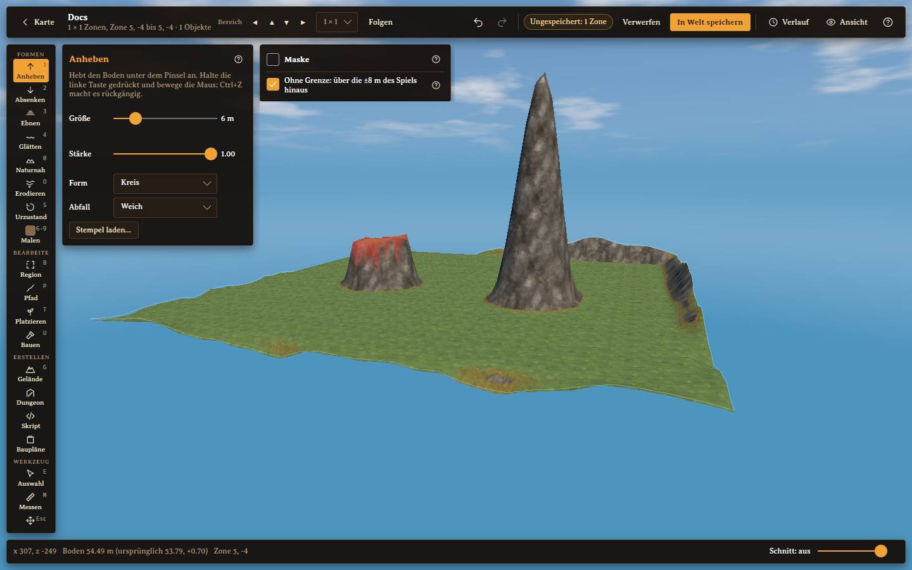
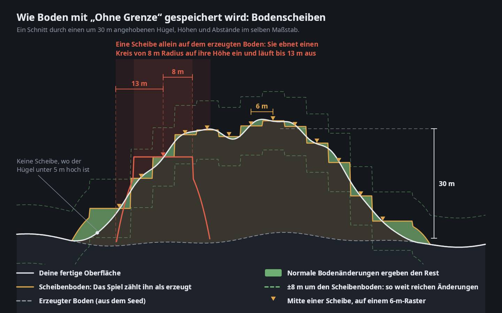
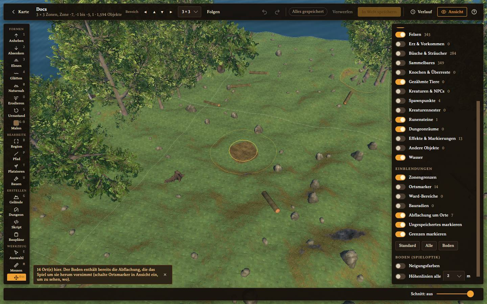

<!-- source: d97e56fa -->
# Bodengrenzen

Das Spiel lässt den Boden höchstens 8 m über oder unter die Höhe gehen, auf der die Welt ihn erzeugt hat. Der Editor hält
sich an diese Regel, sodass jede Welt, die er speichert, im Spiel jedes Spielers lädt, auch bei Konsolenspielern, ohne
Mod. **Ohne Grenze** geht darüber hinaus, auf eine Art, die das Spiel selbst versteht. Diese Seite erklärt die Grenze,
wie „Ohne Grenze“ sie umgeht und wie die Orte des Spiels den Boden formen.

## Die 8-m-Grenze des Spiels

Das Spiel speichert nicht die Höhe des Bodens. Es speichert den **Seed** der Welt, berechnet daraus den erzeugten Boden
und speichert nur deine **Änderungen** daran: für jeden Bodenpunkt, wie weit er angehoben oder abgetragen wurde. Diese
Änderung kann höchstens **±8 m** betragen (plus eine Glättungsänderung von höchstens ±1 m, die die Hacke des Spiels
macht). Alles darüber hinaus wird verworfen, wenn das Spiel die Zone lädt. Der Editor wendet dieselbe Regel an, sodass
ein Punkt, der die Grenze erreicht, dort stehen bleibt.

Was das in der Praxis bedeutet:

- **Gemessen wird vom erzeugten Boden aus, nicht davon, wo der Boden jetzt ist.** Ein um 8 m angehobener Hügel kann
  nicht höher werden, und ein um 8 m abgetragener Boden nicht tiefer, egal wie du dorthin gekommen bist. Die Statusleiste
  zeigt beide Höhen unter der Maus: `Boden 41.20 m (ursprünglich 35.00, +6.20)`.
- **Große Arbeiten stoßen zuerst daran**: eine Baufläche, die in einen Hang geschnitten wird, ein Fluss durch hohes
  Gelände (er braucht sein Bett unter dem Meeresspiegel, siehe [Wie der Boden gespeichert wird](#wie-der-boden-gespeichert-wird)),
  ein Berg.
- **Auch die Werkzeuge des Spiels halten sich daran.** Hacke und Spitzhacke eines Spielers arbeiten innerhalb von ±8 m
  vom erzeugten Boden, im Spiel wie im Editor.

```text
        ┌──────────────────────── +8 m: das Höchste, was das Spiel behält
        │      ╭──╮  angehobener Boden endet hier
  ──────┼─────╯    ╰──────────── erzeugter Boden (die „ursprüngliche“ Höhe)
        │
        └──────────────────────── −8 m: das Tiefste, was das Spiel behält
```

## Ohne Grenze

Der Schalter **Ohne Grenze: über die ±8 m des Spiels hinaus** lässt die Bodenwerkzeuge den Boden bis zu 400 m vom
erzeugten Boden bewegen: Berge, Klippen, Schluchten, tiefe Gruben. Es ist ein einziger Schalter, auf der Karte **Maske**
neben dem Panel jedes Werkzeugs, das er betrifft (die Formpinsel, die Formeln und Bilder von Gelände, Pfad und Region),
und er ist bei jedem Start des Editors aus. Die Berge des Werkzeugs [Gelände](../landform.md) und das Einfügen einer
Kopie gehen immer über die Grenze, wenn sie es brauchen, und Skripte tun es, sofern nicht anders angewiesen.

Während du arbeitest, wird der Teil über ±8 m als eigene Anhebung über dem Boden gehalten; Rückgängig, Verlauf und
**Urzustand** behandeln ihn wie jede andere Änderung. Die Statusleiste sagt bei jedem Umschalten, wie der Schalter steht.


*Derselbe Strich ohne und mit „Ohne Grenze“. Links endet der Boden 8 m höher und seine Spitze wird rot; rechts steigt er
weiter. Der Schalter liegt auf der Karte Maske.*

### Wie es gespeichert wird: Bodenscheiben

Das Spiel behält nie Bodenänderungen über 8 m, aber es ebnet den Boden unter seinen **Orten** (Dörfer, das Lager des
Händlers) ohne jede Grenze und zählt diesen geebneten Boden als erzeugt (siehe
[Orte ebnen den Boden](#orte-ebnen-den-boden)). Das nutzt der Editor. Beim Speichern oder Live-Anwenden macht er
Boden über der Grenze zu **Bodenscheiben**: unsichtbare Orte des Spiels selbst, ohne Modell. Jede Scheibe ebnet einen
Kreis mit 8 m Radius auf ihre Höhe und lässt den Boden ringsum bis etwa 13 m auslaufen: knapp außerhalb des Kreises geht
der Boden etwa drei Viertel des Wegs zur Höhe der Scheibe (das Spiel zählt den Übergang von der Mitte der Scheibe aus,
daher beginnt er mit einer kleinen Stufe), dann immer weniger, bis zu nichts bei 13 m.

1. Scheiben kommen auf ein 6-m-Raster, nur dort, wo dein Boden mehr als 5 m von dem entfernt ist, was der Boden ohne sie
   wäre.
2. Der Editor berechnet den Boden genau so, wie das Spiel ihn aus den Scheiben bauen wird, in der Reihenfolge des Spiels,
   und passt ihre Höhen über mehrere Runden an, um deiner Form so nahe wie möglich zu kommen. Wo es dann noch zu weit
   abweicht, fügt er eine Scheibe hinzu und versucht es erneut.
3. Gewöhnliche Bodenänderungen, innerhalb von ±8 m vom neuen Boden, erledigen den Rest.

Das Spiel jedes Spielers baut aus den Scheiben denselben Boden, auch bei Konsolenspielern, ohne Mod.


*Ein um 30 m angehobener Hügel, so wie er gespeichert wird. Die flachen Oberseiten der Scheiben (orange) steigen auf
einem 6-m-Raster den Hügel hinauf, unter deiner Oberfläche (weiß); eine Scheibe, in Rot, ebnet 8 m um ihre Mitte und
lässt den Boden bis 13 m auslaufen. Die gewöhnlichen Änderungen (grün) erledigen den Rest, innerhalb von ±8 m vom
Scheibenboden. Wo der Hügel weniger als 5 m hoch ist, gibt es keine Scheibe.*

### Was das für dich bedeutet

| | |
|---|---|
| **Die Speichermeldung** | Sagt, wie viele Scheiben erzeugt wurden (und wie viele alte sie ersetzen), wie viele Bäume und Felsen entfernt wurden und wie weit der steilste Boden noch abweicht: „Boden ohne Grenze: 312 Bodenscheibe(n), 40 Bäume/Felsen entfernt; manche Stellen weichen bis zu 2.5 m ab (zu steil)“. |
| **Der Verlauf bleibt** | Der Editor behält deinen Boden ohne Grenze und berechnet die Scheiben daraus: mach ein Einfügen oder einen Strich rückgängig, speichere oder wende erneut an, und seine Scheiben verschwinden, und auch der Boden um sie herum ist wieder wie vorher. Das gilt auch nach dem erneuten Öffnen der Welt (siehe [Was ein Schritt nicht zurücknehmen kann](saving-and-history.md#was-ein-schritt-nicht-zurücknehmen-kann)). |
| **Der neue Boden zählt als erzeugt** | Im Spiel arbeiten Hacke und Spitzhacke ±8 m vom Scheibenboden aus. Sobald die Welt erneut geöffnet ist, ist auch die „ursprüngliche“ Höhe der Statusleiste der Scheibenboden. **Urzustand** bringt den Boden trotzdem auf den ersten Boden der Welt zurück, auch unter den Scheiben. Um eine gespeicherte Form zu entfernen, stelle den Urzustand her, mach sie im Verlauf rückgängig oder trage sie mit „Ohne Grenze“ an wieder ab: die Scheiben werden beim nächsten Speichern neu berechnet und verschwinden, wo sie nicht mehr gebraucht werden. |
| **Bäume und Felsen werden entfernt** | Bäume, Felsen, Erz, Büsche und Sammelbares, wo sich der Boden um mehr als 2 m bewegt hat, würden begraben oder schweben, also verschwinden sie. Bauteile bleiben. |
| **Sehr steile Wände werden weicher** | Eine Scheibe kann einem Einschnitt, der schmaler ist als sie selbst, nicht folgen. |
| **Zonen, die niemand besucht hat** | Behalten ihren alten Boden: ihre Anhebung wird verworfen, und die Meldung sagt, wie viele. Besuche sie zuerst im Spiel. |
| **Die Scheiben laden zuerst** | Das Spiel eines Spielers erzeugt die Scheiben vor den Bauteilen und Bäumen um sie herum, sodass der Boden in den ersten Augenblicken eines Besuchs fertig ist. Auf einem Server sorgt das Plugin WorldEditorBridge dafür, dass das so bleibt. |
| **Aus der Ferne gesehen** | Die neue Form erscheint, wenn du näher kommst, wie der geebnete Boden eines Dorfs. |
| **Die Karte im Spiel** | Wird aus dem Seed gezeichnet und zeigt daher die neue Form nicht. |
| **Erde** | Das Spiel bemalt den Boden einer Scheibe als Erde; der Editor bemalt diese Punkte wieder mit dem eigenen Boden des Bioms, sodass die Scheiben nicht auffallen. |

Der Editor blendet die Scheiben aus: sie erscheinen nicht als Ort, Markierung oder Objekt.

## Orte ebnen den Boden

Dörfer, der Händler, Dungeoneingänge, Altäre der Bosse und die anderen **Orte** des Spiels ebnen den Boden um sich
herum. Der flache Boden wird nicht im Speicherstand gespeichert: das Spiel ebnet ihn bei jedem Laden der Zone neu, bevor
es irgendwelche Änderungen anwendet. Dann fügt es die gespeicherten Bodenänderungen darüber hinzu.

Der Editor zeigt den Boden mit dieser Ebnung schon erledigt, und deine Änderungen kommen darüber, wie im Spiel. Ein
Hinweis unten links in der 3D-Ansicht zählt die Orte im Bereich (und im Umkreis von 40 m darum), und **Ansicht →
Abflachung um Orte** zeichnet, wo sie ebnen: einen Ring für den flachen Teil, einen blasseren, wo er ins Land übergeht.


*Ansicht → **Abflachung um Orte** an, rund um den Altar von Eikthyr: der feste Ring ist der flache Teil, den das Spiel
ebnet, der blassere Ring, wo er wieder ins Land übergeht. Der Hinweis unten links zählt die Orte im Bereich.*

Warum das wichtig ist:

- **Die ±8 m werden vom geebneten Boden aus gezählt**, da das Spiel ihn als erzeugt zählt.
- **Einen Ort zu entfernen, entfernt seine Ebnung.** Einen Runenstein zu löschen, entfernt seinen Ort endgültig und mit
  ihm die kleine Ebnung um ihn herum. Ein Zonen-Reset setzt den Ort neu, und seine Ebnung kommt zurück.
- **Teile eines Orts sind keine Objekte.** Die Felsen eines Krypta-Eingangs, das Lager des Händlers, der Altar eines
  Bosses oder die Wände einer Trollhöhle werden bei jedem Laden der Zone neu aus dem Ort erzeugt, daher zeichnet der
  Editor sie (unter **Ruinen & Bauwerke**), kann sie aber weder wählen noch ändern.
- **Manche Orte halten ihren Boden frei.** Im Quadrat um einen Ort, dessen Art ihren Boden freihält, wächst nichts, und
  Nachwachsen hält das so, wie das Spiel (siehe [Wachstumsregeln](objects.md#wachstumsregeln)).
- **Bodenscheiben** sind derselbe Mechanismus, absichtlich genutzt (siehe [Ohne Grenze](#ohne-grenze)).

## Grenzmarkierungen

Boden, der die ±8-m-Grenze erreicht hat, wird in der 3D-Ansicht **rot** (in Spieloptik; **Ansicht → Grenzen
markieren**, anfangs an), und die Statusleiste fügt unter der Maus „, an der ±8-m-Grenze“ hinzu. Nach einem Strich, der
sie erreicht hat, sagt sie: „Spielgrenze erreicht: Boden kann sich nur 8 m von seiner ursprünglichen Höhe entfernen
(rote Punkte).“

Die anderen Werkzeuge zeigen es auf ihre Art:

| Werkzeug | Wie es die Grenze zeigt |
|---|---|
| [Pfad](../path.md) | Die Bodenpunkte, die sie erreicht haben, werden rot, und die Statusleiste sagt es. |
| [Region](../area.md): Ebnen | Die Zeile für Abtrag und Auftrag sagt, wie viel außer Reichweite ist: „(40 m³ außer Reichweite: ±8-m-Grenze)“. Bei Anheben und Absenken zählt die Zeile nur den Boden, den die Grenze bewegen lässt. |
| Region: Höhenkarte | Punkte, die ihre Höhe nicht erreichen können, werden rot, und die Statusleiste zählt sie. |
| [Skript](../scripting.md) | Mit `Ground.NoLimit = false` zählt die Ergebniszeile die Punkte, die stehen geblieben sind. |

Roter Boden ist kein Fehler: es ist Boden, den das Spiel nicht weiter gehen ließe. Um weiterzumachen, schalte **Ohne
Grenze** ein oder ändere den Plan (ein Fluss, der tiefem Gelände folgt, eine Fläche, die etwas höher geschnitten wird).

## Wie der Boden gespeichert wird

**Eine Höhe pro Meter.** Der Boden hat einen Höhenpunkt pro Meter: 65 × 65 Punkte in einer 64-m-Zone, wobei benachbarte
Zonen ihre Randpunkte teilen. Eine Wand aus Boden erstreckt sich also immer über etwa einen Meter: steiler als das kann
sie nicht sein, im Editor wie im Spiel, und der Boden kann nie überhängen. Ein echter Tunnel oder eine Höhle unter dem
Boden braucht eine Mod, die sie gräbt, etwa Tunnelheim (siehe
[Eine mit Expand World, Riverheim oder Tunnelheim erstellte Welt bearbeiten](../guides/use-mods-worlds.md)).

**Zwei Dreiecke pro Quadratmeter.** Jeder Quadratmeter wird als zwei Dreiecke gezeichnet, geteilt entlang derselben
Diagonale wie im Spiel, von seiner Südost- zu seiner Nordwestecke. Eine Kante von Nordwest nach Südost wird sauber;
eine von Nordost nach Südwest zeigt eine kleine Sägezahnkante, auch im Spiel.

**Die Höhen sind die des Spiels.** Das Meer liegt bei 30 m. Valheim hat kein fließendes Wasser: das Wasser in Flüssen
und Seen ist das Meer, überall auf derselben Höhe, daher steht nur dort Wasser auf dem Boden, wo er unter 30 m liegt. Ein
Fluss durch hohes Gelände braucht einen tiefen Einschnitt.

**Farbe.** Jeder Bodenpunkt hat auch einen Farbwert: einen Anteil Erde, kultivierten Boden und Pflaster, und eine
Markierung, die sagt, dass er bemalt wurde. Ein nie bemalter Punkt zeigt die Farbe, die die Welt erzeugt hat (den Boden
des Bioms und Erde, wo die Welt sie hingesetzt hat). Ein Malpinsel schiebt die Anteile des Punkts in jedem Moment ein
wenig in Richtung seiner Farbe, sodass ein leichter Strich oder der weiche Rand des Pinsels eine Mischung ergibt.
Darum unterscheiden sich auch **Farbe entfernen** und **Urzustand**:

| | Was es mit einem Punkt macht |
|---|---|
| **Farbe entfernen** | Malt einfachen Biomboden. Der Punkt bleibt bemalt, daher verdeckt er auch Erde, die die Welt dort erzeugt hat. |
| **Urzustand** | Entfernt die Malmarkierung, sodass der Punkt wieder zeigt, was die Welt erzeugt hat. |

**Biom.** Das Biom an einem Punkt stammt aus dem Seed. Den Boden zu bearbeiten, ändert es nie.

## Wie die Maske den Boden beurteilt

Die [Maske](../masks.md) beschränkt ein Werkzeug auf den Boden, der auf alle ihre Einstellungen passt. Sie beurteilt
jeden Bodenpunkt für sich, und es gibt keinen Übergang: wo sie Boden ausschließt, tut das Werkzeug gar nichts; wo sie
Boden durchlässt, arbeitet das Werkzeug wie gewohnt.

| Einstellung | Was verglichen wird |
|---|---|
| **Biom** | Das Biom, das die Welt an diesem Punkt erzeugt hat. Den Boden zu bearbeiten, ändert es nicht. |
| **Höhe** | Die Höhe des Bodens dort, wie das Spiel sie zählt (das Meer liegt bei 30 m). |
| **Neigung** | Berechnet aus den Höhen 1 m zu beiden Seiten des Punkts, Ost–West und Nord–Süd. |
| **Malen** | Ein Punkt gilt als bemalt, wenn er bemalt wurde und etwas Farbe hat, daher lässt **Farbe entfernen** ihn für die Maske unbemalt. **Nur Erde**, **Nur kultiviert** und **Nur gepflastert** brauchen diese Farbe zu mindestens der Hälfte der Farbe. |

**Ein Pinselstrich wird auf dem Boden beurteilt, wie er zu Beginn des Strichs war.** Ein Strich Anheben auf Boden unter
der Höhe der Maske steigt also weiter darüber hinaus, bis du loslässt, und ein Strich, der die Neigung ändert, schaltet
sich nicht auf halbem Weg selbst ab. Änderungen, die auf einmal gemacht werden (Gelände, ein Einfügen, Pfad, die Aktionen
des Werkzeugs Region), werden jeweils auf dem Boden unmittelbar davor beurteilt.

Weil es keinen weichen Rand gibt, kann das Formen mit einer Maske eine Stufe hinterlassen, wo passender Boden auf
ausgeschlossenen Boden trifft, vor allem bei Anheben, Absenken und Gelände. Glätte sie danach mit ausgeschalteter
Maske.

## Wie die Werkzeuge den Boden formen

Die meisten Werkzeuge heben einfach an, tragen ab oder ebnen. Einige folgen einem Muster oder einem Modell, das sich zu
kennen lohnt, weil es erklärt, was sie ergeben und was nicht.

### Wie schnell ein Pinsel arbeitet

Bei **Stärke** 1 bewegen Anheben und Absenken die Mitte des Pinsels um bis zu 6 m pro Sekunde (2,4 m pro Sekunde bei der
Vorgabe 0.40). Ebnen, Glätten, Naturnah und Urzustand fügen keinen festen Betrag hinzu: in jedem Moment bewegen sie jeden
Punkt um einen Anteil des Wegs zu ihrem Ziel, sodass sich der Boden auf dem Ziel einpendelt und nie darüber hinausgeht.
Glätten bewegt jeden Punkt zum Mittel aus sich selbst und seinen 8 Nachbarn, daher glättet ein erneutes Überstreichen
mehr. Urzustand entfernt in jedem Moment einen Anteil der Änderung, und ein Punkt innerhalb von 1 cm seiner erzeugten
Höhe gilt wieder als unverändert; Farbe entfernt er nur dort, wo der Pinsel mit mehr als halber Stärke wirkt, damit der
Rand der Farbe nicht ausfranst.

### Das Muster von Naturnah

**Naturnah** berechnet zuerst die grobe Form des Bodens: den Boden über ein paar Meter verwischt, so wie er zu Beginn des
Strichs war. Es fügt dieser Form Buckel aus einem Rauschmuster hinzu, **Buckel** hoch und **Buckelgröße** breit, und
zieht den Boden zum Ergebnis hin. Weil das Ziel gleich bleibt, häuft ein zweiter Strich über dieselbe Stelle nicht immer
mehr Buckel an: er kommt nur demselben Boden näher.

Das Muster ist an die Welt gebunden, nicht an den Pinsel, sodass benachbarte Striche und Bereiche ohne Nähte
zusammenpassen. Das natürliche Aussehen des Werkzeugs Pfad, Naturnah im Werkzeug Region und `n(x, z)` in einer Formel
des Werkzeugs Gelände nutzen dasselbe Muster; **Neues Muster** ändert es für alle.

### Erosion

**Thermische** Erosion bewegt Boden überall dort, wo zwei benachbarte Punkte steiler sind als der **Schüttwinkel**:
Material rutscht vom höheren Punkt zu seinen tieferen Nachbarn, jeweils die Hälfte des Überschusses, sodass sich Hänge
setzen, statt hin und her zu schwingen. Boden wird nur bewegt, nie verloren, was Geröllhalden unter Klippen ergibt.
**Wasser**-Erosion ist Regen: Tropfen fallen auf zufällige Punkte und laufen bis zu 40 Schritte bergab, nehmen Boden
auf, wo sie schnell laufen, und lassen ihn fallen, wo sie langsamer werden oder eine Senke füllen. Viele Tropfen
schneiden Rinnen in Hänge und lassen Schuttfächer an ihrem Fuß. Boden knapp außerhalb des Pinsels kann aufnehmen, was
daraus rutscht oder ausgewaschen wird.

### Wie ein Berg entsteht

Der Körper eines Bergs ist ein natürliches Profil, oben steiler und am Fuß auslaufend, und sein Umriss wird durch
Rauschen verzogen, sodass er nie ein perfekter Kreis ist (bis zu 15 % über den Radius hinaus). **Rau** fügt breite
Wölbungen und Grate mit Rinnen dazwischen die Hänge hinab hinzu, im Verhältnis zur Größe des Bergs, und ein wenig feines
Detail, auf ein paar Meter begrenzt: tiefe, schmale Einschnitte sähen zerrissen aus, und Bodenscheiben könnten ihnen
nicht folgen. An seinem Rand geht er wieder ins Land über, und er wird zum vorhandenen Boden addiert, sodass er die
eigene Lage des Lands behält. Jeder Berg entsteht aus einem **Seed**: dieselbe Vorgabe, dieselben Werte und derselbe Seed
ergeben wieder denselben Berg. Sanfte Hänge behalten Gras und Bäume; steile zeigen nackten Fels, wie das Spiel sie
zeichnet. Ein Berg geht immer über ±8 m hinaus, und Speichern macht ihn zu
[Bodenscheiben](#wie-es-gespeichert-wird-bodenscheiben).

### Wie der Rand eines Pfads ausläuft

Jeder Bodenpunkt nahe einem Pfad wird vom nächsten Punkt seiner Linie aus gemessen. Innerhalb der halben **Breite** wirkt
die Aktion voll; über die Breite von **Weichrand** läuft sie entlang einer S-Kurve aus, sodass eine Straße in den Hang darüber und
darunter übergeht. Bei einem weichen Rand von 0 bekommen die Punkte, die der Rand kreuzt, einen Anteil der Änderung, je
nachdem, wie weit die Linie an ihnen vorbeiläuft, sodass der Rand der Linie gerade folgt, statt von Punkt zu Punkt zu
springen. Mit **Natürlich** schwankt die Breite um bis zu 45 % in beide Richtungen, und die Ränder sind ausgefranst, aus
dem Muster von Naturnah. Das Bett eines Flusses ist eine U-Form unter dem Meeresspiegel, die nur abträgt, sodass er in
einen See oder ins Meer münden kann.
