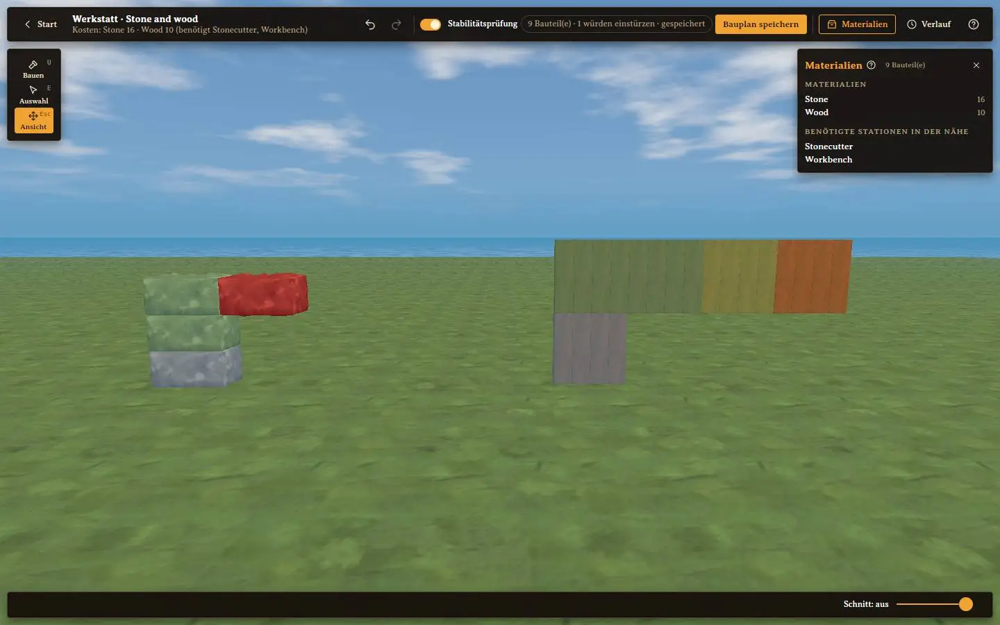
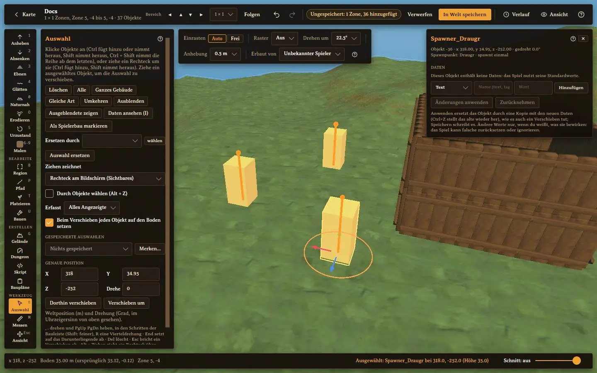
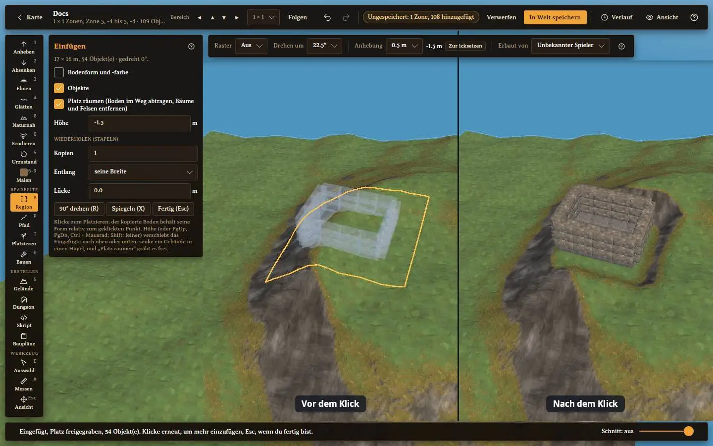

<!-- source: 551a19e3 -->
# Objekte

Alles in einer Valheim-Welt, was nicht Boden ist, ist ein **Objekt**: ein Baum, ein Felsen, eine Wand, eine Truhe, eine
Kreatur, ein unsichtbarer Spawnpunkt. Diese Seite erklärt, was das Spiel von jedem davon speichert, wer als sein Erbauer
gilt, wie Bauteile einrasten und halten, nach welchen Regeln Pflanzen wachsen und was Spawnpunkte tun.

## Was ein Objekt ist

Im Speicherstand ist jedes Objekt ein kurzer Eintrag:

| Teil | Beispiel |
|---|---|
| Seine **Art**, der Name, den das Spiel ihm gibt (sein *Prefab*) | `Beech1`, `rock4_forest`, `piece_chest_wood`, `Spawner_Boar` |
| Seine **Position**, **Drehung**, Neigung und Größe | x 1250, z −380, Höhe 32.4 m, Blickrichtung 90° |
| Seine **Daten**: Werte, die das Spiel dafür speichert | Der Text eines Schilds, der Inhalt einer Truhe, wer es gebaut hat, seine Gesundheit, wann es gepflanzt wurde, der Tag eines Portals |

Der [Inspektor](../select.md) zeigt all das. Die Namen der Werte stammen aus dem Code des Spiels und dem Code deiner Mods,
den der Editor aus ihren Dateien liest, aber nie ausführt. Ändere einen Wert nur, wenn du weißt, was er bewirkt: das
Spiel kann Werte, die es nicht erwartet, zurücksetzen oder ignorieren.

**IDs ändern sich, Art und Position nicht.** Jedes Objekt hat auch eine ID, aber das Spiel vergibt beim Speichern neue
IDs, und der Editor schreibt ein verschobenes Objekt als Kopie an seiner neuen Position. Wo immer der Editor ein Objekt
später wiederfinden muss, sucht er daher dieselbe Art an derselben Position: eine gespeicherte Auswahl (auf 5 cm in der
Fläche und 20 cm in der Höhe genau), deine Änderungen, die auf einen neueren Speicherstand übertragen werden, eine
Wiederherstellung aus einer Sicherung, ein Rückgängigmachen nach dem Live-Anwenden. Ein Objekt, das sich seitdem bewegt
hat oder verschwunden ist, gilt als fehlend.

**Neue Objekte fangen frisch an.** Ein platziertes Objekt ist eine saubere Kopie eines Objekts seiner Art in der Welt,
ohne etwas Eigenes (kein Inhalt, keine Gesundheit), oder ein neues Objekt genau so, wie das Spiel es erzeugt. Auch ein
ersetztes Objekt ist frisch: eine Truhe, die durch eine andere Truhenart ersetzt wird, ist leer. Eine eingefügte Kopie
oder ein Bauplan dagegen behält alles, was seine Objekte enthielten: den Inhalt der Truhe, den Text des Schilds. Arten,
die die Welt nicht erzeugen kann (aus einer Mod, die nicht installiert ist), werden weggelassen, und der Editor sagt,
welche.

**Inhalte, die du festlegst, bleiben deine.** Eine Truhe, die das Spiel nie geöffnet hat, füllt sich beim ersten Laden
mit der Beute des Spiels. Wenn du den Inhalt einer Truhe änderst, markiert der Editor ihn als den eigenen Inhalt der
Truhe, sodass das Spiel ihn lässt. Ein Gegenstand auf einem Ständer wird vollständig gespeichert, als neu und mit voller
Haltbarkeit für seine Qualität.

**Nicht alles, was du siehst, ist ein Objekt.** Teile der Orte des Spiels (die Felsen eines Krypta-Eingangs, das Lager
des Händlers, der Altar eines Bosses) werden bei jedem Laden der Zone neu aus dem Ort erzeugt, daher lassen sie sich
weder wählen noch ändern (siehe [Orte ebnen den Boden](ground-limits.md#orte-ebnen-den-boden)). Ein Runenstein ist
genauso: du kannst ihn löschen, was seinen Ort endgültig entfernt, aber nicht verschieben, kopieren oder ansehen.

**Manche Mods verstecken Objekte tief unter der Erde**, etwa Handwerksstationen 10 km unter einem Haus. Rahmen, Umrisse,
**Alle** und **Ganzes Gebäude** lassen weg, was mehr als 10 m unter dem Boden liegt, damit es nicht mit dem mitgenommen
wird, was darüber steht.

### Verbundene Gruppen: Schiffe und Fahrzeuge

Manche Mods bauen ein Ding aus vielen Objekten: das Schiff einer Schiffs-Mod ist ein Wurzelobjekt mit darauf gebauten
Teilen. Jedes Teil wird mit der ID dessen gespeichert, woran es hängt, und mit seinem Versatz dazu, und die Mod setzt es
dorthin, wenn die Gruppe lädt. Eine Mod teilt das dem Editor in einer mitgelieferten Datei `worldeditor.json` mit; von
sich aus kennt der Editor keine Mod. Dann zeichnet der Editor die Gruppe so, wie die Mod sie baut, und verschiebt,
kopiert und löscht sie als Ganzes, nie ein Teil allein. Jedes Einfügen gibt der Gruppe neue IDs, denn zwei Gruppen mit
denselben IDs würden sich im Spiel ihre Teile teilen.

### Kreaturen stehen auf Bauteilen

Eine Kreatur, deren Position in einem Bauteil liegt (der Boss eines Dungeons, ein gezähmter Eber in einem Pferch), wird
oben auf das höchste Bauteil unter ihr gestellt, sobald der Editor Objekte positioniert: beim Öffnen oder Hinzufügen
eines Bauplans, beim Verschieben, Einfügen, durch ein Skript, durch Claudes Werkzeuge. Der Boden ist kein Bauteil: eine
Kreatur darauf bleibt, wo sie platziert ist.

## Von Spielern gebaute Bauteile

Alles, was ein Spieler mit dem Hammer, der Hacke, dem Kultivator oder dem Serviertablett setzen kann, ist im Spiel
**von Spielern gebaut**: es speichert **wer es gebaut hat**, als Spieler-ID. Das zählt mehr, als es scheint. Ohne
Erbauer hält das Spiel ein Bauteil für einen Teil einer Ruine:

| | Von Spielern gebaut | Ohne Erbauer (eine Ruine) |
|---|---|---|
| Abreißen | Gibt alle Materialien zurück | Gibt ein Drittel davon zurück |
| Ein Feuer daneben | Macht eine Basis: dort spawnen keine Monster | Ist keine Basis |
| Überfälle | Zielen darauf | Ignorieren es |
| Ein Ward oder eine private Truhe | Gehorcht seinem Erbauer | Gehorcht niemandem |

Darum schreibt der Editor einen Erbauer auf jedes Bauteil, das er platziert, einfügt oder baut: den Spieler, der unter
**Erbaut von** auf [der Bauleiste](../build.md#die-bauleiste) gewählt ist. Diese Liste bietet die Spieler, die in
dieser Welt gebaut haben (mit der Zahl ihrer Bauteile), die Spieler, die auf Betten, Wards und Grabsteinen genannt sind,
und die Charaktere auf diesem Computer. Sie beginnt mit dem Spieler mit den meisten Bauteilen, sonst mit deinem eigenen
Charakter. **Niemand (nicht von Spielern gebaut)** setzt Bauteile absichtlich als Teile einer Ruine. Ist gar kein
Spieler bekannt, bekommen Bauteile **Unbekannter Spieler**: sie gelten als gebaut, aber Wards und private Truhen
gehorchen niemandem, also wähle deine eigene ID, wenn du kannst.

Manches behält oder verliert den Erbauer mit Absicht:

- Verschieben oder Bearbeiten eines Objekts behält seinen Erbauer.
- Ein Bauplan behält keinen Erbauer: wer ihn im Spiel baut, wird sein Erbauer. Einer, der aus einer Ruine gespeichert
  wurde, merkt sich, dass er eine Ruine ist.
- Ein erzeugter Dungeon hat keinen Erbauer, wie die des Spiels: Überfälle ignorieren ihn, und er gibt ein Drittel seiner
  Materialien zurück.
- **Als Spielerbau markieren** (das Werkzeug [Auswahl](../select.md)) gibt Bauteilen ohne Erbauer einen: einer Ruine,
  die du reparieren und behalten willst, oder Bauteilen, die alte Editor-Versionen gesetzt haben.

Eine Ruine, an die du angebaut hast (ein Steinturm, mit Holz ausgebessert), zählt als dein Gebäude: ihre Bauteile, die
deine berühren, und die, die jene berühren, erscheinen bei deinen Gebäuden in der Ansicht und auf der Karte.

## Einrasten

Bauteile fügen sich so zusammen, wie der Hammer des Spiels sie zusammenfügt. Jedes Bauteil hat **Einrastpunkte** an
seinen Ecken und Enden, die der Editor aus deinem Valheim liest, mit der echten Form jedes Bauteils (seinen Collidern)
und seinen Platzierungsregeln. Kommen zwei Einrastpunkte nah zusammen, bewegt sich das Bauteil so, dass sie sich genau
treffen: Wände stehen Ende an Ende, Böden stoßen Kante an Kante, eine Wand sitzt auf einem Boden.

**Wie der Hammer ein Bauteil setzt**, dem [Bauen](../build.md) Schritt für Schritt folgt, in einer Welt, in der
Werkstatt und in einem Dungeon (sein Einrasten **Auto**):

1. Die Linie des Cursors trifft das nächste Ding: den Boden oder die echte Form eines Bauteils (nicht seinen Rahmen).
2. Das Bauteil, so gedreht, wie du es eingestellt hast, wird so verschoben, dass der Punkt seiner Form, der dem Treffer
   am nächsten ist, ihn berührt. Teppiche und andere Bodenbauteile sowie Bauteile, die das Spiel in Dinge einsinken
   lässt, richten sich stattdessen nach ihrer Mitte.
3. Von allen Einrastpunkten des Bauteils und der Bauteile im Umkreis von 10 m treffen sich die beiden nächsten innerhalb
   eines halben Meters. Zeige auf die Oberkante einer Wand, um die nächste daraufzusetzen, nahe ihrem Ende, um eine
   daneben zu setzen.
4. Ein Einrasten, das das Bauteil genau dorthin setzen würde, wo schon dasselbe Bauteil steht, wird übersprungen.

Eine Anhebung (`PgUp`, `PgDn` oder `Ctrl` + Mausrad) wird vor dem Einrasten hinzugefügt, sodass ein angehobenes Bauteil an
Punkten nahe seiner neuen Höhe einrastet. Ein Raster rundet nur Punkte auf dem Boden: ein Bauteil, das auf ein anderes
Bauteil zeigt, rastet wie gewohnt ein.

Die Bauleiste hat zwei weitere Arten. **Manuell** beschränkt Schritt 3 auf einen Einrastpunkt des Bauteils, den, den
`Q` und `E` wählen (auf dem Bauteil markiert), und lässt ihn bis zu 1,5 m weit reichen: in einer vollen Ecke, wo das
nächste Paar die falsche Kante ist, wähle den Punkt, der treffen soll. **Frei**, oder `Alt` gedrückt halten in jedem
Modus, überspringt Schritt 3: das Bauteil bleibt, wo es berührt, und mit `Alt` wird seine Position in der Fläche auf
einen Viertelmeter von der Mitte des Bereichs aus gerundet.

Die anderen Werkzeuge rasten an denselben Einrastpunkten ein, jedes auf seine Art:

| Wo | Wie es einrastet |
|---|---|
| [Platzieren](../place.md), **An vorhandenen Bauteilen einrasten** (Teile von Ruinen: die Bauteile, die Spieler bauen, setzt du mit Bauen) | Ein Bauteil nach dem anderen unter dem Cursor. **Daneben**: Ende an Ende mit dem Bauteil neben dem Cursor, auf seiner Höhe, wo sich ein Paar Einrastpunkte innerhalb von 1 m trifft. **Obendrauf**: seine Unterseite auf die Oberseite des Bauteils unter dem Cursor. Ein eingerastetes Bauteil blickt in dieselbe Richtung wie das Bauteil, an das es anschließt. |
| [Bauen](../build.md), **Verlegen** auf Linie, Kreis oder Rechteck (und **Aneinander** bei der Linie von [Platzieren](../place.md), für Teile von Ruinen) | Jedes Bauteil beginnt, wo das letzte endet. Die beiden Enden eines Bauteils sind die Mitten seiner beiden kurzen Seiten, ermittelt aus seinen Einrastpunkten (Arten ohne Einrastpunkte nehmen den Rahmen ihres Modells). Eine Linie, die innerhalb von 1 m von einem Bauteil beginnt, setzt es fort. |
| [Auswahl](../select.md), mit **Einrasten** der Bauleiste auf **Auto** | Während du verschiebst, rastet das nächste Paar Einrastpunkte (eines eines verschobenen Bauteils, eines eines Bauteils ringsum) innerhalb von 0,75 m ein, und die ganze Auswahl rückt so, dass sie sich treffen. |
| [Skript](../scripting.md), `snap: true` | Ein platziertes Bauteil trifft die Einrastpunkte der vorhandenen Bauteile innerhalb von 0,5 m. |

Eingetippte Positionen (**GENAUE POSITION** im Werkzeug Auswahl) rasten nie ein: sie sind exakt.

## Die Stabilitätsprüfung

Im Spiel braucht jedes Bauteil **Stabilität**, die vom Boden aus durch die sich berührenden Bauteile nach oben fließt.
Ein Bauteil mit zu wenig davon bricht und stürzt ein, sobald ein Spieler in die Nähe kommt. Die **Stabilitätsprüfung**
der Werkstatt rechnet sie so aus wie das Spiel, aus Daten, die sie in deinem Valheim liest (Form, Material und
Schwerpunkt jedes Bauteils), und färbt jedes Bauteil in den Farben des Baumodus im Spiel:

| Farbe | Bedeutung |
|---|---|
| Hellblau | Volle Stabilität: es steht auf dem Boden. |
| Grün | Stark: die Hälfte der höchsten Stabilität seines Materials oder mehr. |
| Gelb, Orange | Schwächer. |
| Rot | Kurz vor dem Bruch oder brechend: im Spiel stürzt es ein, sobald ein Spieler in die Nähe kommt. |

**Wie die Stabilität berechnet wird.**

- Ein Bauteil, dessen Form, um 0,15 m nach allen Seiten vergrößert, den Boden erreicht, hat volle Stabilität.
- Jedes andere Bauteil übernimmt die beste Stabilität der Bauteile, die es berührt, abzüglich eines Verlusts für den
  Abstand zwischen ihren Schwerpunkten: die Rate „nach oben“, wenn es genau von unten gehalten wird, die Rate „seitlich“,
  wenn es von der Seite gehalten wird, eine Mischung dazwischen. Von zwei Seiten gehalten, die mindestens 100°
  auseinanderliegen (von oben gesehen), bekommt es den Mittelwert der beiden, wenn der besser ist.
- Das wird wiederholt, bis sich nichts mehr ändert. Bauteile unter dem Minimum ihres Materials brechen; dann wird alles
  ohne sie neu berechnet, sodass sich ein Einsturz so ausbreitet wie im Spiel.

| Material | Maximum | Minimum | Verlust pro Meter seitlich | Verlust pro Meter nach oben |
|---|---|---|---|---|
| Holz | 100 | 10 | 20 % | 12,5 % |
| Kernholz | 140 | 10 | 17 % | 10 % |
| Feinholz | 200 | 10 | 20 % | 8 % |
| Stein | 1000 | 100 | 100 % | 12,5 % |
| Eis | 1000 | 100 | 33 % | 12,5 % |
| Eisen | 1500 | 20 | 8 % | 8 % |
| Schwarzer Marmor | 1500 | 100 | 50 % | 12,5 % |
| Grausten | 2000 | 100 | 33 % | 10 % |
| Uralt | 5000 | 100 | 25 % | 7 % |


*Links drei gestapelte Steinwände: hellblau am Boden, grün darüber, und die eine Wand, die oben 2 m hinausragt, rot, mit
„1 würden einstürzen“ in der oberen Leiste. Rechts Holzwände, die 6 m von einem Pfosten hinausragen: grün, dann gelb,
dann orange.*

Darum steht Stein hoch, kann aber nicht hinausragen (ein Meter seitlich kostet seine ganze Stabilität), und darum ragt
Holz weiter hinaus als Stein, aber nicht so hoch.

**Ausnahmen, wie im Spiel.** Manche Bauteile werden nie geprüft: Bodenplatten aus schwarzem Marmor, Wardsteine, Schiffe
und Karren. Sie halten, wo immer sie sind, und eine Platte gibt die volle Stabilität ihres Materials an das weiter, was
auf ihr ruht; so hält ein Dungeon aus Bauteilen in 5000 m Höhe (siehe
[Warum er in 5000 m Höhe hält](dungeons.md#warum-er-5000-m-hoch-hält)). Die Teile, die sich selbst bewegen (der schwingende
Flügel einer Tür, der Rumpf eines Schiffs), zählen nicht: nichts ruht auf ihnen. In einem Dungeon des Spiels zählen die
Böden und Wände der Räume als Boden, also halten Bauteile, die darauf ruhen.

**Was die Prüfung weglässt**: Felsen und Bäume (das Spiel zählt sie als volle Stabilität; die Parzelle der Werkstatt hat
keine), die genaue Form gekrümmter Collider (ihr Rahmen zählt) und Bauteile, denen das Spiel gar keine Stabilität gibt
(sie werden nicht gefärbt). Bei einem Bauplan, der auf unebenem Boden gebaut wurde, nimmt die Prüfung den Boden dort an,
wo das Gebäude ihn traf: an den Bodenkontaktpunkten, die Homestead aufgezeichnet hat, sonst unter dem tiefsten Bauteil
jeder Stelle.

## Wachstumsregeln

Setzlinge, Feldfrüchte und Wildpflanzen folgen den eigenen Regeln des Spiels, und die Werkzeuge
[Platzieren](../place.md) und Nachwachsen des Editors folgen ihnen auch, sodass das, was du pflanzt, im Spiel wächst.

**Platz zum Wachsen.** Ein Setzling oder eine Feldfrucht wächst nur, wenn nichts innerhalb seines **Wachstumsradius**
steht, der aus deinem Spiel gelesen wird: 0,5 m für die meisten Feldfrüchte, 2 bis 3 m für Baumsetzlinge. Mit
**Setzlingen und Pflanzen Platz zum Wachsen lassen** an (die Vorgabe):

- halten Setzlinge und Feldfrüchte mindestens ihren Wachstumsradius Abstand zu allem, auch untereinander;
- halten ausgewachsene Feldfrüchte (`Pickable_Carrot`) und Bäume, die aus Setzlingen wachsen (`Beech1`, `Oak1`), den
  Platz frei, den ihr Setzling braucht, wie ein echtes Feld oder ein Obstgarten;
- wachsen Büsche im Spiel aus nichts, daher gilt für sie nur **Abstand**.

Aus kannst du so dicht pflanzen, wie du willst, aber diese Pflanzen wachsen dann vielleicht nie.

**Feldfrüchte brauchen kultivierten Boden.** Das Spiel lässt Feldfrüchte nur auf kultiviertem Boden wachsen, also male
ihn zuerst (**Kultivieren** des Pinsels Malen oder Malen im Werkzeug Region). Das Panel Platzieren warnt, wenn eine
angehakte Feldfrucht ihn braucht.

**Wasser.** Ein Objekt, das auf den Boden gesetzt wird, wird dort weggelassen, wo der Boden mehr als 0,3 m unter Wasser
liegt, außer Seetang und Algen.

**Häufung.** Echte Wälder wachsen in Hainen mit Lichtungen dazwischen. **Häufung** legt ein Rauschmuster über die Welt,
dessen Flecken **Fleckgröße** breit sind: wo das Muster niedrig ist, werden Stellen ausgedünnt, und je höher die Häufung,
desto mehr Boden bleibt frei. Das Muster ist an die Welt gebunden, nicht an den Pinsel, sodass nebeneinanderliegende
Striche zusammenpassen.

### Wie Nachwachsen entscheidet, was wächst

**Natur nachwachsen lassen** im Werkzeug Region bringt zurück, was das Spiel selbst wachsen lassen würde, indem es jede
Zone so berechnet, wie das Spiel es beim ersten Erzeugen tut:

- **Die eigenen Regeln des Spiels.** Es liest die Vegetationsregeln des Spiels aus deinem Valheim und nutzt dieselben
  Zufallszahlen, abgeleitet aus dem Seed der Welt, der Zone und der Art. Auf Boden, der noch so ist wie erzeugt, bekommst
  du dieselben Bäume an denselben Stellen zurück, die die Welt anfangs hatte.
- **Die Bedingungen des Spiels**: das Biom (und ob eine Art an seinem Rand oder in seiner Mitte wächst), die Höhe über
  dem Wasser, die Neigung, der Waldfaktor (Haine und Lichtungen), wie rau der Boden um die Stelle ist, die Entfernung von
  der Weltmitte, wie viele Gruppen pro Zone und wie viele Objekte pro Gruppe.
- **Der Boden, wie er jetzt ist.** Ein Hügel, den du angehoben hast, bekommt, was auf seiner neuen Höhe und Neigung
  wächst; eine Fläche, die du geebnet hast, bekommt, was auf flachem Boden wächst.
- **Nicht auf anderen Dingen.** Eine Stelle wird übersprungen, wenn innerhalb von 1 m etwas steht, ein Objekt derselben
  Art innerhalb von 3 m (ein noch stehender Baum wird nicht verdoppelt) oder ein Bauteil innerhalb von 4 m.
- **Alternative Biome** (Dunkle Wiesen, Felsiger Schwarzwald…) liegen dort, wo das Spiel sie hinsetzt, aus dem Seed, mit
  dem, was sie hinzufügen, und ohne das, was sie fernhalten.
- **Orte** halten ihren Boden frei, wie wenn das Spiel eine Zone zum ersten Mal erzeugt.

Was es nicht wissen kann: die Physikprüfungen des Spiels gegen Objekte, die schon stehen. Es arbeitet an bis zu 16
Zonen gleichzeitig. **Bäume und Felsen des Bioms darauf wachsen lassen** im Werkzeug Gelände nutzt für seine Berge
dieselben Regeln auf den Hängen, die es angehoben hat.

## Spawnpunkte

Das Spiel setzt Kreaturen in seine Lager, Dörfer und Dungeons mit **Spawnpunkten**: unsichtbaren Objekten
(`Spawner_Boar`, `Spawner_Draugr`…), von denen jedes seine Kreatur dort spawnt, wo es steht. Welche Kreatur, wie viele
Sterne und ob sie zurückkommt, legt die Art des Spawnpunkts fest; für eine andere Kreatur setzt du also eine andere Art.

| Wie er spawnt | Welche |
|---|---|
| **Spawnt einmal**: wenn zum ersten Mal ein Spieler in die Nähe kommt, nie wieder, sobald sie stirbt | Die meisten Spawnpunkte des Spiels. |
| **N min nach seinem Tod wieder da** | Die `*_respawn_*`, `Spawner_Location_*`, `Spawner_imp_respawn`, `Spawner_Fish4`; oft 60 min. |
| **Nur nachts** oder **nur tagsüber** | Einige, die warten. |
| **Wenn ein Ereignis ihn weckt** | Die `TriggerSpawner_`. |

**Kreaturennester** sind die sichtbare Art: Grauzwergnester, Knochenhaufen und dergleichen. Sie spawnen Kreaturen um
sich herum, bis sie zerstört werden („Greydwarf, Greydwarf_Elite · bis zu 3 ringsum, im Umkreis von 5 m“).


*Spawnpunkte bei einer Hütte: ein einfacher Rahmen für jeden, mit einer orangefarbenen Markierung darüber. Der
ausgewählte Draugr-Spawnpunkt ist im Inspektor geöffnet, dessen Zeile sagt, was er spawnt.*

Das Werkzeug Platzieren und der Inspektor zeigen diese Zeile für jede Art, aus deinem Spiel gelesen
(`Spawnpunkt: Boar · 0–2 ★ · spawnt einmal`). In 3D erscheint jeder Spawnpunkt und jedes Nest als einfacher Rahmen mit einer Markierung
darüber, durch alles davor hindurch sichtbar: orange für einen Spawnpunkt (rot, wenn seine Kreatur zurückkommt), lila für
ein Nest. Beide sind anfangs ausgeblendet, weil sie verraten, wo Dinge sind; schalte sie im Panel Ansicht ein.

## Wie ein Einfügen seinen Platz räumt

Eine Kopie (aus dem Werkzeug Region oder einem Bauplan) enthält:

- **Die Objekte**, mit allem, was sie enthalten: eine eingefügte Truhe ist voll wie das Original.
- **Nur den Boden unter den Gebäuden**: unter jedem Bauteil (nach seiner echten Form) und 1 m darum herum, der über 3
  weitere Meter in den Boden übergeht, wo es landet. Der übrige Boden der Auswahl bleibt zurück, sodass eine eingefügte
  Stadt im Land sitzt, wo sie landet, statt ein Quadrat fremden Bodens mitzubringen. Baupläne enthalten keinen Boden.
- **Höhen**: Bauteile behalten die Form des Gebäudes, gemessen von der mittleren Bodenhöhe der Kopie, die auf die Höhe
  des Bodens dort kommt, wo du klickst. Bäume, Felsen und dergleichen behalten ihre Höhe über dem Boden, sodass jedes auf
  dem Boden landet, wo es hinkommt.

Die Kopie des Werkzeugs Auswahl wird genauso gesetzt.


*Vor dem Klick (links) schneidet der Umriss des Einfügens in den Hügel; danach (rechts) ist der Boden, der der Hütte im
Weg war, bis auf ihren Boden abgetragen, im selben Rückgängig-Schritt.*

Mit **Platz räumen** an schafft jedes Einfügen sich auch Platz, im selben Rückgängig-Schritt:

- Wo ein eingefügtes Bauteil steht (nach seiner echten Form und 1 m darum herum), wird der Boden in seinem Weg bis zur
  Unterseite des tiefsten Bauteils **abgetragen**, wenn nötig über ±8 m hinaus. Ein Gebäude, das in einen Hügel
  eingefügt wird, wird nicht darin begraben. Tieferer Boden wird nie angehoben.
- Wo der kopierte Boden vollständig mitkam, wird nichts abgetragen: das Gebäude steht darauf wie auf dem Original.
- Bauteile mehr als 100 m unter dem Boden werden ignoriert (manche Mods bewahren dort Handwerksstationen auf), und unter
  einer verbundenen Gruppe wie einem Schiff wird nichts abgetragen.
- **Bäume, Felsen, Erz, Büsche und Sammelbares** auf dieser Grundfläche werden entfernt. Gebäude, Kreaturen und gezähmte
  Tiere bleiben.

Eingefügte Objekte sind neue Objekte, die aus der Kopie erzeugt werden, daher funktioniert ein Einfügen auch in einer
anderen Welt. Live verschiebt ein **Ausschneiden** mit anschließendem Einfügen die Objekte im Spiel unter ihren eigenen
IDs, wenn es geht (siehe
[Ein verschobenes Objekt bleibt dasselbe Objekt](live-editing.md#ein-verschobenes-objekt-bleibt-dasselbe-objekt)).

## Bauplandateien

Ein Bauplan ist ein Gebäude, das als Datei aufbewahrt wird, im Format von
[Homestead](https://thunderstore.io/c/valheim/p/sighsorry/Homestead/), der Bau-Mod im Spiel: dieselbe Datei erscheint im
Hammer-Reiter von Homestead, bereit zum Bauen im Spiel, und lässt sich aus dem Editor in jede Welt einfügen. Ein Gebäude
zu teilen heißt, seine Datei `.blueprint` und das Bild `.png` daneben zu teilen.

**Was er behält.** Nur Bauteile: Bäume, Felsen und herumliegende Gegenstände werden nicht behalten, der Boden auch
nicht. Jedes Bauteil ist eine Zeile mit seiner Art, seiner Position in Metern vom **Anker** (der Mitte des Gebäudes auf
Bodenhöhe), seiner Drehung und seiner Größe, die tiefsten Bauteile zuerst:

```text
#Name:Small hut
#Creator:Valheim World Editor
#Description:A hut with a fire pit
#Tags:house, wood
#Pieces
woodwall;Building;-3;1;-2;0;0;0;1;"";1;1;1
```

Der Editor fügt eigene Zeilen hinzu, die Homestead und PlanBuild überspringen, sodass dieselbe Datei im Spiel weiterhin
baut: die Tags, was Objekte enthalten (der Inhalt einer Truhe, der Text eines Schilds, die Sterne eines Bosses), ob das
Gebäude eine Ruine ist und welche Bauteile nur der Editor setzen kann (Statuen, Schiffe, Kreaturen: der Hammer von
Homestead überspringt sie, und die angezeigten Kosten lassen sie weg). Nie wird ein Erbauer geschrieben: wer den Bauplan
im Spiel baut, wird sein Erbauer.

**Was zurückkommt.** Aus dem Editor eingefügt, kommen die Objekte eines Bauplans mit dem zurück, was sie enthielten. Im
Spiel mit Homestead gebaut, sind es nur die Bauteile: das Spiel erzeugt leere Truhen und setzt keine Kreaturen.

**Seine Höhe.** In der Werkstatt geöffnet, wird ein Bauplan als Ganzes so verschoben, dass die Unterseite seines tiefsten
Bauteils auf der Parzelle liegt (Felsen und andere Dinge, die die Hacke setzt, zählen nicht). Der Editor merkt sich diese
Anhebung und nimmt sie beim Speichern wieder zurück, sodass der Anker seine Höhe behält und das Gebäude wie vorher
steht, wenn Homestead es baut.

**Andere Dateien.** Der Editor liest auch `.blueprint`-Dateien von PlanBuild und `.vbuild`-Dateien (BuildShare und
ältere Werkzeuge, ein Bauteil pro Zeile) und kann `.vbuild` schreiben. Sie messen von einer Ecke aus, daher werden sie
auf der Parzelle zentriert. Ihre Bodenmarkierungen werden nicht behalten, Bauteile von Mods, die du nicht hast, werden
weggelassen, und die Meldung sagt, wie viele.
