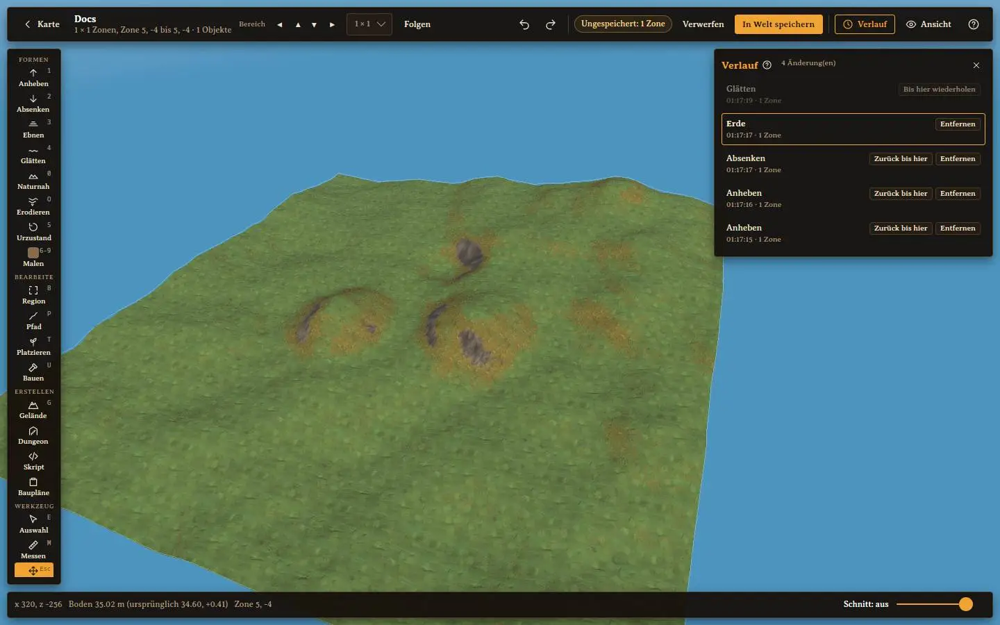

<!-- source: 752963cc -->
# Speichern und Verlauf

Nichts, was du im Editor tust, berührt die Welt, bevor du es sagst. Deine Änderungen warten als **ausstehende** Änderungen und kommen dann
in die Dateien der Welt, wenn du **In Welt speichern** wählst, oder in das laufende Spiel, wenn du **Live anwenden** wählst. Der **Verlauf**
behält jeden Schritt, auch nachdem der Editor geschlossen wurde, sodass du eine Änderung später zurücknehmen kannst.

```text
  deine Änderung ──► ausstehend ──► In Welt speichern ──► ein neuer Speicherstand im Weltordner   (offline)
                         │
                         └────────► Live anwenden ──────► das laufende Spiel, das ihn speichert   (live)
```

## Ausstehende Änderungen

Jeder Pinselstrich, Klick, jedes Einfügen und jeder Skriptlauf ist ein **Schritt**, und er bleibt ausstehend, bis er gespeichert oder angewendet ist. Die obere
Leiste zählt, was aussteht, in Bernstein („Ungespeichert: 3 Zonen, 1 gelöscht, 12 hinzugefügt, 1 zurückgesetzt“ oder live „Nicht angewendet: …“), und
zeigt „Alles gespeichert“ oder „Alles angewendet“ in Grau, wenn nichts wartet:

| Zähler | Was er zählt |
|---|---|
| **Zonen** | Zonen, deren Boden (Höhe oder Farbe) sich wirklich vom Speicherstand unterscheidet. Anheben und dann wieder auf dieselbe Höhe absenken zählt nichts. |
| **gelöscht** | Objekte der Welt, die entfernt werden. |
| **hinzugefügt** | Neue Objekte: platziert, eingefügt, kopiert oder von einem Werkzeug erzeugt. |
| **zurückgesetzt** | Zonen, die markiert sind, damit das Spiel sie neu erzeugt (siehe [Zonen zurücksetzen](areas-and-zones.md#zonen-zurücksetzen)). |

Sobald du gespeichert hast, zählen die Zähler, was sich von diesem Speicherstand unterscheidet, daher wird ein gespeicherter Schritt, den du rückgängig machst, wieder ausstehend. In
der 3D-Ansicht trägt jedes neue Objekt, das noch nicht gespeichert ist, einen grünen Punkt (**Ansicht → Ungespeichertes markieren** blendet sie aus).

**Ausstehende Änderungen gehören zur Welt.** Sie bleiben, wenn du den Bereich verschiebst, zur Karte zurückgehst oder eine andere Stelle öffnest,
und werden alle zusammen gespeichert (siehe [Der Bereich](areas-and-zones.md#der-bereich)). Sie gehen nur verloren, wenn du beendest, ohne zu
speichern (der Editor fragt zuerst), sie verwirfst oder eine Live-Welt mit **Neu laden** neu lädst (auch das fragt zuerst).

**Verwerfen** wirft weg, was nicht gespeichert oder angewendet ist: Es macht die ungespeicherten Schritte am Ende des Verlaufs rückgängig, die neuesten
zuerst, wiederholt gespeicherte oder angewendete Schritte, die du seitdem rückgängig gemacht hast, und verwirft den Rest der Wiederholen-Liste. Gespeicherte und angewendete Schritte
bleiben.

Manche ausstehenden Änderungen haben keinen Schritt im Verlauf des offenen Bereichs (in einem anderen Bereich gemacht oder bevor die Welt erneut
gelesen wurde). Diese lassen sich nur loswerden, indem die ganze Welt erneut aus ihren Dateien oder aus dem Spiel gelesen wird, was jede ausstehende
Änderung verwirft; daher fragt Verwerfen ein zweites Mal, bevor es das tut.

Nach dem erneuten Lesen bleibt der Verlauf so, wie die Welt ihn hat: aus den Dateien der beim letzten Speichern aufbewahrte Verlauf; live (**Verwerfen**
oder **Neu laden**) jeder Schritt, den das Spiel hat, angewendet und weiter rückgängig zu machen, während die nicht angewendeten Schritte mit ihren Änderungen verschwinden.

## Eine Welt speichern

Das Spiel bewahrt eine Welt als Ordner mit **nummerierten Speicherständen** auf: Jeder Speicherstand ist ein Satz Dateien (`_main.<n>.chunks`, `.db2`,
`.fwl2` und eine kleine `.ok`-Markierung) plus Chunk-Dateien mit den Objekten und dem Boden. **In Welt speichern** arbeitet so wie
das Spiel, daher öffnet sich eine damit gespeicherte Welt im Spiel wie jede andere:

1. **Es schreibt einen neuen Speicherstand** mit der nächsten Nummer. Nur die Chunk-Dateien, die sich geändert haben, werden neu geschrieben; unberührte
   Objekte werden Byte für Byte kopiert. Die `.ok`-Markierung kommt zuletzt, weil das Spiel nur einem Speicherstand traut, der sie hat; so wird
   ein abgebrochener Speicherstand nie für einen guten gehalten. Jede Datei behält das Speicherformat, in dem sie gelesen wurde, daher speichern sich Welten ab
   Valheim 1.0.20 wie auch aus älteren Versionen und öffnen sich im Spiel, das sie erstellt hat.
2. **Es liest den neuen Speicherstand zurück** und vergleicht ihn mit dem, was es schreiben wollte: dem Boden der geänderten Zonen, dem
   Boden jeder anderen Zone, der Anzahl der Objekte, den zurückgesetzten Zonen. Unterscheidet sich etwas oder schlägt etwas fehl, werden die neuen Dateien
   entfernt, und die Meldung endet mit „Nichts geändert“. Der alte Speicherstand ist zu diesem Zeitpunkt unberührt.
3. **Es räumt auf.** Der Speicherstand, aus dem du die Welt geöffnet hast, bleibt erhalten, solange die Welt offen ist, weil jeder Speicherstand
   aus ihm erstellt wird. Ein Speicherstand, den du früher in derselben Sitzung gemacht hast, wird entfernt, wenn du erneut speicherst. Wenn du die Welt verlässt,
   bleibt nur der neueste Speicherstand.
4. **Es schreibt den Verlauf** mit der Welt (siehe [Verlauf](#verlauf)).

**Schließe zuerst das Spiel.** Ein laufendes Spiel oder ein laufender Server hält die Welt im Speicher und überschreibt deinen Speicherstand, wenn es das nächste Mal
speichert. Um eine Welt zu ändern, während sie läuft, benutze den [Live-Modus](live-editing.md).

**Was nicht gespeichert werden kann**, wird mit dem Grund aufgeführt: Bearbeitungen in einer Zone, in deren Nähe noch kein Spieler war (die Welt hat dort noch keine Daten:
siehe [Zonen](areas-and-zones.md#zonen)), und neuer Boden in einer Welt, in der im Spiel nie jemand gegraben oder geebnet hat
(der Editor macht Bodenbearbeitungen, indem er eine kopiert, die das Spiel gemacht hat; grabe also zuerst irgendwo im Spiel einmal).

### Das Spiel hat gespeichert, seit du sie geöffnet hast

Hat das Spiel die Welt gespeichert, nachdem der Editor sie gelesen hat (du hast zwischen zwei Speicherungen gespielt), würde das Speichern verwerfen, was
im Spiel passiert ist; daher speichert der Editor nichts. Er bietet stattdessen an, **deine Änderungen** auf den Speicherstand des Spiels **zu übertragen**:
Er macht jede deiner ausstehenden Änderungen auf diesem Speicherstand erneut und findet Objekte an ihrer Art und Position, da
sich ihre IDs bei jedem Speichern ändern (siehe [Was ein Objekt ist](objects.md#was-ein-objekt-ist)).

Wo das Spiel dasselbe geändert hat, fragt er einmal pro Art: **Meine behalten** oder **Die des Spiels behalten**:

| Was kollidiert | Meine behalten |
|---|---|
| Zonen, deren Boden ihr beide geändert habt | Deine geänderten Punkte und Farben kommen über die des Spiels; überall sonst in diesen Zonen bleibt der Boden des Spiels. |
| Objekte, die das Spiel geändert hat (eine benutzte Truhe, ein Schild, eine wachsende Pflanze) und die du gelöscht, verschoben oder bearbeitet hast | Sie werden gelöscht, verschoben oder bearbeitet, wie du es getan hast. |
| Objekte, die das Spiel entfernt hat (genommen, zerstört oder eine Kreatur oder ein Schiff, die sich wegbewegt haben) und die du verschoben oder bearbeitet hast | Sie kommen dorthin zurück, wo du sie hingesetzt hast. Eines, das sich nur bewegt hatte, ist dann zweimal da. |

Noch wird nichts geschrieben: Die Welt ist jetzt der Speicherstand des Spiels mit deinen Änderungen darauf ausstehend. Sieh sie dir an, dann speichere.
Schritte im Verlauf, die etwas betrafen, das du der Version des Spiels überlassen hast, lassen sich nicht mehr rückgängig machen, ebenso wenig die Schritte
davor; die Meldung sagt, wie viele weggefallen sind.

## Live anwenden

Im [Live-Modus](live-editing.md) heißt dieselbe Schaltfläche **Live anwenden**. Sie sendet den ausstehenden Boden, die Objekte und die Zonen-
Resets an das laufende Spiel, das sie mit jedem Spieler dort teilt und selbst speichert, wie alles, was Spieler
bauen. Die gesendeten Schritte bekommen im Verlauf die Markierung **angewendet**; mit **Auto** an wird jeder Schritt angewendet, sobald du ihn
beendest.

Angewendete Schritte lassen sich weiterhin rückgängig machen: Mache sie rückgängig (oder **Entfernen** im Verlauf), dann wende erneut an.

- Ein **gelöschtes** Objekt kommt als Kopie dessen zurück, was es war, als die Welt gelesen wurde, mit seinen Daten (eine Truhe mit ihrem
  Inhalt, wie er war). Für das Spiel ist es ein neues Objekt.
- Ein **platziertes** Objekt wird wieder entfernt, auch wenn eine andere Mod es inzwischen unter einer neuen ID neu erstellt hat: Das Plugin
  findet es an seiner Art und Position.
- Ein **verschobenes** Objekt wandert zurück.
- Ein **Zonen-Reset** lässt sich nach dem Anwenden nicht rückgängig machen.

## Verlauf

**Verlauf** (`L`) führt jeden Schritt auf, den neuesten zuerst: seinen Namen („Anheben“, „Einfügen ×3“, „Entfernt: Platzieren“), seine Uhrzeit und was
er betroffen hat. Markierungen sagen, dass ein Schritt **angewendet** (gespeichert oder an das Spiel gesendet), von **Claude** gemacht oder aus einer **früheren
Sitzung** ist. Er behält standardmäßig jeden Schritt, solange sie weniger als 2 GB Speicher belegen (darüber hinaus fallen die ältesten
zuerst weg); **Einstellungen → Verlauf → Behaltene Schritte** behält stattdessen nur so viele.


*Der letzte Schritt wurde mit **Zurück bis hier** rückgängig gemacht: Er ist ausgegraut und bietet **Bis hier wiederholen** an.*

Es gibt zwei Wege zurück:

| | Was es tut | Beispiel |
|---|---|---|
| **Zurück bis hier** | Macht jeden Schritt nach diesem rückgängig, wie viele Male `Ctrl+Z`. Die späteren Schritte bleiben ausgegraut, zum Wiederholen. Eine neue Änderung verwirft sie. | Du hast drei Dinge ausprobiert und willst die Welt so, wie sie davor war. |
| **Entfernen** | Nimmt nur diesen Schritt heraus und behält alles, was danach getan wurde: Seine Höhenänderung verschwindet von den Punkten, die er berührt hat, seine Farbe geht dort weg, wo seitdem nichts neu bemalt wurde, seine Objekte verschwinden und die, die er gelöscht hat, kommen zurück, seine Resets werden aufgehoben. Das Entfernen ist ein neuer Schritt, daher holt `Ctrl+Z` ihn zurück. | Eine vor einer Stunde gepflanzte Baumreihe entfernen, ohne die seitdem gemachte Bodenarbeit zu verlieren. |

**Claudes Änderungen zurücknehmen** führt **Entfernen** für jeden Schritt aus, den Claude im Verlauf des offenen Bereichs gemacht hat, und behält
deine. Claudes Schritte in anderen Bereichen werden beiseitegelegt (siehe unten): Öffne diese Bereiche, um sie ebenfalls zurückzunehmen.

### Der Verlauf gehört zur Welt

Der Verlauf kommt mit, wenn du den Bereich verschiebst oder seine Größe änderst, wenn Folgen ihn vergrößert und über die Karte. Ein Schritt, der
ganz in einem anderen Bereich gemacht wurde, wird beiseitegelegt, solange dieser offen ist („N Schritt(e) aus anderen Bereichen bleiben erhalten“); er kommt
zurück, bereit zum Rückgängigmachen, wenn du einen Bereich öffnest, der ihn enthält. Ein Schritt, der nur teilweise im offenen Bereich liegt, lässt sich von
hier aus nicht rückgängig machen, ebenso wenig die Schritte davor. Speichern oder Anwenden aus irgendeinem Bereich markiert die Schritte aller Bereiche als gespeichert.

### Behalten, nachdem der Editor geschlossen wurde

Nach jedem **In Welt speichern** oder **Live anwenden** wird der Verlauf in den Datenordner des Editors geschrieben (`history/`, eine
Datei pro Weltordner; live eine pro Verbindung und Welt). Öffne die Welt erneut, auch Tage später, und die Schritte sind
wieder da, markiert als **frühere Sitzung**. Rückgängigmachen setzt den Boden zurück, ein gelöschtes Objekt mit seinem Inhalt zurück und nimmt ein platziertes weg. Änderungen, die du weder gespeichert noch
angewendet hast, werden nicht behalten.

Die Welt hat sich seitdem vielleicht geändert (Spieler haben gebaut und gegraben, oder das Spiel hat sie erneut gespeichert), daher fragt der Editor einmal, bevor
der erste Schritt aus einer früheren Sitzung rückgängig gemacht oder wiederholt wird: Das setzt die Dinge so zurück, wie sie waren, über das, was sich
seitdem geändert hat. Bei einer Welt, die seitdem nur der Editor gespeichert hat, wird nicht gefragt.

### Was ein Schritt nicht zurücknehmen kann

Der Verlauf bleibt über jedes Speichern und Anwenden erhalten, Zonen-Resets und zu Bodenscheiben gemachter Boden mit [Ohne Grenze](ground-limits.md#ohne-grenze)
eingeschlossen. Ein paar Dinge liegen außerhalb seiner Reichweite:

- **Ein Zonen-Reset, einmal gespeichert oder angewendet.** Das Spiel erzeugt die Zone neu: Was die Schritte dort getan haben, wird aus ihnen herausgenommen
  (ein Schritt, der ganz dort lag, verschwindet), ebenso der Schritt, der den Reset markiert hat. Schritte anderswo bleiben.
- **Bäume und Felsen, die unter Boden mit Ohne Grenze entfernt wurden**, einmal live angewendet oder sobald die Welt erneut geöffnet wird: Ein Rückgängigmachen
  bringt sie nicht zurück. Benutze [Natur nachwachsen lassen](../area.md#natur-nachwachsen-lassen).
- **Boden, den Spieler seitdem geändert haben.** Erneut geöffnet, kommt der Boden mit Ohne Grenze einer als Bodenscheiben gespeicherten Zone mit
  dem Verlauf zurück, daher setzt ein Rückgängigmachen den ganzen Boden zurück, den der Schritt geändert hat, auch um die Scheiben herum. Wo Spieler seitdem in dieser Zone gegraben haben,
  behält die Zone, was das Spiel hat: Ein Rückgängigmachen setzt nur den eigenen Boden des Schritts zurück.

## Sicherungen

Der Editor legt keinen eigenen Sicherungsordner an: Er berührt den alten Speicherstand nie, bevor der neue sich korrekt
zurücklesen ließ, und der Speicherstand, aus dem du geöffnet hast, bleibt, bis du die Welt verlässt. Das schützt dich vor einem schiefgegangenen Speichern,
nicht vor einer Bearbeitung, die du nach dem Verlassen bereust. Behalte dafür deine eigene Kopie jeder Welt, die dir wichtig ist (siehe
[Eine Welt vor dem Bearbeiten sichern](../guides/back-up-a-world.md)).

Das Spiel bewahrt seine eigenen Sicherungen neben dem Weltordner auf (`<World>_backup_auto-<date>`), und frühere Editor-Versionen
bewahrten ihre als `<World>_backup_terraineditor-<date>` auf. **Zurück zu einer Sicherung** des Werkzeugs Region setzt eine
Auswahl so zurück, wie sie in einer solchen Kopie war, ohne die ganze Welt zurückzusetzen (siehe
[Einen Bereich aus einer Sicherung wiederherstellen](../guides/restore-from-backup.md)). Es ordnet Objekte so zu:

- Ein Objekt, das jetzt in der Auswahl und in der Sicherung ist, von derselben Art, an derselben Stelle (auf 1 cm genau) und in dieselbe
  Richtung gedreht, bleibt unberührt.
- Jedes andere Objekt der gewählten Arten, das jetzt in der Auswahl ist, wird entfernt, auch wenn seine Art in Ansicht ausgeblendet ist.
- Jedes Objekt der Sicherung ohne Entsprechung kommt zurück, mit all seinen Daten: eine Truhe mit ihrem Inhalt, ein Schild mit
  seinem Text.
- Runensteine werden nie angetastet.

Der Boden kommt genau wie in der Sicherung zurück, Boden mit Ohne Grenze eingeschlossen. Eine Kopie einer anderen Welt (eines anderen Seeds) wird
abgelehnt.
