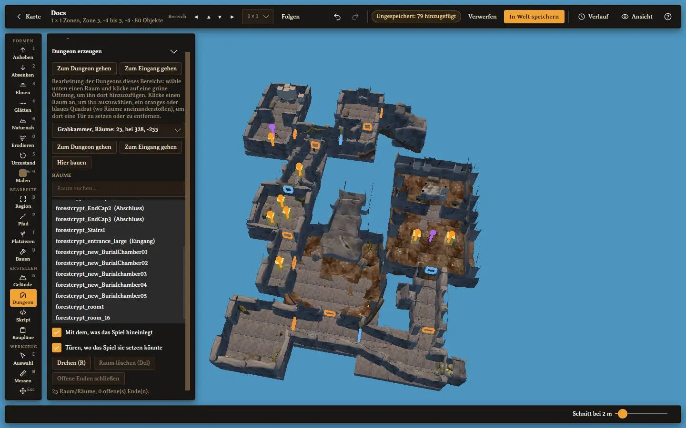
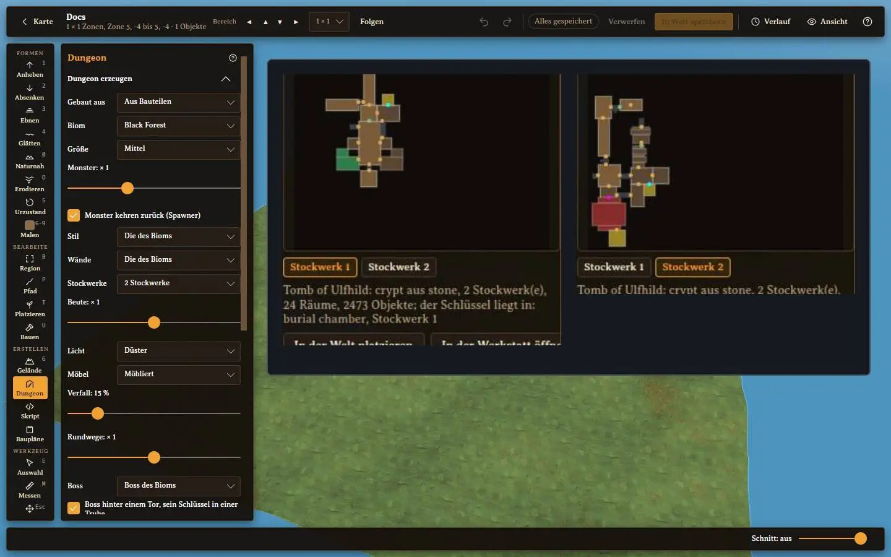
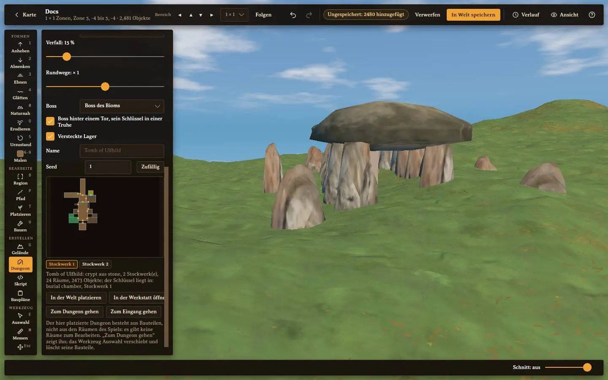
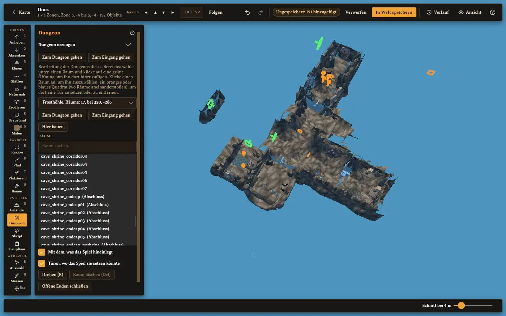
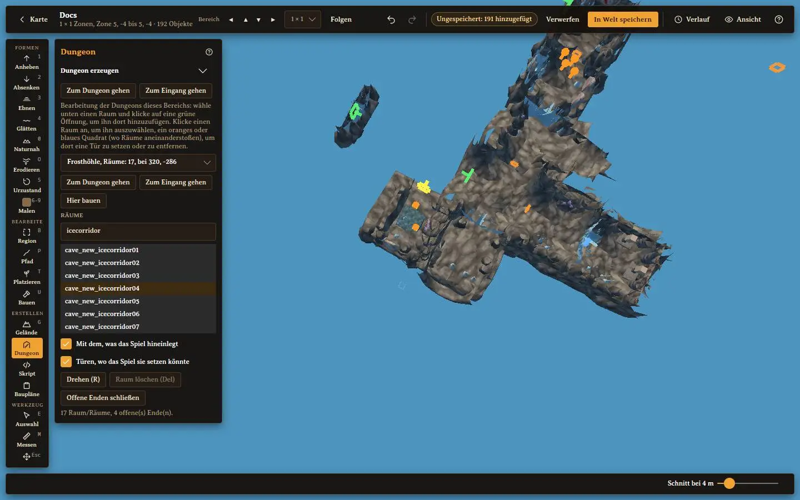
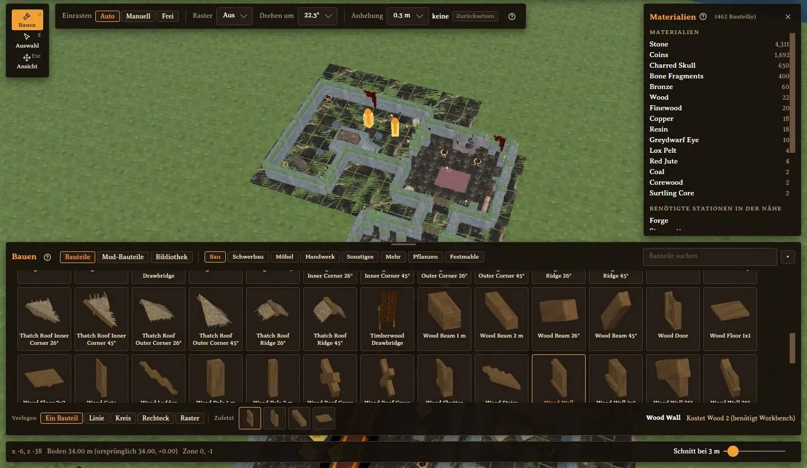

<!-- source: 16125394 -->
# Dungeon

Erzeuge ganze Dungeons und setze sie hinter einem Eingang in deine Welt, bearbeite die Dungeons des Spiels Raum für Raum und
baue in ihnen.

**Wo:** Werkzeugleiste, Abschnitt **ERSTELLEN** · **Taste:** keine · **Funktioniert in:** gespeicherten Welten, live; der Generator auch in der
Werkstatt (**Bibliothek** → **Dungeon erzeugen…**)

*Ein Dungeon aus den Räumen des Spiels (Grabkammer, 25 Räume), 5000 m hoch und 2 m über dem Boden aufgeschnitten. Orangefarbene und
blaue Quadrate markieren, wo Räume aneinanderstoßen. **Raum löschen (Del)** ist ausgegraut, bis ein Raum ausgewählt ist.*

Ein Dungeon in Valheim ist ein Ort auf dem Boden (ein Hügelgrab, ein Höhleneingang), dessen Tür zu Räumen führt, die 5000 m darüber liegen.
Siehe [Wie das Spiel Dungeons aufbewahrt](concepts/dungeons.md#wie-das-spiel-dungeons-aufbewahrt).

## Benutzen

So erzeugst du einen Dungeon und setzt ihn in die Welt:

1. Öffne einen Bereich einer Welt, dann klicke in der Werkzeugleiste auf **Dungeon**.
2. Wähle unter **Dungeon erzeugen** **Biom**, **Größe** und **Stockwerke**. Der Plan wird einen Moment nach
   jeder Änderung neu gezeichnet.
3. Optional: Klicke auf **Zufällig**, bis dir der Plan gefällt; prüfe jedes Stockwerk mit den Schaltflächen **Stockwerk 1**, **Stockwerk 2**...
   darunter.
4. Drehe die Ansicht zu der Stelle, an die der Eingang soll, mittig darauf.
5. Klicke auf **In der Welt platzieren**.
6. Klicke auf **Zum Dungeon gehen**, um hineinzuschauen; **Zum Eingang gehen** bringt die Ansicht wieder hinunter.
7. Klicke auf **In Welt speichern** (oder **Live anwenden**).

Das ganze Platzieren ist ein Schritt zum Rückgängigmachen: `Ctrl+Z` nimmt alles zurück. Dieselben Vorgaben und derselbe Seed ergeben immer denselben
Dungeon aus Bauteilen; einer aus [den Räumen des Spiels](#aus-den-räumen-des-spiels) hängt außerdem davon ab, wo sein
Eingang steht und wohin er zeigt. Die ganze Anleitung findest du unter [Einen Dungeon erzeugen und in die Welt setzen](guides/make-a-dungeon.md).

***Dungeon erzeugen** für einen Dungeon im Schwarzwald, Mittel, 2 Stockwerke, Boss hinter einem Tor. Neben dem Panel sein Plan,
größer gezeichnet, ein Stockwerk je Plan: der grüne Schlüsselraum auf Stockwerk 1, die rote Arena mit ihrem magentafarbenen Torpunkt und die goldene
Schatzkammer auf Stockwerk 2, und die Zusammenfassung darunter.*

## Einstellungen

### Dungeon erzeugen

**Dungeon erzeugen** steht oben im Panel Dungeon: aufgeklappt, wenn der Bereich keinen Dungeon hat, zugeklappt, wenn er einen hat.

| Einstellung | Was sie tut |
|---|---|
| **Gebaut aus** | **Aus Bauteilen**: Räume, gebaut wie ein Spieler sie bauen würde, eingerichtet für ihren Zweck. **Räume des Spiels**: die Dungeonräume des Bioms, verbunden, wie das Spiel sie verbindet (siehe [Aus den Räumen des Spiels](#aus-den-räumen-des-spiels)). Nicht in der Werkstatt zu sehen, die nur Bauteile nimmt. |
| **Biom** | **Wiesen**, **Schwarzwald** (der Standard), **Sumpf**, **Berge**, **Ebenen**, **Nebellande**, **Aschlande**, **Tiefer Norden**. Legt die Monster, die Beute, die Lichter, den Eingang auf dem Boden fest, und Stil und Wände, sofern du sie nicht wählst. |
| **Größe** | **Klein**, **Mittel** (der Standard), **Groß**, **Riesig**: etwa 5, 8, 12 oder 17 Räume pro Stockwerk. |
| **Monster: × 1** | **keine** bis 3-mal so viele wie üblich, in Schritten von 0.25. |
| **Monster kehren zurück (Spawner)** | An: die Spawner des Spiels, deren Monster eine Weile nach ihrem Tod zurückkehren. Aus: die Monster selbst, einmal platziert. Der Boss wird immer einmal platziert. |
| **Stil** | **Die des Bioms** oder **Crypt** (Krypta), **Catacombs** (Katakomben), **Temple** (Tempel), **Fortress** (Festung), **Prison** (Gefängnis), **Dvergr hold** (Dvergr-Feste), **Goblin warren** (Goblinbau), **Ruins** (Ruinen): welche Räume er hat und wie sie angeordnet sind. |
| **Wände** | **Die des Bioms** oder **Stone** (Stein), **Marble** (Marmor), **Wood** (Holz), **Stave** (Stabkirche), **Grausten**, **Dvergr**, **Goblin**. |
| **Stockwerke** | **1 Stockwerk** bis **16 Stockwerke** (standardmäßig 2), durch Treppen verbunden. Der Boss wartet auf dem letzten. |
| **Beute: × 1** | Truhen und Schätze: **keine** bis doppelt so viel wie üblich. Tiefere Stockwerke enthalten mehr. Bei den Räumen des Spiels behält oder verdoppelt es die Truhen der Räume. |
| **Licht** | **Dunkel**, **Düster** (der Standard) oder **Hell**: wie viele Fackeln und Feuerschalen. |
| **Möbel** | **Kahl**, **Möbliert** (der Standard) oder **Reich**. |
| **Verfall: 15 %** | Wie verfallen er ist, 0 bis 100 % in Schritten von 5: Schutt, umgestürzte Säulen, erloschene Fackeln. Einen Stil zu wählen setzt dessen eigenen Wert, ebenso ein Biom zu wählen, solange **Stil** auf **Die des Bioms** steht. |
| **Rundwege: × 1** | Wie oft Räume, die entlang des Weges weit auseinanderliegen, verbunden werden, sodass es mehr als einen Weg herum gibt: **keine (ein Baum)** bis doppelt so oft wie üblich. |
| **Boss** | **Boss des Bioms**, **Kein Boss** oder der Boss oder die Elite eines beliebigen Bioms mit Namen (`Troll`, `Draugr_Elite`, `StoneGolem`...). |
| **Boss hinter einem Tor, sein Schlüssel in einer Truhe** | Das Tor der Arena öffnet sich mit dem Kryptaschlüssel, in einer Truhe weit davon entfernt (Spieler, die den Schlüssel vom Ältesten haben, öffnen es ebenfalls). Aus: große Doppeltore, für alle offen. |
| **Versteckte Lager** | Kleine Schatzräume hinter einer rissigen Wand zum Zerschlagen oder einem Wandteppich. |
| **Name** | Steht auf einem Schild in der Eingangshalle. Leer: ein aus dem Seed gebildeter Name, ausgegraut gezeigt (`Barrow of Sigrun`). |
| **Seed** und **Zufällig** | Die eigene Nummer des Dungeons; jede ganze Zahl ergibt mit denselben Vorgaben einen anderen Dungeon. |

**Licht** oder **Verfall** zu ändern ändert sonst nichts am Dungeon. Bei **Räume des Spiels** werden nur **Biom**,
**Größe**, **Monster**, **Beute** und der Seed benutzt; die anderen Zeilen und der Plan sind ausgeblendet. Was der Generator wohin setzt, steht in
[Wie der Generator einen Dungeon anlegt](concepts/dungeons.md#wie-der-generator-einen-dungeon-anlegt) und
[Einrichtung, Licht und Wachen](concepts/dungeons.md#einrichtung-licht-und-wachen).

Was jedes Biom mitbringt, wenn nichts anderes gewählt ist:

| Biom | Stil | Wände | Boss | Eingang auf dem Boden |
|---|---|---|---|---|
| Wiesen | Crypt | Stone | `Skeleton_Hildir` | Der Hügel einer Grabkammer |
| Schwarzwald | Crypt | Stone | `Troll` | Der Hügel einer Grabkammer |
| Sumpf | Crypt | Stone | `Draugr_Elite` | Die Tür einer versunkenen Krypta |
| Berge | Fortress | Stone | `StoneGolem` | Der Eingang einer Frosthöhle |
| Ebenen | Goblin warren | Goblin | `GoblinBrute` | Kein eigener: ein Paar verbundener Portale |
| Nebellande | Dvergr hold | Dvergr | `SeekerBrute` | Der Eingang einer befallenen Mine |
| Aschlande | Fortress | Grausten | `Charred_Melee_Dyrnwyn` | Ein Morgen-Loch |
| Tiefer Norden | Temple | Stave | `JotunWarrior` | Der Eingang einer Frosthöhle |

**Der Plan** zeichnet das gezeigte Stockwerk von oben: Räume auf dem Weg hindurch hellbraun, Nebenräume dunkler braun,
Gänge dunkelgrau; die Arena des Bosses rot, die Schatzkammer und die versteckten Lager golden, der Schlüsselraum grün. Durchgänge sind Punkte:
das verschlossene Tor magenta, versteckte Wege cyan, offene Bögen grün, Türen und Tore orange. Zeige auf einen Raum, um seinen Namen zu sehen.
Die Zusammenfassung darunter sagt, was erstellt wurde (`Barrow of Sigrun: crypt aus stone, 2 Stockwerk(e), 15 Räume, 2140 Objekte; der
Schlüssel liegt in: ossuary, Stockwerk 2`), und was nicht (`kein Platz für eine Treppe nach unten ab Stockwerk 3; die Stockwerke darunter
fallen weg`).

| Schaltfläche | Was sie tut |
|---|---|
| **In der Welt platzieren** | Setzt den Eingang in der Mitte der Ansicht auf den Boden, seine Tür dir zugewandt, und den Dungeon 5000 m darüber. |
| **In der Werkstatt öffnen** | Schreibt den Dungeon (aus Bauteilen) als Bauplan und öffnet ihn in der [Werkstatt](workshop.md), um ihn zu ändern: siehe [In der Werkstatt öffnen](#in-der-werkstatt-öffnen). Bei **Räume des Spiels** nicht zu sehen. |
| **Zum Dungeon gehen** / **Zum Eingang gehen** | Zu sehen, sobald der Dungeon platziert ist (und bis `Ctrl+Z` ihn zurücknimmt): bringen die Ansicht hinauf in das erste Stockwerk, die Dächer weggeschnitten, und wieder hinunter. |

*Der Hügel einer Grabkammer, platziert mit **In der Welt platzieren**, seine Tür der Kamera zugewandt. Unter der Zusammenfassung sind jetzt **Zum
Dungeon gehen** und **Zum Eingang gehen** zu sehen.*

### Räume eines Dungeons

Unter dem Generator führt das Panel, wenn ein Dungeon im Bereich ist, dessen Dungeons auf und bearbeitet ihre Räume.

| Einstellung | Was sie tut |
|---|---|
| Dungeonliste | Die Dungeons des Bereichs, jeder mit Art, Räumen und Position (`Frosthöhle, Räume: 34, bei 1520, -2240`). Fuling-Dörfer und Höfe in den Wiesen, auf dem Boden genauso angelegt, erscheinen auch. |
| **Zum Dungeon gehen** | Bringt die Ansicht hinauf in die Mitte der Räume des Dungeons und schneidet ihre Dächer weg (bei 4 m über dem Fußboden, wenn der Schnitt aus war). |
| **Zum Eingang gehen** | Bringt die Ansicht zurück hinunter zum Eingang auf dem Boden, ohne Schnitt. |
| **Hier bauen** | Schaltet [Bauen](build.md) über dem Dungeon ein, mit seiner Leiste am unteren Rand: siehe [In einem Dungeon bauen](#in-einem-dungeon-bauen). |
| **RÄUME** + **Raum suchen…** | Die Räume, die diese Art von Dungeon aufnehmen kann; tippe, um sie nach Namen einzugrenzen. Abschlüsse und Eingangsräume sind mit `(Abschluss)` und `(Eingang)` markiert. |
| **Mit dem, was das Spiel hineinlegt** | An (der Standard): Ein hinzugefügter Raum kommt mit dem, was das Spiel dort darin erzeugt hätte (Truhen, Spawner, Fackeln, Dekoration). Aus: leere Räume. |
| **Türen, wo das Spiel sie setzen könnte** | An (der Standard): Ein hinzugefügter Raum bekommt eine Tür, wo er anschließt, nach der eigenen Wahrscheinlichkeit des Spiels. |
| **Drehen (R)** | Verbindet den gezeigten Raum über seine nächste Öffnung derselben Art. |
| **Raum löschen (Del)** | Entfernt den ausgewählten Raum. |
| **Offene Enden schließen** | Setzt den Abschluss des Spiels auf jedes offene Ende, damit nichts hinausführt. Die Meldung sagt, wie viele offene Enden keinen Abschluss ihrer Art haben. |

Die Dächer werden mit dem Schieberegler **Schnitt** in der Statusleiste weggeschnitten, demselben wie in einer Welt und in der Werkstatt. Solange
das Werkzeug Dungeon (oder **Hier bauen**) mit einem offenen Dungeon benutzt wird, zählen seine Meter ab etwa dem Fußboden des
Dungeoneingangs, 0 bis 29 m: Das linke Ende schneidet am Fußboden, das rechte Ende (**Schnitt: aus**) zeigt die Dächer. Verlässt du
das Werkzeug, kommt der eigene Schnitt der Welt zurück, und der des Dungeons bleibt für deine Rückkehr erhalten. Siehe
[Schnitt](editor-basics.md#schnitt).

Die Zeile unten zählt die Räume, die offenen Enden und die überlappenden Paare (`24 Raum/Räume, 3 offene(s) Ende(n). 1 überlappende(s)
Paar(e).`).

## Einen Dungeon öffnen

1. Öffne den Bereich über dem Eingang eines Dungeons (die Ortsmarker der Karte zeigen die Eingänge).
2. Klicke in der Werkzeugleiste auf **Dungeon**: Die Liste zeigt die Dungeons des Bereichs.
3. Klicke unter der Liste auf **Zum Dungeon gehen**.
4. Optional: Bewege den Schieberegler **Schnitt** in der Statusleiste, um mehr oder weniger von den Wänden zu sehen.

Dort oben folgt die Kamera nicht mehr dem Boden: Kreise, verschiebe und fliege wie gewohnt um die Räume. **Dungeonräume** im
[Panel Ansicht](editor-basics.md) zeigt sie oder blendet sie aus.

Ein Dungeon, in dessen Nähe noch niemand war, hat noch keine Räume: Das Panel sagt *Das Spiel hat diesen Dungeon noch nicht angelegt (niemand
war in seiner Nähe).* Besuche ihn im Spiel, dann öffne den Bereich erneut.

*Eine Frosthöhle nach **Zum Dungeon gehen**, ihre Dächer 4 m über dem Fußboden weggeschnitten: Das Panel führt sie auf (`Frosthöhle, Räume: 17, bei
-640, -350`). Grüne Rahmen markieren offene Enden (ein Raum wurde gelöscht), orangefarbene Quadrate, wo Räume ohne Tür aneinanderstoßen.*

## Räume hinzufügen

Jeder Raum hat **Öffnungen**, die Durchgänge, an denen er an den nächsten Raum stößt. Das Spiel verbindet nur Öffnungen derselben Art.

1. Suche einen grünen Rahmen: Er markiert ein **offenes Ende**, eine Öffnung, an die noch kein Raum anschließt.
2. Wähle einen Raum in der Liste unter **RÄUME**.
3. Zeige auf ein offenes Ende (bis auf 1,5 m): Der Raum erscheint dort, durchsichtig, so verbunden, wie das Spiel Räume verbindet.
4. Optional: Drücke `R` (**Drehen (R)**), um ihn über eine andere seiner Öffnungen zu verbinden.
5. Klicke, um ihn hinzuzufügen. Er bleibt ausgewählt, sodass `Del` ihn wieder herausnimmt.

Ein Raum, der einen anderen überlappen oder über den Raum des Dungeons hinausgehen würde (bei den meisten Arten 64 × 64 m um die Mitte seiner Zone),
wird rot, und die Zeile warnt. Das Spiel baut die Liste trotzdem: Es ist nur eine Warnung.

*`cave_new_icecorridor01`, unter **RÄUME** gewählt (eingegrenzt mit „icecorridor“) und auf ein offenes Ende gezeigt: Er erscheint
dort durchsichtig, so verbunden, wie das Spiel es tut. Die Zeile unten lautet `17 Raum/Räume, 4 offene(s) Ende(n).`*

## Türen

Ein Quadrat markiert jede Stelle, an der zwei Räume aneinanderstoßen und eine Tür stehen kann: **blau** mit Tür, **orange** ohne. Klicke
darauf, um die Tür des Dungeons dorthin zu setzen oder sie zu entfernen. Jeder Klick ist ein Schritt zum Rückgängigmachen.

## Einen Raum löschen

Klicke auf einen Raum, um ihn auszuwählen (sein Kasten erscheint), dann klicke auf **Raum löschen (Del)**. Was im Raum steht (Truhen,
Spawner...), verschwindet mit ihm, ebenso die Türen, wo er an andere Räume stieß. Die Räume daneben haben wieder offene Enden:
**Offene Enden schließen** verschließt sie.

## In einem Dungeon bauen

**Hier bauen** schaltet [Bauen](build.md) über dem Dungeon ein, mit seiner [Leiste](workshop.md#die-leiste-bauen) und der
Bauleiste: nur die Reiter **Bauteile** und **Mod-Bauteile** (die Baupläne der **Bibliothek** kommen auf die Parzelle der Werkstatt),
ein Bauteil nach dem anderen (die Linien von **Verlegen** werden auf dem Boden gezeichnet, weit darunter): Wähle ein Bauteil, dann klicke auf den Fußboden
oder die Wand eines Raums oder auf ein Bauteil, das schon dort ist. Bauteile rasten ein wie mit dem Hammer, und der Mauszeiger geht durch das, was der Schnitt ausblendet. Wähle ein anderes Werkzeug,
um mit dem Bauen aufzuhören.

Die Fußböden und Wände eines Raums zählen im Spiel als Boden, daher halten Bauteile, die auf ihnen ruhen. Bauteile, die frei in der Luft hängen, abseits
der Räume, brechen, sobald ein Spieler in die Nähe kommt.

## Aus den Räumen des Spiels

Steht **Gebaut aus** auf **Räume des Spiels**, verbindet der Editor die Dungeonräume des Bioms so, wie das Spiel es tut: eine Grab-
kammer in den Wiesen und im Schwarzwald, eine versunkene Krypta im Sumpf, eine Frosthöhle in den Bergen und im Tiefen Norden, eine
befallene Mine in den Nebellanden und die eigenen der Aschlande und der Ebenen. Er fügt Räume hinzu, bis es etwa 8, 14, 20 oder
26 sind (je nach **Größe**), ohne Überlappungen, schließt jedes offene Ende, füllt jeden Raum mit dem, was das Spiel hineinlegen würde, und setzt
Türen, wo das Spiel es täte. **Monster** kopiert jeden Spawner ungefähr so oft; **Beute** behält jede Truhe mit dieser
Wahrscheinlichkeit unter × 1 und fügt darüber mit dieser Wahrscheinlichkeit eine zweite daneben hinzu. Eine Dungeonart ohne Räume zum
Verbinden (ein Lager, ein Dorf) wird zu einer Frosthöhle, und die Zusammenfassung sagt es.

In der Welt platziert, ist es ein Dungeon aus Räumen, genau wie das Spiel seine eigenen aufbewahrt: Er erscheint in der Dungeonliste, um
Raum für Raum bearbeitet zu werden. Seine Räume werden vom Eingang aus neu angelegt, so wie das Spiel seine eigenen anlegt: von dort aus, wohin der
Eingang den Dungeon setzt, innerhalb des Raums dieser Zone. Die platzierten Räume sind also nicht die der Zusammenfassung, und ihn
anderswo in einer Zone oder in eine andere Richtung zu platzieren, ergibt andere Räume; dieselbe Stelle und Richtung ergeben wieder dieselben. Sind die Raum- und Dungeondateien von Expand World Data aktiv, folgen ihnen der Generator, die Raumliste und die gezeichneten Räume:
siehe [Eine mit Expand World, Riverheim oder Tunnelheim erstellte Welt bearbeiten](guides/use-mods-worlds.md).

## In der Werkstatt öffnen

*Ein erzeugter Dungeon (ein Stockwerk), auf der Parzelle der Werkstatt geöffnet und bei 3 m aufgeschnitten, die Leiste Bauen wieder auf ihrem Reiter
**Bauteile**: oben die Eingangshalle mit ihrem Portal, wo Spieler ankommen; darunter die Arena des Bosses.*

**In der Werkstatt öffnen** schreibt den Dungeon als Bauplan in den Ordner von Homestead und öffnet ihn, um ihn zu ändern: Öffne eine
Truhe, verschiebe die Möbel, füge eigene Details hinzu, dann **Bauplan speichern**. Die Werkstatt tritt an die Stelle der Welt: Bei
nicht gespeicherten (oder nicht angewendeten) Änderungen fragt sie zuerst. Um den Dungeon danach in eine Welt zu setzen, öffne die Welt erneut
und füge den Bauplan ein (siehe [Dungeons aus Bauplänen](#dungeons-aus-bauplänen)). Der Bauplan:

- behält, was seine Objekte enthalten (den Schlüssel in seiner Truhe, die Schilder, den Boss und seine Sterne), und dass er eine Ruine ist;
- trägt die Tags `dungeon` und `generated`, und seine Beschreibung nennt den Seed und die Zusammenfassung;
- hat ein **Portal** in der Eingangshalle, wo Spieler ankommen.

Ein schon vorhandener Bauplan dieses Namens bleibt erhalten; der neue wird nummeriert. Im Spiel mit Homestead gebaut, sind es nur die
Bauteile: kein Schlüssel in der Truhe, kein Boss.

## Dungeons aus Bauplänen

Jeder Bauplan kann ein Dungeon sein: Schalte **Ein Dungeon** ein, wenn du ihn in der Werkstatt speicherst (oder in den **Details** des Panels
Baupläne). Aus dem Panel Baupläne in eine Welt eingefügt, kommt er nicht auf den Boden:

- Der Eingang des Dungeons des Bioms kommt dorthin, wo du klickst, dir zugewandt, und das Gebäude 5000 m darüber.
- Drehen und Spiegeln des Einfügewerkzeugs gelten (`R`, `X`, `,` `.`); seine **Höhe** und **Kopien** nicht, auch wenn das
  Panel sie zeigt.
- Stelle ein **Portal** (`portal_wood`) in das Gebäude, wo Spieler ankommen sollen, in die Richtung, in die sie schauen sollen: Die
  Tür des Eingangs öffnet sich dorthin, und dieses Portal wird weggelassen. Ohne eines kommen Spieler in der Mitte des Gebäudes an,
  nach Norden schauend.
- In den Ebenen ersetzt ein verbundenes Portalpaar den Eingang.

Bauteile halten im Himmel nur auf dem, was das Spiel nie auf Stabilität prüft: Mache die Fußböden aus schwarzem Marmor
(`blackmarble_floor_large`) und stelle alles andere darauf.

## Tastenkürzel

| Taste oder Maus | Was es tut |
|---|---|
| Klick auf einen grünen Rahmen | Den dort gezeigten Raum hinzufügen. |
| Klick auf einen Raum | Ihn auswählen. |
| Klick auf ein Quadrat | Dort eine Tür setzen oder sie entfernen. |
| `R` | Den gezeigten Raum über seine nächste Öffnung verbinden. |
| `Del` | Den ausgewählten Raum löschen. |
| `Ctrl+Z` | Die letzte Änderung rückgängig machen (ein Platzieren, einen Raum, eine Tür). |

Alle Tasten des Editors stehen unter [Tastenkürzel](help/shortcuts.md).

## Tipps und Grenzen

- **Zurückholen:** Jedes Platzieren, jeder Raum und jede Tür ist ein Schritt zum Rückgängigmachen (`Ctrl+Z`). Eine Anordnung verloren, die dir gefiel? Dieselben Vorgaben
  und derselbe Seed ergeben wieder denselben Dungeon aus Bauteilen (einer aus den Räumen des Spiels braucht auch dieselbe Stelle und
  Richtung). Nichts wird geschrieben vor **In Welt speichern** oder **Live anwenden**.
- **Ein Dungeon pro Zone** (64 × 64 m): Hinter dem eigenen Eingang des Spiels sagt der Editor es, wenn dort oben schon etwas ist, und
  platziert nichts; setze den Eingang in eine andere Zone. In den Ebenen (Zugang per Portal) geht er stattdessen höher, siehe
  unten.
- Ein Dungeon aus Bauteilen besteht aus gewöhnlichen Objekten, nicht aus Räumen: [Auswahl](select.md) verschiebt und löscht seine
  Bauteile, und die Dungeonliste zeigt ihn nicht (das Panel sagt, dass er aus Bauteilen besteht, ohne Räume zum Bearbeiten). Benutze
  **Zum Dungeon gehen**.
- Alles, was ein erzeugter Dungeon platziert, hat keinen Erbauer, wie das des Spiels: Überfälle ignorieren es, es ist keine Basis für Feuer,
  und es abzubauen gibt ein Drittel der Materialien zurück. Siehe
  [Von Spielern gebaute Bauteile](concepts/objects.md#von-spielern-gebaute-bauteile).
- Der Eingang ist der eigene Ort des Spiels für das Biom: Das Spiel erzeugt seine Tür und seine Steine bei jedem Laden der Zone.
  Der Dungeon kommt dorthin, wo das Spiel den eigenen Dungeon dieses Eingangs hinsetzt (der einer Frosthöhle über die Mitte der Zone), so gedreht, dass
  Spieler, die durch die Tür kommen, in der Eingangshalle ankommen und hineinschauen. Die Ansicht bleibt am Eingang.
- In den Ebenen führt ein Portal auf dem Boden (3 m vom Punkt) hinein, und sein Zwilling in der Eingangshalle führt zurück,
  verbunden unter einem Tag wie `dg123`. Ohne Eingang im Weg geht der Dungeon in Schritten von 50 m höher, wenn
  dort oben schon etwas ist.
- Manches, was das Spiel in Räume legt (Eiszapfen, Kristalle, Fische), setzt sich im Spiel auf die nächste Oberfläche, daher liegt es vielleicht
  etwas anders, als der Editor es zeigt.
- Das Spiel zeichnet Dungeons dunkel; der Editor beleuchtet sie wie draußen, damit du siehst, was du bearbeitest.
- **Claude** kann Dungeons erzeugen und Räume bearbeiten: siehe [Claude](claude.md).

## Verwandte Seiten

- [Einen Dungeon erzeugen und in die Welt setzen](guides/make-a-dungeon.md)
- [Einen Bauplan in eine Welt einfügen](guides/paste-a-blueprint.md)
- [Wie das Spiel Dungeons aufbewahrt](concepts/dungeons.md#wie-das-spiel-dungeons-aufbewahrt)
- [Werkstatt](workshop.md) · [Auswahl](select.md)
