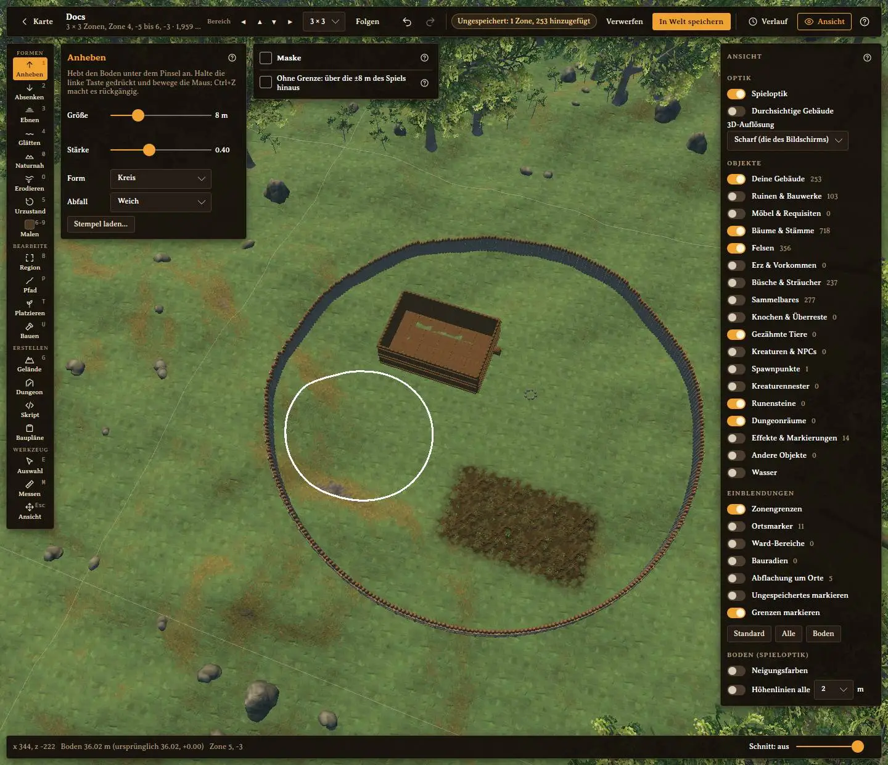
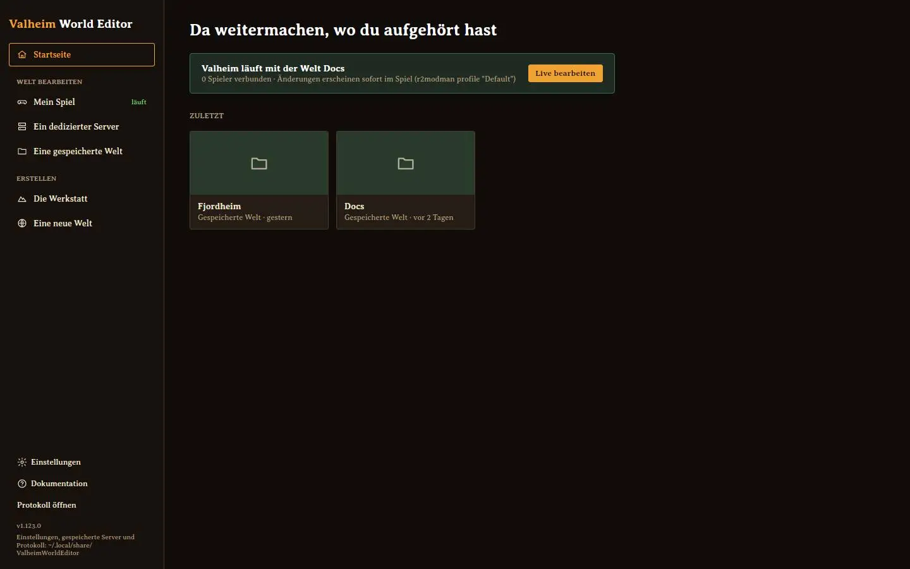
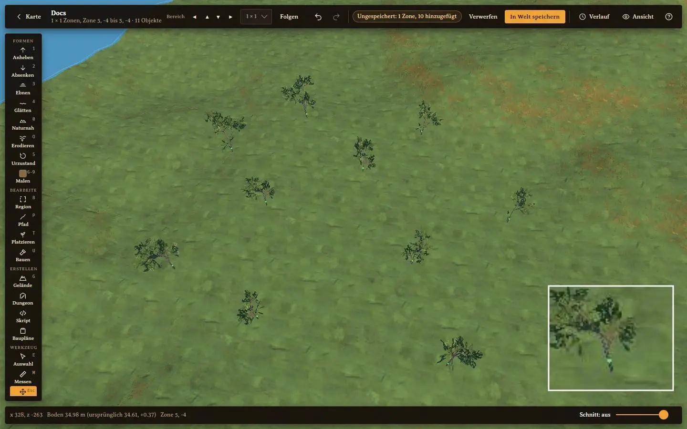
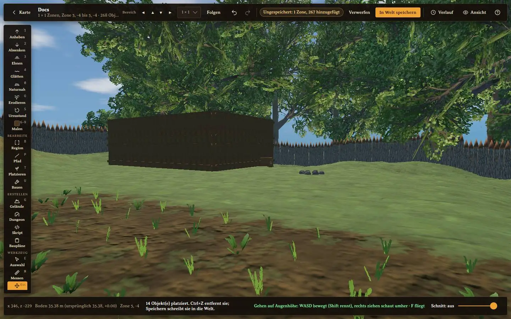
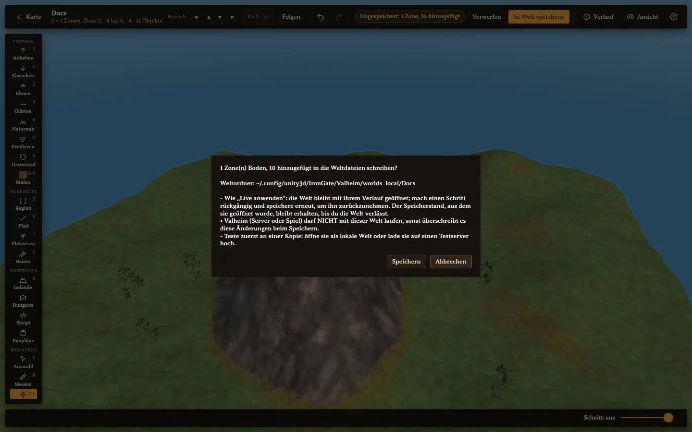
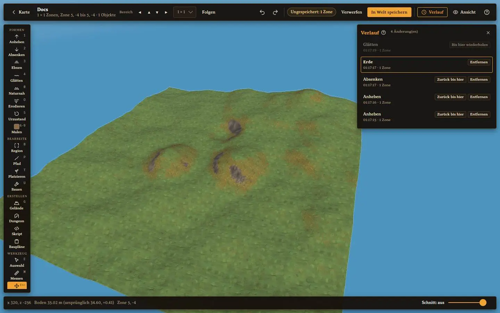
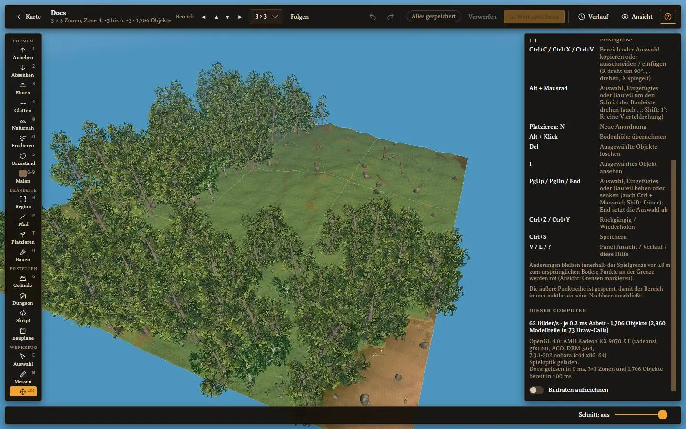
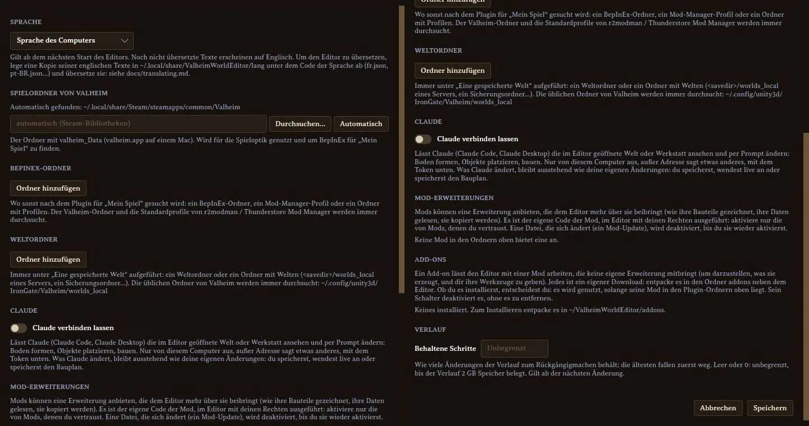

<!-- source: 1d85c1a0 -->
# Das Editorfenster

Finde dich im Editor zurecht: die Startseite, das 3D-Fenster mit oberer Leiste, Werkzeugleiste und Panels, die Kamera,
das Speichern, der Verlauf und das Panel Ansicht.

**Wo:** Zuerst öffnet sich die Startseite; eine Welt öffnet sich auf ihrer [Karte](map.md), dann **In 3D bearbeiten** · **Taste:** `?` oder
`F3` für die Hilfekarte, `F1` für diese Hilfe beim aktiven Werkzeug · **Funktioniert in:** gespeicherten Welten, live, der Werkstatt

*Eine kleine Basis in einem Bereich von 3 × 3, der Pinsel Anheben gewählt (sein Ring auf dem Gras). Links: die Werkzeugleiste und das
Werkzeugpanel. Oben: die obere Leiste. Rechts: das Panel Ansicht. Unten: die Statusleiste, die den Boden unter dem Mauszeiger anzeigt.*

## Benutzen

1. Wähle auf der Startseite, wie du bearbeiten willst: **Mein Spiel**, **Ein dedizierter Server** oder **Eine gespeicherte Welt** (oder **Die
   Werkstatt**, um ohne Welt zu bauen).
2. Klicke auf deine Welt. Sie öffnet sich auf ihrer [Karte](map.md).
3. Klicke auf der Karte auf die Stelle, die du bearbeiten willst, wähle die Größe des Bereichs, dann **In 3D bearbeiten**.
4. Wähle ein Werkzeug in der Leiste, stelle es in seinem Panel ein und benutze es in der Ansicht.
5. Sieh dir an, was in der Zeile der ausstehenden Änderungen in der oberen Leiste wartet, dann **In Welt speichern** (oder **Live anwenden**).
6. Um eine Änderung zurückzunehmen, drücke `Ctrl+Z` oder öffne den **Verlauf** (`L`).

Jede Änderung wartet als [ausstehend](concepts/saving-and-history.md#ausstehende-änderungen), bis du sie speicherst oder anwendest.

## Die Startseite

*Startseite: die Karte des laufenden Spiels mit **Live bearbeiten**, dann die zuletzt geöffneten Welten und Baupläne.*

Das Seitenmenü hat **Startseite**, dann zwei Abschnitte, **Welt bearbeiten** und **Erstellen**. Hierher kommst du von der Karte
einer Welt (**Welten**) oder aus der Werkstatt (**Start**) zurück.

| Eintrag | Was er zeigt |
|---|---|
| **Startseite** | Wo du aufgehört hast. Wenn Valheim mit dem Plugin WorldEditorBridge läuft, sagt eine Karte „Valheim läuft mit der Welt …“ und wie viele Spieler verbunden sind, mit **Live bearbeiten**. Unter **Zuletzt**: die gespeicherten Welten und Baupläne, die du zuletzt geöffnet oder gespeichert hast (Baupläne mit ihren Bildern), die neuesten zuerst, und die gespeicherten Server, die sich mit einem Klick verbinden (Passwort gespeichert oder eine Schlüsseldatei). |
| **Mein Spiel** | Dein eigenes Spiel, live: was fehlt (BepInEx, das Plugin, ein erster Start) oder die Welt, mit der es läuft, und **Live bearbeiten**. *läuft* steht daneben, solange das Spiel läuft; der Editor prüft das alle paar Sekunden. Siehe [Live-Modus](live-mode.md). |
| **Ein dedizierter Server** | Die gespeicherten Server (**Verbinden**, **bearbeiten**, **vergessen**) und das Formular, um dich mit einem anderen zu verbinden. Siehe [Live-Modus](live-mode.md). |
| **Eine gespeicherte Welt** | Die Welten auf diesem Computer, zum Öffnen bei geschlossenem Spiel. Die Liste folgt alle paar Sekunden den hinzugefügten oder entfernten Weltordnern; **Aktualisieren** schaut sofort nach. Fahre mit der Maus über eine Welt, um ihren Ordner zu sehen. **Anderer Weltordner** öffnet jeden Ordner mit `_main.<n>.chunks`-Dateien. Siehe [Eine Welt öffnen, die nicht in der Liste steht](guides/open-a-world.md). |
| **Die Werkstatt** | **Werkstatt öffnen**, ob Homestead installiert ist, und jeden Bauplan, die neuesten zuerst: Klicke auf einen, um ihn zu öffnen. Siehe [die Werkstatt](workshop.md). |
| **Eine neue Welt** | **Neue Welt erstellen**: die Welt eines Seeds, bevor es sie gibt, und eine Suche nach einer, die zu dir passt. Siehe [eine neue Welt](new-world.md). |

Unten im Menü: **Einstellungen** (siehe [Einstellungen](#einstellungen)), **Dokumentation** (diese Hilfe, in einem eigenen
Fenster), **Protokoll öffnen**, die Version und der Ordner mit den Einstellungen und dem Protokoll des Editors.

## Das Fenster

Das 3D-Fenster hat fünf Teile:

- **Obere Leiste**: der Name und der Bereich der Welt, die Bereichssteuerung, Rückgängig und Wiederholen, was aussteht, **Verwerfen**, **In Welt
  speichern** oder **Live anwenden**, dann **Verlauf**, **Ansicht** und **?**. Siehe [Die obere Leiste](#die-obere-leiste).
- **Werkzeugleiste** (linker Rand): jedes Werkzeug, mit seiner Taste in der Ecke. Siehe [Die Werkzeugleiste](#die-werkzeugleiste).
- **Werkzeugpanel** (neben der Leiste): der Name des gewählten Werkzeugs, eine Zeile zur Benutzung und seine Einstellungen. Die
  [Maske](masks.md) zeigt daneben ihre eigene Karte für die Werkzeuge, mit denen sie arbeitet (die Pinsel, Pfad, Region, Gelände
  und Platzieren). Dieselbe Karte enthält **Ohne Grenze**, den anderen gemeinsamen Schalter der Bodenwerkzeuge (siehe
  [Ohne Grenze](terrain.md#ohne-grenze)).
- **Rechtes Panel**: **Ansicht** (`V`), **Verlauf** (`L`), die Hilfekarte **Steuerung** (`?` oder `F3`) oder der
  [Inspektor](select.md) (`I`). Sie teilen sich einen Platz, daher ist immer nur eines zu sehen; dieselbe Taste oder Schaltfläche schließt es
  wieder.
- **Statusleiste** (unten): wo die Maus ist, die letzte Meldung, die Auswahl, Gehen oder Fliegen, der Schieberegler **Schnitt**
  (siehe [Schnitt](#schnitt)) und, in einem Fenster ab etwa 1500 px Breite, eine Erinnerung an die Maus („Rechts ziehen dreht ·
  Mausrad zoomt · Mitte ziehen verschiebt · ? Hilfe“); in einem schmaleren Fenster bekommt die Meldung ihren Platz.

Die Mausanzeige liest sich wie `x 1250, z -380   Boden 32.40 m (ursprünglich 30.10, +2.30)   Zone 20, -6`: die
Position in Metern, die jetzige Höhe des Bodens, seine Höhe vor jeder Änderung und der Unterschied, und die Zone. An der
Grenze des Spiels kommt „, an der ±8-m-Grenze“ hinzu. Die Auswahl liest sich wie „Ausgewählt: 15 Objekte (Beech ×12, Rock ×3)“,
mit den vier häufigsten Arten.

Jeder Schieberegler, Schalter und jede Schaltfläche erklärt sich selbst, wenn du mit der Maus darüberfährst. Der Editor merkt sich deine Wahl zwischen den Starts:
was die Ansicht zeigt, die Optik-Optionen, Form und Abfall des Pinsels, die Aktion der Region, die Art von Gelände, seine Vorgabe für
Formel und deine eigene Formel, die Optionen von Auswahl, welche Kategorien von Platzieren offen sind, die Einstellungen der Bauleiste und die
Größe der Leiste Bauen, das rechte Panel, das du offen gelassen hast, **Folgen**, **Auto**, die Stelle auf der Karte und die Zwischenablage.
**Ohne Grenze** nicht: Es ist bei jedem Start des Editors aus.

## Die obere Leiste

| Steuerelement | Was es tut |
|---|---|
| **Karte** | Zurück zur Weltkarte. Was nicht gespeichert oder angewendet ist, bleibt ausstehend. In der Werkstatt ist das **Start**. |
| Name und Bereich | Der Name der Welt; darunter die Größe des Bereichs, seine erste und letzte Zone und wie viele Objekte er enthält. |
| **Bereich** ◀ ▲ ▼ ▶, Größenliste, **Folgen** | Den Bereich verschieben, seine Größe ändern, ihn wachsen lassen, während du dich umschaust. Siehe [Der Bereich](#der-bereich). |
| Rückgängig, Wiederholen (die gebogenen Pfeile) | Die letzte Änderung rückgängig machen (`Ctrl+Z`); sie wiederholen (`Ctrl+Y` oder `Ctrl+Shift+Z`). Ihr Tooltip nennt den Schritt, z. B. „Anheben rückgängig (Ctrl+Z)“. Ein Schritt aus einer früheren Sitzung fragt vielleicht zuerst. |
| **LIVE** (live) | Zeigt, dass du über das Plugin WorldEditorBridge mit dem laufenden Spiel verbunden bist. |
| Spielerliste, **Los** (live) | Neben **LIVE**, solange ein Spieler verbunden ist: Wähle einen verbundenen Spieler, dann **Los**. Die Kamera dreht sich zum Spieler, wenn er im Bereich ist; sonst wandert der Bereich zu ihm. Spieler erscheinen in der Ansicht als blaue Pfosten mit ihren Namen. |
| **Neu laden** (live) | Lädt die Welt erneut aus dem Spiel, nach einer Rückfrage, wenn Änderungen noch nicht angewendet sind (sie gehen verloren, mit ihren Schritten). Die Schritte, die das Spiel hat, bleiben im Verlauf. Du bleibst, wo du bist. |
| **Auto** (live) | Wendet jede Änderung an, sobald sie fertig ist: jeden Pinselstrich beim Loslassen, jedes Werkzeug, Rückgängig und Wiederholen. Beim Einschalten wird sofort gesendet, was wartet. Wird gemerkt. |
| Zeile der ausstehenden Änderungen | „Ungespeichert: 3 Zonen, 1 gelöscht, 12 hinzugefügt, 1 zurückgesetzt“ (offline) oder „Nicht angewendet: …“ (live), in Bernstein; „Alles gespeichert“ oder „Alles angewendet“ in Grau, wenn nichts wartet. Was sie zählt: siehe [Ausstehende Änderungen](concepts/saving-and-history.md#ausstehende-änderungen). |
| **Verwerfen** | Wirft weg, was noch nicht gespeichert oder angewendet ist, nach einer Rückfrage. Siehe [Verwerfen](#verwerfen). |
| **In Welt speichern** (offline) | Schreibt die Änderungen in die Dateien der Welt (`Ctrl+S`). Siehe [In Welt speichern](#in-welt-speichern). |
| **Live anwenden** (live) | Sendet die Änderungen an das laufende Spiel (`Ctrl+S`): Alle dort sehen sie sofort. Siehe [Live anwenden](#live-anwenden). |
| **Verlauf** | Jede Änderung der Sitzung (`L`). Siehe [Verlauf](#verlauf). |
| **Ansicht** | Was gezeigt wird und wie (`V`). Siehe [Panel Ansicht](#panel-ansicht). |
| **?** | Die Hilfekarte **Steuerung** (`?` oder `F3`). Siehe [Die Hilfekarte](#die-hilfekarte). Jedes Panel hat oben sein eigenes kleines **?**: das Hilfefenster auf der Seite dieses Werkzeugs (`F1` tut dasselbe für das aktive Werkzeug). |

In einem schmalen Fenster enden die Zeilen für Name und Bereich mit „…“ (fahre mit der Maus darüber, um sie ganz zu lesen), und wenn selbst das nicht reicht,
zeigen **Karte**, **Neu laden**, **Verlauf** und **Ansicht** nur noch ihre Symbole.

In der Ansicht trägt jedes neue Objekt, das noch nicht gespeichert oder angewendet ist, einen **grünen Punkt**, außer solange es ausgewählt ist (dann markiert es
sein Umriss). **Ansicht → Ungespeichertes markieren** blendet die Punkte aus; die Objekte bleiben.

*Frisch gepflanzte junge Bäume: Jeder trägt einen kleinen grünen Punkt am Fuß, bis er gespeichert ist (einer in der Ecke
vergrößert), und die Zeile der ausstehenden Änderungen zählt sie: „Ungespeichert: 1 Zone, 10 hinzugefügt“.*

## Die Werkzeugleiste

| Abschnitt | Schaltfläche in der Leiste (Taste) | Was sie öffnet |
|---|---|---|
| **FORMEN** | **Anheben** (`1`), **Absenken** (`2`), **Ebnen** (`3`), **Glätten** (`4`), **Naturnah** (`0`), **Erodieren** (`O`), **Urzustand** (`5`), **Malen** (`6` bis `9`) | Die Bodenpinsel. **Malen** ist ein Pinsel für die vier Farben, gewählt in seinem Panel oder mit einer Taste: Erde (`6`), Kultivieren (`7`), Gepflastert (`8`), Farbe entfernen (`9`). Siehe [Formen und Malen](terrain.md). |
| **BEARBEITEN** | **Region** (`B`), **Pfad** (`P`), **Platzieren** (`T`), **Bauen** (`U`) | [Region](area.md) (Aktionen für Rechteck oder Polygon, Kopieren und Einfügen), [Pfad](path.md) (Straßen, Rampen, Flüsse), [Platzieren](place.md) (Bäume, Felsen, Pflanzen, Spawnpunkte), [Bauen](build.md) (die Bauteile, die Spieler bauen, mit der Leiste Bauen und der Bauleiste). |
| **ERSTELLEN** | **Gelände** (`G`), **Dungeon**, **Skript**, **Baupläne** | [Gelände](landform.md) (eine ganze Landform mit einem Klick: die Form einer Formel, ein Berg oder ein Bild), [Dungeons](dungeons.md), [Skript](scripting.md) und die Bauplan-Bibliothek, um einen einzufügen (siehe [die Werkstatt](workshop.md)). Nur Gelände hat eine Taste. |
| **WERKZEUGE** | **Auswahl** (`E`), **Messen** (`M`), **Ansicht** (`Esc` oder `H`) | [Auswahl](select.md), [Messen](measure.md) und Ansicht: umschauen; links ziehen verschiebt die Ansicht, ein Klick wählt ein Objekt, ein Doppelklick auf eines wechselt zu Auswahl mit diesem Objekt ausgewählt. |
| **MODS** | Eine Schaltfläche pro Werkzeug, das die [Erweiterung](modding.md) einer Mod mitbringt: sein Name, sein Bild oder sein erster Buchstabe; der Tooltip nennt die Mod | Das Werkzeug der Mod: seine Einstellungskarte neben der Leiste, seine Hilfe im Tooltip. Seine Änderungen kommen in den Verlauf und werden wie die des Editors rückgängig gemacht, wiederholt und gespeichert. Nur zu sehen, wenn eine laufende Erweiterung ein Werkzeug hat. |

Die Leiste scrollt, wenn das Fenster für sie zu niedrig ist (und endet über der Leiste Bauen, solange sie offen ist). In der
Werkstatt behält sie nur **Bauen** (`U` oder `T`), **Auswahl** und **Ansicht**.

## Kamera

| Aktion | Wie |
|---|---|
| Ansicht drehen | Rechts ziehen. |
| Zoomen | Mausrad, von 3 m bis 3 km vom Punkt, auf den du schaust. |
| Ansicht verschieben | Mitte ziehen, `Space` + links ziehen oder `Shift` + rechts ziehen (in jedem Werkzeug), oder links ziehen mit dem Werkzeug **Ansicht**. |
| Umherbewegen | `W` `A` `S` `D` oder die Pfeiltasten. Je weiter du herausgezoomt bist, desto schneller. Der Punkt, auf den du schaust, bleibt auf dem Boden (oder dem Wasser). |
| Wie ein Spieler sehen | `F`: Gehen, dann Fliegen, dann zurück zur üblichen Ansicht. |

### Gehen und Fliegen

*Modus Gehen (`F`): die Basis, wie ein Spieler sie sieht, der am Feld steht, die Augen 1,8 m über dem Boden.*

`F` wechselt reihum zwischen drei Ansichten:

1. **Gehen**: Deine Augen sind 1,8 m über dem Boden (oder über dem Wasser, wo es tiefer ist). Du beginnst dort, wohin die übliche
   Ansicht geschaut hat. `W` `A` `S` `D` bewegen dich mit 6 m/s in Blickrichtung; mit `Shift` rennst du mit 12 m/s. Rechts ziehen schaut umher.
   Du folgst dem Boden, wie er steigt und fällt, auch bearbeitetem Boden.
2. **Fliegen**: noch einmal `F`. `Space` geht hoch, `C` geht runter, mit 15 m/s (`Shift`: 45 m/s). `C` bringt dich auch durch den
   Boden, in das, was eine Mod darunter gräbt (die Tunnel und Keller von Tunnelheim); `Space` bringt dich wieder hoch.
3. **Die übliche Ansicht**: `F` ein drittes Mal. Die Ansicht dreht sich um einen Punkt auf dem Boden 20 m vor der Stelle, an der du warst.

Die Statusleiste sagt, welcher Modus an ist, und seine Tasten. Beim Gehen oder Fliegen zoomt das Mausrad nicht, und Ziehen verschiebt
die Ansicht nicht; jedes Werkzeug funktioniert weiter. In einem Dungeon (5000 m hoch, wo das Spiel die Dungeonräume aufbewahrt) folgt die Kamera
nicht dem Boden.

## Der Bereich

Das 3D-Fenster zeigt einen **Bereich**: einen Block von Zonen (eine Zone misst 64 × 64 m) um die Stelle, von der aus du ihn auf der Karte geöffnet hast.
Seine äußere Linie von Bodenpunkten ist gesperrt; um nahe an einem Rand zu arbeiten, verschiebe den Bereich oder vergrößere ihn. Warum der Editor
so arbeitet: siehe [Bereiche und Zonen](concepts/areas-and-zones.md).

| Steuerelement | Was es tut |
|---|---|
| **◀ ▲ ▼ ▶** (nach „Bereich“) | Verschiebt den Bereich um eine Zone (64 m) nach Westen, Norden, Süden oder Osten. Die Kamera bleibt, wo sie in der Welt ist, und ausstehende Änderungen und Verlauf kommen mit. |
| Größenliste | Öffnet den Bereich erneut um dieselbe mittlere Zone mit **3 × 3**, **5 × 5**, **7 × 7**, **9 × 9**, **13 × 13** oder **17 × 17** Zonen. Die Ansicht, die Änderungen und der Verlauf bleiben. Ein Bereich, den Folgen vergrößert hat (etwa 4 × 3), zeigt seine eigene Größe. Große Bereiche (bis 1088 m breit) öffnen und zeichnen sich langsam. |
| **Folgen** | Wenn der Punkt, auf den du schaust, bis auf 12 m an den Rand des Bereichs kommt, wächst der Bereich auf dieser Seite um eine Reihe Zonen und behält die Zonen, die er hat, bis zu 17 Zonen in jede Richtung. Klicke, um es ein- oder auszuschalten; wird gemerkt. Siehe [Folgen](concepts/areas-and-zones.md#folgen). |

Die Pfeile, Folgen und die Größenliste warten, solange etwas verloren ginge, und die Statusleiste sagt warum: Objekte sind
ausgewählt (`Alt+A` in Auswahl hebt die Auswahl auf), ein Pinselstrich läuft, ein Pfad ist gezeichnet (wende ihn an oder lösche ihn) oder Änderungen
werden noch an das Spiel gesendet. Sie warten nicht auf ein Rechteck oder Polygon von Region, eine Linie, ein Raster oder eine Zone von Platzieren oder eine
Messung: Diese fallen weg, wenn der Bereich sich verschiebt, wächst oder seine Größe ändert. Die Bereichssteuerung gibt es in der Werkstatt nicht.

## Speichern, anwenden und verwerfen

### In Welt speichern

**In Welt speichern** (`Ctrl+S`) fragt zuerst, in **In die Welt speichern**, und zeigt, was geschrieben wird, und den Ordner der
Welt. Schließe Valheim (das Spiel oder den Server), bevor du speicherst: Ein laufendes Spiel überschreibt deine Änderungen, wenn es das nächste
Mal speichert.

*Nichts wird geschrieben, bevor du auf **Speichern** klickst: Die Frage zählt, was hineinkommt, nennt den **Weltordner** und warnt dich, Valheim vorher zu schließen.*

Das Ergebnis sagt, was gespeichert wurde („4 Zone(n), 2 gelöschte(s) Objekt(e), 12 neue(s) Objekt(e) in Speicherstand #37 gespeichert.“), und führt
auf, was nicht gespeichert werden konnte, mit dem Grund:

- eine Zone oder ein neues Objekt in einer Zone mit **not generated yet** (noch nicht erzeugt): Kein Spieler war dort, also hat die Welt dort
  keine Daten. Besuche sie zuerst im Spiel.
- neuer Boden in einer Welt mit **no terrain object to copy yet** (noch kein Geländeobjekt zum Kopieren): Niemand hat im Spiel je den Boden gegraben oder geebnet.
  Bearbeite zuerst irgendwo im Spiel einmal den Boden.

Nach dem Speichern bleiben der Bereich und der Verlauf, wie sie waren. Um eine gespeicherte Änderung zurückzunehmen, mache sie rückgängig (oder nimm sie im Verlauf mit
**Entfernen** heraus) und speichere erneut: Das Speichern nimmt sie aus der Welt heraus. Wenn nichts mehr von dem übrig ist, was du gespeichert hast, sagt die Meldung, dass
die Welt wieder so ist, wie du sie geöffnet hast. Wie gespeichert und geprüft wird: siehe
[Eine Welt speichern](concepts/saving-and-history.md#eine-welt-speichern).

**Wenn das Spiel seitdem gespeichert hat.** Hat das Spiel die Welt gespeichert, nachdem der Editor sie gelesen hat, wird nichts gespeichert: Speichern würde
verwerfen, was im Spiel getan wurde. Die Frage **Das Spiel hat diese Welt gespeichert** bietet **Meine Änderungen übertragen** an:
Der Editor liest den Speicherstand des Spiels und macht jede deiner ungespeicherten Änderungen darauf erneut. Wo das Spiel dieselbe
Zone oder dasselbe Objekt geändert hat, fragt er einmal pro Art: **Meine behalten** oder **Die des Spiels behalten**. Nichts wird geschrieben, bevor du erneut speicherst.
**Nicht jetzt** lässt alles, wie es war. Siehe [Eine Welt speichern](concepts/saving-and-history.md#eine-welt-speichern).

### Live anwenden

Im Live-Modus heißt dieselbe Schaltfläche **Live anwenden**. Sie sendet den Boden, die Objektänderungen und die Zonen-Resets an das
laufende Spiel, und die gesendeten Schritte bekommen im Verlauf die Markierung **angewendet**. Sie lassen sich weiterhin rückgängig machen: Das nächste Anwenden sendet
das Rückgängigmachen. Wenn Spieler den Boden einer Zone geändert haben, die du auch geändert hast, fragt es zuerst (**Anwenden** oder **Nicht jetzt**). Siehe
[Live anwenden](concepts/saving-and-history.md#live-anwenden) und [Live-Modus](live-mode.md).

### Verwerfen

**Verwerfen** macht alles rückgängig, was noch nicht gespeichert oder angewendet ist, nach einer Rückfrage („Die letzten N Schritt(e) im Verlauf werden rückgängig gemacht.“).
Es macht die ungespeicherten Schritte am Ende des Verlaufs rückgängig, die neuesten zuerst, wiederholt gespeicherte oder angewendete Schritte, die du seitdem rückgängig gemacht hast, und
verwirft den Rest der Wiederholen-Liste. Gespeicherte und angewendete Änderungen bleiben, ebenso der Rest des Verlaufs, die Kamera und das
Werkzeug.

Manche ausstehenden Änderungen haben vielleicht keinen Schritt im Verlauf dieses Bereichs (in einem anderen Bereich gemacht oder bevor die Welt erneut
gelesen wurde). Dann fragt Verwerfen ein zweites Mal: **Neu lesen** liest die Welt aus ihren Dateien (oder live aus dem Spiel)
und verwirft jede ausstehende Änderung der ganzen Welt. Der Verlauf behält, was die Welt hat: den beim letzten
Speichern aufbewahrten Verlauf, oder live jeden Schritt, den das Spiel hat.

### Verlassen und schließen

**Karte**, die Pfeile und die Größenliste behalten alles Ausstehende. Die Welt für die Startseite zu verlassen (**Welten** auf
der Karte) und das Fenster zu schließen verliert, was aussteht, daher fragen beide zuerst: **Trotzdem verlassen** / **Bleiben** und **Trotzdem
beenden** / **Weiter bearbeiten**.

## Verlauf

*Die letzte Änderung wurde mit **Zurück bis hier** rückgängig gemacht: Sie ist ausgegraut und bietet **Bis hier wiederholen** an.*

**Verlauf** (`L`) führt jede Änderung der Sitzung auf, die neueste zuerst. Jede Zeile zeigt den Namen des Schritts (das Werkzeug oder die
Aktion, z. B. „Anheben“, „Einfügen ×3“, „Entfernt: Anheben“), die Uhrzeit (bei älteren mit dem Tag) und was er betroffen hat, z. B.
„3 Zonen · 12 neu · 2 entfernt · Reset von 1 Zone(n)“. Der aktuelle Schritt, den `Ctrl+Z` als nächsten rückgängig macht, ist umrandet. Die
Überschrift zählt die Schritte, die du rückgängig machen kannst. Das Panel zeigt die neuesten 200 Zeilen; **Ältere zeigen (N)** unten fügt 200
weitere hinzu.

| Steuerelement | Was es tut |
|---|---|
| **Zurück bis hier** | Macht jede Änderung nach dieser rückgängig. Die späteren Änderungen bleiben ausgegraut in der Liste. |
| **Bis hier wiederholen** | Auf einer ausgegrauten Änderung: wiederholt jede Änderung bis einschließlich dieser. |
| **Entfernen** | Nimmt nur diese Änderung heraus und behält alles, was danach getan wurde. Das Entfernen ist ein neuer Schritt („Entfernt: …“), daher holt `Ctrl+Z` die Änderung zurück. Die entfernte Änderung ist durchgestrichen. |
| **Claudes Änderungen zurücknehmen** | Zu sehen, wenn Claude im Verlauf dieses Bereichs Änderungen gemacht hat. Entfernt jede davon, wie **Entfernen** es tut, und behält deine, auch die danach gemachten. Claudes Änderungen in anderen Bereichen bleiben, und die Statusleiste sagt, wie viele: Öffne diese Bereiche, um sie dort zurückzunehmen. |

Markierungen an einer Zeile: **angewendet** (an das Spiel gesendet oder gespeichert), **Claude** (über die
[Claude-Verbindung](claude.md) gemacht), **frühere Sitzung** (aus einem früheren Start des Editors behalten). Eine neue Änderung nach
einem Rückgängigmachen verwirft die ausgegrauten Schritte. Wann der Verlauf auf die Festplatte geschrieben wird, wie weit er zurückreicht und was mit Schritten
aus anderen Bereichen geschieht: siehe [Verlauf](concepts/saving-and-history.md#verlauf).

## Panel Ansicht

**Ansicht** (`V`) wählt, was gezeichnet wird und wie. Jeder Schalter zeigt, wie viele davon es im Bereich gibt. Nur was gezeigt wird, kann
angeklickt oder ausgewählt werden; eine Art auszublenden schützt sie also auch vor einem Klick.

| Abschnitt | Steuerelement | Was es tut |
|---|---|---|
| OPTIK | **Spieloptik** | Zeichnet die Welt mit den eigenen Texturen, Modellen, dem Wasser und dem Himmel des Spiels. Aus: schlichte Farben und Kästen, schneller. |
| | **Durchsichtige Gebäude** | Zeichnet die Gebäude der Spieler halb durchsichtig, um zu sehen, was in ihnen oder hinter ihnen ist. Bäume und Felsen bleiben fest. |
| | **3D-Auflösung** | **Scharf (die des Bildschirms)**, **Ausgewogen** (ein Pixel pro Bildschirmpunkt: weniger auf einem skalierten hochauflösenden Bildschirm) oder **Schnell** (noch weniger). Weniger Pixel geben auf einem langsamen Computer mehr Bilder pro Sekunde; die Statusleiste nennt die Größe. |
| OBJEKTE | **Deine Gebäude**, **Ruinen & Bauwerke**, **Möbel & Requisiten**, **Bäume & Stämme**, **Felsen**, **Erz & Vorkommen**, **Büsche & Sträucher**, **Sammelbares**, **Knochen & Überreste**, **Gezähmte Tiere**, **Kreaturen & NPCs**, **Spawnpunkte**, **Kreaturennester**, **Runensteine**, **Dungeonräume**, **Effekte & Markierungen**, **Andere Objekte** | Jede Art zeigen oder ausblenden. Nur **Deine Gebäude**, **Bäume & Stämme**, **Felsen**, **Gezähmte Tiere**, **Runensteine** und **Dungeonräume** sind anfangs an, damit der Editor nicht verrät, was noch zu finden ist. |
| | **Wasser** | Die Oberfläche von Meer und Seen. |
| EINBLENDUNGEN | **Zonengrenzen** | Die Linien der 64-m-Zonen (anfangs an). |
| | **Ortsmarker** | Ein Pfosten auf jedem Ort (Dörfer, der Händler, Dungeoneingänge…). |
| | **Ward-Bereiche** | Ringe, wo jede Ward schützt (32 m). |
| | **Bauradien** | Ringe, wo jede Werkbank, Schmiede oder andere Handwerksstation dich bauen lässt (10–40 m, je nach Art). |
| | **Abflachung um Orte** | Wo Orte den Boden abflachen: ein Ring für den flachen Teil, ein blasserer, wo er übergeht. |
| | **Ungespeichertes markieren** | Der grüne Punkt über jedem neuen Objekt, das noch nicht gespeichert oder angewendet ist. |
| | **Grenzen markieren** | Rot auf Boden, der die ±8-m-Grenze des Spiels erreicht hat (in Spieloptik). Siehe [Grenzen markieren](concepts/ground-limits.md#grenzmarkierungen). |
| | **Standard** / **Alle** / **Boden** | Die üblichen Schalter / alles an / nur der Boden. Sie stellen die Objekte, das Wasser und die Einblendungen ein, nicht die Optik. |
| BODEN (Spieloptik) | **Neigungsfarben**, **Höhenlinien alle** 1 / 2 / 5 / 10 **m** | Einblendungen auf dem Boden, siehe [Messen](measure.md). |

Zwei Dinge der Ansicht stehen nicht in diesem Panel, weil man sie dort braucht, wo das Panel nicht ist: Der Schieberegler **Schnitt**
ist in der Statusleiste (siehe [Schnitt](#schnitt)), und das Springen zu einem verbundenen Spieler ist in der oberen Leiste, neben **LIVE**.

Was die Arten enthalten:

- **Ruinen & Bauwerke** zeigt auch die Teile der Orte des Spiels, die keine Objekte des Speicherstands sind (die Felsen am Eingang einer
  Krypta, das Lager des Händlers, den Altar eines Bosses). Das Spiel erzeugt sie bei jedem Laden der Zone neu, daher
  können sie nicht angeklickt oder geändert werden.
- Eine Ruine, an die du angebaut hast, zählt als dein Gebäude: ihre Bauteile, die deine berühren, und die, die diese berühren, stehen unter
  **Deine Gebäude**.
- **Gezähmte Tiere** sind die Kreaturen, die Spieler gezähmt haben; wilde stehen unter **Kreaturen & NPCs**.
- **Spawnpunkte** sind die unsichtbaren Spawnpunkte des Spiels, gezeigt mit einem Marker und dem Namen der Kreatur.
  **Kreaturennester** sind Grauzwergnester, Knochenhaufen und Ähnliches.
- **Dungeonräume** liegen hoch über ihren Eingängen (5000 m hoch). Bearbeite sie mit dem Werkzeug [Dungeon](dungeons.md).
- Was Gegenstandsständer und Rüstungsständer halten, wird mit dem Ständer gezeichnet, in Spieloptik, und mit seiner Art gezeigt oder ausgeblendet.
  Schilde und Umhänge erscheinen in ihrem ersten Stil, ein Rüstungsständer in seiner Ruhepose. Die Gegenstände lassen sich nicht anklicken: Klicke
  auf den Ständer.
- Eine Art, die aus ist, schaltet sich beim Platzieren oder Einfügen ein, damit sichtbar bleibt, was du platziert hast (die Meldung sagt es).

**Erbaut von**, der Spieler, der als Erbauer der Bauteile eingetragen wird, die du baust, einfügst oder ersetzt, ist in
[der Bauleiste](build.md#die-bauleiste), mit Bauen, Auswahl und Einfügen.

Wenn ein Bereich Orte enthält (oder welche im Umkreis von 40 m hat), sagt ein Hinweis unten in der Ansicht, neben dem Werkzeugpanel,
wie viele, und dass der Boden die Abflachung, die das Spiel um sie herum vornimmt, bereits enthält. Schließe ihn mit seinem ×. Siehe
[Orte ebnen den Boden](concepts/ground-limits.md#orte-ebnen-den-boden).

## Schnitt

Der Schieberegler **Schnitt** in der Statusleiste blendet alles über einer Höhe aus, und der Mauszeiger geht durch das Ausgeblendete hindurch: Schau
von oben in ein Gebäude, wähle aus, was darin ist, oder baue dort. Es ist ein Steuerelement für jede 3D-Ansicht; nur wovon
seine Meter zählen, ändert sich.

| Wo | Die Meter zählen ab | Spanne |
|---|---|---|
| Eine Welt | Dem Boden (oder dem Meer) in der Mitte der Ansicht; beim Gehen oder Fliegen dem Boden unter der Kamera. Der Schnitt folgt der Ansicht, wenn sie sich bewegt. | 0 bis 39 m |
| Die [Werkstatt](workshop.md#schnitt) | Der Parzelle. | 0 bis 39 m |
| Ein Dungeon, mit dem Werkzeug [Dungeon](dungeons.md) oder **Hier bauen** | Etwa dem Boden des Dungeoneingangs. | 0 bis 29 m |

Der Schieberegler bewegt sich in Schritten von 1 m. Sein linkes Ende schneidet am Boden, an der Parzelle oder am Fußboden; sein rechtes Ende ist aus. Daneben
liest die Leiste „Schnitt bei N m“ oder „Schnitt: aus“. Er ist bei jedem Start des Editors aus.

- **Nur Objekte.** Der Schnitt blendet aus, was über der Höhe steht (Gebäude, Bäume, Felsen, Dungeonräume). Der Boden und
  das Wasser werden ganz gezeichnet.
- **In einer Welt bewegt sich der Schnitt mit der Ansicht.** Drehe die Ansicht an einem Hang lieber um ein Gebäude, statt sie zu verschieben: Die
  Höhe zählt vom Boden in der Mitte der Ansicht.
- **Eine Welt und ein Dungeon behalten jeweils ihren eigenen Schnitt.** Das Werkzeug Dungeon zu wählen nimmt den Schnitt des Dungeons (anfangs aus;
  **Zum Dungeon gehen** schneidet bei 4 m), und es zu verlassen bringt den der Welt zurück. Die Werkstatt beginnt ohne.
- **Andere Wege, hineinzusehen**: **Ansicht → Durchsichtige Gebäude** sowie **Ausblenden** und
  **Durch Objekte wählen** des Werkzeugs [Auswahl](select.md).

## Die Hilfekarte

*Die Karte **Steuerung** (`F3`), bis zum Ende gescrollt: die letzten Tasten, dann **Dieser Computer** mit der Bildrate, der
Grafikkarte und **Bildraten aufzeichnen**.*

**?**, `?` oder `F3` öffnet die Karte **Steuerung**: die wichtigsten Mausaktionen und Tasten, mit einer Erinnerung an die ±8-m-Grenze und
den gesperrten Rand. Jede Taste steht unter [Tastenkürzel](help/shortcuts.md).

Darunter sagt **Dieser Computer**, was die 3D-Ansicht zeichnet (die Grafikkarte und ihre OpenGL-Version) und wie der Bereich
geladen wurde, und, während sich die Ansicht bewegt, die Bildrate mit der eigenen Arbeit des Editors pro Bild und wie viele Objekte, Modell-
teile und Zeichenaufrufe es gibt. Die Ansicht wird nur mit voller Geschwindigkeit gezeichnet, solange etwas passiert, sonst ein paar Mal pro
Sekunde.

**Bildraten aufzeichnen** (bei jedem Öffnen des Editors aus) schreibt die Bildrate in `perf-native.log` im Datenordner des Editors,
eine Zeile alle 0,2 s, während die Ansicht benutzt wird: ob die Kamera sich bewegte (**moving**) oder stillstand (**still**), während
etwas anderes passierte, die Bilder pro Sekunde, die Arbeit des Editors pro Bild und die längste Lücke zwischen zwei Bildern.
Eine Kopfzeile (`#`) nennt das Datum, die Version, die Größe der Ansicht, die Grafikkarte und was geladen ist. Ruhige Momente
werden nicht geschrieben.

## Die obere Leiste der Werkstatt

In der [Werkstatt](workshop.md) zeigt das Fenster statt einer Welt eine leere Parzelle, und die obere Leiste ändert sich:

| Steuerelement | Was es tut |
|---|---|
| **Start** | Zurück zur Startseite, nach einer Rückfrage, wenn das Gebäude nicht als Bauplan gespeichert ist. |
| Name und Kosten | Der Name des Gebäudes und darunter „Kosten: …“ (fahre mit der Maus darüber für jedes Material und die Handwerksstationen, die es braucht) oder „Eine leere Parzelle: nur das Gebäude wird im Bauplan gespeichert“. |
| **Stabilitätsprüfung** | Anfangs an: Jedes Bauteil ist in der Farbe getönt, die das Spiel seiner Stabilität im Baumodus gibt, und Bauteile, die im Spiel einstürzen würden, sind rot. Aus: frei bauen. Siehe [Die Stabilitätsprüfung](concepts/objects.md#die-stabilitätsprüfung). |
| Ausstehend | „N Bauteil(e)“, wie viele einstürzen würden, und „nicht als Bauplan gespeichert“ oder „gespeichert“; „Noch keine Bauteile“ auf einer leeren Parzelle. |
| **Bauplan speichern** | Speichert die Bauteile auf der Parzelle als Homestead-Bauplan (`Ctrl+S`). Sonst wird nichts aufbewahrt. |
| **Materialien** | Öffnet oder schließt das Panel Materialien rechts: was das Gebäude im Spiel kostet. Siehe [Materialien](workshop.md#materialien). |
| **Verlauf**, **?** | Wie in einer Welt. |

Der Schieberegler **Schnitt** ist in der Statusleiste, wie in einer Welt: In der Werkstatt zählen seine Meter ab der Parzelle (siehe
[Schnitt](#schnitt)).

Die Werkstatt hat keine Bereichssteuerung, kein **Verwerfen** und kein Panel **Ansicht**: Gebäude werden fest gezeichnet, und Zonengrenzen
und grüne Punkte sind aus.

## Einstellungen

**Einstellungen**, unten im Menü der Startseite, legt fest, wo der Editor auf diesem Computer nach Dingen sucht. Der
Editor findet die üblichen Orte selbst: Valheim in jeder Steam-Bibliothek (auch Flatpak-Steam und zusätzliche Bibliotheken),
BepInEx im Valheim-Ordner und in den Standardprofilen von r2modman und Thunderstore Mod Manager, und Welten in
den eigenen Weltordnern von Valheim (auch denen von Proton).

*Die Einstellungen scrollen: ihr Anfang links, ihr Ende rechts, bis hinunter zu **Verlauf** und **Speichern**. **Darstellung** erscheint nur
unter Windows.*

| Einstellung | Was sie tut |
|---|---|
| **Sprache** | Die Sprache des Editors; anfangs die des Computers, wenn der Editor sie hat, sonst Englisch. Wird beim nächsten Start des Editors übernommen. Siehe [Übersetzen](translating.md). |
| **Spielordner von Valheim** | Der Ordner mit `valheim_Data` (`valheim.app` auf einem Mac), für eine Kopie außerhalb von Steam oder eine zweite Installation. **Automatisch** sucht wieder in den Steam-Bibliotheken. |
| **BepInEx-Ordner** | Weitere Orte, an denen nach dem Plugin für **Mein Spiel** gesucht wird: ein `BepInEx`-Ordner, ein Mod-Manager-Profil oder ein Ordner mit Profilen. |
| **Weltordner** | Eine Welt oder ein Ordner mit Welten (die Kopie `<savedir>/worlds_local` eines Servers, ein Sicherungsordner…), immer unter **Eine gespeicherte Welt** aufgeführt. |
| **Claude** | **Claude verbinden lassen**, sein Port und Token, **Claude darf Skripte ausführen** und die Zeilen für Claude Code oder Claude Desktop. Siehe [Claude](claude.md). |
| **Mod-Erweiterungen** | Ein Schalter pro Erweiterung, die eine Mod in den Ordnern oben anbietet. Schalte nur die von Mods ein, denen du vertraust. Siehe [Für Mod-Autoren](modding.md). |
| **Add-ons** | Die Add-ons, die in den Ordner `addons` neben dem Editor entpackt sind, ob jedes in Gebrauch ist, und ein Schalter, um eines auszuschalten, ohne es zu entfernen. Ein Add-on wird benutzt, solange seine Mod in den Plugin-Ordnern oben ist. |
| **Verlauf** | **Behaltene Schritte**: wie viele Änderungen der Verlauf zum Rückgängigmachen behält. Leer oder 0: unbegrenzt, bis der Verlauf 2 GB Speicher belegt; die ältesten fallen zuerst weg. |
| **Darstellung** (Windows) | **Mit OpenGL des Grafiktreibers zeichnen**. Standardmäßig aus: Der Editor zeichnet über Direct3D, wie Spiele es tun. Wird beim nächsten Start des Editors übernommen. |

## Tastenkürzel

| Taste | Aktion |
|---|---|
| `Ctrl+Z` / `Ctrl+Y` oder `Ctrl+Shift+Z` | Rückgängig / Wiederholen |
| `Ctrl+S` | In Welt speichern, Live anwenden oder Bauplan speichern |
| `V` / `L` / `?` oder `F3` | Panel Ansicht / Verlauf / Hilfekarte |
| `F1` | Das Hilfefenster beim aktiven Werkzeug |
| `F` | Gehen, Fliegen, zurück zur üblichen Ansicht |
| `W` `A` `S` `D` | Umherbewegen |
| `Esc` | Abbrechen, was das Werkzeug gerade tut, sonst das Werkzeug Ansicht |

Jede Taste und Mausaktion, Werkzeug für Werkzeug: [Tastenkürzel](help/shortcuts.md). Auf einem Mac funktioniert `Cmd` überall, wo
`Ctrl` steht.

## Tipps und Grenzen

- Boden bewegt sich höchstens 8 m über oder unter seine ursprüngliche Höhe, die eigene Grenze des Spiels; Punkte dort werden rot. Siehe
  [Die 8-m-Grenze des Spiels](concepts/ground-limits.md#die-8-m-grenze-des-spiels).
- Die äußere Linie von Punkten des Bereichs ist gesperrt, damit der Bereich immer an seine Nachbarn anschließt. Um dort zu bearbeiten, verschiebe den
  Bereich oder vergrößere ihn. Siehe [Der gesperrte Rand](concepts/areas-and-zones.md#der-gesperrte-rand).
- Zonen, die kein Spieler besucht hat, haben keine Daten in den Dateien der Welt: Bearbeitungen dort lassen sich nicht speichern. Besuche sie zuerst
  im Spiel.
- Eine `.blueprint`- oder `.vbuild`-Datei, die du auf die 3D-Ansicht ziehst, kommt in deine Bauplan-Bibliothek; in der Werkstatt wird sie
  außerdem dort auf die Parzelle gesetzt, wo du sie loslässt.
- Etwas ist schiefgegangen? `Ctrl+Z` macht rückgängig, **Verlauf** nimmt eine Änderung zurück, **Verwerfen** verwirft alles Ungespeicherte.
  Siehe [Einen Schritt rückgängig machen, eine Änderung zurücknehmen oder alles verwerfen](guides/undo-changes.md).
- Um ein Problem zu melden, hänge das Protokoll an: **Protokoll öffnen** unten im Menü der Startseite. Es beginnt bei jedem
  Start neu, also hänge es an, bevor du den Editor erneut startest.

## Verwandte Seiten

- [Deine erste Bearbeitung](start/first-edit.md)
- [Einen Schritt rückgängig machen, eine Änderung zurücknehmen oder alles verwerfen](guides/undo-changes.md)
- [Speichern und Verlauf](concepts/saving-and-history.md)
- [Bereiche und Zonen](concepts/areas-and-zones.md)
- [Tastenkürzel](help/shortcuts.md)
