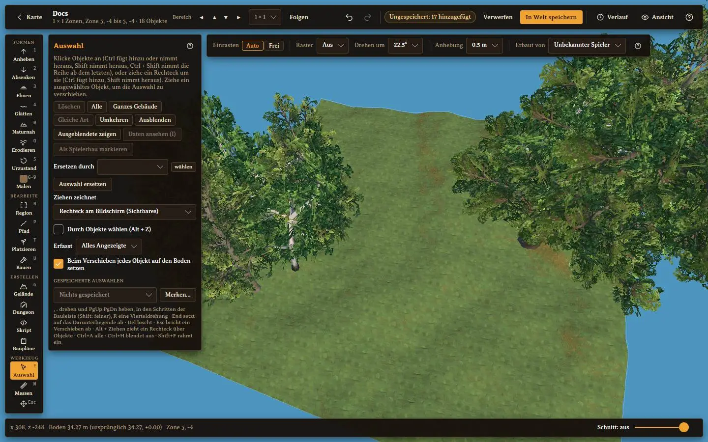

<!-- source: 133e1e92 -->
# Bäume und Felsen räumen, einen Bauplatz ebnen

Entferne Bäume, Felsen und Büsche von einer Stelle und ebne sie zu einem flachen Platz, auf dem du bauen kannst.

**Du brauchst:** eine in 3D geöffnete Welt, bei geschlossenem Spiel oder im [Live-Modus](edit-your-game-live.md).

1. Drücke `B` ([Region](../area.md)). Wähle oben in ihrem Panel **Polygon**.
2. Klicke Ecken rund um den Platz an, ein paar Meter breiter als das Gebäude, und doppelklicke, um es zu schließen.
3. Wähle **Objekte**.
4. Prüfe die Arten-Chips: **Bäume & Stämme**, **Felsen**, **Büsche & Sträucher** und **Sammelbares** sind anfangs an.
   Lass **Deine Gebäude** aus.
5. Drücke **Objekte auswählen (Enter)**. Das Werkzeug Auswahl öffnet sich mit ihnen ausgewählt.
6. Drücke `Del`. Sie sind weg.
7. Drücke `B`, um zum Werkzeug Region zurückzukehren: das Polygon ist noch da. Wähle **Boden**, dann **Ebnen** unter
   **Aktion**.
8. Drücke **Ø** für die durchschnittliche Höhe darin, oder gib eine **Höhe** ein. Um zu einer schon gebauten Tür zu
   passen, zeige auf den Boden an ihrer Schwelle und lies die Höhe in der Statusleiste ab.
9. Stelle **Weichrand** ein (anfangs 3 m), damit der Platz in den Hang übergeht. Die Zeile unter den Einstellungen
   sagt, wie viel Boden abgetragen und aufgefüllt wird und was außerhalb der 8-m-Reichweite des Spiels liegt.
10. Drücke **Ebnen (Enter)**.
11. Optional: Wähle unter **Aktion** **Malen**, dann **Erde** oder **Gepflastert**, und drücke **Malen (Enter)**.
12. Klicke auf **In Welt speichern** (oder **Live anwenden**).

*Nach **Objekte auswählen (Enter)** und `Del`: die Bäume im Polygon sind weg, die außerhalb stehen noch.*

## Prüfen, ob es geklappt hat

- Drücke `M` ([Messen](../measure.md)) und miss quer über den Platz: **Tiefster / höchster** sollten übereinstimmen.
- Oder schalte im Panel Ansicht **Neigungsfarben** ein: der Platz erscheint grün.

## Rückgängig machen

- Jede Aktion ist ein Schritt: `Ctrl+Z` nimmt den letzten zurück. Nach dem Speichern machst du ihn rückgängig und
  speicherst erneut (siehe
  [Einen Schritt rückgängig machen, eine Änderung zurücknehmen oder alles verwerfen](undo-changes.md)).
- Um die Bäume später nachwachsen zu lassen, wähle die Stelle aus, wähle **Zurück** und nutze **Natur
  nachwachsen lassen** (siehe [Region](../area.md#natur-nachwachsen-lassen)).

## Verwandte Seiten

- [Region, Kopieren und Einfügen](../area.md)
- [Maske](../masks.md): nur den Fuß eines Hangs ebnen
- [Eine Straße oder eine Rampe einen Hügel hinauf anlegen](make-a-road.md)
