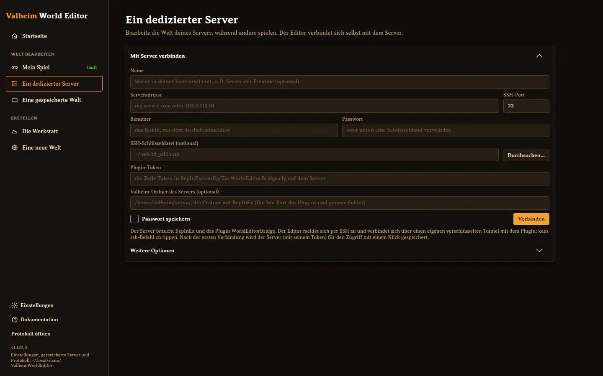

<!-- source: 52199907 -->
# Einen dedizierten Server bearbeiten, während gespielt wird

Verbinde den Editor mit deinem dedizierten Server und ändere seine Welt, während Spieler online bleiben.

**Du brauchst:** SSH-Zugang zu der Maschine, auf der der Server läuft (eine Shell-Anmeldung mit Passwort oder
Schlüsseldatei: SFTP oder der Dateimanager eines Web-Panels allein reicht nicht), das Recht, dort BepInEx und das
Plugin WorldEditorBridge zu installieren und den Server neu zu starten. Für einen bei einem Hoster gemieteten
Spieleserver (ein Web-Panel und FTP, kein SSH) oder einen, den ein Spiele-Panel wie Pterodactyl in einem Container
ausführt: siehe [Einen gemieteten oder über ein Panel gehosteten Server bearbeiten](edit-a-rented-server.md).

*Das Formular unter **Ein dedizierter Server**. Nach der ersten Verbindung wird der Server darüber gespeichert, für
den Zugriff mit einem Klick.*

1. Installiere auf dem Server BepInEx ([BepInExPack for Valheim](https://thunderstore.io/c/valheim/p/denikson/BepInExPack_Valheim/),
   nach seiner Anleitung für dedizierte Server).
2. Kopiere `WorldEditorBridge.dll` (aus `WorldEditorBridge-<version>.zip` auf der
   [Release-Seite](https://github.com/Shuiei/valheim-world-editor/releases/latest)) nach `BepInEx/plugins` des
   Servers, oder installiere WorldEditorBridge im Serverprofil eines Mod-Managers.
3. Starte den Server mit BepInEx neu. Seine `BepInEx/LogOutput.log` meldet jetzt `WorldEditorBridge <version> listening on
   http://127.0.0.1:5182/`.
4. Öffne auf dem Server `BepInEx/config/Tie.WorldEditorBridge.cfg` und kopiere den Wert der Zeile `Token`. Die Datei
   existiert erst, wenn der Server einmal mit dem Plugin gestartet ist.
5. Wähle auf der Startseite des Editors **Ein dedizierter Server**, dann **Mit Server verbinden**.
6. Fülle **Serveradresse**, **Benutzer** und **Passwort** oder **SSH-Schlüsseldatei (optional)** aus. Füge das Token
   in **Plugin-Token** ein.
7. Optional: Fülle **Valheim-Ordner des Servers (optional)** aus (der Ordner, der `BepInEx` enthält), damit der
   Editor genau sagen kann, was falsch ist, wenn das Plugin nicht antwortet. Setze den Haken bei **Passwort
   speichern**, um es nicht erneut eingeben zu müssen.
8. Drücke **Verbinden**. Der Editor meldet sich per SSH an, öffnet seinen eigenen verschlüsselten Tunnel zum Plugin
   und lädt die Welt.
9. Wähle auf der Karte eine Stelle, **In 3D bearbeiten**, nimm eine Änderung vor und drücke **Live anwenden**.

## Prüfen, ob es geklappt hat

- Die obere Leiste zeigt **LIVE**; nach dem Anwenden stehen „Alles angewendet“ und „Auf das laufende Spiel
  angewendet: …“ in der Statusleiste.
- Spieler in der Nähe der Änderung sehen sie sofort.
- Der Server erscheint jetzt über dem Formular und auf der **Startseite**, für den Zugriff mit einem Klick beim
  nächsten Mal.

Wenn stattdessen eine Meldung unter dem Formular erscheint, siehe [Ein Server verbindet sich nicht](../help/troubleshooting.md#ein-server-verbindet-sich-nicht).

## Rückgängig machen

Drücke `Ctrl+Z` (oder **Entfernen** für den Schritt im Verlauf), dann erneut **Live anwenden**. Zurückgesetzte Zonen
lassen sich nach dem Anwenden nicht wiederherstellen.

## Die anderen Felder des Formulars

| Feld | Was es ist |
|---|---|
| **Name** | Wie der Server in deiner Liste erscheint (optional; sonst die Adresse). |
| **Serveradresse** | Der Name oder die IP-Adresse des Servers. Du kannst hier auch `user@address` eingeben. |
| **SSH-Port** | 22, außer das SSH des Servers wurde geändert. |
| **SSH-Schlüsseldatei (optional)** | Dein privater Schlüssel (**Durchsuchen…**, um ihn zu wählen). Leer: Die üblichen Schlüssel in `~/.ssh` (`id_ed25519`, `id_ecdsa`, `id_rsa`) werden probiert; einer, den der Editor nicht verwenden kann, wird übersprungen, und die anderen und das Passwort werden trotzdem probiert. |
| **Plugin-Token** | Immer von dir eingegeben: Der Editor liest es nie vom Server, damit eine SSH-Anmeldung allein die Welt nicht ändern kann. |
| **Weitere Optionen** → **Schlüssel-Passphrase** | Die Passphrase des Schlüssels, wenn er eine hat. Wird nie gespeichert. |
| **Weitere Optionen** → **Plugin-Port** | Der Port des Plugins auf dem Server, wenn er nicht 5182 ist und kein Ordner angegeben ist. |
| **Weitere Optionen** → **Eigener Tunnel vorhanden** | **Bridge-Adresse** und **Token**, dann **Verbinden**: für einen Tunnel, den du mit `ssh -L` oder PuTTY angelegt hast. |

## Gespeicherte Server

Nach der ersten Verbindung steht der Server über dem Formular, der zuletzt genutzte zuerst, mit **Verbinden**,
**bearbeiten** und **vergessen**; das Formular klappt sich unter **Mit anderem Server verbinden** zusammen. Jede Zeile
zeigt `user@address`, ob eine Schlüsseldatei, ein gespeichertes Passwort oder eine Passwortabfrage genutzt wird, und
Felder für das, was nicht gespeichert ist.

- **bearbeiten** füllt das Formular mit dem Server; ändere, was nötig ist, dann aktualisiert **Verbinden** ihn.
- **vergessen** entfernt ihn, mit seinem Passwort und Token.

Die Server werden in `servers.cfg` im Datenordner des Editors gespeichert (das Seitenmenü der Startseite zeigt ihn),
ein Abschnitt pro Server (`Host`, `SshPort`, `User`, `Password`, `KeyFile`, `Token`, `BridgePort`, `GameFolder`,
`HostKey`), sodass du die Datei auch von Hand bearbeiten kannst. Ein Server ist ein Konto auf einer Adresse und einem
Port: Eine erneute Verbindung mit denselben aktualisiert seinen Abschnitt.

`Password` wird nur ausgefüllt, wenn **Passwort speichern** angehakt war, als Klartext (unter Linux kannst nur du die
Datei lesen): Nimm lieber einen SSH-Schlüssel.

`HostKey` ist die Identität des Servers, die bei der ersten Verbindung gespeichert wird. Ändert sie sich jemals,
verweigert der Editor die Verbindung, denn jemand könnte sich als dein Server ausgeben. Wenn du den Server neu
installiert hast, leere die Zeile `HostKey` jedes gespeicherten Servers mit dieser Adresse, um die neue Identität zu
akzeptieren.

## Verwandte Seiten

- [Live-Modus](../live-mode.md): Live anwenden, Auto, dem Spiel folgen, Spieler
- [Einen gemieteten oder über ein Panel gehosteten Server bearbeiten](edit-a-rented-server.md): der Spieleserver eines Hosters, Pterodactyl, Docker
- [Live bearbeiten](../concepts/live-editing.md#wie-die-verbindung-funktioniert): der SSH-Tunnel und das Token
- [Die Welt bearbeiten, die du gerade spielst](edit-your-game-live.md)
- [Eine Welt vor dem Bearbeiten sichern](back-up-a-world.md)
