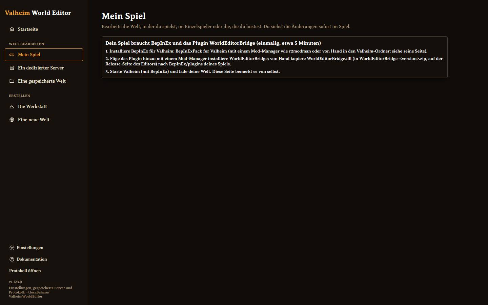
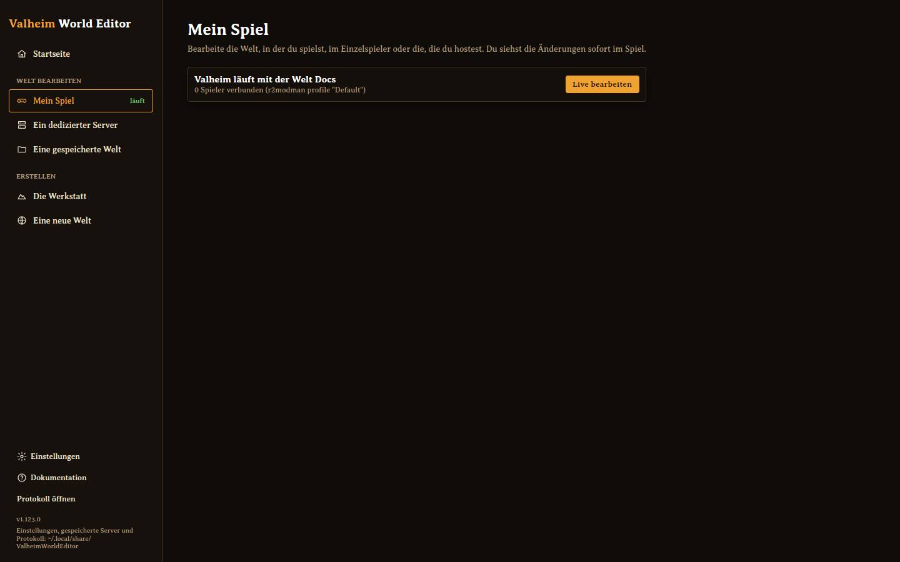

<!-- source: 0fe62110 -->
# Die Welt bearbeiten, die du gerade spielst

Ändere die Welt deines eigenen laufenden Spiels (Einzelspieler oder die Welt, die du hostest) und sieh jede Änderung
sofort im Spiel.

**Du brauchst:** Valheim auf diesem Computer, den Editor und einmalig etwa 5 Minuten, um BepInEx und das Plugin
WorldEditorBridge zu installieren.

*Was **Mein Spiel** anzeigt, bevor BepInEx und das Plugin installiert sind: die Schritte unten, in Kurzform.*

1. Installiere einmalig **BepInEx** in deinem Valheim: [BepInExPack for Valheim](https://thunderstore.io/c/valheim/p/denikson/BepInExPack_Valheim/),
   mit einem Mod-Manager (r2modman, Thunderstore Mod Manager) oder von Hand in den Valheim-Ordner, wie seine Seite
   erklärt. Unter Linux mit dem nativen Spiel startet BepInEx über das Startskript des Packs (seine Seite zeigt die
   Steam-Startoption); ein Mod-Manager erledigt das für dich.
2. Füge das Plugin hinzu. Mit einem Mod-Manager installierst du **WorldEditorBridge** von
   [Thunderstore](https://thunderstore.io/c/valheim/p/Tie/WorldEditorBridge/) oder
   [Hexium](https://valheim.hexium.gg/mods/Tie/WorldEditorBridge). Von Hand kopierst du `WorldEditorBridge.dll` aus
   `WorldEditorBridge-<version>.zip` (auf der [Release-Seite](https://github.com/Shuiei/valheim-world-editor/releases/latest) des Editors)
   nach `BepInEx/plugins` deines Valheim oder deines Mod-Manager-Profils. Nutze das Plugin aus demselben Release wie
   deinen Editor.
3. Starte Valheim mit BepInEx und lade deine Welt (Einzelspieler, oder starte aus dem Spiel einen Server, um sie zu
   hosten). Bei diesem ersten Start schreibt das Plugin seine Einstellungen und sein geheimes Token, die der Editor von
   selbst liest.
4. Öffne im Editor die Startseite. Die **Startseite** zeigt „Valheim läuft mit der Welt …“ und wie viele Spieler
   verbunden sind; **Mein Spiel** im Seitenmenü zeigt *läuft*.
5. Klicke auf **Live bearbeiten**. Die Welt öffnet sich auf ihrer Karte.
6. Klicke auf eine Stelle in deiner Nähe und wähle **In 3D bearbeiten**.
7. Nimm eine Änderung vor, zum Beispiel einen kleinen Hügel mit dem Pinsel **Anheben**.
8. Drücke **Live anwenden** (oder `Ctrl+S`).

*Die Startseite hat das laufende Spiel von selbst bemerkt: **Live bearbeiten** öffnet seine Welt.*

## Prüfen, ob es geklappt hat

- Die obere Leiste zeigt **LIVE** und nach dem Anwenden „Alles angewendet“.
- Die Statusleiste meldet „Auf das laufende Spiel angewendet: …“.
- Im Spiel ist der Hügel sofort da. Das Spiel speichert ihn wie jede andere Änderung.

Bis das Spiel bereit ist, sagt **Mein Spiel**, was fehlt: die drei Schritte, „BepInEx ist installiert: nur noch die
Schritte 2 und 3 fehlen“, „Starte Valheim einmal mit BepInEx“ (das Plugin ist noch nie gelaufen) oder „Starte Valheim
und lade deine Welt“. Bleibt es dabei, siehe
[Mein Spiel zeigt noch zu erledigende Schritte](../help/troubleshooting.md#mein-spiel-zeigt-noch-zu-erledigende-schritte).

## Rückgängig machen

Drücke `Ctrl+Z` (oder **Entfernen** beim Schritt im Verlauf), dann erneut **Live anwenden**: das Spiel nimmt die
Änderung zurück. Zurückgesetzte Zonen lassen sich nach dem Anwenden nicht rückgängig machen. Damit jede Änderung
angewendet wird, sobald du sie machst, schalte **Auto** ein.

## Verwandte Seiten

- [Live-Modus](../live-mode.md): Live anwenden, Auto, dem Spiel folgen, Spieler
- [Einen dedizierten Server bearbeiten, während gespielt wird](edit-a-server-live.md)
- [Live bearbeiten](../concepts/live-editing.md#wie-die-verbindung-funktioniert): wie der Editor das Spiel erreicht
- [Einen Schritt rückgängig machen, eine Änderung zurücknehmen oder alles verwerfen](undo-changes.md)
