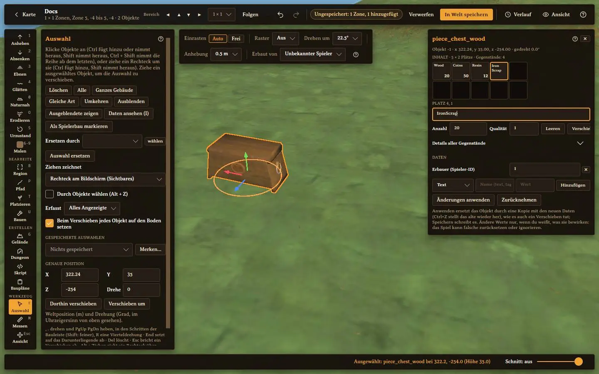

<!-- source: 0fb1e9cf -->
# Ändern, was eine Truhe enthält oder ein Schild sagt

Lege Gegenstände in eine Truhe, nimm sie heraus oder schreibe neuen Text auf ein Schild, mit dem Inspektor.

**Du brauchst:** eine im Editor geöffnete Welt, mit geöffnetem Bereich um die Truhe oder das Schild. Um sie zuerst zu
finden, siehe [Ein Objekt, einen Gegenstand in einer Truhe oder ein Schild finden](find-things.md).

## Eine Truhe

1. Drücke `E`, um [Auswahl](../select.md) zu öffnen.
2. Doppelklicke auf die Truhe: Sie wird allein ausgewählt und öffnet sich im Inspektor, ihre Plätze wie im Spiel
   dargestellt.
3. Klicke auf einen leeren Platz.
4. Tippe in **Gegenstand suchen…** ein paar Buchstaben des Gegenstands (`iron`, `mead`) und wähle ihn in der Liste.
5. Stelle **Anzahl** ein und, bei Werkzeugen und Rüstung, **Qualität**.
6. Wiederhole das für andere Plätze. Um einen Gegenstand herauszunehmen, klicke auf seinen Platz, dann auf
   **Leeren**; um ihn zu verschieben, auf **Verschieben**, dann auf einen anderen Platz.
7. Klicke auf **Änderungen anwenden**.
8. Klicke auf **In Welt speichern** (oder **Live anwenden**).

Die Anzahl wird auf den größten Stapel gekürzt, den das Spiel für diesen Gegenstand erlaubt. Geänderte Inhalte
bleiben der Truhe erhalten: Eine Truhe, die noch niemand geöffnet hat, füllt sich nicht mit der Beute des Spiels
darüber.

*Platz 4 angeklickt, IronScrap in **Gegenstand suchen…** gewählt und **Anzahl** auf 20 gesetzt; Wood, Coins und Resin
füllen die ersten drei Plätze. **Änderungen anwenden** legt sie in die Truhe.*

## Ein Schild

1. Drücke `E` und klicke dann auf das Schild.
2. Drücke `I` (**Daten ansehen (I)**): Ein Doppelklick auf ein Schild würde das ganze Gebäude auswählen.
3. Suche unter **DATEN** den Eintrag **Text (Schild)** und tippe den neuen Text ein.
4. Klicke auf **Änderungen anwenden**, dann auf **In Welt speichern** (oder **Live anwenden**).

Bei einem Schild, das noch keinen Text hat, verwende **Hinzufügen**: Wähle **Text**, tippe `text` als Namen ein,
dann die Worte.

## Prüfen, ob es geklappt hat

Wähle die Truhe oder das Schild erneut aus und drücke `I`: Der Inspektor zeigt den neuen Inhalt oder Text. Öffne nach
dem Speichern die Truhe oder lies das Schild im Spiel.

## Rückgängig machen

- Vor dem Anwenden: **Zurücknehmen** vergisst die Änderungen in der Karte.
- Nach dem Anwenden: `Ctrl+Z` stellt die alte Truhe oder das alte Schild wieder her.
- Nach dem Speichern: siehe [Einen Schritt rückgängig machen, eine Änderung zurücknehmen oder alles verwerfen](undo-changes.md).

## Verwandte Seiten

- [Inspektor](../select.md#inspektor) (auf der Seite Auswahl)
- [Was ein Objekt ist](../concepts/objects.md#was-ein-objekt-ist)
- [Ein Objekt, einen Gegenstand in einer Truhe oder ein Schild finden](find-things.md)
