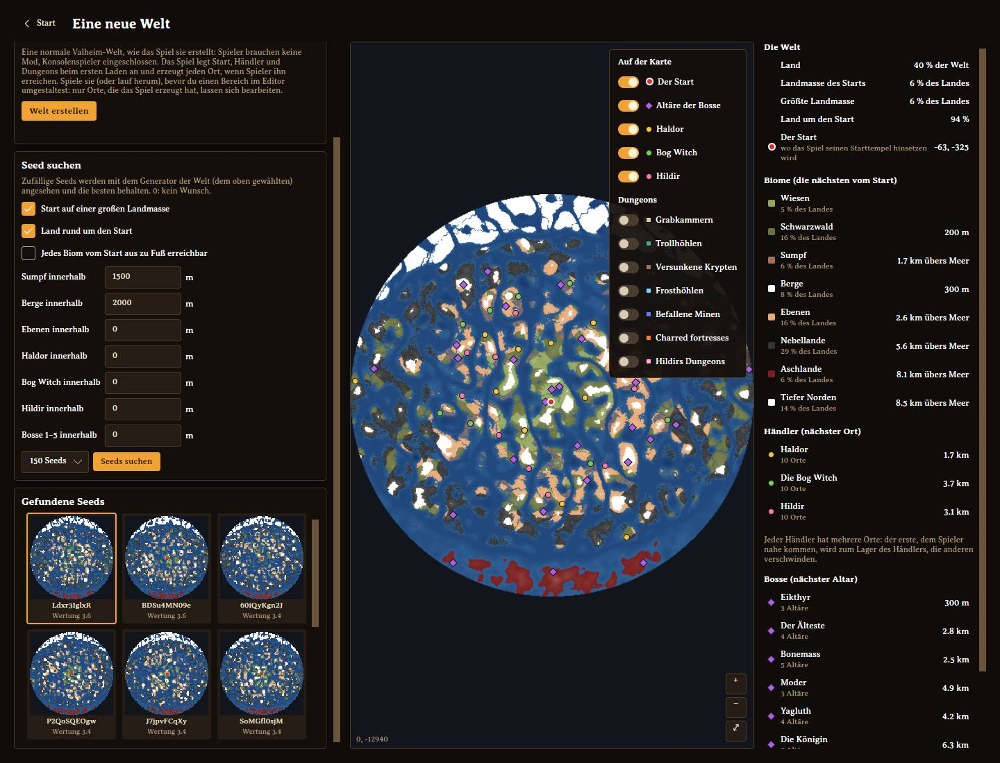

<!-- source: cccbe33c -->
# Einen Seed finden, der nahe am Start hat, was du willst

Lass den Editor viele Seeds durchsuchen und einen auswählen, dessen Start die Biome, Händler oder Bosse in der Nähe hat,
die du willst, und erstelle dann die Welt.

**Du brauchst:** den Editor und Valheim auf diesem Computer. Es muss keine Welt geöffnet sein.

1. Wähle auf der Startseite unter **Erstellen** **Eine neue Welt**, dann **Neue Welt erstellen**.
2. Lass unter **Seed suchen** **Start auf einer großen Landmasse** und **Land rund um den Start** an, oder schalte sie
   aus, wenn du Inseln magst.
3. Optional: Schalte **Jedes Biom vom Start aus zu Fuß erreichbar** ein, damit du nicht früh ein Boot brauchst.
4. Stelle die gewünschten Entfernungen in Metern ein: **Sumpf innerhalb**, **Berge innerhalb**, **Ebenen innerhalb**,
   einen Händler (**Haldor innerhalb**, **Bog Witch innerhalb**, **Hildir innerhalb**) oder **Bosse 1–5 innerhalb**.
   Lass ein Feld auf 0 für keinen Wunsch. Wünsche zu Händlern und Bossen machen die Suche einige Male langsamer.
5. Wähle, wie viele Seeds angesehen werden: **60 Seeds**, **150 Seeds** oder **400 Seeds**.
6. Drücke **Seeds suchen**. Der Balken zeigt den Fortschritt; **Stopp** behält die besten bisher gefundenen.
7. Fahre unter **Gefundene Seeds** mit der Maus über einen Seed, um seine Eckdaten zu sehen, und klicke ihn dann an,
   um ihn auf der großen Karte zu sehen.
8. Prüfe ihn auf der großen Karte: Die Suche betrachtet jeden Seed nur grob und kann kleine Inseln oder schmale
   Meerengen übersehen. Optional: Schalte die Arten unter **Dungeons** ein, die dir wichtig sind.
9. Gib den **Name** der Welt ein, wähle **Gespeichert in** und drücke **Welt erstellen**.
10. Starte Valheim und lade die Welt einmal, bevor du sie im Editor bearbeitest: Das Spiel erzeugt jeden Ort, wenn
    Spieler in seine Nähe kommen.

*Die Wünsche links; die besten Seeds unter **Gefundene Seeds**, der beste zuerst, jeder mit seiner Wertung.*

## Prüfen, ob es geklappt hat

- Der Editor öffnet die Karte der neuen Welt mit der Meldung „… erstellt (Seed …)“.
- In Valheim steht die Welt in der Liste des gewählten Ordners; ein neuer Charakter kommt an der Stelle des roten
  Punkts an.
- Die Orte der Händler und Bosse liegen dort, wo die Seite sie gezeigt hat.

## Rückgängig machen

Bis **Welt erstellen** wird nichts erstellt. Um eine erstellte Welt loszuwerden, lösche ihren Ordner aus dem
Weltordner, in dem sie gespeichert wurde (die Wahl unter **Gespeichert in**). Einen Seed, der dir gefällt, kannst du
jederzeit wieder eingeben: Derselbe Seed ergibt dieselbe Welt.

## Verwandte Seiten

- [Eine neue Welt](../new-world.md): jedes Bedienelement, die Karte, die Eckdaten und wie Seeds bewertet werden
- [Eine Welt öffnen, die nicht in der Liste steht](open-a-world.md)
- [Eine mit Expand World, Riverheim oder Tunnelheim erstellte Welt bearbeiten](use-mods-worlds.md)
