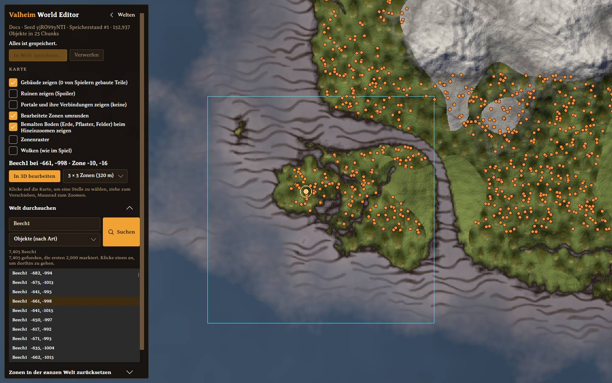

<!-- source: 1ca7ded6 -->
# Ein Objekt, einen Gegenstand in einer Truhe oder ein Schild finden

Durchsuche die ganze Welt nach einem Objekt, einem Gegenstand in irgendeiner Truhe oder einem Text auf einem Schild oder
Portal, und öffne es in 3D.

**Du brauchst:** eine auf ihrer [Karte](../map.md) geöffnete Welt.

1. Öffne im Seitenpanel der Karte **Welt durchsuchen**.
2. Tippe einen Teil dessen ein, was du suchst: eine Art (`portal`, `chest`, `Beech`), einen Gegenstand (`Silver`,
   `Wood`) oder Wörter auf einem Schild. Groß- und Kleinschreibung spielt keine Rolle.
3. Wähle, wonach gesucht wird: **Objekte (nach Art)**, **Gegenstände in Behältern** oder **Texte (Schilder, Portale,
   Wards…)**.
4. Drücke **Suchen** (oder `Enter`). Jedes Ergebnis wird auf der Karte orange markiert und mit einer Anzahl pro Art
   aufgelistet.
5. Klicke ein Ergebnis in der Liste an. Die Karte zentriert sich darauf und wählt seine Zone.
6. Drücke **In 3D bearbeiten**. Der Editor öffnet sich mit diesem Objekt ausgewählt. Bei einem Gegenstand oder einem
   Text öffnen sich auch seine Daten.
7. Optional: ändere den Inhalt der Truhe oder den Text des Schilds (siehe
   [Ändern, was eine Truhe enthält oder ein Schild sagt](fill-a-chest.md)), dann **In Welt speichern** (oder **Live
   anwenden**).

*Jede Markierung ist ein gefundenes Objekt; das in der Liste gewählte ist größer, mit einem goldenen Ring.*

## Prüfen, ob es geklappt hat

- Die Zeile über den Ergebnissen sagt, wie viele gefunden wurden. Die Liste zeigt die ersten 300; bis zu 2.000 werden
  markiert.
- **Nichts gefunden?** Prüfe die Schreibweise und wonach du suchen lässt. Die Suche sieht die Welt so, wie sie im Editor
  ist: Objekte, die du gelöscht, aber nicht gespeichert hast, werden nicht gefunden. Die eigenen Verwaltungsobjekte des
  Spiels (`_ZoneCtrl`…) werden nur gefunden, wenn dein Text mit `_` beginnt.

## Rückgängig machen

Die Suche ändert nichts. Eine Änderung, die du am Objekt vornimmst, ist ein Schritt: `Ctrl+Z` nimmt sie zurück.

## Verwandte Seiten

- [Weltkarte](../map.md#welt-durchsuchen)
- [Ändern, was eine Truhe enthält oder ein Schild sagt](fill-a-chest.md)
- [Auswahl](../select.md)
