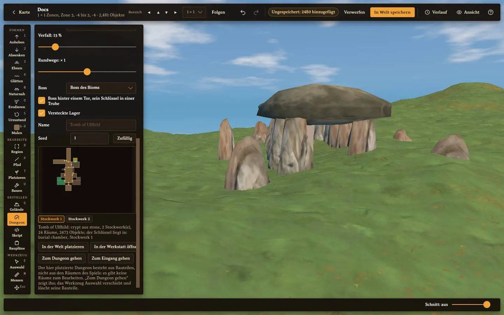

<!-- source: 89221403 -->
# Einen Dungeon erzeugen und in die Welt setzen

Erzeuge aus ein paar Entscheidungen einen ganzen Dungeon und setze ihn hinter einen Eingang, wie es das Spiel mit seinen
eigenen tut.

**Du brauchst:** eine im Editor geöffnete Welt, mit geöffnetem Bereich dort, wo der Eingang hinkommt, in einer Zone, die
noch keinen Dungeoneingang hat (vorher eine Sicherung: siehe [Eine Welt sichern](back-up-a-world.md)).

## Schritte

1. Klicke in der Werkzeugleiste auf **Dungeon** (Abschnitt **ERSTELLEN**).
2. Wähle unter **Dungeon erzeugen** das **Biom**: es legt die Monster, die Beute und den Eingang am Boden fest.
3. Wähle **Größe** und **Stockwerke** und unter **Boss** den Boss.
4. Sieh dir den Plan an; klicke darunter auf **Stockwerk 1**, **Stockwerk 2**..., um jedes Stockwerk zu sehen.
5. Optional: klicke auf **Zufällig**, bis dir der Plan gefällt, oder tippe einen **Name** für das Schild in der
   Eingangshalle ein.
6. Dreh die Ansicht so, dass sie auf die Stelle blickt, an die der Eingang soll, mit dieser Stelle in der Mitte der
   Ansicht.
7. Klicke auf **In der Welt platzieren**. Der Eingang erscheint am Boden, seine Tür zu dir gewandt.
8. Klicke auf **Zum Dungeon gehen**, um von oben hineinzusehen, die Dächer weggeschnitten.
9. Klicke auf **Zum Eingang gehen**, um wieder herunterzukommen.
10. Klicke auf **In Welt speichern** (oder **Live anwenden**).

*Der Eingang nach **In der Welt platzieren**: der Hügel einer Grabkammer, ihre Tür zur Kamera gewandt.*

Um den Dungeon vor dem Platzieren von Hand zu ändern (Möbel verschieben, Truhen füllen), speichere (oder wende an) deine
Änderungen und klicke dann statt Schritt 7 auf **In der Werkstatt öffnen**: die Werkstatt nimmt den Platz der Welt ein.
Ändere den Dungeon, klicke auf **Bauplan speichern**, öffne die Welt erneut und füge ihn ein: siehe
[Einen Bauplan in eine Welt einfügen](paste-a-blueprint.md).

## Prüfen, ob es geklappt hat

Die Statusleiste sagt *… erzeugt: … Objekte, 5000 m über dieser Stelle.* **Zum Dungeon gehen** zeigt seine Räume. Öffne
nach dem Speichern die Welt im Spiel, geh zum Eingang und durch die Tür: du kommst in der Eingangshalle an.

## Rückgängig machen

- Vor dem Speichern: `Ctrl+Z` nimmt die ganze Platzierung in einem Schritt zurück.
- Nach dem Speichern: siehe [Einen Schritt rückgängig machen, eine Änderung zurücknehmen oder alles verwerfen](undo-changes.md)
  oder [Einen Bereich aus einer Sicherung wiederherstellen](restore-from-backup.md).

## Tipps

- *Dort oben ist schon etwas*: jede Zone (64 × 64 m) enthält einen Dungeon. Setze den Eingang in eine andere Zone.
- Dieselben Entscheidungen und derselbe Seed ergeben immer denselben Dungeon aus Bauteilen: notiere dir den **Seed**, um
  ihn erneut zu erzeugen. Ein Dungeon aus den eigenen Räumen des Spiels wird beim Platzieren von seinem Eingang aus neu
  angelegt, daher braucht er auch dieselbe Stelle und Ausrichtung.
- **Gebaut aus: Räume des Spiels** baut ihn stattdessen aus den Räumen des Spiels, um ihn Raum für Raum zu bearbeiten.

## Verwandte Seiten

- [Dungeon](../dungeons.md)
- [Wie das Spiel Dungeons aufbewahrt](../concepts/dungeons.md#wie-das-spiel-dungeons-aufbewahrt)
- [Werkstatt](../workshop.md)
