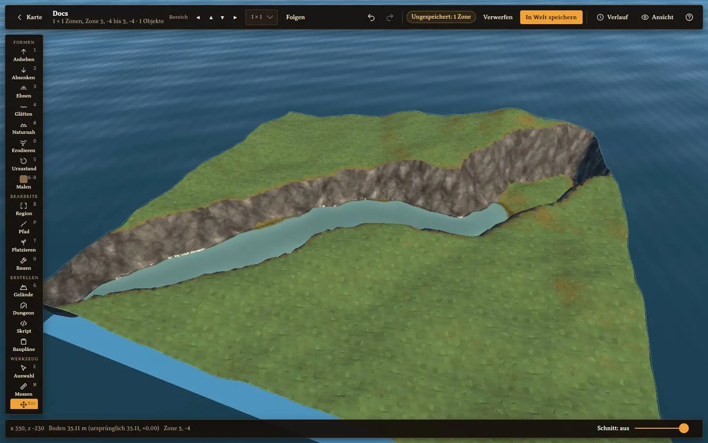

<!-- source: d55dc125 -->
# Einen Fluss oder Teich graben

Grabe einen Fluss, einen Kanal oder einen Teich, der sich mit Wasser füllt.

**Du brauchst:** eine in 3D geöffnete Welt, bei geschlossenem Spiel oder im [Live-Modus](edit-your-game-live.md).
Tiefer Boden nahe dem Meer ist am einfachsten.

Valheim hat kein fließendes Wasser: das Wasser in Flüssen ist das Meer, überall bei 30 m. Ein Fluss oder Teich hat nur
dort Wasser, wo sein Bett unter 30 m liegt.

1. Bewege den Cursor über die Strecke und lies die Bodenhöhe in der Statusleiste ab. Ohne „Ohne Grenze“ kannst du nur
   8 m tief graben, daher hält Boden über etwa 36 m kein Wasser.
2. Drücke `P` ([Pfad](../path.md)) und klicke Punkte entlang des Flusses, vom Meer oder einem See ins Landesinnere.
3. Wähle im Panel **Fluss / Kanal (Wasser)**.
4. Stelle **Breite** (die Breite des Wassers), **Weichrand** (die Ufer) und **Tiefe** ein (wie weit das Bett in
   seiner Mitte unter dem Meeresspiegel liegt, anfangs 2 m).
5. Drücke **Anwenden (Enter)**. Das Bett füllt sich mit Wasser.
6. Für einen Teich drücke `B` ([Region](../area.md)), wähle **Polygon**, klicke rund um den Teich und doppelklicke auf
   die letzte Ecke, um die Form zu schließen.
7. Wähle in der Gruppe **Boden** unter **Aktion** **Ebnen**, tippe eine **Höhe** unter 30 m ein (28 m ergibt 2 m tiefes
   Wasser), stelle **Weichrand** für sanfte Ufer auf etwa 5 m und drücke **Ebnen (Enter)**.
8. Klicke auf **In Welt speichern** (oder **Live anwenden**).

*Ein mit Fluss / Kanal (Wasser) gegrabener Fluss: das Meer füllt ihn.*

## Prüfen, ob es geklappt hat

- Das Wasser erscheint in der 3D-Ansicht, sobald das Bett unter 30 m liegt.
- Sagt die Statusleiste, dass ein Teil die Spielgrenze erreicht hat, ist der Boden dort zu hoch: senke ihn zuerst nahe
  dem Meer ab, folge tieferem Boden oder schalte **Ohne Grenze** ein (siehe [Über die 8-m-Grenze des Spiels hinaus
  anheben oder graben](raise-past-the-limit.md)).

## Rückgängig machen

`Ctrl+Z` nimmt das letzte **Anwenden** oder **Ebnen** zurück. Nach dem Speichern mach es rückgängig und speichere
erneut (siehe [Einen Schritt rückgängig machen, eine Änderung zurücknehmen oder alles verwerfen](undo-changes.md)).

Um einen Fluss später wieder zuzuschütten, wenn die Rückgängig-Schritte weg sind, zeichne die Linie erneut (oder behalte
sie) und wende **Urzustand** des Werkzeugs Pfad an: der Boden entlang der Linie kehrt zu dem zurück, wie die Welt ihn
erzeugt hat. Der Pinsel **Urzustand** (`5`) tut dasselbe an einer Stelle.

## Verwandte Seiten

- [Pfad](../path.md#fluss-oder-kanal)
- [Messen und Einblendungen](../measure.md): Wassertiefe
- [Bodengrenzen](../concepts/ground-limits.md)
