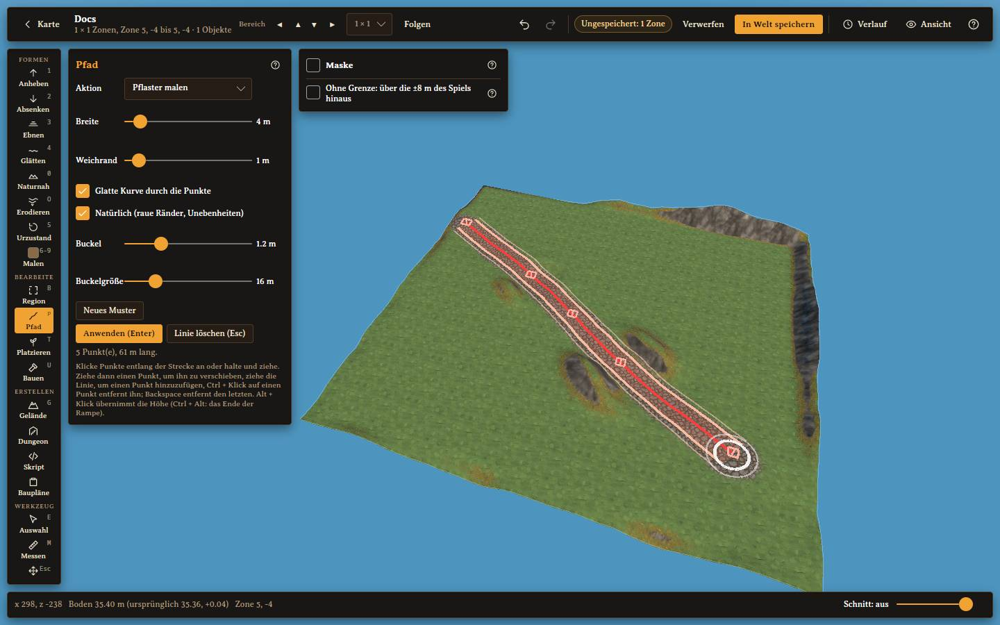

<!-- source: 20a95afa -->
# Eine Straße oder eine Rampe einen Hügel hinauf anlegen

Zeichne eine ebene Straße mit einer gleichmäßigen Rampe den Hügel hinauf, in der Mitte gepflastert.

**Du brauchst:** eine in 3D offene Welt, mit geschlossenem Spiel oder im [Live-Modus](edit-your-game-live.md).

1. Optional: Prüfe zuerst die Neigung. Drücke `M` ([Messen](../measure.md)), klicke auf den Fuß des Hügels, dann auf seine Spitze:
   **Neigung** ist das, was eine Rampe zwischen beiden ergeben wird.
2. Drücke `P` ([Pfad](../path.md)) und klicke Punkte entlang des ebenen Teils der Straße.
3. Wähle im Panel **Ebnen**. `Alt`+Klick auf den Boden übernimmt seine Höhe, oder tippe sie unter **Höhe** ein.
4. Stelle **Breite** (8 m ist eine gute Straße) und **Weichrand** ein (4 m lassen sie in den Hang übergehen).
5. Optional: Hake **Natürlich (raue Ränder, Unebenheiten)** an für einen ausgetretenen Weg.
6. Drücke **Anwenden (Enter)**, dann **Linie löschen (Esc)**.
7. Für den Hügel klicke einen Punkt an seinem Fuß und einen an seiner Spitze und wähle **Rampe (Start → Ende)**. **Start** und
   **Ende** folgen dem Boden unter den beiden Enden; tippe eine Höhe ein, um eines zu ändern.
8. Drücke **Anwenden (Enter)**. Die Linie bleibt.
9. Um sie zu pflastern, wähle **Pflaster malen**, mache **Breite** und **Weichrand** kleiner (4 m und 1 m) und drücke erneut **Anwenden
   (Enter)** auf derselben Linie.
10. Klicke auf **In Welt speichern** (oder **Live anwenden**).

*Eine Straße, mit Ebnen durch zwei Hügel angelegt, dann Pflaster malen (Breite 4 m, Weichrand 1 m) auf derselben
Linie.*

## Prüfen, ob es geklappt hat

- Miss entlang der Straße: **Neigung** bleibt entlang einer Rampe überall gleich.
- Sind Punkte rot geworden, hat ein Teil der Straße die 8-m-Grenze des Spiels erreicht: siehe
  [Über die 8-m-Grenze des Spiels hinaus anheben oder graben](raise-past-the-limit.md).

## Rückgängig machen

Jedes **Anwenden** ist ein Schritt zum Rückgängigmachen: `Ctrl+Z` nimmt den letzten zurück. **Linie löschen (Esc)** entfernt nur die Linie, nicht das, was
du angewendet hast. Mache nach dem Speichern rückgängig und speichere erneut (siehe
[Einen Schritt rückgängig machen, eine Änderung zurücknehmen oder alles verwerfen](undo-changes.md)).

Um eine Straße später wieder zu entfernen, wenn die Schritte zum Rückgängigmachen weg sind, zeichne eine Linie entlang der Straße und wende **Urzustand** mit einer **Breite**
an, die sie abdeckt: Der Boden kehrt dahin zurück, wie die Welt ihn erzeugt hat, die Farbe entfernt.

## Verwandte Seiten

- [Pfad](../path.md)
- [Messen und Einblendungen](../measure.md)
- [Bäume und Felsen räumen, einen Bauplatz ebnen](clear-an-area.md)
