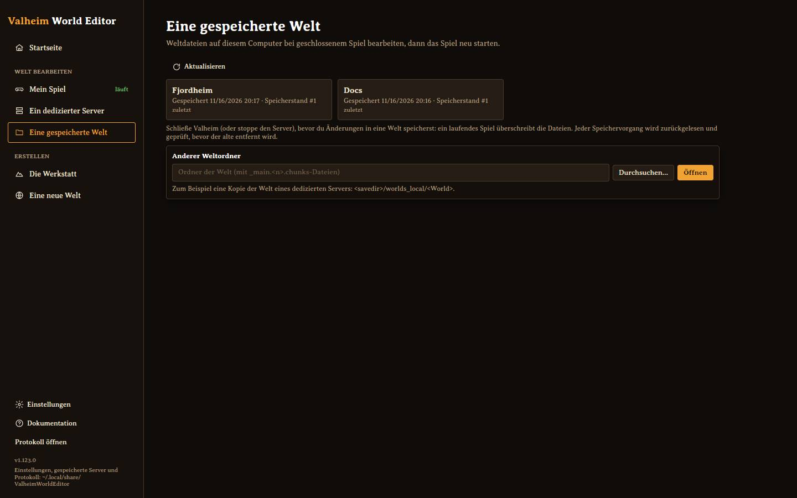

<!-- source: 289a125b -->
# Eine Welt öffnen, die nicht in der Liste steht

Öffne eine Welt aus einem beliebigen Ordner auf diesem Computer: die Kopie einer Serverwelt, eine Sicherung, eine Welt auf
einem anderen Laufwerk.

**Du brauchst:** den Ordner der Welt (den mit den Dateien `_main.<n>.chunks`), und kein Spiel oder Server darf mit ihr
laufen.

1. Schließe Valheim oder stoppe den Server, der die Welt nutzt: ein laufendes Spiel überschreibt die Dateien, die der
   Editor speichert.
2. Bei der Welt eines dedizierten Servers kopierst du ihren Ordner, `<savedir>/worlds_local/<World>`, vom Server auf
   diesen Computer.
3. Klicke auf der Startseite auf **Eine gespeicherte Welt**.
4. Klicke unter **Anderer Weltordner** auf **Durchsuchen…** und wähle den Ordner der Welt, oder füge seinen Pfad in das
   Feld ein.
5. Klicke auf **Öffnen**. Die Welt öffnet sich auf ihrer [Karte](../map.md).
6. Optional: Damit die Welt jedes Mal in der Liste steht, öffne **Einstellungen**, klicke unter **Weltordner** auf
   **Ordner hinzufügen**, wähle mit **Durchsuchen…** den Ordner der Welt (oder einen Ordner mit Welten) und dann
   **Speichern**.

*Die Welten, die der Editor von selbst gefunden hat, darunter **Anderer Weltordner** mit **Durchsuchen…** und
**Öffnen**.*

## Prüfen, ob es geklappt hat

- Die Karte zeigt die Welt, mit ihrem Namen und Seed oben im Seitenpanel.
- Auf der **Startseite** steht die Welt unter **Zuletzt**, sodass sie sich beim nächsten Mal mit einem Klick öffnet.
- Ist der Ordner in den **Einstellungen** hinzugefügt, listet **Eine gespeicherte Welt** die Welt mit *deine* unter
  ihrem Namen.

## Rückgängig machen

Das Öffnen einer Welt ändert nichts an ihr: nur **In Welt speichern** schreibt. Um einen Ordner aus der Liste zu nehmen,
öffne **Einstellungen**, klicke unter **Weltordner** auf das **✕** daneben und dann auf **Speichern**.

## Tipps

- Der Editor sagt, was mit einem Ordner nicht stimmt: „That folder holds worlds; pick one of them“ (dieser Ordner enthält Welten; du hast
  `worlds_local` gewählt: wähle eine Welt darin) oder „No Valheim world in that folder“ (keine Valheim-Welt in diesem Ordner).
- Eine Welt im alten Einzeldateiformat (`<World>.db` und `.fwl`) erscheint ausgegraut: lade sie einmal in Valheim, dann
  macht das Spiel daraus einen Weltordner, den der Editor öffnet.
- Eine Welt, die mit einer Weltgenerierungs-Mod (Expand World, Riverheim) erstellt wurde, braucht deren Add-on: siehe
  [Eine mit Expand World, Riverheim oder Tunnelheim erstellte Welt bearbeiten](use-mods-worlds.md).
- Nachdem du die Welt eines Servers hier bearbeitet hast, kopiere den Ordner bei gestopptem Server zurück auf den
  Server.

## Verwandte Seiten

- [Eine Welt vor dem Bearbeiten sichern](back-up-a-world.md)
- [Einen dedizierten Server bearbeiten, während gespielt wird](edit-a-server-live.md)
- [Das Editorfenster](../editor-basics.md)
- [Die Weltkarte](../map.md)
