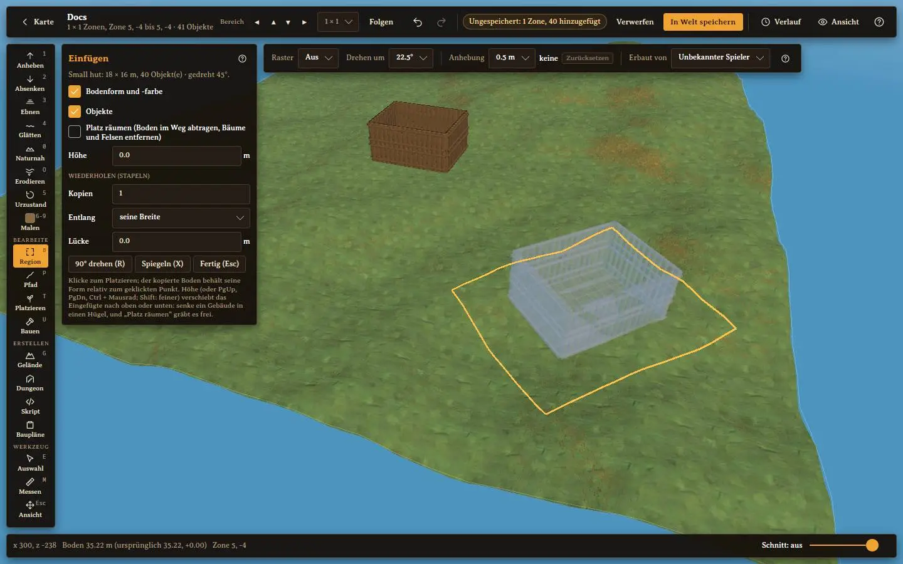

<!-- source: 45f0d395 -->
# Einen Bauplan in eine Welt einfügen

Setze ein Gebäude aus deiner Bauplan-Bibliothek (in der Werkstatt gebaut, aus einer Welt gespeichert oder importiert) in
eine Welt.

**Du brauchst:** eine im Editor geöffnete Welt, mit offenem Bereich dort, wo das Gebäude hin soll, und einen Bauplan in
der Bibliothek (siehe [Werkstatt](../workshop.md)). Vorher eine Sicherung: siehe
[Eine Welt sichern](back-up-a-world.md).

## Schritte

1. Klicke in der Werkzeugleiste auf **Baupläne** (Abschnitt **ERSTELLEN**).
2. Optional: Um eine Datei einzubringen, die dir jemand geschickt hat, klicke auf **Datei importieren…** und wähle die
   `.blueprint`- oder `.vbuild`-Datei.
3. Gib ein Wort aus seinem Namen oder seinen Tags in **Baupläne durchsuchen** ein.
4. Klicke neben dem Bauplan auf **Einfügen**. Das Panel schließt sich, und der Bauplan folgt durchscheinend dem Cursor.
5. Dreh ihn mit `R` (eine Vierteldrehung) oder `,` `.` (um **Drehen um** in der Bauleiste); drücke `X`, um ihn zu
   spiegeln.
6. Optional: Um ihn in einen Hang einzulassen, senke ihn mit `PgDn` (oder `Ctrl` + Mausrad). **Platz räumen** im Panel
   Einfügen (anfangs an) trägt den Boden im Weg ab und entfernt Bäume und Felsen.
7. Klicke dorthin, wo er stehen soll. Klicke woanders erneut für weitere Kopien.
8. Drücke `Esc`, um das Einfügen zu beenden.
9. Klicke auf **In Welt speichern** (oder **Live anwenden**).

Die eingefügten Bauteile enthalten, was der Bauplan enthält: Truheninhalte, Schildtexte, Kreaturen. Ihr Erbauer ist der
Spieler, der unter **Erbaut von** in [der Bauleiste](../build.md#die-bauleiste) gewählt ist, die beim Einfügen
angezeigt wird; die Bauteile einer Ruine bleiben ohne Erbauer. Bauteile aus Mods, die diese Welt nicht hat, werden
weggelassen, und die Meldung listet sie auf.

*Nach **Einfügen**: die Hütte folgt durchscheinend dem Cursor, ihr Grundriss umrandet, um 45° gedreht (`gedreht 45°` im
Panel **Einfügen**), **Platz räumen** aus. Dahinter die Hütte, aus der sie gespeichert wurde.*

Ein Bauplan, der als **Ein Dungeon** markiert ist, wird nicht auf den Boden gesetzt: sein Eingang kommt dorthin, wo du
klickst, und das Gebäude 5000 m darüber. Siehe [Dungeon](../dungeons.md).

## Prüfen, ob es geklappt hat

Das Gebäude steht fest dort, wo du geklickt hast, mit grünen Punkten für Ungespeichertes, und die Statusleiste sagt, wie
viele Objekte eingefügt wurden. Schau unter seine Ränder: nichts sollte schweben. Geh nach dem Speichern im Spiel hin.

## Rückgängig machen

- Vor dem Speichern: `Ctrl+Z` nimmt jedes Einfügen zurück.
- Nach dem Speichern: siehe
  [Einen Schritt rückgängig machen, eine Änderung zurücknehmen oder alles verwerfen](undo-changes.md).

## Tipps

- Das Eingefügte muss in den offenen Bereich passen; meldet es *Nicht eingefügt*, öffne einen größeren Bereich um die
  Stelle.
- Bauteile, die der Editor selbst setzt (Statuen, Requisiten, Kreaturen), werden ebenfalls eingefügt, obwohl der Hammer
  von Homestead sie überspringt.
- Um den Bauplan vorher zu ändern, klicke auf **Öffnen**, um ihn in der Werkstatt zu öffnen.
- Um etwas aus einer Welt als Bauplan zu behalten: kopiere es (mit dem Werkzeug Region oder `Ctrl+C` in Auswahl) und
  klicke dann in der Zeile **Ablage** des Panels auf **Als Bauplan speichern…**.

## Verwandte Seiten

- [Werkstatt](../workshop.md) · [Region](../area.md)
- [Ein Gebäude verschieben oder kopieren](move-a-building.md)
- [Von Spielern gebaute Teile](../concepts/objects.md#von-spielern-gebaute-bauteile)
