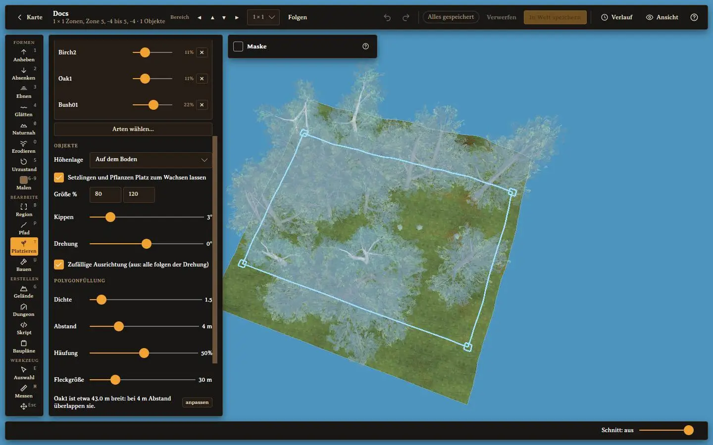

<!-- source: 78139bdb -->
# Einen Wald, ein Feld oder eine Hecke pflanzen

Fülle ein Stück Land mit Bäumen in natürlichen Hainen, ein Feld mit Pflanzen in Reihen oder eine Hecke entlang einer Linie.

**Du brauchst:** eine im Editor offene Welt (vorher eine Sicherung: siehe [Eine Welt sichern](back-up-a-world.md)).

## Ein Wald

1. Drücke `T`, um [Platzieren](../place.md) zu öffnen.
2. Wähle unter **Vorgabe wählen** **Wiesenwäldchen** (oder **Schwarzwald-Bewuchs**, **Sumpf**).
3. Wähle oben im Panel **Polygon**.
4. Klicke Punkte auf dem Boden entlang des Umrisses des Waldes, oder halte gedrückt und ziehe, um ihn frei zu zeichnen.
5. Optional: Erhöhe unter **POLYGONFÜLLUNG** die **Häufung** auf etwa 50 % für Haine mit Lichtungen dazwischen, und stelle
   **Fleckgröße** auf die gewünschte Größe der Haine.
6. Drücke `N` (**Neue Anordnung (N)**), bis die Vorschau passt.
7. Drücke `Enter`, um ihn zu pflanzen.
8. Klicke auf **In Welt speichern** (oder **Live anwenden**).

*Ein Polygon von etwa 58 × 40 m mit **Häufung** 50 % und **Fleckgröße** 30 m (und **Dichte** 1.5): Die durchsichtigen
Bäume sammeln sich in Hainen mit Lichtungen dazwischen. Die Zeilen von **POLYGONFÜLLUNG** stehen unten im Panel.*

## Ein Feld

1. Bemale das Feld mit **Kultivieren** (Werkzeugleiste, **Malen**, oder Taste `7`): Pflanzen wachsen nur auf kultiviertem Boden.
2. Klicke in Platzieren auf **Arten wählen…**, suche `carrot`, hake die gewünschten Pflanzen an, dann klicke auf **Fertig**.
3. Wähle **Raster** und stelle **Abstand** unter **RASTER** ein (1 m passt für Karotten).
4. Ziehe ein Rechteck über den kultivierten Boden, dann drücke `Enter`.

Lass **Setzlingen und Pflanzen Platz zum Wachsen lassen** an, damit jede Pflanze den Platz hat, den das Spiel zum Wachsen braucht.

## Eine Hecke

1. Klicke in Platzieren auf **Arten wählen…**, suche `bush` und hake ein oder zwei Büsche an.
2. Wähle **Linie**, dann **Punkte**.
3. Klicke Punkte entlang der Hecke; stelle **Jeweils** auf etwa 1.5 m und **Streuung** auf 0.25 m.
4. Drücke `Enter`.

## Prüfen, ob es geklappt hat

Die durchsichtige Vorschau wird dort fest, wo du gepflanzt hast, mit einem grünen Punkt für Ungespeichertes an jedem Objekt. Die Statusleiste sagt,
wie viele Objekte platziert wurden. Geh nach dem Speichern im Spiel dorthin.

## Rückgängig machen

- Vor dem Speichern: `Ctrl+Z` nimmt das letzte Polygon, Raster, die letzte Linie oder den letzten Pinselstrich zurück.
- Um ein paar zu entfernen: Modus Pinsel mit denselben angehakten Arten, `Shift` + Ziehen darüber.
- Nach dem Speichern: siehe [Einen Schritt rückgängig machen, eine Änderung zurücknehmen oder alles verwerfen](undo-changes.md).

## Verwandte Seiten

- [Platzieren](../place.md)
- [Wachstumsregeln](../concepts/objects.md#wachstumsregeln)
- [Bäume und Felsen räumen, einen Bauplatz ebnen](clear-an-area.md)
