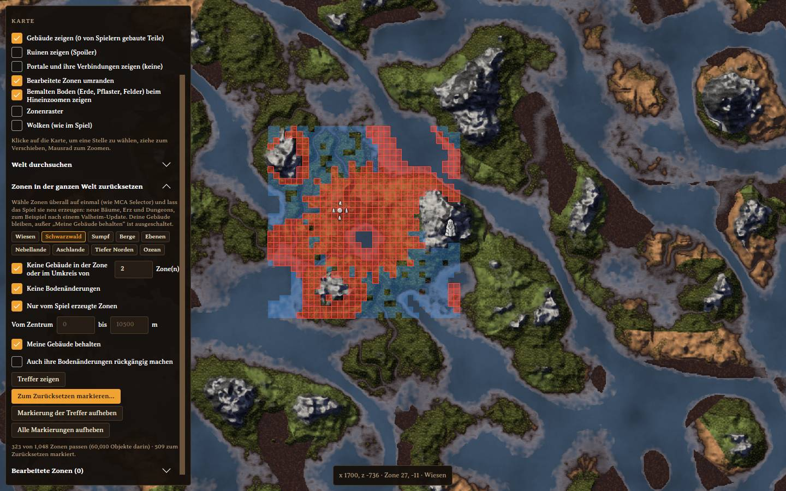

<!-- source: e87fa23c -->
# Zonen neu erzeugen

Lass das Spiel ausgewählte Zonen aus dem Seed neu erzeugen, mit neuen Bäumen, Felsen, Erz und Dungeons, zum Beispiel um
die neuen Inhalte eines Valheim-Updates an Orte zu bringen, an denen niemand gebaut hat.

**Du brauchst:** die Welt im Spiel geschlossen (oder den Server gestoppt) oder den [Live-Modus](edit-a-server-live.md),
und eine [Sicherung der Welt](back-up-a-world.md): ein gespeichertes Zurücksetzen lässt sich nicht rückgängig machen.

1. Führe im Spiel gezähmte Tiere von den Orten weg, die du zurücksetzen willst: alles in einer zurückgesetzten Zone
   verschwindet, außer Grabsteinen und, mit **Meine Gebäude behalten** an, von Spielern gebauten Teilen. Schließe dann
   das Spiel (oder stoppe den Server), außer du bearbeitest live.
2. Sichere die Welt.
3. Öffne die Welt. Ihre [Karte](../map.md) öffnet sich.
4. Öffne im Seitenpanel **Zonen in der ganzen Welt zurücksetzen**.
5. Stelle den Filter ein: die Biome, die zurückgesetzt werden sollen, und lass **Keine Gebäude in der Zone oder im
   Umkreis von N Zone(n)** und **Meine Gebäude behalten** an, damit Basen und das Land um sie herum unberührt bleiben.
   Nutze **Vom Zentrum … bis … m**, um nur einen Teil der Welt zurückzusetzen.
6. Drücke **Treffer zeigen**. Beim ersten Mal liest der Editor jede Zone. Passende Zonen werden blau, und eine Zeile
   sagt, wie viele passen und wie viele Objekte sie enthalten.
7. Ändere den Filter, bis die blauen Zonen die gewünschten sind.
8. Drücke **Zum Zurücksetzen markieren…**. Die Frage nennt, wie viele Zonen es sind, was verschwindet und ob deine
   Gebäude bleiben: lies sie und stimme dann zu. Die Zonen werden rot.
9. Klicke auf **In Welt speichern** (oder **Live anwenden**).

*Blaue Zonen passen zum Filter; rote Zonen sind zum Zurücksetzen markiert.*

Um nur die Zonen unter einer Stelle zurückzusetzen, nutze stattdessen das Werkzeug [Region](../area.md#zonen-zurücksetzen):
ziehe ein Rechteck über sie, wähle **Zurück**, dann **Zonen zurücksetzen** unter **Aktion**, und drücke **Zonen
zurücksetzen… (Enter)**. Es hat dieselben Schalter **Meine Gebäude behalten** und **Auch ihre Bodenänderungen rückgängig
machen** wie die Karte.

## Prüfen, ob es geklappt hat

- Vor dem Speichern zählt die Zeile unter den Schaltflächen die zum Zurücksetzen markierten Zonen.
- Geh im Spiel zu einer zurückgesetzten Zone: sie wird neu erzeugt, wenn du näherkommst, mit neuen Bäumen, Felsen und
  ihrem Ort.

## Rückgängig machen

- **Vor dem Speichern:** **Alle Markierungen aufheben** (auf der Karte oder im Werkzeug Region) bricht jedes markierte
  Zurücksetzen ab, und **Markierung der Treffer aufheben** nur das der Zonen, die zum Filter passen (eines, das mit
  **Zonen zurücksetzen** im Werkzeug Region markiert wurde: auch `Ctrl+Z`).
- **Nach dem Speichern:** im Editor lässt es sich nicht rückgängig machen. Spiele die Sicherung der Welt aus Schritt 2
  zurück (siehe [Eine Welt vor dem Bearbeiten sichern](back-up-a-world.md#rückgängig-machen)).

## Verwandte Seiten

- [Weltkarte](../map.md#zonen-in-der-ganzen-welt-zurücksetzen)
- [Zonen](../concepts/areas-and-zones.md#zonen)
- [Eine Welt vor dem Bearbeiten sichern](back-up-a-world.md)
