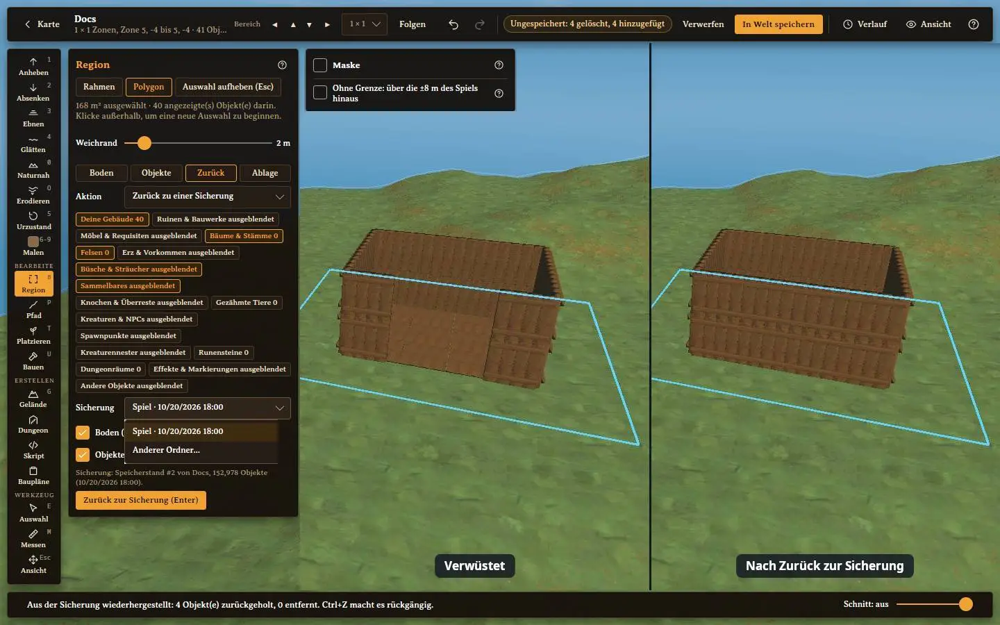

<!-- source: 0a333811 -->
# Einen Bereich aus einer Sicherung wiederherstellen

Setze eine Stelle so zurück, wie sie in einer Sicherung war, nach Griefing, einem schlimmen Überfall oder einer Bearbeitung, die du bereust, ohne den
Rest der Welt zurückzusetzen.

**Du brauchst:** eine Sicherung der Welt von vor dem Schaden: die eigenen Sicherungen des Spiels neben dem Weltordner
(`<World>_backup_auto-<date>`) oder eine auf diesen Computer kopierte Serversicherung. Das Spiel geschlossen, oder
[Live-Modus](edit-a-server-live.md).

1. Öffne die Welt und finde die Stelle auf der [Karte](../map.md). Drücke **In 3D bearbeiten**.
2. Drücke `B` ([Region](../area.md)), wähle **Polygon** und klicke rund um die beschädigte Stelle, etwas weiter als sie.
3. Wähle **Zurück**, dann **Zurück zu einer Sicherung** unter **Aktion**.
4. Wähle unter **Sicherung** ein Datum vor dem Schaden („Spiel · Datum“). Für eine Serversicherung oder eine andere Kopie wähle
   **Anderer Ordner…** und wähle sie aus (live ist das der einzige Weg). Die Zeile darunter sagt, welcher Speicherstand es ist.
5. Wähle die Chips der Arten, die zurückkommen sollen. Für ein Gebäude schalte **Deine Gebäude** ein.
6. Lass **Boden (Höhe und Farbe)** und **Objekte der oben gewählten Arten** angehakt, oder entferne das Häkchen bei dem, das du nicht
   zurückhaben willst.
7. Drücke **Zurück zur Sicherung (Enter)**.
8. Sieh dir das Ergebnis an. Wenn es stimmt, **In Welt speichern** (oder **Live anwenden**).

*Links: ein Polygon um eine Hütte, deren vordere Wand teilweise fehlt, **Zurück zu einer Sicherung** gewählt, die Liste **Sicherung**
auf der Sicherung des Spiels geöffnet und **Deine Gebäude** an. Rechts: nach **Zurück zur Sicherung (Enter)** ist die Wand wieder
ganz; die Zeile über der Schaltfläche nennt den Speicherstand der Sicherung, die Statusleiste zählt, was zurückkam.*

## Prüfen, ob es geklappt hat

- Die Statusleiste sagt „Aus der Sicherung wiederhergestellt: der Boden, N Objekt(e) zurückgeholt, M entfernt.“
- „Nichts wiederherzustellen: die Auswahl ist so, wie sie in der Sicherung war.“ bedeutet, dass die Sicherung dort dieselben Objekte und denselben Boden
  hat: Wähle eine ältere Sicherung.
- Eine wiederhergestellte Truhe hat wieder ihren Inhalt: Klicke sie mit [Auswahl](../select.md) (`E`) an und drücke `I`, um hineinzuschauen.

## Rückgängig machen

`Ctrl+Z` nimmt das Wiederherstellen zurück: Es ist ein Schritt im Verlauf. Nach einem Speichern mache es rückgängig und speichere erneut. Objekte der
gewählten Arten, die nicht in der Sicherung sind, werden entfernt; stelle also aus einer neueren Sicherung erneut wieder her, wenn du etwas verloren hast, das du
später gebaut hast.

## Verwandte Seiten

- [Region: Zurück zu einer Sicherung](../area.md#zurück-zu-einer-sicherung)
- [Eine Welt vor dem Bearbeiten sichern](back-up-a-world.md)
- [Sicherungen](../concepts/saving-and-history.md#sicherungen)
