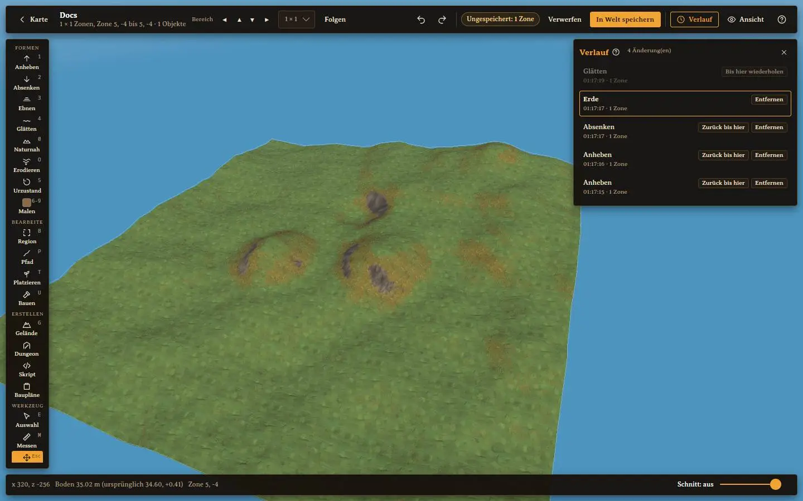

<!-- source: a0f30736 -->
# Einen Schritt rückgängig machen, eine Änderung zurücknehmen oder alles verwerfen

Nimm zurück, was du im Editor getan hast: die letzten Schritte, eine Änderung aus der Mitte, während der Rest bleibt, oder
alles, was noch nicht gespeichert ist.

**Du brauchst:** eine in 3D offene Welt (gespeichert oder live) oder die Werkstatt, mit Änderungen im **Verlauf**.

1. Um die letzte Änderung rückgängig zu machen, drücke `Ctrl+Z` (oder den gebogenen Pfeil in der oberen Leiste). Drücke es erneut für den Schritt
   davor. Der Tooltip des Pfeils nennt den Schritt, den er rückgängig macht.
2. Um zu wiederholen, was du gerade rückgängig gemacht hast, drücke `Ctrl+Y` oder `Ctrl+Shift+Z`.
3. Um mehrere Schritte auf einmal zurückzugehen, öffne den **Verlauf** (`L`) und klicke bei der letzten Änderung, die bleiben soll, auf **Zurück bis hier**.
   Die späteren werden grau; **Bis hier wiederholen** an einer von ihnen holt sie zurück.
4. Um eine Änderung zurückzunehmen und alles danach Getane zu behalten, klicke im **Verlauf** bei dieser Änderung auf **Entfernen**. Sie wird
   durchgestrichen, und das Entfernen ist ein eigener Schritt: `Ctrl+Z` holt die Änderung zurück.
5. Um alles zurückzunehmen, was Claude getan hat, und deine eigenen Änderungen zu behalten, klicke im **Verlauf** auf **Claudes Änderungen zurücknehmen**
   (nur zu sehen, wenn Claude im offenen Bereich Änderungen gemacht hat). Tu das in jedem Bereich, den Claude geändert hat: Die Statusleiste sagt, wie
   viele von Claudes Änderungen in anderen Bereichen erhalten bleiben.
6. Um alles zu verwerfen, was noch nicht gespeichert oder angewendet ist, klicke in der oberen Leiste auf **Verwerfen** und bestätige. Gespeicherte und angewendete
   Änderungen bleiben: Ein gespeicherter Schritt, den du rückgängig gemacht hattest, kommt zurück; speichere also nach dem Rückgängigmachen, wenn er weg sein soll.
7. Um eine schon gespeicherte Änderung zurückzunehmen, mache sie rückgängig (oder nimm sie mit **Entfernen** heraus), dann wieder **In Welt speichern**. Live mache sie
   rückgängig und wieder **Live anwenden** (oder lass **Auto** es senden).

*Verlauf: die letzte Änderung mit **Zurück bis hier** rückgängig gemacht, ausgegraut mit **Bis hier wiederholen**.*

> [!WARNING]
> Eine neue Änderung nach einem Rückgängigmachen verwirft die ausgegrauten Schritte: Sie lassen sich nicht mehr wiederholen. Das Schließen des Editors
> verwirft jede Änderung, die du weder gespeichert noch angewendet hast.

## Prüfen, ob es geklappt hat

- Die Ansicht zeigt den Boden und die Objekte, wie sie waren, und die Zeile der ausstehenden Änderungen in der oberen Leiste zählt weniger (oder zeigt „Alles
  gespeichert“).
- Im **Verlauf** ist die umrandete Zeile der Schritt, zu dem du zurückgegangen bist; rückgängig gemachte Schritte sind grau, entfernte durchgestrichen.

## Rückgängig machen

Jede dieser Aktionen lässt sich umkehren, bis du eine neue Änderung machst: `Ctrl+Y` wiederholt ein Rückgängigmachen, **Bis hier wiederholen** holt
ausgegraute Schritte zurück, und `Ctrl+Z` holt eine entfernte Änderung zurück. **Verwerfen** lässt sich nicht rückgängig machen: Deshalb fragt es zuerst.

## Tipps

- Der Verlauf bleibt nach jedem Speichern oder Anwenden erhalten: Öffne die Welt erneut, auch nachdem du den Editor geschlossen hast, und die Schritte sind
  wieder da, markiert als **frühere Sitzung**. Hat sich die Welt seitdem geändert, fragt der Editor, bevor er einen davon rückgängig macht. Siehe
  [Verlauf](../concepts/saving-and-history.md#verlauf).
- Ein in einem anderen Bereich gemachter Schritt wartet, bis du einen Bereich öffnest, der ihn enthält: Das Panel sagt, wie viele.
- Um weiter zurückzugehen, als der Verlauf des Editors reicht, benutze eine Kopie der Welt: siehe
  [Eine Welt vor dem Bearbeiten sichern](back-up-a-world.md) oder [Einen Bereich aus einer Sicherung wiederherstellen](restore-from-backup.md).

## Verwandte Seiten

- [Einen Bereich aus einer Sicherung wiederherstellen](restore-from-backup.md)
- [Eine Welt vor dem Bearbeiten sichern](back-up-a-world.md)
- [Speichern und Verlauf](../concepts/saving-and-history.md)
- [Das Editorfenster](../editor-basics.md#verlauf)
