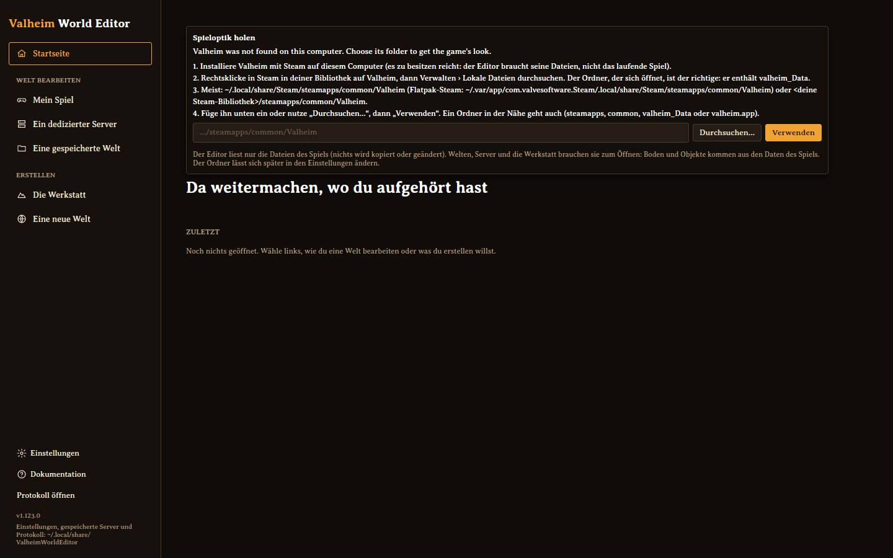
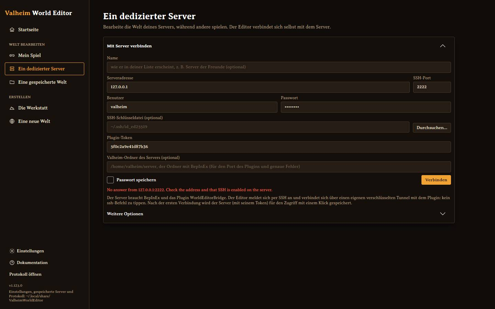
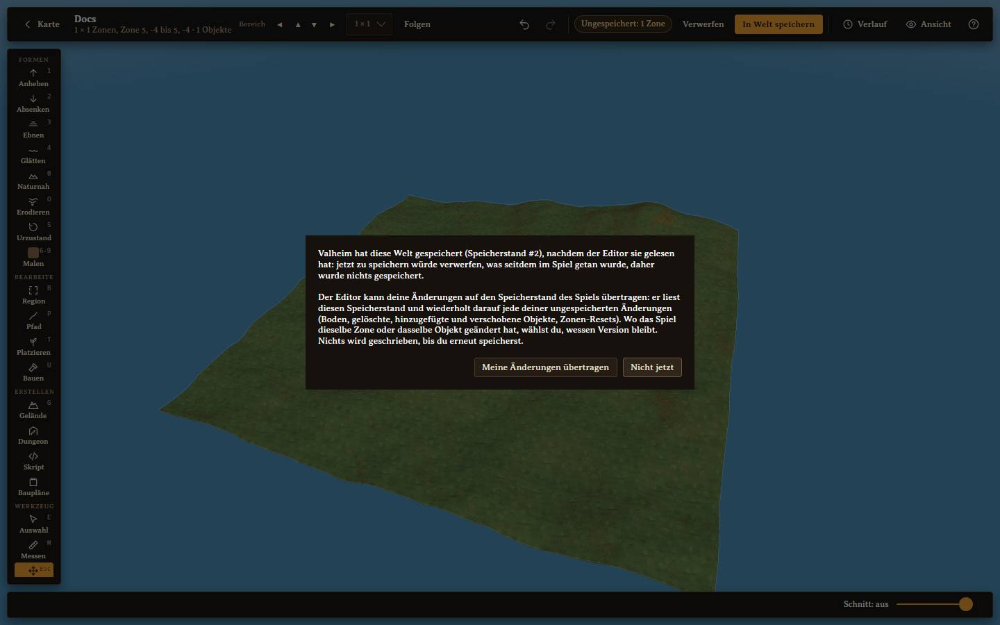

<!-- source: 5b752532 -->
# Fehlerbehebung

Such in der Tabelle, was du siehst, und folge dann dem zugehörigen Abschnitt: jeder sagt, warum es passiert und was zu
tun ist.

| Was du siehst | Gehe zu |
|---|---|
| „Valheim wurde auf diesem Computer nicht gefunden.“ oder Kästen statt Modellen | [Valheim nicht gefunden](#valheim-nicht-gefunden) |
| **Mein Spiel** listet Schritte auf, oder das laufende Spiel erscheint nicht auf der **Startseite** | [Mein Spiel zeigt noch zu erledigende Schritte](#mein-spiel-zeigt-noch-zu-erledigende-schritte) |
| Eine Meldung unter dem Serverformular nach **Verbinden** | [Ein Server verbindet sich nicht](#ein-server-verbindet-sich-nicht) |
| Eine Weltkarte ist ausgegraut, oder eine Welt öffnet sich nicht | [Eine Welt öffnet sich nicht oder ist ausgegraut](#eine-welt-öffnet-sich-nicht-oder-ist-ausgegraut) |
| Speichern endet mit „Nichts geändert“ oder „Nicht gespeichert“ | [Speichern meldet, dass sich nichts geändert hat](#speichern-meldet-dass-sich-nichts-geändert-hat) |
| „Das Spiel hat diese Welt gespeichert“ beim Speichern | [Das Spiel hat gespeichert, während du bearbeitet hast](#das-spiel-hat-gespeichert-während-du-bearbeitet-hast) |
| Live: Spieler sehen eine Änderung nicht, oder der Editor sieht ihre nicht | [Eine Live-Änderung erscheint nicht](#eine-live-änderung-erscheint-nicht) |
| Flackern, Linien oder eine schwarze 3D-Ansicht unter Windows | [Flackern oder Linien unter Windows](#flackern-oder-linien-unter-windows) |
| „Der Computer wurde durch Windows geschützt“, oder macOS öffnet die App nicht | [Windows oder macOS blockiert die App](#windows-oder-macos-blockiert-die-app) |
| Claude sagt, es erreiche den Editor nicht | [Claude kann sich nicht verbinden](#claude-kann-sich-nicht-verbinden) |
| Ein Skript meldet „Fehler“ oder „nichts geändert“ | [Ein Skript schlägt fehl](#ein-skript-schlägt-fehl) |
| Alles andere | [Das Protokoll und Fehlerberichte](#das-protokoll-und-fehlerberichte) |

## Valheim nicht gefunden

Der Editor liest die Texturen, Modelle und das Gelände des Spiels aus deiner Valheim-Installation; ohne sie öffnet sich
weder eine Welt noch die Werkstatt. Die Startseite zeigt dann **Spieloptik holen** mit „Valheim wurde auf diesem
Computer nicht gefunden.“

1. Installiere Valheim mit Steam auf diesem Computer. Es zu besitzen reicht: das Spiel muss nicht laufen.
2. Klicke in Steam in deiner Bibliothek mit der rechten Maustaste auf Valheim, dann auf **Verwalten › Lokale Dateien
   durchsuchen**. Der Ordner, der sich öffnet (der mit `valheim_Data`, oder `valheim.app` auf einem Mac), ist der
   richtige.
3. Füge seinen Pfad in die Karte ein oder nutze **Durchsuchen…**, dann **Verwenden**. Ein Ordner in der Nähe geht auch
   (`steamapps`, `common`, `valheim_Data`, `valheim.app`).

Übliche Orte:

- Windows: `C:\Program Files (x86)\Steam\steamapps\common\Valheim`
- Linux: `~/.local/share/Steam/steamapps/common/Valheim` (Flatpak-Steam:
  `~/.var/app/com.valvesoftware.Steam/.local/share/Steam/steamapps/common/Valheim`)
- macOS: `~/Library/Application Support/Steam/steamapps/common/Valheim`
- Eine andere Steam-Bibliothek: `<library>/steamapps/common/Valheim`

Der Ordner lässt sich später unter **Einstellungen** → **Spielordner von Valheim** ändern (**Automatisch** durchsucht
die Steam-Bibliotheken erneut). Sagt die Karte **Die Spieloptik konnte nicht gelesen werden**, drücke **Erneut
versuchen** oder prüfe den Ordner in den Einstellungen; schlägt es wieder fehl, melde es mit dem Protokoll
([unten](#das-protokoll-und-fehlerberichte)).

*„Valheim wurde auf diesem Computer nicht gefunden.“: wähle den Ordner mit `valheim_Data`, dann **Verwenden**.*

## Mein Spiel zeigt noch zu erledigende Schritte

**Mein Spiel** sagt, was dein Valheim noch braucht, bevor **Live bearbeiten** erscheint:

| Es sagt | Tu das |
|---|---|
| „Dein Spiel braucht BepInEx und das Plugin WorldEditorBridge“ | Installiere beides: siehe [Die Welt bearbeiten, die du gerade spielst](../guides/edit-your-game-live.md). |
| „BepInEx ist installiert: nur noch die Schritte 2 und 3 fehlen.“ | Lege das Plugin in `BepInEx/plugins` und starte dann Valheim. |
| „Starte Valheim einmal mit BepInEx“ | Das Plugin ist noch nie gelaufen. Starte das Spiel über BepInEx (**Start modded** im Mod-Manager oder unter Linux das Startskript des Pakets), nicht über die einfache Steam-Schaltfläche. |
| „Starte Valheim und lade deine Welt“ | Lade im Spiel eine Welt (Einzelspieler, oder hoste eine). Ein Spiel, das dem Server eines anderen beigetreten ist, lässt sich nicht bearbeiten. |

Der Editor prüft alle paar Sekunden. Er sucht die Einstellungsdatei des Plugins in jedem BepInEx-Ordner, den er kennt:
deinem Valheim-Ordner, dem Mod-Manager-Profil, in dem der Editor selbst installiert wurde, jedem Profil von r2modman
und Thunderstore Mod Manager für Valheim (unter Linux auch dem Flatpak-r2modman) und den Ordnern unter
**Einstellungen** → **BepInEx-Ordner**. Liegt dein Spiel oder Profil woanders, füge dort seinen Ordner `BepInEx`, sein
Profil oder einen Ordner mit Profilen hinzu.

**Immer noch nichts, während das Spiel läuft?** Das Plugin lauscht auf Port 5182. Nutzt ein anderes Programm diesen Port
(zum Beispiel ein Tunnel `ssh -L 5182:…`, den du von Hand geöffnet hast), kann das Plugin nicht starten, und die Datei
`BepInEx/LogOutput.log` des Spiels hat eine Zeile `WorldEditorBridge: caught at … while listening on 127.0.0.1:5182 (the bridge does
not answer)`. Schließe dieses Programm oder ändere `Port` in den [Plugin-Einstellungen](../live-mode.md#plugin-einstellungen).

„Dein Spiel konnte nicht geprüft werden: …“ bedeutet, dass der Editor einen BepInEx-Ordner nicht lesen konnte: der Rest
der Meldung sagt, warum.

## Ein Server verbindet sich nicht

Die Meldung unter dem Formular sagt, was schiefging. Meldungen, die gleich beginnen, stehen nur einmal da.

| Meldung | Was zu tun ist |
|---|---|
| „Gib die Serveradresse ein.“ / „Gib das Token des Plugins ein: …“ | Fülle **Serveradresse** oder **Plugin-Token** aus. |
| „The server refused the login: check the user name and the password or key.“ (Der Server hat die Anmeldung abgelehnt.) | Prüfe **Benutzer** und **Passwort** oder **SSH-Schlüsseldatei**. Ein Schlüssel mit Passphrase braucht **Weitere Optionen** → **Schlüssel-Passphrase**. |
| „No answer from <address>:<port>. Check the address and that SSH is enabled on the server.“ (Keine Antwort von dieser Adresse.) | Prüfe **Serveradresse** und **SSH-Port** (22, sofern nicht geändert), und ob der Server SSH annimmt. |
| „The server's identity changed (it was …, now …).“ (Die Identität des Servers hat sich geändert.) | Hast du den Server neu installiert, leere die Zeile `HostKey`, die die Meldung in `servers.cfg` nennt, und verbinde dich erneut. Sonst verbinde dich nicht: jemand könnte sich als dein Server ausgeben. |
| „The server answered but refused the token.“ (Der Server hat das Token abgelehnt.) | Kopiere die Zeile `Token` aus `BepInEx/config/Tie.WorldEditorBridge.cfg` auf dem Server erneut, vollständig. |
| „That token cannot be sent (…)“ (Dieses Token kann nicht gesendet werden.) | Das Token enthält einen Zeilenumbruch oder ein anderes verirrtes Zeichen: kopiere es erneut. |
| „Der Tunnel ist offen, aber das Plugin antwortet nicht auf dem Server: …“ | Der Server läuft nicht, oder nicht mit BepInEx und dem Plugin. Fülle **Valheim-Ordner des Servers (optional)** im Formular aus und verbinde dich erneut, um eine genaue Antwort zu bekommen (unten). Ein Server in einem Container (ein Spielpanel wie Pterodactyl) antwortet nie auf diese Weise: siehe [Ein Server in einem Container](../guides/edit-a-rented-server.md#ein-server-in-einem-container). |
| „The plugin answered, but the game it runs in does not host the world“ (Das Spiel des Plugins hostet die Welt nicht.) | Das Plugin steckt in einem Spiel, das einem anderen Server beigetreten ist. Installiere es auf dem Server, der die Welt hostet. |
| „The server answered with an error (…). Is it the WorldEditorBridge plugin?“ (Der Server hat mit einem Fehler geantwortet.) | Etwas anderes antwortet auf dem Port des Plugins: prüfe **Weitere Optionen** → **Plugin-Port** und `Port` in den Einstellungen des Plugins. Bei 400, durch einen Tunnel zu einer `BindAddress` außer `127.0.0.1`: setze `BindAddress = +` (siehe [Ein Server in einem Container](../guides/edit-a-rented-server.md#ein-server-in-einem-container)). |
| „Could not connect: …“ (Verbindung fehlgeschlagen) | Jeder andere Fehler; der Rest der Meldung sagt, welcher. |

Ist **Valheim-Ordner des Servers** ausgefüllt, sieht der Editor dort per SSH nach und sagt genau, was fehlt: „The
folder … does not exist on the server“ (der Ordner fehlt), „BepInEx is not installed in …“ (BepInEx fehlt), „The plugin
is not in …/BepInEx/plugins“ (das Plugin fehlt), „The plugin is installed but has never run: restart the server with
BepInEx“ (das Plugin ist nie gelaufen) oder „The plugin is installed but does not answer: is the server running, and
started with BepInEx (not the plain start script)?“ (das Plugin antwortet nicht). Die letzte bedeutet auf einem Server, der tatsächlich mit BepInEx läuft, meist, dass er in einem Container läuft
(Pterodactyl, Pelican, Docker): siehe [Ein Server in einem Container](../guides/edit-a-rented-server.md#ein-server-in-einem-container).

Ein Spielserver, der bei einem Anbieter gemietet ist, mit Webpanel und FTP, aber ohne SSH-Anmeldung, lässt sich nicht
live erreichen: bearbeite stattdessen die Dateien seiner Welt, wie in
[Ein gemieteter Spielserver](../guides/edit-a-rented-server.md#ein-gemieteter-spieleserver).

Mit **Eigener Tunnel vorhanden** bedeuten „Nothing answers on 127.0.0.1:…“ (nichts antwortet) oder „No answer from
127.0.0.1:… within … s“ (keine Antwort innerhalb von … s), dass dein Tunnel nicht offen ist oder der Server nicht mit dem Plugin läuft.

*Verbinden gedrückt, ohne dass unter der Adresse etwas antwortet: „No answer from 127.0.0.1:2222. Check the address and
that SSH is enabled on the server.“ (Keine Antwort; prüfe die Adresse und ob SSH aktiviert ist.) Prüfe **Serveradresse** und **SSH-Port**.*

## Eine Welt öffnet sich nicht oder ist ausgegraut

Eine ausgegraute Karte unter **Eine gespeicherte Welt** sagt in Orange, warum. Die üblichen Gründe:

- „Old save format: load this world in Valheim once, then it can be edited here.“ (Altes Speicherformat: lade diese Welt
  einmal in Valheim, dann lässt sie sich hier bearbeiten.) Das Spiel wandelt alte
  Welten aus einer einzigen Datei um, wenn es sie lädt.
- „Mit einer Weltgenerierungs-Mod (…) erstellt, die kein aktives Add-on darstellt“, „… das Add-on ist deaktiviert“ oder
  „… darstellt, sobald … in einem der BepInEx-Plugin-Ordner liegt“: installiere das Add-on, aktiviere es unter
  **Einstellungen → Add-ons** oder füge den BepInEx-Ordner der Mod in den Einstellungen hinzu. Siehe
  [Eine mit Expand World, Riverheim oder Tunnelheim erstellte Welt bearbeiten](../guides/use-mods-worlds.md).
- Eine Riverheim-Welt braucht außerdem ein Riverheim, das ihre Vorgabe kennt (aktualisiere ein älteres), und Riverheim
  1.3 oder neuer braucht Worldhalla im selben BepInEx-Ordner; Welten, die mit der eingestellten Beta von Riverheim
  erstellt wurden, lassen sich nicht öffnen.

Für einen Ordner, den du unter **Anderer Weltordner** eingetippt hast: „That folder holds worlds; pick one of them
(…)“ (dieser Ordner enthält Welten; wähle eine davon) bedeutet, dass du einen Ordner `worlds_local` statt einer einzelnen Welt gewählt hast; „No Valheim world in that folder“
(keine Valheim-Welt in diesem Ordner) bedeutet, dass er keine Dateien `_main.<n>.chunks` enthält. Siehe
[Eine Welt öffnen, die nicht in der Liste steht](../guides/open-a-world.md).

„Die Welt konnte nicht geöffnet werden: …“ nennt den Grund nach dem Doppelpunkt; das Protokoll hat die Einzelheiten.

## Speichern meldet, dass sich nichts geändert hat

Der Editor prüft jedes Speichern, indem er den Speicherstand zurückliest: ist etwas falsch, entfernt er die neuen
Dateien und endet mit „Nichts geändert“. Deine Welt ist, wie sie war, und deine Änderungen sind noch im Editor.

| Meldung | Was zu tun ist |
|---|---|
| „Es gibt keine ungespeicherten Änderungen.“ | Nichts wartet darauf, gespeichert zu werden. |
| „Valheim hat diese Welt gespeichert (Speicherstand #…), nachdem der Editor sie gelesen hat“ | Siehe [Das Spiel hat gespeichert, während du bearbeitet hast](#das-spiel-hat-gespeichert-während-du-bearbeitet-hast). |
| „Speichern fehlgeschlagen (…). Nichts geändert.“ / „Die gespeicherte Welt ließ sich nicht korrekt zurücklesen (…). Nichts geändert.“ | Prüfe den Grund in Klammern (eine volle Festplatte, ein Ordner, in den du nicht schreiben darfst). Schließe Valheim, falls es die Welt nutzt, und speichere dann erneut. |
| „Diese Welt nutzt das Speicherformat …; der Editor speichert nur die Formate … bis ….“ | Ein neueres Format: aktualisiere den Editor. Ein älteres: lade und speichere die Welt in einem aktuellen Valheim und öffne sie dann erneut. |
| „Nicht gespeichert: … zone …: not generated yet (…; visit it in game first)“ (Zone noch nicht erzeugt; besuche sie zuerst im Spiel) | Kein Spieler war dort, daher hat die Welt keine Daten, die sich ändern ließen. Geh im Spiel dorthin und bearbeite dann erneut. |
| „Nicht gespeichert: … the world has no terrain object to copy yet (edit the ground once in game first)“ (die Welt hat noch kein Geländeobjekt zum Kopieren; bearbeite den Boden zuerst einmal im Spiel) | Grabe oder ebne den Boden einmal irgendwo im Spiel, speichere das Spiel und speichere dann erneut. |
| „Nichts konnte gespeichert werden.“ | Alles stand in der obigen Liste „Nicht gespeichert“. |

Ein Pinselstrich, der nichts tut, mit „Nichts geändert: die Maske schließt den ganzen Boden unter dem Pinsel aus“, ist die
[Maske](../masks.md) bei der Arbeit: prüfe ihre Einstellungen für Höhe, Neigung, Biom und Farbe.

## Das Spiel hat gespeichert, während du bearbeitet hast

Ein laufendes Spiel hält die Welt im Speicher und überschreibt die Dateien. Hat es gespeichert, nachdem der Editor die
Welt gelesen hat, speichert **In Welt speichern** nichts und fragt **Das Spiel hat diese Welt gespeichert**:

1. Drücke **Meine Änderungen übertragen**. Der Editor liest den Speicherstand des Spiels und wiederholt jede deiner
   Änderungen darauf.
2. Hat das Spiel dieselben Zonen oder Objekte geändert, fragt er einmal pro Art (Boden, geänderte Objekte, entfernte
   Objekte): **Meine behalten** oder **Die des Spiels behalten**.
3. Sieh dir das Ergebnis an: deine Änderungen stehen jetzt auf dem Speicherstand des Spiels aus. Noch ist nichts
   geschrieben.
4. Schließe Valheim (oder stoppe den Server) und drücke dann erneut **In Welt speichern**.

*Speichern abgelehnt, weil das Spiel die Welt gespeichert hat, nachdem der Editor sie gelesen hat: **Meine Änderungen
übertragen** wiederholt deine Änderungen auf dem Speicherstand des Spiels.*

**Nicht jetzt** lässt alles, wie es war. Das Übertragen deiner Änderungen kann einige Schritte im Verlauf verwerfen (die
Meldung sagt, wie viele).

Um das zu vermeiden, schließe das Spiel vor dem Speichern oder bearbeite live. Mehr unter
[Eine Welt speichern](../concepts/saving-and-history.md#eine-welt-speichern).

## Eine Live-Änderung erscheint nicht

- **Spieler sehen eine angewendete Änderung nicht.** Sieh in die Datei `BepInEx/LogOutput.log` des Servers: die Zeilen
  nach jedem Anwenden sagen, was zerstört, erzeugt und verschoben wurde und ob etwas ein zerstörtes Objekt neu erzeugt
  hat. Siehe [Was das Plugin protokolliert](../live-mode.md#was-das-plugin-protokolliert).
- **„Live-Anwenden fehlgeschlagen: …“ oder „Das Spiel ist nicht erreichbar: …“**. Das Spiel hat nicht innerhalb von
  30 Sekunden geantwortet (es lädt oder ist beschäftigt). Nichts davon wurde ausgeführt: drücke erneut **Live anwenden**.
- **„Nicht angewendet: das Spiel hat den Boden geändert, wo du Änderungen hast“**. Du hast auf **Über die Änderungen des
  Spiels anwenden** mit **Nicht jetzt** geantwortet: wende erneut an und wähle **Anwenden**, oder mach deine Änderungen
  dort rückgängig.
- **Der Editor sieht nicht, was Spieler ändern**, und sagt „Das Plugin WorldEditorBridge auf dem Server ist älter als
  dieser Editor“. Aktualisiere das Plugin; bis dahin liest **Neu laden** die Welt erneut.

## Flackern oder Linien unter Windows

Unter Windows zeichnet der Editor über Direct3D, wie Spiele. Flackert die 3D-Ansicht oder die Karte, zeigt sie Linien
oder zeichnet sie falsch oder langsam, versuch das eigene OpenGL des Grafiktreibers:

1. Öffne auf der Startseite **Einstellungen**.
2. Schalte unter **Darstellung** **Mit OpenGL des Grafiktreibers zeichnen** ein, dann **Speichern**.
3. Schließe den Editor und starte ihn neu.

Schalte es genauso wieder aus, falls es schlechter ist. Den Grafiktreiber zu aktualisieren, hilft auch. Die Karte
**Steuerung** (`F3` in der 3D-Ansicht) zeigt unter **Dieser Computer**, welche Grafikkarte und welche OpenGL-Version die
Ansicht zeichnen.

## Windows oder macOS blockiert die App

**Windows: „Der Computer wurde durch Windows geschützt“.** SmartScreen zeigt das beim ersten Mal, bis es die Signatur
des Editors kennt. Klicke auf **Weitere Informationen** (es zeigt den Herausgeber), dann auf **Trotzdem ausführen**.

**macOS: „kann nicht geöffnet werden“.** Der Mac-Build ist signiert, aber nicht mit einem Apple-Developer-Zertifikat,
daher kann macOS nicht prüfen, wer ihn erstellt hat.

1. Doppelklicke einmal auf **ValheimWorldEditor.app** und schließe die Meldung.
2. Klicke in **Systemeinstellungen › Datenschutz & Sicherheit** neben ValheimWorldEditor auf **Dennoch öffnen**.
3. Oder im Terminal: `xattr -dr com.apple.quarantine /Applications/ValheimWorldEditor.app`.

<!-- picture: os-blocked.jpg: two halves side by side: left, Windows SmartScreen "Windows protected your PC" after More info, showing the publisher and Run anyway; right, macOS System Settings › Privacy & Security scrolled to the "ValheimWorldEditor was blocked" line with Open Anyway -->

Danach öffnet er sich mit einem Doppelklick. Der Mac-Build ist experimentell (Apple Silicon, macOS 12 oder neuer).

## Claude kann sich nicht verbinden

| Prüfen | Was zu tun ist |
|---|---|
| Der Editor läuft | Claude erreicht den Editor nur, solange er läuft. Starte ihn. |
| **Claude verbinden lassen** ist an | Schalte es unter **Einstellungen → Claude** ein und drücke **Speichern**. Der Abschnitt sollte „Listening on http://127.0.0.1:5731/mcp“ zeigen (lauscht auf dieser Adresse). |
| „Could not listen on port …“ (Port kann nicht abgehört werden) | Ein anderes Programm nutzt den Port. Wähle einen anderen **Port**, **Speichern**, und füge den Editor dann mit dem neuen Befehl erneut zu Claude hinzu. |
| Du hast **Neues Token** gedrückt | Das alte Token funktioniert nicht mehr: führe den neuen Befehl für Claude Code erneut aus. |
| Claude Desktop | Starte es nach dem Bearbeiten seiner Konfiguration neu. Hast du den Ordner des Editors verschoben, kopiere die Zeilen erneut aus den Einstellungen: sie enthalten den Pfad des Programms. |
| Claude Code | `/mcp` sollte **valheim-editor** als verbunden auflisten. Wenn nicht, führe den Befehl aus den Einstellungen erneut aus. |

Claude ist verbunden, ändert aber nichts? Solange bei einer Live-Welt **Auto** an ist, darf Claude nur das Panel Ansicht
ändern: schalte Auto aus. Skripte brauchen **Claude darf Skripte ausführen**. Siehe [Claude](../claude.md).

## Ein Skript schlägt fehl

Das Ausgabefeld unter dem Skript sagt, was passiert ist, und in jedem Fall hat sich nichts geändert:

- „Das Skript hat Fehler“: ein Tipp- oder C#-Fehler, mit seiner Zeile aufgeführt (`line 4: The name 'Groud' does not exist
  in the current context`). Korrigiere diese Zeile. „Das Skript hat keine ausführbare Anweisung“ darunter bedeutet, dass
  das Feld leer ist oder nur Kommentare enthält: schreibe mindestens eine Zeile Code oder lade ein Beispiel.
- „Das Skript ist mit einem Fehler abgebrochen“: es ist während der Ausführung fehlgeschlagen, an der angegebenen Zeile
  (ein Objektname, den der Editor nicht erzeugen kann, eine Mal- oder Bergvorgabe, die er nicht kennt, eine Größe von 0
  oder weniger, eine Division durch null).
- „Das Skript lief und hat nichts geändert.“: nutze `Print`, um zu prüfen, ob deine Schleife findet, was du erwartest.
- „Der Bereich hat sich geändert, während das Skript lief“: du hast in der Zwischenzeit bearbeitet, rückgängig gemacht
  oder gespeichert. Führe es erneut aus und warte.
- „Das Skript wurde gestoppt (oder lief 2 Minuten)“: mach es leichter, zum Beispiel `Area.Points(step: 4)`.

Mehr unter [Skript](../scripting.md#wenn-etwas-schiefgeht).

## Das Protokoll und Fehlerberichte

Alles, was der Editor sagt, geht in `ValheimWorldEditor.log`, bei jedem Start neu begonnen, im Datenordner des Editors:

- Windows: `%LOCALAPPDATA%\ValheimWorldEditor`
- Linux: `~/.local/share/ValheimWorldEditor`
- macOS: `~/Library/Application Support/ValheimWorldEditor`

**Protokoll öffnen**, unten im Seitenmenü der Startseite, öffnet es; der Ordner wird dort auch angezeigt. Jeder Fehler,
den der Editor abfängt, ist eine Zeile, die mit `Caught at` beginnt, mit dem Ort, an dem er passiert ist, und dem, was
der Editor gerade tat. Persönliche Daten werden weggelassen: dein Home-Ordner wird `~` geschrieben, und Pfade, Adressen,
Kontonamen, Passwörter und Tokens werden durch Platzhalter wie `<path>` ersetzt.

Um ein Problem zu melden, [eröffne ein Issue](https://github.com/Shuiei/valheim-world-editor/issues) mit:

1. Was du getan und was du gesehen hast (ein Screenshot hilft).
2. Dem Protokoll des Editors, über **Protokoll öffnen**, direkt nach dem Problem (bevor du den Editor neu startest).
3. Live: der Datei `BepInEx/LogOutput.log` des Spiels oder Servers.
4. Bei einer langsamen Ansicht: schalte **Bildraten aufzeichnen** auf der Karte **Steuerung** (`F3`) ein, nutze die
   Ansicht und hänge `perf-native.log` aus demselben Datenordner an.

Ein Sicherheitsproblem gefunden? Melde es vertraulich: siehe [SECURITY.md](../../../SECURITY.md).
