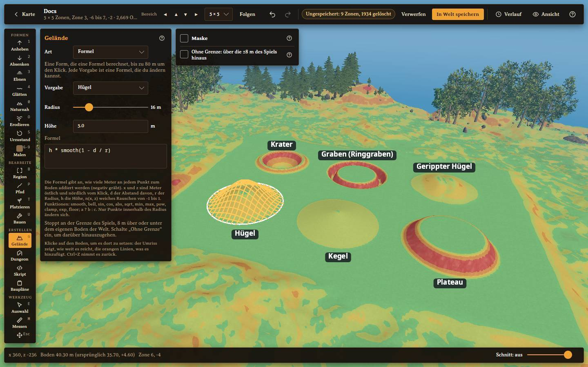
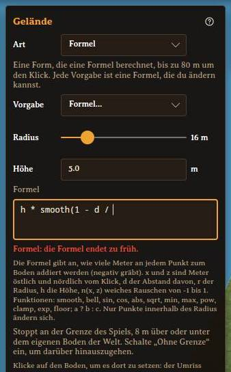
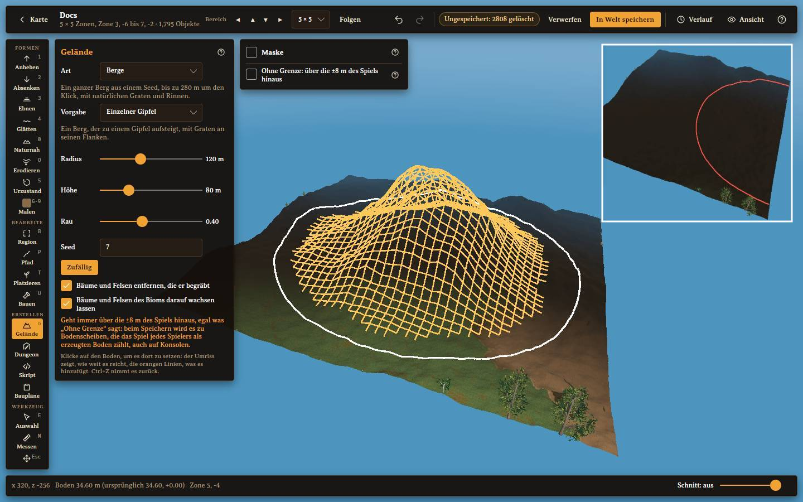
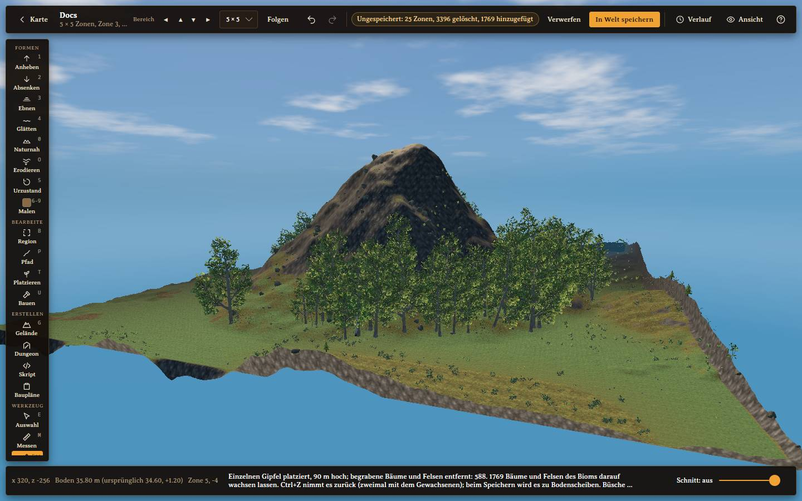
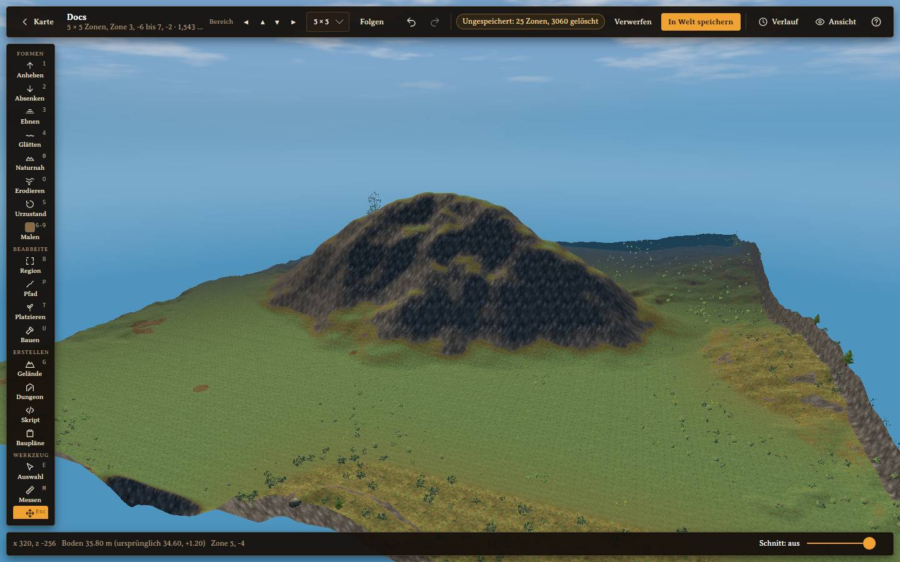
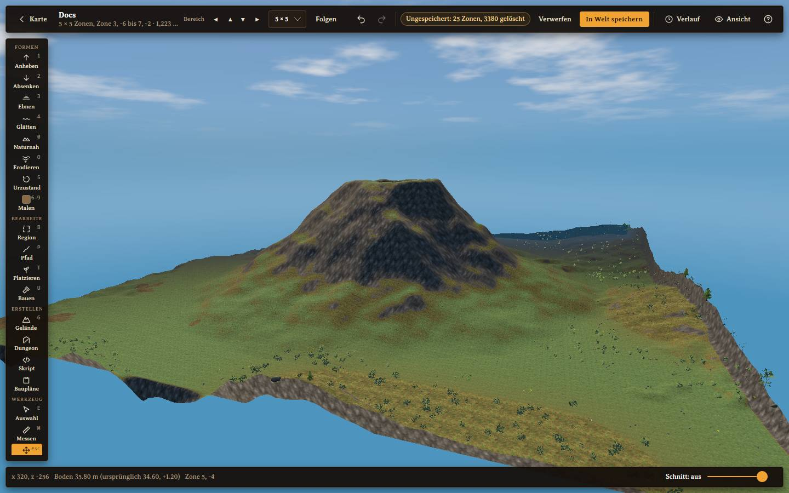
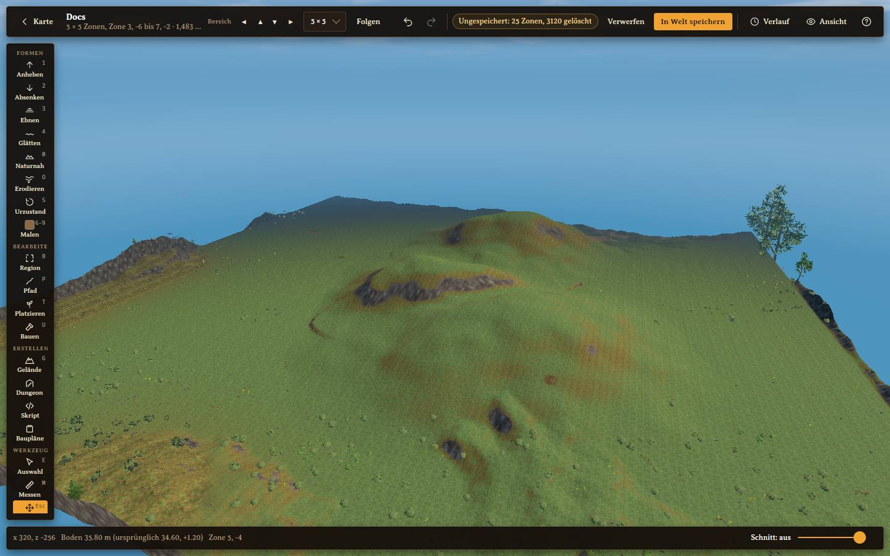
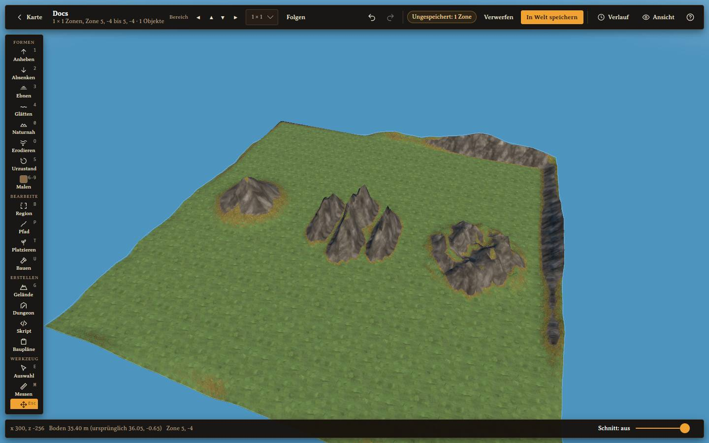
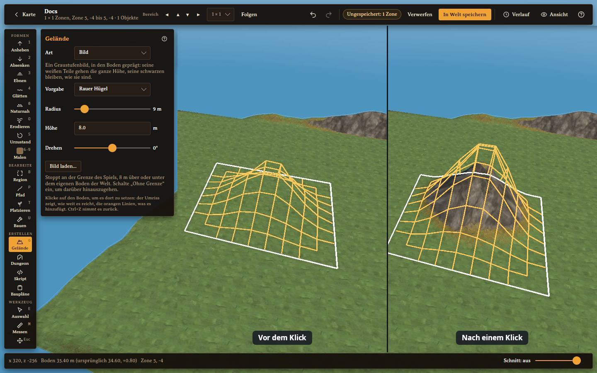

<!-- source: e6ef7a67 -->
# Gelände

Setze mit einem Klick eine ganze Geländeform in den Boden: einen Hügel oder einen Krater, berechnet von einer Formel, einen Berg weit über
die 8 m des Spiels hinaus oder ein eigenes Bild, eingeprägt.

**Wo:** Werkzeugleiste, Abschnitt **ERSTELLEN** · **Taste:** `G` · **Funktioniert in:** gespeicherten Welten, live

*Die Art **Formel**. Vordere Reihe von links: Hügel, Kegel, Plateau. Hintere Reihe von links: Krater, Graben (Ringgraben),
Gerippter Hügel, jede mit dem Standardradius von 16 m und der Standardhöhe von 5 m, mit **Neigungsfarben** in Ansicht an, damit ihre Hänge
lesbar sind. Das Panel zeigt den Hügel und seine Formel; auf dem Hügel ist der weiße Umriss der Radius und die orangefarbenen Linien
das, was ein weiterer Klick hinzufügen würde.*

## Benutzen

1. Klicke in der Werkzeugleiste auf **Gelände** (`G`).
2. Wähle im Panel eine **Art**: **Formel**, **Berge** oder **Bild** (siehe [Die drei Arten](#die-drei-arten)).
3. Wähle eine **Vorgabe**, dann stelle **Radius** und **Höhe** ein.
4. Bewege den Mauszeiger über den Boden. Der weiße Umriss zeigt, wie weit die Geländeform reicht, und die orangefarbenen Linien zeigen,
   was sie hinzufügt, so hoch oder so tief, wie sie sein wird.
5. Klicke. Die Geländeform kommt sofort hinein.
6. Nicht richtig? `Ctrl+Z` nimmt sie zurück. Jeder Klick ist ein Schritt zum Rückgängigmachen („Gelände: Hügel“).

## Die drei Arten

Jede Art hat ihre eigenen Vorgaben. Keine Vorgabe hat in zwei Arten denselben Namen, daher sagt der Name, welche du benutzt hast.

| Art | Erzeugt | Radius | Die ±8-m-Grenze des Spiels |
|---|---|---|---|
| **Formel** | Eine glatte, genaue Form, berechnet von einer Formel, die du lesen und ändern kannst. | 2 bis 80 m | Hält sie ein, außer **Ohne Grenze** ist an. |
| **Berge** | Einen ganzen natürlichen Berg aus einem Seed, mit Graten und Rinnen und darauf gewachsenen Bäumen. | 20 bis 280 m | Geht immer darüber hinaus. |
| **Bild** | Ein eingeprägtes Graustufenbild: ein eingebautes oder eine beliebige Bilddatei. | 2 bis 80 m | Hält sie ein, außer **Ohne Grenze** ist an. |

Eine Zeile unten im Panel sagt, wie die gewählte Art gerade zur Grenze steht. Sie wird bernsteinfarben, wenn
die Geländeform darüber hinausgehen wird. Siehe [Ohne Grenze](terrain.md#ohne-grenze) für den Schalter und dafür, was das Speichern mit Boden
jenseits der Grenze tut.

## Einstellungen, die jede Art hat

Diese stehen bei allen drei Arten an derselben Stelle, unter denselben Namen. Jede Art merkt sich ihre eigenen Werte.

| Einstellung | Was sie tut |
|---|---|
| **Art** | Woraus die Geländeform gemacht wird. Wird für das nächste Mal gemerkt. |
| **Vorgabe** | Die Geländeform: die eigene Liste der Art. |
| **Radius** | Wie weit sie vom Klick aus reicht. |
| **Höhe** | Wie hoch sie aufsteigt (m). Bei **Formel** und **Bild** stellt eine negative Höhe sie auf den Kopf: Ein Hügel wird eine Grube, ein Graben ein Ringwall. |
| **Drehen** | Ihre Richtung, wo sie eine hat: ein Grat oder Gebirgszug von **Berge** und jedes **Bild**. |

## Formel

Eine Form, Punkt für Punkt berechnet. Jede Vorgabe ist eine Formel, die im Feld steht; ändere sie, und die Liste wechselt zu
**Formel…**, deiner eigenen, die für das nächste Mal gemerkt wird.

| Vorgabe | Form |
|---|---|
| **Hügel** | Ein glatter runder Hügel. |
| **Kegel** | Gerade Hänge bis zu einer Spitze. |
| **Plateau** | Eine flache Kuppe mit einem glatten Hang ringsum. |
| **Krater** | Eine Senke mit erhöhtem Rand. |
| **Graben (Ringgraben)** | Ein Graben bei drei Vierteln des Radius. Mit negativer Höhe ein Ringwall. |
| **Mulde** | Eine runde Senke. |
| **Gerippter Hügel** | Ein Hügel mit Rippen, die quer über ihn laufen. |
| **Formel…** | Deine eigene. |

| Einstellung | Was sie tut |
|---|---|
| **Radius** | 2 bis 80 m (Standard 16 m). Nur der Boden darin ändert sich. |
| **Höhe** | Standard 5 m. Sie ist `h` in der Formel. |
| **Formel** | Wie viele Meter an jedem Punkt im Radius zum Boden addiert werden; eine negative Zahl gräbt. Ein Fehler erscheint unter dem Feld, und nichts lässt sich platzieren, bis er behoben ist. |

*Eine unfertige Formel: Die Liste ist zu **Formel…** gewechselt, und die Zeile unter dem Feld sagt, was falsch ist („die
Formel endet zu früh“).*

### Eine Formel schreiben

Die Formel wird für jeden Bodenpunkt im Radius berechnet, und das Ergebnis wird dort zum Boden addiert.

| Name | Bedeutung |
|---|---|
| `x`, `z` | Meter östlich und nördlich des Klicks. |
| `d`, `r`, `h` | Abstand vom Klick, der Radius, die Höhe. |
| `n(x, z)` | Glattes Rauschen von etwa -1 bis 1, aus dem Muster der Pinsel (**Neues Muster** in [Naturnah](terrain.md#naturnah) ändert es). Benutze `n(x / 10, z / 10)` für weite Buckel. |
| `pi` | 3,14159… |

Funktionen: `abs`, `atan2(y, x)`, `bell(t)` (1 bei 0, ausklingend bis etwa ±1), `ceil`, `clamp(v, a, b)`, `cos`, `exp`,
`floor`, `log`, `max(…)` und `min(…)` (beliebig viele Werte), `pow(a, b)`, `round`, `sign`, `sin`, `smooth(t)` (0
unter 0, 1 über 1, dazwischen ein glattes S), `sqrt`, `tan`.

Operatoren: `+ - * / %`, `^` (Potenz), Vergleiche `< > <= >= == !=` (1 oder 0), `&&`, `||`, `!` und `a ? b : c`.

Die Vorgaben zeigen, wie es funktioniert:

| Vorgabe | Formel |
|---|---|
| **Hügel** | `h * smooth(1 - d / r)` |
| **Kegel** | `h * max(0, 1 - d / r)` |
| **Plateau** | `h * smooth((r - d) / (0.35 * r))` |
| **Mulde** | `-h * smooth(1 - (d / r) ^ 2)` |
| **Graben (Ringgraben)** | `-h * bell((d - 0.75 * r) / (0.12 * r))`: ein Graben bei drei Vierteln des Radius. |

Zwei weitere zum Einstieg: `h * smooth(1 - d / r) * (1 + 0.3 * n(x / 8, z / 8))` ist ein buckliger Hügel, und
`abs(x) < 3 ? -h : 0` gräbt einen 6 m breiten Graben quer durch den Kreis.

## Berge

Ein ganzer Berg aus einem Seed, zum vorhandenen Boden addiert, sodass er die eigene Lage des Landes behält und an seinem Rand wieder
in sie übergeht. Sein Umriss ist nie ein perfekter Kreis, und **Rau** fügt Wölbungen, Grate und Rinnen im
Verhältnis zu seiner Größe hinzu.

*Einzelner Gipfel, 80 m hoch, Radius 120 m, vor dem Klick: Die orangefarbenen Linien zeigen ihn so hoch, wie er aufsteigen wird, und der weiße
Ring, wie weit er reicht. Eingesetzt, oben rechts: Mit dem Mauszeiger nahe dem Rand des Bereichs wird der Ring rot, und keine Vorschau
erscheint, weil er nicht hineinpassen würde.*

| Vorgabe | Höhe / Radius, die sie würfelt | Form |
|---|---|---|
| **Einzelner Gipfel** | 50–110 m / 120–240 m | Ein Berg, der zu einem Gipfel aufsteigt, mit Graten an seinen Flanken. |
| **Grat** | 35–80 m / 140–260 m | Ein langer Kamm, halb so breit wie lang. |
| **Gebirgszug** | 40–90 m / 180–280 m | Drei bis fünf Gipfel entlang einer Linie, durch Sättel verbunden. |
| **Tafelberg** | 20–50 m / 70–150 m | Eine flache Kuppe mit steilen, felsigen Hängen: Platz zum Bauen da oben. Rauheit gibt es nur an den Hängen. |
| **Vulkan** | 45–100 m / 130–240 m | Ein Kegel mit einem Krater an der Spitze. |
| **Hügelland** | 12–30 m / 100–220 m | Drei bis sechs sanfte Hügel beisammen. |

| Einzelner Gipfel | Grat |
|---|---|
|  |  |
| **Vulkan** | **Hügelland** |
|  |  |

*Vier Vorgaben in der Mitte eines Bereichs von 5 × 5, der vorher geräumt und geebnet wurde, damit jede hervortritt. Auf dem einzelnen Gipfel sind die
Bäume des Bioms gewachsen; die anderen bleiben kahl, damit ihre Form zu sehen ist.*

| Einstellung | Was sie tut |
|---|---|
| **Vorgabe** | Die Art des Bergs. Eine zu wählen würfelt einen neuen Berg davon, wie **Zufällig**. |
| **Radius** | 20 bis 280 m. Sein Umriss ist zerklüftet, bis zu 15 % weiter: Der Ring zeigt es. |
| **Höhe** | Wie hoch er sich über den Boden dort erhebt, 5 bis 300 m. |
| **Drehen** | Nur **Grat** und **Gebirgszug**: die Richtung, in die er verläuft, 0° bis 179°. |
| **Rau** | 0: glatte Hänge. 1: tiefe Rinnen und Grate. |
| **Seed** | Die Zahl, aus der seine Details stammen: Dieselbe Vorgabe, dieselben Werte und derselbe Seed ergeben wieder denselben Berg. |
| **Zufällig** | Ein neuer Berg der Vorgabe: neue Größe, Rauheit, Richtung und neuer Seed. Würde er nicht in den offenen Bereich passen, wird er als Ganzes kleiner gemacht, auch in der Höhe, damit die Hänge genauso sanft bleiben. |
| **Bäume und Felsen entfernen, die er begräbt** | Anfangs an. Bäume, Felsen, Erz, Büsche und Sammelbares, wo er den Boden um mehr als 2 m anhebt, werden entfernt (das Speichern täte es sowieso). Bauteile bleiben, ebenso, was in einem Dungeon hoch darüber ist. |
| **Bäume und Felsen des Bioms darauf wachsen lassen** | Anfangs an. Lässt die eigenen Bäume und Felsen des Bioms nach den Regeln des Spiels auf den Hängen wachsen, die er um mehr als einen Meter angehoben hat, abseits von dem, was dort schon steht. Ein zweiter Schritt zum Rückgängigmachen. |

Ein Berg muss ganz in den offenen Bereich passen, zerklüfteter Rand eingeschlossen: Wo der Ring rot ist, setzt ein Klick nichts hinein.

## Bild

Ein Graustufenbild, in den Boden geprägt: Seine weißen Teile gehen die ganze **Höhe**, graue Teile einen Teil davon, schwarze
Teile bleiben, wie sie sind. Das Bild bedeckt ein Quadrat, doppelt so breit wie **Radius**; der Umriss zeigt es.

*Die eingebauten Bilder, 6 m hoch bei einem Radius von 8 m. Von links: Rauer Hügel, Dünen, Felsiger Boden.*

*Die Vorgabe **Rauer Hügel**, **Radius** 9 m und **Höhe** 8 m. Links: sein quadratischer Umriss und die orangefarbene Vorschau auf flachem Boden
vor dem Klick. Rechts: der ganze Hügel, mit einem Klick gesetzt.*

| Vorgabe | Form |
|---|---|
| **Rauer Hügel** | Ein kleiner Gipfel mit rauen Flanken. |
| **Dünen** | Parallele Kämme in einem runden Fleck. |
| **Felsiger Boden** | Klumpiger, zerbrochener Boden. |
| Deine eigenen | Jedes Bild, das du geladen hast, unter seinem Dateinamen. |

| Einstellung | Was sie tut |
|---|---|
| **Radius** | Die halbe Seite des Bilds, 2 bis 80 m (Standard 16 m). |
| **Höhe** | Wie weit die weißen Teile aufsteigen (m, Standard 4). Negativ: Sie werden stattdessen hinuntergedrückt. |
| **Drehen** | Dreht das Bild, -180° bis 180°. |
| **Bild laden…** | Verwendet ein beliebiges Bild (PNG, JPEG…): eine Höhenkarte aus einem anderen Werkzeug, ein Logo, eine von Hand gezeichnete Form. Seine Helligkeit ist die Höhe; durchsichtige Teile zählen als Schwarz. Es wird auf ein Quadrat von 128 × 128 Punkten skaliert, daher wird ein breites Bild gestaucht, und feine Details gehen verloren. Es wird für das nächste Mal unter seinem Dateinamen behalten. |
| **Bild vergessen** | Entfernt das gewählte geladene Bild. Nur bei geladenen Bildern zu sehen: Die eingebauten bleiben. |

Die Bilder sind die [Stempel](terrain.md#stempel) der Pinsel: Eines, das du hier lädst, ist auch eine Pinselform, und eines, das dort
geladen wurde, wird hier angeboten. Zwei eingebaute Stempel, **Tafelberg (flache Kuppe)** und **Kraterrand**, sind nur Pinselformen: Als
Geländeformen erzeugt sie die Art **Formel** (**Plateau** und **Graben** mit negativer Höhe).

## Tastenkürzel

| Taste oder Maus | Was es tut |
|---|---|
| `G` | Gelände wählen. |
| Klick auf den Boden | Die Geländeform dort setzen. |
| `Ctrl+Z` | Die letzte zurücknehmen (zweimal drücken, wenn auf einem Berg Bäume gewachsen sind). |
| `Esc` | Das Werkzeug verlassen (zurück zu Ansicht). |

## Tipps und Grenzen

- **Formel und Bild stoppen 8 m vom erzeugten Boden entfernt**, und die Statusleiste sagt es. Für höhere setze ein Häkchen bei
  **Ohne Grenze: über die ±8 m des Spiels hinaus** auf der Karte **Maske** neben dem Panel (siehe [Ohne Grenze](terrain.md#ohne-grenze)):
  Es bleibt für jedes Bodenwerkzeug an, bis du es ausschaltest.
- **Ein Berg geht immer über die 8 m des Spiels hinaus**, egal was **Ohne Grenze** sagt. Das Speichern macht ihn zu Bodenscheiben und
  leert den Verlauf des Bereichs, wie bei [Ohne Grenze](terrain.md#ohne-grenze). Prüfe ihn, bevor du speicherst.
- **Für große Berge öffne zuerst einen größeren Bereich** (die Größenliste des Bereichs in der oberen Leiste): Bei einem Bereich von 5 × 5 kann der Radius
  bis etwa 137 m betragen.
- **Die [Maske](masks.md) gilt**: Wo sie Boden auslässt, endet die Geländeform in einer Stufe, ein Berg in einer Klippe.
- **Eine Formel, die überall 0 ergibt**, ändert nichts, und die Statusleiste sagt es. Punkte, an denen sie keine Zahl ergibt
  (eine Division durch null), bleiben, wie sie waren.
- **Die äußerste Linie von Punkten des Bereichs ändert sich nie** (siehe
  [Der gesperrte Rand](concepts/areas-and-zones.md#der-gesperrte-rand)).
- **Um einen Rand** danach **weicher zu machen**, gehe mit dem Pinsel **Glätten** oder **Naturnah** darüber.
- **Sanfte Hänge behalten Gras und Bäume; steile zeigen nackten Fels**, so wie das Spiel sie zeichnet.
- **Um ein Bild als Pinsel** beim Ziehen **zu benutzen**, wähle es stattdessen als **Form** des Pinsels (siehe
  [Stempel](terrain.md#stempel)). Um die Höhen eines ganzen Bereichs aus einem Bild festzulegen, siehe
  [Höhenkarte](area.md#höhenkarte).
- **Ein [Skript](scripting.md)** kann ebenfalls Formelformen und Berge platzieren, nach Regeln.

## Verwandte Seiten

- [Über die 8-m-Grenze des Spiels hinaus anheben oder graben](guides/raise-past-the-limit.md)
- [Ohne Grenze](concepts/ground-limits.md#ohne-grenze): wie der Boden über 8 m hinaus gespeichert wird
- [Wie ein Berg entsteht](concepts/ground-limits.md#wie-ein-berg-entsteht)
- [Wachstumsregeln](concepts/objects.md#wachstumsregeln): was auf einem Berg wächst
- [Formen und Malen](terrain.md): Pinsel und Stempel
