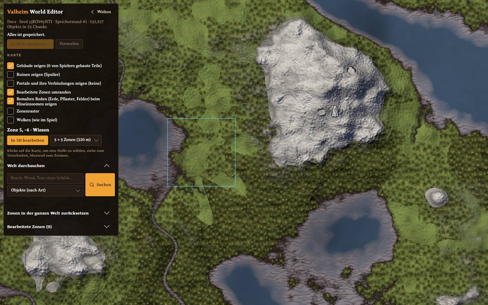
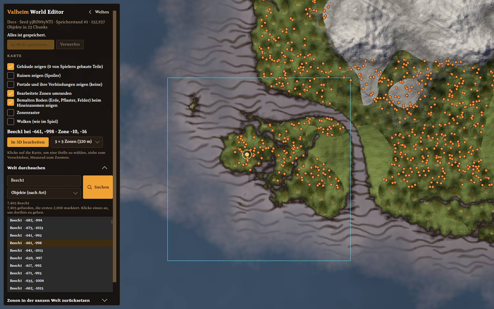
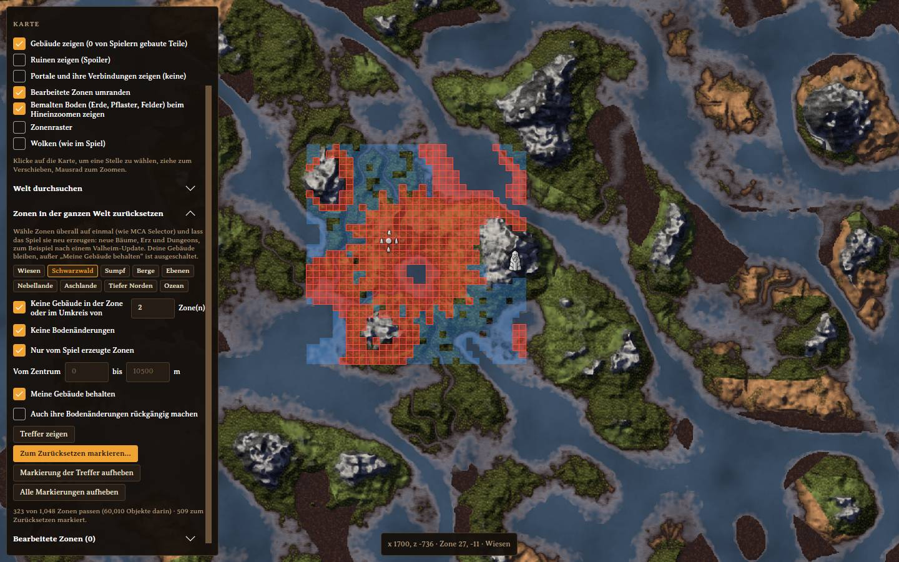
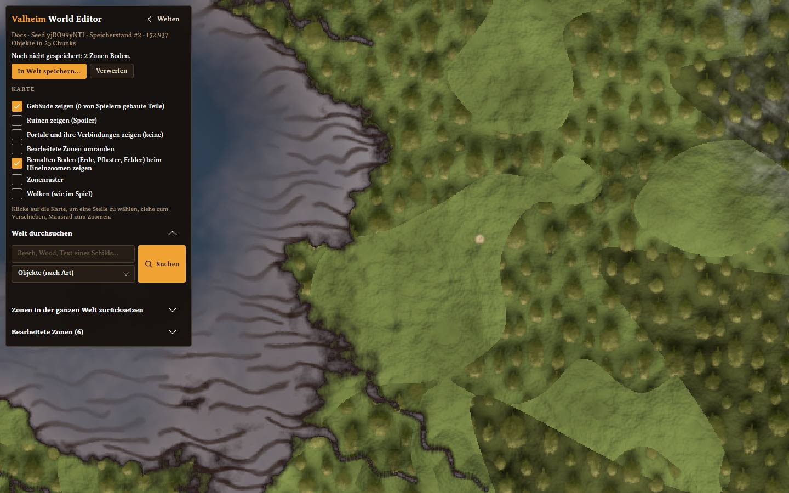

<!-- source: 2b176694 -->
# Weltkarte

Sieh die ganze Welt, wähle die Stelle, die du in 3D bearbeiten willst, durchsuche jedes Objekt, jede Truhe und jedes
Schild, setze Zonen überall auf einmal zurück und speichere, was ansteht.

**Wo:** öffnet sich mit jeder Welt; **Karte** in der oberen Leiste des Editors führt zu ihr zurück · **Taste:** keine
(`F1` öffnet diese Seite) · **Funktioniert in:**
gespeicherten Welten, live

> [!WARNING]
> **Schließe das Spiel oder stoppe den Server, bevor du eine Welt offline speicherst.** Ein laufendes Spiel
> überschreibt beim Speichern die Weltdateien, und deine Änderungen, zurückgesetzte Zonen eingeschlossen, gehen
> verloren. Um eine Welt zu ändern, während sie läuft, verwende den [Live-Modus](live-mode.md).

*Eine Zone ist gewählt: Das hellblaue Quadrat ist der Bereich, den **In 3D bearbeiten** öffnet, in der Größe, die
neben der Schaltfläche gewählt ist.*

Die Karte wird so gezeichnet, wie das Spiel seine eigene zeichnet, aus den Daten der Welt, sodass sie wie die
Spielkarte aussieht, auf der alles aufgedeckt ist. Der Start und die Händler (sobald ihre Zone erzeugt ist) zeigen
ihre Symbole wie im Spiel.

## Benutzen

1. Ziehe, um die Karte zu verschieben; drehe das Mausrad, um zum Zeiger hin zu zoomen.
2. Klicke auf eine Stelle. Das Seitenpanel zeigt ihre Zone und ihr Biom („Zone 12, -4 · Schwarzwald“), und der
   Bereich, der sich öffnen wird, ist hellblau umrandet.
3. Wähle im Seitenpanel die Größe in der Liste neben **In 3D bearbeiten**.
4. Drücke **In 3D bearbeiten**. Der [3D-Editor](editor-basics.md) öffnet sich um die angeklickte Zone.

Die Karte merkt sich, wo du zuletzt hingesehen hast, auch beim nächsten Start des Editors. Das Feld unten zeigt den
Punkt unter dem Zeiger: seine Koordinaten, Zone und Biom („x 812, z -260 · Zone 13, -4 · Wiesen“) und das
Alternativbiom seines Gebiets, wenn es eines hat („Alternativbiom Dark Meadows“, ein paar Sekunden nach dem Öffnen
der Karte gezeigt).

## Einstellungen

Oben im Seitenpanel stehen Name, Seed und Speicherstandnummer der Welt und wie viele Objekte sie enthält (live: die
Verbindung statt der Speicherstandnummer); nach dem Speichern zeigt es die neue Speicherstandnummer. **Welten** führt
zurück zur Startseite: Bei ausstehenden Änderungen fragt es zuerst, und **Trotzdem verlassen** verwirft sie.

| Einstellung | Was sie tut |
|---|---|
| **Aus dem Spiel neu laden** | Nur live: liest die ganze Welt neu aus dem laufenden Spiel. Die Zeile darüber listet die Spieler, die online sind („Live-Welt · 2 Spieler online: Ragnar, Freya“). |
| **In Welt speichern…** / **Live anwenden** | Schreibt jede ausstehende Änderung in die Weltdateien (live: sendet sie an das laufende Spiel). Die Zeile darüber sagt, was ansteht, zum Beispiel „Noch nicht gespeichert: 3 Zonen Boden, 12 gelöscht, 40 hinzugefügt, Reset von 25 Zone(n).“ |
| **Verwerfen** | Verwirft nach einer Rückfrage jede noch nicht gespeicherte oder angewendete Änderung. |
| **Gebäude zeigen (N von Spielern gebaute Teile)** | Zeichnet jedes von Spielern gebaute Bauteil: Grundrisse aus der Nähe, Punkte weiter weg, nichts bei weit herausgezoomter Karte. Ruinen, an die Spieler angebaut haben, werden mit dem Gebäude gezeichnet. Anfangs an. |
| **Ruinen zeigen (Spoiler)** | Zeichnet auch die Ruinen der Welt (Steintürme, verfallene Häuser, Ruinen der Nebellande und der Aschlande), blasser. Anfangs aus, weil es zeigt, wo sie liegen. |
| **Portale und ihre Verbindungen zeigen (N: P verbundene(s) Paar(e), A einzeln)** | Zeichnet jedes Portal als violetten Punkt, mit einer Linie zwischen den beiden, die dasselbe Tag haben (das Paar, das das Spiel verbindet); ein Portal ohne Partner ist hohl. Hineingezoomt (8 m pro Pixel oder näher) steht jedes Tag neben seinem Portal („kein Tag“ bei einem leeren). N zählt die Portale, P die verbundenen Paare, A die Portale ohne Partner. Im Editor hinzugefügte oder gelöschte Portale zählen, sobald die Karte erneut gezeigt wird. Anfangs aus, weil es zeigt, wo jedes Portal steht. |
| **Bearbeitete Zonen umranden** | Umrandet Zonen, deren Boden geändert wurde: eine dünne gelbe Linie für Änderungen, die schon in der Welt sind, eine dickere orange Linie für noch nicht gespeicherte oder angewendete Änderungen. Anfangs an. |
| **Bemalten Boden (Erde, Pflaster, Felder) beim Hineinzoomen zeigen** | Aus der Nähe wird die Karte mit 1 m Detail und deinen ausstehenden Bodenänderungen gezeichnet; das zeigt auch Erde, Pflaster und kultivierten Boden. Anfangs an. |
| **Zonenraster** | Zeichnet die Linien zwischen den 64-m-[Zonen](concepts/areas-and-zones.md#zonen), wenn weit genug hineingezoomt ist. |
| **Wolken (wie im Spiel)** | Zeichnet die ziehenden Wolkenschatten der Spielkarte. |
| **In 3D bearbeiten** | Öffnet den 3D-Editor auf dem Bereich um die gewählte Zone. |
| Größenliste (neben **In 3D bearbeiten**) | Wie viel Boden der Editor lädt: **3 × 3 Zonen (192 m)**, **5 × 5 Zonen (320 m)** (Standard), **7 × 7**, **9 × 9**, **13 × 13** oder **17 × 17 Zonen (1088 m)**. Nimm 5 × 5 für die meisten Arbeiten, 9 × 9 oder mehr, um eine Stadt einzufügen oder einen großen Berg anzuheben. Größere Bereiche sind langsamer. Du kannst sie später in der oberen Leiste ändern. |

Im Live-Modus erscheinen die Spieler, die online sind, als blaue Punkte mit ihren Namen, alle 5 Sekunden
aktualisiert. Änderungen bleiben über Bereiche hinweg [ausstehend](concepts/saving-and-history.md#ausstehende-änderungen):
Bearbeite einen Bereich, kehre zur Karte zurück, öffne einen anderen und speichere alles auf einmal.

## Welt durchsuchen

*Jede orange Nadel ist ein gefundenes Objekt. Das in der Liste gewählte Ergebnis ist größer, mit goldenem Ring, und
die Karte ist darauf zentriert.*

1. Öffne **Welt durchsuchen**.
2. Tippe einen Teil eines Namens oder Texts ein, zum Beispiel `Beech`, `Wood` oder die Worte eines Schilds. Groß- und
   Kleinschreibung spielt keine Rolle.
3. Wähle, wonach gesucht wird (unten).
4. Drücke **Suchen** (oder `Enter`). Jedes Ergebnis wird auf der Karte markiert und aufgelistet.
5. Klicke auf ein Ergebnis: Die Karte zentriert sich darauf und wählt seine Zone. **In 3D bearbeiten** öffnet dann
   mit diesem Objekt ausgewählt.

| Suchen nach | Findet |
|---|---|
| **Objekte (nach Art)** | Jedes Objekt, dessen Art den Text enthält: `portal`, `Beech`, `chest`, `guard_stone`… |
| **Gegenstände in Behältern** | Jede Truhe, jeden Karren, jedes Schiff oder jeden anderen Behälter mit einem Gegenstand, dessen Name den Text enthält: `Wood`, `Draugr`, `Silver`… Jedes Ergebnis sagt, wie viele („Wood ×50“). |
| **Texte (Schilder, Portale, Wards…)** | Jedes Objekt mit einem Text, der ihn enthält: Schildtexte, Portal-Tags, Namen von Wards und Grabsteinen. Jedes Ergebnis zeigt den passenden Text. |

Eine Zeile über den Ergebnissen zählt, was je Art (bei Behältern je Gegenstand) und insgesamt gefunden wurde. Die
Liste zeigt die ersten 300 Ergebnisse; bis zu 2.000 werden markiert. Bei Gegenständen und Texten öffnen sich auch die
[Daten](select.md) des Objekts, sodass du den Inhalt der Truhe oder den Text des Schilds sofort ändern kannst. Wenn du
änderst, wonach gesucht wird, wird sofort neu gesucht.

Die Suche liest die Welt so, wie sie im Editor ist: Objekte, die du platziert, aber nicht gespeichert hast, werden
gefunden, Objekte, die du gelöscht, aber nicht gespeichert hast, nicht. Die eigenen Verwaltungsobjekte des Spiels
(Namen, die mit `_` beginnen, wie `_ZoneCtrl`) werden nur gefunden, wenn auch dein Text mit `_` beginnt.

## Zonen in der ganzen Welt zurücksetzen

*Die Zonen der Wiesen wurden zum Zurücksetzen markiert (rot), dann wurde **Schwarzwald** gewählt und **Treffer
zeigen** gedrückt (blau). Die Zeile unter den Schaltflächen zählt beide.*

Wähle Zonen überall in der Welt danach aus, was sie sind, und lass das Spiel sie neu erzeugen: neue Bäume, Felsen, Erz
und Dungeons, zum Beispiel nach einem Valheim-Update, an Orten, an denen niemand gebaut hat. Um die Zonen unter einer
Auswahl zurückzusetzen, verwende stattdessen das Werkzeug [Region](area.md#zonen-zurücksetzen), das dieselben zwei Schalter
hat und auf dieselbe Weise markiert; Schritt für Schritt: [Zonen neu erzeugen](guides/reset-zones.md).

1. Öffne **Zonen in der ganzen Welt zurücksetzen**.
2. Stelle den Filter ein (unten).
3. Drücke **Treffer zeigen**. Beim ersten Mal liest der Editor jede Zone (einen Moment). Passende Zonen werden blau,
   und eine Zeile meldet „N von M Zonen passen (K Objekte darin)“. Ab dann folgt die Karte dem Filter, während du ihn
   änderst.
4. Drücke **Zum Zurücksetzen markieren…** und stimme zu. Die passenden Zonen werden rot.
5. **In Welt speichern** (offline) oder **Live anwenden** führt das Zurücksetzen aus. Bis dahin bricht **Alle
   Markierungen aufheben** es ab, und **Markierung der Treffer aufheben** bricht es für die Zonen ab, die der Filter
   jetzt trifft.

> [!CAUTION]
> **Einmal gespeichert oder angewendet, lässt sich ein Zurücksetzen nicht rückgängig machen.** Jedes Objekt in der
> Zone wird entfernt, außer den Grabsteinen der Spieler und, mit **Meine Gebäude behalten** an, den von Spielern
> gebauten Bauteilen: Bäume, Felsen, Erz, Ruinen, Dungeoneingänge, Gegenstände am Boden und Kreaturen, auch gezähmte
> Tiere. Bring gezähmte Tiere zuerst weg und [sichere die Welt](guides/back-up-a-world.md).

| Einstellung | Was sie tut |
|---|---|
| Biom-Schaltflächen (**Wiesen** … **Ozean**) | Nur Zonen, deren Mitte in einem der eingeschalteten Biome liegt. Keines an: jedes Biom. |
| **Keine Gebäude in der Zone oder im Umkreis von N Zone(n)** | Lässt Zonen aus, die höchstens N Zonen von Bauteilen von Spielern entfernt sind, Diagonalen eingeschlossen (0 bis 50; anfangs 2). Anfangs an. Ist das aus, wird eine Zone mit Bauteilen trotzdem ausgelassen, solange **Meine Gebäude behalten** an ist. |
| **Keine Bodenänderungen** | Lässt Zonen aus, deren Boden geändert wurde (im Spiel oder im Editor). Anfangs an. |
| **Nur vom Spiel erzeugte Zonen** | Nur Zonen, in deren Nähe schon ein Spieler war. Aus: auch Zonen, die nur Objekte oder Bodenänderungen aus dem Editor enthalten. Anfangs an. |
| **Vom Zentrum … bis … m** | Nur Zonen in diesem Abstand von der Mitte der Welt. Leer: keine Grenze (der Rand der Welt liegt bei 10.500 m). Setze zum Beispiel nur die äußeren Ringe zurück. |
| **Meine Gebäude behalten** | Anfangs an: Gebäude werden von der Karte aus nie zurückgesetzt, und eine Zone mit von Spielern gebauten Bauteilen passt nie. Ist es aus und **Keine Gebäude…** ebenfalls aus, passen Zonen mit Gebäuden wie jede andere, und ihre Gebäude verschwinden mit dem Rest; die Frage vor dem Markieren sagt das. |
| **Auch ihre Bodenänderungen rückgängig machen** | Das Zurücksetzen entfernt auch die Bodenänderungen der Zonen, zurück zum Boden des Seeds. Zählt nur, wenn **Keine Bodenänderungen** aus ist. Hier anfangs aus (beim Werkzeug Region anfangs an). |
| **Treffer zeigen** | Färbt die passenden Zonen blau und zählt sie und die Objekte darin. |
| **Zum Zurücksetzen markieren…** | Markiert nach einer Rückfrage jede passende Zone zum Zurücksetzen (rot). |
| **Markierung der Treffer aufheben** | Bricht das Zurücksetzen der passenden Zonen ab, die markiert sind; die anderen Markierungen bleiben. |
| **Alle Markierungen aufheben** | Bricht jedes markierte Zurücksetzen von Zonen ab, auch die mit dem Werkzeug Region markierten. |

Wenn das nächste Mal ein Spieler in die Nähe einer zurückgesetzten Zone kommt, erzeugt das Spiel sie neu aus dem
Seed, mitsamt ihrem Ort (Ruine, Dungeon, Altar). Live geschieht das sofort dort, wo Spieler sind; nach einem
Zurücksetzen live liest der Editor die Welt neu, und der Verlauf kommt mit, ohne das, was er in den zurückgesetzten
Zonen getan hat.

## Bearbeitete Zonen

**Bearbeitete Zonen (N)** listet jede Zone, deren Boden geändert wurde, die am meisten geänderte zuerst. Jede Zeile
nennt die Zone, wie viele Höhenpunkte (`H`) und Farbpunkte (`F`) geändert wurden, die Spanne der Höhenänderungen
(`-2.4 … 6.0 m`) und „(nicht gespeichert)“, wenn manche Änderungen ausstehen („(nicht angewendet)“ in einer Live-Welt).
Klicke auf eine Zeile, um auf diese Zone hineinzuzoomen und sie zu wählen, bereit für **In 3D bearbeiten**.

*Vier Zonen gespeichert (dünn gelb) und zwei seitdem bearbeitet (dicker orange): Die Liste kennzeichnet die
ausstehenden mit „(nicht gespeichert)“.*

## Tastenkürzel

| Taste oder Maus | Was sie tut |
|---|---|
| Ziehen | Die Karte verschieben. |
| Mausrad | Zum Zeiger hin zoomen. |
| Klick | Die Zone dort wählen. |
| `Enter` im Suchfeld | Suchen. |

## Tipps und Grenzen

- **Die Karte zeigt die Welt so, wie sie gelesen wurde.** Live folgt der 3D-Editor dem, was Spieler im offenen Bereich
  ändern, aber der Rest der Karte ändert sich nur mit **Aus dem Spiel neu laden**.
- **Näher als etwa 6 m pro Pixel hineingezoomt** wird der sichtbare Teil neu mit 1 m Detail gezeichnet, mit deinen
  ausstehenden Bodenänderungen darin.
- **Nur Zonen innerhalb der Welt** werden zum Zurücksetzen aufgeführt. Ein dedizierter Server, auf dem niemand online
  ist, erzeugt auch Zonen weit außerhalb der Welt: Diese werden ausgelassen.
- **Um eine Änderung zurückzunehmen**, bricht **Alle Markierungen aufheben** markierte Zurücksetzungen ab, und
  **Verwerfen** verwirft alles Ausstehende. Um eine einzelne Änderung rückgängig zu machen, öffne ihren Bereich in 3D
  und drücke `Ctrl+Z` oder verwende den Verlauf: siehe
  [Einen Schritt rückgängig machen, eine Änderung zurücknehmen oder alles verwerfen](guides/undo-changes.md).
- **Die Suche findet nichts?** Prüfe die Schreibweise und die Wahl unter **Suchen nach**; Verwaltungsobjekte brauchen
  ein führendes `_`.
- **Mit Expand World erstellte Welten**: Mit installiertem und eingeschaltetem Add-on erscheint eine größere Welt
  vollständig, die Ortssymbole kommen aus ihren Daten, und die Anzeige ergänzt das Gebiet und die Statuseffekte, die ein
  Spieler dort bekommt („Gebiet frost · Effekte Freezing (Nacht)“). Siehe
  [Eine mit Expand World, Riverheim oder Tunnelheim erstellte Welt bearbeiten](guides/use-mods-worlds.md).

## Verwandte Seiten

- [Ein Objekt, einen Gegenstand in einer Truhe oder ein Schild finden](guides/find-things.md)
- [Zonen neu erzeugen](guides/reset-zones.md)
- [Eine Welt vor dem Bearbeiten sichern](guides/back-up-a-world.md)
- [Bereiche und Zonen](concepts/areas-and-zones.md)
- [Das Editorfenster](editor-basics.md), [Live-Modus](live-mode.md)
