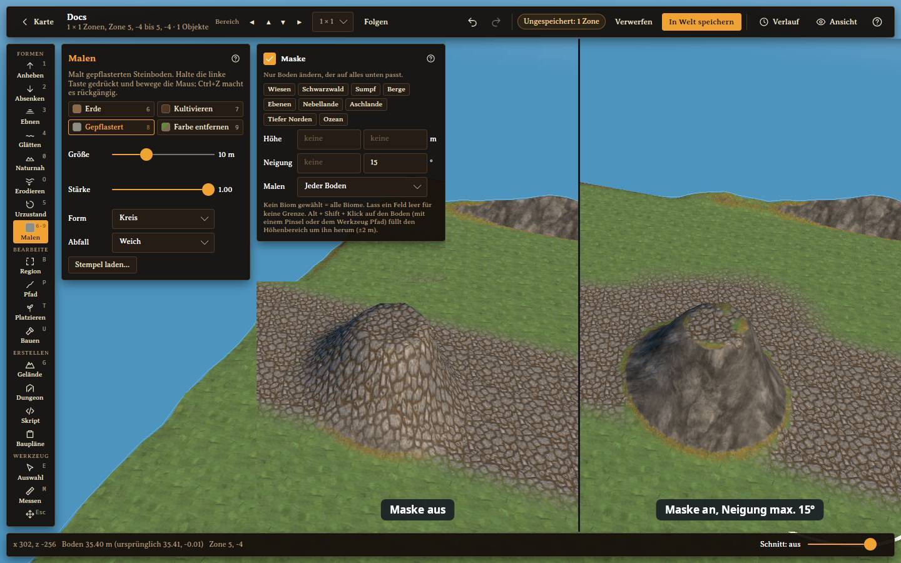
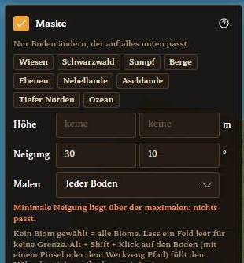

<!-- source: 1cb7e459 -->
# Maske

Lass ein Werkzeug nur den Boden ändern, den du wählst, nach Biom, Höhe, Neigung oder Farbe: Pflastere nur die flachen Teile eines Hügels,
ebne einen Talboden, ohne seine Hänge anzutasten, pflanze nur auf unbemaltem Boden.

**Wo:** die Karte **Maske** neben dem Werkzeugpanel · **Taste:** keine (`Alt`+`Shift`+Klick setzt einen Höhenbereich) ·
**Funktioniert in:** gespeicherten Welten, live

*Derselbe breite Pinselstrich mit der Farbe Gepflastert über einen Hügel. Links, Maske aus: Alles ist gepflastert. Rechts, Maske an mit Neigungen
unter 15°: Der flache Boden ist gepflastert, die steilen Hänge des Hügels nicht. Die Karte Maske ist neben dem Werkzeugpanel.*

Die Maske arbeitet mit den Formpinseln und dem Pinsel Malen, [Gelände](landform.md),
[Pfad](path.md), den Aktionen des Werkzeugs [Region](area.md), dem Einfügen und [Platzieren](place.md). [Bauen](build.md) hält sie
nicht zurück: Ein Bauteil kommt dorthin, wohin du zeigst.

## Benutzen

1. Wähle ein Werkzeug, das die Maske benutzt. Die Karte **Maske** erscheint neben seinem Panel.
2. Setze auf der Karte ein Häkchen bei **Maske**. Ihre Einstellungen öffnen sich darunter.
3. Stelle die gewünschten Biome, Höhe, Neigung und Farbe ein. Lass eine Einstellung leer, um nicht danach zu begrenzen.
4. Benutze das Werkzeug wie gewohnt: Es ändert nur den Boden, der auf jede Einstellung passt.
5. Wenn du fertig bist, entferne das Häkchen bei **Maske**. Sie bleibt mit ihren Einstellungen an, wenn du das Werkzeug wechselst.

## Einstellungen

| Einstellung | Was sie tut |
|---|---|
| **Maske** | An: Das Werkzeug ändert nur Boden, der auf alles darunter passt. Aus: keine Grenze. |
| Biom-Chips | **Wiesen**, **Schwarzwald**, **Sumpf**, **Berge**, **Ebenen**, **Nebellande**, **Aschlande**, **Tiefer Norden**, **Ozean**: nur diese Biome. Keines gewählt: jedes Biom. |
| **Höhe** min / max | Nur Boden zwischen diesen Höhen (m; das Meer liegt bei 30 m). Lass ein Feld leer („keine“) für keine Grenze auf dieser Seite. |
| **Neigung** min / max | Nur Boden zwischen diesen Steilheiten, 0° bis 90°. Ein Maximum von 0 lässt nur völlig flachen Boden durch. |
| **Malen** | **Jeder Boden**, **Nur unbemalt**, **Nur bemalt**, **Nur Erde**, **Nur kultiviert** oder **Nur gepflastert**. |

Eine orangefarbene Warnung erscheint unter den Einstellungen, wenn sie nichts durchlassen: eine maximale Neigung von 0° oder ein Minimum über
dem Maximum.

*Neigung min 30° liegt über max 10°, daher warnt die Karte in Orange: „Minimale Neigung liegt über der maximalen: nichts passt.“*

### Ohne Grenze, auf derselben Karte

Unter der Maske enthält die Karte die andere Einstellung, die alle Bodenwerkzeuge teilen:

| Einstellung | Was sie tut |
|---|---|
| **Ohne Grenze: über die ±8 m des Spiels hinaus** | An: Die Bodenwerkzeuge gehen bis zu 400 m vom erzeugten Boden weg, nicht nur die 8 m des Spiels. Ein Schalter für die Formpinsel, [Gelände](landform.md) (seine Formeln und Bilder), [Pfad](path.md) und [Region](area.md); er bleibt an, bis du ihn ausschaltest, und ist bei jedem Start des Editors aus. Siehe [Ohne Grenze](terrain.md#ohne-grenze). |

Er gehört nicht zur Maske (er funktioniert mit Maske an oder aus), und die Karte zeigt ihn nur bei den Werkzeugen, für die er gilt:
nicht beim Pinsel Malen und bei [Platzieren](place.md), die keinen Boden bewegen. Ein Berg von Gelände geht immer über die
Grenze hinaus, egal was der Schalter sagt.

## Tastenkürzel

| Taste oder Maus | Was es tut |
|---|---|
| `Alt`+`Shift`+Klick auf den Boden | Mit einem Form- oder Malpinsel oder dem Werkzeug Pfad: schaltet die Maske ein und füllt **Höhe** von 2 m unter bis 2 m über dieser Stelle. Praktisch, um nur an einer Terrasse oder einer Uferlinie zu arbeiten. |

## Tipps und Grenzen

- **Die Maske hat keinen weichen Rand.** Jeder Bodenpunkt (einer pro Meter) passt oder nicht, daher kann Formen mit ihr eine
  Stufe hinterlassen, wo passender Boden an den Rest stößt, vor allem mit Anheben, Absenken und [Gelände](landform.md). Gehe danach
  mit dem Pinsel **Glätten** über die Stufe, mit Maske aus.
- **Während eines Pinselstrichs betrachtet die Maske den Boden so, wie er war, als du die Taste gedrückt hast.** Ein Pinselstrich Anheben unter
  einer Höhengrenze steigt weiter darüber hinaus, bis du loslässt. Bearbeitungen mit einem Klick (Gelände, Pfad, Region,
  Einfügen) betrachten den Boden direkt davor.
- **Biom ist das Biom, das die Welt** dort **erzeugt hat**. Den Boden umzuformen ändert es nicht.
- **Malen:** Mit **Farbe entfernen** gelöschter Boden zählt als unbemalt. **Nur Erde**, **Nur kultiviert** und
  **Nur gepflastert** brauchen diese Farbe zu mindestens der Hälfte der Färbung.
- **Nichts geändert?** Die Statusleiste sagt „Nichts geändert: die Maske schließt den ganzen Boden unter dem Pinsel aus (prüfe
  ihre Einstellungen für Höhe, Neigung, Biom und Farbe).“
- **Auch ein Einfügen gehorcht der Maske, obwohl die Karte beim Einfügen nicht zu sehen ist.** Eine angelassene Maske begrenzt den Boden,
  den das Einfügen formt (seine Objekte kommen alle hinein). Entferne das Häkchen bei **Maske**, bevor du kopierst und einfügst, wenn du den ganzen Boden willst.
- **Die Maske ist eine Einstellung, keine Änderung**: Sie wird nicht mit `Ctrl+Z` rückgängig gemacht und nicht in der Welt gespeichert. Sie ist bei jedem Start des Editors aus,
  ihre Felder leer.

Ideen:

- Um einen Weg nur auf den flachen Teilen eines Hangs zu pflastern, stelle **Neigung** max ein und benutze **Pflaster malen** des Werkzeugs Pfad.
- Um nur auf unbemaltem oder nur auf kultiviertem Boden zu pflanzen, stelle **Malen** ein und benutze [Platzieren](place.md).
- Um den Grund eines Tals zu ebnen, ohne seine Hänge anzutasten, stelle **Höhe** max etwas über den Talboden und
  benutze **Ebnen** oder das Werkzeug [Region](area.md).

## Verwandte Seiten

- [Bäume und Felsen räumen, einen Bauplatz ebnen](guides/clear-an-area.md)
- [Einen Wald, ein Feld oder eine Hecke pflanzen](guides/plant-a-forest.md)
- [Formen und Malen](terrain.md), [Pfad](path.md), [Region](area.md)
- [Wie die Maske den Boden beurteilt](concepts/ground-limits.md#wie-die-maske-den-boden-beurteilt)
