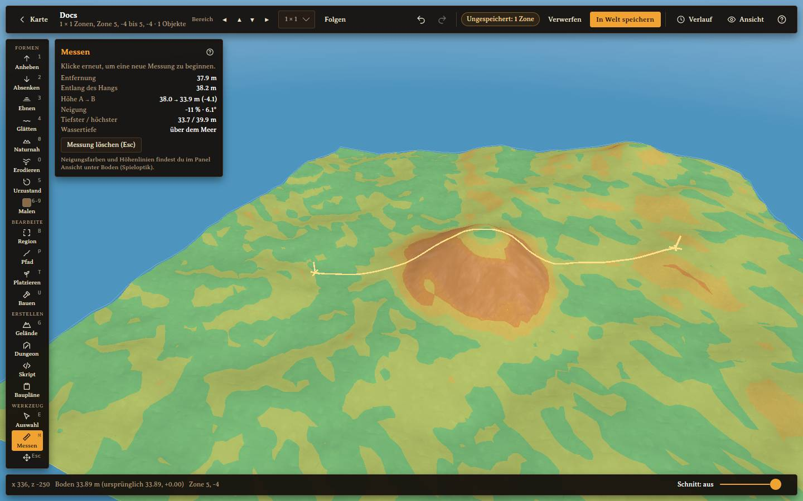
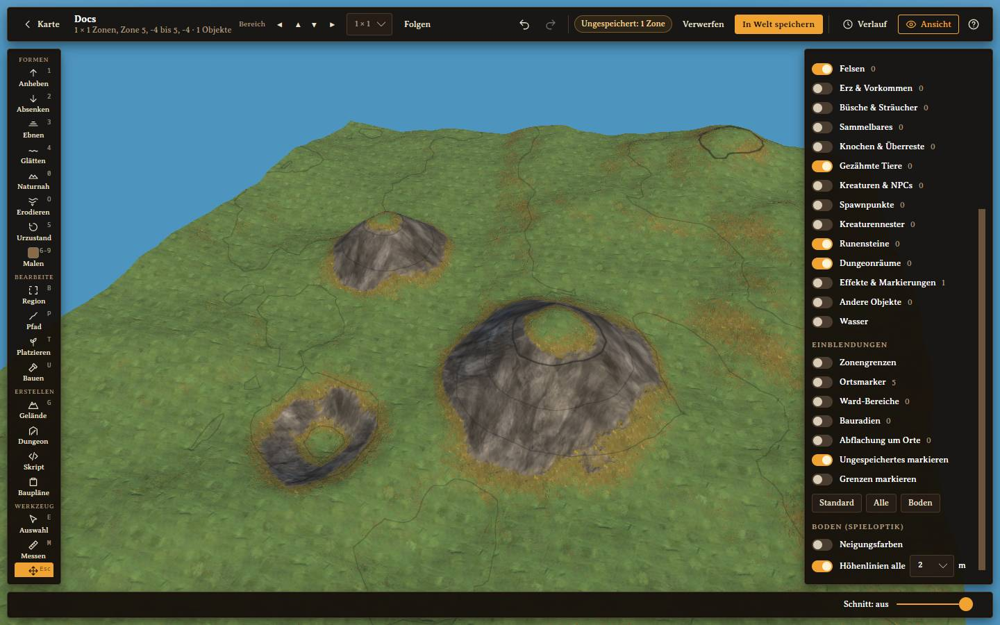
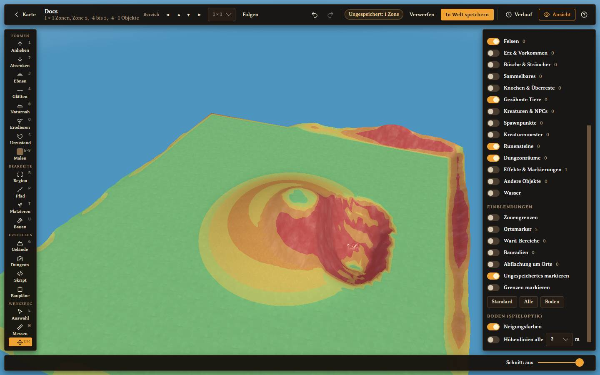

<!-- source: 164ad5c4 -->
# Messen und Einblendungen

Klicke zwei Punkte an und lies die Entfernung, den Höhenunterschied und die Neigung zwischen ihnen ab. Zwei
Einblendungen auf dem Boden, Neigungsfarben und Höhenlinien, zeigen Steilheit und Höhe überall auf einmal, während du
ein beliebiges Werkzeug benutzt.

**Wo:** Werkzeugleiste, Abschnitt **WERKZEUGE**; die Einblendungen im Panel Ansicht · **Taste:** `M` ·
**Funktioniert in:** gespeicherten Welten, live

*Eine Messung vom Fuß eines Erdhügels über seine Kuppe, mit eingeschalteten Neigungsfarben. Die Linie folgt dem
Boden; das Panel zeigt die Entfernung, die Höhen und die Neigung.*

## Benutzen

1. Klicke in der Werkzeugleiste auf **Messen** (`M`).
2. Klicke einen ersten Punkt auf dem Boden an. Die Linie folgt dem Cursor.
3. Klicke einen zweiten Punkt an, um die Messung festzulegen. Das Panel zeigt die Messwerte.
4. Klicke noch einmal, um eine neue Messung zu beginnen, oder drücke **Messung löschen (Esc)**, um sie zu entfernen.

Die Linie wird entlang des Bodens gezeichnet und zeigt so das Profil zwischen den beiden Punkten. Der Hinweis oben im
Panel sagt, was der nächste Klick tut.

## Messwerte

| Messwert | Was er bedeutet |
|---|---|
| **Entfernung** | Die gerade Entfernung von oben gesehen, wie auf einer Karte (m). |
| **Entlang des Hangs** | Die Länge einer geraden Linie von A nach B, einschließlich des Höhenunterschieds (m). |
| **Höhe A → B** | Die Bodenhöhe an beiden Punkten und der Unterschied, zum Beispiel `35.0 → 42.5 m (+7.5)`. |
| **Neigung** | Die mittlere Neigung von A nach B, in % und in Grad. Eine Neigung von 100 % entspricht 45°. |
| **Tiefster / höchster** | Der tiefste und der höchste Boden entlang der Linie, jeden Meter gelesen: Ein Buckel oder eine Senke zeigt sich hier, auch wenn A und B gleich hoch liegen. |
| **Wassertiefe** | Wie tief der niedrigere Punkt unter dem Meer liegt (das Meer liegt auf 30 m), oder „über dem Meer“. |

Die Höhen sind die des Spiels, wie in der Statusleiste. Du kannst die Werte im Panel markieren und kopieren.

## Einblendungen auf dem Boden

Im Panel Ansicht (`V`) unter **BODEN (Spieloptik)**:

| Einstellung | Was sie tut |
|---|---|
| **Neigungsfarben** | Färbt den Boden nach Steilheit, sodass du siehst, wo eine Rampe oder ein Bauplatz zu steil ist: grün unter 10°, gelbgrün 10–20°, gelb 20–30°, orange 30–45°, rot über 45°. Hügel behalten ihr Licht und ihre Schatten. |
| **Höhenlinien alle** *N* **m** | Zeichnet Höhenlinien (Konturen) alle **1**, **2** (Standard), **5** oder **10** m. Jede fünfte Linie ist dunkler und dicker. Eng beieinander liegende Linien bedeuten steilen Boden. |

Beide brauchen **Spieloptik** (die Bodendarstellung im Panel Ansicht), bleiben an, während du andere Werkzeuge
benutzt, und werden gespeichert. Höhenlinien liegen auf Vielfachen des Abstands, daher hat der Meeresspiegel (30 m)
immer eine, und der Küstenlinie lässt sich leicht folgen.

*Höhenlinien alle 2 m über zwei Erdhügeln und einer Mulde, Zonengrenzen aus. Das Panel Ansicht zeigt **Höhenlinien
alle** 2 m unter **BODEN (Spieloptik)**; jede fünfte Linie ist dunkler.*

*Neigungsfarben auf einem Erdhügel: grün auf dem flachen Boden, dann gelbgrün, gelb und orange seine sanfte Seite
hinauf, und rot an der hineingeschnittenen Klippe. Das Panel Ansicht zeigt **Neigungsfarben** angehakt unter
**BODEN (Spieloptik)**.*

## Tastenkürzel

| Taste oder Maus | Was sie tut |
|---|---|
| `M` | Messen wählen. |
| Klick | Punkt A setzen, dann Punkt B, dann von vorn beginnen. |
| `Esc` | Die Messung löschen; ein zweites `Esc` verlässt das Werkzeug. |
| `V` | Das Panel Ansicht (die Einblendungen) zeigen oder ausblenden. |

## Tipps und Grenzen

- **Die Messung ändert nichts** an der Welt und wird nicht gespeichert.
- **Die Messwerte folgen dem Boden.** Ändere den Boden mit einem anderen Werkzeug und kehre zu Messen zurück, oder
  mache etwas rückgängig: Die Höhen, die Neigung und die tiefsten und höchsten Punkte werden an denselben A und B neu
  gelesen.
- **Eine Rampe planen:** Miss von ihrem Fuß bis zu ihrer Spitze. **Neigung** ist die Neigung, die **Rampe** im
  Werkzeug [Pfad](path.md) entlang einer geraden Linie zwischen denselben Punkten ergibt.
- **Grenzen markieren**, im selben Panel Ansicht, färbt den Boden rot, der die ±8 m des Spiels erreicht hat. Siehe
  [Grenzen markieren](concepts/ground-limits.md#grenzmarkierungen).

## Verwandte Seiten

- [Eine Straße oder eine Rampe einen Hügel hinauf anlegen](guides/make-a-road.md)
- [Bäume und Felsen räumen, einen Bauplatz ebnen](guides/clear-an-area.md)
- [Das Editorfenster](editor-basics.md): das Panel Ansicht
- [Pfad](path.md), [Formen und Malen](terrain.md)
