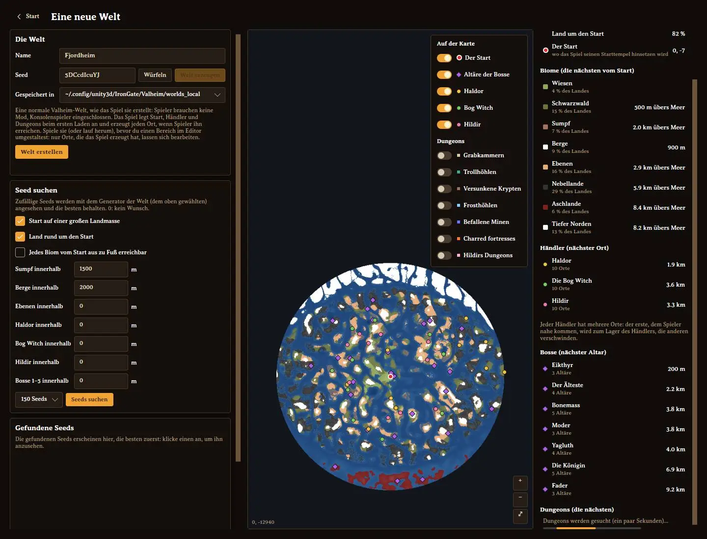
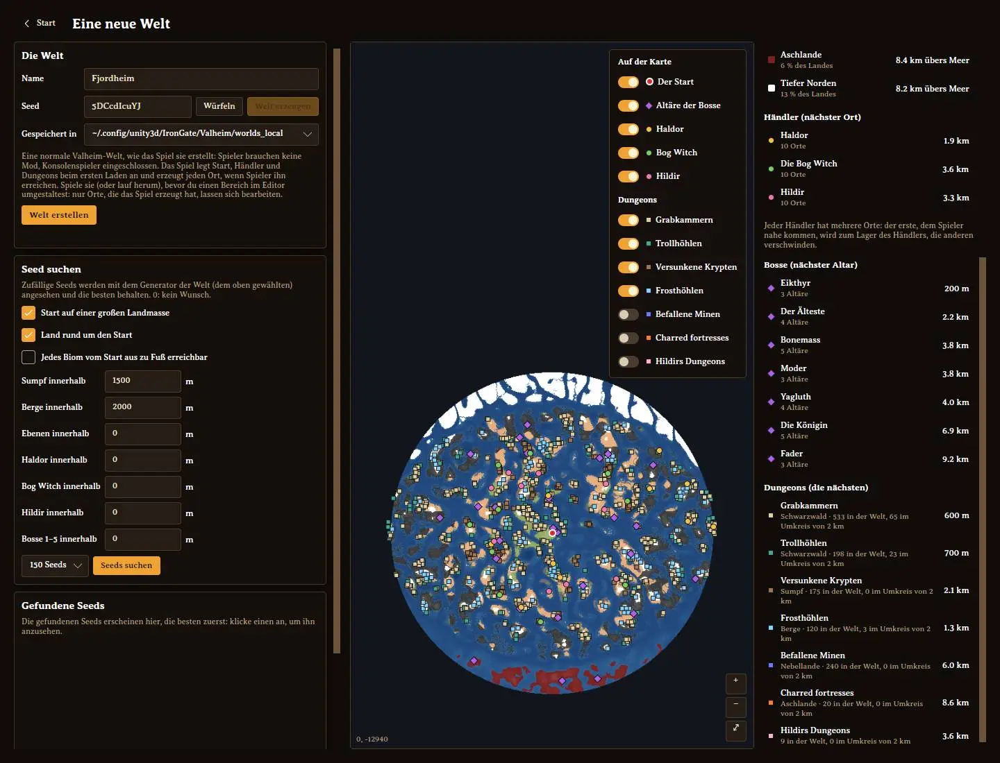
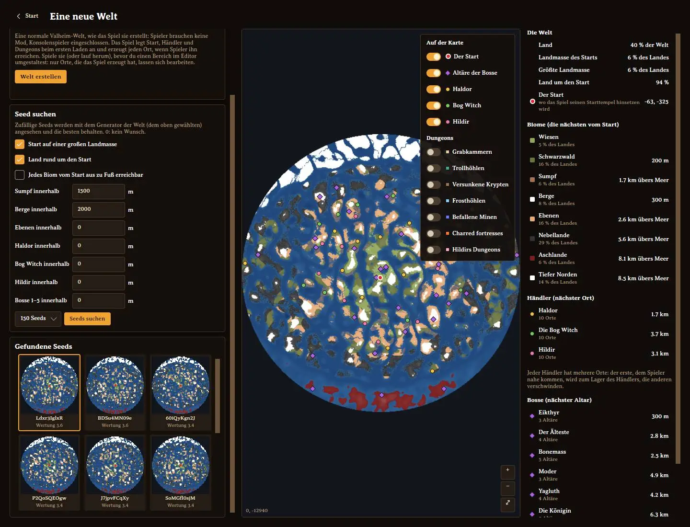

<!-- source: eca6c42a -->
# Eine neue Welt

Sieh dir die Welt eines Seeds an, bevor sie existiert, durchsuche viele Seeds nach einem, der zu dir passt, und erstelle
die Welt.

**Wo:** Startseite, **Erstellen** → **Eine neue Welt** → **Neue Welt erstellen** · **Taste:** keine · **Funktioniert
in:** der Startseite (es muss keine Welt geöffnet sein)

*Der rote Punkt ist der Start, lila Rauten sind Altäre der Bosse, die gelben, grünen und rosa Punkte sind die Orte der
Händler. Die Spalte rechts listet die Fakten des Seeds auf, hier bis zu den nächsten Altären der Bosse
heruntergescrollt.*

Die Welt, die du erstellst, ist eine normale Valheim-Welt, nach den eigenen Regeln des Spiels aus ihrem Seed erzeugt:
Spieler treten ihr ohne Mod bei, auch Konsolenspieler über Crossplay (außer du wählst den Generator einer
Weltgenerierungs-Mod, siehe [Tipps und Grenzen](#tipps-und-grenzen)).

## Benutzen

1. Wähle auf der Startseite unter **Erstellen** **Eine neue Welt**, dann **Neue Welt erstellen**. Die Welt eines
   zufälligen Seeds wird gezeigt.
2. Tippe einen Seed ein und drücke **Welt erzeugen** (oder `Enter`), oder drücke **Würfeln** für einen anderen
   zufälligen. Um den Editor suchen zu lassen, siehe [Einen Seed suchen](#einen-seed-suchen).
3. Sieh dir die Karte und die Fakten daneben an. Optional: schalte die Dungeonarten ein, die dich interessieren.
4. Tippe unter **Name** den Namen der Welt ein, wähle unter **Gespeichert in**, wo sie hinkommt, und drücke **Welt
   erstellen**. Der Editor
   schreibt die Welt und öffnet ihre Karte.
5. Starte Valheim, lade die neue Welt und lauf durch die Gegenden, die du bearbeiten willst. Das Spiel erzeugt jeden Ort
   erst, wenn Spieler in seine Nähe kommen.
6. Öffne die Welt erneut im Editor, um umzugestalten, was das Spiel erzeugt hat.

**Start** (oben links) führt zurück zur Startseite; es wird nichts erstellt.

## Einstellungen

| Einstellung | Was sie bewirkt |
|---|---|
| **Seed** | Bis zu 10 Buchstaben und Ziffern, wie im Spiel. Derselbe Seed erzeugt immer dieselbe Welt. Groß- und Kleinschreibung zählt: `Valheim` und `valheim` sind zwei Welten. |
| **Würfeln** | Setzt einen anderen zufälligen Seed ins Feld und zeigt seine Welt. |
| **Welt erzeugen** | Zeigt die Welt des Seeds (oder `Enter` im Seed-Feld). Ausgegraut, solange der Seed im Feld der gezeigte ist. |
| **Auf der Karte** | Zeigt oder verbirgt **Der Start**, **Altäre der Bosse**, **Haldor**, **Bog Witch** und **Hildir**. |
| **Dungeons** | Zeigt, wo jede Dungeonart liegen wird (anfangs aus). Siehe [Dungeons](#dungeons). |
| **Name** | Der Name der Welt, wie das Spiel ihn auflistet. Er ist auch der Name ihres Ordners, darf also nicht `/ \ : * ? " < > \|` enthalten. |
| **Gespeichert in** | In welchen der Weltordner des Spiels sie kommt: deine lokalen Welten (`worlds_local`) oder die Steam-Cloud-Welten (`worlds`), jeweils die, die auf diesem Computer existieren. Der Ordner, in den das installierte Spiel speichert, kommt zuerst (unter Linux behält der über Proton laufende Windows-Build seine Welten in seinem Steam-Präfix), sodass das Spiel die Welt auflistet. |
| **Generator** | Nur sichtbar, wenn ein Add-on für eine Weltgenerierungs-Mod aktiv ist und die Mod gefunden wird: der Generator der Mod oder **Der des Spiels**. Siehe [Tipps und Grenzen](#tipps-und-grenzen). |
| **Welt erstellen** | Erstellt die Welt und öffnet ihre Karte. Eine gleichnamige Welt, die schon in diesem Ordner liegt, wird nie überschrieben: du wirst nach einem anderen Namen gefragt. |

## Die Karte

Die Karte zeigt die Welt des Seeds so, wie das Spiel sie erzeugen wird: Land nach Biom gefärbt (höherer Boden heller),
Wasser an Land blau getönt, das Meer nach Tiefe schattiert, Norden oben. Das dauert ein paar Sekunden; währenddessen
erscheint „Welt von … wird angesehen…“. Herangezoomt wird die Ansicht mit einem Punkt pro Bildschirmpixel neu
gezeichnet, sodass Küsten und Flüsse scharf bleiben. Die Ecke unten links zeigt die Koordinaten unter dem Zeiger.

Über der Karte liegen die Orte, die das Spiel anlegt, wenn es die Welt zum ersten Mal lädt:

- der **Start** (roter Punkt mit weißem Ring): der Starttempel, wo neue Spieler ankommen;
- die **Altäre der Bosse** (lila Rauten): Eikthyr, der Älteste, Bonemass, Moder, Yagluth, die Königin und Fader;
- die **Orte der Händler**: Haldor (gelb), die Bog Witch (grün) und Hildir (rosa). Jeder Händler hat mehrere Orte: der
  erste, dem Spieler nahe kommen, wird zum Lager, und die anderen verschwinden.

Fahre über eine Markierung, um ihre Koordinaten und ihre Entfernung vom Start zu sehen. Die Orte liegen genau dort, wo
das Spiel sie hinsetzen wird: der Editor spielt die Platzierungsregeln des Spiels nach, gelesen aus den Dateien deines
Valheim (beim ersten Mal ein paar Sekunden).

## Dungeons

*Vier Arten eingeschaltet: jedes kleine Quadrat ist ein Dungeon, seine Farbe seine Art, wie bei den Schaltern und in
**Dungeons (die nächsten)** (Entfernung, Biom, wie viele in der Welt und im Umkreis von 2 km).*

Die Schalter **Dungeons** zeigen **Grabkammern**, **Trollhöhlen**, **Versunkene Krypten**, **Frosthöhlen**, **Befallene
Minen**, **Charred fortresses** und **Hildirs Dungeons**. Der Editor beginnt sie zu suchen, sobald ein Seed gezeigt wird
(ein paar Sekunden); eine Art, die du einschaltest, erscheint, sobald sie gefunden ist. Die Dungeons der letzten 20 Seeds,
die du angesehen hast, bleiben erhalten, sodass die Rückkehr zu einem sie sofort zeigt.

**Dungeons (die nächsten)** gibt für jede Art an, wie weit der nächste vom Start entfernt ist, sein Biom, wie viele es in
der Welt gibt und wie viele im Umkreis von 2 km liegen. Klicke auf eine Zeile, um diese Art einzuschalten und den
nächsten auf der Karte zu sehen.

Sie umfassen die Arten, die ein **alternatives Biom** (eine Variante wie Dunkle Wiesen) hinzufügt oder fernhält. Dörfer,
Ruinen und die anderen kleinen Orte werden nicht gezeigt.

## Die Fakten des Seeds

Neben der Karte die Welt des Seeds als Listen. Klicke auf eine Zeile mit einer Markierung, um sie oder die nächste ihrer
Art auf der Karte zu sehen.

- **Die Welt**: **Land** (wie viel der Welt Land ist), **Landmasse des Starts** und **Größte Landmasse** (jeweils als
  Anteil am ganzen Land), **Land um den Start** (Land im Umkreis von 400 m um den Start) und die Koordinaten des
  Starts.
- **Biome (die nächsten vom Start)**: der Anteil jedes Bioms am Land und wie weit sein nächstes Land entfernt ist, mit
  „übers Meer“, wenn es auf einer anderen Landmasse liegt (du brauchst ein Boot).
- **Händler (nächster Ort)**: wie weit der nächste Ort jedes Händlers entfernt ist und wie viele Orte er hat.
- **Bosse (nächster Altar)**: wie weit der nächste Altar jedes Bosses entfernt ist und wie viele es gibt.
- **Dungeons (die nächsten)**: siehe [Dungeons](#dungeons).

Land ist hier Boden, auf dem du stehen oder durch den du waten kannst: höchstens 1 m unter Wasser, oder 3 m in einem
Sumpf. Eine Landmasse ist Land, das mit Land verbunden ist, ohne tieferes Wasser zu überqueren.

## Einen Seed suchen

*Die Wünsche (hier eine große Landmasse mit Land ringsum, ein Sumpf innerhalb von 1500 m und Berge innerhalb von 2000 m,
150 Seeds); die besten gefundenen Seeds unter **Gefundene Seeds**, die besten zuerst. Der erste wurde angeklickt: sein
Rand leuchtet auf, und seine Welt füllt die große Karte.*

**Seed suchen** sieht sich im Hintergrund viele zufällige Seeds an und behält die besten für deine Wünsche. 0 in einem
Entfernungsfeld bedeutet „kein Wunsch“. Für eine Suche Schritt für Schritt siehe
[Einen Seed finden, der nahe am Start hat, was du willst](guides/find-a-seed.md).

| Einstellung | Was sie bewirkt |
|---|---|
| **Start auf einer großen Landmasse** | Bevorzugt Seeds, deren Start auf einer großen Landmasse liegt (anfangs an). |
| **Land rund um den Start** | Bevorzugt Seeds mit wenig Wasser im Umkreis von 400 m um den Start (anfangs an). |
| **Jedes Biom vom Start aus zu Fuß erreichbar** | Bevorzugt Seeds, bei denen das nächste Land jedes Bioms auf der eigenen Landmasse des Starts liegt. |
| **Sumpf innerhalb**, **Berge innerhalb**, **Ebenen innerhalb** | Bevorzugt Seeds, bei denen das nächste Land dieses Bioms innerhalb so vieler Meter liegt (0 bis 8.000 m, in Schritten von 250; anfangs 1.500 für den Sumpf und 2.000 für die Berge). |
| **Haldor innerhalb**, **Bog Witch innerhalb**, **Hildir innerhalb** | Bevorzugt Seeds, bei denen einer der Orte dieses Händlers innerhalb so vieler Meter liegt. |
| **Bosse 1–5 innerhalb** | Bevorzugt Seeds, bei denen je ein Altar von Eikthyr, dem Ältesten, Bonemass, Moder und Yagluth innerhalb so vieler Meter liegt. |
| Liste der Seeds | Wie viele zufällige Seeds angesehen werden: **60 Seeds**, **150 Seeds** (die Vorgabe) oder **400 Seeds**. |
| **Seeds suchen** | Startet die Suche; der Balken darunter zeigt, wie weit sie ist. |
| **Stopp** | Stoppt die Suche und zeigt die besten bisher gefundenen. |

Die 12 besten Seeds erscheinen unter **Gefundene Seeds**, jeder als kleine Karte mit seinem Seed und seiner Wertung. Fahre
über einen, um seine Fakten zu sehen; klicke ihn an, um ihn auf der großen Karte zu sehen (er bekommt einen farbigen
Rand).

### Wie Seeds bewertet werden

- **Start auf einer großen Landmasse** bringt bis zu 3 (der Anteil der Startlandmasse am Land, mal 3); **Land rund um
  den Start** bringt bis zu 2 (der Anteil an Land im Umkreis von 400 m, mal 2).
- Ein erfüllter Entfernungswunsch bringt 1 bis 2, umso mehr, je näher es ist. Ein verfehlter zieht ab, umso mehr, je
  weiter es ist; ein Biom oder Händler, den der Seed gar nicht hat, zieht 2 ab. **Bosse 1–5 innerhalb** zählt den
  Mittelwert der fünf Bosse.
- **Jedes Biom zu Fuß erreichbar** bringt 0,25 für jedes Biom, dessen nächstes Land auf der Landmasse des Starts liegt.

Eine Wertung ist nie unter 0. Die Suche sieht jeden Seed gröber an als die große Karte (Punkte etwa 210 m auseinander
statt etwa 40 m), daher kann sie kleine Inseln und schmale Meerengen übersehen: prüfe einen gefundenen Seed auf der
großen Karte, bevor du ihn wählst. Wünsche zu Händlern oder Bossen machen die Suche ein paarmal langsamer.

## Tastenkürzel

| Eingabe | Aktion |
|---|---|
| `Enter` (im Seed-Feld) | Die Welt des Seeds zeigen |
| Mausrad | Dort zoomen, wo der Zeiger ist |
| Ziehen | Die Karte verschieben (von überall, auch von einer Markierung aus) |
| Doppelklick | Wieder die ganze Welt zeigen |
| **+**, **−**, **⤢** (unten rechts) | Näher, weiter weg, die ganze Welt |

## Tipps und Grenzen

- **Spiele die Welt, bevor du sie bearbeitest.** Eine neue Welt enthält noch keine Bäume, Felsen oder Gebäude, nur ihren
  Namen, ihren Seed und eine leere Zonenliste. Das Spiel legt Start, Händler, Altäre und Dungeons an, wenn es die Welt
  zum ersten Mal lädt (dort, wo diese Seite sie gezeigt hat), und erzeugt jede Zone, wenn Spieler in ihre Nähe kommen.
  Der Editor kann nur Zonen umgestalten, die das Spiel erzeugt hat; bis dahin zeigt die Karte das Land des Seeds ohne
  etwas darauf.
- Die Welt wird im Speicherformat von Valheim 1.0.20 und neuer geschrieben, so wie das Spiel eine neue Welt schreibt:
  ein älteres Spiel oder ein älterer Server lehnt sie ab, also aktualisiere sie zuerst. Eine gleichnamige Welt wird nie
  überschrieben.
- Lassen sich die Bosse und Händler nicht aus den Dateien deines Spiels lesen, sagt die Seite es: die Karte zeigt
  trotzdem die Biome, aber die Markierungen fehlen, und die Suche kann nicht nach ihnen suchen. Das Protokoll
  (**Protokoll öffnen** auf der Startseite) sagt, warum.
- Ist das [Add-on Expand World](../../addons/ExpandWorld/README.md) aktiv, folgen die angesehenen Seeds und die
  erstellte Welt den Einstellungen und Datendateien der Mods (die Seite sagt es über **Welt erstellen**): eine breitere
  Welt, andere Biome und Orte, der Meeresspiegel der Mods. Ein Biom, das die Mods hinzufügen, und ein Territorium
  erscheinen in ihren eigenen Kartenfarben.
- Ist das [Add-on Riverheim](../../addons/Riverheim/README.md) aktiv und Riverheim installiert, bietet **Generator**
  Riverheim an (anfangs gewählt, da das Spiel jede neue Welt zu einer Riverheim-Welt macht, solange die Mod installiert
  ist) oder **Der des Spiels**. Eine Riverheim-Welt braucht Riverheim im Spiel jedes Spielers, daher können
  Konsolenspieler über Crossplay ihr nicht beitreten. Jeder Seed dauert ein paar Sekunden: Riverheim legt zuerst seine
  ganze Welt an.
- Nichts wird erstellt bis **Welt erstellen**: **Start** und das Schließen der Seite hinterlassen keine Spur. Um eine
  erstellte Welt zu entfernen, lösche ihren Ordner aus dem Weltordner, in dem sie gespeichert wurde.

*Ist das Add-on Riverheim aktiv, zeigt **Generator** Riverheim und seine Version, und der Hinweis darunter sagt, was eine
Riverheim-Welt von ihren Spielern verlangt. Karte und Fakten sind die eigene Welt von Riverheim für diesen Seed.*

## Verwandte Seiten

- [Einen Seed finden, der nahe am Start hat, was du willst](guides/find-a-seed.md)
- [Eine mit Expand World, Riverheim oder Tunnelheim erstellte Welt bearbeiten](guides/use-mods-worlds.md)
- [Bereiche und Zonen](concepts/areas-and-zones.md#zonen): warum das Spiel eine Zone erzeugen muss, bevor du sie
  bearbeiten kannst
- [Dungeons](dungeons.md): einen Dungeon bearbeiten, sobald das Spiel ihn erzeugt hat
