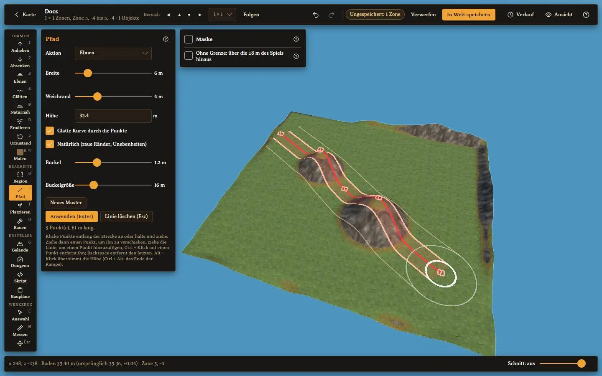
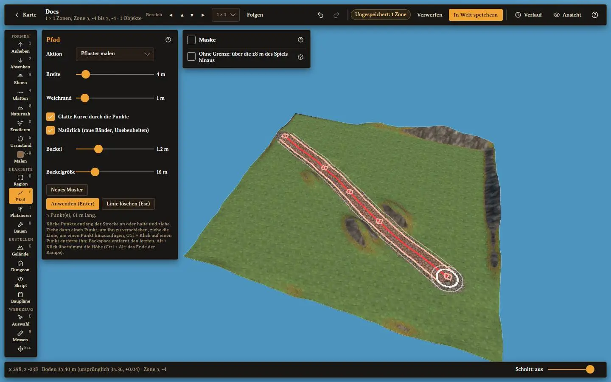
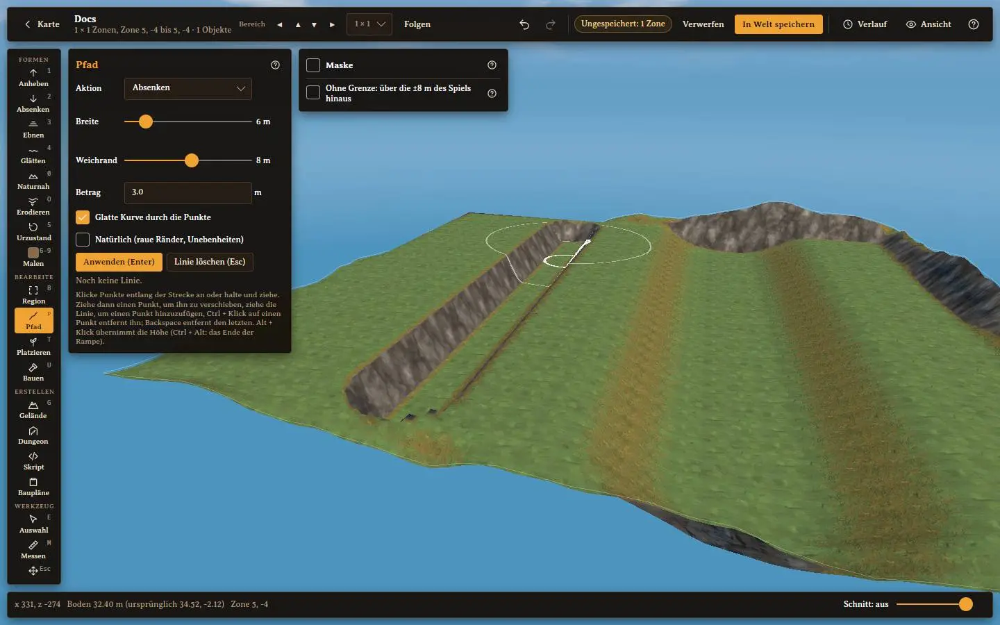
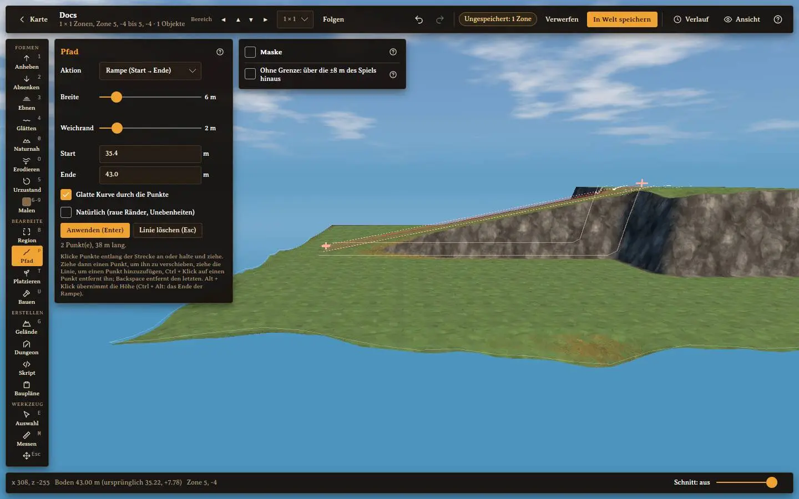
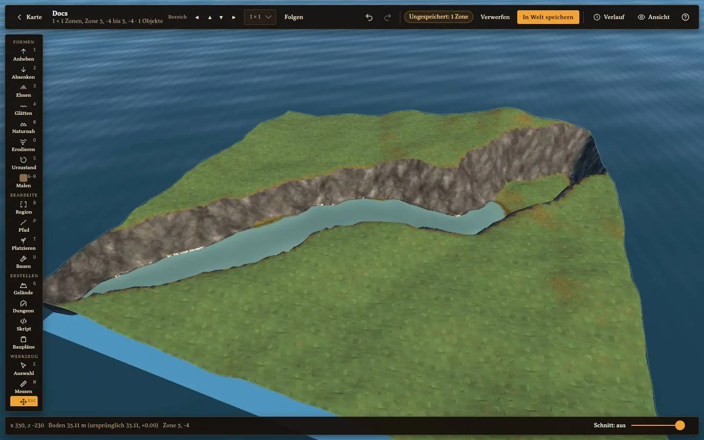

<!-- source: 2d41926b -->
# Pfad

Zeichne eine Linie und ebne, rampe, hebe, senke, glätte, grabe oder bemale dann den Boden entlang dieser Linie:
Straßen, Rampen, Dämme, Gräben und Flüsse.

**Wo:** Werkzeugleiste, Abschnitt **BEARBEITEN** · **Taste:** `P` · **Funktioniert in:** gespeicherten Welten, live

*Eine Linie aus fünf Punkten, über zwei Erdhügel gezeichnet, mit **Ebnen** gewählt, die **Höhe** per `Alt`+Klick vom
flachen Boden übernommen und **Natürlich (raue Ränder, Unebenheiten)** an. Noch hat sich nichts geändert: das Band zeigt
die Breite und die weichen Ränder des Pfads, bis du **Anwenden (Enter)** drückst; die Kreise am letzten Punkt gehören
zum Mauszeiger.*

## Benutzen

1. Klicke in der Werkzeugleiste auf **Pfad** (`P`).
2. Klicke Punkte entlang der Strecke an, oder halte und ziehe, um sie frei zu zeichnen. Unter dem Mauszeiger zeigt ein
   Kreis die Breite des Pfads und ein blasserer seinen weichen Rand; sobald es Punkte gibt, zeigt das Band beides
   entlang der Linie.
3. Optional: Feile an der Linie. Ziehe einen Punkt, um ihn zu verschieben, ziehe die Linie zwischen zwei Punkten, um
   dort einen Punkt hinzuzufügen, `Ctrl`+Klick auf einen Punkt entfernt ihn, `Backspace` entfernt den letzten.
4. Wähle im Panel eine **Aktion** und stelle ihre Einstellungen ein.
5. Drücke **Anwenden (Enter)**. Die Änderung ist ein Rückgängig-Schritt, benannt nach der Aktion („Pfad: Ebnen“).
6. Optional: Wähle eine andere Aktion und wende sie auf dieselbe Linie an (erst ebnen, dann pflastern), oder verschiebe
   ihre Punkte und wende erneut an. Die Linie bleibt, bis du **Linie löschen (Esc)** drückst.

Das Panel zeigt, wie viele Punkte die Linie hat und wie lang sie ist.

*Die Linie aus dem ersten Bild, gleiche Kamera: **Ebnen** hat eine ebene Straße durch beide Erdhügel geschnitten, dann
hat **Pflaster malen** mit **Breite** 4 m und **Weichrand** 1 m ihre Mitte gepflastert. Die Linie bleibt für die
nächste Aktion.*

## Einstellungen

| Einstellung | Was sie bewirkt |
|---|---|
| **Aktion** | Was entlang der Linie geschieht (siehe [Aktionen](#aktionen)). |
| **Breite** | Breite des Pfads, 1 bis 40 m (Standard 8 m). Die Aktion wirkt über diese ganze Breite voll. |
| **Weichrand** | Wie weit die Änderung zu jeder Seite ausläuft, 0 bis 15 m (Standard 4 m), damit der Pfad in den Boden übergeht. Bei **0** ist der Rand scharf: ein Graben mit geraden, steilen Seiten. |
| **Höhe** | **Ebnen**: die Höhe des Pfads (m). `Alt`+Klick auf den Boden übernimmt sie. |
| **Betrag** | **Anheben** / **Absenken**: um wie viel (m, Standard 2). |
| **Start**, **Ende** | **Rampe**: die Höhe am ersten und am letzten Punkt (m). Siehe [Rampe](#rampe). |
| **Tiefe** | **Fluss / Kanal**: wie tief das Bett in seiner Mitte unter dem Meeresspiegel liegt (m, Standard 2). |
| **Glatte Kurve durch die Punkte** | An (Standard): eine glatte Kurve durch deine Punkte. Aus: gerade Linien zwischen ihnen. |
| **Natürlich (raue Ränder, Unebenheiten)** | Eine Breite, die sich entlang des Wegs ändert (bis zu 45 % in beide Richtungen), und raue Ränder, für jede Aktion; bei **Ebnen**, **Rampe**, **Anheben**, **Absenken** und **Fluss / Kanal** auch kleine Buckel auf der Oberfläche. Der Pfad sieht dann ausgetreten aus statt werkzeuggemacht. |
| **Buckel**, **Buckelgröße**, **Neues Muster** | **Naturnah** und **Natürlich**: wie hoch und wie breit die Buckel sind, und ein anderes Zufallsmuster für sie. Es sind die des Pinsels [Naturnah](terrain.md#naturnah): ob hier, dort oder im Werkzeug [Region](area.md) eingestellt, es sind dieselben Werte. |
| **Schüttwinkel** | **Erodieren**: die steilste Neigung, die stehen bleibt, 10° bis 60° (Standard 33°). Der des Pinsels [Erodieren](terrain.md#erodieren), derselbe Wert. |

*Zwei gerade Linien auf flachem Boden, jede mit **Absenken** um 3 m bei **Breite** 6 m, entlang gesehen. Links:
**Weichrand** 0, ein Graben mit steilen, geraden Wänden. Rechts: **Weichrand** 8 m, die Böschungen gehen sanft in
den Boden über.*

## Aktionen

| Aktion | Was sie bewirkt |
|---|---|
| **Ebnen** | Ebnet den Pfad auf **Höhe**: eine Straße, eine Terrasse entlang eines Hangs, ein Damm über eine Senke. |
| **Rampe (Start → Ende)** | Eine Neigung, die gleichmäßig von **Start** bis **Ende** steigt oder fällt. |
| **Anheben** | Hebt den Pfad um **Betrag** an, mit seinem Auf und Ab: eine Böschung, ein Deich. |
| **Absenken** | Gräbt den Pfad um **Betrag** ab: ein Graben, ein Hohlweg. |
| **Glätten** | Gleicht den Boden entlang des Pfads aus: jeder Punkt rückt zum Durchschnitt des Bodens im Umkreis von 3 m. Wende es erneut an für mehr. |
| **Naturnah** | Natürlich wirkende Buckel entlang des Pfads, über der groben Form des Bodens, mit **Buckel**, **Buckelgröße** und dem Muster: was ein geebneter oder angehobener Pfad braucht, um wieder wie Boden auszusehen. |
| **Erodieren** | Lässt den Boden entlang des Pfads in einem Zug verwittern: Hänge setzen sich auf den **Schüttwinkel**, Regen schneidet Rinnen und hinterlässt Schwemmfächer, Hänge setzen sich erneut. |
| **Urzustand** | Zurück dazu, wie die Welt ihn entlang des Pfads erzeugt hat, Farbe entfernt, mit Ohne Grenze angehobener oder gegrabener Boden eingeschlossen: macht eine Straße oder einen Graben rückgängig, lange nachdem der Rückgängig-Verlauf weg ist. |
| **Fluss / Kanal (Wasser)** | Gräbt ein Bett unter den Meeresspiegel, sodass es sich mit Wasser füllt (siehe [Fluss oder Kanal](#fluss-oder-kanal)). |
| **Erde malen**, **Pflaster malen**, **Kultivierten Boden malen** | Bemalt den Pfad, in voller Farbe über die Breite, über den weichen Rand auslaufend. |
| **Farbe entfernen** | Malt schlichten Biomboden entlang des Pfads (siehe [Malpinsel](terrain.md#malpinsel)). |

**Ebnen**, **Anheben**, **Absenken**, **Glätten**, **Naturnah**, **Erodieren**, **Urzustand** und die Farben sind
dieselben Aktionen wie die der [Pinsel](terrain.md) und des Werkzeugs [Region](area.md), unter denselben Namen (Region
führt Urzustand als **Zurück zum Urzustand** in seiner Gruppe **Zurück**): ein Pinsel sagt durch seinen Strich,
wo, das Werkzeug Region durch eine Auswahl, das Werkzeug Pfad durch eine Linie, und der Boden ändert sich auf dieselbe
Weise.

### Rampe

*Eine Rampe aus zwei Punkten von der Seite gesehen, vom Boden an ihrem Fuß (**Start** 35.2 m) bis oben auf eine um 8 m
angehobene Fläche (**Ende** 43 m). Sie steigt auf dem ganzen Weg gleichmäßig.*

Bis du eine Höhe eingibst oder übernimmst, folgen **Start** und **Ende** dem Boden unter dem ersten und letzten Punkt,
sodass das Verschieben der Enden sie aktualisiert. `Alt`+Klick auf den Boden übernimmt die Starthöhe,
`Ctrl`+`Alt`+Klick die Endhöhe. **Linie löschen (Esc)** lässt sie wieder dem Boden folgen. Eine gewundene Rampe hat
überall dieselbe Neigung.

### Fluss oder Kanal

*Ein Fluss, mit **Fluss / Kanal (Wasser)** quer durch die Zone gegraben: das Meer füllt ihn.*

Valheim hat kein fließendes Wasser: das Wasser in Flüssen ist das Meer, überall auf derselben Höhe (30 m). Ein Fluss
hat also nur dort Wasser, wo sein Bett unter dem Meeresspiegel liegt. Die Aktion gräbt ein U-förmiges Bett, in seiner
Mitte **Tiefe** unter dem Meeresspiegel, das bis zur **Breite** zur Wasserlinie ansteigt; der **Weiche Rand** bildet
die Ufer. Sie gräbt nur: schon tieferer Boden bleibt, wie er ist, sodass ein Fluss in einen See oder ins Meer münden
kann.

Durch hohen Boden braucht ein Fluss einen tiefen Einschnitt, und die ±8-m-Grenze des Spiels stoppt ihn 8 m tief (die
Statusleiste sagt das). Bring den Boden zuerst nahe am Meer herunter, folge tiefem Gelände oder schalte
[Ohne Grenze](terrain.md#ohne-grenze) ein.

## Tastenkürzel

| Taste oder Maus | Was sie bewirkt |
|---|---|
| `P` | Pfad wählen. |
| Klicken / halten und ziehen | Punkte hinzufügen / die Linie frei zeichnen (ein Punkt alle 2 m). |
| Einen Punkt ziehen / die Linie ziehen | Den Punkt verschieben / dort einen Punkt hinzufügen und verschieben. |
| `Ctrl`+Klick auf einen Punkt | Ihn entfernen. |
| `Backspace` | Den letzten Punkt entfernen. |
| `Alt`+Klick | Die Höhe (Ebnen) oder den Start der Rampe übernehmen. |
| `Ctrl`+`Alt`+Klick | Die Endhöhe der Rampe übernehmen. |
| `Alt`+`Shift`+Klick | Den Höhenbereich der [Maske](masks.md) auf 2 m über und unter dieser Stelle setzen, wie bei einem Pinsel. |
| `Enter` | Die Aktion anwenden. |
| `Esc` | Die Linie löschen; ein zweites `Esc` verlässt das Werkzeug. |
| `Ctrl+Z` | Das letzte Anwenden rückgängig machen. |

## Tipps und Grenzen

- **Die [Maske](masks.md) gilt für jede Aktion**, und ebenso die ±8-m-Grenze, außer
  [Ohne Grenze](terrain.md#ohne-grenze) ist an. Wo der Pfad die Grenze erreicht, werden die Punkte rot und die
  Statusleiste sagt das. Der Schalter Ohne Grenze liegt auf der Karte **Maske** neben dem Panel Pfad: ein Schalter für
  alle Bodenwerkzeuge.
- **Eine scharfe Ecke** braucht zwei nah beieinanderliegende Punkte oder **Glatte Kurve durch die Punkte** aus: eine
  glatte Kurve geht durch jeden Punkt, den du klickst.
- **Prüfe die Neigung einer Rampe vorher** mit [Messen](measure.md): vom Fuß bis oben gemessen ist **Neigung** das, was
  die Rampe ergibt.
- **Linie löschen (Esc) entfernt nur die Linie.** Was du angewendet hast, bleibt; `Ctrl+Z` nimmt ein Anwenden nach dem
  anderen zurück.
- **Der Pfad wirkt nur im offenen Bereich** und bewegt nie dessen äußerste Reihe von Punkten (siehe
  [Der gesperrte Rand](concepts/areas-and-zones.md#der-gesperrte-rand)).

## Verwandte Seiten

- [Eine Straße oder eine Rampe einen Hügel hinauf anlegen](guides/make-a-road.md)
- [Einen Fluss oder Teich graben](guides/make-a-river.md)
- [Bodengrenzen](concepts/ground-limits.md)
- [Formen und Malen](terrain.md), [Messen](measure.md)
- [Wie der Rand eines Pfads ausläuft](concepts/ground-limits.md#wie-der-rand-eines-pfads-ausläuft)
