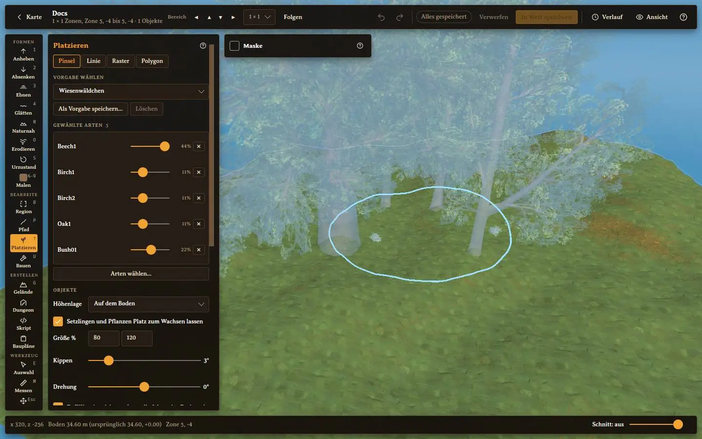
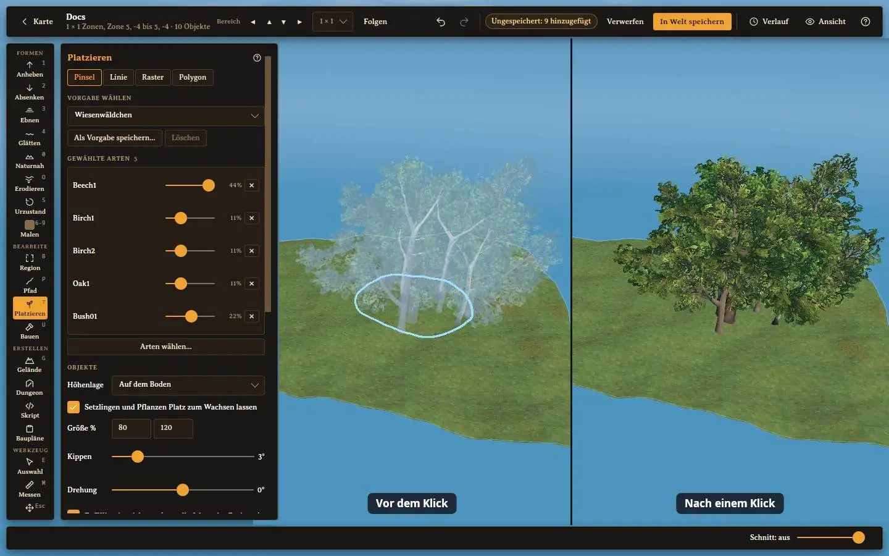
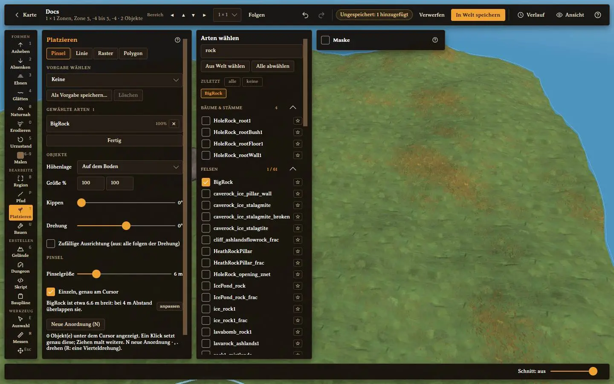
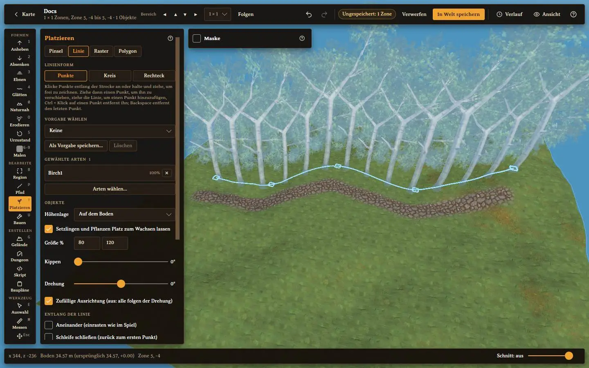
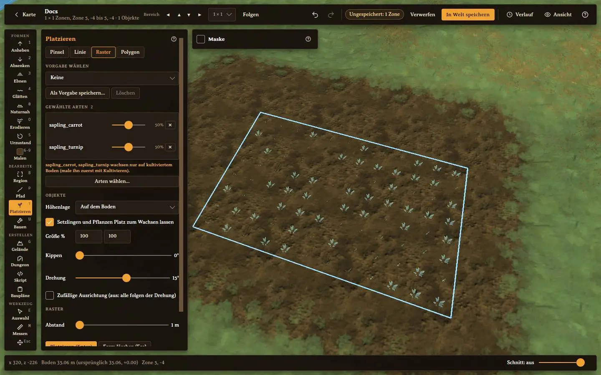
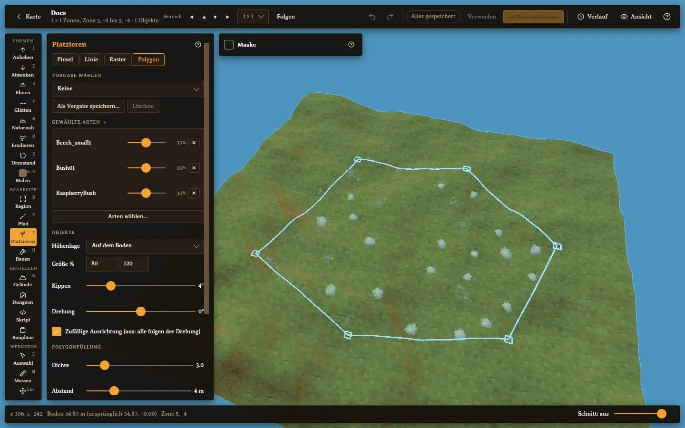
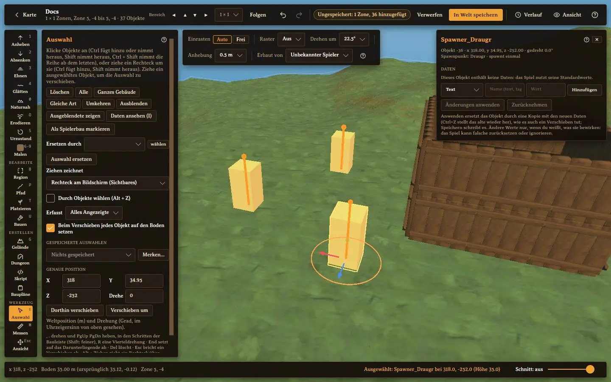

<!-- source: c6106c48 -->
# Platzieren

Setze Bäume, Felsen, Büsche, Feldfrüchte und Spawnpunkte in die Welt, einzeln oder zu Hunderten. Die Bauteile, die
Spieler bauen (Wände, Böden, Zäune, Möbel), setzt du mit [Bauen](build.md), dem Werkzeug darunter in der Leiste.

**Wo:** Werkzeugleiste, Abschnitt **BEARBEITEN** · **Taste:** `T` · **Funktioniert in:** gespeicherten Welten, live
(die Werkstatt hat nur [Bauen](build.md))

*Die durchscheinenden Bäume und Büsche im Pinselkreis sind genau das, was ein Klick setzt; das Panel zeigt die Vorgabe
Wiesenwäldchen und ihre Arten.*

*Links: die durchscheinende Vorschau im Pinselkreis. Rechts: dieselbe Stelle nach einem Klick, die Bäume und Büsche
stehen dort, wo die Vorschau sie gezeigt hat.*

## Benutzen

Um ein kleines Wäldchen zu pflanzen:

1. Drücke `T`.
2. Wähle im Panel **Platzieren** unter **Vorgabe wählen** die Vorgabe **Wiesenwäldchen**.
3. Wähle oben im Panel **Pinsel**.
4. Zeige auf den Boden: die durchscheinende Vorschau zeigt, was ein Klick setzt.
5. Klicke, um sie zu setzen, oder ziehe, um weiter hinzuzufügen.

Bei Linie, Raster und Polygon zeichnest du stattdessen die Form, prüfst die Vorschau und drückst dann `Enter`
(**Platzieren (Enter)**). Die Form bleibt nach dem Platzieren, ihre Vorschau nun leer (was sie setzen würde, steht schon
da): drücke **Form löschen (Esc)**, um die nächste zu zeichnen.

Jeder Klick, Strich oder jedes `Enter` ist ein Rückgängig-Schritt (`Ctrl+Z`). Nichts wird in die Welt geschrieben, bis
du **In Welt speichern** (oder **Live anwenden**) nutzt. Um Platziertes zu verschieben oder zu löschen, nutze
[Auswahl](select.md).

## Einstellungen

Das Panel, von oben nach unten. Zeilen, die für den gewählten Modus oder die Arten nicht gelten, sind ausgeblendet. Die
angehakten Arten mit ihren Anteilen, **Tempo**, deine Vorgaben, Favoriten und zuletzt genutzten Arten bleiben zwischen
den Sitzungen erhalten; die anderen Einstellungen beginnen wieder bei ihren Standardwerten. Die [Maske](masks.md) hat
eine eigene Karte neben dem Panel und gilt für jeden Modus.

| Einstellung | Was sie bewirkt |
|---|---|
| **Pinsel**, **Linie**, **Raster**, **Polygon** | Der Modus: siehe [Modi](#modi). |
| **Linienform** | Nur im Modus Linie: **Punkte**, **Kreis** oder **Rechteck**. Siehe [Linie](#linie). |
| **Vorgabe wählen** | Lädt eine Mischung: ihre Arten mit ihren Anteilen, dazu Dichte, Abstand, Häufung, Fleckgröße, Größe und Kippen, mit zufälliger Ausrichtung an. Eingebaut: **Wiesenwäldchen**, **Schwarzwald-Bewuchs**, **Sumpf**, **Beerenplatz**, **Waldboden**, **Wiesenfelsen**; deine folgen als **Deine: *Name***. Arten, die die Welt nicht setzen kann, werden weggelassen (die Statusleiste sagt, wie viele). **Keine** lädt nichts; nach einer Vorgabe gewählt, hakt es jede Art ab. |
| **Als Vorgabe speichern…** / **Löschen** | Speichert die gewählten Arten, Anteile und diese Einstellungen unter einem Namen. **Löschen** entfernt eine deiner Vorgaben, nach einer Rückfrage. |
| **Gewählte Arten** | Die Arten, die du gewählt hast, jede mit ihrem Anteilsregler und einem ✕ zum Entfernen („Noch keine“, solange es keine gibt). Bei zwei oder mehr Arten ziehst du einen Regler, um den Anteil dieser Art festzulegen: die anderen folgen, sodass die Anteile 100 % ergeben, und jede behält mindestens 1 %. Beech bei 75 % mit Birch ergibt drei Buchen auf eine Birke. |
| **Arten wählen…** | Öffnet die Karte **Arten wählen**: siehe [Wählen, was platziert wird](#wählen-was-platziert-wird). |
| **OBJEKTE: Höhenlage** | **Auf dem Boden**: jedes Objekt steht auf dem Boden (ein Teil einer Ruine mit seiner Unterseite). **Über dem Boden**: **Höhe** Meter über dem Boden darunter. **Auf einer Höhe**: die Unterseite jedes Objekts auf derselben **Höhe**, egal was der Boden tut (eine ebene Mauer, eine Plattform). |
| **Höhe** | Die Meter für Über dem Boden oder die Höhe für Auf einer Höhe. |
| **An vorhandenen Bauteilen einrasten** | Erscheint, wenn eine angehakte Art ein Teil einer Ruine oder eines Dungeons mit Einrastpunkten ist (die Bauteile, die Spieler bauen, gehören zu [Bauen](build.md)). An: das Teil rastet an den Bauteilen ringsum ein, wie beim Hammer. Im Modus Pinsel setzt **Daneben** es Ende an Ende an das Bauteil neben dem Cursor und **Obendrauf** auf das Bauteil unter dem Cursor. Die Zeile unten im Panel sagt, woran es eingerastet ist („Neben *Name* eingerastet.“). Siehe [Einrasten](concepts/objects.md#einrasten). |
| **Setzlingen und Pflanzen Platz zum Wachsen lassen** | Erscheint, wenn ein Setzling, eine Feldfrucht oder ein Baum, der aus einem Setzling wächst, angehakt ist. An: sie behalten den Platz, den das Spiel zum Wachsen braucht. Aus: so dicht, wie du willst (sie wachsen dann vielleicht nicht). Siehe [Wachstumsregeln](concepts/objects.md#wachstumsregeln). |
| **Größe %** min / max | Jedes Objekt bekommt eine zufällige Größe zwischen den beiden, 10 bis 300 % (anfangs 80 bis 120). |
| **Kippen** | Zufällige Neigung, 0 bis 20°. |
| **Drehung** | Dreht das Muster des Pinsels und die Ausrichtung jedes Objekts, -180 bis 180°. |
| **Zufällige Ausrichtung (aus: alle folgen der Drehung)** | An: jedes Objekt zeigt in eine zufällige Richtung. Aus: alle folgen der Drehung. |
| **PINSEL: Pinselgröße** | Pinselradius, 1 bis 30 m. Es ist auch die Größe der Formpinsel: ein Wert für beide. |
| **Tempo** | Pinsel: wie schnell ein Ziehen pflanzt, 0.05 bis 1. Höher füllt den Pinselkreis schneller bis zu seiner Dichte. Es gehört nur dem Pinsel von Platzieren: die **Stärke** der Formpinsel ändert es nicht. Ausgeblendet bei Einzeln. |
| **Einzeln, genau am Cursor** | Pinsel: ein Objekt genau unter dem Cursor pro Klick; Ziehen fügt keine weiteren hinzu. Nur ein Objekt genau an dieser Stelle blockiert es. |
| **Dichte** | Pinsel und Polygon: Objekte pro 100 m², 0.2 bis 20. |
| **Abstand** | Pinsel und Polygon: der kleinste Abstand zwischen Objekten, 0.5 bis 15 m, auch zu schon vorhandenen Objekten. Bei Raster: die Zellgröße, 1 bis 30 m. |
| **Häufung** | Pinsel und Polygon: sammelt die Objekte in Hainen mit Lichtungen dazwischen, 0 bis 100 %. 0 ist eine gleichmäßige Verteilung. |
| **Fleckgröße** | Mit Häufung: wie groß die Haine und Lichtungen sind, 5 bis 120 m. |
| **anpassen** | Erscheint, wenn eine angehakte Art breiter als der Abstand ist („Beech1 ist etwa 6.2 m breit: bei 4 m Abstand überlappen sie.“). Klicke darauf, um den Abstand auf diese Breite zu setzen. |
| **Platzieren (Enter)**, **Form löschen (Esc)**, **Letzten Punkt entfernen (Backspace)** | Linie, Raster und Polygon: setzen, was die Vorschau zeigt, die Form entfernen oder den zuletzt geklickten Punkt zurücknehmen. |
| **Neue Anordnung (N)** | Neue zufällige Stellen, Arten, Größen und Ausrichtungen für die Vorschau (und neue Haine mit Häufung). |

Die Zeile unten sagt, wie viele Objekte die Vorschau zeigt und welche Tasten gelten. Eine orange Zeile unter den
gewählten Arten warnt, wenn etwas Aufmerksamkeit braucht: „Noch nichts zu platzieren“ oder Feldfrüchte, die „nur auf
kultiviertem Boden wachsen (male ihn zuerst mit Kultivieren)“.

## Wählen, was platziert wird

**Arten wählen…** öffnet neben dem Panel eine Karte mit jeder Art, die das Spiel in einer Welt speichert, auch Arten,
von denen deine Welt noch keine hat, und den Arten deiner Mods. Kreaturen, fallengelassene Gegenstände und Ragdolls
sind nicht darin, ebenso wenig die Bauteile des Hammers und des Serviertabletts: die sind in der Leiste [Bauen](build.md).
Die Setzlinge und Feldfrüchte des Kultivators sind in beiden. **Fertig** schließt sie.

*Die Karte Arten wählen bei der Suche nach „rock“, mit BigRock angehakt: die Kategorie Felsen zählt 1 angehakte Art
neben ihrer Gesamtzahl, und BigRock steht vorne in der Reihe Zuletzt.*

| Element | Was es bewirkt |
|---|---|
| **Arten suchen (oak, rock, bush…)** | Filtert die Liste nach Namen und öffnet jede Kategorie mit einem Treffer. Spawnpunkte und Nester werden auch über ihre Kreatur gefunden (`boar` findet `Spawner_Boar`). |
| Kästchen | Jede angehakte Art wird platziert; jedes Objekt wählt zufällig eine davon, nach Anteil. Klicke auf den Namen einer Kategorie, um sie zu- oder aufzuklappen; nach dem Namen steht, wie viele Arten sie hat, oder „angehakt / alle“. |
| **Aus Welt wählen** | Klicke ein Objekt in der Welt an, um nur seine Art zu platzieren; `Shift` + Klick fügt sie den angehakten Arten hinzu (oder nimmt sie heraus). `Esc` bricht ab. Ein Bauteil wird nicht übernommen: die Statusleiste sagt, dass du es mit Bauen setzen sollst. |
| **Alle abwählen** | Hakt jede Art ab. |
| **Favoriten** | Klicke auf den ☆ hinter einer Art, um sie zu markieren; markierte Arten erscheinen als Schaltflächen über der Liste. |
| **Zuletzt** | Die letzten acht Arten, die du platziert hast, die neueste zuerst, nach den jetzt gewählten Arten. |
| Schaltflächen von Favoriten und Zuletzt | Klick: diese Art an- oder abhaken. `Shift` + Klick: nur diese Art platzieren. **alle** / **keine** haken die ganze Reihe an oder ab. |

Die Kategorien: **Bäume & Stämme**, **Felsen**, **Büsche & Sträucher**, **Sammelbares**, **Erz & Vorkommen**, **Ruinen &
Bauwerke**, **Möbel & Requisiten**, **Knochen & Überreste**, **Spawnpunkte**, **Kreaturennester**, **Kreaturen & NPCs**
(Händler, Vögel), **Effekte & Markierungen** (Nebel, Musik, Zonen von Boss-Ereignissen) und **Andere Objekte**. Arten
ohne Modell erscheinen in der Vorschau als Kästen.

## Modi

| Modus | Wie er funktioniert |
|---|---|
| **Pinsel** | Die Vorschau folgt dem Cursor im Pinselkreis. Ein Klick setzt genau, was sie zeigt; Ziehen fügt weiter hinzu (wie schnell, folgt Dichte und **Tempo**). `Shift` + Ziehen entfernt die angehakten Arten unter dem Pinsel. Sind nur einrastende Teile von Ruinen angehakt, schaltet sich **Einzeln** selbst ein, und jedes Teil rastet ein. |
| **Linie** | Klicke Punkte entlang einer Strecke an oder zeichne einen Kreis oder ein Rechteck. Objekte kommen alle **Jeweils** Meter oder Ende an Ende. |
| **Raster** | Ziehe ein Rechteck. In die Mitte jeder Zelle kommt ein Objekt; das Rechteck bekommt so viele ganze Zellen, wie hineinpassen. |
| **Polygon** | Klicke Punkte rund um ein Stück Boden an, oder halte und ziehe, um seinen Umriss frei zu zeichnen. Objekte kommen an zufällige Stellen darin (Dichte, Abstand). |

Bei Linie und Polygon ziehst du einen Punkt, um ihn zu verschieben, ziehst den Umriss, um einen Punkt hinzuzufügen, und
entfernst einen Punkt mit `Ctrl` + Klick. Ein Doppelklick auf den letzten Punkt setzt die Form, wie `Enter`. Bei Raster
und Polygon drehen `,` `.` und `Alt` + Mausrad das ganze Rechteck oder Polygon mit seinen Zellen; `R` dreht es um eine
Vierteldrehung.

### Linie

*Modus Linie mit **Punkte**: Birken alle 4 m entlang einer glatten Kurve durch fünf Punkte, neben einem gepflasterten
Weg, vor **Platzieren (Enter)** gezeigt. Die blassen Bäume sind die Vorschau.*

| Element | Was es bewirkt |
|---|---|
| **Punkte** | Klicke Punkte entlang des Wegs an, oder halte und ziehe, um frei zu zeichnen. **Schleife schließen (zurück zum ersten Punkt)** kehrt zum ersten Punkt zurück, um einen Zaun um einen Ort zu schließen. **Glatte Kurve durch die Punkte** zeichnet eine Kurve statt gerader Abschnitte. |
| **Kreis** | Drücke in der Mitte und ziehe nach außen bis zur Größe; lass los, um ihn zu sehen. |
| **Rechteck** | Drücke an einer Ecke und ziehe zur gegenüberliegenden. |
| **Aneinander (einrasten wie im Spiel)** | Jedes Teil beginnt, wo das letzte endet, entlang der Linie gedreht, so wie der Hammer sie einrasten lässt: die Mauer einer Ruine, eine Reihe alter Böden. Mehrere angehakte Arten wechseln sich ab. Es schaltet sich selbst ein, wenn jede angehakte Art ein Teil ist, das das Spiel einrasten lässt. Damit rastet ein Kreis in seiner Größe auf ganze Teile ein, und die Seiten eines Rechtecks füllen sich von den Ecken her, sodass die Ecken sich treffen. Um die Bauteile des Hammers aneinanderzulegen (einen Zaun, eine Palisade), nutze **Verlegen** von [Bauen](build.md#bauteile-entlang-einer-linie-oder-in-einem-raster-verlegen). |
| **Schichten** | Mit Aneinander: die Linie 1 bis 20 Teile hoch gestapelt. |
| **Jeweils** | Ohne Aneinander: der Abstand zwischen Objekten, 0.5 bis 30 m. |
| **Streuung** | Zufälliger seitlicher Versatz von der Linie, 0 bis 5 m. |
| **Der Linie folgen (plus Drehung; ersetzt zufällige Ausrichtung)** | An (Standard): jedes Objekt zeigt entlang der Linie, plus die Drehung. Aus: zufällige Ausrichtung. Kreise und Rechtecke folgen immer ihrem Umriss. |

- Endet die Linie nicht auf einem ganzen Teil, sagt die untere Zeile, wie viel übrig bleibt („0.8 m der Linie bleiben am
  Ende übrig: verschiebe einen Punkt, um sie zu schließen“).
- Eine Linie, die innerhalb von 1 m an einem vorhandenen Bauteil beginnt (mit **An vorhandenen Bauteilen einrasten**
  an), setzt es fort, auf seiner Höhe.
- Am Hang bleiben aneinandergesetzte Teile waagerecht und steigen oder fallen stufenweise mit dem Boden. Für eine
  gleichmäßige Reihe ebne zuerst den Boden entlang der Linie ([Pfad](path.md), Ebnen) oder nutze **Auf einer Höhe**.

### Raster

*Karotten und Rüben auf einem um 15° gedrehten Raster, von knapp oben gesehen, sodass die Feldfrucht jeder Zelle zu
sehen ist. Die orange Zeile im Panel warnt, dass Feldfrüchte kultivierten Boden brauchen.*

### Polygon

*Ein Punkt für Punkt gezeichnetes Polygon, mit Büschen und jungen Bäumen als Vorschau an zufälligen Stellen darin.*

Die Stellen werden einmal ausgelost und bleiben, solange das Polygon gleich bleibt; **Neue Anordnung (N)** lost neue
aus.

## Spawnpunkte und Nester

Spawnpunkte sind die unsichtbaren Markierungen des Spiels, die Kreaturen in Lager, Dörfer und Dungeons setzen. Du
findest sie in **Arten wählen** unter **Spawnpunkte** (suche die Kreatur: `boar`) und platzierst sie wie jede Art. Jede
Art zeigt, was sie spawnt, aus deinem Spiel gelesen:

- die Kreatur und ihre Sterne (`Boar · 0–2 ★`);
- **spawnt einmal** (wenn zum ersten Mal ein Spieler in die Nähe kommt, nie wieder, sobald sie stirbt) oder ***N* min
  nach seinem Tod wieder da**;
- **nur nachts**, **nur tagsüber** oder **wenn ein Ereignis ihn weckt** bei den wenigen, die warten.

Kreatur, Sterne und Wiederkehrzeit sind pro Art fest: wähle die Art, die spawnt, was du willst. **Kreaturennester**
(Grauzwergnester, Knochenhaufen…) spawnen um sich herum, bis sie zerstört sind; ihre Zeile sagt, wie viele und wie weit
(„Greydwarf, Greydwarf_Elite · bis zu 3 ringsum, im Umkreis von 5 m“). Siehe
[Spawnpunkte](concepts/objects.md#spawnpunkte).

*Nah an zwei Eber-Spawnpunkten und einem Draugr-Spawnpunkt neben einer Hütte. Die Zeile im Inspektor des ausgewählten
Draugr sagt, was er spawnt und ob er zurückkehrt.*

In der 3D-Ansicht erscheint jeder Spawnpunkt und jedes Nest als schlichter Kasten mit einer Markierung darüber, durch
alles davor sichtbar, im Umkreis von 250 m: orange für einen Spawnpunkt (rot, wenn seine Kreatur zurückkehrt), lila für
ein Nest. Anfangs sind sie ausgeblendet: schalte **Spawnpunkte** und **Kreaturennester** im
[Panel Ansicht](editor-basics.md) ein.

## Tastenkürzel

| Taste oder Maus | Was sie bewirkt |
|---|---|
| `T` | Öffnet Platzieren. |
| Klicken / Ziehen | Pinsel: setzen / weiter hinzufügen. Linie und Polygon: Punkte hinzufügen. Raster: das Rechteck zeichnen. |
| `Shift` + Ziehen | Pinsel: die angehakten Arten unter dem Pinsel entfernen. |
| `Ctrl` + Klick auf einen Punkt | Linie und Polygon: diesen Punkt entfernen. |
| `Enter` | Die Linie, das Raster oder das Polygon setzen. |
| `Esc` | **Aus Welt wählen** abbrechen; sonst die Form löschen; ist nichts gezeichnet, zurück zu **Ansicht**. |
| `Backspace` | Den letzten Punkt entfernen. |
| `N` | Neue Anordnung. |
| `,` `.` oder `Alt` + Mausrad | Um 15° drehen (`Shift`, feiner: 1°): die Ausrichtung, oder bei Raster und Polygon das ganze Rechteck oder Polygon. |
| `R` | Dasselbe um eine Vierteldrehung drehen. |
| `[` `]` | Pinselgröße. |
| `PgUp` / `PgDn` oder `Ctrl` + Mausrad | Die Höhenlage um 0,5 m anheben oder senken (`Shift`, feiner: 0,1 m). Von Auf dem Boden aus beginnt es, darüber anzuheben. |
| `Alt` + Klick | Zu Auf einer Höhe wechseln, auf der Oberseite des angeklickten Bauteils (um darauf zu stehen) oder des Bodens dort. |
| `Ctrl+Z` | Das letzte Platzieren rückgängig machen. |

Alle Tasten des Editors stehen unter [Tastenkürzel](help/shortcuts.md).

## Tipps und Grenzen

- **Rückgängig:** `Ctrl+Z` nimmt einen Klick, einen Strich oder eine Form zurück, auch nach dem Speichern (dann erneut
  speichern). Siehe [Änderungen rückgängig machen](guides/undo-changes.md).
- Höchstens 2000 Objekte pro Linie, Raster oder Polygon und 400 pro Pinselklick.
- Objekte kommen nur in den offenen Bereich, nicht auf seine äußerste Reihe von Punkten, und nur dorthin, wo die Maske
  es erlaubt.
- Ein Objekt auf dem Boden wird ausgelassen, wo der Boden mehr als 0,3 m unter Wasser liegt (außer Kelp und Seetang).
  Über dem Boden oder Auf einer Höhe darf es über Wasser stehen.
- Pinsel und Polygon halten Abstand zu dem, was schon steht. Linie und Raster ignorieren ihn, außer bei einem Objekt
  genau an der Stelle, sodass zweimal dieselbe Form zu setzen sie nicht verdoppelt.
- Feldfrüchte wachsen nur auf kultiviertem Boden: bemale ihn zuerst mit **Kultivieren** (oder Malen im Werkzeug
  Region).
- Setzlinge und Feldfrüchte, die du platzierst, gelten als von Spielern gebaut, von dem Spieler, der unter **Erbaut von**
  in [der Bauleiste](build.md#die-bauleiste) gewählt ist; Bäume, Felsen, Spawnpunkte und Teile von Ruinen nicht.
  Siehe [Von Spielern gebaute Teile](concepts/objects.md#von-spielern-gebaute-bauteile).
- Neue Objekte sind frisch: kein Inhalt, keine Lebenspunkte. Um eine Truhe zu füllen, siehe
  [Ändern, was eine Truhe enthält](guides/fill-a-chest.md).

## Verwandte Seiten

- [Einen Wald, ein Feld oder eine Hecke pflanzen](guides/plant-a-forest.md)
- [Bäume und Felsen räumen, einen Bauplatz ebnen](guides/clear-an-area.md)
- [Was ein Objekt ist](concepts/objects.md#was-ein-objekt-ist)
- [Bauen](build.md) · [Auswahl](select.md) · [Masken](masks.md)
