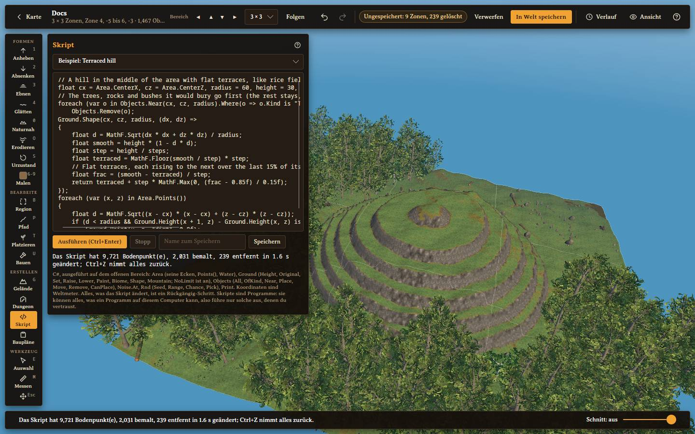
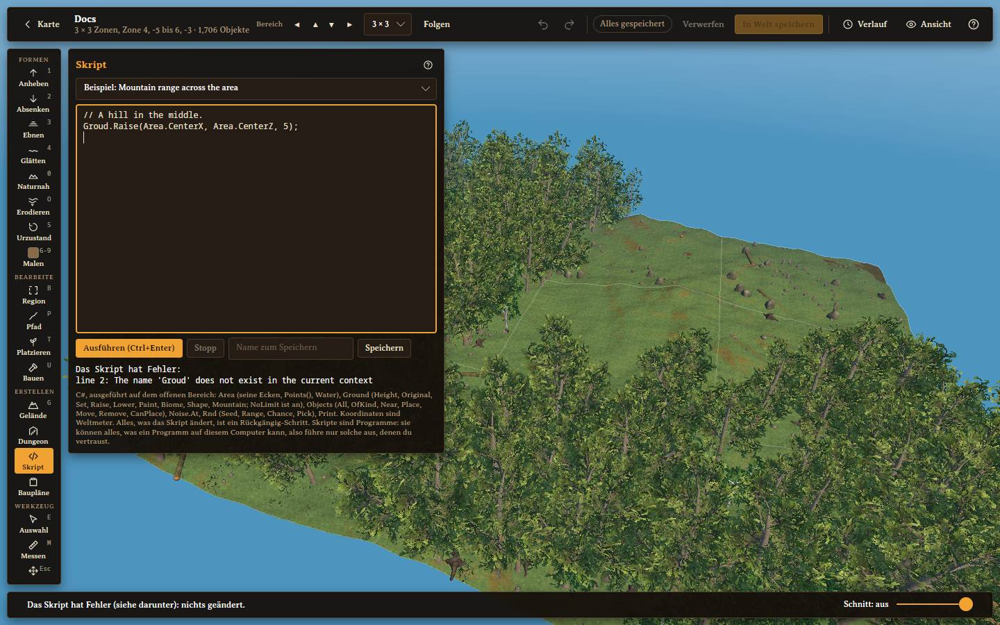

<!-- source: f2b8214d -->
# Skript

Schreibe ein paar Zeilen C#, die den offenen Bereich nach Regeln formen, bemalen und füllen: ein Gebirgszug, ein Wald
nur an sanften Hängen, Terrassen, ein gepflasterter Platz genau auf der mittleren Höhe.

**Wo:** Werkzeugleiste, Abschnitt **ERSTELLEN** · **Taste:** keine (`Ctrl+Enter` führt das Skript aus) ·
**Funktioniert in:** gespeicherten Welten, live (nicht in der Werkstatt)


*Das Beispiel Terraced hill auf einem 3 × 3-Bereich ausgeführt: der Code im Panel und darunter die Ergebniszeile, die
sagt, was das Skript geändert hat.*

Du musst nichts installieren: Der Editor kompiliert das Skript selbst. Wenn du noch nie C# geschrieben hast, beginne
mit einem [Beispiel](#die-beispiele) und ändere seine Zahlen, oder folge [Dein erstes Skript](#dein-erstes-skript).

## Benutzen

1. Öffne einen Bereich im 3D-Editor. Ein Skript arbeitet auf dem **offenen Bereich** (den Zonen, die du siehst).
2. Wähle **Skript** im Abschnitt **ERSTELLEN** der Werkzeugleiste.
3. Wähle ein Beispiel oder ein gespeichertes Skript in der Liste, oder schreibe dein eigenes in das Codefeld.
4. Drücke **Ausführen (Ctrl+Enter)**. Das Ausgabefeld zeigt „Wird kompiliert…“, „Läuft…“, dann, was das Skript
   ausgegeben und was es geändert hat, oder was schiefgegangen ist.
5. Sieh dir das Ergebnis an. Rückgängig (der Pfeil in der oberen Leiste) nimmt den ganzen Lauf in einem Schritt
   zurück; `Ctrl+Z` auch, sobald du in die 3D-Ansicht geklickt hast (im Codefeld macht es dein Tippen rückgängig).
   Ändere die Zahlen und führe es erneut aus, bis es dir gefällt.
6. Drücke **In Welt speichern** (oder **Live anwenden**), um es zu behalten, wie jede andere Änderung.

Während das Skript läuft, ändert sich nichts: Wenn es fertig ist, kommt alles, was es geändert hat, auf einmal in den
Bereich, als ein Rückgängig-Schritt. Wenn es Fehler hat, scheitert, gestoppt wird oder 2 Minuten läuft, ändert sich
nichts.

## Dein erstes Skript

Diese Lektion hebt einen Erdhügel in der Mitte des Bereichs an und macht ihn dann höher.

1. Öffne einen Bereich und wähle **Skript**.
2. Markiere den ganzen Text im Codefeld und ersetze ihn durch:

   ```csharp
   // Ein Erdhügel, 10 m hoch und 30 m breit, in der Mitte des Bereichs.
   Ground.Shape(Area.CenterX, Area.CenterZ, 15, (dx, dz) =>
   {
       float d = MathF.Sqrt(dx * dx + dz * dz) / 15;   // 0 in der Mitte, 1 am Rand
       return 10 * (1 - d);                            // hinzuzufügende Meter
   });
   Print($"The top is at {Ground.Height(Area.CenterX, Area.CenterZ):0.0} m.");
   ```

3. Drücke `Ctrl+Enter`. Ein Erdhügel erhebt sich in der Mitte des Bereichs; die Ausgabe sagt, wo seine Spitze liegt
   und wie viele Bodenpunkte sich geändert haben.
4. Klicke in die 3D-Ansicht und drücke dann `Ctrl+Z`. Der Erdhügel ist weg.
5. Klicke in das Codefeld, ändere `10 *` in `20 *` und drücke erneut `Ctrl+Enter`. Der Erdhügel ist doppelt so hoch.
6. Optional: Gib einen Namen in das Namensfeld ein und drücke **Speichern**, um das Skript beim nächsten Mal in der
   Liste zu finden.

`Ground.Shape` addiert die Meter, die deine Funktion zurückgibt, zu jedem Punkt im Umkreis von 15 m um die Mitte;
`dx` und `dz` sind die Meter von der Mitte aus. Jeder andere Aufruf steht in der [API-Referenz](#api-referenz).

## Einstellungen

| Einstellung | Was sie tut |
|---|---|
| **Liste** | Die sieben Beispiele („Beispiel: …“), dann deine gespeicherten Skripte, die neuesten zuerst. Einen Eintrag zu wählen **ersetzt** den Text im Codefeld: Speichere dein eigenes Skript zuerst. Ein Beispiel leert das Namensfeld; ein gespeichertes Skript trägt seinen Namen dort ein. |
| **Codefeld** | Das Skript. `Tab` rückt ein; `Ctrl+Enter` führt es aus; `Ctrl+Z` macht dein Tippen rückgängig, nicht den Lauf. |
| **Ausführen (Ctrl+Enter)** | Kompiliert das Skript und führt es auf dem offenen Bereich aus. Seine Änderungen sind **ein Rückgängig-Schritt**, im Verlauf benannt mit „Skript: “ und dem Namen des Listeneintrags. |
| **Stopp** | Stoppt ein laufendes Skript, egal was es gerade tut: Nichts von dem, was es getan hat, bleibt erhalten. |
| Namensfeld, **Speichern** | Speichert den Code unter dem eingegebenen Namen und wählt ihn in der Liste aus. Zeichen, die ein Dateiname nicht enthalten kann, werden zu `_`. Das Überschreiben eines anderen gespeicherten Skripts fragt zuerst. |
| **Ausgabe** | Was das Skript ausgegeben hat (`Print`), dann, was es geändert hat, oder seine Fehler mit ihrer Zeile. |

Gespeicherte Skripte sind `<name>.csx`-Dateien im Ordner `scripts` des Datenordners des Editors
(`~/.local/share/ValheimWorldEditor/scripts` unter Linux, `%LOCALAPPDATA%\ValheimWorldEditor\scripts` unter Windows,
`~/Library/Application Support/ValheimWorldEditor/scripts` unter macOS). Bearbeite sie in einem beliebigen Texteditor
oder teile sie: Eine dort abgelegte `.csx`-Datei erscheint in der Liste, wenn der Editor neu startet oder nachdem du
ein Skript gespeichert hast.

## Die Beispiele

Jedes Beispiel ist ein vollständiges Skript, bereit, auf jedem offenen Bereich ausgeführt zu werden. Lies sie, um zu
sehen, wie die API benutzt wird.

| Beispiel | Was es tut |
|---|---|
| **Mountain range across the area** | Vier Berge der Vorgabe Einzelner Gipfel in einer Linie von Südwest nach Nordost, jeder 35 bis 60 m hoch. `Rnd.Seed = 7`, daher ist es bei jedem Lauf derselbe Gebirgszug. Beim Speichern werden sie zu Bodenscheiben (über die 8-m-Grenze des Spiels hinaus). |
| **Terraced hill** | Ein Hügel, 30 m hoch und mit 60 m Radius, in sechs flache Terrassen wie Reisfelder geschnitten. Die Bäume, Felsen und Büsche, die er begraben würde, werden zuerst entfernt (alles andere bleibt); die steilen Stufen werden mit Erde bemalt. |
| **Canyon with a river** | Ein gewundener Canyon von West nach Ost, 18 m zu jeder Seite seiner Linie, bis 3 m unter den Meeresspiegel gegraben, sodass sich Wasser darin sammelt, und auf den letzten 30 m an den Rändern des Bereichs auslaufend. |
| **Scatter boulders** | Große Felsbrocken (`rock4_forest`, `rock4_coast`, `rock4_heath`) alle 6 m, wo das Rauschen hoch ist, mehr an Hängen, jeder zufällig gedreht und skaliert. Gibt aus, wie viele. |
| **Ring of trees** | Ein Ring aus 36 Buchen, 40 m von der Mitte entfernt; die Bäume innerhalb des Rings werden entfernt. |
| **Flat paved base** | Ein 40 × 40 m großes Quadrat, auf seine eigene mittlere Höhe geebnet und gepflastert, mit einem sanften 10-m-Hang zum Boden ringsum. Bleibt innerhalb der 8-m-Grenze (`Ground.NoLimit = false`). Gibt die Höhe aus. |
| **Noise landscape** | Welliges Land über den ganzen Bereich: Hügel und Täler bis 25 m nach oben oder unten mit kleineren Buckeln darauf, auf den letzten 40 m an den Rändern zurück zum ursprünglichen Boden auslaufend. |

## Wie ein Skript die Welt sieht

- **Einfaches C#.** Ein Skript ist eine Liste von Anweisungen, die von oben nach unten ausgeführt werden. Es kann
  Variablen, Schleifen, Funktionen und Klassen deklarieren und .NET verwenden (`MathF`, `System.Linq`…).
  `using System`, `System.Linq` und `System.Collections.Generic` sind schon da.
- **Weltmeter.** Jede Position ist in Metern: **x** nach Osten, **z** nach Norden, dieselben Zahlen wie in der
  Statusleiste und beim Befehl `pos` des Spiels. Höhen sind Meter über dem Nullpunkt der Welt; das Meer liegt auf
  `Area.Water` (30 m).
- **Ein Punkt pro Meter.** `Ground.Set(x, z, …)` ändert den Punkt, der (x, z) am nächsten liegt; `Ground.Height`
  liest weich zwischen den Punkten, so wie der Boden gezeichnet wird.
- **Seine eigenen Änderungen.** Ein Skript sieht, was es bisher geändert hat (hebe einen Punkt an, dann gibt
  `Ground.Height` die neue Höhe), aber `Objects.All` bleibt so, wie der Bereich beim Start war.
- **Nur der offene Bereich.** Die äußere Punktreihe bleibt, wie sie ist, damit der Bereich weiter an seine Nachbarn
  anschließt; Änderungen dort oder außerhalb des Bereichs werden ohne Fehler ignoriert. Öffne für größere Arbeiten
  einen größeren Bereich (bis 17 × 17 Zonen).
- **Über die 8-m-Grenze hinaus.** `Ground.NoLimit` ist an, wie der Schalter [Ohne Grenze](concepts/ground-limits.md#ohne-grenze):
  Der Boden kann bis zu 400 m über oder unter den erzeugten Boden gehen, und beim Speichern wird er zu Bodenscheiben,
  die das Spiel jedes Spielers als erzeugten Boden zählt. `Ground.NoLimit = false;` bleibt innerhalb der 8 m des
  Spiels: Punkte, die darüber hinausgingen, stoppen dort, und die Ergebniszeile sagt, wie viele.
- **Keine Maske.** Die [Maske](masks.md) begrenzt die Werkzeuge, die du von Hand benutzt, nicht Skripte. Prüfe im
  Skript, was du brauchst (`Ground.Biome`, die Höhe, die Neigung).
- **Bei jedem Lauf ein Neuanfang.** Variablen, `Rnd` und `Objects.All` beginnen von vorn. Es läuft immer nur ein
  Skript gleichzeitig.

## API-Referenz

### Area

Der offene Bereich.

| Member | Was es liefert |
|---|---|
| `Area.MinX`, `Area.MinZ`, `Area.MaxX`, `Area.MaxZ` | Seine Ecken (Weltmeter). Ein 3 × 3-Bereich ist 192 m breit. |
| `Area.CenterX`, `Area.CenterZ` | Seine Mitte. |
| `Area.Points()` | Jeden Bodenpunkt, den das Skript ändern kann (ohne die äußere Reihe), als `(x, z)`, Reihe für Reihe von Süden: `foreach (var (x, z) in Area.Points()) { … }`. `Area.Points(step: 4)` nimmt jeden 4. Meter, zum Verstreuen. Ein Schritt von 0 oder weniger, oder einer, der zu klein ist, um durch den Bereich voranzukommen, stoppt das Skript mit einem Fehler. |
| `Area.Inside(x, z)` | Ob ein Punkt innerhalb des Bereichs liegt (nicht auf seinem Rand). |
| `Area.Water` | Den Meeresspiegel (30 m, oder dort, wo die Einstellungen von Expand World Rivers der Welt ihn hinlegen). |
| `Area.WorldSeed`, `Area.World` | Den Seed der Welt (eine Zahl) und ihren Namen. |

### Ground

| Member | Was es tut |
|---|---|
| `Ground.Height(x, z)` | Die jetzige Höhe des Bodens dort (mit den bisherigen Änderungen des Skripts). |
| `Ground.Original(x, z)` | Der Boden vor jeder Bearbeitung, so wie die Welt ihn erzeugt hat (mit schon gespeicherten Bodenscheiben). Der Unterschied zu `Height` ist das, was abgegraben oder aufgeschüttet wurde. |
| `Ground.Set(x, z, height)` | Setzt den Bodenpunkt dort auf diese Höhe. |
| `Ground.Raise(x, z, metres)`, `Ground.Lower(x, z, metres)` | Bewegt ihn um so viel nach oben oder unten. |
| `Ground.Shape(x, z, radius, (dx, dz) => metres)` | Addiert die Meter, die deine Funktion liefert, zu jedem Punkt im Radius um (x, z). `dx`, `dz`: Meter von der Mitte aus; `MathF.Sqrt(dx * dx + dz * dz)` ist der Abstand. Ein negativer Wert gräbt. |
| `Ground.Mountain(x, z, "Lone peak", height:, radius:, rough:, turn:, seed:)` | Ein Berg des Werkzeugs [Gelände](landform.md#berge), seine Mitte bei (x, z): `"Lone peak"`, `"Ridge"`, `"Mountain range"`, `"Mesa"`, `"Volcano"` oder `"Rolling hills"`. `height` und `radius` in Metern, `rough` von 0 bis 1, `turn` in Grad (die Richtung eines Grats). Lass einen Wert weg für einen zufälligen im Bereich der Vorgabe; derselbe `seed` ergibt denselben Berg. Er reicht etwa 1,15 × seinen Radius weit. Bäume, Felsen, Erz, Büsche und Sammelbares, die er um mehr als 2 m begräbt, werden entfernt; anders als das Werkzeug lässt er danach keine Bäume darauf wachsen. |
| `Ground.Paint(x, z, "dirt")` | Bemalt den Punkt: `"dirt"`, `"cultivated"`, `"paved"` oder `"clear"` (zurück zum eigenen Boden des Bioms). Eine letzte Zahl von 0 bis 1 malt nur teilweise (`0.5f`) und mischt sich mit der vorhandenen Farbe. |
| `Ground.Biome(x, z)` | Das Biom dort: `"Meadows"`, `"BlackForest"`, `"Swamp"`, `"Mountain"`, `"Plains"`, `"Ocean"`, `"Mistlands"`, `"AshLands"` oder `"DeepNorth"` (`"None"` außerhalb des Bereichs). |
| `Ground.NoLimit` | Standardmäßig `true`: Änderungen gehen über die 8 m des Spiels hinaus. `false`: Sie stoppen dort. Es zählt sein Wert am Ende des Skripts. |

### Objects

Was im Bereich steht, so wie es beim Start des Skripts war. Jedes Objekt (`Obj`) hat seinen `Prefab`-Namen, seine
Position `X`, `Y`, `Z`, seine Drehung `Yaw` und Neigungen `Pitch` und `Roll` (Grad), seine Größe `Scale` (1: die des
Spiels), seine Art `Kind` und `Building` (ein Bauteil, das ein Spieler gebaut hat). `Objects.All` ändert sich
nicht, während das Skript läuft: Objekte, die du platzierst, sind nicht darin, und die, die du entfernst, sind noch
aufgeführt.

| Member | Was es tut |
|---|---|
| `Objects.All` | Jedes Objekt des Bereichs. |
| `Objects.OfKind("Trees")` | Die einer Art (Groß- und Kleinschreibung egal): `Buildings`, `Ruins`, `Furniture`, `Trees`, `Rocks`, `Ore`, `Bushes`, `Pickables`, `Remains`, `Animals` (gezähmt), `Creatures` (wild, Händler, Vögel), `SpawnPoints`, `Nests`, `Runestones`, `Dungeons`, `Effects`, `Other`: die Arten des Panels Ansicht. |
| `Objects.Near(x, z, radius)` | Die im Radius um einen Punkt, flach gemessen. |
| `Objects.Remove(o)` | Entfernt es. |
| `Objects.Place("Beech1", x, z, yaw:, scale:, y:, pitch:, roll:, snap:)` | Ein neues Objekt nach seinem Prefab-Namen (`Beech1`, `Pinetree_01`, `rock4_forest`, `piece_chest_wood`…: die Namen, die das Werkzeug [Platzieren](place.md) auflistet; bei einem Bauteil zeige auf seine Kachel in [Bauen](build.md)). Ohne `y` steht es auf dem Boden, **so wie das Skript ihn hinterlässt** (erst graben, dann platzieren: Es sitzt in der Grube). `yaw` dreht es (0: seine Vorderseite zeigt nach Norden, 90: nach Osten), `pitch` und `roll` neigen es, `scale` skaliert es (`0.5f` halb, `2` doppelt). Mit `snap: true` rückt ein Bauteil an die Einrastpunkte von Bauteilen im Umkreis von 0,5 m heran, wie es der Hammer tut. Eine Kreatur, die in einem Bauteil platziert wird, wird obendrauf gestellt (die Meldung sagt, wie viele). Bauteile gelten als von Spielern gebaut, vom Erbauer, der unter **Erbaut von** in [der Bauleiste](build.md#die-bauleiste) gewählt ist (siehe [Von Spielern gebaute Teile](concepts/objects.md#von-spielern-gebaute-bauteile)). Ein Punkt außerhalb des Bereichs (sein Rand zählt zum Bereich), ein Wert, der keine Zahl ist, oder eine Größe unter 0 stoppt das Skript. |
| `Objects.Move(o, x:, z:, y:, yaw:, pitch:, roll:, scale:)` | Verschiebt, dreht oder skaliert ein Objekt; was du weglässt, bleibt, wie es ist (oder wie ein früheres `Move` es hinterlassen hat). Es behält, was es enthält (Truheninhalt, Erbauer…). Die Größe muss über 0 liegen, der Ort im Bereich, und jeder Wert muss eine Zahl sein. |
| `Objects.CanPlace("Beech1")` | Ob der Editor dieses Objekt erzeugen kann. Verwende es vor `Place`, wenn ein Name falsch sein könnte: `Place` mit einem Namen, den er nicht erzeugen kann, stoppt das Skript. |

### Rauschen und Zufallszahlen

| Member | Was es liefert |
|---|---|
| `Noise.At(x, z, scale, seed)` | Weiches natürliches Rauschen, von etwa -1 bis 1, die Art, aus der das Gelände von Valheim und die Berge des Werkzeugs Gelände gemacht sind. `scale` ist die Größe seiner Buckel in Metern (Standard 32); ein anderer `seed` (Standard 0) ergibt ein anderes Muster. Es wiederholt sich alle 256 × `scale` Meter. |
| `Rnd.Seed = 42;` | Macht die Zufallszahlen unten bei jedem Lauf gleich (ohne das ist jeder Lauf anders). |
| `Rnd.Next()` | Eine Zufallszahl von 0 bis 1. |
| `Rnd.Range(min, max)` | Eine Zufallszahl zwischen `min` und `max`. |
| `Rnd.Int(min, max)` | Eine zufällige ganze Zahl von `min` bis ausschließlich `max`. |
| `Rnd.Chance(0.3f)` | In 30 % der Fälle `true`. |
| `Rnd.Pick("Beech1", "Oak1", "Birch1")` | Einen der Werte, zufällig. |

### Ausgeben

`Print(anything)` schreibt eine Zeile in das Ausgabefeld: Werte, Zählungen, was das Skript gerade tut (höchstens
2.000 Zeilen). Um Zahlen zu prüfen, bevor etwas geändert wird, kommentiere die ändernden Zeilen aus (`//`) und gib
stattdessen aus.

## Rezepte

Jedes Rezept ist ein vollständiges Skript: Füge es in das Codefeld ein und führe es auf einem beliebigen offenen
Bereich aus.

**Ein runder Hügel in der Mitte des Bereichs**, 25 m hoch, 40 m breit:

```csharp
Ground.Shape(Area.CenterX, Area.CenterZ, 40, (dx, dz) =>
{
    float d = MathF.Sqrt(dx * dx + dz * dz) / 40;   // 0 in der Mitte, 1 am Rand
    return 25 * (1 - d * d) * (1 - d * d);           // eine weiche Glocke
});
```

**Ein See**: Grabe eine runde Senke unter den Meeresspiegel; das Meer füllt sie (Boden unter 30 m liegt unter
Wasser):

```csharp
float cx = Area.CenterX, cz = Area.CenterZ, radius = 35;
Ground.Shape(cx, cz, radius, (dx, dz) =>
{
    float d = MathF.Sqrt(dx * dx + dz * dz) / radius;
    float bed = Area.Water - 4 * (1 - d * d);         // 4 m tief in der Mitte
    float now = Ground.Height(cx + dx, cz + dz);
    return d < 0.8f ? bed - now : (bed - now) * (1 - d) / 0.2f;   // ein sanftes Ufer
});
```

**Kiefernwald nur an sanften Hängen**, dichter, wo das Rauschen hoch ist, keiner im Wasser:

```csharp
Rnd.Seed = 1;
int planted = 0;
foreach (var (x, z) in Area.Points(step: 5))
{
    float slope = MathF.Abs(Ground.Height(x + 1, z) - Ground.Height(x - 1, z)) / 2;   // Anstieg pro Meter
    if (slope > 0.45f || Ground.Height(x, z) < Area.Water + 1) continue;             // etwa 25°, und trockenes Land
    if (Noise.At(x, z, 50, seed: 2) < 0 || !Rnd.Chance(0.6f)) continue;
    string tree = Rnd.Pick("Pinetree_01", "FirTree");
    float px = x + Rnd.Range(-2, 2), pz = z + Rnd.Range(-2, 2);   // etwas neben dem Raster
    if (!Area.Inside(px, pz)) continue;
    Objects.Place(tree, px, pz, yaw: Rnd.Range(0, 360));
    planted++;
}
Print($"{planted} trees planted.");
```

**Das Unterholz räumen**: Entferne jeden Busch und alles Sammelbare im Bereich (Bäume und Gebäude bleiben):

```csharp
int n = 0;
foreach (var o in Objects.OfKind("Bushes").Concat(Objects.OfKind("Pickables")))
{
    Objects.Remove(o);
    n++;
}
Print($"{n} removed.");
```

**Eine gepflasterte Straße** zwischen zwei Punkten, 6 m breit, von der Höhe des einen Endes bis zu der des anderen
geebnet:

```csharp
float x1 = Area.MinX + 20, z1 = Area.CenterZ, x2 = Area.MaxX - 20, z2 = Area.CenterZ + 30;
float h1 = Ground.Height(x1, z1), h2 = Ground.Height(x2, z2);
float length = MathF.Sqrt((x2 - x1) * (x2 - x1) + (z2 - z1) * (z2 - z1));
for (float s = 0; s <= length; s += 0.5f)
{
    float t = s / length, x = x1 + (x2 - x1) * t, z = z1 + (z2 - z1) * t;
    // Quer über die Straße: 3 m zu jeder Seite der Linie.
    float ax = -(z2 - z1) / length, az = (x2 - x1) / length;
    for (float w = -3; w <= 3; w += 0.5f)
    {
        Ground.Set(x + ax * w, z + az * w, h1 + (h2 - h1) * t);
        Ground.Paint(x + ax * w, z + az * w, "paved");
    }
}
```

**Berge nach Biom**: ein Tafelberg in den Ebenen, sonst ein einzelner Gipfel, in der Mitte des Bereichs:

```csharp
float cx = Area.CenterX, cz = Area.CenterZ;
string preset = Ground.Biome(cx, cz) == "Plains" ? "Mesa" : "Lone peak";
Ground.Mountain(cx, cz, preset, height: 40, radius: 70, seed: 123);
Print($"{preset} in the {Ground.Biome(cx, cz)}.");
```

**Deine eigene Funktion**: Funktionen machen größere Skripte lesbar. Hier ein Ring aus aufrechten Steinen:

```csharp
void Stone(float x, float z) =>
    Objects.Place("highstone", x, z, yaw: Rnd.Range(0, 360), scale: Rnd.Range(0.7f, 1.1f));

Rnd.Seed = 5;
for (int i = 0; i < 12; i++)
{
    float a = i * MathF.Tau / 12;
    Stone(Area.CenterX + MathF.Cos(a) * 18, Area.CenterZ + MathF.Sin(a) * 18);
}
```

**Die Felsen aufrichten**: Jeder geneigte Felsen des Bereichs wird aufrecht gestellt und behält seine Drehung:

```csharp
int n = 0;
foreach (var o in Objects.OfKind("Rocks"))
{
    if (o.Pitch == 0 && o.Roll == 0) continue;
    Objects.Move(o, pitch: 0, roll: 0);
    n++;
}
Print($"{n} rocks stood up.");
```

**Ein Holzboden** aus 2-m-Bodenteilen, zusammengerastet wie mit dem Hammer, auf einer darunter geebneten Fläche:

```csharp
float cx = Area.CenterX, cz = Area.CenterZ, level = Ground.Height(cx, cz);
for (float z = cz - 6; z <= cz + 6; z++)
    for (float x = cx - 6; x <= cx + 6; x++)
        Ground.Set(x, z, level);
for (int i = -2; i <= 2; i++)
    for (int j = -2; j <= 2; j++)
        Objects.Place("wood_floor", cx + i * 2, cz + j * 2, y: level, snap: true);
```

## Wenn etwas schiefgeht

Das Ausgabefeld sagt, was passiert ist; die Statusleiste sagt es kurz. In jedem der folgenden Fälle hat sich nichts
geändert.

- **Fehler beim Kompilieren**: Das Skript lässt sich nicht kompilieren. Sie werden mit ihrer Zeile aufgeführt,
  höchstens 20: `line 4: The name 'Groud' does not exist in the current context` ist ein Tippfehler in Zeile 4.
- **Fehler bei der Ausführung** stoppen das Skript, mit ihrer Zeile: ein Objektname, den der Editor nicht erzeugen
  kann (`the editor cannot make a “Beech” (a prefab name, like Beech1 or rock4_forest)`), eine Farbe oder eine
  Bergvorgabe, die er nicht kennt (die Meldung listet die richtigen auf), eine Größe von 0 oder weniger in `Move`,
  eine Division durch null…
- „**Das Skript hat keine ausführbare Anweisung**“: Das Codefeld ist leer oder enthält nur Kommentare. Schreibe
  mindestens eine Zeile Code, oder wähle ein Beispiel in der Liste.
- „**Das Skript lief und hat nichts geändert.**“ Prüfe mit `Print`, ob deine Schleife findet, was du erwartest: ein
  anders geschriebener Artname, Punkte außerhalb des Bereichs oder auf seinem Rand.
- „**Der Bereich hat sich geändert, während das Skript lief: nichts geändert. Führe es erneut aus.**“ Du hast
  bearbeitet, rückgängig gemacht oder gespeichert, während es lief (oder ein anderer Bereich wurde geöffnet). Führe es
  erneut aus und warte darauf.


*Ein falsch geschriebener Name: Die Ausgabe nennt die Zeile und den Fehler; die Statusleiste meldet, dass sich nichts
geändert hat.*

### Ein Skript stoppen

**Stopp** und die 2-Minuten-Grenze funktionieren immer. Ein Skript endet beim nächsten Durchgang einer seiner eigenen
Schleifen, beim nächsten Punkt von `Area.Points()` oder bei der nächsten Reihe von `Ground.Shape` oder
`Ground.Mountain`. Ein einzelner Aufruf, der für sich lange dauert (eine riesige LINQ-Abfrage, `Thread.Sleep`, eine
Rekursion, die nie endet), wird eine Sekunde später mitsamt dem Prozess beendet, in dem das Skript läuft. So oder so
bleibt nichts von dem erhalten, was es getan hat.

Eine Schleife über einen ganzen 17 × 17-Bereich umfasst etwa 1,2 Millionen Punkte, ein paar Sekunden Arbeit. Verwende
`Area.Points(step: 4)`, wenn nicht jeder Punkt nötig ist.

## Tastenkürzel

| Taste | Aktion |
|---|---|
| `Ctrl+Enter` (im Codefeld) | Das Skript ausführen |
| `Tab` (im Codefeld) | Einrücken |
| `Ctrl+Z` (außerhalb des Codefelds) | Den ganzen Lauf zurücknehmen |

## Tipps und Grenzen

- **Skripte sind Programme.** Ein Skript läuft mit deinen Rechten und kann deine Dateien lesen und schreiben, wie
  jedes Programm; der Prozess, in dem es läuft, ist keine Sandbox. Führe nur Skripte aus, die du geschrieben hast oder
  denen du vertraust. Siehe [Skripte und Claude](concepts/safety.md#skripte-und-claude).
- `Rnd.Seed` macht einen Lauf wiederholbar: Dasselbe Skript und derselbe Seed ergeben auf demselben Bereich dasselbe
  Ergebnis. Ändere den Seed für eine andere Variante.
- Die Änderungen eines Skripts sind gewöhnliche Bearbeitungen: **Verwerfen** verwirft sie, der Verlauf führt den Lauf
  als einen Schritt auf, und live sendet **Live anwenden** sie wie jede andere.
- Objekte, die du entfernst, sind beim Speichern weg. Das Entfernen eines Runensteins entfernt seinen Ort endgültig,
  wie beim Werkzeug [Auswahl](select.md).
- Ein verschobenes Objekt behält alle seine Daten; live bewegt es sich im Spiel als dasselbe Objekt, wenn es geht
  (siehe [Dinge verschieben](live-mode.md#dinge-verschieben)).
- Ein Teil einer verbundenen Gruppe einer Mod (ein Schiff und seine Bauteile) wird nie allein entfernt oder
  verschoben: `Objects.Remove` oder `Objects.Move` eines Teils entfernt oder verschiebt seine ganze Gruppe, in ihrer
  Form, wie es das Werkzeug Auswahl tut.
- Skripte sind C# 12. [Claude](claude.md) führt Skripte über dieselbe Engine aus und kann einen Probelauf machen, der
  nur sagt, was ein Skript ändern würde.

## Verwandte Seiten

- [Claude formen oder bauen lassen](guides/connect-claude.md)
- [Bodengrenzen](concepts/ground-limits.md#ohne-grenze): was mit Boden über 8 m beim Speichern passiert
- [Sicherheit](concepts/safety.md#skripte-und-claude): was ein Skript auf deinem Computer erreichen kann
- [Gelände](landform.md), [Platzieren](place.md) und [Bauen](build.md): die Werkzeuge, denen die Aufrufe eines
  Skripts folgen
