<!-- source: 24266405 -->
# Auswahl

Wähle Objekte, um sie zu verschieben, zu drehen, anzuheben, zu kopieren, zu ersetzen oder zu löschen, oder öffne eines im Inspektor, um zu sehen und zu ändern, was
es enthält.

**Wo:** Werkzeugleiste, Abschnitt **WERKZEUGE** · **Taste:** `E` · **Funktioniert in:** gespeicherten Welten, live, der Werkstatt

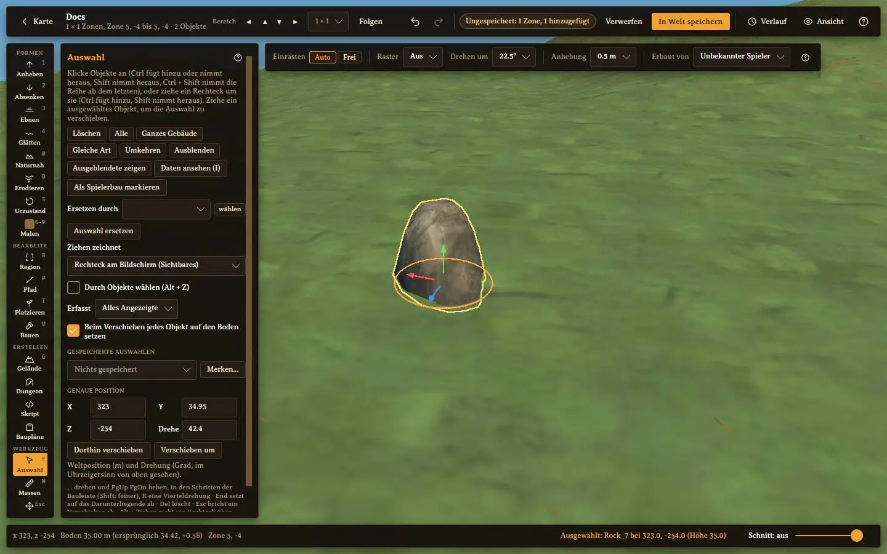
*Nah an einem ausgewählten Felsen: sein orangefarbener Umriss, die Pfeile rotes X, grünes Y und blaues Z, die ihn entlang einer Achse verschieben, und
der orangefarbene Ring, der ihn dreht. Links ist das Panel Auswahl.*

## Benutzen

So verschiebst du ein paar Objekte:

1. Drücke `E`.
2. Klicke auf ein Objekt. `Ctrl` + Klick für weitere, oder ziehe ein Rechteck auf dem Bildschirm um sie herum.
3. Ziehe ein ausgewähltes Objekt, um alle zu verschieben, oder ziehe einen Pfeil, um entlang einer Achse zu verschieben, oder den Ring, um zu drehen.
4. Optional: Tippe genaue Werte unter **GENAUE POSITION** ein, dann klicke auf **Dorthin verschieben**.

Im Werkzeug **Ansicht** wechselt ein Doppelklick auf ein Objekt zu Auswahl, mit dem Objekt ausgewählt. Nur gezeigte Objekte
lassen sich wählen: Schalte ihre Arten zuerst im [Panel Ansicht](editor-basics.md) ein. Das Objekt unter dem Mauszeiger hat einen
blassen Kasten: Das ist das, welches ein Klick wählt.

Jedes Verschieben, Drehen, Löschen oder Ändern ist ein Schritt zum Rückgängigmachen (`Ctrl+Z`). Nichts wird in die Welt geschrieben, bevor du **In Welt
speichern** (oder **Live anwenden**) wählst.

## Einstellungen

Das Panel Auswahl, von oben nach unten.

| Einstellung | Was sie tut |
|---|---|
| **Löschen** | Entfernt die ausgewählten Objekte (`Del`). `Ctrl+Z` holt sie zurück. |
| **Alle** | Wählt jedes gezeigte Objekt im Bereich aus (`Ctrl+A`). |
| **Ganzes Gebäude** | Fügt jedes Bauteil hinzu, das über sich berührende Bauteile mit den ausgewählten verbunden ist: Wände, Böden, Dächer, Balken. Abseits stehende Bauteile werden nicht erfasst. |
| **Gleiche Art** | Wählt jedes gezeigte Objekt der jetzt ausgewählten Arten: Wähle eine Buche, bekomme alle Buchen. |
| **Umkehren** | Wählt jedes gezeigte Objekt, das jetzt nicht ausgewählt ist, und nur diese (`Ctrl+I`). |
| **Ausblenden** / **Ausgeblendete zeigen** | Blendet die ausgewählten Objekte in der Ansicht aus, um zu erreichen, was sie verdecken (`Ctrl+H`), und zeigt sie wieder (`Alt+H`). Ausgeblendete Objekte werden weder gezeichnet noch gewählt; in der Welt ändert sich nichts. Einen anderen Bereich zu öffnen vergisst, was ausgeblendet war. |
| **Daten ansehen (I)** | Öffnet den [Inspektor](#inspektor) für das eine ausgewählte Objekt. |
| **Als Spielerbau markieren** | Gibt den ausgewählten Bauteilen ohne Erbauer den Spieler, der unter **Erbaut von** in [der Bauleiste](build.md#die-bauleiste) gewählt ist, damit das Spiel sie als von Spielern gebaut behandelt. Benutze es für eine Ruine, die du reparieren und behalten willst. Siehe [Von Spielern gebaute Bauteile](concepts/objects.md#von-spielern-gebaute-bauteile). |
| **Ersetzen durch** + **wählen** + **Auswahl ersetzen** | Wähle eine Art (oder klicke auf **wählen**, dann auf ein Objekt in der Welt), dann ersetze jedes ausgewählte Objekt durch sie, an derselben Stelle und in derselben Ausrichtung. Die neuen Objekte behalten nichts von den Daten der alten. |
| **Ziehen zeichnet** | **Rechteck am Bildschirm (Sichtbares)** oder **Ein Umriss auf dem Boden (alles darüber)**: siehe [Viele auf einmal auswählen](#viele-auf-einmal-auswählen). |
| **Durch Objekte wählen (Alt + Z)** | Ein Rechteck erfasst auch, was darin hinter anderen verborgen ist: die Möbel in einem Haus, die Wand hinter einer anderen. |
| **Erfasst** | Was Klicks, Rechtecke und Umrisse erfassen: **Alles Angezeigte**, **Nur Bauteile** (was Spieler gebaut haben) oder **Nur Natur** (Bäume, Felsen, Erz, Büsche, Sammelbares, Überreste). Was ausgelassen wird, wird weiter gezeichnet, ist aber nicht im Weg: Mit Nur Bauteile erfasst ein Rechteck die Wand hinter einem Baum. Es gilt auch für die Klicks des Werkzeugs Ansicht; **Obendrauf** des Werkzeugs Platzieren und die Pipetten wählen jede Art. |
| **Beim Verschieben jedes Objekt auf den Boden setzen** | An: Jedes Objekt landet auf dem Fußboden, Tisch oder Felsen unter der Stelle, an der es endet, sonst auf dem Boden (Bäume, Büsche und Kreaturen tragen nichts: Ein in einem Wald verschobener Baum steht auf dem Boden); ein Gebäude bewegt sich als ein Block und sitzt auf dem, was darunter ist. Aus: Die ganze Auswahl bewegt sich als ein Block in ihrer Höhe über dem Boden. Anfangs an. |
| **GESPEICHERTE AUSWAHLEN**: **Merken…** | Merkt sich die Auswahl unter einem Namen, für diese Welt. Wähle eine in der Liste für ihre Schaltflächen: **Auswahl** (statt der aktuellen Auswahl), **Hinzufügen** (zu ihr) und **Vergessen** (nach einer Rückfrage). Seitdem verschobene oder gelöschte Objekte zählen als fehlend; die Statusleiste sagt, wie viele. |
| **GENAUE POSITION**: **X**, **Y**, **Z**, **Drehen** | Bei einer Auswahl zu sehen. X (Ost–West) und Z (Nord–Süd) sind die Mitte der Auswahl, Y die Höhe ihres niedrigsten Objekts, Drehen die Ausrichtung des ersten Objekts in Grad, im Uhrzeigersinn von oben gesehen. |
| **Dorthin verschieben** | Verschiebt und dreht die Auswahl auf die eingetippten Werte, als ein Schritt zum Rückgängigmachen. Eingetippte Werte sind genau: Nichts rastet darüber hinaus ein. |
| **Verschieben um** | Stellt die Felder auf Beträge um: Meter nach Osten, oben und Norden, und Grad zum Drehen. **Um diese Werte verschieben** führt es aus. |

## Ein Objekt nach dem anderen auswählen

| Aktion | Was sie tut |
|---|---|
| Klick | Wählt das Objekt aus, und nur dieses. |
| Erneuter Klick an derselben Stelle | Wählt das nächste Objekt dahinter, dann das nächste: eine Truhe auf einem Fußboden, den Fußboden, den Balken darunter. |
| `Ctrl` + Klick | Fügt das Objekt hinzu oder nimmt es heraus, wenn es schon ausgewählt ist. |
| `Shift` + Klick | Nimmt das Objekt heraus. |
| `Ctrl` + `Shift` + Klick | Fügt die Reihe vom zuletzt geklickten Objekt bis zu diesem hinzu: Klicke Wand 1, dann Wand 3, und die Wände 1 bis 3 sind ausgewählt. |
| Doppelklick auf ein Bauteil | Wählt das ganze Gebäude aus. Eine Truhe (jeder Behälter) ist die Ausnahme: Sie wird allein ausgewählt und öffnet sich im Inspektor. |
| Doppelklick auf einen Teil eines Schiffs | Wählt das ganze Schiff aus: siehe [Schiffe und andere verbundene Objekte](#schiffe-und-andere-verbundene-objekte). |
| Klick auf leeren Boden oder `Alt+A` | Hebt die Auswahl auf. |

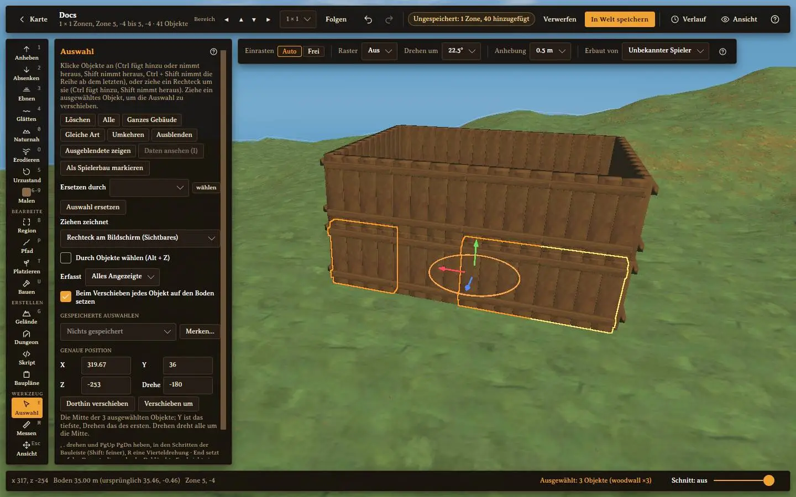
*Ein Klick auf ein Wandteil, dann `Ctrl` + Klick auf zwei weitere: Das zuletzt geklickte ist hellgelb umrandet,
die anderen orange, und die Statusleiste zählt die drei.*

## Viele auf einmal auswählen

Ziehen auf leerem Boden zeichnet ein Rechteck auf dem Bildschirm. Beim Loslassen werden die darin **sichtbaren** Objekte ausgewählt, nicht
die hinter anderen verborgenen. Drehe die Kamera, um zu wählen: von oben den Fußboden und die Wandkronen eines Gebäudes; von der Seite
eine Wand.

| Aktion | Was sie tut |
|---|---|
| Ziehen auf leerem Boden | Zeichnet das Rechteck; was darin zu sehen ist, wird die Auswahl. |
| `Alt` + Ziehen | Zeichnet das Rechteck, auch wenn du über einem Objekt beginnst (einem Gebäude, einem Wald). |
| `Ctrl` + Ziehen | Fügt hinzu, was das Rechteck erfasst. |
| `Shift` + Ziehen | Nimmt es heraus. |

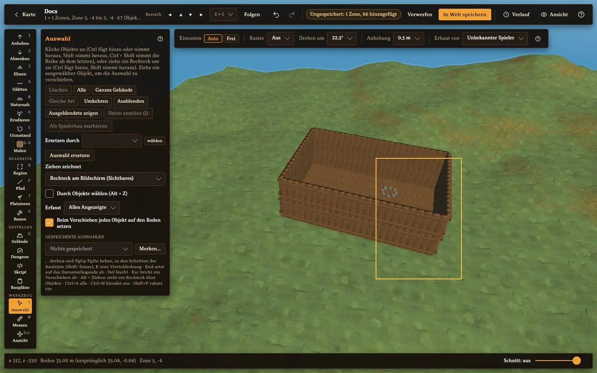
*`Alt` + Ziehen von der Mitte einer Hütte über ihre rechte Hälfte: Das Rechteck wird auf dem Bildschirm gezeichnet.*

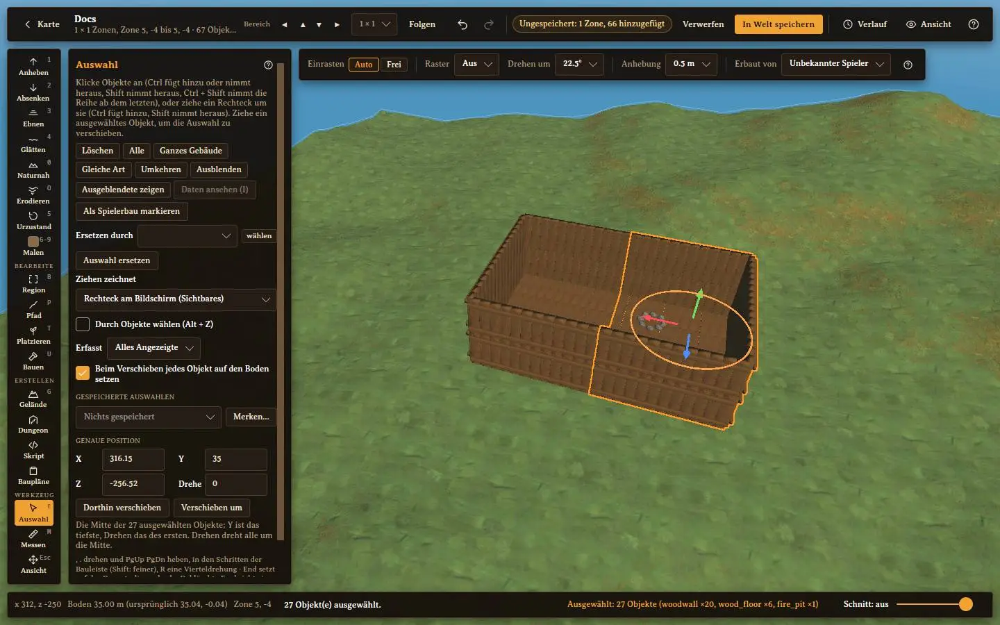
*Nach dem Loslassen: 27 Bauteile umrandet, die Wände, der zwischen ihnen sichtbare Fußboden und die Feuerstelle; der Fußboden und die Truhe
hinter der vorderen Wand bleiben außen vor. Die Statusleiste zählt die Objekte.*

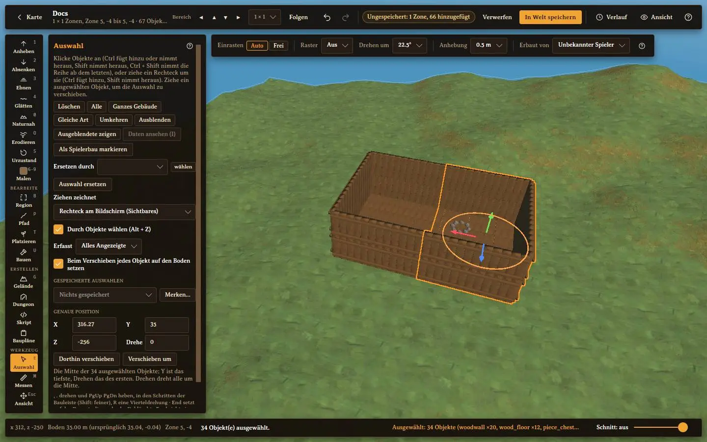
*Dasselbe Rechteck mit **Durch Objekte wählen** an: 34 Bauteile, auch der Fußboden und die Truhe hinter der vorderen Wand.*

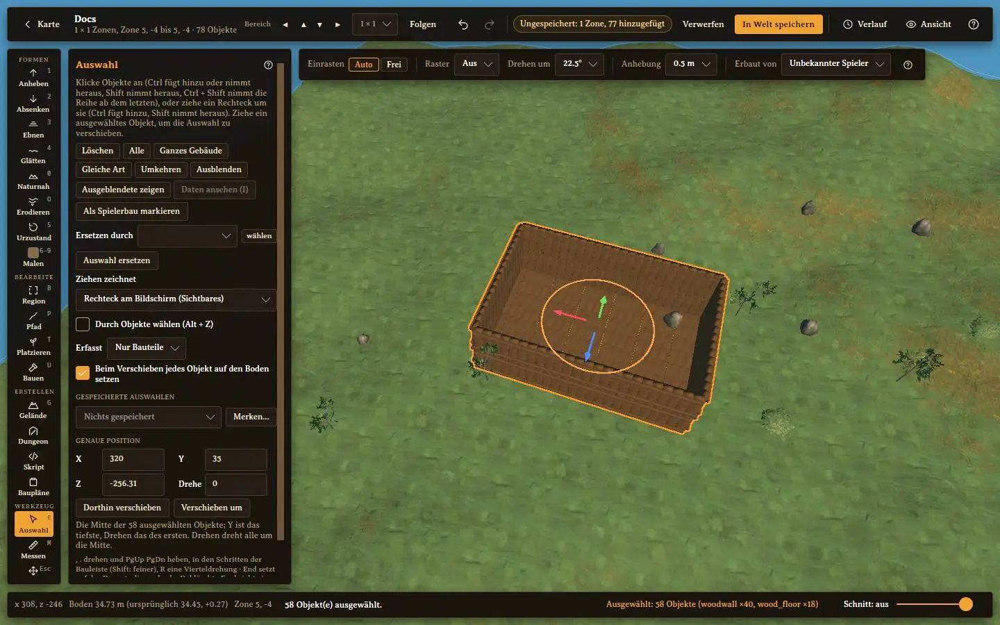
***Erfasst: Nur Bauteile** und ein Rechteck über der ganzen Hütte zwischen Felsen und Büschen: allein die 58 Bauteile der Hütte.*

Mit **Ziehen zeichnet: Ein Umriss auf dem Boden (alles darüber)** zeichnet Ziehen stattdessen einen Umriss auf dem Boden, und jedes
gezeigte Objekt, das darin steht, wird ausgewählt, verborgen oder nicht. `Alt`, `Ctrl` und `Shift` wirken wie beim Rechteck.

Um nach Art in einem genauen Rechteck oder Polygon auszuwählen (jeden Baum oder nur die Buchen, und nur dort, wo die
[Maske](masks.md) den Boden durchlässt), benutze das Werkzeug [Region](area.md#objektaktionen): Unter **Objekte** wählt sein
**Objekte auswählen (Enter)** sie aus und wechselt zu Auswahl, wo **Löschen** und **Auswahl ersetzen**
auf sie wirken.

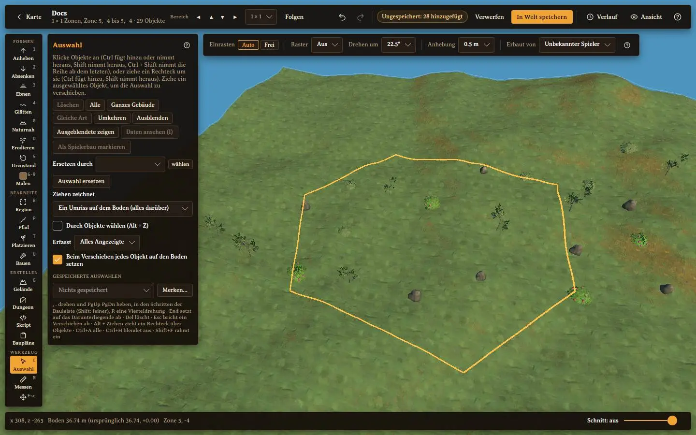
*`Alt` + Ziehen um Felsen und Büsche: Der Umriss wird gezeichnet, obwohl das Ziehen auf einem Busch begann.*

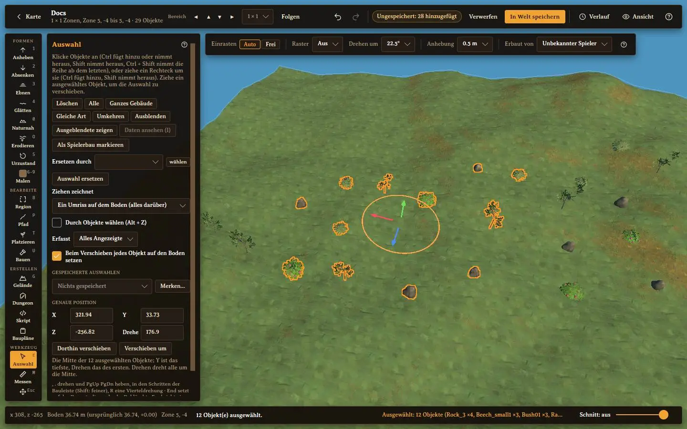
*Alles Gezeigte darin ist ausgewählt, und **GENAUE POSITION** zeigt, wo die Auswahl ist.*

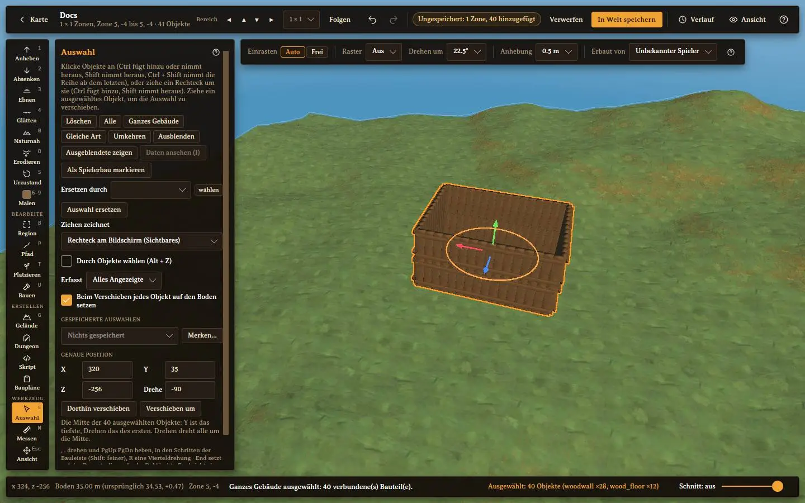
*Ein Klick auf eine Wand, dann **Ganzes Gebäude**: Jedes verbundene Bauteil der Hütte ist ausgewählt.*

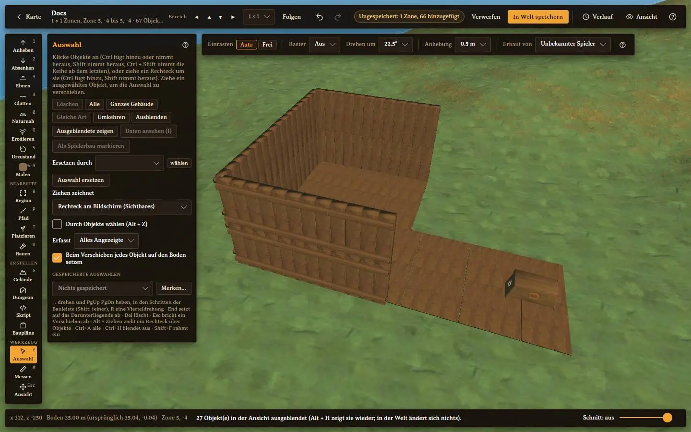
*Nah an der Hütte, nachdem `Ctrl+H` ihre umrahmte rechte Hälfte ausgeblendet hat: Die Truhe auf dem Fußboden darin ist frei zu sehen.
`Alt+H` holt die Wände zurück.*

## Verschieben und drehen

| Aktion | Was sie tut |
|---|---|
| Ein ausgewähltes Objekt ziehen | Verschiebt die ganze Auswahl, die dem Mauszeiger auf dem Boden folgt. Bauteile rasten an den Bauteilen ringsum ein oder folgen dem Raster, je nach Einstellung [der Bauleiste](build.md#die-bauleiste). |
| Einen Pfeil ziehen | Verschiebt entlang einer Achse: **rotes X** Ost–West, **grünes Y** oben–unten, **blaues Z** Nord–Süd. Halte `Ctrl` für Schritte von 0,5 m. |
| Den orangefarbenen Ring ziehen | Dreht die Auswahl um ihre Mitte; halte `Ctrl` für Schritte von 15°. |
| `End` | Lässt jedes Objekt senkrecht auf das fallen, was darunter ist (einen Fußboden, einen Tisch, einen Felsen), sonst auf den Boden. |

Die Bauleiste neben dem Panel ist die, die [Bauen](build.md) und Einfügen benutzen: **Einrasten** (**Auto**: Verschobene Bauteile rasten
an den nächsten Einrastpunkten im Umkreis von 0,75 m ein, wie mit dem Hammer; **Frei**: Sie bleiben, wo du sie hinziehst), **Raster** (Bauteile,
die nicht einrasten, folgen ihm), **Drehen um** und **Anhebung** (die Schritte der Tasten unten) und **Erbaut von**.

Die Statusleiste folgt dem Verschieben: „Verschiebe 12 Objekt(e): 4.5 m, gedreht 15°, +0.25 m · eingerastet an woodwall“. Ein verschobenes
Objekt behält seine Daten: eine Truhe ihren Inhalt, ein Schild seinen Text, ein Bauteil seinen Erbauer. Siehe
[Einrasten](concepts/objects.md#einrasten), wie ein Verschieben landet.

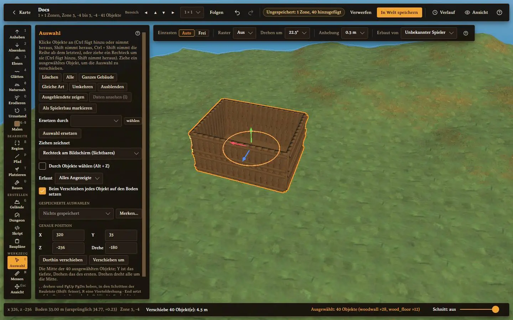
*Ziehen des roten X-Pfeils einer ganz ausgewählten Hütte: Die Statusleiste folgt dem Verschieben, „Verschiebe 40 Objekt(e): 4.5 m“.*

## Kopieren, ausschneiden und einfügen

`Ctrl+C` kopiert die Auswahl; `Ctrl+V` fügt sie mit dem Einfügewerkzeug ein (`R` dreht, `X` spiegelt), hier oder in einem anderen
Bereich: siehe [Region](area.md). Kopien behalten alles, was die Originale enthalten. Bäume und Ähnliches behalten ihre Höhe über dem
Boden, wo sie landen; Bauteile behalten die Form des Gebäudes und nehmen den Boden darunter mit (ohne
Farbe). `Ctrl+X` schneidet aus: dieselbe Kopie, dann verlassen die Objekte die Welt, sodass Einfügen sie verschiebt.

Um eine Kopie als Bauplan zu behalten, öffne **Baupläne** in der Leiste und klicke in der Zeile **Ablage** auf **Als Bauplan speichern…**:
siehe [das Panel Baupläne](workshop.md#panel-baupläne).

## Inspektor

Der Inspektor zeigt alles, was ein Objekt im Speicherstand enthält, und lässt dich es ändern. Öffne ihn mit **Daten ansehen (I)**
oder per Doppelklick auf eine Truhe (oder ein beliebiges Objekt, das kein Bauteil ist).

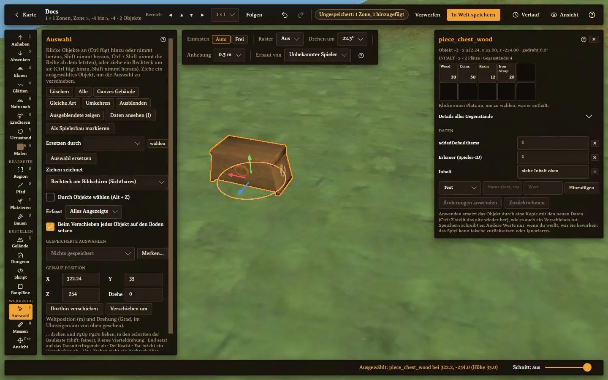
*Nah an einer Truhe mit vier Gegenständen, geöffnet im Inspektor: ihre Plätze wie im Spiel, jeder mit dem Namen des Gegenstands und
der Anzahl, dann jeder Wert unter DATEN.*

Oben: der Name, die ID, die Position und die Drehung des Objekts. Bei einem Spawnpunkt oder einem Nest, was es spawnt
(`Spawnpunkt: Boar · 0–2 ★ · spawnt einmal`); bei einem Objekt einer Mod, von welcher Mod es stammt.

| Teil | Was er tut |
|---|---|
| **INHALT** | Truhen und andere Behälter: die Plätze wie im Spiel („5 × 2 Plätze · Gegenstände: 4“). Klicke auf einen Platz, dann **Gegenstand suchen…** (tippe ein paar Buchstaben), **Anzahl** und **Qualität**. **Leeren** nimmt den Gegenstand heraus; **Verschieben**, dann ein anderer Platz, verschiebt ihn (zwei Gegenstände tauschen). Die Anzahl wird auf den größten Stapel des Spiels gekürzt. |
| **Details aller Gegenstände** | Jeder Gegenstand mit Stapel, Qualität, Haltbarkeit und Platz. **Gegenstand hinzufügen** legt einen neuen in den ersten freien Platz; **✕** nimmt einen heraus; **Plätze ordnen** verschiebt jeden Gegenstand in die ersten freien Plätze, Reihe für Reihe. |
| **HÄLT** / **TRÄGT** | Gegenstandsständer und Rüstungsständer. Die Liste bietet nur an, was das Spiel diesen Ständer aufnehmen lässt (ein flacher Ständer nimmt auch Essen, um einen Tisch zu decken). **Qual.** ist seine Qualität, **Stil** sein Aussehen, **Hängt** die Art, wie er hängt, **Pose** die Pose eines Rüstungsständers; **✕** nimmt ihn ab. |
| **DATEN** | Jeder Wert, mit dem Namen des Spiels, mit einer Beschriftung für die üblichen: Text (Schild), Tag (Portal), Erbauer (Spieler-ID), Gesundheit, Brennstoff, Stufe (Sterne)... Ändere Zahlen und Texte direkt; **✕** entfernt einen Wert (das Spiel benutzt dann seinen Standard). Andere Binärdaten werden aufgeführt, aber nicht geändert. |
| **Hinzufügen** | Fügt einen Wert hinzu, den das Objekt nicht hat: Wähle seine Art, tippe seinen Namen, wie das Spiel ihn nennt (`text` für ein Schild, `tag` für ein Portal), und den Wert. |
| **Änderungen anwenden** | Ersetzt das Objekt durch eine Kopie mit den neuen Daten, an derselben Stelle: ein Schritt zum Rückgängigmachen. **In Welt speichern** oder **Live anwenden** schreibt es. |
| **Zurücknehmen** | Vergisst die in der Karte gemachten Änderungen. |

- Die Größe eines Behälters kommt aus dem Spiel. Karren und Schiffe haben ihren Behälter an einem Teil, daher ist ihre Größe unbekannt.
- Gegenstände außerhalb der Plätze wären im Spiel verborgen: Der Editor fragt, bevor er das anwendet.
- Geänderter Inhalt wird der eigene der Truhe: Eine nie geöffnete Truhe füllt sich nicht mit der Beute des Spiels darüber.
- Ein auf einen Ständer gesetzter Gegenstand ist neu und hat volle Haltbarkeit für seine Qualität. In **Spieloptik** zeichnet die 3D-Ansicht ihn auf dem
  Ständer.
- Die Namen der Werte kommen aus dem Code des Spiels und deiner Mods (gelesen, nie ausgeführt). Ein unbekannter Name erscheint als Zahl.

> [!WARNING]
> Ändere einen Wert nur, wenn du weißt, was er tut: Das Spiel setzt Werte, die es nicht erwartet, vielleicht zurück oder ignoriert sie. `Ctrl+Z`
> setzt das alte Objekt zurück, bis du speicherst.

## Schiffe und andere verbundene Objekte

Manche Mods bauen Objekte aus anderen: das Schiff einer Schiffsmod ist eine Wurzel und die darauf gebauten Bauteile, die
Lokomotive einer Zugmod und die Wagen, die sie zieht. Wenn die Mod sie beschreibt (ihre `worldeditor.json`, siehe [Modding](modding.md),
oder ein Add-on wie das Add-on [ValheimRAFT](../../addons/ValheimRAFT/README.md) oder [Railroads](../../addons/Railroads/README.md)),
zeichnet der Editor die Gruppe so, wie die Mod sie baut, und hält sie zusammen:

- **Als Ganzes verschoben.** Einen beliebigen Teil auszuwählen und zu verschieben, zu drehen oder zu löschen erfasst die ganze Gruppe (die Statusleiste sagt es,
  in den Worten der Mod: „a whole vehicle“). Eine verschobene Gruppe behält ihre Höhe (ein Schiff bleibt schwimmend), rastet nicht ein und
  fällt nicht mit `End`.
- **Als Ganzes kopiert.** `Ctrl+C` auf einem beliebigen Teil kopiert die ganze Gruppe, ohne den Boden. Jedes Einfügen ist eine eigene Gruppe
  mit neuen IDs. Ein ohne seine Wurzel kopierter Teil wird als gewöhnliches Bauteil eingefügt.
- **Als Ganzes entfernt.** Einen beliebigen Teil zu löschen löscht die ganze Gruppe, auch wenn das Werkzeug [Region](area.md#objektaktionen)
  sie ausgewählt hat.

Claudes Werkzeuge tun dasselbe. Siehe [Was ein Objekt ist](concepts/objects.md#was-ein-objekt-ist).

## Tastenkürzel

| Taste oder Maus | Was es tut |
|---|---|
| `E` | Öffnet Auswahl. |
| `Ctrl+A` / `Alt+A` | Alles Gezeigte auswählen / die Auswahl aufheben. |
| `Ctrl+I` | Die Auswahl umkehren. |
| `Ctrl+H` / `Alt+H` | Die ausgewählten Objekte ausblenden / wieder zeigen. |
| `Alt+Z` | **Durch Objekte wählen** umschalten. |
| `Shift+F` oder Ziffernblock `.` | Die Auswahl ins Bild rücken (`F` allein wechselt die Sicht). |
| `Del` | Die Auswahl löschen. |
| `I` | Den Inspektor für das eine ausgewählte Objekt öffnen. |
| `,` `.` oder `Alt` + Mausrad | Um den Schritt **Drehen um** der Bauleiste drehen, anfangs 22.5° (`Shift`, feiner: 1°). |
| `R` | Eine Vierteldrehung drehen. |
| `PgUp` / `PgDn` oder `Ctrl` + Mausrad | Um den Schritt **Anhebung** der Bauleiste anheben oder absenken, anfangs 0.5 m (`Shift`, feiner: ein Fünftel davon). |
| `End` | Jedes Objekt auf das fallen lassen, was darunter ist. |
| `Esc` | Den Inspektor schließen; sonst ein laufendes Rechteck, einen Umriss oder ein Verschieben abbrechen; sonst zurück zum Werkzeug Ansicht (die Auswahl bleibt). |
| `Ctrl+C` / `Ctrl+X` / `Ctrl+V` | Kopieren, ausschneiden, einfügen. |
| `Ctrl+Z` | Rückgängig. Kurz nacheinander gedrückte Tasten sind ein Schritt. |

Alle Tasten des Editors stehen unter [Tastenkürzel](help/shortcuts.md).

## Tipps und Grenzen

> [!CAUTION]
> Runensteine lassen sich auswählen und löschen, aber nicht verschieben, drehen, kopieren oder untersuchen: Das Spiel baut jeden aus
> seinem Ort, wann immer die Zone lädt, daher entfernt das Löschen eines Runensteins diesen Ort endgültig (mit der kleinen Abflachung
> des Bodens darum). „In Welt speichern“ macht es dauerhaft; bis dahin holt `Ctrl+Z` ihn zurück.

- **Zurückholen:** Versehentlich gelöscht oder verschoben: `Ctrl+Z`, auch nach dem Speichern (dann erneut speichern). Etwas ausgeblendet: `Alt+H`.
  Siehe [Änderungen rückgängig machen](guides/undo-changes.md).
- Rechtecke, Umrisse, **Alle**, **Gleiche Art**, **Umkehren** und **Ganzes Gebäude** lassen alles aus, was mehr als 10 m unter dem
  Boden ist (Objekte, die eine Mod dort versteckt, etwa Handwerksstationen unter einem Haus).
- Ein Klick wählt ein Objekt nach seiner gezeichneten Form, nicht nach seinem Kasten: Ein Stein unter den Ästen eines Baums lässt sich zwischen den
  Ästen anklicken. Blätter und Gras zählen nur, wo nichts Festes dahinter ist. Siehe
  [Was ein Objekt ist](concepts/objects.md#was-ein-objekt-ist).
- Ausgewählte Objekte verlieren ihren grünen Punkt für Ungespeichertes, solange sie ausgewählt sind.
- Im Live-Modus behält ein verschobenes Objekt seine ID im laufenden Spiel, wenn sich sonst nichts daran geändert hat. Siehe
  [Was wann gesendet wird](concepts/live-editing.md#was-wann-gesendet-wird).

## Verwandte Seiten

- [Ein Gebäude verschieben oder kopieren](guides/move-a-building.md)
- [Ändern, was eine Truhe enthält oder ein Schild sagt](guides/fill-a-chest.md)
- [Ein Objekt, einen Gegenstand in einer Truhe oder ein Schild finden](guides/find-things.md)
- [Objekte](concepts/objects.md#was-ein-objekt-ist) · [Einrasten](concepts/objects.md#einrasten)
- [Bauen](build.md) · [Platzieren](place.md) · [Region](area.md)
