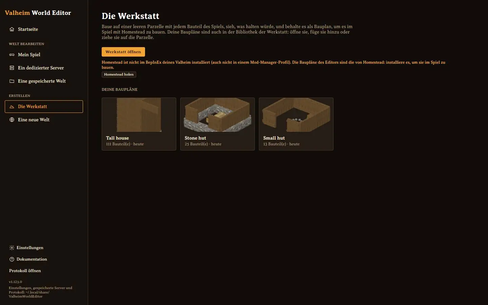
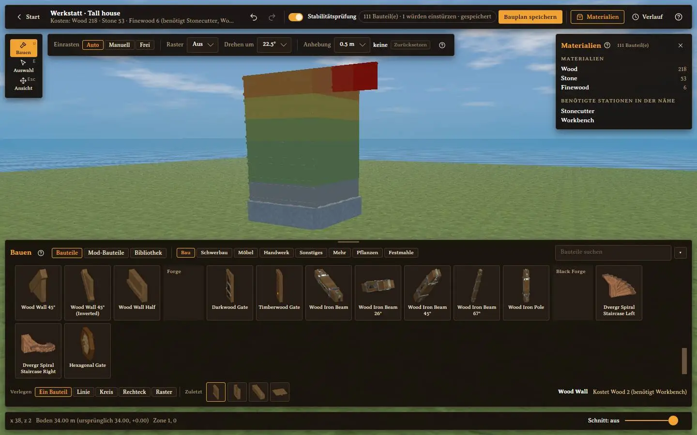
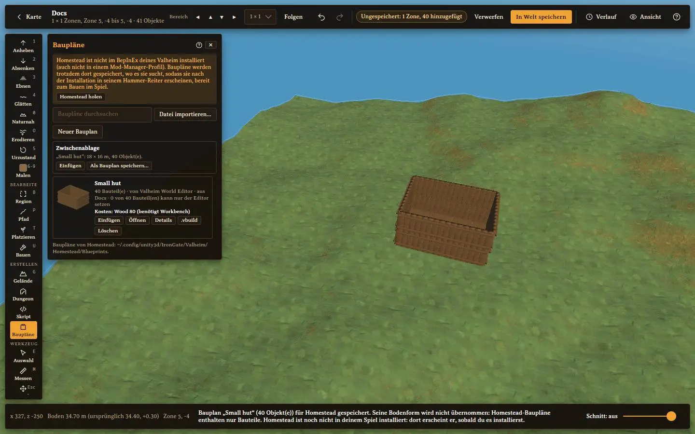

<!-- source: 491b2a7c -->
# Dein erster Bau

In etwa fünfzehn Minuten baust du in der Werkstatt eine kleine Holzhütte, siehst zu, wie die Stabilitätsprüfung sie
färbt, bewahrst sie als Bauplan auf und fügst sie in eine Welt ein. Für den ersten Teil brauchst du keine Welt: die
Werkstatt ist eine leere Parzelle.

**Du brauchst:** den installierten Editor ([Den Editor installieren](install.md)). Für den letzten Teil eine Welt mit
einer Sicherungskopie daneben, wie in [Deine erste Bearbeitung](first-edit.md).

## 1. Die Werkstatt öffnen

1. Klicke auf der Startseite auf **Die Werkstatt**, dann auf **Werkstatt öffnen**.

***Die Werkstatt** auf der Startseite: **Werkstatt öffnen**, ob Homestead installiert ist, und deine Baupläne (hier
drei; deine Liste ist beim ersten Mal leer).*

**Was du sehen solltest:** eine flache, leere Parzelle aus Wiese, die Leiste **Bauen** am unteren Rand auf ihrem Reiter
**Bauteile** und die obere Leiste mit „Noch keine Bauteile“. Die Werkzeugleiste enthält nur **Bauen**, **Auswahl** und
**Ansicht**, mit der Bauleiste daneben.

## 2. Einen Boden legen

1. Tippe in der Leiste **Bauen** `wood floor` in **Bauteile suchen** ein.
2. Klicke auf die Kachel des Holzbodens. Sein Name und seine Kosten erscheinen am Fuß der Leiste, und er kommt dort zu
   **Zuletzt** hinzu.
3. Klicke in die Mitte der Parzelle. Der Boden wird gesetzt.
4. Zeige neben die Kante des Bodens und klicke erneut. Der neue Boden rastet am ersten ein, Kante an Kante, wie mit dem
   Hammer des Spiels. Setze vier Böden zu einem Quadrat.

**Was du sehen solltest:** einen quadratischen Boden, jedes Bauteil hellblau gefärbt: es steht auf dem Boden und hat
daher volle Stabilität. Die obere Leiste zählt „4 Bauteil(e) · nicht als Bauplan gespeichert“, und unter dem Titel
stehen die Kosten der Hütte.

## 3. Die Wände hochziehen

1. Suche `wood wall` und klicke auf die Kachel der Holzwand.
2. Zeige auf die Außenkante eines Bodens und klicke: die Wand rastet auf der Kante ein. Drücke vorher `,` oder `.`, um
   sie zu drehen, falls sie in die falsche Richtung zeigt.
3. Setze Wände rund um den Boden. Lass eine Lücke für eine Tür.
4. Suche `wood door`, klicke auf ihre Kachel und setze die Tür in die Lücke.
5. Setze eine zweite Reihe Wände auf die erste.

*Die Stabilitätsprüfung an einem hohen Haus: der Steinsockel hellblau, die Wände darüber grün, dann gelb und orange,
wenn ihre Stabilität nachlässt, und ein Überhang rot: er würde einstürzen.*

**Was du sehen solltest:** die Wände auf dem Boden sind grün (stark); die zweite Reihe ist heller grün oder gelb, mit
weniger Stabilität. Ein Bauteil, das im Spiel einstürzen würde, wird rot, und die obere Leiste sagt, wie viele
einstürzen würden. Warum: siehe [Die Stabilitätsprüfung](../concepts/objects.md#die-stabilitätsprüfung).

Ein Bauteil am falschen Platz? Drücke `Ctrl+Z`, um es rückgängig zu machen, oder drücke `E` (**Auswahl**), klicke das
Bauteil an, drücke `Del` und drücke `U`, um wieder zu bauen.

## 4. Den Bauplan speichern

1. Klicke in der oberen Leiste auf **Bauplan speichern** (oder drücke `Ctrl+S`).
2. Tippe `My first hut` als **Name**, ein paar Wörter als **Beschreibung** und `hut, wood` als **Tags** ein.
3. Klicke auf **Speichern**. Würden einige Bauteile im Spiel einstürzen, fragt der Editor vorher: **Weiterbauen**, um sie
   zu reparieren (sie sind rot), oder **Trotzdem speichern**.

**Was du sehen solltest:** die Meldung „Bauplan „My first hut“ (… Objekt(e)) für Homestead gespeichert.“, und die obere
Leiste sagt „gespeichert“. Der Bauplan ist jetzt in deiner Bibliothek, mit einem Bild der Hütte. Ist die Mod
[Homestead](https://thunderstore.io/c/valheim/p/sighsorry/Homestead/) in deinem Spiel, erscheint er auch in ihrem
Hammer-Reiter, bereit zum Bauen im Spiel.

## 5. In eine Welt einfügen

1. Klicke oben links auf **Start**, um zur Startseite zurückzukehren.
2. Klicke auf **Eine gespeicherte Welt**, dann auf deine Welt (nicht ihre Sicherungskopie). Klicke auf ihrer Karte eine
   Stelle offenen Bodens an, die du besucht hast, und klicke auf **In 3D bearbeiten**.
3. Klicke in der Werkzeugleiste unter **ERSTELLEN** auf **Baupläne**. In einem niedrigen Fenster scrolle die
   Werkzeugleiste mit dem Mausrad, um dorthin zu kommen.
4. Such **My first hut** in der Liste und klicke auf seine Schaltfläche **Einfügen**.
5. Bewege die Maus über offenen Boden: die Hütte folgt ihr, durchsichtig. Drücke `R`, um sie um eine Vierteldrehung zu
   drehen.
6. Klicke, um sie zu setzen, und drücke dann `Esc`, um das Einfügen zu beenden.

*Das Panel **Baupläne** neben der Werkzeugleiste: eine gespeicherte Hütte mit ihrem Bild, ihren Kosten und ihrer
Schaltfläche **Einfügen**.*

**Was du sehen solltest:** die Hütte steht auf dem Boden. Mit **Platz räumen** an im Panel Einfügen (anfangs an) ist der
Boden in ihrem Weg abgetragen, und die Bäume und Felsen auf ihrem Platz sind weg. Die obere Leiste sagt „Ungespeichert:
… hinzugefügt“.

Ein roter Umriss vor dem Klick bedeutet, dass die Hütte nicht in den offenen Bereich passt: öffne auf der Karte einen
größeren.

## 6. Die Welt speichern

1. Schließe Valheim, falls es läuft.
2. Klicke auf **In Welt speichern**, prüfe den **Weltordner** in der Frage und klicke dann auf **Speichern**.
3. Starte Valheim, lade die Welt und geh zu der Stelle.

**Was du sehen solltest:** deine Hütte, die dort steht, wo du sie eingefügt hast. Ihre Bauteile sind von Spielern
gebaut, daher behandelt das Spiel sie als deine Basis (siehe
[Von Spielern gebaute Bauteile](../concepts/objects.md#von-spielern-gebaute-bauteile)).

## Wenn es nicht geklappt hat

- **Ein Bauteil rastet nicht ein**: zeige näher an die Kante oder Oberseite des vorhandenen Bauteils; Einrasten nimmt die
  nächsten Einrastpunkte innerhalb eines halben Meters.
- **Die Werkstatt sagt, Homestead sei nicht installiert**: das ist in Ordnung. Baupläne werden dort gespeichert, wo
  Homestead sie sucht, und das Einfügen in eine Welt funktioniert ohne es.
- **Der Umriss des Einfügens ist rot**: die Hütte ist zu nah am Rand des Bereichs. Bewege die Maus nach innen oder öffne
  einen größeren Bereich.
- **Dir gefällt das Ergebnis nicht**: `Ctrl+Z` nimmt das Einfügen vor dem Speichern zurück. Nach dem Speichern mach es
  rückgängig und drücke erneut **In Welt speichern**: siehe
  [Einen Schritt rückgängig machen, eine Änderung zurücknehmen oder alles verwerfen](../guides/undo-changes.md).

## Weiter

- [Die Werkstatt](../workshop.md): jeder Bauteilreiter, die Bibliothek, Schnitt und wie Bauteile einrasten.
- [Einen Bauplan in eine Welt einfügen](../guides/paste-a-blueprint.md)
- [Ein Gebäude verschieben oder kopieren](../guides/move-a-building.md)
