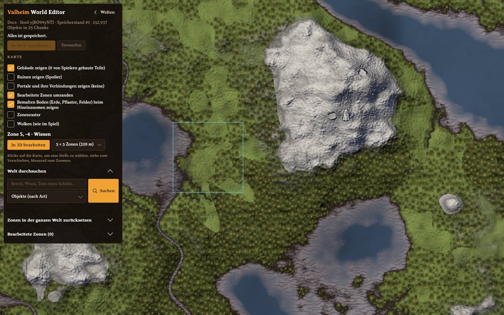
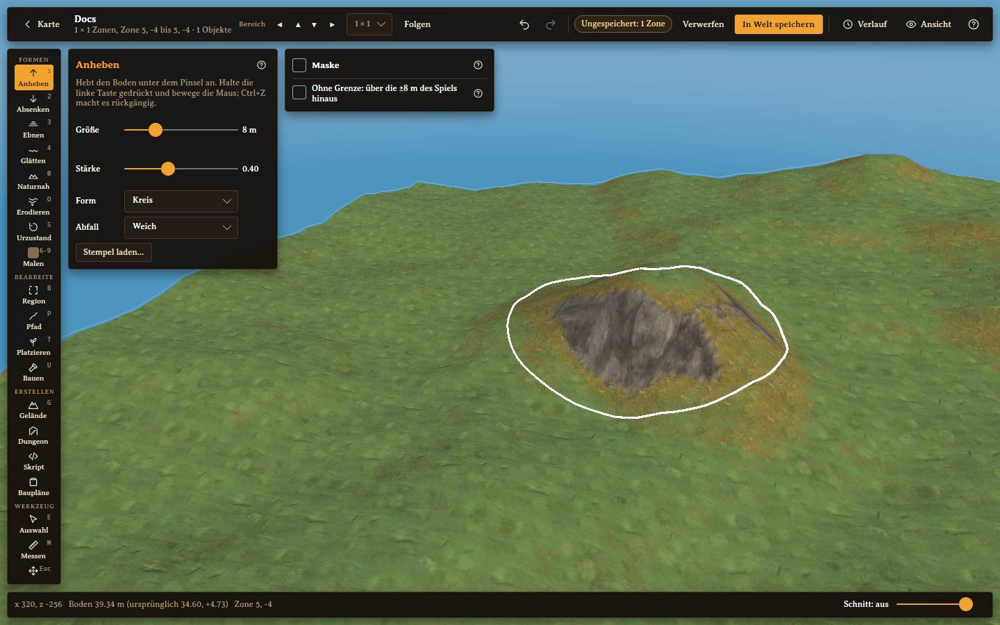
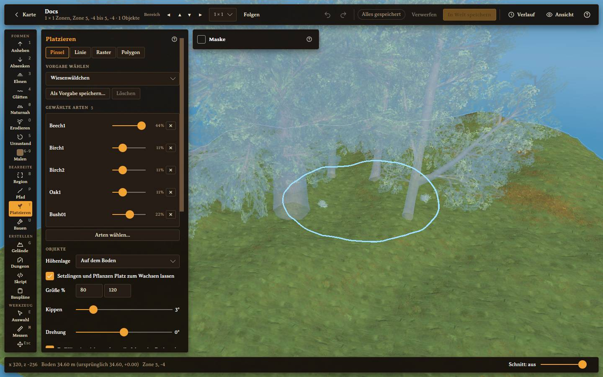
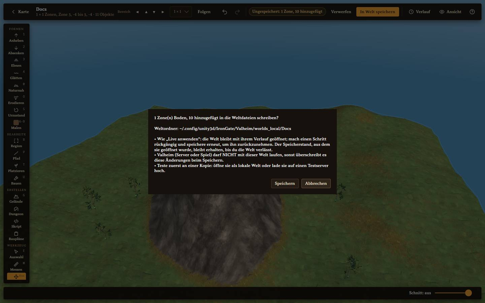

<!-- source: b94e61af -->
# Deine erste Bearbeitung

In etwa zehn Minuten kopierst du eine Welt, hebst einen kleinen Hügel an und pflanzt ein paar Bäume neben deiner Basis, machst rückgängig und wiederholst,
speicherst und gehst in Valheim zum Ergebnis. Die Kopie bewahrt die Welt, wie sie war, daher kann nichts verloren gehen.

**Du brauchst:** den installierten Editor ([Den Editor installieren](install.md)) und eine Einzelspielerwelt, in der du gespielt hast:
eine, in der du eine Basis gebaut und mindestens einmal die Hacke oder die Spitzhacke benutzt hast. Valheim muss geschlossen sein.

## 1. Die Welt kopieren

Die Kopie ist dein Weg zurück: Was immer du als Nächstes tust, du kannst die Welt genau so zurücksetzen, wie sie jetzt ist.

1. Schließe Valheim.
2. Klicke im Editor auf der Startseite auf **Eine gespeicherte Welt** und fahre mit der Maus über die Karte deiner Welt. Der Tooltip endet mit dem
   Ordner der Welt, zum Beispiel `…/IronGate/Valheim/worlds_local/Midgard`.
3. Öffne in deinem Dateimanager den Ordner `worlds_local`, der ihn enthält.
4. Kopiere den Ordner der Welt und füge die Kopie in denselben Ordner `worlds_local` ein.
5. Benenne die Kopie in `<World>_backup_<date>` um, zum Beispiel `Midgard_backup_2026-10-22`.

**Was du sehen solltest:** Nach ein paar Sekunden führt **Eine gespeicherte Welt** beide auf: deine Welt und
`Midgard_backup_2026-10-22`. Du bearbeitest die Welt selbst; die Kopie bleibt unberührt daneben. Mehr zu Kopien:
[Eine Welt vor dem Bearbeiten sichern](../guides/back-up-a-world.md).

## 2. Die Welt öffnen

1. Klicke unter **Eine gespeicherte Welt** auf deine Welt (nicht die Kopie). Sie öffnet sich auf ihrer Karte.
2. Klicke auf der Karte auf eine Stelle offenen Bodens nahe deiner Basis.
3. Wähle im Seitenpanel in der Größenliste neben **In 3D bearbeiten** **3 × 3 Zonen (192 m)**, dann klicke auf **In 3D
   bearbeiten**.

*Die Karte: Ein Klick hat eine Zone gewählt (das blaue Quadrat); **In 3D bearbeiten** öffnet sie mit der daneben gewählten Größe.*

**Was du sehen solltest:** die 3D-Ansicht deiner Basis und des Landes darum, die Werkzeugleiste links und die obere
Leiste mit „Alles gespeichert“. Ist die Ansicht weit weg, scrolle mit dem Mausrad näher heran; rechts ziehen dreht die Ansicht.

## 3. Einen Hügel anheben

1. Drücke `1` oder klicke in der Leiste auf **Anheben**. Sein Panel öffnet sich neben der Leiste.
2. Ziehe im Panel **Größe** auf etwa 10 m.
3. Halte auf offenem Boden neben deiner Basis die linke Maustaste gedrückt und bewege die Maus ein paar
   Sekunden lang in kleinen Kreisen.

*Anheben: der Umriss des Pinsels auf dem Boden, ein daneben angehobener Hügel und das Panel mit **Größe** und **Stärke**.*

**Was du sehen solltest:** Der Boden hebt sich unter dem Pinsel, und die obere Leiste zeigt „Ungespeichert: 1 Zone“ in Bernstein. Noch
wird nichts in die Welt geschrieben: Die Änderung ist [ausstehend](../concepts/saving-and-history.md#ausstehende-änderungen).

## 4. Bäume pflanzen

1. Drücke `T` oder klicke in der Leiste auf **Platzieren**.
2. Klicke im Panel **Platzieren** auf **Pinsel**, dann wähle unter **Vorgabe wählen** **Wiesenwäldchen**.
3. Ziehe die Maus am Fuß deines Hügels entlang.

*Platzieren mit **Pinsel** und der Vorgabe **Wiesenwäldchen**: Der Pinsel zeigt die nächsten Bäume durchsichtig; die gepflanzten
stehen um ihn herum.*

**Was du sehen solltest:** Buchen, Birken, Eichen und Büsche erscheinen, wo du ziehst, jeder mit einem kleinen grünen Punkt (noch nicht
gespeichert), und die obere Leiste ergänzt „… hinzugefügt“.

## 5. Rückgängig machen und wiederholen

1. Drücke `Ctrl+Z` (`Cmd+Z` auf einem Mac). Die zuletzt gepflanzten Bäume verschwinden.
2. Drücke `Ctrl+Y`. Sie kommen zurück.
3. Drücke `L`, um den **Verlauf** zu öffnen.

**Was du sehen solltest:** Der Verlauf führt deine Schritte auf, die neuesten zuerst: „Platziert: …“, dann Anheben. **Zurück bis hier** in einer Zeile
geht zu ihr zurück; **Entfernen** nimmt nur diese eine Änderung heraus. Drücke erneut `L`, um ihn zu schließen.

Mehr: [Einen Schritt rückgängig machen, eine Änderung zurücknehmen oder alles verwerfen](../guides/undo-changes.md).

## 6. Speichern

1. Klicke in der oberen Leiste auf **In Welt speichern** (oder drücke `Ctrl+S`).
2. Lies die Frage: Sie sagt, was sie schreibt, und nennt den **Weltordner**. Prüfe, dass der Ordner deine Welt ist, nicht die
   Kopie, dann klicke auf **Speichern**.

*Die Frage vor dem Speichern: Prüfe die Zeile **Weltordner**, dann klicke auf **Speichern**.*

**Was du sehen solltest:** Die Statusleiste sagt „1 Zone(n), … neue(s) Objekt(e) in Speicherstand #… gespeichert“, die obere Leiste zeigt „Alles
gespeichert“, und die grünen Punkte sind weg. Der Editor hat einen neuen Speicherstand neben den alten geschrieben und ihn zur Prüfung zurückgelesen.

Die Welt bleibt mit ihrem Verlauf offen: Du kannst weiterhin einen Schritt rückgängig machen und erneut speichern, um ihn zurückzunehmen.

## 7. Im Spiel ansehen

1. Klicke oben links auf **Karte**, dann auf **Welten**, um die Welt zu verlassen.
2. Starte Valheim und lade die Welt.
3. Geh zu der Stelle neben deiner Basis.

**Was du sehen solltest:** deinen Hügel und deine Bäume, wie im Editor. Das Spiel speichert sie ab jetzt wie gewohnt.

## Wenn es nicht geklappt hat

- **„Nicht gespeichert: … not generated yet“** (noch nicht erzeugt): Du hast eine Zone bearbeitet, die kein Spieler besucht hat, daher hat die Welt dort keine Daten.
  Wähle eine Stelle, an der du schon warst, oder besuche sie zuerst im Spiel.
- **„… the world has no terrain object to copy yet“** (noch kein Geländeobjekt zum Kopieren): Niemand hat in dieser Welt je den Boden gegraben oder geebnet. Benutze im
  Spiel irgendwo einmal die Hacke oder die Spitzhacke, speichere, beende das Spiel und speichere im Editor erneut.
- **„Valheim hat diese Welt gespeichert … nachdem der Editor sie gelesen hat“**: Das Spiel lief oder hat die Welt gespeichert, während du
  bearbeitet hast. Siehe [In Welt speichern](../editor-basics.md#in-welt-speichern).
- **Dir gefällt das Ergebnis nicht**: Öffne die Welt erneut, mache rückgängig (oder nimm die Schritte im Verlauf mit **Entfernen** heraus), dann **In Welt
  speichern**. Oder setze die Kopie zurück: siehe [Eine Welt vor dem Bearbeiten sichern](../guides/back-up-a-world.md#rückgängig-machen).

## Weiter

- [Dein erster Bau](first-build.md): Baue eine Hütte in der Werkstatt und füge sie in diese Welt ein.
- [Das Editorfenster](../editor-basics.md): jeder Teil des Fensters.
- [Tastenkürzel](../help/shortcuts.md): jede Taste und Mausaktion.

Im Editor öffnet `F1` (oder das kleine **?** oben in einem Panel) diese Hilfe beim Werkzeug, das du gerade benutzt.
