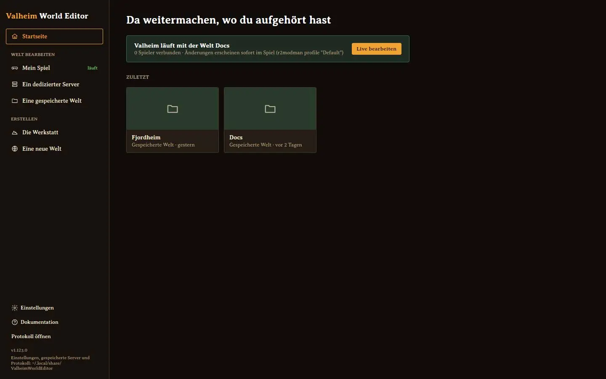
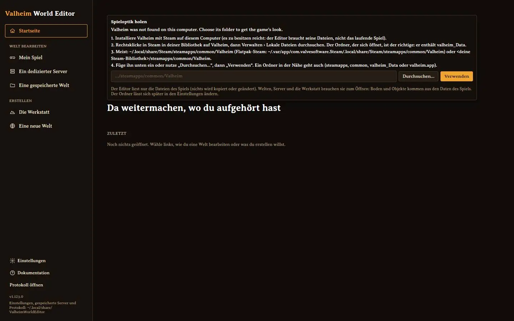
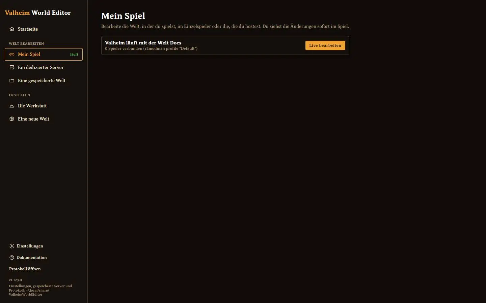
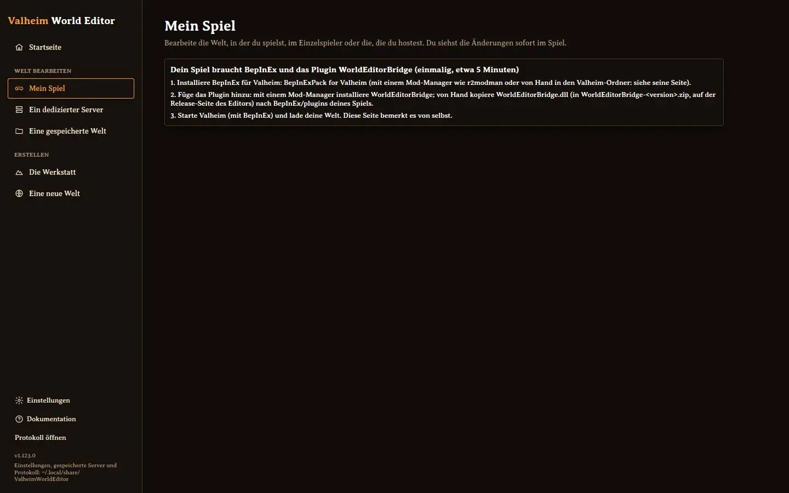

<!-- source: 68ffaeda -->
# Den Editor installieren

Lade den Editor herunter, starte ihn und lass ihn dein Valheim finden. Am Ende ist der Editor auf seiner Startseite
geöffnet und hat die Dateien des Spiels gelesen, bereit für [deine erste Bearbeitung](first-edit.md).

## Was du brauchst

- **Windows 10 oder 11** oder **Linux**, 64 Bit; oder **macOS 12 oder neuer auf einem Mac mit Apple Silicon** (M1
  und neuer). Die Mac-Version ist experimentell: Sie wurde noch nicht auf einem Mac ausprobiert, und Intel-Macs werden
  nicht unterstützt.
- **Valheim**, über Steam auf demselben Computer installiert. Es zu besitzen reicht: Der Editor liest die Dateien des
  Spiels (seine Texturen, Modelle, Gelände und Karte), er braucht das Spiel nicht laufend. Nichts wird kopiert oder
  geändert.

Du musst nichts weiter installieren. Alles, was der Editor braucht, ist im Download enthalten.

## Herunterladen

1. Öffne die [Release-Seite](https://github.com/Shuiei/valheim-world-editor/releases/latest).
2. Lade die Datei für deinen Computer herunter:
   - Windows: `ValheimWorldEditor-v<version>-win-x64.zip`
   - Linux: `ValheimWorldEditor-v<version>-linux-x64.tar.gz`
   - macOS: `ValheimWorldEditor-v<version>-macos-arm64-experimental.zip`

Den Editor gibt es auch auf [Nexus Mods](https://www.nexusmods.com/valheim/mods/4348). Der Editor ist ein Programm,
keine Mod: Thunderstore und Hexium führen nur sein Plugin (siehe
[Das Plugin für die Live-Bearbeitung](#das-plugin-für-die-live-bearbeitung)).

## Unter Windows starten

1. Entpacke den Download an einen beliebigen Ort, zum Beispiel auf den Desktop. Halte seine Dateien zusammen:
   `ValheimWorldEditor.exe` braucht die `.dll`-Dateien daneben. Starte ihn nicht aus dem Zip heraus.
2. Doppelklicke auf `ValheimWorldEditor.exe`.
3. Wenn Windows „Der Computer wurde durch Windows geschützt“ meldet, klicke auf **Weitere Informationen** (es nennt
   den Herausgeber), dann auf **Trotzdem ausführen**. Windows fragt das, bis SmartScreen die Signatur des Editors
   kennt.

<!-- picture: install-smartscreen.jpg: Windows 11, the blue "Windows protected your PC" dialog after More info was clicked, the publisher line and the Run anyway button visible, nothing else on screen -->

## Unter Linux starten

1. Entpacke den Download an einen beliebigen Ort, zum Beispiel in deinen Home-Ordner.
2. Doppelklicke im Ordner auf `ValheimWorldEditor`. Wenn dein Dateimanager ihn als Text öffnet oder fragt, was zu tun
   ist, wähle **Ausführen** (oder Rechtsklick, **Als Programm ausführen**). Aus einem Terminal:
   `./ValheimWorldEditor`.

Der Editor zeichnet mit OpenGL 3.3, das jeder Grafiktreiber der letzten zehn Jahre hat (Mesa, AMD, NVIDIA, Intel).

## Unter macOS starten (experimentell)

1. Entpacke den Download und verschiebe **ValheimWorldEditor.app** an einen Ort deiner Wahl, zum Beispiel in
   Programme.
2. Doppelklicke einmal darauf. macOS verweigert das Öffnen, weil der Editor nicht mit einem Apple-Developer-Zertifikat
   signiert ist. Schließe die Meldung.
3. Öffne **Systemeinstellungen › Datenschutz & Sicherheit**, scrolle nach unten zu **Sicherheit**, klicke neben
   ValheimWorldEditor auf **Dennoch öffnen** und bestätige mit deinem Passwort.
4. Doppelklicke erneut auf die App. Ab jetzt öffnet sie sich mit einem Doppelklick.

Statt der Schritte 2 und 3 kannst du im Terminal ausführen:
`xattr -dr com.apple.quarantine /Applications/ValheimWorldEditor.app` (mit dem Pfad, an den du sie gelegt hast).

Auf einem Mac funktioniert `Cmd` überall dort, wo die Dokumentation `Ctrl` sagt: `Cmd+Z` macht rückgängig,
`Cmd`+Klick fügt zu einer Auswahl hinzu. Das Gelände des Spiels wird mit dem eigenen Shader des Spiels gezeichnet,
wenn das Mac-Spiel einen mitbringt, den der Editor lesen kann, sonst in einfachen Farben. Wenn etwas nicht
funktioniert, [eröffne ein Issue](https://github.com/Shuiei/valheim-world-editor/issues) mit dem Protokoll des
Editors (**Protokoll öffnen** auf der Startseite).

## Der erste Start

Der Editor öffnet sich in einem eigenen Fenster, auf der Startseite, im Bereich **Startseite**. Beim ersten Mal und nach
jedem Valheim-Update zeigt eine Karte **Spieloptik wird vorbereitet**, während der Editor ein paar Sekunden lang die
Dateien des Spiels liest. Welten, Server und die Werkstatt öffnen sich, sobald sie **Die Spieloptik ist bereit.**
zeigt.

*Die Startseite: das Seitenmenü links, „Startseite“ rechts. Sobald eine Welt geöffnet wurde, erscheint sie unter
„Zuletzt“.*

## Wenn Valheim nicht gefunden wird

Der Editor sucht selbst in jeder Steam-Bibliothek (auch in Flatpak-Steam). Wenn er das Spiel nicht findet, zeigt die
Karte **Spieloptik holen** und „Valheim wurde auf diesem Computer nicht gefunden.“

*Die Schritte der Karte sagen, wo der Ordner zu finden ist; füge ihn in das Feld ein (oder **Durchsuchen…**), dann
**Verwenden**.*

1. Rechtsklicke in Steam in deiner Bibliothek auf Valheim, dann **Verwalten › Lokale Dateien durchsuchen**. Der
   Ordner, der sich öffnet, ist der richtige: Er enthält `valheim_Data` (`valheim.app` auf einem Mac).
2. Kopiere seinen Pfad, füge ihn in das Feld der Karte ein (oder klicke auf **Durchsuchen…** und wähle ihn), dann
   klicke auf **Verwenden**.

Die üblichen Orte sind:

- Windows: `C:\Program Files (x86)\Steam\steamapps\common\Valheim`
- Linux: `~/.local/share/Steam/steamapps/common/Valheim` (Flatpak-Steam:
  `~/.var/app/com.valvesoftware.Steam/.local/share/Steam/steamapps/common/Valheim`)
- macOS: `~/Library/Application Support/Steam/steamapps/common/Valheim`
- Eine andere Steam-Bibliothek: `<library>/steamapps/common/Valheim`

Ein Ordner in der Nähe geht auch (`steamapps`, `common`, `valheim_Data` oder `valheim.app`): Der Editor findet den
Spielordner von dort aus. Du kannst ihn später in den **Einstellungen** ändern (**Spielordner von Valheim**), siehe
[Einstellungen](../editor-basics.md#einstellungen).

## Das Plugin für die Live-Bearbeitung

Um eine Welt zu bearbeiten, während das Spiel läuft (dein eigenes Spiel oder ein dedizierter Server, während andere
spielen), braucht das Spiel, das die Welt hostet, **BepInEx** und das Plugin **WorldEditorBridge** des Editors.
Spieler, die beitreten, brauchen keins von beiden, auch nicht auf Konsolen. Um gespeicherte Welten bei geschlossenem
Spiel zu bearbeiten oder in der Werkstatt zu bauen, brauchst du keins von beiden.

Für dein eigenes Spiel:

1. Installiere einmalig BepInEx: [BepInExPack for Valheim](https://thunderstore.io/c/valheim/p/denikson/BepInExPack_Valheim/),
   mit einem Mod-Manager (r2modman, Thunderstore Mod Manager) oder von Hand in den Valheim-Ordner, wie seine Seite es
   beschreibt.
2. Füge das Plugin hinzu. Mit einem Mod-Manager installiere WorldEditorBridge von
   [Thunderstore](https://thunderstore.io/c/valheim/p/Tie/WorldEditorBridge/) oder
   [Hexium](https://valheim.hexium.gg/mods/Tie/WorldEditorBridge) (BepInEx kommt mit). Von Hand kopiere
   `WorldEditorBridge.dll` aus `WorldEditorBridge-<version>.zip` (auf der
   [Release-Seite](https://github.com/Shuiei/valheim-world-editor/releases/latest) oder auf
   [Nexus Mods](https://www.nexusmods.com/valheim/mods/4348)) nach `BepInEx/plugins` deines Valheim. Verwende dieselbe
   Version wie die des Editors.
3. Starte Valheim mit BepInEx und lade deine Welt (Einzelspieler oder ein Server, den du aus dem Spiel startest). Bei
   diesem ersten Start schreibt das Plugin seine Einstellungen, `BepInEx/config/Tie.WorldEditorBridge.cfg`, mit einem
   zufälligen **Token**.
4. Auf der Startseite des Editors zeigt die **Startseite** jetzt „Valheim läuft mit der Welt …“ und **Mein Spiel**
   zeigt *läuft*. Der Editor findet das Plugin und sein Token selbst, auch in Mod-Manager-Profilen. Klicke auf **Live
   bearbeiten**.

***Mein Spiel** bei laufendem Spiel: Die Karte nennt die Welt, die verbundenen Spieler und wo das Plugin gefunden wurde
(hier ein r2modman-Profil), mit **Live bearbeiten**.*

Solange das Spiel nicht läuft, sagt **Mein Spiel** Schritt für Schritt, was fehlt.

***Mein Spiel** bevor BepInEx installiert ist: die drei Schritte, einmalig zu erledigen. Die Seite bemerkt das Spiel
von selbst, sobald es läuft.*

Folge dann [Die Welt bearbeiten, die du gerade spielst](../guides/edit-your-game-live.md).

Für einen **dedizierten Server** installiere BepInEx (nach der Anleitung von BepInExPack für dedizierte Server) und
kopiere `WorldEditorBridge.dll` nach `BepInEx/plugins` des Servers (oder installiere das Plugin im Serverprofil eines
Mod-Managers), dann starte den Server einmal, damit er sein Token schreibt. Der Editor verbindet sich per SSH damit,
über seinen eigenen verschlüsselten Tunnel, daher muss der Server dir SSH-Zugang zu seiner Maschine geben: siehe
[Einen dedizierten Server bearbeiten, während gespielt wird](../guides/edit-a-server-live.md). Ein bei einem Hoster
gemieteter Spieleserver hat oft keinen SSH-Zugang: siehe
[Einen gemieteten oder über ein Panel gehosteten Server bearbeiten](../guides/edit-a-rented-server.md).

## Add-ons für Mods

Manche Mods für Weltgenerierung und Bauen brauchen ein **Add-on**, damit der Editor darstellen oder bearbeiten kann,
was sie erzeugen. Jedes ist ein eigener Download auf der
[Release-Seite](https://github.com/Shuiei/valheim-world-editor/releases/latest):
`ValheimWorldEditor-addon-<Name>-<version>.zip`.

1. Entpacke das Add-on in den Ordner `addons` neben dem Editor (unter macOS neben `ValheimWorldEditor.app`).
2. Öffne die **Einstellungen**: Unter **Add-ons** wird das Add-on aufgeführt, mit der Angabe, ob es genutzt wird. Ein
   Add-on wird genutzt, solange seine Mod in deinen BepInEx-Plugin-Ordnern liegt; sein Schalter deaktiviert es, ohne
   es zu entfernen.

| Add-on | Für |
|---|---|
| [Expand World](../../../addons/ExpandWorld/README.md) | Welten, die mit den Expand-World-Mods (Size, Rivers, Data) erstellt wurden. |
| [Riverheim](../../../addons/Riverheim/README.md) | Welten, die mit Riverheim erstellt wurden. |
| [Tunnelheim](../../../addons/Tunnelheim/README.md) | Die Tunnel, die Tunnelheim gräbt, und ein Werkzeug Tunnel. |
| [Railroads](../../../addons/Railroads/README.md) | Gleise, Bahnhöfe und Züge von Railroads. |
| [ValheimRAFT](../../../addons/ValheimRAFT/README.md) | Die Schiffe und Landfahrzeuge von ValheimRAFT, jedes als Ganzes verschoben, kopiert und gelöscht. |

Ein Add-on ist Code, der im Editor läuft: Installiere nur solche, denen du vertraust. Siehe
[Eine mit Expand World, Riverheim oder Tunnelheim erstellte Welt bearbeiten](../guides/use-mods-worlds.md).

## Wo der Editor seine Dateien ablegt

Seine Einstellungen, gespeicherten Server (`servers.cfg`), was er sich zwischen den Starts merkt, der Index der
Spieldateien (`game-index.json`) und sein Protokoll (`ValheimWorldEditor.log`, bei jedem Start ein neues) liegen in:

- Windows: `%LOCALAPPDATA%\ValheimWorldEditor`
- Linux: `~/.local/share/ValheimWorldEditor`
- macOS: `~/Library/Application Support/ValheimWorldEditor`

Der untere Teil des Menüs der Startseite zeigt diesen Ordner, und **Protokoll öffnen** öffnet das Protokoll. Deine
Baupläne liegen im Ordner von Homestead, siehe [die Werkstatt](../workshop.md).

## Weiter

[Deine erste Bearbeitung](first-edit.md): eine Welt sichern, einen Hügel anheben, Bäume pflanzen, speichern und es im
Spiel ansehen.
