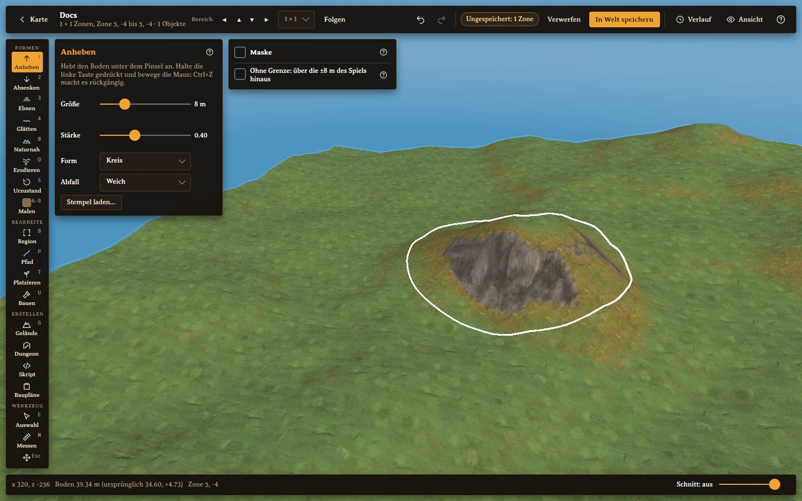
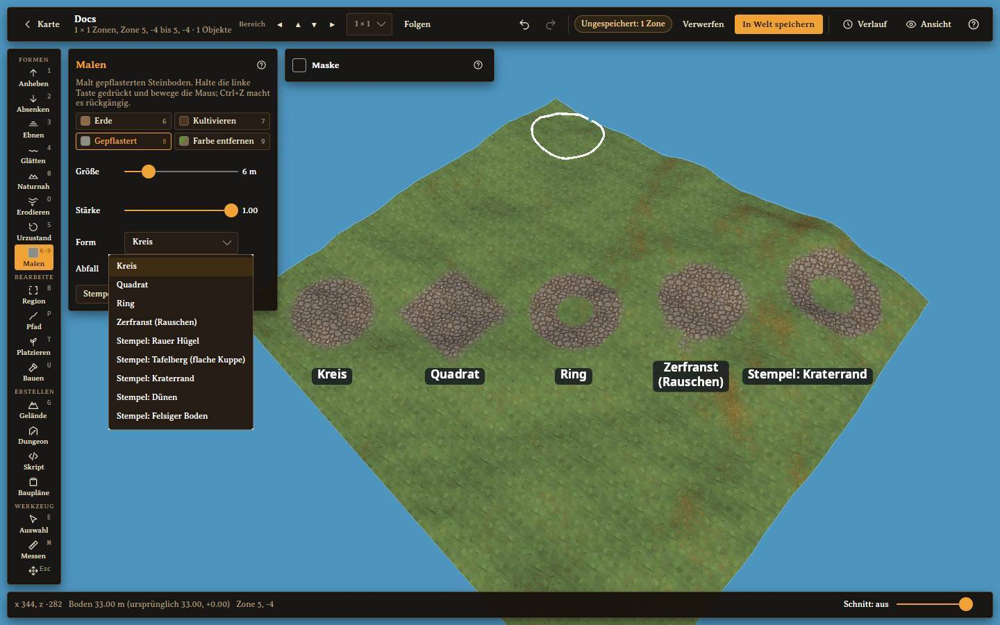
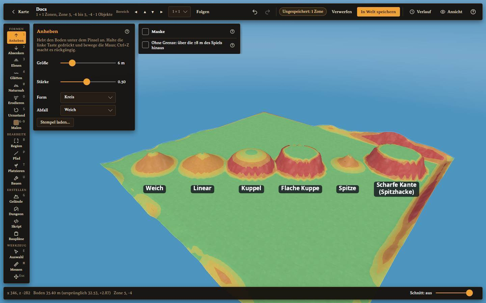
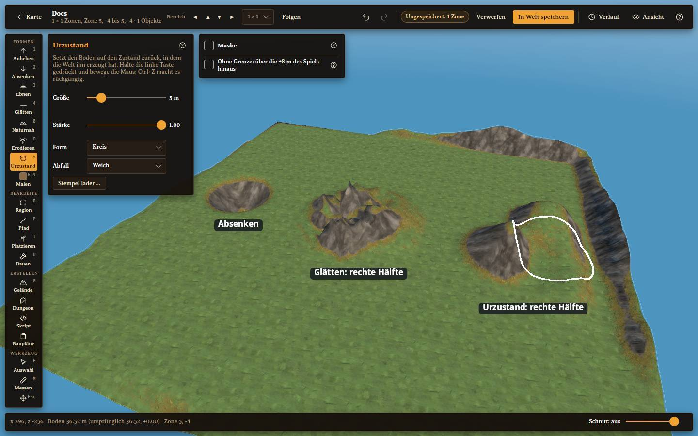
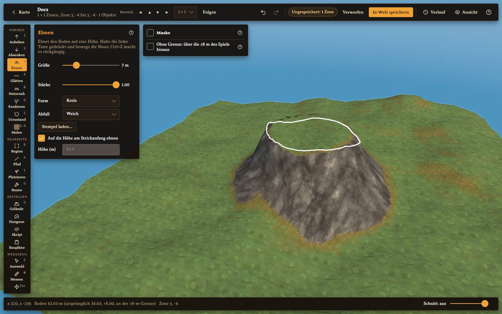
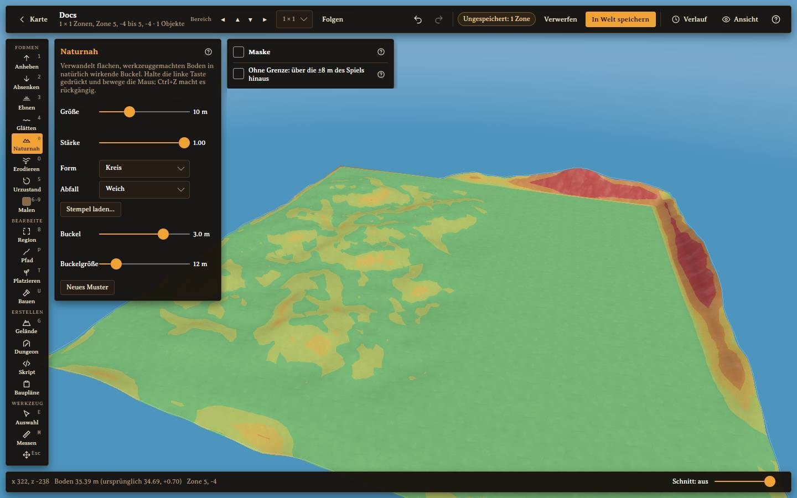
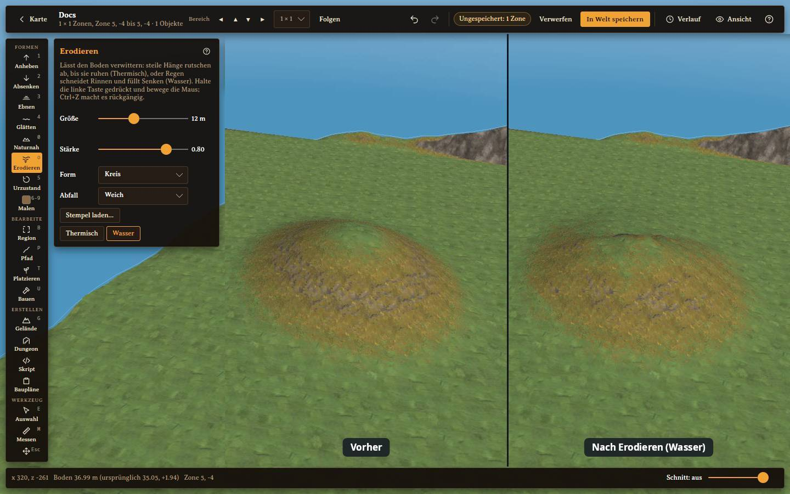
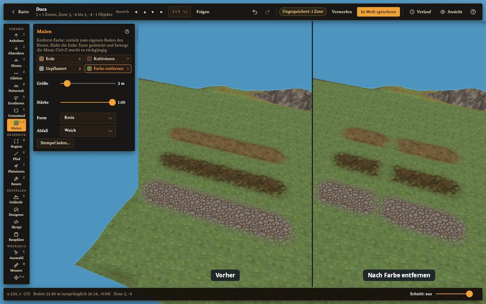
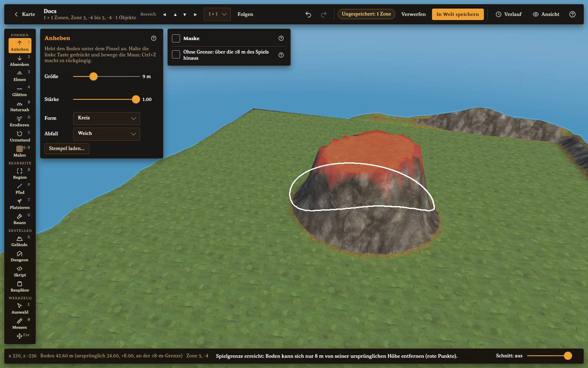
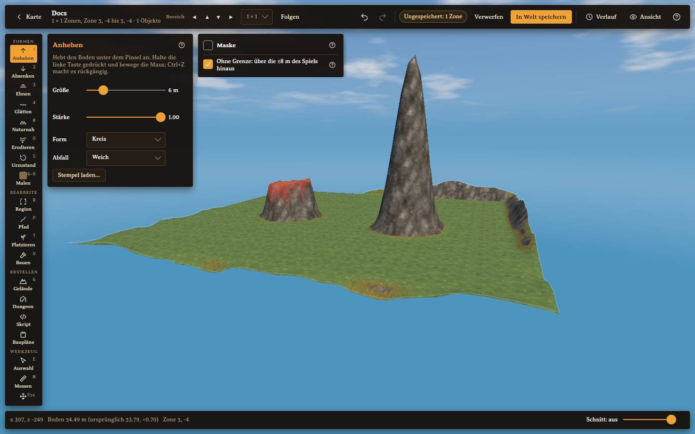

<!-- source: 9d7cf01c -->
# Formen und Malen

Hebe, senke, ebne, glätte und bemale den Boden mit einem Pinsel, den du gedrückt hältst und ziehst, wie mit Hacke,
Spitzhacke und Kultivator im Spiel, nur schneller und größer.

**Wo:** Werkzeugleiste, Abschnitt **FORMEN** · **Tasten:** `1` bis `9`, `0`, `O` · **Funktioniert in:** gespeicherten
Welten, live

*Ein Erdhügel aus drei Strichen mit Anheben. Der weiße Ring auf seiner Kuppe ist der Pinsel; das Panel links enthält
seine Einstellungen.*

Jede Änderung folgt den eigenen Regeln des Spiels, sodass die Welt im Spiel jedes Spielers lädt, auch auf Konsolen,
ohne Mod. Jeder Strich ist ein Rückgängig-Schritt (`Ctrl+Z`).

## Benutzen

1. Klicke in der Werkzeugleiste auf einen Pinsel unter **FORMEN** oder drücke seine Taste (siehe
   [Tastenkürzel](#tastenkürzel)). Um zu malen, klicke auf **Malen** und wähle die Farbe in seinem Panel (siehe
   [Malpinsel](#malpinsel)).
2. Stelle im Panel **Größe** und **Stärke** ein. `[` und `]` ändern die Größe während der Arbeit.
3. Halte die linke Maustaste auf dem Boden gedrückt und bewege die Maus. Der Pinsel wirkt, solange die Taste gedrückt
   ist; hältst du still, bearbeitet er dieselbe Stelle also immer stärker.
4. Lass los. Der ganze Strich ist ein Rückgängig-Schritt, benannt nach dem Pinsel („Anheben“).
5. Um die Änderung zu behalten, **In Welt speichern** (oder **Live anwenden** im [Live-Modus](live-mode.md)). Bis
   dahin ist sie [ausstehend](concepts/saving-and-history.md#ausstehende-änderungen).

Der Ring auf dem Boden folgt den Hügeln darunter und zeigt die Form des Pinsels: Ein Quadrat oder ein Stempel zeigt
seinen gedrehten Umriss, die Form Ring einen zweiten, inneren Umriss.

## Einstellungen

Das Panel zeigt die Einstellungen, die alle Pinsel teilen, dann die eigenen des gewählten Pinsels. Form und Abfall
werden gespeichert.

| Einstellung | Was sie tut |
|---|---|
| **Größe** | Der Radius des Pinsels, 1 bis 30 m (bei einem Quadrat seine halbe Seitenlänge). Standard 6 m. |
| **Stärke** | Wie schnell der Pinsel wirkt, 0.05 bis 1 (Standard 0.40). |
| **Form** | **Kreis**, **Quadrat**, **Ring**, **Zerfranst (Rauschen)** oder ein Bild (**Stempel: …**, siehe [Stempel](#stempel)). |
| **Abfall** | Wie die Wirkung von der Mitte zum Rand nachlässt (unten). Bei Stempeln ausgeblendet: Ein Bild hat seinen eigenen Verlauf. |
| **Drehen** | Nur **Quadrat** und Stempel: dreht den Pinsel, -180° bis 180°. |
| **Stempel laden…** / **Stempel vergessen** | Ein Bild als Pinselform hinzufügen oder ein hinzugefügtes entfernen (siehe [Stempel](#stempel)). |
| Einstellungen von Ebnen, Naturnah, Erodieren | Nur für diesen Pinsel gezeigt (siehe [Formpinsel](#formpinsel)). |

Zwei Einstellungen gelten für jedes Bodenwerkzeug, nicht nur für die Pinsel, daher stehen sie auf der Karte **Maske**
neben dem Panel: die [Maske](masks.md) selbst und darunter **Ohne Grenze: über die ±8 m des Spiels hinaus** (siehe
[Ohne Grenze](#ohne-grenze)).

### Formen

| Form | Was sie abdeckt |
|---|---|
| **Kreis** | Ein runder Pinsel. |
| **Quadrat** | Ein Quadrat, so breit wie der Pinsel. Es dreht sich mit **Drehen**. |
| **Ring** | Nur ein Band: nichts innerhalb von 40 % der Größe, volle Stärke bei 70 %, nichts am Rand. Für Kraterränder, Gräben und Erdwälle. |
| **Zerfranst (Rauschen)** | Ein runder Pinsel, dessen Rand um bis zu ein Drittel der Größe vor- und zurückspringt. Das Muster ist an die Welt gebunden, sodass zwei Striche über dieselbe Stelle denselben Rand haben. |

*Ein Tupfer Gepflastert pro Form, jeder beschriftet: Kreis, Quadrat, Ring, Zerfranst (Rauschen) und der Stempel
Kraterrand. Die Liste Form ist im Panel geöffnet.*

### Abfall

| Abfall | Wie er nachlässt | Gut für |
|---|---|---|
| **Weich** (Standard) | Eine S-Kurve: sanft in der Mitte und am Rand. | Die meisten Arbeiten. |
| **Linear** | Gleichmäßig von der Mitte zum Rand. | Kegel, gleichmäßige Hänge. |
| **Kuppel** | Bleibt weit nach außen stark, fällt dann nahe am Rand schnell ab. | Runde Hügel mit steilem Fuß. |
| **Flache Kuppe** | Volle Stärke über die inneren 80 %, lässt nur im äußeren Fünftel nach. | Plattformen, Terrassen, Hügel mit flacher Kuppe. |
| **Spitze** | Nur nahe der Mitte stark. | Felsnadeln und Gruben. |
| **Scharfe Kante (Spitzhacke)** | Volle Stärke bis zum Rand, dahinter nichts. | Steile Wände und gerade Schnitte. |

*Derselbe Strich mit Anheben in jedem Abfall, beschriftet: Weich, Linear, Kuppel, Flache Kuppe, Spitze, Scharfe Kante
(Spitzhacke). Neigungsfarben sind an: Je steiler die Seite, desto röter.*

## Formpinsel

| Pinsel (Beschriftung in der Leiste) | Taste | Was er tut |
|---|---|---|
| **Anheben** | `1` | Hebt den Boden an, solange du die Taste hältst. |
| **Absenken** | `2` | Gräbt den Boden ab. |
| **Ebnen** | `3` | Ebnet den Boden auf eine Höhe: Tieferer Boden wird angehoben, höherer abgetragen. |
| **Glätten** | `4` | Gleicht Unebenheiten und scharfe Kanten aus. Fahre für mehr erneut über eine Stelle. |
| **Naturnah** | `0` | Verwandelt flachen, mit Werkzeugen gemachten Boden in natürlich wirkende Buckel. |
| **Erodieren** | `O` | Lässt den Boden verwittern: Steile Hänge rutschen ab, oder Regen schneidet Rinnen. |
| **Urzustand** | `5` | Bringt den Boden zurück in den Zustand, in dem die Welt ihn erzeugt hat, und entfernt Farbe. |

*Beschriftet von links: eine mit Absenken gegrabene Grube; ein rauer Hügel, dessen rechte Hälfte Glätten ausgeglichen
hat; ein angehobener Hügel, dessen rechte Hälfte Urzustand auf den erzeugten Boden zurückgesetzt hat, mit dem Ring des
Pinsels darauf.*

Ebnen, Glätten, Naturnah und Urzustand schießen nie übers Ziel hinaus: In jedem Moment bewegen sie den Boden um einen
Teil des Wegs auf ihr Ziel zu, längeres Halten bringt ihn also nur näher heran.

Die Werkzeuge [Region](area.md) und [Pfad](path.md) haben dieselben Aktionen unter denselben Namen, in einem Zug auf
eine Auswahl oder entlang einer Linie angewendet statt unter einem gehaltenen Pinsel. (Region führt Urzustand als
**Zurück zum Urzustand** in seiner Gruppe **Zurück**.) Sie ändern den Boden auf dieselbe Weise: Ein **Glätten**
dort bewegt jeden Punkt zum Mittel des Bodens im Umkreis von 3 m, etwa so viel, wie der Pinsel Glätten in ein oder
zwei Sekunden auf einer Stelle bei Standardstärke bewirkt.

### Ebnen

*Ein auf der Kuppe des Hügels begonnener Strich mit Ebnen hat sie eingeebnet. **Auf die Höhe am Strichanfang ebnen**
ist an, daher ist **Höhe (m)** ausgegraut und zeigt die übernommene Höhe: 43.4 m.*

| Einstellung | Was sie tut |
|---|---|
| **Auf die Höhe am Strichanfang ebnen** | An (Standard): Der Boden, auf dem du die Taste drückst, legt die Höhe für den ganzen Strich fest. **Höhe (m)** zeigt sie. |
| **Höhe (m)** | Wird genutzt, wenn die Option darüber aus ist: Jeder Strich ebnet auf diese Höhe. |

Um auf eine Höhe deiner Wahl zu ebnen, `Alt`+klicke mit einem beliebigen Pinsel auf den Boden: Der Editor wechselt zu
**Ebnen**, schaltet die Option darüber aus und trägt diese Höhe in **Höhe (m)** ein. So bringst du mehrere
Plattformen auf gleiche Höhe oder ebnest einen Bauplatz auf die Höhe einer Tür, die du schon gebaut hast.

### Naturnah

| Einstellung | Was sie tut |
|---|---|
| **Buckel** | Wie hoch die Buckel sind, 0.2 bis 4 m (Standard 1.2 m). |
| **Buckelgröße** | Wie breit sie sind, 4 bis 60 m (Standard 16 m): Kleine Werte ergeben rauen Boden, große Werte sanfte Wellen. |
| **Neues Muster** | Ein neues zufälliges Buckelmuster für das nächste Naturnah (dieser Pinsel, das von Region oder von Pfad) und für Pfade mit Natürlich. Der Rand der Form **Zerfranst (Rauschen)** und das Rauschen in Formeln von [Gelände](landform.md#eine-formel-schreiben) kommen aus demselben Muster, ändern sich also mit. |

Ein zweiter Strich über dieselbe Stelle häuft keine weiteren Buckel auf. Das Muster ist an die Welt gebunden, sodass
benachbarte Striche nahtlos aneinander anschließen. **Naturnah** und **Natürlich** im Werkzeug [Pfad](path.md) und
**Naturnah** im Werkzeug [Region](area.md) verwenden dieselben Einstellungen und dasselbe Muster und zeigen sie in
ihren eigenen Panels: Ein in einem gesetzter Wert gilt in allen dreien.

*Eingeebneter Boden mit eingeschalteten Neigungsfarben. Die linke Hälfte wurde naturnah gemacht (Buckel 3 m,
Buckelgröße 12 m): Ihre Buckel erscheinen als gelbe Flecken. Die rechte Hälfte bleibt flach und einfach grün.*

### Erodieren

| Einstellung | Was sie tut |
|---|---|
| **Thermisch** | Boden, der steiler ist als der **Schüttwinkel**, rutscht zu seinen tieferen Nachbarn ab, bis er liegen bleibt: Geröllhalden unter Klippen, abgemilderte, mit Werkzeugen gemachte Wände. Boden wird nur verschoben, nie verloren. |
| **Wasser** | Regen: Tropfen fallen unter den Pinsel, laufen bergab, nehmen Boden auf, wo sie schnell fließen, und lagern ihn ab, wo sie langsamer werden. Viele Tropfen ergeben Rinnen, Schuttfächer am Fuß von Hängen und glattere Talböden. **Stärke** legt fest, wie viele Tropfen fallen. |
| **Schüttwinkel** | Nur **Thermisch**: der steilste Hang, der liegen bleibt, 10° bis 60° (Standard 33°). Kleinere Werte ebnen mehr. |

Material, das aus dem Pinsel rutscht oder gespült wird, kann knapp außerhalb davon landen. **Erodieren** in den
Werkzeugen [Region](area.md) und [Pfad](path.md) macht beide Arten auf einmal, über eine ganze Auswahl oder entlang
einer Linie, mit diesem **Schüttwinkel** (ihre Panels zeigen ihn auch).

*Derselbe Hügel aus derselben Kamera. Links: so, wie er angehoben wurde. Rechts: nach zwei Sekunden Erodieren
(Wasser): Der Regen hat seine Kuppe abgetragen und seine Flanken mit kleinen Rinnen durchzogen.*

### Urzustand

**Urzustand** nimmt deine Änderungen in jedem Moment ein Stück zurück, bis der Boden so ist, wie die Welt ihn erzeugt
hat. Er nimmt auch Boden zurück, der mit [Ohne Grenze](#ohne-grenze) angehoben oder gegraben wurde, gespeichert oder
nicht: Das nächste Speichern entfernt die Bodenscheiben, die nicht mehr nötig sind. Farbe entfernt er nur im inneren
Teil des Pinsels, sodass der Rand der Farbe sauber bleibt.

## Malpinsel

**Malen**, die letzte Schaltfläche im Abschnitt **FORMEN** der Werkzeugleiste, ist ein Pinsel für die vier Farben.
Sein Panel zeigt sie als vier Farbfelder: Klicke eines an, um damit zu malen. Das gewählte Feld ist umrandet, und die
Schaltfläche in der Leiste nimmt seine Farbe an.

| Farbe | Taste | Was sie tut |
|---|---|---|
| **Erde** | `6` | Nackte Erde, wie ein ausgetretener Weg. |
| **Kultivieren** | `7` | Kultivierter Boden, wie ihn der Kultivator macht. Im Spiel lassen sich Feldfrüchte nur darauf pflanzen. |
| **Gepflastert** | `8` | Gepflasterter Steinboden. |
| **Farbe entfernen** | `9` | Malt einfachen Boden des Bioms. |

Jede Taste wählt den Malpinsel mit dieser Farbe, aus jedem Werkzeug. Die Schaltfläche in der Leiste kommt mit der
zuletzt benutzten Farbe zurück (anfangs Erde).

Malen verwendet dieselbe Größe, Stärke, Form, denselben Abfall und dieselbe Maske wie die Formpinsel. Es ändert, wie
der Boden aussieht und was dort wächst, nie seine Höhe. Ein leichter Strich oder der weiche Rand des Pinsels ergibt
einen Übergang; halte länger für die volle Farbe.

**Farbe entfernen oder Urzustand?** **Farbe entfernen** malt einfachen Biomboden über alles und verdeckt damit auch
Erde, die die Welt dort erzeugt hat. **Urzustand** entfernt deine Farbe, sodass der Boden wieder zeigt, was die Welt
erzeugt hat.

*Links: Streifen aus Pflaster, kultiviertem Boden und Erde. Rechts: dieselben Streifen nach einem Strich Farbe
entfernen quer über alle drei (das Panel Malen links).*

## Stempel

Ein Stempel ist ein Bild, das als Pinselform dient: Weiße Teile wirken voll, graue teilweise, schwarze gar nicht.
Wähle einen unter **Form**, wo Stempel als **Stempel: …** aufgeführt sind. Ein Stempel deckt ein Quadrat ab, das
doppelt so breit wie **Größe** ist, und dreht sich mit **Drehen**. Er funktioniert mit jedem Formpinsel und mit Malen.

| Stempel | Form |
|---|---|
| **Rauer Hügel** | Eine kleine Spitze mit rauen Seiten. |
| **Tafelberg (flache Kuppe)** | Eine flache Kuppe mit steilen, leicht zerfransten Seiten. |
| **Kraterrand** | Ein Ringwall, für Krater (danach innen Absenken) und alte Erdwerke. |
| **Dünen** | Parallele Kämme in einem runden Fleck. |
| **Felsiger Boden** | Klumpiger, zerklüfteter Boden. |

| Einstellung | Was sie tut |
|---|---|
| **Stempel laden…** | Verwendet ein beliebiges Bild (PNG, JPEG…) als Stempel: eine Höhenkarte aus einem anderen Werkzeug, ein Logo, eine von Hand gezeichnete Form. Seine Helligkeit ist die Stärke; transparente Teile zählen als schwarz. Es wird auf ein Quadrat von 128 × 128 Punkten skaliert, sodass ein breites Bild gestaucht wird und feine Details verloren gehen. Es wird unter seinem Dateinamen für das nächste Mal behalten. |
| **Stempel vergessen** | Entfernt das geladene Bild, das unter **Form** gewählt ist. Nur bei geladenen Bildern gezeigt: Die eingebauten Stempel bleiben. |

**Um ein ganzes Bild mit einem Klick in den Boden zu setzen**, auf einer Höhe, die du festlegst, verwende statt eines
Pinsels die Art **Bild** im Werkzeug [Gelände](landform.md#bild): Es bietet dieselben Bilder an und die, die du
hier lädst.

## Ohne Grenze

Das Spiel hält jede Bodenänderung innerhalb von 8 m um den Boden, den es erzeugt hat. Ein Pinsel stoppt dort, färbt
den Punkt rot, und die Statusleiste meldet „Spielgrenze erreicht: Boden kann sich nur 8 m von seiner ursprünglichen
Höhe entfernen (rote Punkte).“ Siehe [Die 8-m-Grenze des Spiels](concepts/ground-limits.md#die-8-m-grenze-des-spiels).

*Anheben gehalten, bis der Boden 8 m höher stoppte. Mit **Grenzen markieren** an ist seine Kuppe rot gefärbt; die
Statusleiste zeigt die Meldung, und die Cursoranzeige endet mit „an der ±8-m-Grenze“.*

**Ohne Grenze: über die ±8 m des Spiels hinaus**, auf der Karte **Maske** neben dem Werkzeugpanel (unter der
Maske), lässt die Bodenwerkzeuge bis zu 400 m vom erzeugten Boden abweichen: Klippen, Canyons, Felsnadeln, tiefe
Gruben. Es ist ein Schalter für jedes Werkzeug, das er betrifft, und die Karte zeigt ihn bei jedem davon: jeder
Formpinsel, [Gelände](landform.md) (seine Arten **Formel** und **Bild**), [Pfad](path.md) und [Region](area.md)
(auch seine Höhenkarten-Importe). Er bleibt für jedes Werkzeug an, bis du ihn ausschaltest, und ist bei jedem Start
des Editors aus. Die Art **Berge** von Gelände und das Einfügen einer kopierten Stelle gehen immer über die Grenze
hinaus.

> [!IMPORTANT]
> Das Speichern von Boden ohne Grenze liest den Bereich neu aus der Welt und **leert seinen Verlauf**: Du kannst nicht
> über dieses Speichern hinaus rückgängig machen. Prüfe die Form, bevor du speicherst.

*Derselbe Strich mit Anheben, Ohne Grenze aus (links: bei 8 m gestoppt, seine Kuppe rot) und an (rechts: weit
höher). Der Schalter steht auf der Karte Maske, angehakt wie für den rechten.*

Beim Speichern wird Boden jenseits von ±8 m zu unsichtbaren Bodenscheiben, die das Spiel jedes Spielers auf dieselbe
Weise aufbaut. Die Speichermeldung sagt, wie viele Scheiben entstanden sind und wie viele Bäume und Felsen entfernt
wurden, zum Beispiel „Boden ohne Grenze: 312 Bodenscheibe(n), 40 Bäume/Felsen entfernt; manche Stellen weichen bis zu
2.5 m ab (zu steil)“. Wie das funktioniert und was es im Spiel ändert: [Ohne Grenze](concepts/ground-limits.md#ohne-grenze).

Nach dem Speichern:

- Bäume, Felsen, Erz, Büsche und Sammelbares, wo sich der Boden mehr als 2 m bewegt hat, sind weg (sie wären begraben
  oder würden schweben). Bauteile bleiben.
- Der neue Boden zählt als erzeugt: Hacke und Spitzhacke des Spiels wirken ±8 m davon aus. Um eine gespeicherte Form
  zu entfernen, setze sie mit **Urzustand** zurück (auf den Boden, den die Welt erzeugt hat), oder trage sie mit
  eingeschaltetem Ohne Grenze wieder ab.
- Sehr steile Wände fallen etwas weicher aus als gezeichnet.
- Zonen, die noch kein Spieler besucht hat, behalten ihren alten Boden; die Meldung sagt, wie viele. Besuche sie
  zuerst im Spiel.
- Die Karte im Spiel zeigt die neue Form nicht.

## Tastenkürzel

| Taste oder Maus | Was sie tut |
|---|---|
| `1` `2` `3` `4` `0` `O` `5` | Anheben, Absenken, Ebnen, Glätten, Naturnah, Erodieren, Urzustand. |
| `6` `7` `8` `9` | Der Malpinsel mit Erde, Kultivieren, Gepflastert, Farbe entfernen. |
| `[` / `]` | Pinselgröße 1 m kleiner / größer. |
| Linke Taste halten und ziehen | Den Boden bearbeiten. |
| `Alt`+Klick | Die Höhe dort übernehmen: wechselt zu Ebnen auf dieser Höhe. |
| `Alt`+`Shift`+Klick | Die [Maske](masks.md) für 2 m unter bis 2 m über dieser Stelle einschalten (auch mit dem Werkzeug Pfad). |
| Mit mittlerer Taste ziehen | Die Ansicht verschieben (auch, während ein Pinsel gewählt ist). |
| `Ctrl+Z` | Den letzten Strich rückgängig machen. |
| `Esc` | Den Pinsel verlassen (zurück zu Ansicht). |

Alle Tasten des Editors: [Tastenkürzel](help/shortcuts.md).

## Tipps und Grenzen

- **Lies den Boden unter dem Cursor** in der Statusleiste ab: `Boden 41.20 m (ursprünglich 35.00, +6.20)`. Sie fügt
  „an der ±8-m-Grenze“ hinzu, wenn der Punkt dort ist. Das Meer liegt auf 30 m.
- **Die äußerste Punktreihe des Bereichs ändert sich nie**, damit der Bereich an das Land drumherum anschließt. Um
  dort zu arbeiten, verschiebe oder vergrößere den Bereich: siehe [Der gesperrte Rand](concepts/areas-and-zones.md#der-gesperrte-rand).
- **Der Boden hat eine Höhe pro Meter.** Eine Wand erstreckt sich immer über etwa einen Meter, und der Boden kann
  nicht überhängen (eine Mod wie Tunnelheim gräbt echte Tunnel: siehe [Eine mit Expand World, Riverheim oder Tunnelheim erstellte Welt bearbeiten](guides/use-mods-worlds.md)).
  Eine von Nordost nach Südwest gezogene Kante zeigt eine kleine Sägezahnstufe, auch im Spiel.
- **Dörfer, der Händler und Dungeoneingänge ebnen den Boden um sich herum.** Deine Änderungen liegen darüber; schalte
  **Abflachung um Orte** im Panel Ansicht ein, um zu sehen, wo. Siehe
  [Orte ebnen den Boden](concepts/ground-limits.md#orte-ebnen-den-boden).
- **Tempo:** Anheben und Absenken bewegen die Mitte des Pinsels bei Standardstärke um etwa 2,4 m pro Sekunde, bei
  Stärke 1 um 6 m pro Sekunde.
- **Nichts geändert?** Die [Maske](masks.md) schließt vielleicht den ganzen Boden unter dem Pinsel aus; die
  Statusleiste sagt es dann.
- **Um eine Änderung zurückzunehmen:** `Ctrl+Z` für den letzten Strich, **Urzustand** für eine Stelle, **Verwerfen**
  für alles nicht Gespeicherte. Siehe [Änderungen rückgängig machen](guides/undo-changes.md).

## Verwandte Seiten

- [Über die 8-m-Grenze des Spiels hinaus anheben oder graben](guides/raise-past-the-limit.md)
- [Bäume und Felsen räumen, einen Bauplatz ebnen](guides/clear-an-area.md)
- [Bodengrenzen](concepts/ground-limits.md)
- [Maske](masks.md), [Gelände](landform.md)
- [Wie der Boden gespeichert wird](concepts/ground-limits.md#wie-der-boden-gespeichert-wird), [wie schnell ein Pinsel wirkt](concepts/ground-limits.md#wie-schnell-ein-pinsel-arbeitet)
