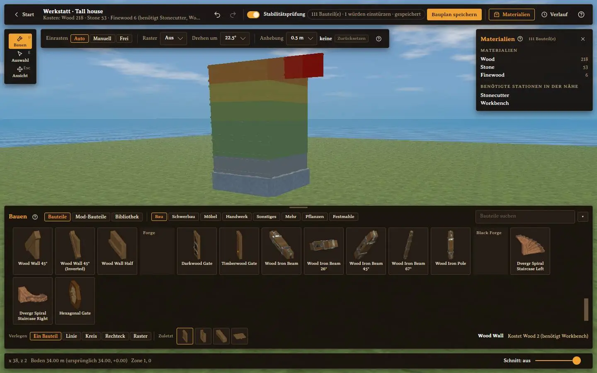
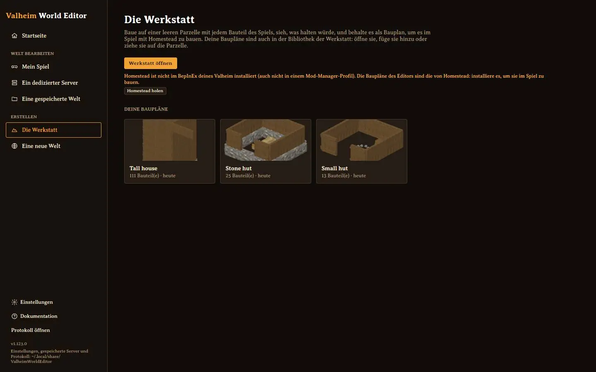
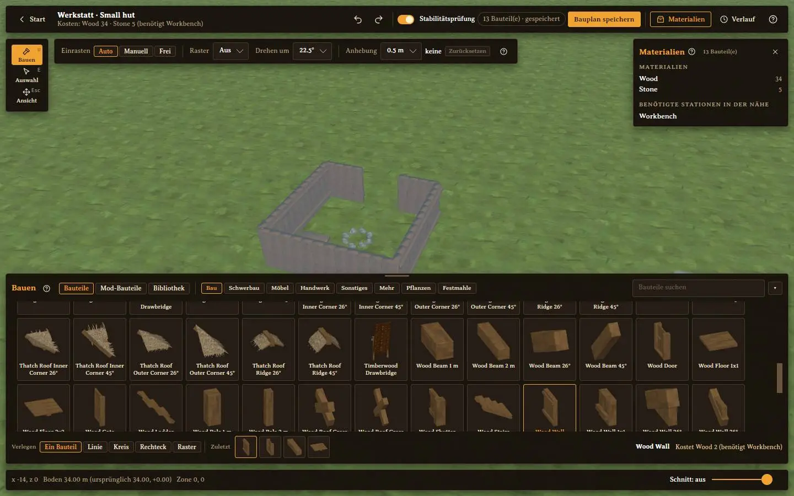
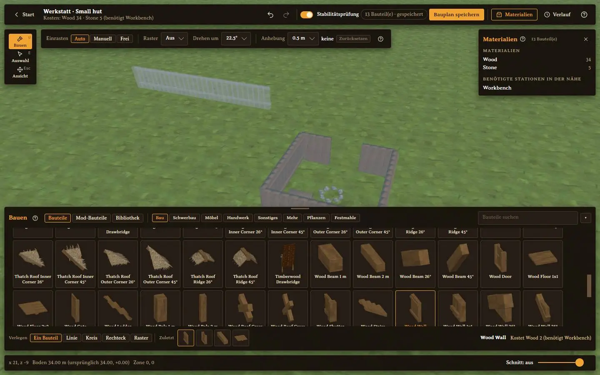
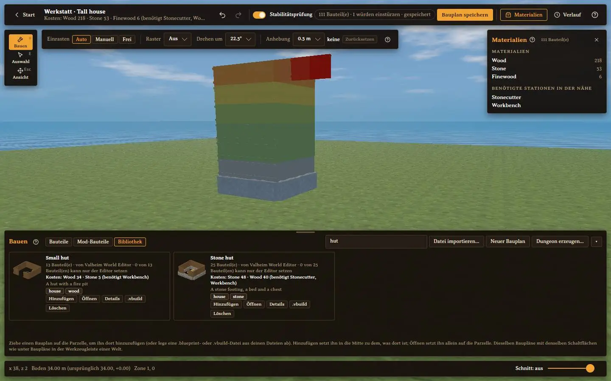
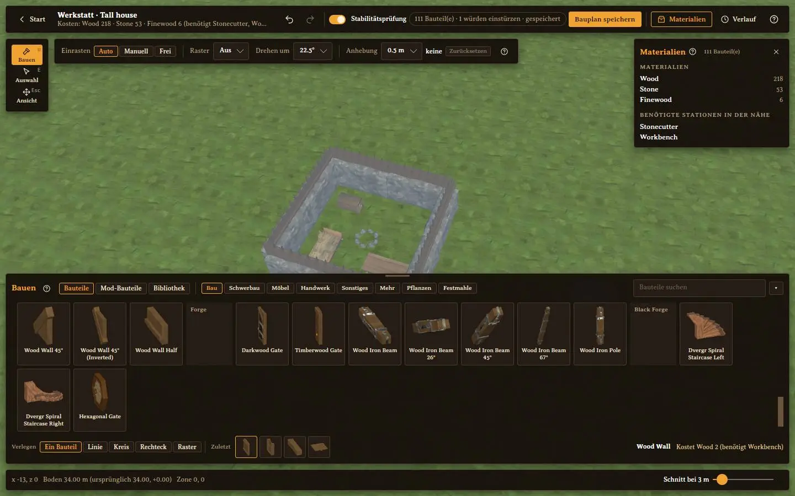
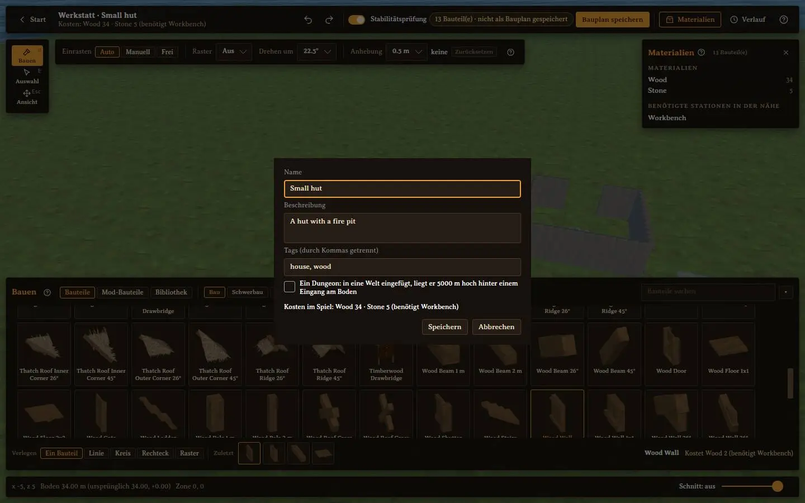
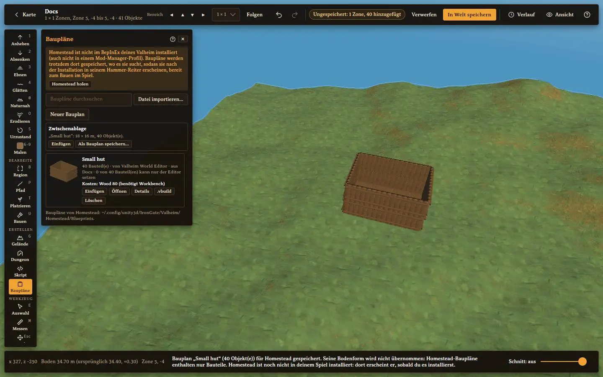

<!-- source: 820eb141 -->
# Werkstatt

Baue auf einer leeren Parzelle mit jedem Bauteil, das das Spiel hat, sieh, was halten würde und was es kostet, und
bewahre es als Bauplan auf, um es im Spiel zu bauen oder in jede Welt einzufügen.

**Wo:** Startseite, **Die Werkstatt** → **Werkstatt öffnen**; in einer Welt **Baupläne** (Werkzeugleiste, Abschnitt
**ERSTELLEN**) → **Neuer Bauplan** · **Taste:** keine · **Funktioniert in:** der eigenen Parzelle der Werkstatt (das
Panel **Baupläne** funktioniert in gespeicherten Welten und live)

*Ein hohes Haus mit **Stabilitätsprüfung** an: der Steinsockel hellblau, die Holzwände darüber grün, dann gelb, dann
orange nahe der Spitze, und der Überhang, der aus der obersten Reihe hinausragt, orange, dann rot. Die obere Leiste
zeigt `111 Bauteil(e) · 1 würden einstürzen · gespeichert`.*

Ein Bauplan ist eine Datei von [Homestead](https://thunderstore.io/c/valheim/p/sighsorry/Homestead/), der Bau-Mod im
Spiel: dieselbe Datei erscheint im Hammer-Reiter von Homestead, bereit zum Bauen im Spiel, und lässt sich aus dem Editor
in eine Welt einfügen.

## Benutzen

Um eine Hütte zu bauen und aufzubewahren:

1. Klicke auf der Startseite auf **Die Werkstatt**, dann auf **Werkstatt öffnen**. (Aus einer Welt: **Baupläne** in der
   Werkzeugleiste, dann **Neuer Bauplan**; eine Welt mit ungespeicherten Änderungen fragt vorher.)
2. Wähle in der Leiste **Bauen** am unteren Rand ein Bauteil im Reiter **Bauteile**.
3. Klicke auf die Parzelle, um es zu setzen. Es rastet an den vorhandenen Bauteilen ein, wie mit dem Hammer.
4. Drehe das Bauteil mit `,` und `.`; hebe es mit `PgUp` und `PgDn` (oder `Ctrl` + Mausrad); halte `Alt`, um es frei in
   Viertelmetern zu setzen. Um Bauteile zu verschieben oder zu löschen, drücke `E` (Auswahl).
5. Achte auf die Farben der **Stabilitätsprüfung** und die Zahl „würden einstürzen“ in der oberen Leiste, und darauf,
   was es kostet, im Panel **Materialien** rechts.
6. Klicke auf **Bauplan speichern** (`Ctrl+S`) und gib ihm einen Namen, eine Beschreibung und Tags.
7. Klicke auf **Start**, um zur Startseite zurückzukehren.

Um einen gespeicherten Bauplan zu ändern, klicke ihn unter **Deine Baupläne** auf der Startseite an (oder unter
**Startseite**), oder klicke daneben in der Bibliothek auf **Öffnen** (dem Panel Baupläne einer Welt oder dem Reiter
**Bibliothek** der Werkstatt).

***Die Werkstatt** auf der Startseite: **Werkstatt öffnen**, **Homestead holen** (es ist hier nicht installiert) und drei
Baupläne unter **Deine Baupläne**, jeder mit seinem Bild, die neuesten zuerst.*

## Die Parzelle

Die Parzelle gehört zu keiner Welt: 3 × 3 Zonen (192 m breit) flache Wiese auf einer Höhe. Ihre Mitte, auf Bodenhöhe,
ist der **Anker** des Bauplans, der Punkt, von dem aus Homestead jedes Bauteil misst.

- Die Werkzeugleiste hat nur [Bauen](build.md) (`U` oder `T`), **Auswahl** (`E`) und **Ansicht**. Die Bodenwerkzeuge
  sind für Welten.
- Neben der Werkzeugleiste die **Bauleiste**: **Einrasten**, **Raster**, **Drehen um** und **Anhebung** (siehe
  [Die Bauleiste](#die-bauleiste)).
- Am unteren Rand die **Leiste Bauen**: die Bauteile, die Bauteile deiner Mods und deine Baupläne (siehe
  [Die Leiste Bauen](#die-leiste-bauen)).
- Rechts das Panel **Materialien**: was das Gebäude kostet (siehe [Materialien](#materialien)).
- Es gibt keine Maske, kein Panel Ansicht und keine Zonengrenzen, und Gebäude werden massiv gezeichnet.
- Die obere Leiste hat **Start**, Rückgängig und Wiederholen, den Schalter **Stabilitätsprüfung**, **Bauplan
  speichern**, **Materialien** und **Verlauf**. Sie zählt die Bauteile, sagt, wie viele einstürzen würden und ob das
  Gebäude gespeichert ist (`12 Bauteil(e) · 2 würden einstürzen · nicht als Bauplan gespeichert`).
- Unter dem Titel: was das Gebäude im Spiel kostet, in Kurzform; eine lange Zeile endet mit „…“.
- Die Statusleiste hat den Schieberegler **Schnitt**, wie in einer Welt (siehe [Schnitt](#schnitt)).

Es gibt kein **Verwerfen**: mach rückgängig oder öffne den Bauplan erneut. Verlassen mit einem Gebäude, das nicht als
Bauplan gespeichert ist (**Start**, einen anderen öffnen, beenden), fragt vorher.

*Die Werkstatt mit einer kleinen Hütte auf der Parzelle: die Werkzeugleiste nur mit **Bauen**, **Auswahl** und
**Ansicht**, die Bauleiste daneben; die obere Leiste mit **Start**, **Stabilitätsprüfung**, der Zahl der Bauteile,
**Bauplan speichern** und **Materialien**; das Panel **Materialien** rechts; die Leiste Bauen am unteren Rand auf dem
Reiter **Bau**, mit den vier zuletzt gewählten Bauteilen unter **Zuletzt** und der gewählten Holzwand.*

## Einstellungen

### Die Leiste Bauen

Die Leiste **Bauen** (die des Werkzeugs [Bauen](build.md), dieselbe in einer Welt) erstreckt sich über den unteren Rand
des Fensters, sodass der Parzelle der Rest bleibt. Ihre oberste Reihe enthält drei Reiter, **Bauteile**,
**Mod-Bauteile** und **Bibliothek**, dann die eigenen Optionen des Reiters und seine Suche. Ziehe ihre Oberkante nach
oben oder unten, um sie höher oder niedriger zu machen, und klicke auf **▾** an ihrem rechten Ende, um sie auf diese
Reihe einzuklappen (**▴** öffnet sie wieder). Beides bleibt für das nächste Mal erhalten.

**Bauteile** listet alles auf, was Spieler bauen, jedes mit einem Bild aus dem Modell des Spiels:

| Reiter | Was er enthält |
|---|---|
| **Bau**, **Schwerbau**, **Möbel**, **Handwerk**, **Sonstiges**, **Mehr** | Die eigenen Reiter des Hammers, in der Reihenfolge des Spiels. |
| **Pflanzen** | Die Bauteile des Kultivators: Feldfrüchte, Setzlinge und Blumen. |
| **Festmahle** | Die Bauteile des Serviertabletts. |

In jedem Reiter sind die Bauteile nach der Handwerksstation gruppiert, die sie brauchen, in der Reihenfolge, in der
Spieler sie bekommen (keine, Werkbank, Steinmetztisch, Schmiede, Handwerkertisch, Schwarzschmiede, Galdrtisch), dann
nach Name. Jede Gruppe beginnt mit dem Namen der Station.

**Mod-Bauteile** listet die Bauteile auf, die deine Mods hinzufügen, eine Mod nach der anderen: wähle die Mod in der
Liste an ihrer linken Seite (mit der Zahl ihrer Bauteile). Die Überschriften sind die eigenen Gruppen der Mod (ihre
Handwerksstation, bei einem Bauteil ohne Gruppe). Die Bauteile kommen von zwei Stellen:

- **Den Mods, die auf diesem Computer installiert sind**, in den BepInEx-Ordnern, die der Editor kennt (dem deines
  Valheim, denen deiner Mod-Manager-Profile, den in den Einstellungen hinzugefügten). Die Werkstatt liest ihre Dateien
  beim ersten Öffnen, ohne das Spiel, und erneut nur, wenn sie sich ändern; **Mods neu einlesen** liest sie jetzt neu.
  Ihre Namen und Bilder stammen aus den eigenen Dateien der Mods. Ein so gelesenes Bauteil rastet an seinen eigenen
  Einrastpunkten ein, aber seine Kosten sind nicht bekannt (die Mods legen sie beim Spielstart fest): es zeigt
  `Kosten unbekannt`, und [Materialien](#materialien) listet es unter **Kein bekanntes Rezept** auf.
- **Einem laufenden Spiel**, das die Mods mit WorldEditorBridge ausführt (siehe
  [Live-Modus](live-mode.md#gemoddete-spiele)): es nennt ihre echten Namen und Kosten, die Vorrang vor den Angaben der
  Dateien haben.

Mods, die ihre Bauteile im Code erzeugen (Railroads), werden über ihr [Add-on](modding.md) aufgeführt, das sie benennt.

<!-- picture: workshop-mod-pieces.jpg, the Mod pieces tab with Moonforged Build Pieces and Railroads installed: the two mods down its side, Moonforged's walls with their pictures, two of them snapped together on the plot -->

| Einstellung | Was sie bewirkt |
|---|---|
| **Bauteile suchen** | Findet Bauteile in jedem Reiter, auch die der Mods, nach Name oder Prefab (`stone floor`, `woodwall`). Jedes Wort muss passen. |
| Die Kachel eines Bauteils | Wählt es. Sein Name und seine Kosten erscheinen am Fuß der Leiste (`Wood Wall · Kostet Wood 2 (benötigt Workbench)`), bei einem Bauteil einer Mod mit dem Namen der Mod. Zeige auf eine Kachel, um ihren Prefab-Namen zu sehen. |
| **Zuletzt** | Die letzten 12 Bauteile, die du gewählt hast, die neuesten zuerst, am Fuß der Leiste: klicke eines an, um es erneut zu wählen. Bleibt für das nächste Mal erhalten. |

Jeder Klick setzt ein Bauteil. Ist kein Bauteil gewählt, wählt Bauen die Holzwand. **Verlegen** am Fuß der Leiste setzt
das Bauteil stattdessen entlang einer Linie, rund um einen Kreis oder ein Rechteck oder in ein Raster: siehe
[Bauteile entlang einer Linie oder in einem Raster verlegen](build.md#bauteile-entlang-einer-linie-oder-in-einem-raster-verlegen).

**Schnelle Wege**, solange **Bauen** an ist:

| Maus | Was sie bewirkt |
|---|---|
| Ziehen | Verlegt eine Reihe des Bauteils von dort, wo du gedrückt hast: Kopien Kante an Kante, eine Bauteillänge auseinander (die Breite einer Wand, die Seite eines Bodens), entlang der Seite des Bauteils, die näher an der Ziehrichtung liegt, auf der Höhe des ersten, bis zu 64. Eine Wand reiht sich nur entlang ihrer Breite: drehe sie zuerst, um sie in die andere Richtung zu reihen. Lass los, um die Reihe zu setzen, ein Rückgängig-Schritt. |
| `Shift` + Rechtsklick | Entfernt das Bauteil unter dem Zeiger (`Ctrl+Z` holt es zurück). Rechts ziehen dreht weiterhin die Ansicht, und `Shift` + rechts ziehen verschiebt sie weiterhin. |
| Mittelklick | Baut mit der Art des Bauteils unter dem Zeiger, wie eine Pipette: es wird in der Leiste gewählt und steht unter **Zuletzt** an erster Stelle. Mitte ziehen verschiebt weiterhin die Ansicht. |

*Ein Ziehen von links: eine Reihe Holzwände Ende an Ende verlegt, durchsichtig, bis die Taste losgelassen wird.*

### Die Bauleiste

Die Leiste neben der Werkzeugleiste legt fest, wie das Bauteil gesetzt wird: **Einrasten** (**Auto**, **Manuell**,
**Frei**), **Raster**, **Drehen um** und **Anhebung**. In einer Welt ist es dieselbe Leiste, die sich Auswahl und
Einfügen teilen und die dort auch **Erbaut von** hat: siehe [Die Bauleiste](build.md#die-bauleiste).

### Reiter Bibliothek

*Der Reiter **Bibliothek** bei der Suche nach „hut“: die Suche, **Datei importieren…**, **Neuer Bauplan** und **Dungeon
erzeugen…** in der obersten Reihe der Leiste, dann die beiden Hütten nebeneinander (das hohe Haus ist ausgefiltert), jede
mit ihrem Bild, ihren Bauteilen, Kosten, ihrer Beschreibung, ihren Tags und ihren Schaltflächen **Hinzufügen**,
**Öffnen**, **Details**, **.vbuild** und **Löschen**.*

Die Bibliothek ist dieselbe Liste wie das [Panel Baupläne](#panel-baupläne) einer Welt: dieselben Baupläne, gleich
dargestellt, mit denselben Schaltflächen. Nur das Setzen unterscheidet sich: die Parzelle nimmt einen mit
**Hinzufügen** (oder durch Ziehen) auf, eine Welt mit **Einfügen**.

| Einstellung | Was sie bewirkt |
|---|---|
| **Baupläne durchsuchen** | Behält die Baupläne, die jedes eingegebene Wort im Namen, Ersteller, in der Beschreibung oder den Tags haben. |
| **Hinzufügen** | Fügt den Bauplan der Parzelle hinzu, in ihrer Mitte. Ein Rückgängig-Schritt. |
| Einen Bauplan auf die Parzelle ziehen | Fügt den Bauplan dort hinzu, wo du ihn ablegst. |
| **Öffnen** | Der Bauplan allein auf der Parzelle, um ihn zu ändern (fragt vorher, wenn die Parzelle nicht gespeichert ist). **Bauplan speichern** schreibt ihn zurück. |
| **Details** | Ändert seinen Namen, seine Beschreibung, seine Tags und den Dungeon-Schalter. Ein neuer Name benennt Datei und Bild um, wenn dieser Name frei ist. Für den Bauplan auf der Parzelle übernimmt die Werkstatt den neuen Namen, und **Bauplan speichern** schreibt diese Datei. |
| **.vbuild** | Schreibt seine Objekte als `.vbuild`-Datei in den Ordner `export` des Bauplanordners des Editors und sagt, wo. |
| **Löschen** | Entfernt seine Datei und sein Bild, nach einer Rückfrage. Auch Homestead verliert ihn. Löschen des Bauplans auf der Parzelle lässt das Gebäude dort, markiert als *nicht als Bauplan gespeichert*. |
| Dateien auf der Parzelle ablegen | `.blueprint`- und `.vbuild`-Dateien aus deinem Dateimanager werden importiert und dann dort hinzugefügt, wo sie landen. Auf einer Welt abgelegt, werden sie nur importiert. |
| **Datei importieren…** | Importiert eine `.blueprint`-Datei (Homestead, PlanBuild) oder `.vbuild`-Datei in die Bibliothek. |
| **Neuer Bauplan** | Eine leere Parzelle (fragt vorher, wenn die Parzelle nicht gespeichert ist). |
| **Dungeon erzeugen…** | Zeigt den Dungeon-Generator (nur Bauteile; siehe [Dungeon](dungeons.md)). **Auf der Parzelle öffnen** setzt den Dungeon allein dorthin, **Zur Parzelle hinzufügen** fügt ihn in der Mitte hinzu; so oder so bleibt sein Bauplan in der Bibliothek, ohne Bild `.png` daneben. **← Bibliothek** führt zurück. |

Ein geöffneter oder hinzugefügter Bauplan behält seine genaue Form und wird als Ganzes so verschoben, dass sein tiefstes
Bauteil auf der Parzelle sitzt. Ein Homestead-Bauplan behält seinen Anker in der Mitte der Parzelle; andere Dateien
werden zentriert. Erneutes Speichern behält die Höhe des Ankers, sodass das Gebäude wie vorher steht, wenn Homestead es
baut. Bauteile von Mods, die du nicht hast, werden weggelassen, und die Meldung listet sie auf. Ein Bauplan, der von
außerhalb des Ordners von Homestead geöffnet wurde, fragt, bevor er einen Bibliotheksbauplan gleichen Namens
überschreibt.

Baupläne aus Editor-Versionen vor Homestead stehen hinter den anderen, unter **Ältere Editor-Baupläne**: **Nach
Homestead** bewahrt einen als Homestead-Bauplan auf, der sich dann hinzufügen oder öffnen lässt.

### Materialien

Das Panel **Materialien** rechts listet auf, was das Gebäude auf der Parzelle im Spiel kostet, und folgt jeder Änderung:

| Teil | Was es auflistet |
|---|---|
| **Materialien** | Jedes Material mit seiner Menge, die größte zuerst. |
| **Benötigte Stationen in der Nähe** | Die Handwerksstationen, die zum Bauen in der Nähe sein müssen. |
| **Kein bekanntes Rezept** | Bauteile, für die der Editor kein Rezept kennt (die einer Mod, bevor ein laufendes Spiel es ihm mitgeteilt hat), nach Mod. Sie werden nicht mitgezählt. |
| **Nur der Editor kann sie setzen** | Statuen, Requisiten, Schiffe und Kreaturen: der Hammer von Homestead überspringt sie, daher werden sie nicht mitgezählt. |

**Materialien** in der oberen Leiste (oder **✕** im Panel) schließt und öffnet es; die Werkstatt merkt sich, welches.

### Stabilitätsprüfung

**Stabilitätsprüfung** (standardmäßig an) färbt jedes Bauteil in den Farben, die der Baumodus des Spiels seiner
Stabilität gibt:

| Farbe | Bedeutung |
|---|---|
| **Hellblau** | Volle Stabilität: es steht auf dem Boden. |
| **Grün** | Stark. |
| **Gelb**, **Orange** | Schwächer. |
| **Rot** | Kurz vor dem Bruch: im Spiel stürzt es ein, sobald ein Spieler in die Nähe kommt. |

Die obere Leiste sagt, wie viele Bauteile einstürzen würden, und **Bauplan speichern** fragt vorher, wenn welche
einstürzen würden (auch mit ausgeschaltetem Schalter: er blendet nur die Farben aus). Stein steht hoch, kann aber nicht
hinausragen; Holz ragt weiter hinaus, aber nicht so hoch. Siehe
[Die Stabilitätsprüfung](concepts/objects.md#die-stabilitätsprüfung).

### Schnitt

*Dasselbe Haus mit **Schnitt bei 3 m**, von oben gesehen: alles über 3 m ist ausgeblendet, sodass du in sein Erdgeschoss
siehst, mit der Feuerstelle, dem Bett, dem Tisch und der Truhe.*

Der Schieberegler **Schnitt** in der Statusleiste blendet alles über einer Höhe aus, 0 bis 39 m über der Parzelle, und der
Cursor geht durch das Ausgeblendete hindurch, sodass du innen bauen kannst. Sein rechtes Ende ist aus (`Schnitt: aus`).
Es ist derselbe Schieberegler wie in einer Welt und in einem Dungeon, wo seine Meter vom Boden oder vom Boden des Dungeons aus
zählen: siehe [Schnitt](editor-basics.md#schnitt).

## Einen Bauplan speichern

**Bauplan speichern** (`Ctrl+S`) fragt nach:

| Feld | Was es ist |
|---|---|
| **Name** | Homestead listet ihn unter diesem Namen auf; die Datei wird danach benannt. |
| **Beschreibung** | Ein paar Worte, angezeigt in der Bibliothek und für die Leute, mit denen du ihn teilst. Zeilenumbrüche werden zu Leerzeichen. |
| **Tags (durch Kommas getrennt)** | Wörter, um ihn zu finden: `house, viking, stone`. Bis zu 12, Doppelte werden entfernt. |
| **Ein Dungeon: in eine Welt eingefügt, liegt er 5000 m hoch hinter einem Eingang am Boden** | Macht ihn zu einem Dungeon-Bauplan: siehe [Dungeon](dungeons.md). |

Der Dialog zeigt die **Kosten im Spiel**. Speichern des Bauplans, den du geöffnet hast, überschreibt ihn; ein anderer
Name erzeugt einen neuen und ersetzt einen gleichnamigen erst nach einer Rückfrage. Neben der Datei wird ein Bild
gespeichert (eine `.png`, das Gebäude schräg von oben gesehen, auf transparentem Hintergrund), das Homestead als Symbol
verwendet. Es wird mit den Modellen des Spiels gezeichnet, wenn der Editor sie lesen kann, sonst mit der Form jedes
Bauteils in der Farbe seines Materials. Ein anderswo erstellter Bauplan ohne Bild bekommt in der Bibliothek eines
gezeichnet, nur im Speicher.

*Speichern der Hütte: **Name** „Small hut“, **Beschreibung** „A hut with a fire pit“, **Tags** „house, wood“, **Ein
Dungeon** aus, und die Zeile **Kosten im Spiel** über **Speichern**.*

Was behalten wird:

- **Alles, was auf der Parzelle steht**, nicht der Boden der Parzelle. Die Parzelle beginnt leer, also gehört alles
  davon dir: die Bauteile, die du gebaut hast, und was ein geöffneter oder hinzugefügter Bauplan mitgebracht hat (Bäume,
  Felsen, Kreaturen). Es muss mindestens ein Bauteil darunter sein.
- **Was Objekte enthalten**: der Inhalt einer Truhe, der Text eines Schilds, der Gegenstand eines Gegenstandsständers,
  die Sterne einer Kreatur. Wähle ein Objekt und drücke `I`, um es zu sehen oder zu ändern: siehe
  [Inspektor](select.md).
- **Ob es eine Ruine ist**: Bauteile ohne Erbauer, wie sie die Ruinen des Spiels und erzeugte Dungeons haben. Für den
  Rest wird kein Erbauer geschrieben: wer den Bauplan im Spiel baut, wird sein Erbauer.
- **Bauteile nur für den Editor**: Statuen, Requisiten, Schiffe und Kreaturen. Der Hammer von Homestead überspringt
  sie; Einfügen aus dem Editor setzt sie. Die Bibliothek zählt sie (`2 von 40 Bauteil(en) kann nur der Editor setzen`),
  und die Kosten lassen sie weg.

## Panel Baupläne

*Das Panel **Baupläne** in einer Welt: das Homestead-Banner, **Baupläne durchsuchen** und **Datei importieren…**,
**Neuer Bauplan**, die **Ablage** mit **Einfügen** und **Als Bauplan speichern…**, dann eine gespeicherte Hütte
mit ihrem Bild, ihren Bauteilen, Kosten und ihren Schaltflächen **Einfügen**, **Öffnen**, **Details**, **.vbuild** und
**Löschen**.*

In einer Welt öffnet **Baupläne** in der Werkzeugleiste (oder **Baupläne…** im Panel Region) die Bibliothek neben der
Werkzeugleiste; **✕** führt zurück zur Ansicht. Ein Banner sagt, ob Homestead installiert ist, mit seiner Version, oder
bietet **Homestead holen** an. Jeder Bauplan zeigt sein Bild, seine Bauteile, seinen Ersteller, die Welt, aus der er
stammt, seine Kosten, Beschreibung und Tags. **Baupläne durchsuchen** durchsucht Name, Ersteller, Beschreibung und Tags.
Es ist dieselbe Liste, mit denselben Schaltflächen, wie der [Reiter Bibliothek](#reiter-bibliothek) der Werkstatt; ein Bauplan
ohne Bild bekommt auch hier eines gezeichnet.

| Schaltfläche | Was sie bewirkt |
|---|---|
| **Einfügen** | Schließt das Panel und beginnt, ihn in den offenen Bereich einzufügen (siehe [Kopieren und einfügen](area.md#kopieren-und-einfügen)). Arten, die diese Welt nicht erzeugen kann, werden weggelassen und aufgelistet. Ein Dungeon-Bauplan kommt stattdessen nach oben, hinter einen Eingang. |
| **Öffnen** | Öffnet ihn in der Werkstatt, allein auf der Parzelle, um ihn zu ändern. |
| **Details** | Ändert seinen Namen, seine Beschreibung, seine Tags und den Dungeon-Schalter. Ein neuer Name benennt Datei und Bild um, wenn dieser Name frei ist. |
| **.vbuild** | Schreibt seine Objekte (nicht den Boden) als `.vbuild`-Datei (BuildShare und ältere Werkzeuge) in den Ordner `export` des Bauplanordners des Editors und sagt, wo. |
| **Löschen** | Entfernt seine Datei und sein Bild, nach einer Rückfrage. Auch Homestead verliert ihn. |
| **Datei importieren…** | Importiert eine `.blueprint`- oder `.vbuild`-Datei. |
| **Neuer Bauplan** | Öffnet die Werkstatt auf einer leeren Parzelle. |

Die Zeile **Ablage** über den Bauplänen zeigt, was zuletzt mit dem Werkzeug Region oder mit `Ctrl+C` in Auswahl
kopiert wurde (seine Größe und wie viele Objekte), oder dass noch nichts kopiert ist:

| Schaltfläche | Was sie bewirkt |
|---|---|
| **Einfügen** | Fügt die Zwischenablage ein, wie `Ctrl+V`. |
| **Als Bauplan speichern…** | Speichert die Objekte der Zwischenablage als Homestead-Bauplan, mit Name, Beschreibung und Tags und ob er ein Dungeon ist (siehe [Dungeons](dungeons.md)). Boden und Erbauer werden nicht behalten. Ein Bauplan mit demselben Namen wird nach einer Rückfrage ersetzt. Dasselbe wie **Bauplan speichern…** im Panel Region. |

Baupläne aus Editor-Versionen vor Homestead stehen unter **Ältere Editor-Baupläne**, mit **Einfügen**, **Nach
Homestead** (bewahrt ihn als Homestead-Bauplan auf, nummeriert, wenn der Name vergeben ist), **.vbuild** und
**Löschen**. Homestead-Baupläne enthalten keinen Boden: die Bodenform einer Kopie wird nicht behalten, und die Meldung
sagt es.

**Um einen Bauplan aus einer Welt zu speichern**, kopiere etwas mit dem Werkzeug Region oder Auswahl (`Ctrl+C`), öffne
**Baupläne** in der Werkzeugleiste und klicke in der Zeile **Ablage** auf **Als Bauplan speichern…**. Siehe
[Einen Bauplan in eine Welt einfügen](guides/paste-a-blueprint.md) für den umgekehrten Weg.

## Bauplandateien

Homestead baut die Baupläne des Editors im Spiel, mit einer Truhe für die Materialien. Die Startseite und das Panel
Baupläne suchen `Homestead.dll` in jedem Ordner `BepInEx/plugins`, den der Editor kennt: dem deines Valheim, dem
Mod-Manager-Profil, aus dem der Editor läuft, den in den Einstellungen hinzugefügten Ordnern und den Profilen von
r2modman und Thunderstore Mod Manager. Baupläne werden dort gespeichert, wo Homestead sie sucht, auch wenn es nicht
installiert ist, sodass sie im Spiel erscheinen, sobald du es installierst.

Baupläne liegen im Ordner von Homestead im Speicherordner von Valheim (dem, der ihn schon hat, sonst dem Speicherordner
deiner Welten):

- Linux: `~/.config/unity3d/IronGate/Valheim/Homestead/Blueprints`
- Windows: `%USERPROFILE%\AppData\LocalLow\IronGate\Valheim\Homestead\Blueprints`

Um ein Gebäude zu teilen, teile seine `.blueprint`-Datei und die `.png` daneben.

**Importieren** liest `.blueprint`-Dateien von Homestead und PlanBuild (ihre Bodenmarkierungen werden nicht behalten) und
`.vbuild`-Dateien. Die Datei wird ein Homestead-Bauplan unter ihrem eigenen Namen, nummeriert (`House (2)`), wenn der
Name vergeben ist. Die Meldung sagt, wie viele Bauteile unbekannt waren und wie viele Zeilen nicht gelesen werden
konnten.

Ein Homestead-Bauplan ist eine `.blueprint`-Datei von PlanBuild mit Kopfzeilen (`#Name:`, `#Creator:`, `#Description:`,
`#Category:`, `#HomesteadVersion:`...) und einer Zeile pro Bauteil nach `#Pieces`:
`prefab;Building;x;y;z;qx;qy;qz;qw;"";1;1;1`, seine Position in Metern vom Anker, seine Drehung und Skalierung. Der
Editor fügt eigene Zeilen hinzu (`#Tags:`, `#EditorData:` für das, was Objekte enthalten, `#EditorRuin:1`), die
Homestead und PlanBuild überspringen, sodass die Datei im Spiel weiterhin baut. Bauteile werden die tiefsten zuerst
geschrieben, auf den Millimeter genau. Der Dateiname ist der Name des Bauplans, wobei Zeichen, die Windows oder Linux
ablehnen, zu `_` werden, höchstens 64 Zeichen.

Die Kosten stammen aus den Rezepten in deinem eigenen Valheim: die Materialien jedes Bauteils mal ihrer Anzahl, die
größten zuerst, mit den Stationen, die in der Nähe sein müssen
(`Wood 120 · Stone 64 · Core wood 20 · … (benötigt Stonecutter, Workbench)`). Bauteile ohne bekanntes Rezept (aus Mods)
werden getrennt aufgelistet; ist keines bekannt, steht dort `Kosten unbekannt (Bauteile aus Mods?)`.

## Tastenkürzel

| Taste oder Maus | Was sie bewirkt |
|---|---|
| `U` oder `T` | Bauen. Seine Tasten (drehen, heben, Einrastpunkte, Reihen, Linien) stehen auf der Seite von [Bauen](build.md#tastenkürzel). |
| `E` | Auswahl: Bauteile verschieben, drehen, löschen (bei **Einrasten** auf **Manuell** in Bauen: der nächste Einrastpunkt). |
| `Esc` | Ansicht. |
| `Ctrl+S` | Bauplan speichern. |
| `Ctrl+Z` | Rückgängig. |
| `Ctrl+Y` oder `Ctrl+Shift+Z` | Wiederholen. |

Alle Tasten des Editors stehen unter [Tastenkürzel](help/shortcuts.md).

## Tipps und Grenzen

- **Wiederherstellen:** `Ctrl+Z` funktioniert auf der Parzelle. Ein gespeicherter Bauplan bleibt in der Bibliothek:
  **Öffnen** holt ihn zurück.
- Ein Reiter zeigt höchstens 300 Bauteile: suche, um die anderen zu finden.
- **Was zurückkommt.** Aus dem Editor eingefügt, enthalten die Objekte eines Bauplans, was sie enthielten
  (Truheninhalte, Schilder, den Boss). Im Spiel mit Homestead gebaut, sind es nur die Bauteile: Truhen sind leer, und
  es kommen keine Kreaturen.
- Kopieren und Einfügen sind für Welten: `Ctrl+V` tut auf der Parzelle nichts, daher entfernt `Ctrl+X` dort nur die
  Bauteile (`Ctrl+Z` holt sie zurück). Um ein Gebäude hinzuzufügen, nutze **Hinzufügen** oder ziehe einen Bauplan
  herein.
- Ein Bauplan, der mit Mods erstellt wurde, die du nicht hast, öffnet sich ohne deren Bauteile; ihn dann zu speichern,
  schreibt ihn ohne sie.
- Kreaturen in einem Bauteil werden oben auf das höchste Bauteil unter ihnen gestellt (die Meldung sagt, wie viele). Die
  obere Leiste zählt die, die noch in einem Bauteil stecken.
- Die Stabilitätsprüfung lässt Felsen und Bäume weg (die Parzelle hat keine) und zählt Mesh-Formen nach ihrem Rahmen.
- Homestead prüft die Versionen mit dem Server: ein Server, auf dem es läuft, trennt Spieler, die es nicht haben
  (Konsolenspieler können es nicht haben). Spieler brauchen es nur in ihrem eigenen Spiel, um Baupläne zu bauen.
- Um mit derselben Leiste Bauen auf dem offenen Boden einer Welt oder in einem Dungeon zu bauen, siehe [Bauen](build.md)
  und [Dungeon](dungeons.md).
- **Claude** kann auf der Parzelle bauen und Baupläne speichern: siehe [Claude](claude.md).

## Verwandte Seiten

- [Einen Bauplan in eine Welt einfügen](guides/paste-a-blueprint.md)
- [Dein erster Bau](start/first-build.md)
- [Die Stabilitätsprüfung](concepts/objects.md#die-stabilitätsprüfung) · [Einrasten](concepts/objects.md#einrasten)
- [Bauen](build.md) · [Dungeon](dungeons.md) · [Auswahl](select.md)
