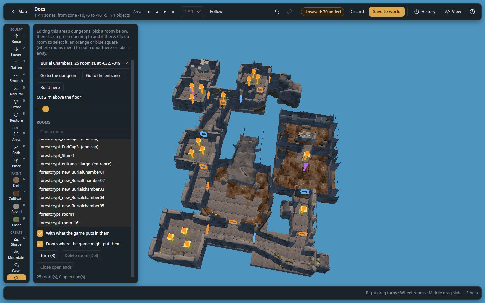
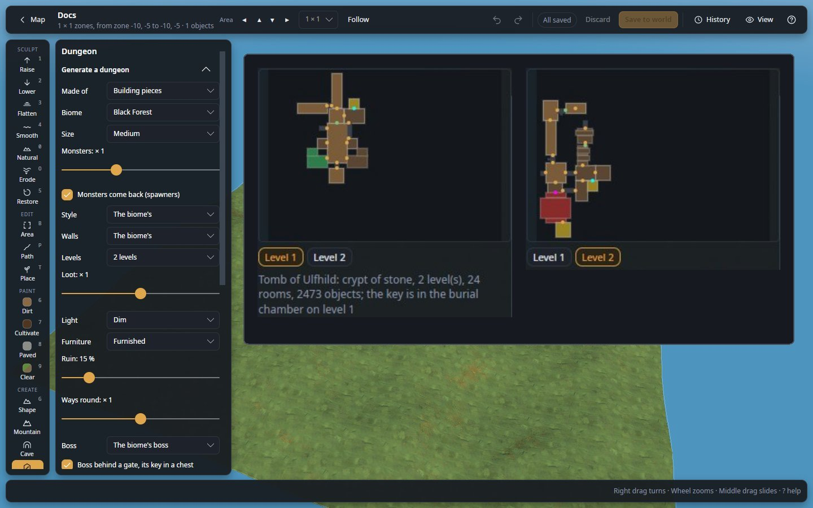
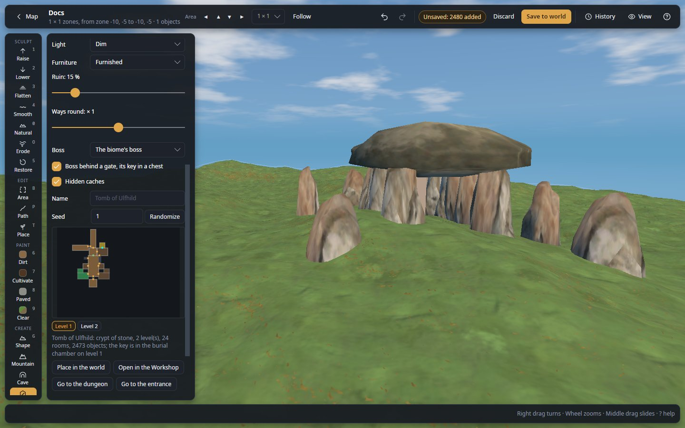
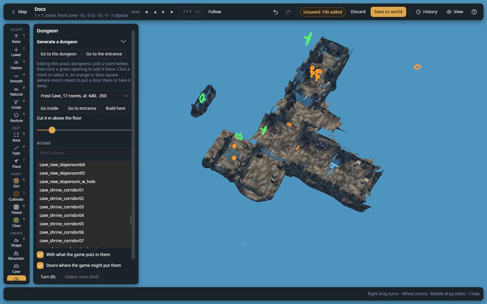
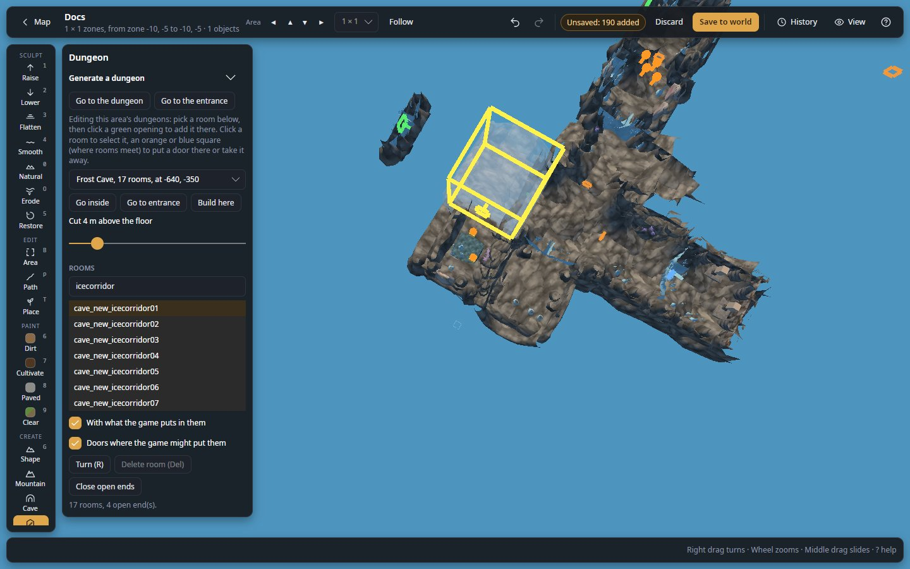
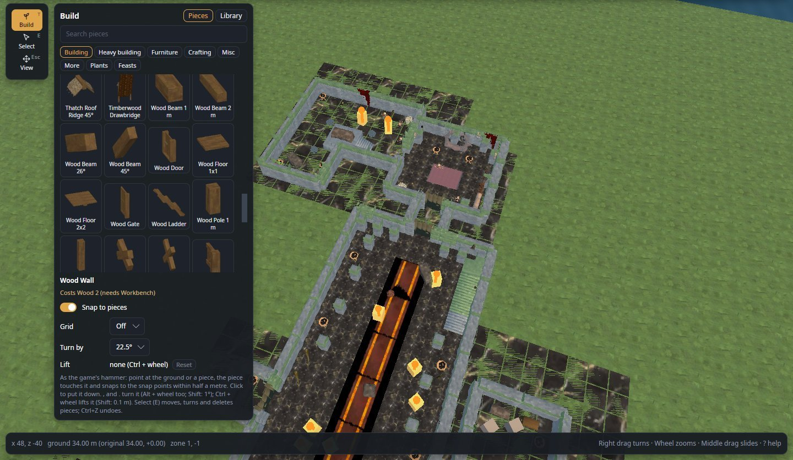

# Dungeon

Generate whole dungeons and put them in your world behind an entrance, edit the game's own dungeons room by room, and
build inside them.

**Where:** tool rail, CREATE section · **Key:** none · **Works in:** saved worlds, live; the generator also in the
Workshop (**Library** → **Generate dungeon…**)

*A dungeon of the game's own rooms (Burial Chambers, 18 rooms), 5000 m up and cut 2 m above the floor. Orange and
blue squares mark where rooms meet. **Delete room (Del)** is greyed until a room is selected.*

A Valheim dungeon is a location on the ground (a mound, a cave mouth) whose door leads to rooms kept 5000 m above it.
See [How the game keeps dungeons](concepts/dungeons.md#how-the-game-keeps-dungeons).

## Use it

To generate a dungeon and put it in the world:

1. Open an area of a world, then click **Dungeon** on the tool rail.
2. Under **Generate a dungeon**, choose the **Biome**, **Size** and **Levels**. The plan is drawn again a moment after
   each change.
3. Optional: click **Randomize** until you like the plan; check each level with the **Level 1**, **Level 2**...
   buttons under it.
4. Turn the view to face the spot where the entrance should go, centred on it.
5. Click **Place in the world**.
6. Click **Go to the dungeon** to look inside; **Go to the entrance** brings the view back down.
7. Click **Save to world** (or **Apply live**).

The whole placement is one undo step: `Ctrl+Z` takes it all back. The same choices and seed always make the same
dungeon. For the full walk-through, see [Generate a dungeon and put it in the world](guides/make-a-dungeon.md).

***Generate a dungeon** for a Black Forest dungeon, Medium, 2 levels, boss behind a gate. Beside the panel, its plan
drawn larger, one level each: the green key room on level 1, the red arena with its magenta gate dot and the gold
treasury on level 2, and the summary under them.*

## Settings

### Generate a dungeon

**Generate a dungeon** is at the top of the Dungeon panel: open when the area has no dungeon, folded when it has one.

| Setting | What it does |
|---|---|
| **Made of** | **Building pieces**: rooms built as a player would build them, furnished for what they are. **The game's own rooms**: the biome's dungeon rooms joined the way the game joins them (see [Made of the game's own rooms](#made-of-the-games-own-rooms)). Not shown in the Workshop, which takes only building pieces. |
| **Biome** | **Meadows**, **Black Forest** (the default), **Swamp**, **Mountain**, **Plains**, **Mistlands**, **Ashlands**, **Deep North**. Sets the monsters, loot, lights, the entrance on the ground, and the style and walls unless you pick them. |
| **Size** | **Small**, **Medium** (the default), **Large**, **Huge**: about 5, 8, 12 or 17 rooms on each level. |
| **Monsters: × 1** | **none** to 3 times the usual, in steps of 0.25. |
| **Monsters come back (spawners)** | On: the game's spawners, whose monsters come back a while after being killed. Off: the monsters themselves, placed once. The boss is always placed once. |
| **Style** | **The biome's**, or **Crypt**, **Catacombs**, **Temple**, **Fortress**, **Prison**, **Dvergr hold**, **Goblin warren**, **Ruins**: which rooms it has and how they are laid out. |
| **Walls** | **The biome's**, or **Stone**, **Marble**, **Wood**, **Stave**, **Grausten**, **Dvergr**, **Goblin**. |
| **Levels** | **1 level** to **16 levels** (2 by default), joined by stairs. The boss waits on the last. |
| **Loot: × 1** | Chests and treasure: **none** to twice the usual. Deeper levels hold more. |
| **Light** | **Dark**, **Dim** (the default) or **Bright**: how many torches and braziers. |
| **Furniture** | **Bare**, **Furnished** (the default) or **Rich**. |
| **Ruin: 15 %** | How ruined it is, 0 to 100 %: rubble, fallen pillars, torches gone out. Picking a style sets its own value. |
| **Ways round: × 1** | How often rooms far apart along the way are joined, so there is more than one way round: **none (a tree)** to twice the usual. |
| **Boss** | **The biome's boss**, **No boss**, or any biome's boss or elite by name (`Troll`, `Draugr_Elite`, `StoneGolem`...). |
| **Boss behind a gate, its key in a chest** | The arena's gate opens with the crypt key, in a chest far from it (players who hold the key from the Elder open it too). Off: grand double gates, open to all. |
| **Hidden caches** | Small treasure rooms behind a cracked wall to break or a tapestry. |
| **Name** | Written on a sign in the entrance hall. Empty: a name made from the seed, shown greyed (`Barrow of Sigrun`). |
| **Seed** and **Randomize** | The dungeon's own number; any whole number makes another dungeon with the same choices. |

Changing **Light** or **Ruin** changes nothing else about the dungeon. With **The game's own rooms**, only **Biome**,
**Size**, **Monsters** and the seed are used; the other rows are hidden. What the generator puts where is in
[How the generator lays out a dungeon](concepts/dungeons.md#how-the-generator-lays-out-a-dungeon) and
[Furnishing, light and guards](concepts/dungeons.md#furnishing-light-and-guards).

What each biome brings when nothing else is picked:

| Biome | Style | Walls | Boss | Entrance on the ground |
|---|---|---|---|---|
| Meadows | Crypt | Stone | `Skeleton_Hildir` | A burial chamber's mound |
| Black Forest | Crypt | Stone | `Troll` | A burial chamber's mound |
| Swamp | Crypt | Stone | `Draugr_Elite` | A sunken crypt's door |
| Mountain | Fortress | Stone | `StoneGolem` | A Frost Cave's mouth |
| Plains | Goblin warren | Goblin | `GoblinBrute` | None of its own: a pair of linked portals |
| Mistlands | Dvergr hold | Dvergr | `SeekerBrute` | An infested mine's entrance |
| Ashlands | Fortress | Grausten | `Charred_Melee_Dyrnwyn` | A Morgen hole |
| Deep North | Temple | Stave | `JotunWarrior` | A Frost Cave's mouth |

**The plan** draws the level shown from above: rooms on the way through light brown, side rooms darker brown,
corridors dark grey; the boss's arena red, the treasury and hidden caches gold, the key room green. Doorways are dots:
the locked gate magenta, hidden ways cyan, open arches green, doors and gates orange. Point at a room for its name.
The summary under it says what was made (`Barrow of Sigrun: crypt of stone, 2 level(s), 15 rooms, 2140 objects; the
key is in the ossuary on level 2`) and what could not be (`no room for stairs down from level 3; the levels below are
left out`).

| Button | What it does |
|---|---|
| **Place in the world** | Puts the entrance on the ground at the middle of the view, its door facing you, and the dungeon 5000 m above it. |
| **Open in the Workshop** | Writes the dungeon (building pieces) as a blueprint and opens it in the [Workshop](workshop.md) to change it. |
| **Go to the dungeon** / **Go to the entrance** | Shown once the dungeon is placed: take the view up into the first level with the roofs cut away, and back down. |

*A burial chamber's mound placed by **Place in the world**, its door facing the camera. Under the summary, **Go to
the dungeon** and **Go to the entrance** are now shown.*

### Rooms of a dungeon

Below the generator, with a dungeon in the area, the panel lists its dungeons and edits their rooms.

| Setting | What it does |
|---|---|
| Dungeon list | The area's dungeons, each with its kind, rooms and place (`Frost Cave, 34 rooms, at 1520, -2240`). Fuling villages and Meadows farms, laid out the same way on the ground, show too. |
| **Go inside** | Takes the view up to the middle of the dungeon's rooms and cuts their roofs away (at 4 m above the floor when the cut was off). |
| **Go to entrance** | Takes the view back down to the entrance on the ground, with nothing cut. |
| **Build here** | Opens the Workshop's Build panel over the dungeon: see [Build inside a dungeon](#build-inside-a-dungeon). |
| **Cut 4 m above the floor** | How high above the floor of the dungeon's entrance the roofs are cut, 0 to 29 m. The right end, **Cut: off (roofs shown)**, shows the roofs; the left end cuts at the floor. |
| **ROOMS** + **Find a room…** | The rooms this kind of dungeon can take; type to narrow them by name. End caps and entrance rooms are marked `(end cap)` and `(entrance)`. |
| **With what the game puts in them** | On (the default): an added room comes with what the game would have made in it there (chests, spawners, torches, decorations). Off: bare rooms. |
| **Doors where the game might put them** | On (the default): an added room gets a door where it joins, by the game's own chance. |
| **Turn (R)** | Joins the room shown by its next opening of the same kind. |
| **Delete room (Del)** | Removes the selected room. |
| **Close open ends** | Puts the game's end cap on every open end, so nothing leads out. The message says how many open ends have no end cap of their kind. |

The line at the bottom counts the rooms, open ends and overlapping pairs (`24 rooms, 3 open end(s). 1 overlapping
pair(s).`).

## Open a dungeon

1. Open the area over a dungeon's entrance (the map's location markers show the entrances).
2. Click **Dungeon** on the tool rail: the list shows the area's dungeons.
3. Click **Go inside**.
4. Optional: move the cut slider to see more or less of the walls.

Up there the camera no longer follows the ground: orbit, slide and fly round the rooms as usual. **Dungeon rooms** in
the [View panel](editor-basics.md) shows or hides them.

A dungeon nobody has been near has no rooms yet: the panel says *The game has not laid this dungeon out yet (nobody
has been near it).* Visit it in game, then open the area again.

*A Frost Cave after **Go inside**, its roofs cut 4 m above the floor: the panel lists it (`Frost Cave, 17 rooms, at
-640, -350`). Green frames mark open ends (a room was deleted), orange squares where rooms meet without a door.*

## Add rooms

Every room has **openings**, the doorways where it meets the next room. The game joins only openings of the same kind.

1. Find a green frame: it marks an **open end**, an opening no room meets yet.
2. Pick a room in the list under **ROOMS**.
3. Point at an open end (within 1.5 m): the room shows there, see-through, joined the way the game joins rooms.
4. Optional: press `R` (**Turn (R)**) to join it by another of its openings.
5. Click to add it. It stays selected, so `Del` takes it out again.

A room that would overlap another, or go past the dungeon's space (64 × 64 m around its zone's middle for most kinds),
turns red and the line warns. The game builds the list anyway: it is only a warning.

*`cave_new_icecorridor01` picked under **ROOMS** (narrowed with "icecorridor") and pointed at an open end: it shows
there see-through, joined the game's way. The line at the bottom reads `17 rooms, 4 open end(s).`*

## Doors

A square marks every place where two rooms meet and a door can stand: **blue** with a door, **orange** without. Click
it to put the dungeon's door there or take it away. Each click is one undo step.

## Delete a room

Click a room to select it (its box shows), then click **Delete room (Del)**. What stands in the room (chests,
spawners...) goes with it, and so do the doors where it met other rooms. The rooms next to it have open ends again:
**Close open ends** caps them.

## Build inside a dungeon

**Build here** gives the Workshop's [Build panel](workshop.md) over the dungeon: pick a piece, then click on a room's
floor or wall, or on a piece already there. Pieces snap as with the hammer, and the cursor goes through what the cut
hides. Pick another tool to stop building.

A room's floors and walls count as ground in game, so pieces resting on them hold. Pieces hanging in the open, away
from the rooms, break as soon as a player comes near.

## Made of the game's own rooms

With **Made of** set to **The game's own rooms**, the editor joins the biome's dungeon rooms the game's way: a burial
chamber in the Meadows and Black Forest, a sunken crypt in the Swamp, a Frost Cave in the Mountain and Deep North, an
infested mine in the Mistlands, and the Ashlands' and Plains' own. It adds rooms until there are about 8, 14, 20 or
26 (by **Size**), without overlaps, closes every open end, fills each room with what the game would put there, and puts
doors where the game would. **Monsters** copies each spawner about that many times. A dungeon kind with no rooms to
join (a camp, a village) becomes a Frost Cave, and the summary says so.

Placed in the world, it is one dungeon of rooms, exactly as the game keeps its own: it shows in the dungeon list, to
edit room by room. With Expand World Data's room and dungeon files on, the generator, the room list and the rooms drawn
follow them: see [Edit a world made with Expand World, Riverheim or Tunnelheim](guides/use-mods-worlds.md).

## Open it in the Workshop

*A generated dungeon (one level) opened on the Workshop's plot and cut at 3 m, the Build panel back on its **Pieces**
tab: at the top, the entrance hall with its portal where players arrive; below it, the boss's arena.*

**Open in the Workshop** writes the dungeon as a blueprint in Homestead's folder and opens it, to change it: open a
chest, move the furniture, add your own touches, then **Save blueprint**. The blueprint:

- keeps what its objects hold (the key in its chest, the signs, the boss and its stars) and that it is a ruin;
- is tagged `dungeon` and `generated`, and its description gives the seed and the summary;
- has a **portal** in the entrance hall where players arrive.

A blueprint of that name already there is kept; the new one is numbered. Built in game with Homestead, it is only the
pieces: no key in the chest, no boss.

## Dungeons from blueprints

Any blueprint can be a dungeon: switch on **A dungeon** when you save it in the Workshop (or in the Blueprints panel's
**Details**). Pasted into a world from the Blueprints panel, it does not go on the ground:

- The entrance of the biome's dungeon goes where you click, facing you, and the building 5000 m above it.
- The paste tool's turn and mirror apply (`R`, `F`, `,` `.`); its height does not.
- Put a **portal** (`portal_wood`) in the building where players should arrive, facing the way they should look: the
  entrance's door opens there, and that portal is left out. Without one, players arrive at the building's middle,
  facing north.
- In the Plains, a linked portal pair stands in for the entrance.

Pieces hold in the sky only on what the game never checks for support: make the floors of black marble
(`blackmarble_floor_large`) and stand everything else on them.

## Shortcuts

| Key or mouse | What it does |
|---|---|
| Click a green frame | Add the room shown there. |
| Click a room | Select it. |
| Click a square | Put a door there or take it away. |
| `R` | Join the room shown by its next opening. |
| `Del` | Delete the selected room. |
| `Ctrl+Z` | Undo the last change (a placement, a room, a door). |

All the editor's keys are in [Shortcuts](help/shortcuts.md).

## Tips and limits

- **Recover:** each placement, room or door is one undo step (`Ctrl+Z`). Lost a layout you liked? The same choices
  and seed make the same dungeon again. Nothing is written until **Save to world** or **Apply live**.
- **One dungeon per zone** (64 × 64 m): behind the game's own entrance, when something is already up there, the
  editor says so and places nothing; put the entrance in another zone. In the Plains (portal way in) it goes higher
  instead, below.
- A dungeon of building pieces is ordinary objects, not a dungeon of rooms: [Select](select.md) moves and deletes its
  pieces, and the dungeon list does not show it (the panel may say *No dungeon in this area*). Use **Go to the
  dungeon**.
- Everything a generated dungeon places has no builder, like the game's own: raids ignore it, it is no base for fires,
  and taking it apart gives back a third of the materials. See
  [Player-built pieces](concepts/objects.md#player-built-pieces).
- The entrance is the game's own location for the biome: the game makes its door and stones whenever the zone loads.
  The dungeon goes where the game puts that entrance's own (a Frost Cave's above the middle of the zone), turned so
  players coming through the door arrive in the entrance hall facing in. The view stays at the entrance.
- In the Plains, a portal on the ground (3 m from the point) leads in and its twin in the entrance hall leads back,
  linked under a tag such as `dg123`. With no entrance in the way, the dungeon goes higher in 50 m steps when
  something is already up there.
- Some of what the game puts in rooms (icicles, crystals, fish) settles on the nearest surface in game, so it may sit
  a little differently from where the editor shows it.
- The game draws dungeons dark; the editor lights them like the outside, so you can see what you edit.
- **Claude** can generate dungeons and edit rooms: see [Claude](claude.md).

## Related

- [Generate a dungeon and put it in the world](guides/make-a-dungeon.md)
- [Paste a blueprint into a world](guides/paste-a-blueprint.md)
- [How the game keeps dungeons](concepts/dungeons.md#how-the-game-keeps-dungeons)
- [Workshop](workshop.md) · [Select](select.md)
