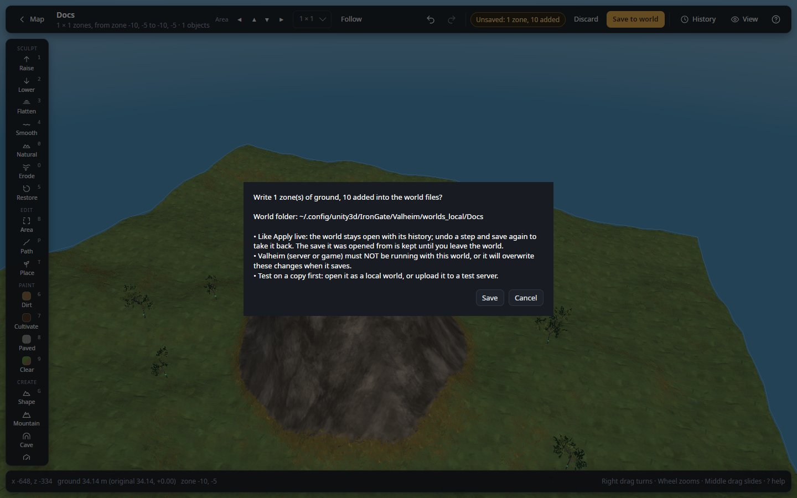
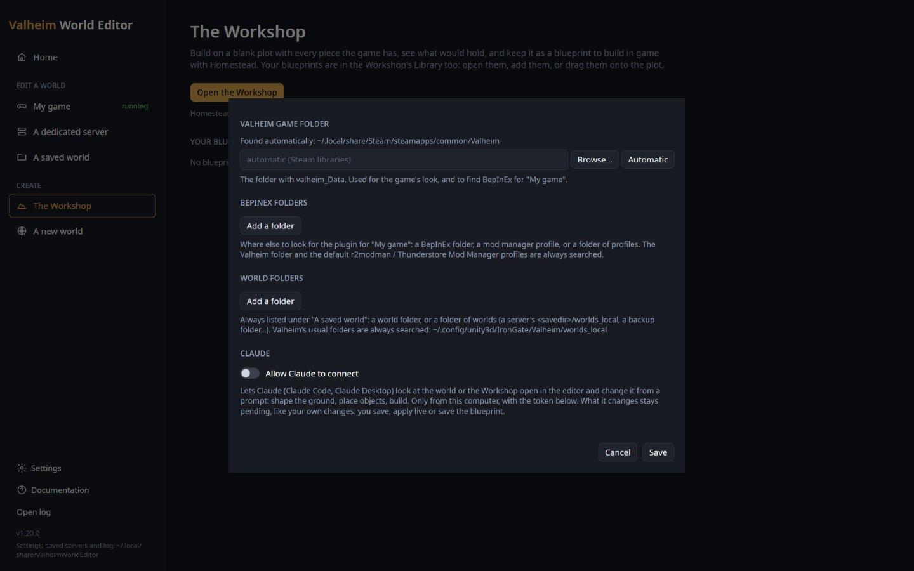

# The editor window

Find your way around the editor: the start page, the 3D window with its top bar, tool rail and panels, the camera,
saving, History and the View panel.

**Where:** the start page opens first; a world opens on its [map](map.md), then **Edit in 3D** · **Key:** `?` or
`F3` for the help card, `F1` for this help at the tool in use · **Works in:** saved worlds, live, the Workshop

*A small base in a 3 × 3 area, the Raise brush chosen (its ring on the grass). Left: the tool rail and the tool's
panel. Top: the top bar. Right: the View panel. Bottom: the status bar, reading the ground under the pointer.*

## Use it

1. On the start page, choose how to edit: **My game**, **A dedicated server** or **A saved world** (or **The
   Workshop** to build without a world).
2. Click your world. It opens on its [map](map.md).
3. On the map, click the place to edit, choose the area's size, then **Edit in 3D**.
4. Pick a tool on the rail, set it in its panel, and use it in the view.
5. Look over what is waiting in the top bar's pending line, then **Save to world** (or **Apply live**).
6. To take a change back, press `Ctrl+Z`, or open **History** (`L`).

Every change waits as [pending](concepts/saving-and-history.md#pending-changes) until you save or apply it.

## The start page

*Home: the card of the running game with **Edit live**, then the worlds and blueprints opened last.*

The side menu has **Home**, then two sections, **Edit a world** and **Create**. You come back here from a world's
map (**Worlds**) or from the Workshop (**Start**).

| Entry | What it shows |
|---|---|
| **Home** | Where you left off. When Valheim runs with the WorldEditorBridge plugin, a card says "Valheim is running with the world …" and how many players are connected, with **Edit live**. Under **Recent**: the saved worlds and blueprints you opened or saved last (blueprints with their pictures), newest first, and the saved servers that connect in one click (password saved, or a key file). |
| **My game** | Your own game, live: what is missing (BepInEx, the plugin, a first start), or the world it runs with and **Edit live**. *running* shows beside it while the game runs; the editor checks every few seconds. See [live mode](live-mode.md). |
| **A dedicated server** | The saved servers (**Connect**, **edit**, **forget**) and the form to connect to another one. See [live mode](live-mode.md). |
| **A saved world** | The worlds on this computer, to open with the game closed. The list follows the world folders added or removed every few seconds; **Refresh** looks at once. Hover a world to see its folder. **Another world folder** opens any folder with `_main.<n>.chunks` files. See [Open a world that is not in the list](guides/open-a-world.md). |
| **The Workshop** | **Open the Workshop**, whether Homestead is installed, and every blueprint, newest first: click one to open it. See [the Workshop](workshop.md). |
| **A new world** | **Make a new world**: a seed's world before it exists, and a search for one that suits you. See [a new world](new-world.md). |

At the bottom of the menu: **Settings** (see [Settings](#settings)), **Documentation** (this help, in its own
window), **Open log**, the version, and the folder that holds the editor's settings and log.

## The window

The 3D window has five parts:

- **Top bar**: the world's name and area, the area controls, undo and redo, what is pending, **Discard**, **Save to
  world** or **Apply live**, then **History**, **View** and **?**. See [The top bar](#the-top-bar).
- **Tool rail** (left edge): every tool, with its key in the corner. See [The tool rail](#the-tool-rail).
- **Tool panel** (next to the rail): the chosen tool's name, a line on how to use it, and its settings. The
  [Mask](masks.md) shows its own card beside it for the tools it works with (the brushes, Path, Area, Shape,
  Mountain and Place).
- **Right-hand panel**: **View** (`V`), **History** (`L`), the **Controls** help card (`?` or `F3`) or the
  [Inspector](select.md) (`I`). They share one place, so only one shows at a time; the same key or button again
  closes it.
- **Status bar** (bottom): where the mouse is, the last message, the selection, Walk or Fly, and a reminder of the
  mouse ("Right drag turns · Wheel zooms · Middle drag slides · ? help").

The mouse readout reads like `x 1250, z -380   ground 32.40 m (original 30.10, +2.30)   zone 20, -6`: the
position in metres, the ground's height now, its height before any change and the difference, and the zone. At the
game's limit it adds ", at the ±8 m limit". The selection reads like "Selected: 15 objects (Beech ×12, Rock ×3)",
with the four most common kinds.

Every slider, switch and button explains itself when you hover it. The editor remembers your choices between runs:
what View shows, the look options, the brush's shape and falloff, the Area action, the Shape preset and your own
formula, Select's options, which Place categories are open, the right-hand panel you left open, **Follow**,
**Auto**, the map's place and the clipboard.

## The top bar

| Control | What it does |
|---|---|
| **Map** | Back to the world map. What is not saved or applied stays pending. In the Workshop this is **Start**. |
| Name and area | The world's name; under it the area's size, its first and last zone and how many objects it holds. |
| **Area** ◀ ▲ ▼ ▶, size list, **Follow** | Move the area, change its size, let it grow as you look around. See [The area](#the-area). |
| Undo, redo (the curved arrows) | Undo the last change (`Ctrl+Z`); redo it (`Ctrl+Y` or `Ctrl+Shift+Z`). Their hover text names the step, e.g. "Undo Raise (Ctrl+Z)". A step from an earlier session may ask first. |
| **LIVE** (live) | Shows you are connected to the running game through the WorldEditorBridge plugin. |
| **Reload** (live) | Loads the world again from the game, after asking when changes are not applied yet (they are dropped). You stay where you are. |
| **Auto** (live) | Applies every change to the game as soon as it is done: each stroke when you let go, each tool, undo and redo. Switching it on sends what is waiting at once. Remembered. |
| Pending line | "Unsaved: 3 zones, 1 deleted, 12 added, 1 reset" (offline) or "Not applied: …" (live), in amber; "All saved" or "All applied" in grey when nothing waits. What it counts: see [Pending changes](concepts/saving-and-history.md#pending-changes). |
| **Discard** | Throws away what is not saved or applied yet, after asking. See [Discard](#discard). |
| **Save to world** (offline) | Writes the changes into the world's files (`Ctrl+S`). See [Save to world](#save-to-world). |
| **Apply live** (live) | Sends the changes to the running game (`Ctrl+S`): everyone there sees them at once. See [Apply live](#apply-live). |
| **History** | Every change of the session (`L`). See [History](#history). |
| **View** | What is shown and how (`V`). See [View panel](#view-panel). |
| **?** | The **Controls** help card (`?` or `F3`). See [The help card](#the-help-card). Each panel has its own small **?** at the top: the Help window at that tool's page (`F1` does the same for the tool in use). |

In a narrow window the name and area line end in "…" (hover it to read it whole), and when even that is not enough,
**Map**, **Reload**, **History** and **View** show only their icons.

In the view, every new object not saved or applied yet carries a **green dot**, except while it is selected (its
outline marks it then). **View → Unsaved marks** hides the dots; the objects stay.

*Young trees just planted: each carries a small green dot at its foot until it is saved (one enlarged in the
corner), and the pending line counts them: "Unsaved: 1 zone, 10 added".*

## The tool rail

| Section | Rail button (key) | What it opens |
|---|---|---|
| **SCULPT** | **Raise** (`1`), **Lower** (`2`), **Flatten** (`3`), **Smooth** (`4`), **Natural** (`0`), **Erode** (`O`), **Restore** (`5`) | The ground brushes; **Natural** opens the panel titled **Naturalize**. See [Sculpt and paint](terrain.md). |
| **EDIT** | **Area** (`B`), **Path** (`P`), **Place** (`T`) | [Area](area.md) (box or polygon actions, copy and paste), [Path](path.md) (roads, ramps, rivers, caves), [Place](place.md) (trees, rocks, pieces, spawn points). |
| **PAINT** | **Dirt** (`6`), **Cultivate** (`7`), **Paved** (`8`), **Clear** (`9`) | The paint brushes; **Clear** opens the panel titled **Clear paint**. See [Sculpt and paint](terrain.md). |
| **CREATE** | **Shape** (`G`), **Mountain**, **Cave**, **Dungeon**, **Script**, **Blueprints** | [Shape](shape.md), [Mountain](mountain.md), Cave (the [Path](path.md) tool with its Cave action), [Dungeons](dungeons.md), [Script](scripting.md), and the blueprint library to paste one (see [the Workshop](workshop.md)). Only Shape has a key. |
| **TOOLS** | **Select** (`E`), **Measure** (`M`), **View** (`Esc` or `H`) | [Select](select.md), [Measure](measure.md), and View: look around; a left drag slides the view, a click picks an object, a double-click on one switches to Select with it selected. |
| **MODS** | One button per tool a mod's [extension](modding.md) brings: its name, its picture or first letter; hovering it names the mod | The mod's tool: its card of settings next to the rail, its help in the tooltip. Its changes go into History and are undone, redone and saved like the editor's own. Shown only when a running extension has a tool. |

The rail scrolls when the window is too short for it. In the Workshop it keeps only **Build** (the Place tool for
building pieces, `T`), **Select** and **View**.

## Camera

| Action | How |
|---|---|
| Turn the view | Right drag. |
| Zoom | Mouse wheel, from 3 m to 3 km from the point you look at. |
| Slide the view | Middle drag, `Space` + left drag or `Shift` + right drag (in any tool), or a left drag with the **View** tool. |
| Move around | `W` `A` `S` `D` or the arrow keys. The further you are zoomed out, the faster. The point you look at stays on the ground (or the water). |
| See it as a player | `F`: Walk, then Fly, then back to the usual view. |

### Walk and Fly

*Walk mode (`F`): the base as a player standing by the field sees it, eyes 1.8 m above the ground.*

`F` cycles through three views:

1. **Walk**: your eyes are 1.8 m above the ground (or above the water where it is deeper). You start where the usual
   view was looking. `W` `A` `S` `D` move where you look at 6 m/s; `Shift` runs at 12 m/s. Right drag looks around.
   You keep to the ground as it rises and falls, edited ground included.
2. **Fly**: `F` again. `Space` goes up, `C` goes down, at 15 m/s (`Shift`: 45 m/s). `C` also takes you through the
   ground, into what a mod digs under it (Tunnelheim's tunnels and cellars); `Space` brings you back up.
3. **The usual view**: `F` a third time. The view turns around a point on the ground 20 m ahead of where you were.

The status bar says which mode is on and its keys. While walking or flying the wheel does not zoom and drags do not
slide the view; every tool still works. In a dungeon (5000 m up, where the game keeps dungeon rooms) the camera does
not keep to the ground.

## The area

The 3D window shows one **area**: a block of zones (a zone is 64 × 64 m) around the spot you opened from the map.
Its outer line of ground points is locked, so to work near an edge, move the area or make it bigger. Why the editor
works this way: see [Areas and zones](concepts/areas-and-zones.md).

| Control | What it does |
|---|---|
| **◀ ▲ ▼ ▶** (after "Area") | Moves the area one zone (64 m) west, north, south or east. The camera stays where it is in the world, and pending changes and History come along. |
| Size list | Opens the area again around the same middle zone at **3 × 3**, **5 × 5**, **7 × 7**, **9 × 9**, **13 × 13** or **17 × 17** zones. The view, the changes and History stay. An area Follow grew (like 4 × 3) shows its own size. Large areas (up to 1088 m across) are slow to open and to draw. |
| **Follow** | When the point you look at comes within 12 m of the area's edge, the area grows a row of zones on that side, and keeps the zones it has, up to 17 zones each way. Click to switch it on or off; remembered. See [Follow](concepts/areas-and-zones.md#follow). |

The arrows, Follow and the size list wait while something would be lost, and the status bar says why: objects are
selected (`Alt+A` in Select clears them), a brush stroke is going on, a path is drawn (apply or clear it), or changes
are still being sent to the game. They do not wait for an Area box or polygon, a Place line, grid or zone, or a
measure: those are dropped when the area moves, grows or changes size. The area controls are not in the Workshop.

## Save, apply and discard

### Save to world

**Save to world** (`Ctrl+S`) first asks, in **Save into the world**, showing what will be written and the world's
folder. Close Valheim (the game or the server) before you save: a running game writes over your changes the next
time it saves.

*Nothing is written until you click **Save**: the question counts what goes in, names the **World folder** and warns you to close Valheim first.*

The result says what was saved ("Saved 4 zone(s), 2 deleted object(s), 12 new object(s) to save #37.") and lists
what could not be, with the reason:

- a zone, or a new object in a zone, that is **not generated yet**: no player has been there, so the world has no
  data there. Visit it in game first.
- new ground in a world that has **no terrain object to copy yet**: nobody ever dug or levelled the ground in game.
  Edit the ground once anywhere in game first.

After a save the area and History stay as they were. To take a saved change back, undo it (or **Remove** it in
History) and save again: the save takes it out of the world. When nothing is left of what you saved, the message says
the world is as you opened it again. How a save is written and checked: see
[Saving a world](concepts/saving-and-history.md#saving-a-world).

**When the game saved since.** If the game saved the world after the editor read it, nothing is saved: saving would
throw away what was done in the game. The question **The game saved this world** offers **Bring my changes over**:
the editor reads the game's save and makes each of your unsaved changes again on it. Where the game changed the same
zone or object, it asks once per kind, **Keep mine** or **Keep the game's**. Nothing is written until you save again.
**Not now** leaves everything as it was. See [Saving a world](concepts/saving-and-history.md#saving-a-world).

### Apply live

In live mode the same button is **Apply live**. It sends the ground, the object changes and the zone resets to the
running game, and the steps sent are tagged **applied** in History. They can still be undone: the next apply sends
the undo. When players changed the ground of a zone you also changed, it asks first (**Apply** or **Not now**). See
[Applying live](concepts/saving-and-history.md#applying-live) and [live mode](live-mode.md).

### Discard

**Discard** undoes everything not saved or applied yet, after asking ("The last N step(s) in History are undone").
It undoes the unsaved steps at the end of History, newest first, redoes saved or applied steps you undid since, and
drops the rest of the redo list. Saved and applied changes stay, and so do the rest of History, the camera and the
tool.

Some pending changes may have no step in this area's History (made in another area, or before the world was read
again). Discard then asks a second time: **Read it again** reads the world from its files (or from the game, live)
and drops every pending change of the whole world.

### Leaving and closing

**Map**, the arrows and the size list keep everything pending. Leaving the world for the start page (**Worlds** on
the map) and closing the window lose what is pending, so both ask first: **Leave anyway** / **Stay**, and **Quit
anyway** / **Keep editing**.

## History

*The last change was undone with **Back to here**: it is greyed out and offers **Redo to here**.*

**History** (`L`) lists every change of the session, newest first. Each row shows the step's name (the tool or
action, e.g. "Raise", "Paste ×3", "Removed: Raise"), the time (with the day for older ones) and what it touched, e.g.
"3 zones · 12 new · 2 removed · 1 zone reset(s)". The current step, the one `Ctrl+Z` undoes next, is outlined. The
heading counts the steps you can undo. The panel shows the newest 200 rows; **Show older (N)** at the bottom adds 200
more.

| Control | What it does |
|---|---|
| **Back to here** | Undoes every change made after this one. The later changes stay in the list, greyed out. |
| **Redo to here** | On a greyed-out change: redoes every change up to and including it. |
| **Remove** | Takes out only this change and keeps everything done after it. The removal is a new step ("Removed: …"), so `Ctrl+Z` brings the change back. The removed change is struck through. |
| **Take back Claude's changes** | Shown when Claude made changes in this area's history. Removes each of them, as **Remove** does, and keeps yours, even those made after them. Claude's changes made in other areas are taken back from those areas. |

Tags on a row: **applied** (sent to the game, or saved), **Claude** (made through the
[Claude connection](claude.md)), **earlier session** (kept from an earlier run of the editor). A new change made after
an undo drops the greyed-out steps. When History is written to disk, how far back it goes, and what happens to steps
made in other areas: see [History](concepts/saving-and-history.md#history).

## View panel

**View** (`V`) chooses what is drawn and how. Each switch shows how many there are in the area. Only what is shown can
be picked or selected, so hiding a kind also keeps it safe from a click.

| Section | Control | What it does |
|---|---|---|
| LOOK | **Game look** | Draws the world with the game's own textures, models, water and sky. Off: plain colours and boxes, faster. |
| | **See-through buildings** | Draws players' buildings half see-through, to see what is inside or behind them. Trees and rocks stay solid. |
| | **3D resolution** | **Sharp (the screen's)**, **Balanced** (one pixel per screen point: fewer on a scaled high-resolution screen) or **Fast** (fewer still). Fewer pixels give more frames per second on a slow computer; the status bar says the size. |
| OBJECTS | **Your buildings**, **Ruins & structures**, **Furniture & props**, **Trees & logs**, **Rocks**, **Ore & deposits**, **Bushes & shrubs**, **Pickables**, **Bones & remains**, **Tamed animals**, **Creatures & NPCs**, **Spawn points**, **Creature nests**, **Runestones**, **Dungeon rooms**, **Effects & markers**, **Other objects** | Show or hide each kind. Only **Your buildings**, **Trees & logs**, **Rocks**, **Tamed animals**, **Runestones** and **Dungeon rooms** are on at first, so the editor does not spoil what is still to be found. |
| | **Water** | The sea and lake surface. |
| OVERLAYS | **Zone borders** | The 64 m zone lines (on at first). |
| | **Location markers** | A post on every location (villages, the trader, dungeon entrances…). |
| | **Ward areas** | Rings where each ward protects (32 m). |
| | **Build ranges** | Rings where each workbench, forge or other crafting station lets you build (10–40 m, by kind). |
| | **Location flattening** | Where locations flatten the ground: a ring for the flat part, a fainter one where it blends in. |
| | **Unsaved marks** | The green dot over each new object not saved or applied yet. |
| | **Limit marks** | Red on ground that reached the game's ±8 m limit (in Game look). See [Limit marks](concepts/ground-limits.md#limit-marks). |
| | **Defaults** / **All** / **Ground** | The usual switches / everything on / only the ground. They set the objects, the water and the overlays, not the look. |
| BUILDING | **Built by** | The player written as the builder of every piece you place, paste or build. |
| GROUND (game look) | **Slope colours**, **Height lines every** 1 / 2 / 5 / 10 **m** | Ground overlays, see [Measure](measure.md). |
| PLAYERS (live) | **Go to** (a player), **Go** | Turns the camera to the player when they are in the area; otherwise the area moves to them. Players show in the view as blue posts with their names. |

What the kinds hold:

- **Ruins & structures** also shows the parts of the game's locations that are not objects of the save (a crypt
  entrance's rocks, the trader's camp, a boss's altar). The game makes them again each time the zone loads, so they
  cannot be picked or changed.
- A ruin you built onto counts as your building: its pieces that touch yours, and the ones touching those, are under
  **Your buildings**.
- **Tamed animals** are the creatures players tamed; wild ones are under **Creatures & NPCs**.
- **Spawn points** are the game's invisible spawn points, shown with a marker and the creature's name.
  **Creature nests** are greydwarf nests, bone piles and the like.
- **Dungeon rooms** are high above their entrances (5000 m up). Edit them with the [Dungeon](dungeons.md) tool.
- What item stands and armour stands hold is drawn with the stand, in Game look, and shown or hidden with its kind.
  Shields and capes show in their first style, an armour stand in its resting pose. The items cannot be picked: pick
  the stand.
- Placing or pasting a kind that is off switches it on, so what you placed stays visible (the message says so).

**Built by** lists the players who built in this world (with their piece counts), the players named on beds, wards
and tombstones, and the characters on this computer, marked "(this computer)". At first it chooses the player with
the most pieces, else your own character, else a player named in the world. **Other player id…** asks for any id (a
whole number). **Nobody (not player built)** places pieces without a builder, as parts of a ruin. With no player known
at all, pieces get **Unknown player** (id 1): wards and private chests then answer to nobody, so choose your own id
when you can. The choice is remembered per world. Why the builder matters: see
[Player-built pieces](concepts/objects.md#player-built-pieces).

When an area holds locations (or has some within 40 m), a note at the bottom of the view, beside the tool panel, says
how many, and that the ground already includes the flattening the game does around them. Close it with its ×. See
[Locations level the ground](concepts/ground-limits.md#locations-level-the-ground).

## The help card

*The **Controls** card (`F3`), scrolled to its end: the last keys, then **This computer** with the frame rate, the
graphics card and **Record frame rates**.*

**?**, `?` or `F3` opens the **Controls** card: the main mouse actions and keys, with a reminder of the ±8 m limit and
the locked edge. Every key is on [Shortcuts](help/shortcuts.md).

Below them, **This computer** says what draws the 3D view (the graphics card and its OpenGL version) and how the area
loaded and, while the view moves, the frame rate with the editor's own work per frame and how many objects, model
parts and draws there are. The view is drawn at full speed only while something happens, otherwise a few times a
second.

**Record frame rates** (off each time the editor opens) writes the frame rate to `perf-native.log` in the editor's
data folder, a line every 0.2 s while the view is used: whether the camera was **moving** or stood **still** while
something else happened, the frames per second, the editor's work per frame and the longest gap between two frames.
A header line (`#`) gives the date, the version, the view's size, the graphics card and what is loaded. Idle moments
are not written.

## The Workshop's top bar

In the [Workshop](workshop.md) the window shows a blank plot instead of a world, and the top bar changes:

| Control | What it does |
|---|---|
| **Start** | Back to the start page, after asking when the building is not saved as a blueprint. |
| Name and cost | The building's name, and under it "Cost: …" (hover it for every material and the crafting stations it needs), or "A blank plot: only the building is kept in the blueprint". |
| **Support check** | On at first: each building piece is tinted the colour the game gives its support in build mode, and pieces that would fall in game are red. Off: build freely. See [The support check](concepts/objects.md#the-support-check). |
| Cut slider | Hides everything higher than the chosen height above the plot, to see and build inside. It moves 1 m a step from the ground (left end) up to 39 m; the right end (40) is off. It reads "Cut at N m" or "Cut: off". |
| Pending | "N piece(s)", how many would fall, and "not saved as a blueprint" or "saved"; "No pieces yet" on an empty plot. |
| **Save blueprint** | Saves the building pieces on the plot as a Homestead blueprint (`Ctrl+S`). Nothing else is kept. |
| **History**, **?** | As in a world. |

The Workshop has no area controls, no **Discard** and no **View** panel: buildings are drawn solid, and zone borders
and green dots are off.

## Settings

**Settings**, at the bottom of the start page's menu, sets where the editor looks for things on this computer. The
editor finds the usual places by itself: Valheim in every Steam library (Flatpak Steam and extra libraries too),
BepInEx in the Valheim folder and in the default r2modman and Thunderstore Mod Manager profiles, and worlds in
Valheim's own world folders (Proton's too).

*Settings scrolls: its top on the left, its end on the right, down to **History** and **Save**. **Drawing** shows only
on Windows.*

| Setting | What it does |
|---|---|
| **Language** | The editor's language; at first the computer's when the editor has it, else English. Taken when the editor starts again. See [Translating](translating.md). |
| **Valheim game folder** | The folder with `valheim_Data` (`valheim.app` on a Mac), for a copy outside Steam or a second install. **Automatic** goes back to searching the Steam libraries. |
| **BepInEx folders** | More places to look for the plugin for **My game**: a `BepInEx` folder, a mod manager profile, or a folder of profiles. |
| **World folders** | A world, or a folder of worlds (a server's `<savedir>/worlds_local` copy, a backup folder…), always listed under **A saved world**. |
| **Claude** | **Allow Claude to connect**, its port and token, **Claude may run scripts**, and the lines to give Claude Code or Claude Desktop. See [Claude](claude.md). |
| **Mod extensions** | One switch per extension a mod in the folders above offers. Turn on only those of mods you trust. See [For mod authors](modding.md). |
| **Add-ons** | The add-ons unpacked into the `addons` folder next to the editor, whether each is in use, and a switch to turn one off without removing it. An add-on is used while its mod is in the plugins folders above. |
| **History** | **Steps kept**: how many changes History keeps to undo. Empty or 0: no limit, until History takes 2 GB of memory; the oldest go first. |
| **Drawing** (Windows) | **Draw with the graphics driver's OpenGL**. Off by default: the editor draws through Direct3D, as games do. Taken when the editor starts again. |

## Shortcuts

| Key | Action |
|---|---|
| `Ctrl+Z` / `Ctrl+Y` or `Ctrl+Shift+Z` | Undo / redo |
| `Ctrl+S` | Save to world, Apply live, or Save blueprint |
| `V` / `L` / `?` or `F3` | View panel / History / help card |
| `F1` | The Help window at the tool in use |
| `F` | Walk, Fly, back to the usual view |
| `W` `A` `S` `D` | Move around |
| `Esc` | Cancel what the tool is doing, else the View tool |

Every key and mouse action, tool by tool: [Shortcuts](help/shortcuts.md). On a Mac, `Cmd` works wherever it says
`Ctrl`.

## Tips and limits

- Ground moves at most 8 m up or down from its original height, the game's own limit; points there turn red. See
  [The game's 8 m limit](concepts/ground-limits.md#the-games-8-m-limit).
- The outer line of points of the area is locked, so the area always joins its neighbours. To edit there, move the
  area or make it bigger. See [The locked edge](concepts/areas-and-zones.md#the-locked-edge).
- Zones no player has visited have no data in the world's files: edits there cannot be saved. Visit them in game
  first.
- Dropping a `.blueprint` or `.vbuild` file on the 3D view adds it to your blueprint library; in the Workshop it is
  also added to the plot where you drop it.
- Something went wrong? `Ctrl+Z` undoes, **History** takes back one change, **Discard** drops everything not saved.
  See [Undo a step, take back one change, or discard everything](guides/undo-changes.md).
- To report a problem, attach the log: **Open log** at the bottom of the start page's menu. It starts over at each
  run, so attach it before you start the editor again.

## Related

- [Your first edit](start/first-edit.md)
- [Undo a step, take back one change, or discard everything](guides/undo-changes.md)
- [Saving and history](concepts/saving-and-history.md)
- [Areas and zones](concepts/areas-and-zones.md)
- [Shortcuts](help/shortcuts.md)
