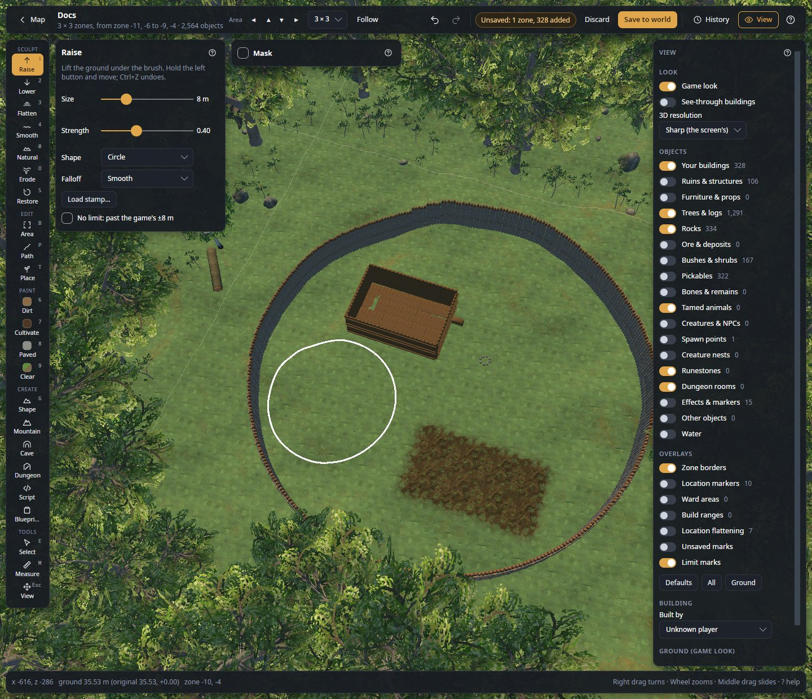
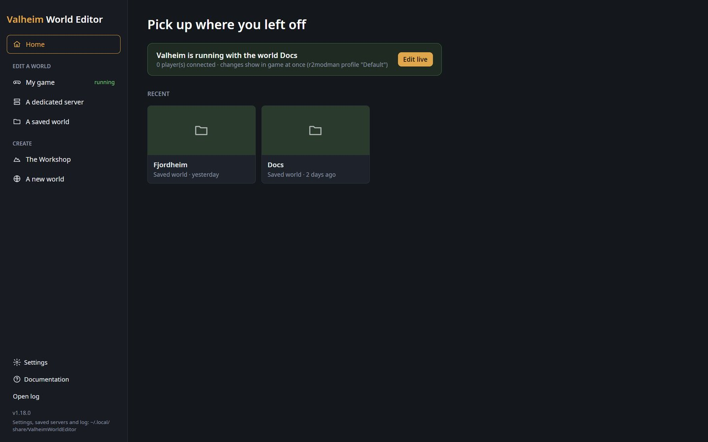
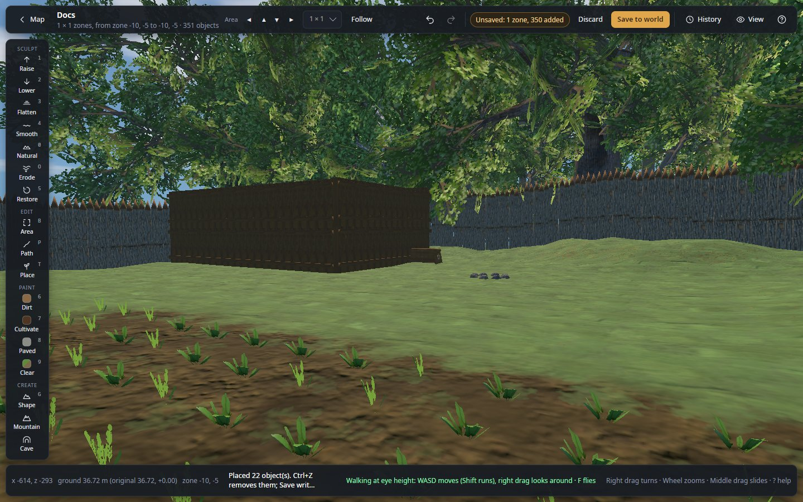
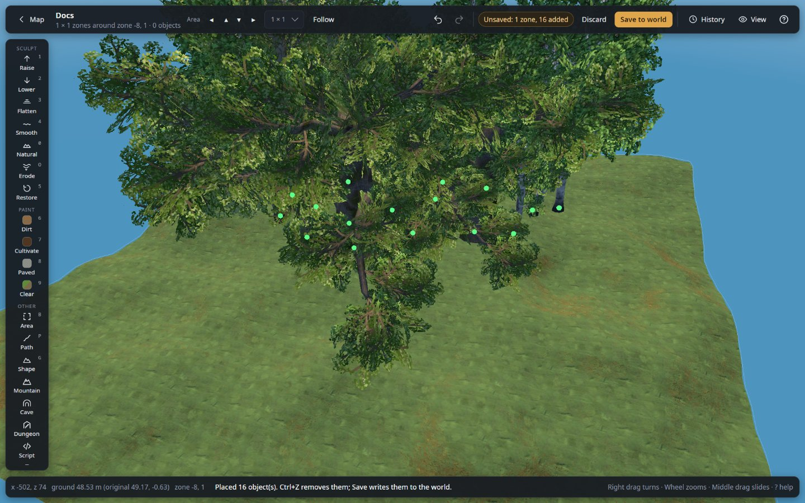
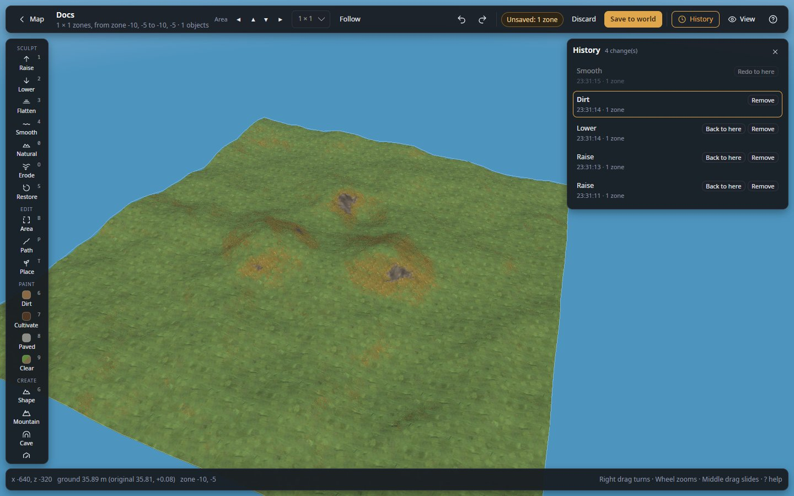
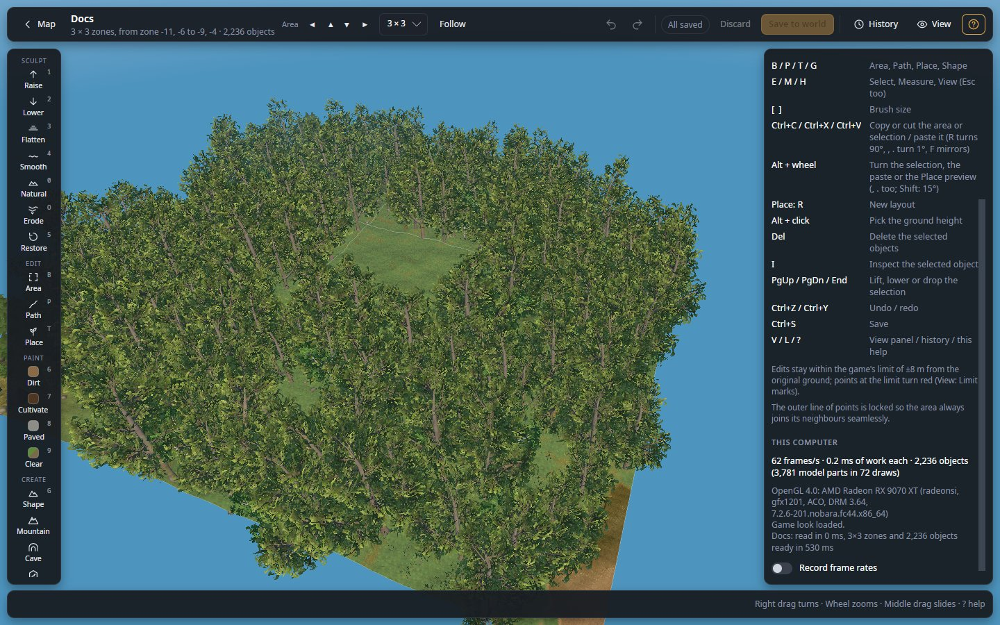

# Getting around the 3D editor

*A hut, a field, a fire pit and a palisade circle with a wood behind. Left: the tool rail. Top: the top bar. Right:
the View panel. Bottom: the status bar.*

The 3D editor shows one **area** of a world: a block of zones (a zone is 64 × 64 m) around the spot you opened from
the [world map](map.md), from 3 × 3 up to 17 × 17 zones. Everything you do there waits as **pending** changes until
you **Save to world** (offline) or **Apply live** (in a running game). This page explains the window, the camera,
moving the area, saving, discarding, the History, the View panel and every shortcut.

## The start page

*Home: the card of the running game with **Edit live**, then the worlds and blueprints opened last.*

The editor opens on its start page. You come back to it from a world's map (**Worlds**) or from the Workshop
(**Start**). Its side menu has **Home**, then two sections, **Edit a world** and **Create**:

| | What it shows |
|---|---|
| **Home** | Where you left off. When Valheim is running with the WorldEditorBridge plugin, a card says "Valheim is running with the world …" and how many players are connected, with **Edit live**. Under **Recent**: the saved worlds and blueprints you opened or saved last (blueprints with their pictures), newest first, and the saved servers that connect in one click (password saved, or a key file). Click one to open it. |
| **My game** | Your game, live: what is missing (BepInEx, the plugin, a first start), or the world it runs with and **Edit live**. *running* shows beside it in the menu while the game runs; the editor checks every few seconds. See [live mode](live-mode.md). |
| **A dedicated server** | The saved servers (**Connect**, **edit**, **forget**) and the form to connect to another one. See [live mode](live-mode.md#a-dedicated-server). |
| **A saved world** | The worlds on this computer, to open with the game closed. The list follows the world folders added or removed by itself every few seconds; **Refresh** looks at once. **Another world folder** opens any folder with `_main.<n>.chunks` files. |
| **The Workshop** | **Open the Workshop**, whether Homestead is installed, and every blueprint, newest first: click one to open it in the Workshop. See [the Workshop](workshop.md). |
| **A new world** | **Make a new world**: a seed's world before it exists, and a search for one that suits you. See [a new world](new-world.md). |

At the bottom of the menu: **Settings**, **Documentation** (this documentation, in the browser), **Open log**, the
version and the folder of the editor's settings and log.

A world opens on its map. Pick a zone and the area size there, then **Edit in 3D** (see [the map](map.md)).

## The window

The 3D editor has five parts:

- **Top bar**: **Map**, the world's name (under it the area's size, its first and last zone and how many objects
  it holds), the area controls (**Area** ◀ ▲ ▼ ▶, the size list, **Follow**), undo and redo, what is pending,
  **Discard** and **Save to world** (or **Apply live**), then **History**, **View** and the help (**?**) button.
- **Tool rail** (left edge): every tool, with its key in the corner, in five sections (below), and a sixth for mods' own tools when a mod brings one.
- **Tool panel** (next to the rail): the tool's name, a line saying what it does and how, and its settings. The
  [Mask](masks.md) has its own card next to it for the tools it works with (the brushes, Path, Area, Shape, Mountain
  and Place).
- **Right-hand panel**: **View** (`V`), **History** (`L`), the **Controls** help (`?` or `F3`) or the
  [Inspector](select.md#inspecting-and-changing-an-objects-data) (`I`). They share the same place under the top
  bar, so only one shows at a time. Pressing the key or the button again closes it.
- **Status bar** (bottom): where the mouse is, the last message, the selection, Walk or Fly, and a reminder of the
  mouse ("Right drag turns · Wheel zooms · Middle drag slides · ? help").

The mouse readout reads like `x 1250, z -380   ground 32.40 m (original 30.10, +2.30)   zone 20, -6`: the world
position in metres, the ground's height now, its height before any change and the difference, and the zone. When
the point has reached the game's limit it adds ", at the ±8 m limit". The selection reads like "Selected: 15
objects (Beech ×12, Rock ×3)", with the four most common kinds.

Every slider, switch and button explains itself when you hover it. The editor remembers your choices between runs:
what View shows, the look options, the brush's shape and falloff, the Area action, the Shape preset (and your own
formula), Select's options, which Place categories are open, the right-hand panel you left open, **Follow**,
**Auto**, the map's place and the clipboard.

### The tool rail

| Section | Rail button (key) | What it opens |
|---|---|---|
| **SCULPT** | **Raise** (`1`), **Lower** (`2`), **Flatten** (`3`), **Smooth** (`4`), **Natural** (`0`), **Erode** (`O`), **Restore** (`5`) | The ground brushes. **Natural** opens the panel titled **Naturalize**. See [sculpting](terrain.md). |
| **EDIT** | **Area** (`B`), **Path** (`P`), **Place** (`T`) | [Area](area.md) (box or polygon actions, copy and paste), [Path](path.md) (roads, ramps, rivers, caves), [Place](place.md) (trees, rocks, pieces, spawn points). |
| **PAINT** | **Dirt** (`6`), **Cultivate** (`7`), **Paved** (`8`), **Clear** (`9`) | The paint brushes. **Clear** opens the panel titled **Clear paint**. See [sculpting and painting](terrain.md). |
| **CREATE** | **Shape** (`G`), **Mountain**, **Cave**, **Dungeon**, **Script**, **Blueprints** | Shape and Mountain (see [sculpting](terrain.md)), Cave (the Path tool with its Cave action, see [Path](path.md)), [Dungeon](dungeons.md), [Script](scripting.md), and the blueprint library to paste one (see [the Workshop](workshop.md)). Only Shape has a key. |
| **TOOLS** | **Select** (`E`), **Measure** (`M`), **View** (`Esc`, also `H`) | [Select](select.md) (move, turn, delete and inspect objects), [Measure](measure.md), and View: look around; a left drag slides the view, a click picks an object and a double click on one switches to Select with it selected. |

| **MODS** | One button per tool a mod's [extension](modding.md#extensions) brings (its name, its picture or first letter; pointing at it names the mod) | The mod's tool: its card of settings and buttons next to the rail, its help in the tooltip. What it does goes in the history like any other edit: undo, redo and save work as for the editor's own tools. Only shown when a running extension has a tool. |

The rail scrolls when the window is too short for it. In the [Workshop](#the-workshops-top-bar) it keeps only
**Build** (the Place tool for building pieces, `T`), **Select** and **View**.

## Camera

| Action | How |
|---|---|
| Turn the view | Right mouse drag. |
| Zoom | Mouse wheel (from 3 m to 3 km away from the point you look at). |
| Slide the view | Middle mouse drag, Space + left drag, or Shift + right drag (these work in any tool), or a left drag with the **View** tool (`H` or `Esc`). |
| Move around | `W` `A` `S` `D` or the arrow keys. The further you are zoomed out, the faster it goes. The point you look at stays on the ground (or on the water). |
| See it as a player | `F`: Walk, then Fly, then back to the usual view (below). |
| Back to the map | **Map** at the top left. What is not saved stays pending. |

### Walk and Fly

*Walk mode (`F`): the base as a player standing by the field inside the palisade sees it, eyes 1.8 m above the
ground.*

`F` cycles through three views:

1. **Walk**: your eyes are 1.8 m above the ground (or above the water where it is deeper), like a player's. You
   start where the usual view was looking. `W` `A` `S` `D` move where you look at 6 m/s; Shift runs at 12 m/s.
   Right drag looks around, up and down. You keep to the ground as it rises and falls, the ground you just edited
   included.
2. **Fly**: `F` again. Space goes up, `C` goes down; 15 m/s (Shift: 45 m/s). You can never go below eye height
   over the ground.
3. **The usual view**: `F` a third time. The view turns around a point on the ground 20 m ahead of where you were.

The status bar says which mode is on and its keys. While walking or flying the wheel does not zoom and drags do not
slide the view. All tools still work: you can paint, place or select while walking. In a dungeon (5000 m up, where
the game keeps dungeon rooms) the camera does not keep to the ground.

## The area

The area is the block of zones open in 3D. The ground at its outer line of points is locked (see [Limits](#limits)),
so to work near an edge, move the area or make it bigger. The top bar's area controls (in worlds, not in the
Workshop) are:

| Control | What it does |
|---|---|
| **◀ ▲ ▼ ▶** (after "Area") | Moves the area one zone (64 m) west, north, south or east. The camera stays where it is in the world, so the view does not jump. Pending changes stay pending, and the history comes along (see [History](#history)). The arrows do not wait: a path being drawn, an Area box or polygon, a Place line or zone, a measure and the selection are dropped. |
| Size list (**3 × 3** … **17 × 17**) | Opens the area again at that size around the same middle zone, on the fly: 3 × 3, 5 × 5, 7 × 7, 9 × 9, 13 × 13 or 17 × 17 zones. The view, the changes and the history stay. An area that Follow grew (or any size not on the list, like 4 × 3) shows its own size in the box. Large areas (13 × 13, 17 × 17: up to 1088 m across) are slow to open and to draw. |
| **Follow** | When the point you look at comes within 12 m of the area's edge, the area grows that way by itself: a row of zones is added on that side (on both sides near a corner), and the zones already open stay. A 3 × 3 area becomes 4 × 3, then 4 × 4 and so on. It never leaves zones behind, and stops at 17 zones each way (about 1 km); then it says so: move the area with the arrows, or open another from the map. Click to switch it on or off; remembered. |

Follow and the size list **wait** while something would be lost, and the status bar says why: objects are selected,
a brush stroke is going on, a path is drawn (apply or clear it), or changes are still being sent to the game.

How it works: the editor keeps one set of pending changes for the whole world, not one per area. Opening another
block of zones reads it from the world with your pending changes on top, so the edits you made outside the new
block are still waiting, and are saved with the rest.

## Top bar

| Control | What it does |
|---|---|
| **Map** | Back to the world map. What is not saved or applied stays pending. In the Workshop this button is **Start**. |
| Undo / Redo (the curved arrows) | Undo the last change (`Ctrl+Z`); redo it (`Ctrl+Y` or `Ctrl+Shift+Z`). Their hover text names the step, e.g. "Undo Raise (Ctrl+Z)". Works for every tool. A step from an [earlier session](#kept-after-the-editor-closes) may ask first. |
| **LIVE** (live) | Connected to the running game through the WorldEditorBridge plugin. |
| **Reload** (live) | Loads the world again from the game, after asking when changes are not applied yet (they are dropped). You stay where you are. The open area also follows the game by itself, see [live mode](live-mode.md#following-the-game). |
| **Auto** (live) | Applies every change to the game as soon as it is done: each stroke when you let go, each tool, undo and redo. Switching it on with changes waiting sends them at once. Remembered. |
| Pending | "Unsaved: 3 zones, 1 deleted, 12 added, 1 reset" (offline) or "Not applied: …" (live), in amber; "All saved" or "All applied" in grey when nothing waits. See below. |
| **Discard** | Throws away what is not saved (or applied) yet, after asking. See [Discard](#discard). |
| **Save to world** (offline) | Writes the changes into the world's files (`Ctrl+S`). See [Saving](#saving). |
| **Apply live** (live) | Sends the changes to the running game (`Ctrl+S`): everyone there sees them at once. See [Apply live](#apply-live). |
| **History** (`L`) | Every change of the session. See [History](#history). |
| **View** (`V`) | What is shown and how. See [View panel](#view-panel). |
| **?** | The **Controls** card: mouse, keys and "This computer". See [Shortcuts](#shortcuts). |

### What "pending" counts

The pending line counts four things:

- **zones**: zones whose ground (height or paint) really differs from the saved state. Raising and then lowering
  back to the same height counts nothing.
- **deleted**: objects of the world that will be removed.
- **added**: new objects (placed, pasted, copied, or made by a tool).
- **reset**: zones marked for [reset](area.md#reset-zones) (the game makes them again the next time it loads them).

Once you saved, the counts are what differs from that save: an undo after a save makes a change pending again.

*Each new tree carries a green dot until it is saved; the status bar says what the last action did.*

In the view, every new object not saved (or applied) yet carries a **green dot**, except while it is selected: the
selection's outline marks it then, and its dot comes back once you select something else. **View → Unsaved marks** hides
the dots (the objects stay).

## Saving and discarding

### Saving

**Save to world** (or `Ctrl+S`) first asks, showing what will be written and the world's folder. Close Valheim (the
game or the server) before you save: a running game keeps the world in memory and writes over your changes the
next time it saves.

How a save works:

1. **A new save.** The game keeps a world as numbered saves (`_main.<n>.chunks`, `.db2`, `.fwl2` and `.ok`) plus
   chunk files that hold the objects and the ground. The editor writes the **next save number** (the highest there
   + 1): new copies of only the chunk files that changed, a new index, and the world's data. Untouched objects are
   copied byte for byte. The `.ok` marker is written last, as the game does: the game only trusts a save that has
   it. Each file keeps the save format it was read in, so worlds saved by Valheim 1.0.20 and later (format 42) and
   by earlier versions (format 41) both save, and open again in the game that saved them.
2. **Read back and checked.** The editor reads the new save back and compares it with what it meant to write: the
   saved zones' ground, every other zone's ground untouched, the number of objects, the reset zones. If anything
   differs or fails, the new files are removed and the message ends with "Nothing changed". Nothing of the old save
   is touched before this point, so no backup folder is needed and none is made.
3. **Tidy up.** The previous save of this session (if you saved before) is removed. The save the world was opened
   from is kept while the world is open, because each save is made from it, with every change since. When you
   leave the world, only the newest save stays.
4. **The history is written** with the world (see [Kept after the editor closes](#kept-after-the-editor-closes)).

After a save the area and its history stay as they were, like after Apply live. To take a saved change back, undo
it (or **Remove** it in History) and save again.

The result says what was saved ("Saved 4 zone(s), 2 deleted object(s), 12 new object(s) to save #37."), and lists
what could not be saved, with the reason:

- a zone, or a new object in a zone, that the game has **not generated yet**: no player has been near it, so the
  world has no data there. Visit it in game first.
- new ground in a world where nobody ever **dug or levelled the ground** in game: the editor copies an existing
  ground object of the world to make new ones, so dig once anywhere in game first.

**The game saved since?** If the game saved the world after the editor read it (you played between two saves),
the editor saves nothing, because saving would throw away what was done in the game. Instead it offers to **bring
your changes over** onto the game's save:

1. It reads the game's save and makes each of your unsaved changes again on it: the changed zones' ground (heights,
   paint, smoothing, zone resets and No limit ground), the objects you deleted, added and moved, with their data and
   links. Objects are found again by kind and place, since their ids change with every save.
2. Where the game changed the same thing, it asks once per kind, **Keep mine** or **Keep the game's**, listing the
   first few (name and place, or zone):
   - **zones whose ground you both changed**: keeping yours puts your changed points and paint over the game's,
     and the game's ground stays everywhere else in those zones; keeping the game's also drops a reset of that
     zone's ground you marked there (a reset of its objects alone stays);
   - **objects the game changed** (a chest's contents, a sign, a growing plant) that you deleted, moved or edited
     (an object you added and saved counts too):
     keeping yours deletes, moves or edits them (a moved one takes the game's data along, an edited one keeps
     yours);
   - **objects the game removed** that you moved or edited (taken or destroyed by players, or moved away, like a
     creature or a ship): keeping yours brings them back where you put them, as you had them. One the game only
     moved is then there twice.

   If the save the editor read is gone (the game keeps only its last two saves), the editor cannot tell whether
   the game changed an object, and the question says how many of them may be unchanged.
3. The world is then the game's save with your changes pending on it, and the area is read again. **Nothing is
   written yet**: look the changes over, then save as usual. The next save is made from the game's save.

The history comes along: its steps find their objects in the game's save, and you are asked once before undoing
one (the game changed the world under it). A step that touches something you gave to the game's version cannot be
undone any more, nor can the steps before it: those are dropped, and the result says how many. **Not now** leaves
everything as it was; saving again offers the same.

After [zone resets](area.md#reset-zones), or when [No limit](terrain.md#no-limit) ground is turned into ground discs,
the world is read again from what was written, because the ground under the area is no longer the same. That
starts a new history.

### Apply live

In live mode the same button is **Apply live**. It sends the ground, the object changes and the zone resets to the
running game, and the steps sent are tagged **applied** in History. They can still be undone: the next apply sends
the undo. When players changed the ground of a zone you also changed, it asks before writing over it. See
[live mode](live-mode.md).

### Discard

**Discard** throws away everything not saved (or applied) yet, after asking. The question says how many steps of
History will be undone. It then undoes the steps at the end of History that are not saved, newest first, and drops
the redo list. Saved and applied changes stay, and so does the rest of the history. The camera and the tool stay
as they are.

Some pending changes may have no step in this area's history (made in another area, or before the world was read
again). Discard then asks a second time: those can only be thrown away by **reading the world again** from its
files (or from the game, live), which drops every pending change of the whole world.

### Leaving and closing

**Map**, the arrows and the size list keep everything pending. Closing the window with changes pending asks first
(**Quit anyway** / **Keep editing**): changes you neither saved nor applied are lost when you quit.

## History

*The last change was undone with **Back to here**: it is greyed out and offers **Redo to here**.*

**History** (`L`) lists every change of the session, newest first. Each row shows the step's name (the tool or
action, e.g. "Raise", "Paste ×3", "Removed: Place"), the time (with the day for older ones) and what it touched,
e.g. "3 zones · 12 new · 2 removed · 1 zone reset". The current step, the one `Ctrl+Z` undoes next, is outlined.
The heading counts the changes. History keeps every step by default, as long as they take less than 2 GB of
memory (past that, the oldest go first); **Settings > History > Steps kept** keeps only that many instead. The panel
shows the newest 200 rows; **Show older (N)** at the bottom adds 200 more.

Tags on a row:

- **applied**: sent to the game already (live), or saved (offline).
- **Claude**: made by Claude through the editor's [Claude connection](claude.md).
- **earlier session**: kept from an earlier run of the editor (below).

| Control | What it does |
|---|---|
| **Back to here** | Undoes every change made after this one. The later changes stay in the list, greyed out. |
| **Redo to here** | On a greyed-out change: redoes every change up to and including it. |
| **Remove** | Takes out only this change and keeps everything done after it. Its height change is taken off the points it touched (later edits there stay), its paint goes back where nothing repainted since, the objects it added go and the ones it deleted come back, and its zone resets are cancelled. The removal is itself a new step ("Removed: …"), so `Ctrl+Z` brings the change back. The removed change is struck through. |
| **Take back Claude's changes** | Shown when Claude made changes. Removes every change Claude made (as **Remove** does, one by one) and keeps yours, even those made after them. |

For example: remove a tree line you planted an hour ago without losing the ground work you did since.

A new change made after an undo drops the redo list (the greyed-out steps), as usual.

### When you move to another area

The history belongs to the world, not to one area. It comes along when you move or resize the area, when Follow
grows it, and through the map:

- A step made wholly in **another area** is kept aside while this one is open. The panel says "N step(s) made in
  other areas are kept: open those areas to undo them". It comes back, undoable, when you open an area that holds
  it.
- A step **partly outside** the open area cannot be undone from here, and neither can the steps made before it:
  they are kept aside too, until an area holding all of it opens.
- Saving or applying from any area marks the steps of every area as saved, so Discard never undoes them.

### Kept after the editor closes

After each **Save to world** or **Apply live**, the history is written to disk, in `history/` of the editor's data
folder (one file per world folder; live, one per connection and world). Open the world again, even after closing
the editor, and the steps are back in **History**, tagged **earlier session**; the status bar says how many came
back. **Undo** takes them back as before: the ground as it was, a deleted object back with its contents and data, a
placed one removed. Changes you neither saved nor applied are not kept.

The world may have changed since: players built and dug (live), or the game saved it again (offline). Then the
editor asks once, before the first step from an earlier session is undone or redone, because doing it puts the
ground and the objects back as they were, over what changed since. A world that only the editor saved since is
not asked about.

The history file is removed when the world is read again (zone resets, No limit ground).

## The Workshop's top bar

In the [Workshop](workshop.md) the editor shows a blank plot instead of a world, and the top bar changes:

| Control | What it does |
|---|---|
| **Start** | Back to the start page, after asking when the building is not saved as a blueprint. |
| Name and cost | The building's name, and under it "Cost: …" (hover it for every material and the crafting stations it needs), or "A blank plot: only the building is kept in the blueprint". |
| **Support check** | On at first: every building piece is outlined in the colour the game gives its support in build mode (blue on the ground, then green to red), and pieces that would fall in game are pink. Off: build freely. |
| Cut slider | Hides everything higher than the chosen height above the plot, to see and build inside the building. It moves 1 m at a time, from the ground (left end) up to 40 m; at the right end it is off. It reads "Cut at N m" or "Cut: off". |
| Pending | "N piece(s)", how many would fall, and "not saved as a blueprint" or "saved"; "No pieces yet" on an empty plot. |
| **Save blueprint** | Saves the building pieces on the plot as a Homestead blueprint (`Ctrl+S`). Nothing else is kept. |
| **History**, **?** | As in a world. |

The Workshop has no area controls, no **Discard** and no **View** panel (buildings are drawn solid, and zone
borders and green dots are off). The rail has only **Build**, **Select** and **View**.

## View panel

**View** (`V`) chooses what is drawn and how. Each switch shows how many there are in the area. Only what is shown
can be picked or selected, so hiding a kind also keeps it safe from a click.

| Section | Control | What it does |
|---|---|---|
| LOOK | **Game look** | Draws the world with the game's own textures, models, water and sky (read from your Valheim). Off: plain colours and boxes, faster. |
| | **See-through buildings** | Draws players' buildings half see-through, to see the ground and objects inside or behind them. Trees and rocks stay solid. |
| | **3D resolution** | How many pixels the 3D view draws: **Sharp (the screen's)** (every pixel of the screen), **Balanced** (one per screen point: fewer on a high-resolution screen with scaling) or **Fast** (fewer still). Fewer pixels give more frames per second on slow computers; the status bar says the size. |
| OBJECTS | **Your buildings**, **Ruins & structures**, **Furniture & props**, **Trees & logs**, **Rocks**, **Ore & deposits**, **Bushes & shrubs**, **Pickables**, **Bones & remains**, **Tamed animals**, **Creatures & NPCs**, **Spawn points**, **Creature nests**, **Runestones**, **Dungeon rooms**, **Effects & markers**, **Other objects** | Show or hide each kind. Only **Your buildings**, **Trees & logs**, **Rocks**, **Tamed animals**, **Runestones** and **Dungeon rooms** are on at first, so the editor does not spoil what is still to be found. See the notes below. |
| | **Water** | The sea and lake surface. |
| | | What item stands and armour stands hold (a shield on the wall, food on a table, a suit of armour) is drawn with the stand, shown and hidden with its kind, in Game look. Shields and capes are drawn in their first style, an armour stand in its resting pose; the items cannot be picked, pick the stand. |
| OVERLAYS | **Zone borders** | The 64 m zone lines (on at first). |
| | **Location markers** | A post on every location (villages, the trader, dungeon entrances…). |
| | **Ward areas** | Rings on the ground where each ward protects (32 m). |
| | **Build ranges** | Rings where each workbench, forge or other crafting station lets you build and upgrade (10–40 m, by kind). |
| | **Location flattening** | Where locations flatten the ground: a ring for the flat part, a fainter one where it blends into the land. |
| | **Unsaved marks** | The green dot over each new object not saved (or applied) yet. |
| | **Limit marks** | The red on ground that reached the game's limit of ±8 m (in Game look). |
| | **Defaults** / **All** / **Ground** | The usual switches / everything on / only the ground. They set the objects, the water and the overlays, not the look. |
| BUILDING | **Built by** | The player written as the builder of every piece you place: see [Player-built pieces](#player-built-pieces). |
| GROUND (game look) | **Slope colours**, **Height lines every** 1 / 2 / 5 / 10 **m** | Ground overlays, see [Measure](measure.md). |
| PLAYERS (live) | **Go to** (a player), **Go** | Turns the camera to the player when they are in the area; otherwise the area moves to them. Players are drawn in the 3D view as blue posts with their names. |

Notes on the kinds:

- **Ruins & structures** also shows the parts of the game's locations that are not objects of the save (a crypt
  entrance's rocks, the trader's camp, a boss's altar, a troll cave's walls). The game makes them again from the
  location each time the zone loads, so they cannot be picked or changed here.
- A ruin you built onto (a stone tower patched with wood) counts as your building: its pieces that touch yours, and
  the ones touching those, are under **Your buildings**. The rest of the world's ruins stay under Ruins & structures.
- **Tamed animals** are the creatures players tamed; wild ones are under **Creatures & NPCs**.
- **Spawn points** are the game's invisible spawn points, shown with a marker and the creature's name (see
  [Spawn points](place.md#spawn-points)). **Creature nests** are greydwarf nests, bone piles and the like.
- **Dungeon rooms** are high above their entrances (5000 m up, where the game keeps them). Edit them with the
  [Dungeon](dungeons.md) tool.
- Placing or pasting a kind that is off switches it on, so what you placed stays visible (the message says so).

When an area holds locations (or has some within 40 m), a note at the bottom left says how many: the ground already
includes the flattening the game does around them. Close it with its ×.

## Player-built pieces

Everything a player can place with the hammer, the hoe, the cultivator or the serving tray is **player built** in
the game: it stores who built it. The editor writes the player chosen in **View → Building → Built by** on every
such piece it places, pastes or builds, as the game would. Without a builder the game takes a piece for part of a
ruin: taking it down gives only a third of its materials back, a fire next to it is no base (monsters still
spawn), raids ignore it, and a ward or private chest answers to nobody.

**Built by** lists the players who built in this world (with their piece counts), the players named on beds, wards
and tombstones, and the characters on this computer (marked "(this computer)", even in a world where you built
nothing yet). At first it chooses the player with the most pieces, else your own character, else a player named in
the world. **Other player id…** asks for any id (a whole number). **Nobody (not player built)** places pieces
without a builder, as parts of a ruin. The choice is remembered per world. With no player known at all, pieces get
**Unknown player** (id 1): they are player built, but wards and private chests answer to nobody, so choose your own
id when you can.

Pieces placed by older versions of the editor may have no builder: select them and press **Make player built**
([Select](select.md) tool). Moving or editing an object keeps the builder it has.

## Shortcuts

*The **Controls** card (`F3`): mouse and keys, then This computer.*

The help card opens with the **?** button, `?` (Shift + `/`) or `F3`. It lists the main controls. Below them,
**This computer** says what draws the 3D view (the graphics card's name and its OpenGL version) and how the area
loaded, and, while the view moves, the frame rate with the editor's own work per frame and how many objects, model
parts and draws there are.

With **Record frame rates** (off each time the editor opens) the editor writes its frame rate to `perf-native.log`
in its data folder, a line every 0.2 s while the view is used. A header line (`#`) gives the date, the version, the
size of the 3D view, the graphics card and what is loaded (written again when one changes); then each line says
whether the camera was **moving**, or stood **still** while something else happened (a stroke, the mouse), with the
frames per second, the editor's work per frame and the longest gap between two frames. Idle moments are not
written. The view is only drawn at full speed while something happens; otherwise a few times a second.

Everything the editor says also goes to `ValheimWorldEditor.log` in the same data folder
(`~/.local/share/ValheimWorldEditor` on Linux, `%LOCALAPPDATA%\ValheimWorldEditor` on Windows), each line with its
time, started over at each run. **Open log** at the bottom of the start page's menu opens it: attach it when you
report a problem. Every error the editor handles is in it, as a line starting `Caught at` with where it happened,
what the editor was doing and the error itself (with its stack trace, unless it is an expected one such as text
being typed). Personal data is left out of these lines: your home folder is written `~`, and file paths, web
addresses, user@host names, IP and server addresses, your account name and the saved servers' accounts, passwords
and tokens are replaced by placeholders such as `<path>`.

The keys below work in the 3D editor only: not while you type in a box, and not on the start page or the map. This
is the full list; the help card shows the main ones.

**Mouse**

| Input | Action |
|---|---|
| Left click / drag | Use the tool (View tool: a click picks an object, a drag slides the view) |
| Right drag | Turn the view (Walk and Fly: look around) |
| Wheel | Zoom |
| Middle drag, Space + left drag, Shift + right drag | Slide the view |
| `Alt` + click | Pick the ground height under the mouse (Flatten, Path) |
| `Alt` + `Shift` + click | Set the [Mask](masks.md)'s height range around that spot (2 m above and below) |
| `Alt` + wheel | Turn the selection (Select), the paste or the Place preview, like `,` `.`; with nothing to turn, it zooms |
| `Ctrl` + wheel | Paste: the paste's height, 0.5 m a notch (Shift: 0.1 m). Building (the Workshop's Build, or building in a dungeon): lift the piece, 0.5 m (Shift: 0.1 m) |

**Camera and panels**

| Key | Action |
|---|---|
| `W` `A` `S` `D` or arrow keys | Move around |
| `F` | Walk at eye height, Fly, back to the usual view (while pasting, `F` mirrors instead) |
| Space / `C` | Fly: up / down. Shift: faster (Walk: run) |
| `V` / `L` / `?` or `F3` | View panel / History / help (again: close it) |

**Tools**

| Key | Tool |
|---|---|
| `1` `2` `3` `4` `5` | Raise, Lower, Flatten, Smooth, Restore |
| `0`, `O` | Naturalize, Erode |
| `6` `7` `8` `9` | Dirt, Cultivate, Paved, Clear paint |
| `B` `P` `T` `G` | Area, Path, Place, Shape |
| `E` `M` | Select, Measure |
| `Esc` or `H` | View (`Esc` only when it has nothing else to cancel, see below) |

The digits of the numeric keypad work too. In the Workshop only `T` (Build), `E` and `Esc`/`H` choose a tool.

**Editing**

| Key | Action |
|---|---|
| `Ctrl+Z` / `Ctrl+Y` (or `Ctrl+Shift+Z`) | Undo / redo |
| `Ctrl+S` | Save to world (offline), Apply live (live), Save blueprint (Workshop) |
| `Ctrl+C` / `Ctrl+X` | Area or Select: copy / cut (a cut takes the objects away as one step; the ground stays) |
| `Ctrl+V` | Paste the clipboard |
| `[` `]` | Brush size, 1 m smaller or bigger (1–30 m) |

**Per tool**

| Tool | Key | Action |
|---|---|---|
| Area | `Enter` | Close the polygon being drawn; once the selection is done, do the chosen action |
| | `Backspace` | Remove the polygon's last point |
| | `Esc` | Clear the box or polygon |
| Path | `Enter` | Apply the path |
| | `Backspace` | Remove the last point |
| | `Esc` | Clear the points |
| Place | `Enter` | Place along the line, circle, rectangle, grid or zone |
| | `Backspace` | Remove the line's or zone's last point |
| | `Esc` | Clear the shape being drawn (or cancel picking a kind) |
| | `R` | A new random layout |
| | `,` `.` | Turn the preview (or a drawn grid or zone) by 1° (Shift: 15°). The Workshop's Build: by the panel's turn step (Shift: 1°) |
| | `PgUp` / `PgDn` | Raise or lower what you place, 0.5 m (Shift: 0.1 m) |
| Paste | `R` | Turn 90° |
| | `F` | Mirror |
| | `,` `.` | Turn by 1° (Shift: 15°) |
| | `Esc` | Stop pasting (back to Area) |
| Select | `,` `.` | Turn the selection by 1° (Shift: 15°) |
| | `PgUp` / `PgDn` | Lift or lower the selection 0.25 m (Shift: 1 m) |
| | `End` | Drop the selection onto the ground |
| | `Del` | Delete the selected objects |
| | `I` | Inspect the selected object (one object) |
| | `Esc` | Cancel a move under way, or a selection zone being drawn |
| | `Alt` + `Z` | Select through on or off: a box also takes what is hidden behind others |
| | `Ctrl` + `A` / `Alt` + `A` | Select every shown object / clear the selection |
| | `Ctrl` + `I` | Invert the selection |
| | `Ctrl` + `H` / `Alt` + `H` | Hide the selected objects in the view / show them again |
| | `Shift` + `F`, Numpad `.` | Frame the selection |
| Dungeon | `R` | Turn the room to add |
| | `Del` | Delete the selected room |
| Measure | `Esc` | Clear the measure |
| Script | `Ctrl+Enter` | Run the script (in the code box) |
| Inspector | `Esc` | Close it |

`Esc` does the first thing it can: cancel picking a kind with the eyedropper, stop pasting, close the Inspector,
clear what the tool is drawing; only then does it switch to the View tool.

## Limits

- Ground can move at most **8 m** up or down from its original height: the game's own limit. Points at the limit
  turn **red** (in Game look, **Limit marks**), and the status bar says so under the mouse.
  [No limit](terrain.md#no-limit) goes past it: when you save, that ground becomes invisible ground discs that the
  game levels.
- The outer line of points of the area is **locked**, so the area always joins its neighbours without a step. To
  edit there, move the area with the arrows, or make it bigger.
- Villages, the trader and similar locations flatten the ground around them while the game runs; the editor's
  ground already includes it (**Location flattening** shows where).
- Zones that no player has visited yet have no data in the world's files: edits there cannot be saved. Visit them
  in game first.
- Dropping a `.blueprint` or `.vbuild` file onto the 3D view adds it to your blueprint library; in the Workshop it
  is also added to the plot where you drop it.
